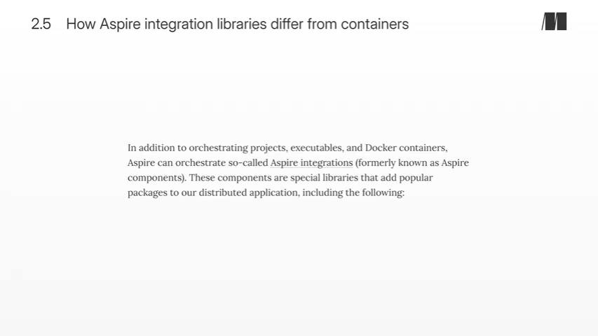
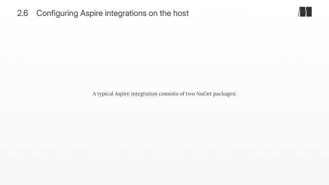
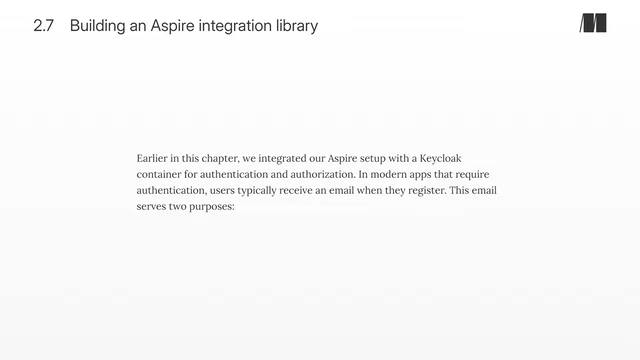
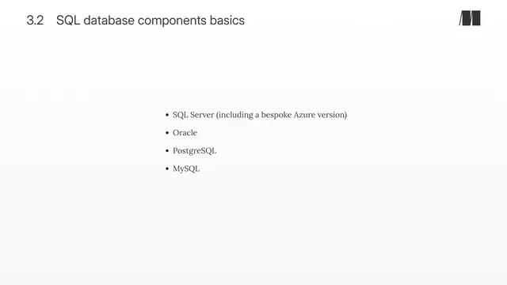
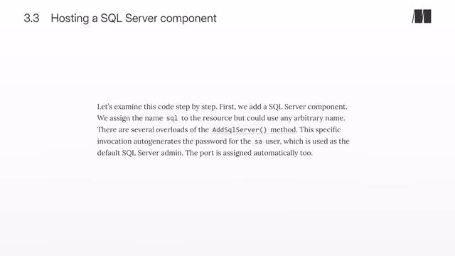
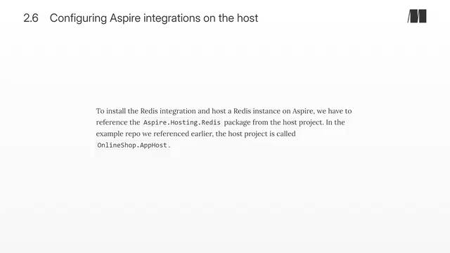
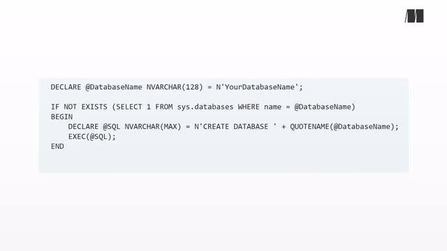
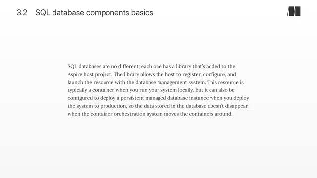
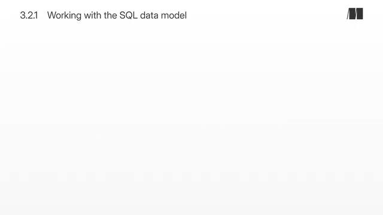

# Building Distributed Applications That Work：P16–P22 复现文档

> 范围：P16–P22。主线是 .NET Aspire 的集成库：先用 Redis 集成做输出缓存，再自定义 MailDev 集成，最后接入 SQL Server，并用 ADO.NET 与 Entity Framework 两种方式读取产品数据。  
> 重要说明：这份逐字稿里大量出现 “See this code”，但 Listing 2.6–3.7 的正文没有出现在转写中。下面的代码是按逐字稿明确提到的项目名、文件名、包名、方法行为重建的**最小可运行版本**；凡是逐字稿没有逐字出现的方法签名，都以你实际安装的 Aspire 包签名为准。课里没给的版本号、端口、镜像 tag，我会在第 7 节单独标出。

---

## 1. 这一节做什么

这一段课程要解决一个很具体的问题：怎样把“共享基础设施”接进一个 Aspire 分布式应用，并且让前端、API、数据库、缓存、邮件测试服务都能在同一个 dashboard 里启动、互相发现、互相传连接信息。

P16 先区分 Aspire 集成库和裸 Docker 容器：集成库本质上还是帮你托管数据库、消息代理、缓存等组件，但它用扩展方法把 Docker 启动、端口、连接字符串、服务发现包装起来。P17 用 Redis 输出缓存演示标准集成库的两包模型：AppHost 里的 host 包，消费项目里的 client 包。P18 进一步自己写一个 MailDev 自定义集成，理解 `ContainerResource`、`IResourceWithConnectionString`、`AddResource`、镜像 tag 常量这些底层结构。P19 是上一章的总结。P20–P22 进入数据库：先讲如何连接已有的数据库实例，再讲 SQL Server 集成、数据模型与 DTO、Blazor 产品页、ADO.NET 原始 SQL、Entity Framework，以及 Azure SQL Server 的差异。



最终可运行的形态是：

```text
OnlineShop/
  OnlineShop.sln
  OnlineShop.AppHost/                 # Aspire 编排入口
  OnlineShop.Web/                     # Blazor 前端，使用 Redis 输出缓存
  OnlineShop.Api/                     # 产品 API，使用 SQL Server
  OnlineShop.ServiceDefaults/         # 公共 DTO、服务默认配置
  OnlineShop.MailDev.Hosting/         # 自定义 MailDev 集成库
```

---

## 2. 讲师原话

> "The integrations are based mostly on Docker containers, but the libraries that enable them have a range of extension methods that make it much easier to host these components in Aspire than work with Docker containers directly."
> —— p016 [00:27]
> **译**：这些集成大多基于 Docker 容器，但启用它们的库提供了一系列扩展方法，使得在 Aspire 中托管这些组件比直接使用 Docker 容器容易得多。

> "A typical Aspire integration consists of two new get packages. A package that allows you to host an instance of the service on Aspire. A client package that allows other apps hosted by Aspire to access the service."
> —— p017 [00:00]
> **译**：一个典型的 Aspire 集成由两个 NuGet 包组成。一个包允许你在 Aspire 上托管服务实例。一个客户端包允许 Aspire 托管的其他应用访问该服务。



> "One of the best tools for this job is the MailDev Docker image, available at this link. Let's wrap this image in a custom Aspire component."
> —— p018 [00:52]
> **译**：最适合这项工作的工具之一是 MailDev Docker 镜像，链接在这里。让我们把这个镜像包装成一个自定义 Aspire 组件。

> "It's good practice to specify the exact version of the image so that a one-to-one relationship exists between your integration component and the Docker image version on which it relies."
> —— p018 [03:13]
> **译**：指定镜像的精确版本是好做法，这样你的集成组件与它所依赖的 Docker 镜像版本之间就存在一对一关系。



> "Add the following code to the distributed application builder in the apphost.cs file in the Aspire Host project. See this code. In this example, Database is an arbitrary resource name."
> —— p020 [01:50]
> **译**：把下面的代码添加到 Aspire Host 项目的 apphost.cs 文件中的分布式应用构建器里。见这段代码。在这个示例中，Database 是一个任意的资源名称。

> "Regardless of what RDBMS we choose and what library we choose to interact with it, We have to prepare
> "Regardless of what RDBMS we choose and what library we choose to interact with it, We have to prepare two types of objects. Data models representing database entities. Data transfer objects transfer this data across application boundaries."
> —— p021 [02:17]
> **译**：无论我们选择哪种关系型数据库管理系统、选择哪个库与它交互，我们都必须准备两类对象。代表数据库实体的数据模型。在应用边界之间传递这些数据的数据传输对象。

> "Therefore, it's a common best practice to keep the same library reference that contains the common DTO definitions for both the client and the server."
> —— p021 [05:37]
> **译**：因此，一个常见的最佳实践是让客户端和服务器都引用同一个包含公共 DTO 定义的库。



> "By default, the SQL Server instance is registered as a Docker container. If we don't make the container lifetime persistent, a new container instance will be launched every time we run the orchestrated application."
> —— p022 [01:52]
> **译**：默认情况下，SQL Server 实例会被注册为 Docker 容器。如果我们不把容器生命周期设为持久化，那么每次运行被编排的应用时都会启动一个新的容器实例。

> "This method adds an instance of the SQL connection class to dependency injection, DI, with the appropriate connection string configured."
> —— p022 [05:57]
> **译**：这个方法会把一个 SQL 连接类的实例加入依赖注入（DI），并配置好相应的连接字符串。



> "The toArray method causes the underlying SQL query to execute, as does its asynchronous version, toArrayAsync."
> —— p022 [10:59]
> **译**：toArray 方法会触发底层 SQL 查询执行，它的异步版本 toArrayAsync 也一样。

---

## 3. 从零复现

这一节按“先编排、再消费、最后换数据库实现”的顺序走。每一步都给出可执行的命令和要改的文件，命令全部在解决方案根目录执行。

### 3.0 前置环境

需要三样东西，缺一样都跑不起来：

1. **.NET SDK**：能编译 Aspire 8.x 工程的版本（课里提到“In version 8, it merely added a reference…”，说明讲师使用的基线是 Aspire 8 及其之后的版本）。用 `dotnet --version` 确认。
2. **Docker Desktop 或同类容器运行时**：Redis、MailDev、SQL Server 三个组件在本地都是以容器方式启动的（p017 [02:19] 讲师明确说 dashboard 里 Redis “is shown as a container… the path starts with docker.io”）。
3. **Aspire 工作负载/模板**（可选，但有模板能省掉大量样板）：`dotnet workload install aspire`。

验证容器运行时：

```bash
docker version
```

能打印出 Client 与 Server 两段信息即可。若只有 Client 段，说明 Docker 引擎没起来，后面所有 `AddRedis`、`AddSqlServer`、`AddMailDev` 都会在 dashboard 里停在 Starting。

### 3.1 建解决方案骨架

课里给出的项目名是 `OnlineShop.AppHost`、`OnlineShop.Web`、`OnlineShop.Api`、`OnlineShop.ServiceDefaults`，以及后面自己加的 `OnlineShop.MailDev.Hosting`。逐字稿在 p018 [01:18] 说创建类库的方法是“navigate to the Solution folder and execute the following command”，在 p018 [01:46] 说加包也是用 CLI，所以下面统一用 CLI。

```bash
dotnet new aspire-sln -n OnlineShop
cd OnlineShop
dotnet new aspire-apphost -n OnlineShop.AppHost
dotnet new aspire-servicedefaults -n OnlineShop.ServiceDefaults
dotnet new blazor -n OnlineShop.Web
dotnet new webapi -n OnlineShop.Api

dotnet sln add OnlineShop.AppHost/OnlineShop.AppHost.csproj
dotnet sln add OnlineShop.ServiceDefaults/OnlineShop.ServiceDefaults.csproj
dotnet sln add OnlineShop.Web/OnlineShop.Web.csproj
dotnet sln add OnlineShop.Api/OnlineShop.Api.csproj

dotnet add OnlineShop.AppHost/OnlineShop.AppHost.csproj reference OnlineShop.Web/OnlineShop.Web.csproj
dotnet add OnlineShop.AppHost/OnlineShop.AppHost.csproj reference OnlineShop.Api/OnlineShop.Api.csproj
dotnet add OnlineShop.Web/OnlineShop.Web.csproj reference OnlineShop.ServiceDefaults/OnlineShop.ServiceDefaults.csproj
dotnet add OnlineShop.Api/OnlineShop.Api.csproj reference OnlineShop.ServiceDefaults/OnlineShop.ServiceDefaults.csproj
```

如果 `aspire-sln` 模板在你的 SDK 里不存在，退化成 `dotnet new sln -n OnlineShop`，其余命令不变——模板只影响默认文件内容，不影响后面的手写代码。

### 3.2 接入 Redis 输出缓存（P16–P17）

这一步要动三个地方，对应讲师说的“host 包 + client 包”模型。

**第一步，AppHost 加 host 包**：

```bash
dotnet add OnlineShop.AppHost/OnlineShop.AppHost.csproj package Aspire.Hosting.Redis
```

**第二步，Web 项目加 client 包**：

```bash
dotnet add OnlineShop.Web/OnlineShop.Web.csproj package Aspire.StackExchange.Redis.OutputCaching
```

**第三步，改两个 Program.cs**：AppHost 里注册缓存资源并把引用传给前端；Web 里声明“我要用名为 cache 的输出缓存”。

课里 p017 [01:53] 特别提醒：客户端引用的名字，必须是 host 里注册组件时用的名字，地址由服务发现解析。所以下面两处字符串必须一模一样：AppHost 用 `"cache"`，Web 也用 `"cache"`。



改完后先别急着写业务代码，直接跑一次：

```bash
dotnet run --project OnlineShop.AppHost
```

dashboard 打开后应该能看到 `cache` 这一项，点进去的 Source 页签路径以 `docker.io` 开头——这正是 p017 [02:48] 描述的现象。

### 3.3 自建 MailDev 集成（P18）

这一步是本段课程信息密度最高的部分，因为它把“集成库内部长什么样”拆开给你看。讲师给的顺序是：建类库 → 加 `Aspire.Hosting` 包 → 写资源类 → 写 tag 常量类 → 写扩展方法 → 在 AppHost 里手动加项目引用（并设 `IsAspireProjectResource="false"`）→ 调 `AddMailDev()`。

```bash
dotnet new classlib -n OnlineShop.MailDev.Hosting
dotnet sln add OnlineShop.MailDev.Hosting/OnlineShop.MailDev.Hosting.csproj
dotnet add OnlineShop.MailDev.Hosting/OnlineShop.MailDev.Hosting.csproj package Aspire.Hosting
```

删掉模板生成的 `Class1.cs`：

```bash
rm OnlineShop.MailDev.Hosting/Class1.cs
```

然后写三个文件（完整内容见第 4 节）。写完回到 AppHost，**不要**用 `dotnet add reference`，而是手改 csproj，加上 `IsAspireProjectResource="false"`。原因逐字稿 p018 [04:39] 说得很清楚：在 aspire-host 上下文里，任何 ProjectReference 默认都会被当成“由 Aspire 托管的服务”并生成元数据，而我们这里要的是一个普通类库。

### 3.4 连接一个已经存在的数据库（P20）

在写任何 `AddSqlServer` 之前，先把“外部数据库”这条路走通，因为它的写法对 SQL Server、Oracle、MongoDB 都一样。做法是：AppHost 里 `AddConnectionString("Database")`，`appsettings.json` 里配 `ConnectionStrings:Database`，然后把返回的引用 `WithReference` 给需要的服务。

这里的 `Database` 是任意资源名（讲师原话：“Database is an arbitrary resource name”），但它**必须**和配置文件里 `ConnectionStrings` 段的键同名。

### 3.5 托管 SQL Server 容器（P22）

换掉 3.4 里的外部连接串，改用集成库在本地起容器：

```bash
dotnet add OnlineShop.AppHost/OnlineShop.AppHost.csproj package Aspire.Hosting.SqlServer
```

AppHost 里的写法是四件事：`AddSqlServer("sql")` 建资源、`.AddDatabase("sqldb")` 建库、`.WithLifetime(ContainerLifetime.Persistent)` 让容器复用、`.WithReference(...)` + `.WaitFor(...)` 把连接信息交给 API 并等数据库就绪。

注意 p022 [00:57] 的版本提醒：Aspire 8 早期版本里 `AddDatabase` 只是加一个引用和一个连接字符串，真正的库要自己建；新版本会真正执行建库命令。逐字稿说“In the SQL server implementation, this command would be… See this code”，具体 SQL 没在转写里出现，所以我不在这里编造它——你只要知道它会执行对应提供程序的建库语句即可。



### 3.6 数据模型与 DTO（P21）

两个文件，两个项目，一个原则：**实体只留在 API 里，DTO 放到双方都引用的公共库里**。

- `OnlineShop.Api/Models/Product.cs`：带 `[Key]`、`[MaxLength]` 的实体。
- `OnlineShop.ServiceDefaults/Products/ProductDto.cs`：只有 Name、Description、Price 三个字段。

讲师解释了为什么不能直接拿实体当返回值：实体里有对其他服务无用的字段（比如数据库自增主键），会白占带宽；而且实体和“用户想看的”之间往往还有一层转换。用户只关心名称、描述、价格，所以 DTO 就只有这三个字段。



### 3.7 产品 UI（P21）

四步：把 `WeatherApiClient.cs` 改名为 `ProductsApiClient.cs` 并改内容；在 `Program.cs` 里把 `AddHttpClient` 的泛型参数换成新类型；用产品列表替换 `Home.razor` 的内容；删掉 `Counter.razor`、`Weather.razor`，并清理 `NavMenu.razor` 里指向 `/counter`、`/weather` 的链接。



讲师强调这一步是“database agnostic”的：UI 不知道后面是 SQL Server、PostgreSQL 还是 MySQL。所以这一段代码在 3.8 和 3.9 两条路线里**完全不用改**。

### 3.8 API 消费 SQL Server：ADO.NET 路线（P22）

```bash
dotnet add OnlineShop.Api/OnlineShop.Api.csproj package Aspire.Microsoft.Data.SqlClient
```

Program.cs 里 `AddSqlServerClient("sqldb")` 注册 `SqlConnection`，然后启动时解析出来：打开连接 → 建 `Shop` 库 → `USE Shop` → 建 Products 表 → 表空则插数据。最后 GET 端点里直接查表返回 `ProductDto` 列表。

讲师在 p022 [08:12] 明确说这个例子是为了演示方便，“In a real-life application, database interaction would be abstracted away by the service layer”，所以生产代码里不要把 SQL 写在 endpoint 里。

### 3.9 API 消费 SQL Server：Entity Framework 路线（P22）

```bash
dotnet add OnlineShop.Api/OnlineShop.Api.csproj package Aspire.Microsoft.EntityFrameworkCore.SqlServer
```

换成 `AddSqlServerDbContext<ProductsDbContext>("sqldb")`，加一个 `ProductsDbContext`，启动时 `Database.EnsureCreated()` + 空表插数据，GET 端点里用 `ToArrayAsync()`。**host 侧一行都不用改**，因为容器还是同一个 SQL Server。

### 3.10 Azure SQL Server（P22）

如果目标是 Azure：AppHost 加 `Aspire.Hosting.Azure.Sql`，用 `AddAzureSqlServer("sql")` 代替 `AddSqlServer("sql")`，后面 `AddDatabase("sqldb")` 保持不变。讲师提醒：这个方法本地不会起 Docker 容器，默认配置下本地甚至跑不起来；它的价值在于部署到 Azure 时自动在同一资源组里创建托管实例。客户端两个库照旧可用，另外 `AddConnectionString` 注册的库也能被同样的客户端库消费，前提是连接串指向 SQL Server、名字对得上、引用传到了服务里。

---

## 4. 完整代码

以下文件按目录顺序给出，可以直接落盘。

### 4.1 `OnlineShop.AppHost/OnlineShop.AppHost.csproj`

```xml
<Project Sdk="Microsoft.NET.Sdk">

  <PropertyGroup>
    <OutputType>Exe</OutputType>
    <TargetFramework>net8.0</TargetFramework>
    <ImplicitUsings>enable</ImplicitUsings>
    <Nullable>enable</Nullable>
    <IsAspireHost>true</IsAspireHost>
    <UserSecretsId>online-shop-apphost</UserSecretsId>
  </PropertyGroup>

  <ItemGroup>
    <PackageReference Include="Aspire.Hosting.AppHost" Version="8.*" />
    <PackageReference Include="Aspire.Hosting.Redis" Version="8.*" />
    <PackageReference Include="Aspire.Hosting.SqlServer" Version="8.*" />
  </ItemGroup>

  <ItemGroup>
    <ProjectReference Include="..\OnlineShop.Api\OnlineShop.Api.csproj" />
    <ProjectReference Include="..\OnlineShop.Web\OnlineShop.Web.csproj" />
    <!-- 关键：IsAspireProjectResource=false，把类库当普通类库，而不是被托管的服务 -->
    <ProjectReference Include="..\OnlineShop.MailDev.Hosting\OnlineShop.MailDev.Hosting.csproj"
                      IsAspireProjectResource="false" />
  </ItemGroup>

</Project>
```

### 4.2 `OnlineShop.AppHost/Program.cs`

```csharp
using OnlineShop.MailDev.Hosting;

var builder = DistributedApplication.CreateBuilder(args);

// ---------- P17：Redis 输出缓存 ----------
var cache = builder.AddRedis("cache");

// ---------- P18：自定义 MailDev 集成 ----------
var mailDev = builder.AddMailDev("maildev");

// ---------- P22：SQL Server 容器 ----------
var sql = builder.AddSqlServer("sql")
                 .WithLifetime(ContainerLifetime.Persistent);

var sqldb = sql.AddDatabase("sqldb");

// ---------- 编排两个应用 ----------
var api = builder.AddProject<Projects.OnlineShop_Api>("api")
                 .WithReference(sqldb)
                 .WithReference(mailDev)
                 .WaitFor(sqldb);

builder.AddProject<Projects.OnlineShop_Web>("webfrontend")
       .WithReference(api)
       .WithReference(cache)
       .WaitFor(api);

builder.Build().Run();
```

### 4.3 `OnlineShop.AppHost/appsettings.json`（外部数据库路线，P20）

```json
{
  "ConnectionStrings": {
    "Database": "Server=my-managed-sql.example.com,1433;Database=OnlineShop;User Id=app;Password=CHANGE_ME;TrustServerCertificate=True"
  }
}
```

如果走 3.4 的外部库路线，把 4.2 里那段 SQL Server 代码换成：

```csharp
var database = builder.AddConnectionString("Database");

var api = builder.AddProject<Projects.OnlineShop_Api>("api")
                 .WithReference(database);
```

### 4.4 `OnlineShop.MailDev.Hosting/MailDevResource.cs`

```csharp
using Aspire.Hosting.ApplicationModel;

namespace OnlineShop.MailDev.Hosting;

/// <summary>
/// 代表一个 MailDev 容器资源。它同时实现 IResourceWithConnectionString，
/// 这样客户端可以通过连接字符串找到 SMTP 端点。
/// </summary>
public class MailDevResource : ContainerResource, IResourceWithConnectionString
{
    internal const string SmtpEndpointName = "smtp";
    internal const string HttpEndpointName = "http";

    public MailDevResource(string name) : base(name)
    {
    }

    private EndpointReference SmtpEndpoint => new(this, SmtpEndpointName);

    public ReferenceExpression ConnectionStringExpression =>
        ReferenceExpression.Create(
            $"smtp://{SmtpEndpoint.Property(EndpointProperty.Host)}:{SmtpEndpoint.Property(EndpointProperty.Port)}");
}
```

### 4.5 `OnlineShop.MailDev.Hosting/MailDevContainerImageTags.cs`

```csharp
namespace OnlineShop.MailDev.Hosting;

internal static class MailDevContainerImageTags
{
    internal const string Registry = "docker.io";
    internal const string Image = "maildev/maildev";
    // 课里强调必须写精确版本，不要写 latest。
    // 具体 tag 请以 MailDev 官方镜像页面当时可用的版本为准。
    internal const string Tag = "2.1.0";
}
```

### 4.6 `OnlineShop.MailDev.Hosting/MailDevResourceBuilderExtensions.cs`

```csharp
using Aspire.Hosting.ApplicationModel;

namespace OnlineShop.MailDev.Hosting;

public static class MailDevResourceBuilderExtensions
{
    /// <summary>
    /// 把 MailDev 容器加入 Aspire 编排。Docker 启动细节全部封装在这里。
    /// </summary>
    public static IResourceBuilder<MailDevResource> AddMailDev(
        this IDistributedApplicationBuilder builder,
        string name,
        int? httpPort = null,
        int? smtpPort = null)
    {
        var resource = new MailDevResource(name);

        return builder.AddResource(resource)
            .WithImage(MailDevContainerImageTags.Image, MailDevContainerImageTags.Tag)
            .WithImageRegistry(MailDevContainerImageTags.Registry)
            .WithHttpEndpoint(targetPort: 1080, port: httpPort, name: MailDevResource.HttpEndpointName)
            .WithEndpoint(targetPort: 1025, port: smtpPort, name: MailDevResource.SmtpEndpointName);
    }
}
```

> 端口 1080 / 1025 是 MailDev 镜像自身的默认端口，**逐字稿没有提到这两个数字**，请以你所用镜像的文档为准。

### 4.7 `OnlineShop.Web/Program.cs`

```csharp
using OnlineShop.Web;
using OnlineShop.Web.Components;

var builder = WebApplication.CreateBuilder(args);

builder.AddServiceDefaults();

// P17：启用 Redis 输出缓存，名字必须与 AppHost 里 AddRedis("cache") 一致
builder.AddRedisOutputCache("cache");

builder.Services.AddRazorComponents()
    .AddInteractiveServerComponents();

builder.Services.AddHttpClient<ProductsApiClient>(client =>
{
    // 服务发现会解析 "api" 这个逻辑名
    client.BaseAddress = new Uri("http://api");
});

var app = builder.Build();

app.MapDefaultEndpoints();

if (!app.Environment.IsDevelopment())
{
    app.UseExceptionHandler("/Error", createScopeForErrors: true);
    app.UseHsts();
}

app.UseHttpsRedirection();
app.UseStaticFiles();
app.UseAntiforgery();

app.UseOutputCache();

app.MapRazorComponents<App>()
    .AddInteractiveServerRenderMode();

app.Run();
```

### 4.8 `OnlineShop.Web/ProductsApiClient.cs`

```csharp
using System.Net.Http.Json;
using OnlineShop.ServiceDefaults.Products;

namespace OnlineShop.Web;

public class ProductsApiClient
{
    private readonly HttpClient _http;

    public ProductsApiClient(HttpClient http)
    {
        _http = http;
    }

    public async Task<ProductDto[]> GetProductsAsync(CancellationToken ct = default)
    {
        var products = await _http.GetFromJsonAsync<ProductDto[]>("/products", ct);
        return products ?? Array.Empty<ProductDto>();
    }
}
```

### 4.9 `OnlineShop.Web/Components/Pages/Home.razor`

```razor
@page "/"
@inject ProductsApiClient ProductsClient

<PageTitle>Online Shop</PageTitle>

<h1>Products</h1>

@if (_products is null)
{
    <p><em>Loading...</em></p>
}
else if (_products.Length == 0)
{
    <p>No products found.</p>
}
else
{
    <table class="table">
        <thead>
            <tr>
                <th>Name</th>
                <th>Description</th>
                <th>Price</th>
            </tr>
        </thead>
        <tbody>
        @foreach (var product in _products)
        {
            <tr>
                <td>@product.Name</td>
                <td>@product.Description</td>
                <td>@product.Price.ToString("C")</td>
            </tr>
        }
        </tbody>
    </table>
}

@code {
    private ProductDto[]? _products;

    protected override async Task OnInitializedAsync()
    {
        _products = await ProductsClient.GetProductsAsync();
    }
}
```

### 4.10 `OnlineShop.Web/Components/Layout/NavMenu.razor`

```razor
<div class="top-row ps-3 navbar navbar-dark">
    <div class="container-fluid">
        <a class="navbar-brand" href="">OnlineShop.Web</a>
    </div>
</div>

<input type="checkbox" title="Navigation menu" class="navbar-toggler" />

<div class="nav-scrollable">
    <nav class="flex-column">
        <div class="nav-item px-3">
            <NavLink class="nav-link" href="" Match="NavLinkMatch.All">
                <span class="bi bi-house-door-fill-nav-menu" aria-hidden="true"></span> Home
            </NavLink>
        </div>
    </nav>
</div>
```

### 4.11 `OnlineShop.ServiceDefaults/Products/ProductDto.cs`

```csharp
namespace OnlineShop.ServiceDefaults.Products;

public class ProductDto
{
    public string Name { get; set; } = string.Empty;
    public string Description { get; set; } = string.Empty;
    public decimal Price { get; set; }
}
```

### 4.12 `OnlineShop.Api/Models/Product.cs`

```csharp
using System.ComponentModel.DataAnnotations;

namespace OnlineShop.Api.Models;

public class Product
{
    [Key]
    public int Id { get; set; }

    [MaxLength(100)]
    public string Name { get; set; } = string.Empty;

    [MaxLength(500)]
    public string Description { get; set; } = string.Empty;

    public decimal Price { get; set; }
}
```

### 4.13 `OnlineShop.Api/Program.cs`（ADO.NET 版）

```csharp
using Microsoft.Data.SqlClient;
using OnlineShop.Api.Models;
using OnlineShop.ServiceDefaults.Products;

var builder = WebApplication.CreateBuilder(args);

builder.AddServiceDefaults();

// P22：注册 SqlConnection，连接串由 host 按 "sqldb" 这个名字提供
builder.AddSqlServerClient("sqldb");

var app = builder.Build();

app.MapDefaultEndpoints();

// ---------- 初始化：建库、建表、补种子数据 ----------
using (var scope = app.Services.CreateScope())
{
    var connection = scope.ServiceProvider.GetRequiredService<SqlConnection>();
    connection.Open();

    // 演示用：客户端也可以自己建库（DDD 里每个服务一个库的常见场景）
    using (var createDb = connection.CreateCommand())
    {
        createDb.CommandText =
            "IF DB_ID('Shop') IS NULL CREATE DATABASE Shop;";
        createDb.ExecuteNonQuery();
    }

    using (var createTable = connection.CreateCommand())
    {
        createTable.CommandText = @"
            USE Shop;
            IF OBJECT_ID('dbo.Products', 'U') IS NULL
            BEGIN
                CREATE TABLE dbo.Products (
                    Id INT IDENTITY(1,1) PRIMARY KEY,
                    Name NVARCHAR(100) NOT NULL,
                    Description NVARCHAR(500) NOT NULL,
                    Price DECIMAL(18,2) NOT NULL
                );
            END";
        createTable.ExecuteNonQuery();
    }

    using (var seed = connection.CreateCommand())
    {
        seed.CommandText = @"
            USE Shop;
            IF NOT EXISTS (SELECT 1 FROM dbo.Products)
            BEGIN
                INSERT INTO dbo.Products (Name, Description, Price) VALUES
                    (N'Mechanical Keyboard', N'87-key, hot-swappable', 89.00),
                    (N'Ergonomic Mouse', N'Vertical grip, wireless', 49.50),
                    (N'27-inch Monitor', N'4K IPS, USB-C', 329.00);
            END";
        seed.ExecuteNonQuery();
    }
}

// ---------- GET：把数据以 DTO 返回 ----------
app.MapGet("/products", async (SqlConnection connection) =>
{
    var results = new List<ProductDto>();

    using var command = connection.CreateCommand();
    command.CommandText =
        "USE Shop; SELECT Name, Description, Price FROM dbo.Products ORDER BY Id;";

    using var reader = await command.ExecuteReaderAsync();
    while (await reader.ReadAsync())
    {
        results.Add(new ProductDto
        {
            Name = reader.GetString(0),
            Description = reader.GetString(1),
            Price = reader.GetDecimal(2)
        });
    }

    return results;
});

app.Run();
```

### 4.14 `OnlineShop.Api/ProductsDbContext.cs`

```csharp
using Microsoft.EntityFrameworkCore;
using OnlineShop.Api.Models;

namespace OnlineShop.Api;

public class ProductsDbContext : DbContext
{
    public ProductsDbContext(DbContextOptions<ProductsDbContext> options)
        : base(options)
    {
    }

    public DbSet<Product> Products => Set<Product>();
}
```

### 4.15 `OnlineShop.Api/Program.cs`（Entity Framework 版）

```csharp
using Microsoft.EntityFrameworkCore;
using OnlineShop.Api;
using OnlineShop.Api.Models;
using OnlineShop.ServiceDefaults.Products;

var builder = WebApplication.CreateBuilder(args);

builder.AddServiceDefaults();

// P22：注册 DbContext，连接串同样来自 host 的 "sqldb"
builder.AddSqlServerDbContext<ProductsDbContext>("sqldb");

var app = builder.Build();

app.MapDefaultEndpoints();

using (var scope = app.Services.CreateScope())
{
    var db = scope.ServiceProvider.GetRequiredService<ProductsDbContext>();

    // 库不存在就按默认配置创建；生产里通常改用迁移
    db.Database.EnsureCreated();

    if (!db.Products.Any())
    {
        db.Products.AddRange(
            new Product { Name = "Mechanical Keyboard", Description = "87-key, hot-swappable", Price = 89.00m },
            new Product { Name = "Ergonomic Mouse", Description = "Vertical grip, wireless", Price = 49.50m },
            new Product { Name = "27-inch Monitor", Description = "4K IPS, USB-C", Price = 329.00m });

        db.SaveChanges();
    }
}

app.MapGet("/products", async (ProductsDbContext db) =>
{
    // ToArrayAsync 才会真正触发 SQL 执行
    var products = await db.Products
        .Select(p => new ProductDto
        {
            Name = p.Name,
            Description = p.Description,
            Price = p.Price
        })
        .ToArrayAsync();

    return products;
});

app.Run();
```

### 4.16 Azure SQL 变体（只改 AppHost）

```csharp
var sql = builder.AddAzureSqlServer("sql");
var sqldb = sql.AddDatabase("sqldb");   // 与 4.2 完全相同
```

对应包：

```bash
dotnet add OnlineShop.AppHost/OnlineShop.AppHost.csproj package Aspire.Hosting.Azure.Sql
```

---

## 5. 逐行解释

**4.2 里的 `builder.AddRedis("cache")`。** 这一行做了三件事：注册一个名为 `cache` 的资源、给它配上 Redis 镜像、把它标记为“可被其他资源引用”。名字 `cache` 不是随便取的装饰，它是服务发现的键——4.7 里 `AddRedisOutputCache("cache")` 必须与之字面一致，否则客户端会去解析一个不存在的资源名。在 Node/NestJS 里，这相当于在容器编排里给服务起个 DNS 名，然后客户端用这个名连。

**4.2 的 `.WithLifetime(ContainerLifetime.Persistent)`。** 这是 p022 [01:52] 讲的重点。默认生命周期下，每次 `dotnet run` 都会起一个新容器、销毁旧容器，旧容器里的数据一起没了。加上这行后旧容器被复用。它的副作用是：你改了建表逻辑想重新来一遍时，得先 `docker rm` 那个容器。这也是为什么后面 4.13 的建表语句用了 `IF OBJECT_ID(...) IS NULL` 这种幂等写法。

**4.2 的 `.WaitFor(sqldb)`。** 没有它，API 可能在 SQL Server 还在初始化时就去连库，第一次启动大概率报连接失败。`WaitFor` 让 API 的启动被数据库的就绪状态挡住。注意它和 `WithReference` 是两件事：前者管启动顺序，后者管连接信息注入。

**4.4 的 `ContainerResource` + `IResourceWithConnectionString`。** 第一个基类让这个资源能被当成 Docker 容器托管（p018 [02:15]：“Because this class extends container resource, it can be used as a base for a Docker container”）。第二个接口让别的服务能通过连接字符串找到它——邮件客户端需要的是一个 SMTP 地址，而不是一堆零散的 host/port 字段。

**4.4 的 `ConnectionStringExpression`。** 用 `ReferenceExpression.Create` 拼出 `smtp://host:port`，其中 host 和 port 是**运行时**从端点上解析的，不是编译期写死的。所以你在 dashboard 里改端口映射，连接串会自动跟着变。

**4.6 的 `WithImageRegistry("docker.io")`。** 对应 p017 [02:48] 说的“Source 页签路径以 docker.io 开头”。镜像来源信息是集成库的一部分，写清楚了排查问题时不用猜镜像是从哪儿拉的。

**4.6 的 `WithHttpEndpoint(targetPort: 1080, ...)` 与 `WithEndpoint(targetPort: 1025, ...)`。** 前者给浏览器访问的收件箱 UI，后者给 SMTP 客户端。注意 `port` 参数是可空的：传 `null` 就由系统分配宿主机端口，避免和你本机已有的 1080/1025 冲突。

**4.7 的 `builder.AddServiceDefaults()`。** 这是模板生成的服务默认配置（健康检查、服务发现、OpenTelemetry 等）。没有它，`http://api` 这个逻辑地址不会被解析成真实地址。

**4.8 的 `client.BaseAddress = new Uri("http://api")`。** 这里 `api` 是 AppHost 里 `AddProject<...>("api")` 给的名字。前端不需要知道 API 跑在哪个端口，服务发现会补上。

**4.9 的 `OnInitializedAsync`。** Blazor 首次渲染时拉数据。因为页面输出被 Redis 缓存了，第二次请求同一个页面时可能根本不进这个方法——这正是输出缓存的意义。

**4.10 删掉 `/counter`、`/weather` 两个链接。** 讲师在 p021 [07:58] 要求同时删掉 `Counter.razor` 和 `Weather.razor` 两个文件，只删链接不删文件会留下编译得过的死代码。

**4.11 的 `ProductDto` 只有三个字段。** 对照 4.12 的实体，少了 `Id`。讲师给的三个理由：其他服务用不上的字段白占带宽、网络带宽可能有限、实体和展示内容之间常需要转换。把 DTO 放 `ServiceDefaults` 而不是各放一份，是为了避免“改了客户端那份忘了服务端那份”。

**4.12 的 `[Key]`。** 映射到数据库的自增标识列，作为主键和查询索引。`[MaxLength]` 让数据库字段按指定长度优化，同时在数据进库前就能校验——等于把一部分校验前移到了模型层。

**4.13 的 `builder.AddSqlServerClient("sqldb")`。** 注册的是 `SqlConnection` 实例，连接串由 host 提供，客户端不用自己拼。想自己指定连接串就用该方法的其他重载。

**4.13 里先用 `IF DB_ID('Shop') IS NULL CREATE DATABASE Shop;`，再 `USE Shop`。** 讲师专门提醒 `USE Shop` 是必需的，否则表会建到默认库里。这个坑很典型：连接串指向的是 `master`，不切库就建错地方。

**4.13 的 `IF NOT EXISTS (SELECT 1 FROM dbo.Products)`。** 幂等种子数据。因为容器是持久化的，重启后表里已经有数据，不加判断就会重复插入。

**4.13 的 GET 端点直接写 SQL。** 讲师明确说这是演示便利，真实项目要把数据库交互抽象到服务层。你在生产代码里照抄这段，测试会很难写。

**4.14 的 `DbSet<Product> Products => Set<Product>();`。** 用表达式体属性而不是字段，避免每次访问都重新分配。

**4.15 的 `AddSqlServerDbContext<ProductsDbContext>("sqldb")`。** 注册 DbContext，连接串来源与 4.13 相同——所以 host 侧不用为换 ORM 改任何东西。讲师原话是“The host remains the same… Only the client changes”。

**4.15 的 `EnsureCreated()`。** 库不存在就按 EF 的默认约定建出来。讲师提醒这不总是你想要的：很多场景需要精细控制建库过程（比如指定排序规则），那就得用迁移而不是这个方法。

**4.15 的 `.ToArrayAsync()`。** 关键点：LINQ 的 `Select` 只是构造表达式树，不执行；`ToArrayAsync` 才把它翻译成 SQL 发出去。初学者常犯的错是写完查询就以为已经查过了。同步版 `ToArray()` 行为一致。

**4.16 的 `AddAzureSqlServer`。** 方法名变了，但 `AddDatabase("sqldb")` 不变——讲师说这个方法对任何官方集成库提供的数据库类型都通用。它本地不起容器，所以本地开发时你需要 hybrid 配置（本地容器、生产托管），这部分课里说放在第 9 章。

---

## 6. 复现检查清单

按顺序勾，任何一项不过就别往下走。

**环境**
- [ ] `dotnet --version` 有输出
- [ ] `docker version` 同时有 Client 和 Server 段
- [ ] 解决方案根目录下有 `OnlineShop.sln`

**Redis / 输出缓存**
- [ ] `OnlineShop.AppHost.csproj` 引用了 `Aspire.Hosting.Redis`
- [ ] `OnlineShop.Web.csproj` 引用了 `Aspire.StackExchange.Redis.OutputCaching`
- [ ] AppHost 里注册名与 Web 里 `AddRedisOutputCache(...)` 的参数**完全一致**
- [ ] dashboard 里能看到 `cache`，Source 页签路径以 `docker.io` 开头

**MailDev 自定义集成**
- [ ] 类库项目名为 `OnlineShop.MailDev.Hosting`
- [ ] 该项目引用了 `Aspire.Hosting`
- [ ] 三个文件都在：`MailDevResource.cs`、`MailDevContainerImageTags.cs`、`MailDevResourceBuilderExtensions.cs`
- [ ] AppHost 的 csproj 里该 ProjectReference 带 `IsAspireProjectResource="false"`
- [ ] AppHost `Program.cs` 顶部有 `using OnlineShop.MailDev.Hosting;`
- [ ] `AddMailDev("maildev")` 在 `builder.Build()` 之前
- [ ] dashboard 里出现 `maildev`，点 URL 能打开本地收件箱

**外部数据库（可选路线）**
- [ ] AppHost 用 `AddConnectionString("Database")`
- [ ] `appsettings.json` 里存在 `ConnectionStrings:Database`
- [ ] 该引用通过 `WithReference` 传给了目标服务

**SQL Server（容器路线）**
- [ ] AppHost 引用了 `Aspire.Hosting.SqlServer`
- [ ] `AddSqlServer("sql")` 后跟了 `.WithLifetime(ContainerLifetime.Persistent)`
- [ ] `AddDatabase("sqldb")` 的返回值被 `WithReference` 传给 API
- [ ] API 用 `.WaitFor(sqldb)` 或等效方式等待数据库
- [ ] dashboard 里同时出现 `sql` 与 `sqldb` 两项

**模型与 DTO**
- [ ] `OnlineShop.Api/Models/Product.cs` 存在，含 `[Key]` 与 `[MaxLength]`
- [ ] `OnlineShop.ServiceDefaults/Products/ProductDto.cs` 存在
- [ ] DTO 不含 `Id`
- [ ] Web 与 Api 都引用了 `ServiceDefaults`

**UI**
- [ ] `ProductsApiClient.cs` 已替换掉 `WeatherApiClient.cs`
- [ ] `Program.cs` 的 `AddHttpClient<T>` 泛型参数是新类型
- [ ] `Home.razor` 展示产品表格
- [ ] `Counter.razor`、`Weather.razor` 已删除
- [ ] `NavMenu.razor` 里没有指向 `/counter`、`/weather` 的链接

**运行验证**
- [ ] `dotnet run --project OnlineShop.AppHost` 能起来
- [ ] 浏览器打开前端首页，表格里有三行产品
- [ ] 刷新页面后仍正常（验证输出缓存没把页面搞坏）
- [ ] 停止再启动一次，数据仍在（验证容器持久化生效）

---

## 7. 课里没讲但你会撞上的

**Aspire 包的具体版本号。** 逐字稿只提到“In version 8, it merely added a reference…”，没有给出任何精确版本。上面 csproj 里用 `8.*` 占位。如果你用 `dotnet add package` 而不是手写，会拿到当前最新版；这时 `AddDatabase` 的自动建库行为、`ReferenceExpression` 的签名都可能与本文不一致，以实际包为准。

**MailDev 的镜像 tag。** 课里只说“要写精确版本，不要写 latest”，没给具体号。4.5 里的 `2.1.0` 是示意，请到 MailDev 镜像页面挑一个当时可用的版本替换。

**MailDev 的端口号。** 课里完全没提 1080 / 1025 这两个数字。这两个是镜像默认值，务必按你所用 tag 的文档核对。

**Aspire 8 早期与新版的 `AddDatabase` 差异。** 讲师在 p022 [00:57] 明确点出行为变了：旧版只加引用和连接串，真正的库要单独建；新版会执行提供程序的建库语句。如果你照着旧教程写却发现库已经自动建好了，原因在这里。逐字稿里那句具体 SQL 没有出现在转写中，所以本文没有复现它。

**数据库命名规则。** 讲师说库名“can be arbitrary as long as it adheres to the database naming rules”，但规则本身课里没展开。用带空格或连字符的名字会给你后面写 `USE`、写连接串带来麻烦。

**`Product` 的 `Price` 精度。** 课里只说实体属性要选“与对应字段最接近的数据类型”，没给 `decimal` 的精度/小数位配置。EF 默认会按提供程序给一个值，货币场景下建议显式配置（`HasPrecision`），否则可能出现你没想到的舍入。

**EF 迁移 vs `EnsureCreated`。** 讲师只演示了 `EnsureCreated()` 并说“We don't always want to do this”，没讲迁移的具体用法。项目一旦进入多人协作阶段，`EnsureCreated` 会因为无法增量演进 schema 而卡住你。

**生产环境用容器跑数据库。** P16 就已经警告过“Hosting the SQL Server instance in a container would be a terrible idea unless it's done purely for development or demonstration purposes”，P22 又重复了一次。容器是无状态的，宿主出问题后容器恢复会被重置到初始状态，数据全丢。生产请用托管实例，混合方案在第 9 章。

**`WithLifetime(Persistent)` 与清理。** 容器持久化后，你想“清空数据库重来”不能靠重启应用，得手动删容器（或删数据卷）。这个操作课里没讲。

**健康检查与启动顺序。** `AddServiceDefaults()` 带来的健康检查端点、`WaitFor` 的内部重试策略，课里都没展开。第一次启动时 SQL Server 初始化较慢，你可能看到 API 短暂报错后自动恢复，这通常不是代码问题。

**Blazor 渲染模式与输出缓存。** Web 项目是 Blazor（讲师说“a blazor web application with an in-browser UI”），`UseOutputCache()` 与交互式渲染模式叠加时的具体行为课里没讲。如果页面看起来“卡在旧数据”，先怀疑缓存，而不是怀疑 API。

**给前端同学的两句对应关系。** 依赖注入（DI）在 Node/NestJS 里对应 provider 容器，`GetRequiredService<T>()` 相当于按 token resolve。`ProductsDbContext` 相当于 Prisma Client 这类 ORM 句柄，`ToArrayAsync()` 相当于 Prisma 里真正加 `await` 那一刻才发查询。至于锁和事务，这一节的代码里没有出现，课里也没讲；你后面加写操作时才知道要不要包事务。

**语法提醒（知道即可）。** C# 的 `[Key]`、`[MaxLength]` 是特性（attribute），等价于在字段上加元数据；`=> Set<Product>()` 是表达式体成员，只是语法糖。`using` 语句块在这里用于限定资源作用域（数据库连接属于 `IDisposable`），不是 JavaScript 里的模块导入。

---

## 附：本段课程的知识地图

| 主题 | 对应段落 | 交付物 |
|---|---|---|
| 集成库 vs 裸容器 | P16 | 概念区分（数据无状态性警告） |
| Redis 输出缓存 | P16–P17 | `AddRedis` + `AddRedisOutputCache` |
| 集成库的两包模型 | P17 | host 包 / client 包 分工 |
| 自定义集成库 | P18 | MailDev 三个源文件 + csproj 特殊引用 |
| 连接已有数据库 | P20 | `AddConnectionString` + `ConnectionStrings` 配置 |
| SQL 数据库组件通则 | P21 | 实体 / DTO 分层原则 |
| 产品 UI | P21 | `ProductsApiClient` + `Home.razor` |
| SQL Server 容器 | P22 | `AddSqlServer` + `AddDatabase` + 持久化 + `WaitFor` |
| ADO.NET 消费 | P22 | `AddSqlServerClient` + 原始 SQL |
| Entity Framework 消费 | P22 | `AddSqlServerDbContext` + `ToArrayAsync` |
| Azure SQL | P22 |