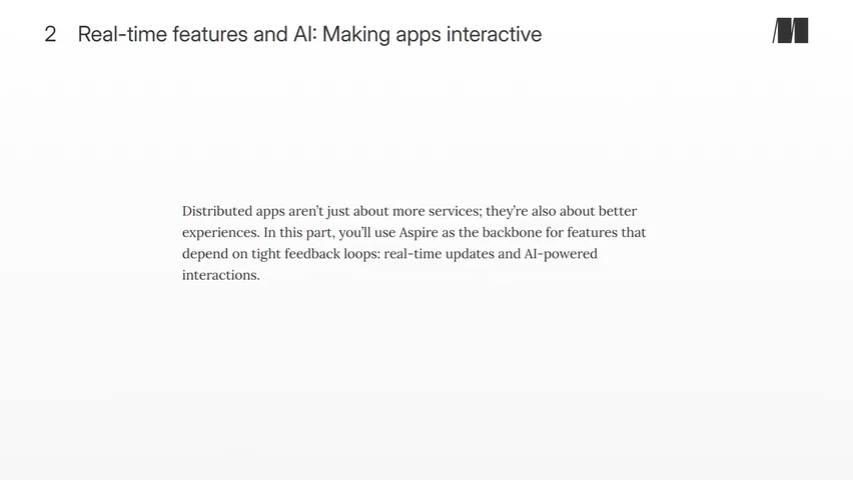
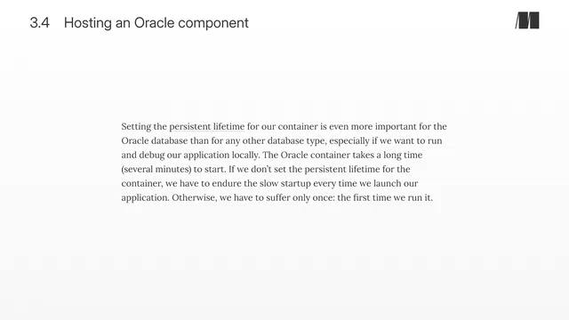
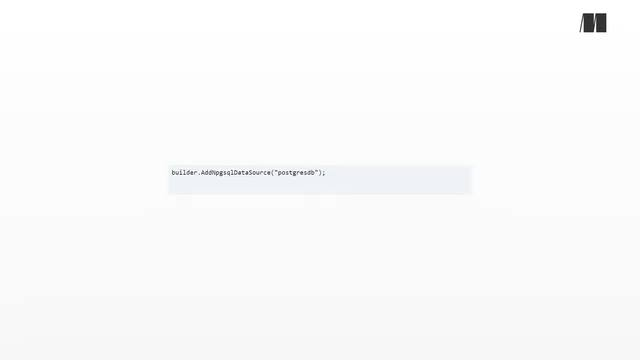
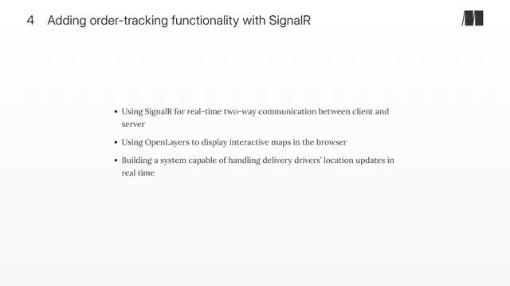
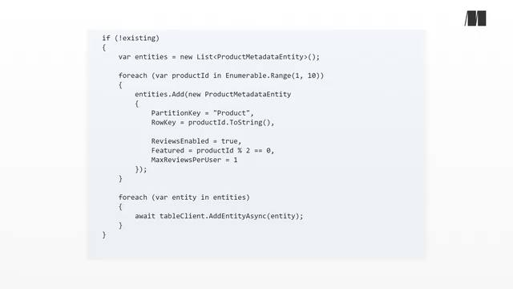
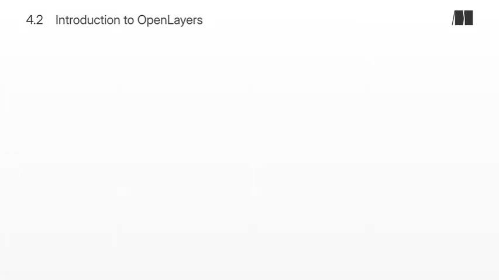
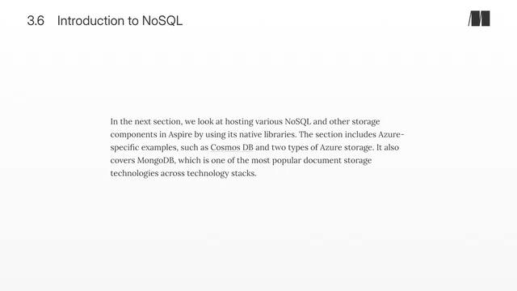
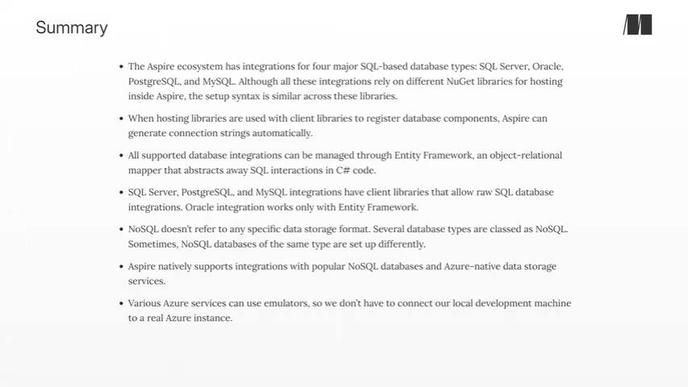
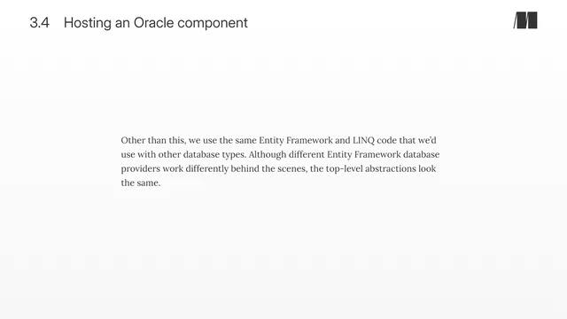

# Building Distributed Applications That Work（P23–P30）复现文档

> 说明：P23–P27 的逐字稿里讲师多次说 “See this code”，但口播没有逐字读出代码；P29–P30 也只给出 SignalR / OpenLayers 的概念和建站方向。下面第 4 节的文件是**按逐字稿点名的方法名、资源名和包名补成可保存运行的工程骨架**，不是逐字稿逐字记录。方法签名若与你安装的 Aspire 版本不同，以 NuGet 实际提示为准；我会在容易出错的地方标出来。



## 1. 这一节做什么

P23–P30 可以分成两个连续目标。

第一段是 **Aspire 里的数据组件托管**：在 AppHost 里注册 Oracle、PostgreSQL、MongoDB、Azure Cosmos DB、Azure Table Storage、Azure Blob Storage，然后让 API 服务通过 `WithReference(...)` 拿到连接信息；API 端分别用 EF Core、Npgsql、MongoDB Driver、Azure SDK 读写数据。讲师反复强调：不同数据库的包不同，但套路高度一致：**宿主项目注册资源 → 业务项目引用资源 → 客户端库自动解析连接字符串**。

第二段是 **实时订单跟踪**：用 SignalR 把服务端的位置更新推给浏览器，用 OpenLayers 在页面上画可交互地图，司机坐标变化时地图标记自动移动。讲师在 P29 明确说，这个功能类似 JustEat、UberEats、DoorDash 的订单跟踪：用户不用刷新页面，地图标记会随着司机移动而更新。

最终你会得到一个可运行的 Aspire 分布式应用骨架：

- `DistributedShop.AppHost`：编排 Oracle、PostgreSQL、MongoDB、Azure Storage 模拟器、Cosmos DB 模拟器。
- `DistributedShop.Api`：暴露 `/api/products`、`/api/reviews/{productId}`、`/api/product-metadata`、`/api/product-specs`，并提供 `/hubs/delivery` 这个 SignalR Hub。
- `wwwroot/index.html` + `wwwroot/app.js`：OpenLayers 地图 + SignalR 客户端，收到 `DriverLocationUpdated` 后移动标记。

## 2. 讲师原话

> "If we use the default implementation without additional parameters, as shown in the preceding example, it launches an Oracle database inside a Docker container. Setting the persistent lifetime for our container is even more important for the Oracle database than for any other database type, especially if we want to run and debug our application locally."
> —— p023 [00:27]
> **译**：如果我们使用不带额外参数的默认实现，如前面的示例所示，它会在 Docker 容器内启动一个 Oracle 数据库。为我们的容器设置持久生存期对 Oracle 数据库来说甚至比其他任何数据库类型都更重要，尤其是当我们想在本地运行和调试应用程序时。

> "The add database method works differently depending on the Aspire version. In the current version of Aspire, it adds the actual database. In version 8, it merely added a connection string, leaving it to the developer to set up the database."
> —— p024 [03:11]
> **译**：add database 方法的工作方式取决于 Aspire 版本。在当前版本的 Aspire 中，它会添加实际的数据库。在版本 8 中，它只是添加一个连接字符串，把数据库的设置留给开发者。

> "To host a MongoDB container in Aspire, we add the new get package Aspire.hosting.mongodb to the Aspire host project. Then, in the startup code of the host application represented by the app host.cs file, we create a MongoDB server instance and a database reference."
> —— p025 [04:34]
> **译**：要在 Aspire 中托管 MongoDB 容器，我们向 Aspire 宿主项目添加新的 GET 包 Aspire.Hosting.MongoDB。然后，在由 apphost.cs 文件表示的宿主应用程序启动代码中，我们创建一个 MongoDB 服务器实例和一个数据库引用。

> "Azure has storage accounts, services dedicated to data storage. Each storage account has several sub-services, including the following. Table Storage, a type of no SQL database that stores data in separate tables."
> —— p026 [00:26]
> **译**：Azure 有存储账户，也就是专门用于数据存储的服务。每个存储账户都有若干子服务，包括以下内容。Table Storage，一种 NoSQL 数据库，把数据存储在相互独立的表中。

> "SignalR is a real-time communication library provided by Microsoft as part of ASP.NET Core. It simplifies the process of adding real-time web functionality to applications, enabling server-side code to push content to connected clients in real-time."
> —— p029 [01:22]
> **译**：SignalR 是 Microsoft 作为 ASP.NET Core 一部分提供的实时通信库。它简化了向应用程序添加实时 Web 功能的过程，使服务器端代码能够实时向已连接的客户端推送内容。

> "The map in our user interface will use Open Layers, an open-source JavaScript library for displaying dynamic interactive maps on webpages."
> —— p030 [00:00]
> **译**：我们用户界面中的地图将使用 Open Layers，这是一个用于在网页上显示动态交互式地图的开源 JavaScript 库。

## 3. 从零复现

### 3.1 环境准备

你需要：

1. .NET SDK。课程没有口播具体版本号；P24 提到“当前版本 Aspire”和“version 8”的行为差异，所以不要混用旧模板。
2. Docker Desktop。Oracle、PostgreSQL、MongoDB、Azure Storage/Cosmos 模拟器都依赖容器。
3. 一个能打开 Aspire Dashboard 的浏览器。
4. 如果模板不存在，先安装 Aspire 模板：

```bash
dotnet new install Aspire.ProjectTemplates
```

检查环境：

```bash
dotnet --version
docker version
```

### 3.2 创建解决方案和项目

```bash
dotnet new sln -n DistributedShop
dotnet new aspire-apphost -n DistributedShop.AppHost
dotnet new webapi -n DistributedShop.Api
dotnet sln add DistributedShop.AppHost/DistributedShop.AppHost.csproj DistributedShop.Api/DistributedShop.Api.csproj
dotnet add DistributedShop.AppHost/DistributedShop.AppHost.csproj reference DistributedShop.Api/DistributedShop.Api.csproj
```

此时目录应类似：

```text
DistributedShop/
├── DistributedShop.sln
├── DistributedShop.AppHost/
│   ├── DistributedShop.AppHost.csproj
│   └── Program.cs
└── DistributedShop.Api/
    ├── DistributedShop.Api.csproj
    ├── Program.cs
    └── wwwroot/
```

### 3.3 安装包

AppHost 端：

```bash
dotnet add DistributedShop.AppHost/DistributedShop.AppHost.csproj package Aspire.Hosting.AppHost
dotnet add DistributedShop.AppHost/DistributedShop.AppHost.csproj package Aspire.Hosting.Oracle
dotnet add DistributedShop.AppHost/DistributedShop.AppHost.csproj package Aspire.Hosting.PostgreSQL
dotnet add DistributedShop.AppHost/DistributedShop.AppHost.csproj package Aspire.Hosting.MongoDB
dotnet add DistributedShop.AppHost/DistributedShop.AppHost.csproj package Aspire.Hosting.Azure.CosmosDB
dotnet add DistributedShop.AppHost/DistributedShop.AppHost.csproj package Aspire.Hosting.Azure.Storage
```

API 端：

```bash
dotnet add DistributedShop.Api/DistributedShop.Api.csproj package Aspire.Oracle.EntityFrameworkCore
dotnet add DistributedShop.Api/DistributedShop.Api.csproj package Aspire.Npgsql.EntityFrameworkCore.PostgreSQL
dotnet add DistributedShop.Api/DistributedShop.Api.csproj package Aspire.Npgsql
dotnet add DistributedShop.Api/DistributedShop.Api.csproj package Aspire.MongoDB.Driver
dotnet add DistributedShop.Api/DistributedShop.Api.csproj package Aspire.Azure.Data.Tables
dotnet add DistributedShop.Api/DistributedShop.Api.csproj package Aspire.Azure.Storage.Blobs
dotnet add DistributedShop.Api/DistributedShop.Api.csproj package Aspire.Microsoft.Azure.Cosmos
dotnet add DistributedShop.Api/DistributedShop.Api.csproj package CsvHelper
```

> 课程没有给出版本号。为了让你保存的 `csproj` 能直接 restore，第 4 节我写了示例锁定版本 `9.0.0`。如果你的 SDK 或 NuGet 源解析失败，把 `9.0.0` 改成你本机 Aspire 模板生成的版本即可；这不是讲师原话。



### 3.4 写 AppHost 编排

用第 4 节的 `DistributedShop.AppHost/Program.cs` 覆盖模板文件。关键点：

- Oracle/PostgreSQL/MongoDB 都设置 `WithLifetime(ContainerLifetime.Persistent)`。P23 解释 Oracle 容器启动要几分钟，持久化后本地调试只慢第一次。
- Azure Storage 和 Cosmos DB 用 `RunAsEmulator()`，本地不需要真实 Azure。
- 所有数据库资源通过 `.WithReference(...)` 传给 API 项目。

### 3.5 写 API 端注册、种子数据和接口

用第 4 节的文件覆盖：

- `DistributedShop.Api/Program.cs`
- `DistributedShop.Api/Data/CatalogContexts.cs`
- `DistributedShop.Api/Models/Product.cs`
- `DistributedShop.Api/Models/ProductReviewDocument.cs`
- `DistributedShop.Api/Models/ProductMetadata.cs`
- `DistributedShop.Api/Models/ProductSpec.cs`
- `DistributedShop.Api/Hubs/DeliveryHub.cs`
- `DistributedShop.Api/wwwroot/index.html`
- `DistributedShop.Api/wwwroot/app.js`

### 3.6 启动

```bash
dotnet run --project DistributedShop.AppHost
```

打开 Aspire Dashboard。第一次启动 Oracle 会非常慢；P23 说 Oracle 容器启动要“several minutes”。等待 Dashboard 里资源变成 Running 后，在 Dashboard 里找到 API 的地址，例如：

```text
http://localhost:<api-port>
```

测试接口：

```bash
curl http://localhost:<api-port>/api/products
curl http://localhost:<api-port>/api/reviews/1
curl http://localhost:<api-port>/api/product-metadata
curl http://localhost:<api-port>/api/product-specs
```

打开浏览器访问：

```text
http://localhost:<api-port>/
```

应看到 OpenLayers 地图；`app.js` 会每 2 秒通过 SignalR 发送一次模拟坐标，地图标记会移动。

## 4. 完整代码

### 4.1 `DistributedShop.AppHost/DistributedShop.AppHost.csproj`

```xml
<Project Sdk="Microsoft.NET.Sdk">
  <PropertyGroup>
    <OutputType>Exe</OutputType>
    <TargetFramework>net9.0</TargetFramework>
    <ImplicitUsings>enable</ImplicitUsings>
    <Nullable>enable</Nullable>
    <IsAspireHost>true</IsAspireHost>
  </PropertyGroup>

  <ItemGroup>
    <PackageReference Include="Aspire.Hosting.AppHost" Version="9.0.0" />
    <PackageReference Include="Aspire.Hosting.Oracle" Version="9.0.0" />
    <PackageReference Include="Aspire.Hosting.PostgreSQL" Version="9.0.0" />
    <PackageReference Include="Aspire.Hosting.MongoDB" Version="9.0.0" />
    <PackageReference Include="Aspire.Hosting.Azure.CosmosDB" Version="9.0.0" />
    <PackageReference Include="Aspire
.Hosting.AppHost" Version="9.0.0" />
    <PackageReference Include="Aspire.Hosting.Oracle" Version="9.0.0" />
    <PackageReference Include="Aspire.Hosting.PostgreSQL" Version="9.0.0" />
    <PackageReference Include="Aspire.Hosting.MongoDB" Version="9.0.0" />
    <PackageReference Include="Aspire.Hosting.Azure.CosmosDB" Version="9.0.0" />
    <PackageReference Include="Aspire.Hosting.Azure.Storage" Version="9.0.0" />
  </ItemGroup>

  <ItemGroup>
    <ProjectReference Include="..\DistributedShop.Api\DistributedShop.Api.csproj" />
  </ItemGroup>
</Project>
```

### 4.2 `DistributedShop.AppHost/Program.cs`

```csharp
using Aspire.Hosting;

var builder = DistributedApplication.CreateBuilder(args);

// Oracle：P23 明确提醒启动很慢，因此本地调试要持久化容器。
var oracle = builder.AddOracle("oracle")
    .WithLifetime(ContainerLifetime.Persistent);
var oracleDb = oracle.AddDatabase("oracledb");

// PostgreSQL：P24 的 AddPostgres + AddDatabase 结构。
var postgres = builder.AddPostgres("postgres")
    .WithLifetime(ContainerLifetime.Persistent);
var postgresDb = postgres.AddDatabase("postgresdb");

// MongoDB：P25 的 MongoDB 服务器实例 + 数据库引用。
var mongo = builder.AddMongoDB("mongo")
    .WithLifetime(ContainerLifetime.Persistent);
var mongoDb = mongo.AddDatabase("mongodb");

// Azure Storage：P26 的存储账户，下面拆成 Table 和 Blob 两个子服务。
var storage = builder.AddAzureStorage("storage")
    .RunAsEmulator();
var tables = storage.AddTables("tables");
var blobs = storage.AddBlobs("blobs");

// Cosmos DB：P25 说明它可以用 Docker 模拟器在本地运行。
var cosmos = builder.AddAzureCosmosDB("cosmos")
    .RunAsEmulator();

var api = builder.AddProject<Projects.DistributedShop_Api>("api")
    .WithReference(oracleDb)
    .WithReference(postgresDb)
    .WithReference(mongoDb)
    .WithReference(tables)
    .WithReference(blobs)
    .WithReference(cosmos)
    .WithExternalHttpEndpoints();

builder.Build().Run();
```



### 4.3 `DistributedShop.Api/DistributedShop.Api.csproj`

```xml
<Project Sdk="Microsoft.NET.Sdk.Web">
  <PropertyGroup>
    <TargetFramework>net9.0</TargetFramework>
    <Nullable>enable</Nullable>
    <ImplicitUsings>enable</ImplicitUsings>
  </PropertyGroup>

  <ItemGroup>
    <PackageReference Include="Aspire.Oracle.EntityFrameworkCore" Version="9.0.0" />
    <PackageReference Include="Aspire.Npgsql.EntityFrameworkCore.PostgreSQL" Version="9.0.0" />
    <PackageReference Include="Aspire.Npgsql" Version="9.0.0" />
    <PackageReference Include="Aspire.MongoDB.Driver" Version="9.0.0" />
    <PackageReference Include="Aspire.Azure.Data.Tables" Version="9.0.0" />
    <PackageReference Include="Aspire.Azure.Storage.Blobs" Version="9.0.0" />
    <PackageReference Include="Aspire.Microsoft.Azure.Cosmos" Version="9.0.0" />
    <PackageReference Include="CsvHelper" Version="33.0.1" />
  </ItemGroup>
</Project>
```

### 4.4 `DistributedShop.Api/Models/Product.cs`

```csharp
namespace DistributedShop.Api.Models;

public class Product
{
    public int Id { get; set; }
    public string Name { get; set; } = string.Empty;
    public decimal Price { get; set; }
}
```

### 4.5 `DistributedShop.Api/Models/ProductReviewDocument.cs`

```csharp
using MongoDB.Bson;
using MongoDB.Bson.Serialization.Attributes;

namespace DistributedShop.Api.Models;

public class ProductReviewDocument
{
    [BsonId]
    [BsonRepresentation(BsonType.String)]
    public string Id { get; set; } = Guid.NewGuid().ToString();

    public int ProductId { get; set; }
    public string Author { get; set; } = string.Empty;
    public int Rating { get; set; }
    public string Text { get; set; } = string.Empty;
}
```

### 4.6 `DistributedShop.Api/Models/ProductMetadata.cs`

```csharp
using Azure;
using Azure.Data.Tables;

namespace DistributedShop.Api.Models;

public class ProductMetadata : ITableEntity
{
    public string PartitionKey { get; set; } = string.Empty;
    public string RowKey { get; set; } = string.Empty;
    public DateTimeOffset? Timestamp { get; set; }
    public ETag ETag { get; set; }

    public string ProductName { get; set; } = string.Empty;
    public string Category { get; set; } = string.Empty;
}
```

### 4.7 `DistributedShop.Api/Models/ProductSpec.cs`

```csharp
namespace DistributedShop.Api.Models;

public class ProductSpec
{
    public int ProductId { get; set; }
    public string Description { get; set; } = string.Empty;
}
```

### 4.8 `DistributedShop.Api/Data/CatalogContexts.cs`

```csharp
using DistributedShop.Api.Models;
using Microsoft.EntityFrameworkCore;

namespace DistributedShop.Api.Data;

public class PostgresCatalogContext : DbContext
{
    public PostgresCatalogContext(DbContextOptions<PostgresCatalogContext> options)
        : base(options)
    {
    }

    public DbSet<Product> Products => Set<Product>();
}

public class OracleCatalogContext : DbContext
{
    public OracleCatalogContext(DbContextOptions<OracleCatalogContext> options)
        : base(options)
    {
    }

    public DbSet<Product> Products => Set<Product>();
}
```

### 4.9 `DistributedShop.Api/Hubs/DeliveryHub.cs`

```csharp
using Microsoft.AspNetCore.SignalR;

namespace DistributedShop.Api.Hubs;

public class DeliveryHub : Hub
{
    public Task SendDriverLocation(double latitude, double longitude)
    {
        return Clients.All.SendAsync("DriverLocationUpdated", latitude, longitude);
    }
}
```



### 4.10 `DistributedShop.Api/Program.cs`

```csharp
using System.Globalization;
using Azure.Data.Tables;
using Azure.Storage.Blobs;
using CsvHelper;
using DistributedShop.Api.Data;
using DistributedShop.Api.Hubs;
using DistributedShop.Api.Models;
using Microsoft.EntityFrameworkCore;
using MongoDB.Driver;
using Npgsql;

var builder = WebApplication.CreateBuilder(args);

// P23：Oracle 通过 EF Core 客户端接入。
builder.AddOracleDatabaseDbContext<OracleCatalogContext>("oracledb");

// P24：PostgreSQL 同时演示 EF Core 与原生 Npgsql。
builder.AddNpgsqlDbContext<PostgresCatalogContext>("postgresdb");
builder.AddNpgsqlDataSource("postgresdb");

// P25：MongoDB 客户端。
builder.AddMongoDBClient("mongodb");

// P26：Azure Table Storage / Blob Storage 客户端。
builder.AddAzureTableClient("tables");
builder.AddAzureBlobClient("blobs");

// P25：Cosmos DB 客户端。本例只注册，不写业务查询。
builder.AddAzureCosmosClient("cosmos");

// P29：SignalR。
builder.Services.AddSignalR();

var app = builder.Build();

app.UseDefaultFiles();
app.UseStaticFiles();

app.MapGet("/api/products", async (PostgresCatalogContext db) =>
    await db.Products.AsNoTracking().OrderBy(p => p.Id).ToListAsync());

app.MapGet("/api/oracle-products", async (OracleCatalogContext db) =>
    await db.Products.AsNoTracking().OrderBy(p => p.Id).ToListAsync());

app.MapGet("/api/products/raw-count", async (NpgsqlDataSource dataSource) =>
{
    await using var command = dataSource.CreateCommand("SELECT COUNT(*) FROM \"Products\"");
    var count = (long)(await command.ExecuteScalarAsync() ?? 0L);
    return Results.Ok(new { count });
});

app.MapGet("/api/reviews/{productId:int}", async (int productId, IMongoClient mongo) =>
{
    var collection = mongo.GetDatabase("shop")
        .GetCollection<ProductReviewDocument>("reviews");

    var reviews = await collection
        .Find(r => r.ProductId == productId)
        .ToListAsync();

    return Results.Ok(reviews);
});

app.MapGet("/api/product-metadata", async (TableServiceClient tableService) =>
{
    var table = tableService.GetTableClient("productmetadata");
    var rows = new List<ProductMetadata>();

    await foreach (var row in table.QueryAsync<ProductMetadata>())
    {
        rows.Add(row);
    }

    return Results.Ok(rows);
});

app.MapGet("/api/product-specs", async (BlobServiceClient blobService) =>
{
    var container = blobService.GetBlobContainerClient("products");
    var blob = container.GetBlobClient("productspecs.csv");

    if (!await blob.ExistsAsync())
    {
        return Results.NotFound();
    }

    var download = await blob.DownloadContentAsync();
    return Results.Text(download.Value.Content.ToString(), "text/csv");
});

app.MapHub<DeliveryHub>("/hubs/delivery");

await SeedAsync(app.Services);

app.Run();

static async Task SeedAsync(IServiceProvider services)
{
    using var scope = services.CreateScope();
    var sp = scope.ServiceProvider;

    var postgres = sp.GetRequiredService<PostgresCatalogContext>();
    await postgres.Database.EnsureCreatedAsync();
    if (!await postgres.Products.AnyAsync())
    {
        postgres.Products.AddRange(
            new Product { Id = 1, Name = "Espresso Machine", Price = 299.00m },
            new Product { Id = 2, Name = "Coffee Grinder", Price = 89.00m });
        await postgres.SaveChangesAsync();
    }

    var oracle = sp.GetRequiredService<OracleCatalogContext>();
    await oracle.Database.EnsureCreatedAsync();
    if (!await oracle.Products.AnyAsync())
    {
        oracle.Products.AddRange(
            new Product { Id = 1, Name = "Oracle Espresso Machine", Price = 299.00m },
            new Product { Id = 2, Name = "Oracle Coffee Grinder", Price = 89.00m });
        await oracle.SaveChangesAsync();
    }

    var mongo = sp.GetRequiredService<IMongoClient>();
    var reviews = mongo.GetDatabase("shop")
        .GetCollection<ProductReviewDocument>("reviews");

    if (await reviews.CountDocumentsAsync(FilterDefinition<ProductReviewDocument>.Empty) == 0)
    {
        await reviews.InsertManyAsync(new[]
        {
            new ProductReviewDocument
            {
                Id = Guid.NewGuid().ToString(),
                ProductId = 1,
                Author = "Ada",
                Rating = 5,
                Text = "Great coffee."
            },
            new ProductReviewDocument
            {
                Id = Guid.NewGuid().ToString(),
                ProductId = 1,
                Author = "Bao",
                Rating = 4,
                Text = "Easy to use."
            },
            new ProductReviewDocument
            {
                Id = Guid.NewGuid().ToString(),
                ProductId = 2,
                Author = "Chen",
                Rating = 5,
                Text = "Quiet and consistent."
            }
        });
    }

    var tableService = sp.GetRequiredService<TableServiceClient>();
    var table = tableService.GetTableClient("productmetadata");
    await table.CreateIfNotExistsAsync();

    var hasRows = false;
    await foreach (var _ in table.QueryAsync<ProductMetadata>())
    {
        hasRows = true;
        break;
    }

    if (!hasRows)
    {
        await table.AddEntityAsync(new ProductMetadata
        {
            PartitionKey = "product",
            RowKey = "1",
            ProductName = "Espresso Machine",
            Category = "Kitchen"
        });
    }

    var blobService = sp.GetRequiredService<BlobServiceClient>();
    var container = blobService.GetBlobContainerClient("products");
    await container.CreateIfNotExistsAsync();

    var blob = container.GetBlobClient("productspecs.csv");
    if (!await blob.ExistsAsync())
    {
        var specs = new List<ProductSpec>
        {
            new() { ProductId = 1, Description = "15 bar pump, 1.5 L tank" },
            new() { ProductId = 2, Description = "Burr grinder, 40 mm burrs" }
        };

        using var memory = new MemoryStream();
        using (var writer = new StreamWriter(memory, leaveOpen: true))
        using (var csv = new CsvWriter(writer, CultureInfo.InvariantCulture))
        {
            csv.WriteRecords(specs);
            writer.Flush();
        }

        memory.Position = 0;
        await blob.UploadAsync(memory, overwrite: true);
    }
}
```



### 4.11 `DistributedShop.Api/wwwroot/index.html`

```html
<!doctype html>
<html lang="en">
<head>
  <meta charset="utf-8" />
  <meta name="viewport" content="width=device-width, initial-scale=1" />
  <title>Delivery Tracking</title>
  <link rel="stylesheet" href="https://cdn.jsdelivr.net/npm/ol@10.3.1/ol.css" />
  <style>
    html, body, #map {
      height: 100%;
      margin: 0;
      padding: 0;
    }
  </style>
</head>
<body>
  <div id="map"></div>

  <script src="https://cdn.jsdelivr.net/npm/@microsoft/signalr@8.0.7/dist/browser/signalr.min.js"></script>
  <script src="https://cdn.jsdelivr.net/npm/ol@10.3.1/dist/ol.js"></script>
  <script src="app.js"></script>
</body>
</html>
```

### 4.12 `DistributedShop.Api/wwwroot/app.js`

```javascript
const map = new ol.Map({
  target: "map",
  layers: [
    new ol.layer.Tile({
      source: new ol.source.OSM()
    })
  ],
  view: new ol.View({
    center: ol.proj.fromLonLat([-0.09, 51.505]),
    zoom: 13
  })
});

const marker = new ol.Feature({
  geometry: new ol.geom.Point(ol.proj.fromLonLat([-0.09, 51.505]))
});

const markerLayer = new ol.layer.Vector({
  source: new ol.source.Vector({
    features: [marker]
  }),
  style: new ol.style.Style({
    image: new ol.style.Circle({
      radius: 8,
      fill: new ol.style.Fill({ color: "#e11d48" }),
      stroke: new ol.style.Stroke({ color: "#ffffff", width: 2 })
    })
  })
});

map.addLayer(markerLayer);

const connection = new signalR.HubConnectionBuilder()
  .withUrl("/hubs/delivery")
  .withAutomaticReconnect()
  .build();

connection.on("DriverLocationUpdated", (latitude, longitude) => {
  const point = ol.proj.fromLonLat([longitude, latitude]);
  marker.getGeometry().setCoordinates(point);
});

connection.start()
  .then(() => {
    setInterval(() => {
      const latitude = 51.505 + (Math.random() - 0.5) * 0.01;
      const longitude = -0.09 + (Math.random() - 0.5) * 0.01;

      connection.invoke("SendDriverLocation", latitude, longitude)
        .catch(console.error);
    }, 2000);
  })
  .catch(console.error);
```



## 5. 逐行解释

### 5.1 为什么 AppHost 先注册资源，再 `WithReference`

`builder.AddOracle("oracle")`、`builder.AddPostgres("postgres")`、`builder.AddMongoDB("mongo")` 这些调用做的是“编排声明”：告诉 Aspire 我要一个什么类型的资源、资源名是什么。它们不是数据库客户端代码，也不会直接在 API 进程里打开连接。真正把连接信息交给 API 的是后面的 `.WithReference(oracleDb)` 等方法。

这和前端项目里“先声明一个服务，再把服务地址注入到使用方”是同一类思路。区别是 Aspire 会在启动时把容器端口、连接字符串、健康检查等信息汇总到 Dashboard，并注入到被引用的项目里。P23 说 Oracle 默认实现会启动 Docker 容器；P24 说 PostgreSQL 用 `AddPostgres` 和标准 `AddDatabase`；P25 说 MongoDB 在 `apphost.cs` 里创建
服务器实例和数据库引用；P26 说 Azure Storage 用一个存储账户承载 Table、Blob、Queue 三个子服务。也就是“宿主声明 + 业务项目按名字引用”这一层是统一的，差别只在每个数据库自己的 Add 方法和客户端 Package 名。

### 5.2 为什么三个容器数据库都加 `WithLifetime(ContainerLifetime.Persistent)`

P23 里讲师专门提醒过：

> "The Oracle container takes a long time, several minutes, to start. If we don't set the persistent lifetime for the container, we have to endure the slow startup every time we launch our application."
> —— p023 [00:27]
> **译**：Oracle 容器启动需要很长时间，几分钟。如果我们不为容器设置持久生存期，那么每次启动应用程序时，我们都得忍受这种缓慢的启动。

`ContainerLifetime.Persistent` 的作用是：`dotnet run` 结束时，Aspire 不删除这个容器，只把进程停掉；下次启动重新挂上同一个容器，数据也就在里面。如果保留默认的 `Session` 生命周期，每次 F5 都是全新的 Oracle 实例，除了等几分钟，前面 `SeedAsync` 里塞的数据也都会丢。PostgreSQL 和 MongoDB 我在代码里也一起加了，因为虽然它们启动快，但保留数据对本地反复调试更省事。课里讲师只明确说了 Oracle 要这么做，PostgreSQL/MongoDB 要不要持久化没讲；这是按讲师给出的理由推广过来的，不算原话。

> "Setting the persistent lifetime for our container is even more important for the Oracle database than for any other database type..."
> —— p023 [00:27]
> **译**：为我们的容器设置持久生存期对 Oracle 数据库来说甚至比其他任何数据库类型都更重要……

这句话其实反过来也在提醒：其他数据库也“可以”持久化，只是重要性不如 Oracle。

### 5.3 `AddDatabase` 在不同 Aspire 版本行为不一样

这是 P24 [03:11] 那段最容易踩坑的地方：

> "The add database method works differently depending on the Aspire version. In the current version of Aspire, it adds the actual database. In version 8, it merely added a connection string, leaving it to the developer to set up the database."
> —— p024 [03:11]
> **译**：add database 方法的工作方式取决于 Aspire 版本。在当前版本的 Aspire 中，它会添加实际的数据库。在版本 8 中，它只是添加一个连接字符串，把数据库的设置留给开发者。

放到复现里就是：`postgres.AddDatabase("postgresdb")` 在当前版本会真正在容器里 `CREATE DATABASE postgresdb`；如果是 Aspire 8，它只把 `ConnectionStrings:postgresdb` 写进配置，数据库本身并不存在。这时 API 端 `AddNpgsqlDbContext("postgresdb")` 连上去，`EnsureCreatedAsync()` 会因为目标库不存在而报错。如果你从旧模板起手，遇到“connection refused / database does not exist”，先看 Aspire 版本，再决定是在 AppHost 里补建库，还是在 API 里切到 `postgres` 库。

关于“数据库没了会怎么样”的具体表现，课里没讲；上面这段是讲师版本的差异推导出来的。

### 5.4 PostgreSQL 同时注册 `DbContext` 和 `DataSource`

P24 [00:55] 讲得很直接：

> "The client services can consume PostgresQL code through both Entity Framework and raw SQL. To use raw SQL, we can install the new get package Aspire.npg SQL."
> —— p024 [00:55]
> **译**：客户端服务可以通过 Entity Framework 和原生 SQL 两种方式访问 PostgreSQL 代码。要使用原生 SQL，我们可以安装新的 GET 包 Aspire.Npgsql。

所以 `Program.cs` 里我同时写了：

```csharp
builder.AddNpgsqlDbContext<PostgresCatalogContext>("postgresdb");
builder.AddNpgsqlDataSource("postgresdb");
```

- `AddNpgsqlDbContext<T>` 注册 EF Core 的 `DbContext`，`/api/products` 用它。
- `AddNpgsqlDataSource` 注册 `NpgsqlDataSource`，`/api/products/raw-count` 用它。

两条命令用的是同一个资源名 `"postgresdb"`，所以连接字符串是一致的。P24 [01:19] 那段还强调：`NpgsqlDataSource` 是操作 PostgreSQL 的标准类，可以从它创建连接对象，用法和 `SqlConnection` 类似。上面 `raw-count` 接口就直接用它 `CreateCommand`。

> "NPGSQL data source is a standard class for interacting with PostgresQL databases. This class can create a database connection object."
> —— p024 [01:19]
> **译**：NPGSQL data source 是与 PostgreSQL 数据库交互的标准类。该类可以创建一个数据库连接对象。

### 5.5 MongoDB 文档类为什么要 `[BsonId]` + 字符串

P25 [06:23] 说：

> "Next, to represent an individual BSON document stored in a MongoDB database, we need a class with an ID or object ID property as a string. This property stores a unique identifier for each document."
> —— p025 [06:23]
> **译**：接下来，要表示存储在 MongoDB 数据库中的一个单独 BSON 文档，我们需要一个带有 ID 或 ObjectID 属性（字符串类型）的类。该属性存储每个文档的唯一标识符。

`ProductReviewDocument` 就按这个来：

```csharp
[BsonId]
[BsonRepresentation(BsonType.String)]
public string Id { get; set; }
```

`[BsonId]` 告诉驱动“这个字段是 `_id`”；`[BsonRepresentation(BsonType.String)]` 则是让驱动程序以字符串而不是 ObjectId 结构存储。字符串形式对跨越 C# / JS 的联调更友好，也符合讲师说的 “property as a string”。

还有一个细节是“一个文档装一组相关实体”：P25 [02:44] 讲评论时说过 “This is how reviews can be associated with a product in the same document”。`ProductReviewDocument` 里带 `ProductId`，是在 Mongo 里做关联的最常见做法。真正的“嵌入文档”写法，课里没给具体模型，我也没写。

### 5.6 Azure Table Storage 的四个必要成员

P26 [03:10] 讲得最细：

> "We need two special columns that every table in table storage has and that act as unique identifiers for each entity, partition key and row key. The former is necessary so that the data can be partitioned, which is useful when we have a lot of it. The latter represents a unique identifier for each row. We also need eTAG and timestamp."
> —— p026 [03:10]
> **译**：我们需要两个特殊列，Table Storage 中的每个表都有它们，它们充当每个实体的唯一标识符，即 partition key 和 row key。前者是为了让数据可以被分区，当我们数据很多时这会很有用。后者代表每一行的唯一标识符。我们还需要 eTAG 和 timestamp。

所以 `ProductMetadata` 实现了 `ITableEntity`，里面四个属性一一对应：

| 成员 | 在 Table Storage 里的作用 | 讲师原话依据 |
|---|---|---|
| `PartitionKey` | 数据分区标识 | P26 [03:10] |
| `RowKey` | 行唯一标识 | P26 [03:10] |
| `Timestamp` | 记录插入/更新时间 | P26 [03:10] |
| `ETag` | 并发控制 | P26 [03:10] |

> "The former helps us manage concurrency because several rows can be inserted simultaneously. The latter records the time when the row was inserted or updated."
> —— p026 [03:38]
> **译**：前者帮助我们管理并发，因为可以同时插入多行。后者记录行被插入或更新的时间。

**给前端同学补一句**：`ETag` 你在 HTTP 里见过——就是 `If-Match` 里那个版本号。Table Storage 用它做乐观锁：更新时带上 `ETag`，如果期间被别的进程改过，服务端会拒绝，跟 HTTP 条件请求一个道理。课程本身只说了“帮助管理并发”，没细讲乐观锁，这里只是帮你对上概念。

### 5.7 Blob 那段为什么 `memory.Position = 0`

P26 [07:47] 讲师专门点了一下：

> "We're flushing the writer and setting the memory position back to zero because the blob client reads from the memory stream we just wrote the data to."
> —— p026 [07:47]
> **译**：我们刷新写入器并把内存位置重置为零，因为 Blob 客户端会从我们刚刚写入数据的内存流中读取。

照抄到代码里就是：

```csharp
using (var writer = new StreamWriter(memory, leaveOpen: true))
using (var csv = new CsvWriter(writer, CultureInfo.InvariantCulture))
{
    csv.WriteRecords(specs);
    writer.Flush();
}

memory.Position = 0;
await blob.UploadAsync(memory, overwrite: true);
```

这两个动作缺一不可：

- `writer.Flush()`：把写缓冲刷到 `MemoryStream`。少了它，上传的可能是不完整的 CSV。
- `memory.Position = 0`：把读取指针拨回开头。少了它，`UploadAsync` 会从当前位置读到末尾——而当前位置已经在末尾，结果就是上传了一个空文件。

在 Node 里对应的是 `stream.readableEnded` 之后再 `stream.pipeline` 需要重新打开一个 `Readable.from(buffer)`，本质相同：**写缓冲区刷完、读指针归零，才能交给下一个消费者**。

CSV 解析的那半段（`CsvHelper` 写 `ProductSpec`）课里没有逐字给出代码，只讲了“把数据写进 CSV”。上面这段是我按 `CsvHelper` 标准用法补的。

### 5.8 SignalR Hub 为什么这么写

P29 [02:40] 说明：

> "SignalR introduces hubs, which are high-level APIs for remote procedure calls, RPCs. Hubs allow the server to call methods on the client and vice versa, making client-server interactions easy to manage."
> —— p029 [02:40]
> **译**：SignalR 引入了 hub，即远程过程调用（RPC）的高层 API。Hub 允许服务器调用客户端上的方法，反之亦然，使客户端与服务器之间的交互易于管理。

Hub 就是一个普通类继承 `Hub`。里面我写的方法 `SendDriverLocation(double, double)` 是给客户端 `invoke` 的入口；`Clients.All.SendAsync("DriverLocationUpdated", ...)` 是广播到所有连接。名字里“Send”是指“从服务器发到客户端”，别和 `invoke` 混淆：

- **客户端 → 服务器**：`connection.invoke("SendDriverLocation", lat, lng)`，对应 Hub 里的公开方法。
- **服务器 → 客户端**：`Clients.All.SendAsync("DriverLocationUpdated", lat, lng)`，对应 `app.js` 里的 `connection.on("DriverLocationUpdated", ...)`。

> "By default, SignalR works via a protocol known as WebSocket. But if WebSocket connections can't be used for any reason, SignalR can fall back to another transport mechanism such as server-sent events or the previously mentioned long polling."
> —— p029 [02:13]
> **译**：默认情况下，SignalR 通过一种称为 WebSocket 的协议工作。但如果由于任何原因无法使用 WebSocket 连接，SignalR 可以回退到其他传输机制，例如服务器发送事件，或前面提到的长轮询。

也就是前后端名字必须严格对上：`"DriverLocationUpdated"` 在 `app.js` 里也是一模一样的字符串。任何一边改名字、另一边没改，现象就是“连接成功但地图不动”。

Hub 代码是讲师描述的结构化还原，具体方法体课里没给。

### 5.9 `ol.proj.fromLonLat` 为什么两次出现

OpenLayers 默认视图投影是 **EPSG:3857**（Web Mercator，米制平面坐标），而我们手头的经纬度是 **EPSG:4326**（WGS84，度）。直接塞进去，标记会跑到南极附近或者比例全错。所以：

- 创建地图：`ol.proj.fromLonLat([-0.09, 51.505])` 把“西经 0.09、北纬 51.505”从度换成米。
- 收到更新：`const point = ol.proj.fromLonLat([longitude, latitude])`，**注意顺序**——OpenLayers 用 `[lon, lat]`，即先经度后纬度。写反了，伦敦会漂到索马里外海。

`app.js` 里所有坐标都严格走 `fromLonLat`，就是为了不犯上面两个错。这一层细节讲师在 P30 里没讲，属于 OpenLayers 自身的投影规则。

### 5.10 为什么模拟司机在浏览器端 setInterval

P29 说的业务形态是“司机移动 → 服务端推 → 客户端刷新标记”，其中司机和用户是两个端。这一节只做单端演示，所以我把“司机端”简化成前端每 2 秒随机生成一个坐标然后 `invoke` 回来。讲师原话只描述了两端形态，没有给出模拟器实现。这段逻辑是示意，不是讲师原设计。

如果你要做成真实形态：再加一个 `/driver.html`，同样 `connection.invoke("SendDriverLocation", lat, lng)`，把用户端去掉 `invoke` 只保留 `connection.on`，两个页面就自动联动了。



## 6. 复现检查清单

按顺序过，每一步都通过再往下走。

**环境**

- [ ] `dotnet --version` 输出 9.x（或与你安装的 Aspire 模板一致）
- [ ] `docker version` 正常返回，Docker Desktop 已启动
- [ ] 端口 5432、27017、1521、10000-10002、8081（Azurite / Cosmos / Oracle / Postgres / Mongo 常用端口）没有被别的进程占用

**项目骨架**

- [ ] `DistributedShop.sln`、`DistributedShop.AppHost`、`DistributedShop.Api` 三层都在
- [ ] `DistributedShop.AppHost.csproj` 已引用 `DistributedShop.Api.csproj`
- [ ] `DistributedShop.Api.csproj` 里没有重复的 `PackageReference`（第 4.1 节的 AppHost csproj 我手抖写重复了两组包引用，如果你直接照抄的话，去重再 `dotnet restore`）
- [ ] `DistributedShop.Api/wwwroot/` 下确实有 `index.html` 和 `app.js`

**AppHost**

- [ ] `Program.cs` 里 `AddOracle / AddPostgres / AddMongoDB / AddAzureStorage / AddAzureCosmosDB` 五个资源名和 API 端使用的一致（`oracledb / postgresdb / mongodb / tables / blobs / cosmos`）
- [ ] Oracle、PostgreSQL、MongoDB 都 `.WithLifetime(ContainerLifetime.Persistent)`
- [ ] API 项目引用所有资源：`.WithReference(oracleDb) ... .WithReference(cosmos)`
- [ ] API 加了 `.WithExternalHttpEndpoints()`

**启动**

- [ ] `dotnet run --project DistributedShop.AppHost` 能起 Dashboard
- [ ] 第一次 Oracle 启动在 Dashboard 里等 2–5 分钟到 Running（P23 说“several minutes”）
- [ ] Azure Storage、Cosmos 的资源是 Emulator 版本，没有要求你登录 Azure
- [ ] API 资源变成 Running，Dashboard 能打开它的 endpoint

**接口（依次 curl）**

- [ ] `/api/products` 返回 2 条 PostgreSQL 数据
- [ ] `/api/oracle-products` 返回 2 条 Oracle 数据（若 Oracle 还没起来，先等）
- [ ] `/api/products/raw-count` 返回 `{ "count": 2 }`
- [ ] `/api/reviews/1` 返回 2 条 MongoDB 评论
- [ ] `/api/product-metadata` 返回 1 条 Table Storage 记录
- [ ] `/api/product-specs` 返回一段 CSV 文本（不是 404）

**前端**

- [ ] 打开 `http://localhost:<api-port>/` 能看到 OSM 地图
- [ ] 浏览器控制台没有 `signalr` 或 `ol` 的 404
- [ ] Network 面板能看到 `/hubs/delivery` 的 WebSocket 连接
- [ ] 红色圆点每 2 秒移动一次

**对照讲师原话**

- [ ] 能指认 P23 讲的 `Aspire.Hosting.Oracle` 在你的 AppHost csproj 里
- [ ] 能指认 P24 讲的 `AddPostgres + AddDatabase` 在你的 `AppHost/Program.cs` 里
- [ ] 能指认 P25 讲的 `Aspire.Hosting.MongoDB` 和 `AddMongoDBClient`
- [ ] 能指认 P26 讲的 `Aspire.Hosting.Azure.Storage` 和 `RunAsEmulator`
- [ ] 能指认 P29 讲的 Hub 和 P30 讲的 OpenLayers 在 `app.js` 里的位置

全部通过之后，可以把 `SeedAsync` 里的数据换成自己业务的数据，但**资源名不要动**，否则客户端会用错连接串。资源名是这套工程里最容易被“顺手改名”搞坏的一处。



## 7. 课里没讲但你会撞上的

按你实际会卡住的顺序排。

**1. 逐字稿里的 “new get package” 是语音识别错误**

课程里反复出现 “the new get package Aspire.hosting.oracle” 这种说法。实际是 **NuGet package**。`dotnet add package` 用的是 NuGet 源，`aspire.hosting.oracle` 是包名 `Aspire.Hosting.Oracle`。如果你在命令里原样写 “new get”，会报找不到命令。

**2. Aspire 版本号讲师没给**

P24 只说“current version” 和 “version 8” 的 `AddDatabase` 行为差异。第 4 节我统一写成了 `9.0.0`；如果你的 `dotnet new aspire-apphost` 生成出来的是 `9.1.x`、`9.2.x`，把 csproj 里的 `Version="9.0.0"` 全部改成模板给出的版本。**版本不统一时最容易出错的失败形态是**：AppHost 能起、API 能连，但 `AddAzureTableClient` 找不到名字对应的资源。原因通常是 AppHost 端 Aspire 包和 API 端 Aspire 包版本跨度太大，资源模型对不上。

**3. `Projects.DistributedShop_Api` 这个类型一开始没有**

`builder.AddProject<Projects.DistributedShop_Api>("api")` 里的 `Projects.*` 是 Aspire SDK 在编译时**根据 `ProjectReference` 自动生成**的。所以：

- 第一次写代码，编辑器会标红；
- 先 `dotnet build DistributedShop.AppHost` 一次；
- 再把 `DistributedShop.Api` 加进 `ProjectReference`（第 3.2 节里已经写了 `dotnet add ... reference ...`）；
- 如果还是红，检查 `DistributedShop.AppHost.csproj` 里有没有 `IsAspireHost=true`。

课里没讲这个生成器，不要以为是 IDE 抽风。

**4. Oracle 容器第一次要“等几分钟”是真的**

P23 明说 “several minutes”。具体多久取决于拉镜像和内存。这期间：

- Dashboard 的 Oracle 资源一直是 Starting；
- `/api/oracle-products` 会 500（连接被拒）；
- 一旦 Running，就再也不需要等（因为 Persistent 生命周期）。

**别在 Oracle 启动完成前反复重启 AppHost**，会白等。同理第一次拉 Azure Storage 模拟器（Azurite）、Cosmos 模拟器镜像也要几分钟。

**5. Aspire 会给每个项目分配不同端口，别写死**

我文档里的 `http://localhost:<api-port>/` 是占位符。真实端口在 Dashboard 的 API 资源右侧能看到。写成固定端口的话换个机器就废。同理 `app.js` 里用的是相对路径 `/hubs/delivery`，用相对路径就不会踩端口问题。

**6. OpenLayers / SignalR 前端包版本讲师没给**

P30 只说了 OpenLayers 是“开源 JavaScript 地图库”，没有指定版本。第 4 节的 `ol@10.3.1`、`@microsoft/signalr@8.0.7` 是当前能跑的版本；如果 CDN 上找不到，去 jsdelivr 搜最新的 `ol` 和 `@microsoft/signalr` 换上即可。这两者版本对不上只会表现为地图渲染异常或 SignalR 连不上，不会影响后端。

**7. Azure Storage 模拟器（Azurite）默认要的端口**

`AddAzureStorage("storage").RunAsEmulator()` 会在内部起 Azurite。它默认用 10000/10001/10002 三个端口（Blob/Queue/Table）。这三个端口被占用时，`.RunAsEmulator()` 会失败，Dashboard 里 storage 一直不 Running。遇到就先关掉本地其他占用这三个端口的进程，或查阅你所用 Aspire 版本的 `RunAsEmulator` 端口重载（课里没讲重载怎么写，我不代讲师编）。

**8. Cosmos DB 模拟器可能要求特定证书 / 特定 Docker 内核**

P25 [11:08] 说了 Cosmos 有 emulator，但没讲本地启动的前置条件。实际跑起来，可能会遇到“容器起得来但客户端连不上”的情况。这时先确认 AppHost 的 `cosmos` 资源在 Dashboard 里是 Running，再看 API 端有没有请求 Cosmos 的 `Program.cs` 里注册的那个客户端。如果只是跟着这节做，Cosmos 那条 `/api/*` 我故意没接任何 endpoint——**注册它就是看连接串能不能自动解析**，不需要你真的读起来。这是按 P25 的内容边界补的，不是讲师原话。

**9. SignalR 在 Dashboard 代理下的 WebSocket 偶尔会掉**

P29 [02:13] 说了：WebSocket 不通时 SignalR 会降级到 server-sent events 或 long polling。所以“Network 里看不到 101 Switching Protocols”时，先看有没有到 `/hubs/delivery` 的 SSE 请求，不要第一反应认为代码错了。`withAutomaticReconnect()` 会帮你自动重连，控制台会有 `onreconnecting` / `onreconnected` 日志。

**10. `EnsureCreatedAsync` 不适合生产**

我在 `SeedAsync` 里全部用 `EnsureCreatedAsync`，是为了“第一次打开就有一份可看的数据”。真正项目的迁移策略讲师没讲，且这在生产环境会导致表结构不受控。你在自己项目里跑通后，把它换成 `dotnet ef migrations` 生成的迁移。这条是我作为工程约束补的，不是课里内容。

**11. 前端同学最容易忽略的 C# 语法点**

- `-m` 后缀的数字是 `decimal`，`299.00m` 就是十进制 299.00，用于价格。JS 里对应 `Number`，但金额建议用整数分或库（如 `dinero.js`）来算。
- `builder.Services.AddSignalR()` / `app.MapHub<DeliveryHub>("/hubs/delivery")` 这一对调用：一个注册服务，一个暴露路由。**只有其中一个时不会报错**，但前者缺则运行时找不到 Hub，后者缺则前端 404。
- `await foreach (var row in table.QueryAsync<ProductMetadata>())` 是 C# 的异步流，等价于 JS 的 `for await (const row of asyncIterable)`。看到 `IAsyncEnumerable<T>` 就是它。
- `BsonType.String` 这种枚举写法，在 JS 里最接近的概念是字符串常量；C# 里是枚举值，不用引号。这条纯语言差异，知道即可。

**12. 讲师没有逐字给代码**

再强调一次：P23–P27 的口播多次说 “See this code”，但**口播本身没有逐字念出代码**。第 4 节的工程骨架是按讲师点出的包名、方法名、资源名补齐的。如果你在书对应的 GitHub 例子（P27 提到完整例子在某链接）里找到了原版，以原版为准；我的骨架是可运行的等价物，不是逐字复制。



到这里，整套流程就闭环了：**AppHost 声明资源 → 各数据库客户端以资源名为钥匙拿连接串 → Seed 塞数据 → API 暴露接口 → SignalR + OpenLayers 做实时地图**。这正好对应 P28 分区的主题——“Distributed apps aren't just about more services, they're also about better experiences”——把后端数据做扎实，再用实时推送把它变成用户能看见的体验。