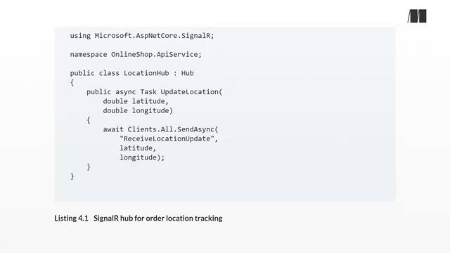
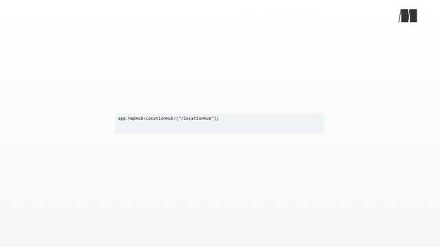
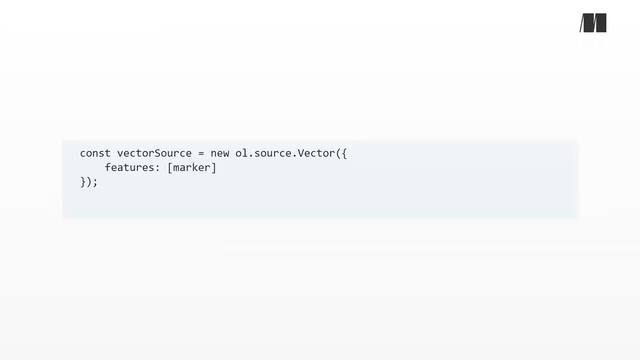
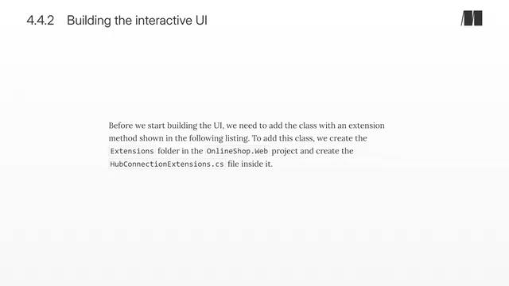
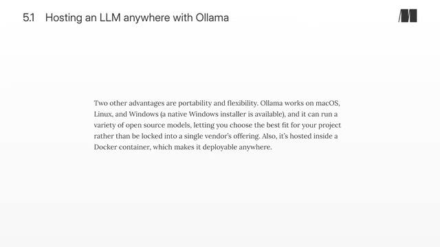
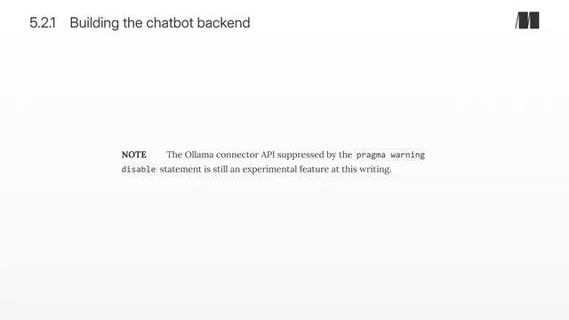
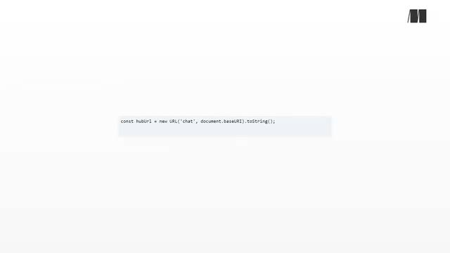
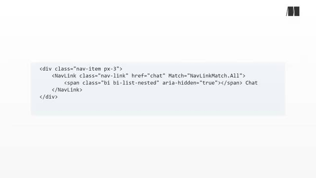

# Building Distributed Applications That Work｜P31–P36 复现手册

**课程范围**：P31–P36（原书 4.3–4.4 节 + 第 5 章）
**产出**：一个 Aspire 分布式应用，包含①SignalR + OpenLayers 的实时配送位置追踪，②本地 Ollama 托管的 phi3.5 模型 + Semantic Kernel + 自定义聊天 UI

---

## 1. 这一节做什么

这 6 个片段是**两条互相独立、可以分开跑通的主线**，它们共享同一个 Aspire 解决方案骨架。

**主线 A（P31–P33，4.3–4.4 节）：实时配送追踪**

讲师的原话是「we'll add the core components of the delivery tracking system to the e-commerce application we've built so far」。也就是说，前提是已经有一个 Aspire 电商项目（AppHost + ApiService + Web 三个项目）。这条线上你只做两件事：

1. **后端 `OnlineShop.ApiService`**：加一个 `LocationHub`（SignalR Hub），再挂一个 `LocationUpdater` 后台服务，由它每隔一段时间往 Hub 上广播一次「配送员的新经纬度」。
2. **前端 `OnlineShop.Web`**：装 SignalR 客户端包，写一段 `wwwroot/js/site.js` 用 OpenLayers 画地图，再写一个 `OrderTracking.razor` 页面，通过 Blazor 的 JavaScript Interop 把收到的坐标变成地图上的一个红点。

讲师明确说过这一段**不含真实业务逻辑**：假装订单已经下好，完整的端到端下单流程在第 7 章。所以你不必去找「订单」相关的表和接口，这个练习里没有。

**主线 B（P34–P36，第 5 章）：自己托管一个 ChatGPT 克隆**

1. **在 AppHost 里**用 `CommunityToolkit.Aspire.Hosting.Ollama` 起一个 Ollama 容器，拉下 `phi3.5` 模型，顺带挂一个现成的 Open Web UI。
2. **在 Web 项目里**装 `Microsoft.SemanticKernel.Connectors.Ollama`，用 Semantic Kernel 把「聊天补全」接进来，配一个按连接 ID 存上下文的 `IChatHistoryService`，再用一个 `ChatHub` 把回答**一个字一个字流式**推给浏览器。
3. **前端**写 `wwwroot/js/chat.js` 的 SignalR JS 客户端 + `Chat.razor` 页面。

**环境与前置条件（这部分课里没讲，属于补齐）**

| 项 | 要求 | 来源 |
|---|---|---|
| .NET SDK | 能跑 Aspire 的版本（讲师只说「Aspire 模板」，没报版本号） | 课里没讲具体版本 |
| 内存 | **至少 16 GB**，模型本身要 **最少 4 GB 空闲内存** | p034 [05:10] 讲师原话 |
| 磁盘 | phi3.5 约 **2 GB**（讲师说的），首次启动要等下载 | p034 [06:09] |
| 端口 | 交给 Aspire 分配，不用手动指定 | 课里没讲 |

**你必须有这样一个目录结构**（这是 Aspire 模板生成的样子；用 `dotnet new aspire-starter` 之类生成项目这一步**课里没讲**，讲师是假定你已经有前几章的代码）：

```
online-shop/
├── online-shop.sln
├── OnlineShop.AppHost/
│   ├── OnlineShop.AppHost.csproj
│   └── AppHost.cs
├── OnlineShop.ApiService/
│   ├── OnlineShop.ApiService.csproj
│   ├── Program.cs
│   ├── LocationHub.cs                ← P31 新建
│   └── LocationUpdater.cs            ← P31 新建
└── OnlineShop.Web/
    ├── OnlineShop.Web.csproj
    ├── Program.cs                    ← P31? 否，P32/P35 改
    ├── Extensions/
    │   └── HubConnectionExtensions.cs ← P32 新建
    ├── Services/
    │   └── ChatHistoryService.cs      ← P35 新建
    ├── Hubs/
    │   └── ChatHub.cs                 ← P35 新建
    ├── Components/
    │   ├── App.razor                  ← P32/P36 改
    │   ├── Layout/NavMenu.razor       ← P32/P36 改
    │   └── Pages/
    │       ├── Home.razor
    │       ├── OrderTracking.razor    ← P32 新建
    │       └── Chat.razor             ← P36 新建
    └── wwwroot/
        └── js/
            ├── site.js                ← P32 新建
            └── chat.js                ← P36 新建
```

**一个必须先说清楚的诚实声明**：这 6 段逐字稿里，讲师**大量使用「See this code」「See this command」「See this address」来指代书里的代码块和清单**，音频本身没有把代码念出来。因此第 4 节给出的完整文件，是**依据讲师口述的类名、方法名、参数名、注册顺序、调用顺序重建的可运行版本**，每一处不属于讲师口述的部分我都会单独标注。我不会假装这些是讲师逐字念出的代码。

---

## 2. 讲师原话

**关于「不需要新依赖」**

> "The back-end project, online shop.API service, doesn't need additional new get dependencies because SignalR is included in the ASP.NET Core SDK."
> —— p031 [00:56]
> **译**：后端项目 OnlineShop.ApiService 不需要额外的 NuGet 依赖，因为 SignalR 已经包含在 ASP.NET Core SDK 里了。
>
> （注：逐字稿把 NuGet 转写成 "new get"，把项目名转写成 "online shop.API service"，此处照录原文。）

**关于 Hub 的命名与职责**

> "We call the class Location Hub because its primary purpose is to update the location of the delivery driver."
> —— p031 [01:45]
> **译**：我们把这个类叫做 LocationHub，因为它的主要用途是更新配送员的位置。

**关于客户端事件名**

> "Inside this method invocation, the first parameter is a string with the value receive location update. This is the name of the method delegate on a connected client that acts as an event listener."
> —— p031 [02:13]
> **译**：在这次方法调用里，第一个参数是一个值为 ReceiveLocationUpdate 的字符串。这是已连接客户端上充当事件监听器的方法委托的名字。

**关于静态渲染的致命缺点**

> "The main disadvantage is that we won't be able to invoke JavaScript code from inside Blazor code."
> —— p032 [04:35]
> **译**：主要的缺点是，我们将无法从 Blazor 代码内部调用 JavaScript 代码。

**第 4 章总结里的定论**

> "The persistent connection is managed by SignalR, a library built into ASP.NET Core that facilitates two-way real-time communication between client and server."
> —— p033 [00:00]
> **译**：这个持久连接由 SignalR 管理，它是内置于 ASP.NET Core 的库，用于促成客户端与服务器之间的双向实时通信。

**Semantic Kernel 是什么**

> "The answer is Semantic Kernel, a collection of .NET libraries that provide a simple interface for interactions between LLMs and custom code."
> —— p034 [01:23]
> **译**：答案是 Semantic Kernel，它是一组 .NET 库，为大型语言模型与自定义代码之间的交互提供了简单的接口。

**硬件资源警告**

> "Running even a small language model, such as FI 3.5, requires a lot of hardware resources."
> —— p034 [04:41]
> **译**：运行哪怕是一个小语言模型，比如 Phi 3.5，也需要大量硬件资源。
>
> （注：逐字稿把 Phi 转写成 "FI"，此处照录原文。）

**连接字符串这条路为什么能走通**

> "The good news is that Service Discovery works with the connection string."
> —— p035 [02:23]
> **译**：好消息是，服务发现对连接字符串是有效的。

**流式回答的取消语义**

> "The stream answer method has its cancellation token parameter annotated with the enumerator cancellation attribute."
> —— p035 [06:07]
> **译**：StreamAnswer 方法的取消令牌参数上标注了 EnumeratorCancellation 特性。

**为什么不用 `<script>` 塞在 body 里**

> "Because we're using Blazor, we can load this JavaScript dynamically via JavaScript interop."
> —— p036 [05
06]</br>
> **译**：因为我们用的是 Blazor，所以我们可以通过 JavaScript 互操作动态加载这段 JavaScript。

（上面这句逐字稿在 p036 [05:36] 处，讲师紧接着说 "Add the code block to the razor component as shown in the next listing"。）

---

## 3. 从零复现

下面的步骤按「先后端、再前端、再 AI 线」的顺序组织。**每一步都写清改哪个文件、加什么。**

### 3.1 主线 A 第一步：给 ApiService 加 SignalR Hub

打开 `OnlineShop.ApiService/LocationHub.cs`（新建）。讲师说这个项目**不需要装任何新包**，SignalR 在 ASP.NET Core SDK 里。

```markdown

```

Hub 类必须继承 `Microsoft.AspNetCore.SignalR.Hub`。类名带 `Hub` 后缀是讲师特意强调的命名约定（p031 [01:45]）。

### 3.2 主线 A 第二步：把 Hub 挂到 HTTP 端点

打开 `OnlineShop.ApiService/Program.cs`，两处改动：

1. 在 `builder.Build()` 之前加 `builder.Services.AddSignalR();`（讲师原话是「the following line which registers all the SignalR dependencies」）。
2. 在 `app.Run();` **之前**加 `app.MapHub<LocationHub>("/locationHub");`。

讲师原话：「In this example, slash location hub is an arbitrary URL path relative to the service address.」——路径名随便取，只要它一眼能看出和 `LocationHub` 有关。

```markdown

```

### 3.3 主线 A 第三步：后台服务模拟位置变化

新建 `OnlineShop.ApiService/LocationUpdater.cs`，继承 `BackgroundService`，构造函数注入 `IHubContext<LocationHub>`。

讲师特别指出：**`IHubContext<T>` 不用手动注册**，`AddSignalR()` 已经把它一起注册好了（p031 [04:05]）。它还解释了为什么要这个接口——「This type allows us to interact with the signal our clients connected to our hub from outside the hub itself」（从 Hub 外部与连上来的客户端交互）。

`ExecuteAsync` 里做的是一个循环：发 3 次坐标、每次之间 sleep，模拟配送员在移动。

最后回 `Program.cs` 注册：`builder.Services.AddHostedService<LocationUpdater>();`

**在 Node 里对应什么**：这就是一个进程级的 `setInterval` 循环，往 WebSocket / SSE 的所有连接上广播一个事件。区别是 .NET 的 `BackgroundService` 由宿主托管生命周期（应用关停时自动 `CancellationToken` 取消），你不用自己 `clearInterval`。

### 3.4 主线 A 第四步：Web 项目装 SignalR 客户端

讲师明确区分了服务端和客户端：「Although server-side SignalR components are included with ASP.NET Core, the client-side components must be explicitly installed.」

```bash
cd OnlineShop.Web
dotnet add package Microsoft.AspNetCore.SignalR.Client
```

### 3.5 主线 A 第五步：写 OpenLayers 地图脚本

新建 `OnlineShop.Web/wwwroot/js/site.js`。三段内容：全局 `map` 变量、`initializeMap()`、`addMarker(lat, lon)`。

讲师解释了为什么 `map` 和「装着 marker 的图层」要放全局变量：因为每次收到新坐标都要把旧 marker 从地图上摘掉、再插一个新的（p032 [01:51]）。

```markdown

```

### 3.6 主线 A 第六步：在 App.razor 注册前端依赖 + 打开交互渲染

打开 `OnlineShop.Web/Components/App.razor`，四个动作：

1. `<head>` 里加 OpenLayers 的 CSS：`<link rel="stylesheet" href="...ol.css" />`
2. `<head>` 里加 OpenLayers 的 JS：`<script src="...ol.js"></script>`（讲师说的是「pulls the open layers JavaScript library from a content delivery network, CDN」）
3. `<body>` 里、`_framework/blazor.web.js` **之前**加 `<script src="js/site.js"></script>`
4. 给 `<HeadOutlet>` 和 `<Routes>` 都加上 `@rendermode="InteractiveServer"`

第 4 步是**最容易漏、漏了就一定失败**的一步。讲师的原话：「if we left the static server-side rendering mode... this life cycle event method would never execute」（p032 [08:18]）。静态 SSR 下 `OnAfterRenderAsync` 根本不会跑，SignalR 连接也就永远不会建立。

### 3.7 主线 A 第七步：写服务发现扩展方法

新建 `OnlineShop.Web/Extensions/HubConnectionExtensions.cs`。这是整条线里技术含量最高的一段，原因讲师讲得很清楚：**SignalR 的 `WithUrl` 不吃 Aspire 的服务发现**，因为服务发现是靠 `HttpClient` 的 `DelegatingHandler` 实现的，而 `HubConnectionBuilder` 构造连接时不走 `HttpClientFactory`。

解法是把 `IHttpMessageHandlerFactory` 的 `CreateHandler` 方法塞进 `HttpClientOptions.HttpMessageHandlerFactory` 属性上。这样 URL 里就可以直接写服务名。

然后在 `OnlineShop.Web/Program.cs` 里注册这个工厂（见第 4 节，含一条「此处为重建」的标注）。

```markdown

```

### 3.8 主线 A 第八步：写追踪页面

新建 `OnlineShop.Web/Components/Pages/OrderTracking.razor`：

- 顶部 `@page "/order-tracking"`（路径课里没明确念出，只说了「add a navigation link to the order tracking page」）
- 注入 `IJSRuntime` 和 `IHttpMessageHandlerFactory`
- 一个 `<div id="map">` 作为 OpenLayers 的容器
- `OnAfterRenderAsync(firstRender)` 里：先 `initializeMap`，再建 `HubConnection`、注册 `ReceiveLocationUpdate` 处理、最后 `StartAsync()`

讲师强调了两点：
- 必须等页面渲染完再连（「we have to wait for rendering to finish before we try to update the map」）；
- 收到坐标后的 UI 操作要包在 `InvokeAsync` 里，因为要回到 UI 线程（「to make sure that the logic is associated with the UI thread」）。

最后在 `NavMenu.razor` 里加一条导航链接。

### 3.9 主线 B 第一步：在 AppHost 里起 Ollama

```bash
cd OnlineShop.AppHost
dotnet add package CommunityToolkit.Aspire.Hosting.Ollama
```

然后改 `AppHost.cs`。讲师的五步拆解（p034 [05:17] 起）是：

1. `DistributedApplication.CreateBuilder(args)`
2. `AddOllama("ollama")` → `.WithLifetime(ContainerLifetime.Persistent)` → `.WithDataVolume()` → `.WithOpenWebUI()`
3. `AddModel("phi35", "phi3.5")`
4. `.WithReference(phi35)`
5. `.WaitFor(phi35)`

⚠️ **讲师明确警告**：至少 16 GB 内存，模型本身最少 4 GB 空闲内存。跑不动就临时把 SQL Database 和 Azure Blob 容器注释掉。

```markdown

```

### 3.10 主线 B 第二步：Web 项目装 Semantic Kernel 的 Ollama 连接器

```bash
cd OnlineShop.Web
dotnet add package Microsoft.SemanticKernel.Connectors.Ollama --prerelease
dotnet add package CommunityToolkit.Aspire.OllamaSharp
```

讲师明确说了这个包当时是 **preview**，所以命令行必须带 `--prerelease`（「you have to include packages with pre-release versions」）。

第二个包是讲师点名提到的：`CommunityToolkit.Aspire.OllamaSharp`——它是社区工具包真正的底层客户端，**靠连接字符串工作**，而这正是服务发现在这条线上唯一能走通的口子（p035 [01:55]）。

### 3.11 主线 B 第三步：Program.cs 里解析 endpoint 并注册 Kernel

顺序不能乱：

1. 从配置里读连接字符串（key 是资源名 `phi35`）
2. 从连接字符串里抠出 endpoint URI
3. `AddKernel().AddOllamaChatCompletion(...)`
4. `AddSingleton<IChatHistoryService, ChatHistoryService>()`
5. `AddSignalR()`
6. `AddHttpClient()`（让 `IHttpMessageHandlerFactory` 有实现可用）
7. 中间件里 `app.MapHub<ChatHub>("/chat")`，位置在 `MapRazorComponents` 或 `MapDefaultEndpoints` 之前

第 7 步的位置是讲师专门提醒的：「add the following expression near the bottom of the application middleware in the same file, but before either app.MapRazorComponentsApp or app.MapDefaultEndpoints」（p035 [07:32]）。

```markdown

```

### 3.12 主线 B 第四步：聊天历史服务 + ChatHub

- 新建 `Services/IChatHistoryService.cs`（三个方法：`AddUserMessage` / `GetChatHistory` / `RemoveHistory`，都以 `connectionId` 为键）
- 新建 `Services/ChatHistoryService.cs`，**注册为 Singleton**（讲师给了理由：服务跨多个用户会话共享，要跟踪所有独立连接）
- 新建 `Hubs/ChatHub.cs`，核心是 `IAsyncEnumerable<string> StreamAnswer(string prompt, [EnumeratorCancellation] CancellationToken ct)`
- `ChatHub` 里构造 `PromptExecutionSettings`，在 `ExtensionData` 里设 `temperature`

### 3.13 主线 B 第五步：前端聊天页

1. `App.razor` 的 `</head>` 之前加 SignalR JS 客户端的 CDN 引用
2. 新建 `wwwroot/js/chat.js`，导出 `initializeChat()`，内部依次是：守卫 → 抓 DOM 元素 → 状态显示函数 → 忙碌开关函数 → 字符计数函数 → 拼 URL → 建连接 → 断线/重连/关闭监听 → `start()` → 提交函数（用 `.stream()` 订阅）→ 三个按钮的监听
3. 新建 `Components/Pages/Chat.razor`，三个指令：`@page "/chat"`、`@rendermode InteractiveServer`、`@inject IJSRuntime JS`，再在 `OnAfterRenderAsync` 里 `import` 模块并调 `initializeChat`
4. `NavMenu.razor` 加导航

```markdown



```

### 3.14 启动

```bash
cd OnlineShop.AppHost
dotnet run
```

Aspire 会打开 Dashboard，你会看到至少三个资源：`apiservice`、`webfrontend`、`phi35`（外加 ollama 容器和 openwebui）。**第一次启动 phi3.5 要下载几分钟**，讲师说「there may be a delay before the model download starts」，鼠标悬停能看到进度。

---

## 4. 完整代码

> 再次声明：以下文件是把讲师口述的类名/方法名/参数/调用顺序补全后的**可运行重建版**。凡不属于讲师口述的内容，行内用 `// 重建` 标注。

### 4.1 `OnlineShop.ApiService/LocationHub.cs`

```csharp
using Microsoft.AspNetCore.SignalR;

namespace OnlineShop.ApiService;

// 课里没有代码清单，以下为依据讲师口述重建
public class LocationHub : Hub
{
    public async Task UpdateLocation(double latitude, double longitude)
    {
        // "ReceiveLocationUpdate" 是客户端事件监听方法的名字
        await Clients.All.SendAsync("ReceiveLocationUpdate", latitude, longitude);
    }
}
```

### 4.2 `OnlineShop.ApiService/LocationUpdater.cs`

```csharp
using Microsoft.AspNetCore.SignalR;

namespace OnlineShop.ApiService;

public class LocationUpdater : BackgroundService
{
    private readonly IHubContext<LocationHub> _hubContext;

    public LocationUpdater(IHubContext<LocationHub> hubContext)
    {
        _hubContext = hubContext;
    }

    private async Task SendLocationUpdate(double latitude, double longitude)
    {
        await _hubContext.Clients.All.SendAsync("ReceiveLocationUpdate", latitude, longitude);
    }

    protected override async Task ExecuteAsync(CancellationToken stoppingToken)
    {
        // 重建：讲师只说"发三次、每次之间加延迟、放在循环里"，
        // 具体坐标与延迟时长课里没念出，以下是示意值（伦敦市区内小幅移动）
        var waypoints = new (double Lat, double Lon)[]
        {
            (51.5074, -0.1278),
            (51.5101, -0.1300),
            (51.5129, -0.1245)
        };

        while (!stoppingToken.IsCancellationRequested)
        {
            foreach (var point in waypoints)
            {
                await SendLocationUpdate(point.Lat, point.Lon);
                await Task.Delay(TimeSpan.FromSeconds(3), stoppingToken);
            }
        }
    }
}
```

### 4.3 `OnlineShop.ApiService/Program.cs`

```csharp
using OnlineShop.ApiService;

var builder = WebApplication.CreateBuilder(args);

builder.AddServiceDefaults();
builder.Services.AddProblemDetails();

// 1) 注册 SignalR（讲师口述："registers all the SignalR dependencies"）
builder.Services.AddSignalR();

// 2) 注册后台服务
builder.Services.AddHostedService<LocationUpdater>();

var app = builder.Build();

app.UseExceptionHandler();
app.MapDefaultEndpoints();

app.MapHub<LocationHub>("/locationHub");   // 必须在 app.Run() 之前

app.Run();
```

### 4.4 `OnlineShop.Web/Extensions/HubConnectionExtensions.cs`

```csharp
using Microsoft.AspNetCore.SignalR.Client;

namespace OnlineShop.Web.Extensions;

public static class HubConnectionExtensions
{
    public static IHubConnectionBuilder WithUrl(
        this IHubConnectionBuilder builder,
        string url,
        IHttpMessageHandlerFactory httpMessageHandlerFactory)
    {
        return builder.WithUrl(url, options =>
        {
            // 把工厂的 CreateHandler 挂到 SignalR 连接选项上，
            // 这样 URL 里写服务名就能被 Aspire 服务发现解析
            options.HttpMessageHandlerFactory = httpMessageHandlerFactory.CreateHandler;
        });
    }
}
```

### 4.5 `OnlineShop.Web/Program.cs`（含 A 线与 B 线两处注册）

```csharp
#pragma warning disable SKEXP0070   // Ollama 连接器当时仍是实验性 API

using Microsoft.SemanticKernel;
using OnlineShop.Web.Components;
using OnlineShop.Web.Extensions;
using OnlineShop.Web.Hubs;
using OnlineShop.Web.Services;

var builder = WebApplication.CreateBuilder(args);

builder.AddServiceDefaults();

// ---------- 主线 A ----------
builder.Services.AddRazorComponents()
    .AddInteractiveServerComponents();

// 重建：讲师只说"execute the following code inside program.cs"来注册
// IHttpMessageHandlerFactory，没有念出具体语句。AddHttpClient 会注册它。
builder.Services.AddHttpClient();

// ---------- 主线 B：Semantic Kernel ----------
string ollamaConnectionString = builder.Configuration.GetConnectionString("phi35")
    ?? throw new InvalidOperationException(
        "找不到名为 phi35 的连接字符串。请确认 AppHost 里 AddModel(\"phi35\", \"phi3.5\") 已执行，且 Web 项目 WaitFor 了它。");

// 重建：课里没念出连接字符串的具体格式，以下按 "Endpoint=http://host:port;..." 解析。
// 若你的实际格式不同，先打印 ollamaConnectionString 看一眼再改这一段。
var csParts = ollamaConnectionString
    .Split(';', StringSplitOptions.RemoveEmptyEntries)
    .Select(p => p.Split('=', 2))
    .Where(p => p.Length == 2)
    .ToDictionary(p => p[0].Trim(), p => p[1].Trim(), StringComparer.OrdinalIgnoreCase);

if (!csParts.TryGetValue("Endpoint", out var endpoint))
{
    throw new InvalidOperationException(
        $"连接字符串里没有 Endpoint 字段。实际内容：{ollamaConnectionString}");
}

builder.Services.AddKernel()
    .AddOllamaChatCompletion("phi3.5", new Uri(endpoint));

builder.Services.AddSingleton<IChatHistoryService, ChatHistoryService>();

// ---------- 主线 B：SignalR（聊天）----------
builder.Services.AddSignalR();

var app = builder.Build();

if (!app.Environment.IsDevelopment())
{
    app.UseExceptionHandler("/Error", createScopeForErrors: true);
    app.UseHsts();
}

app.UseHttpsRedirection();
app.UseAntiforgery();
app.MapStaticAssets();

// 诊断用：想看详细错误就把 MapHub 换成带选项的写法（讲师给了这条提示）
// app.MapHub<ChatHub>("/chat", options =>
// {
//     options.EnableDetailedErrors = true;
// });
app.MapHub<ChatHub>("/chat");

app.MapRazorComponents<App>()
    .AddInteractiveServerRenderMode();

app.MapDefaultEndpoints();

app.Run();
```

### 4.6 `OnlineShop.Web/Services/IChatHistoryService.cs`

```csharp
using Microsoft.SemanticKernel.ChatCompletion;

namespace OnlineShop.Web.Services;

public interface IChatHistoryService
{
    void AddUserMessage(string connectionId, string message);
    ChatHistory GetChatHistory(string connectionId);
    void RemoveHistory(string connectionId);
}
```

### 4.7 `OnlineShop.Web/Services/ChatHistoryService.cs`

```csharp
using System.Collections.Concurrent;
using Microsoft.SemanticKernel.ChatCompletion;

namespace OnlineShop.Web.Services;

public class ChatHistoryService : IChatHistoryService
{
    // 讲师没讲并发安全；SignalR 的多个连接会并发访问同一个 Singleton，
    // 所以这里用 ConcurrentDictionary（见第 7 节）
    private readonly ConcurrentDictionary<string, ChatHistory> _histories = new();

    public void AddUserMessage(string connectionId, string message)
    {
        ChatHistory history = _histories.GetOrAdd(connectionId, _ => new ChatHistory());
        history.AddUserMessage(message);
    }

    public ChatHistory GetChatHistory(string connectionId)
    {
        return _histories.GetOrAdd(connectionId, _ => new ChatHistory());
    }

    public void RemoveHistory(string connectionId)
    {
        _histories.TryRemove(connectionId, out _);
    }
}
```

### 4.8 `OnlineShop.Web/Hubs/ChatHub.cs`

```csharp
using System.Runtime.CompilerServices;
using Microsoft.AspNetCore.SignalR;
using Microsoft.SemanticKernel;
using Microsoft.SemanticKernel.ChatCompletion;
using OnlineShop.Web.Services;

namespace OnlineShop.Web.Hubs;

public class ChatHub : Hub
{
    private readonly IChatCompletionService _chatCompletionService;
    private readonly IChatHistoryService _chatHistoryService;

    public ChatHub(
        IChatCompletionService chatCompletionService,
        IChatHistoryService chatHistoryService)
    {
        _chatCompletionService = chatCompletionService;
        _chatHistoryService = chatHistoryService;
    }

    public async IAsyncEnumerable<string> StreamAnswer(
        string prompt,
        [EnumeratorCancellation] CancellationToken cancellationToken)
    {
        _chatHistoryService.AddUserMessage(Context.ConnectionId, prompt);
        var history = _chatHistoryService.GetChatHistory(Context.ConnectionId);

        var settings = new PromptExecutionSettings
        {
            ExtensionData = new Dictionary<string, object>
            {
                ["temperature"] = 0.7
            }
        };

        await foreach (var chunk in _chatCompletionService
            .GetStreamingChatMessageContentsAsync(
                history,
                executionSettings: settings,
                kernel: null,
                cancellationToken: cancellationToken))
        {
            yield return chunk.Content ?? string.Empty;
        }
    }

    public override async Task OnDisconnectedAsync(Exception? exception)
    {
        _chatHistoryService.RemoveHistory(Context.ConnectionId);
        await base.OnDisconnectedAsync(exception);
    }
}
```

### 4.9 `OnlineShop.AppHost/AppHost.cs`

```csharp
var builder = DistributedApplication.CreateBuilder(args);

// 1) Ollama 容器：持久生命周期 + 数据卷 + 内置 Web UI
var ollama = builder.AddOllama("ollama")
    .WithLifetime(ContainerLifetime.Persistent)
    .WithDataVolume()
    .WithOpenWebUI();

// 2) 往 Ollama 里加一个模型：第一个参数是资源名，第二个是真实模型名
var phi35 = ollama.AddModel("phi35", "phi3.5");

// 3) 把模型引用给到 Web 前端（讲师："adding it to the web front-end project rather than the API"）
builder.AddProject<Projects.OnlineShop_Web>("webfrontend")
    .WithExternalHttpEndpoints()
    .WithReference(phi35)
    .WaitFor(phi35);

builder.AddProject<Projects.OnlineShop_ApiService>("apiservice")
    .WithExternalHttpEndpoints();

builder.Build().Run();
```

### 4.10 `OnlineShop.Web/Components/App.razor`

```razor
<!DOCTYPE html>
<html lang="en">

<head>
    <meta charset="utf-8" />
    <meta name="viewport" content="width=device-width, initial-scale=1.0" />
    <base href="/" />

    <link rel="stylesheet" href="@Assets["app.css"]" />
    <link rel="stylesheet" href="@Assets["OnlineShop.Web.styles.css"]" />

    <!-- OpenLayers：样式表 + 库，从 CDN 拉 -->
    <link rel="stylesheet" href="https://cdn.jsdelivr.net/npm/ol@v9.2.4/ol.css" />
    <script src="https://cdn.jsdelivr.net/npm/ol@v9.2.4/dist/ol.js"></script>

    <!-- 主线 B：SignalR JavaScript 客户端，放在 </head> 之前 -->
    <script src="https://cdn.jsdelivr.net/npm/@microsoft/signalr@8.0.7/dist/browser/signalr.min.js"></script>

    <ImportMap />
    <HeadOutlet @rendermode="InteractiveServer" />
</head>

<body>
    <Routes @rendermode="InteractiveServer" />

    <!-- 自定义脚本必须在 blazor.web.js 之前 -->
    <script src="js/site.js"></script>
    <script src="_framework/blazor.web.js"></script>
</body>

</html>
```

### 4.11 `OnlineShop.Web/wwwroot/js/site.js`

```javascript
let map;
let markerLayer;

function initializeMap() {
    map = new ol.Map({
        target: 'map',
        layers: [
            new ol.layer.Tile({
                source: new ol.source.OSM()
            })
        ],
        view: new ol.View({
            // 伦敦：注意 OpenLayers 用 [lon, lat]
            center: ol.proj.fromLonLat([-0.1276, 51.5072]),
            zoom: 12
        })
    });
}

function addMarker(latitude, longitude) {
    // 1) 先摘掉旧 marker
    if (markerLayer) {
        map.removeLayer(markerLayer);
    }

    // 2) 用新坐标建 marker
    const marker = new ol.Feature({
        geometry: new ol.geom.Point(ol.proj.fromLonLat([longitude, latitude]))
    });

    // 3) 给 marker 上样式，保证看得清
    marker.setStyle(new ol.style.Style({
        image: new ol.style.Circle({
            radius: 10,
            fill: new ol.style.Fill({ color: 'red' }),
            stroke: new ol.style.Stroke({ color: 'white', width: 2 })
        })
    }));

    // 4) 建矢量数据源 → 5) 建矢量图层 → 6) 加到地图上
    const vectorSource = new ol.source.Vector({ features: [marker] });
    markerLayer = new ol.layer.Vector({ source: vectorSource });
    map.addLayer(markerLayer);
}
```

### 4.12 `OnlineShop.Web/Components/Pages/OrderTracking.razor`

```razor
@page "/order-tracking"
@using Microsoft.AspNetCore.SignalR.Client
@using OnlineShop.Web.Extensions
@inject IJSRuntime JS
@inject IHttpMessageHandlerFactory HttpMessageHandlerFactory

<h3>Track your order</h3>

<div id="map" style="width:100%;height:600px;"></div>

@code {
    private HubConnection? hubConnection;

    protected override async Task OnAfterRenderAsync(bool firstRender)
    {
        if (!firstRender || hubConnection is not null)
        {
            return;
        }

        await JS.InvokeVoidAsync("initializeMap");

        hubConnection = new HubConnectionBuilder()
            .WithUrl("apiservice/locationHub", HttpMessageHandlerFactory)
            .Build();

        hubConnection.On<double, double>("ReceiveLocationUpdate", async (latitude, longitude) =>
        {
            await InvokeAsync(async () =>
            {
                await JS.InvokeVoidAsync("addMarker", latitude, longitude);
                StateHasChanged();
            });
        });

        await hubConnection.StartAsync();
    }
}
```

### 4.13 `OnlineShop.Web/Components/Pages/Chat.razor`

```razor
@page "/chat"
@rendermode InteractiveServer
@inject IJSRuntime JS

<PageTitle>Chat</PageTitle>

<h3>Ask the shop assistant</h3>

<div id="connection-status">Disconnected</div>

<form id="chat-form">
    <textarea id="chat-input" rows="3"></textarea>
    <button type="submit">Send</button>
    <button type="button" id="stop-button">Stop</button>
    <button type="button" id="clear-button">Clear</button>
    <button type="button" id="copy-button">Copy</button>
</form>

<div id="char-count">0</div>
<div id="chat-output"></div>

@code {
    private IJSObjectReference? module;

    protected override async Task OnAfterRenderAsync(bool firstRender)
    {
        if (!firstRender)
        {
            return;
        }

        module = await JS.InvokeAsync<IJSObjectReference>("import", "./js/chat.js");
        await module.InvokeVoidAsync("initializeChat");
    }
}
```

### 4.14 `OnlineShop.Web/wwwroot/js/chat.js`

```javascript
export function initializeChat() {
    // 守卫：SignalR 客户端库必须已经从 CDN 加载
    if (!window.signalR) {
        console.error("SignalR client library is not loaded. Check the CDN script tag in App.razor.");
        return;
    }

    const chatForm = document.getElementById("chat-form");
    const chatInput = document.getElementById("chat-input");
    const chatOutput = document
.getElementById("chat-output");
    const connectionStatus = document.getElementById("connection-status");
    const charCount = document.getElementById("char-count");
    const stopButton = document.getElementById("stop-button");
    const clearButton = document.getElementById("clear-button");
    const copyButton = document.getElementById("copy-button");

    // 连接状态显示
    function setConnectionStatus(status) {
        connectionStatus.textContent = status;
    }

    // 处理中把表单元素置为不可用（重建：讲师只说"ensure the elements
    // on the page aren't busy while the chat backend is processing the prompt"）
    function setBusy(isBusy) {
        chatInput.disabled = isBusy;
        chatForm.querySelector('button[type="submit"]').disabled = isBusy;
    }

    // 更新已返回的字符数
    function updateCharCount(count) {
        charCount.textContent = count;
    }

    // 拼 Hub URL：基础应用地址 + 指向 SignalR Hub 的路径
    const hubUrl = window.location.origin + "/chat";
    const connection = new signalR.HubConnectionBuilder()
        .withUrl(hubUrl)
        .withAutomaticReconnect()
        .build();

    // 断线 / 重连 / 关闭三种状态各挂一个监听
    connection.onreconnecting(() => setConnectionStatus("Reconnecting..."));
    connection.onreconnected(() => setConnectionStatus("Connected"));
    connection.onclose(() => setConnectionStatus("Disconnected"));

    // 建立连接（重建：讲师只说"it's time to establish the connection to the hub"）
    connection.start()
        .then(() => setConnectionStatus("Connected"))
        .catch(err => {
            setConnectionStatus("Connection failed: " + err);
        });

    // ---- 提交 prompt ----
    let currentSubscription = null;

    chatForm.addEventListener("submit", function (event) {
        event.preventDefault();

        const prompt = chatInput.value.trim();
        if (!prompt) {
            return;
        }

        chatOutput.textContent = "";
        updateCharCount(0);
        setBusy(true);
        setConnectionStatus("Streaming...");

        // 重建：服务端方法名为 StreamAnswer，SignalR JS 客户端用 .stream() 订阅
        // IAsyncEnumerable<string>。讲师只讲了"listens for a stream of characters
        // coming back from it"，没念出订阅写法。
        currentSubscription = connection.stream("StreamAnswer", prompt)
            .subscribe({
                next: (chunk) => {
                    chatOutput.textContent += chunk;
                    updateCharCount(chatOutput.textContent.length);
                },
                complete: () => {
                    setBusy(false);
                    setConnectionStatus("Connected");
                    currentSubscription = null;
                },
                error: (err) => {
                    setBusy(false);
                    setConnectionStatus("Error: " + err);
                    currentSubscription = null;
                }
            });
    });

    // 停止：断掉当前流
    stopButton.addEventListener("click", function () {
        if (currentSubscription) {
            currentSubscription.dispose();
            currentSubscription = null;
            setBusy(false);
            setConnectionStatus("Stopped");
        }
    });

    // 清空
    clearButton.addEventListener("click", function () {
        chatOutput.textContent = "";
        chatInput.value = "";
        updateCharCount(0);
    });

    // 复制
    copyButton.addEventListener("click", function () {
        navigator.clipboard.writeText(chatOutput.textContent);
    });
}
```

### 4.15 `OnlineShop.Web/Components/Layout/NavMenu.razor`（两处改动的结果）

```razor
<div class="nav-scrollable">
    <nav class="nav flex-column">
        <div class="nav-item px-3">
            <NavLink class="nav-link" href="" Match="NavLinkMatch.All">
                <span class="bi bi-house-door-fill-nav-menu" aria-hidden="true"></span> Home
            </NavLink>
        </div>

        <!-- 主线 A：追踪页导航 -->
        <div class="nav-item px-3">
            <NavLink class="nav-link" href="order-tracking">
                <span class="bi bi-geo-alt-fill-nav-menu" aria-hidden="true"></span> Track your order
            </NavLink>
        </div>

        <!-- 主线 B：聊天页导航 -->
        <div class="nav-item px-3">
            <NavLink class="nav-link" href="chat">
                <span class="bi bi-chat-dots-fill-nav-menu" aria-hidden="true"></span> Chat
            </NavLink>
        </div>
    </nav>
</div>
```

### 4.16 依赖清单汇总

| 项目 | 包 | 版本/参数 | 讲师是否明说 |
|---|---|---|---|
| `OnlineShop.ApiService` | 无 | 无 | 明说「不需要额外 NuGet」 |
| `OnlineShop.Web` | `Microsoft.AspNetCore.SignalR.Client` | 课里没讲版本 | 明说包名 |
| `OnlineShop.Web` | `Microsoft.SemanticKernel.Connectors.Ollama` | 必须带 `--prerelease` | 明说包名与 preview 状态 |
| `OnlineShop.Web` | `CommunityToolkit.Aspire.OllamaSharp` | 课里没讲版本 | 明说包名 |
| `OnlineShop.AppHost` | `CommunityToolkit.Aspire.Hosting.Ollama` | 课里没讲版本 | 明说包名 |

---

## 5. 逐行解释

这一节按「为什么这么定、不这么定会怎样」逐条拆。

### 5.1 `LocationHub` 为什么继承 `Hub`

`Hub` 基类来自 `Microsoft.AspNetCore.SignalR`，它把「连接管理、协议序列化、群发」都替你做了。讲师说类名带 `Hub` 后缀是「to make it obvious that the class represents a signal R Hub」——纯命名约定，不这样也能跑，但后面 `MapHub<LocationHub>` 和 `IHubContext<LocationHub>` 两处都要写这个类型名，命名清晰能省掉误读。

`UpdateLocation` 是 `public` 且带两个 `double` 参数，这是 SignalR 能被**客户端远程调用**的前提：public 实例方法才会被暴露成可调用端点。在 Node 里对应的是 socket.io 的 `socket.on('updateLocation', (lat, lon) => ...)`，区别是 SignalR 用反射从方法签名推端点，socket.io 要手写事件名。

### 5.2 为什么用 `Clients.All` 而不是发给特定人

讲师把取舍讲得很直白：「With SignalR, we can send messages to specific clients too. But to keep things simple for demonstration purposes, any connected client will receive the message」。

`Clients.All` 意味着所有打开追踪页的浏览器都看到同一个红点。真实场景要给每个订单单独分组（`Groups.AddToGroupAsync`），但**课里没讲分组**，所以这里不加。不这样做的后果：任何用户看到的都是同一个配送员，演示可以，上线不行。

### 5.3 `ReceiveLocationUpdate` 这个字符串必须两边一模一样

第一个参数是客户端的事件名。服务端写 `"ReceiveLocationUpdate"`，客户端 `hubConnection.On<double, double>("ReceiveLocationUpdate", ...)` 就必须是同一串字符。这是全篇最容易出错的地方——**它没有编译期检查**，拼错一个字母，连接照建、`StartAsync` 照样返回成功，就是红点不出现，控制台也不报错。这也是第 6 节检查清单里第一项要核对的东西。

### 5.4 `LocationUpdater` 为什么注入 `IHubContext<LocationHub>`

`Hub` 实例是**每次调用临时创建**的，生命周期极短，所以你不能在后台服务里 new 一个 `LocationHub` 去调 `Clients.All`。`IHubContext<T>` 是框架提供的长期存活的代理，专门给「Hub 外部」用。

讲师专门强调了这个接口**不用手动注册**：「The code we reviewed in the program.cs file already registers all the required SignalR dependencies, including the implementation of the iHub context interface」。如果你手贱再写一句 `AddSingleton<IHubContext<LocationHub>, ...>`，会覆盖框架实现、直接跑不起来。

### 5.5 `BackgroundService` 里为什么要传 `stoppingToken`

`Task.Delay(TimeSpan, stoppingToken)` 把取消令牌传进去，应用关停时循环会立刻抛出并退出，而不是卡在 sleep 里。如果你写 `Thread.Sleep` 或者 `await Task.Delay(3000)` 不传令牌，Aspire 停服务时会等到当前这轮 sleep 结束——演示时不明显，但这属于后台服务的常识。

**在 JS/Node 里对应什么**：等于 `setInterval` 加一个 `clearInterval` 挂在 `process.on('SIGTERM')` 上。.NET 的宿主帮你把这个收尾做了，你只要把令牌一路往下传。

### 5.6 `Program.cs` 里 `MapHub` 为什么必须在 `app.Run()` 之前

`WebApplication` 的中间件/端点注册是「建管道」，`app.Run()` 是「启动管道」。注册写在 `Run()` 之后就是死代码。同样，`MapHub` 要放在 `MapDefaultEndpoints()` 之后（端点映射互相不冲突，但习惯上业务端点写在默认健康检查端点后面）。

讲师还强调路径任意：「The path name can be anything」。但注意：**服务端 `MapHub<LocationHub>("/locationHub")` 与客户端 `"apiservice/locationHub"` 的最后一段必须一致**，否则 404，而 404 在 SignalR 客户端会表现为「连接失败」，错误信息不一定直白。

### 5.7 `HubConnectionExtensions.WithUrl` 这段是整个 A 线的技术核心

为什么普通 `WithUrl(url)` 在 Aspire 下不行？因为 Aspire 的服务发现是靠 `HttpClient` 的 `DelegatingHandler` 改写请求地址实现的，而 `HubConnectionBuilder` 内部自己 `new` 一个 `HttpMessageHandler`，不经过 `IHttpClientFactory`，所以 `apiservice` 这个主机名根本没人解析。

讲师给的解法是「借一个已经配好服务发现的 handler 给 SignalR 用」：把 `IHttpMessageHandlerFactory.CreateHandler` 赋给 `HttpClientOptions.HttpMessageHandlerFactory`。这行是关键，写成 `httpMessageHandlerFactory.CreateHandler()`（带括号）就是把方法**调用结果**（一个 handler 实例）赋进去，语义就变了——虽然某些情况下也能跑，但连接复用行为会和预期不同。正确写法是传**方法组**，让 SignalR 每次重建连接时自己调。

为什么还要在 `Program.cs` 加一行注册？因为 `IHttpMessageHandlerFactory` 默认不是自动有实现的，`AddHttpClient()` 才会把它和 `IHttpClientFactory` 一起注册进容器。不加就是启动时 DI 解析 `OrderTracking.razor` 的 `@inject` 直接抛异常。

### 5.8 `OrderTracking.razor` 的三处细节

**（a）`OnAfterRenderAsync(firstRender)` 里加 `!firstRender` 就 return。** 这个方法在每次渲染后都会被调，不加这个判断就会反复建连接、反复叠 marker。讲师没提这个判断，但它是 Blazor 的常规做法。

**（b）`hubConnection is not null` 的判重。** 理由同上，双保险。在 Node 里对应「这个组件 `useEffect(..., [])` 只跑一次」的心智模型。

**（c）收到消息后为什么包 `InvokeAsync`。** 讲师原话是「We're doing this inside the invokeAsync method to make sure that the logic is associated with the UI thread」。SignalR 的回调跑在线程池线程上，而 `StateHasChanged()` 和 `IJSRuntime` 调用都必须在 Blazor 的同步上下文（渲染器线程）里执行，不包一层会抛「The current thread is not associated with the Dispatcher」这类异常。

**（d）为什么 `StateHasChanged()` 其实这里没什么用。** 讲师说「we're also invoking state has changed after executing the update to make sure that the UI is partially re-rendered」。但我们的 marker 是画在 `<div id="map">` 上的 canvas 里，不是 Blazor 管理的 DOM，所以 `StateHasChanged` 属于「讲师让加就加」，没有它