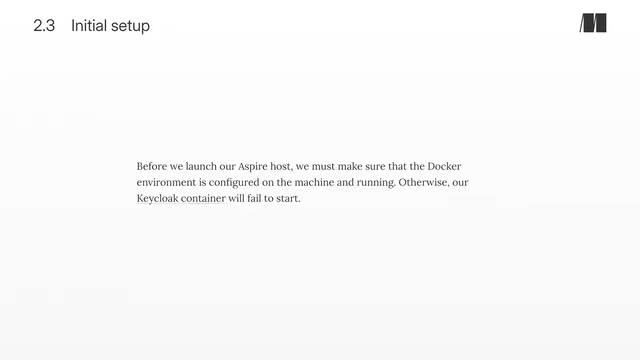
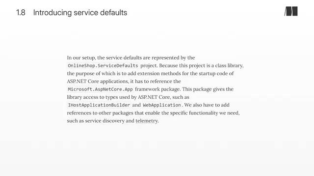
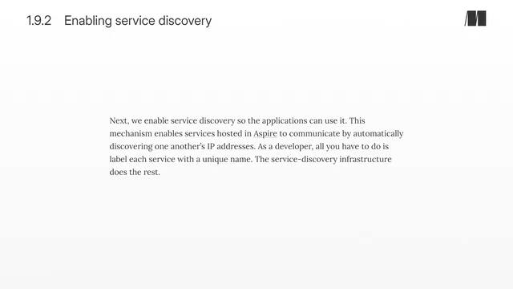
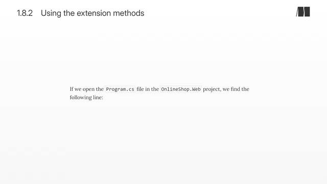
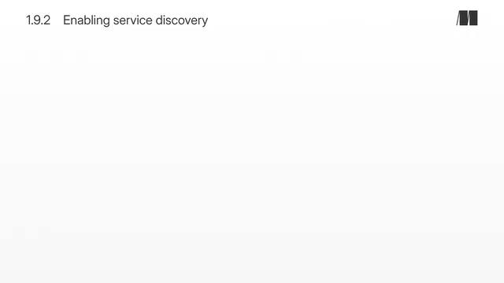
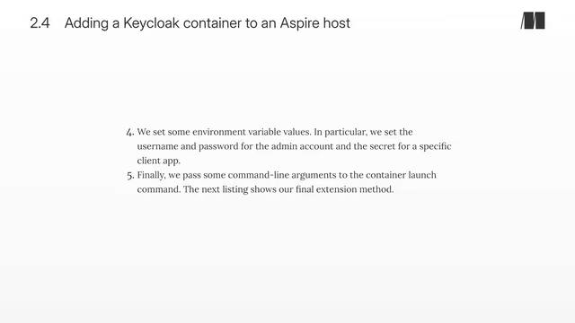
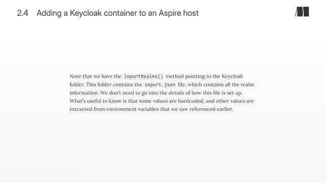
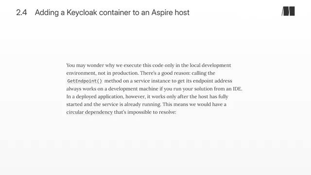
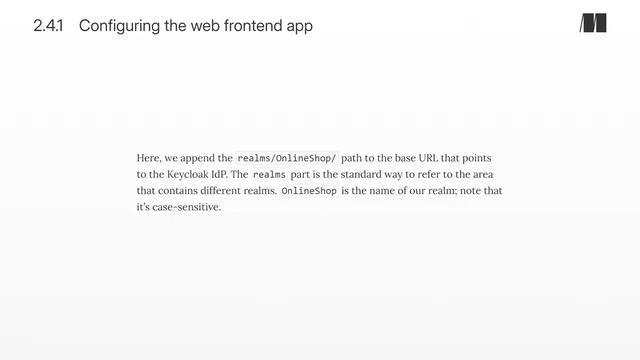
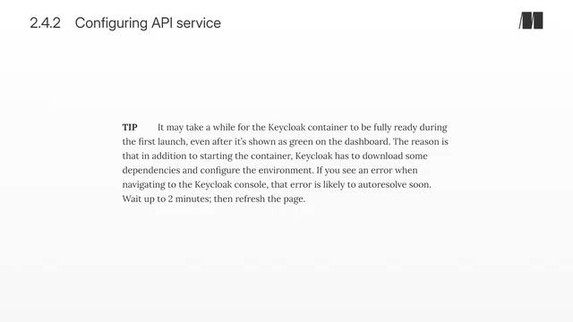

# Building Distributed Applications That Work —— P9–P15 复现手册

> 覆盖 P009–P015。前半段（P009–P011）讲 Aspire 的 Service Defaults 与服务发现，后半段（P012–P015）进入第 2 章：把 Keycloak 作为 Docker 容器挂进 Aspire 编排器，并让 Blazor 前端用 OIDC、API 服务用 Bearer Token 分别接上它。
>
> **必须先说清楚的一件事**：这门课的逐字稿是“讲解 + 指向代码清单”的形式，讲师反复说 "See this code"、"The following listing shows…"，但**代码原文没有被读进逐字稿**。所以本文第 4 章里所有代码块，都是按逐字稿里**明确点名的类名、方法名、调用顺序、路径**还原出来的**结构示意**，我用醒目的标注区分了“逐字稿确定”和“课里没讲”。凡是逐字稿没给的（具体 NuGet 版本号、环境变量名的字面拼写、讲师给的 GitHub 链接），我都会明说课里没讲，需要你回到视频画面上抄。

---

## 1. 这一节做什么

这一段课程完成两件事，两件事都在同一个解决方案 `OnlineShop` 上做增量改造。

**第一件事（P009–P011）：把“服务默认值”和“服务发现”这两块地基铺好。**

Aspire 的 starter 模板会生成一个类库项目 `OnlineShop.ServiceDefaults`，里面有一个 `Extensions.cs` 文件，装着一组扩展方法。这些扩展方法负责四类事情：让应用能被加进 Aspire 编排器、开启服务发现、让编排器能探到应用的健康状态、从应用里收集指标（metrics）。讲师特别强调，这个类库是**放在解决方案里、可以改的**，不是黑盒 SDK——比如你想换一个 metrics 库，或者想加自己的注册逻辑，直接改这个文件就行。

服务发现解决的是“服务挪了位置、换了端口，调用方不用改代码”的问题。核心机制是：每个服务在编排器里注册时挂一个唯一名字，之后调用方不去记 IP:Port，只写这个名字，由 Aspire 宿主在运行时把名字解析成真实地址。

**第二件事（P012–P015）：把 Keycloak 这个身份提供方（IDP）作为 Docker 容器交给 Aspire 托管，然后让前端和 API 接上去。**

这一章的目的不是讲安全协议（协议细节在第 8 章），而是拿“安全基础设施”当练手对象，学会两件事：**怎么把一个 Docker 容器接进 Aspire**、**怎么用 Aspire 集成库替代裸容器**。所以这一段你要产出的东西是：

- 一个能在 Aspire 仪表板上看到的 Keycloak 容器资源，类型显示为 `container`，来源是 `quay.io/keycloak/keycloak`；
- 容器启动时自动导入 `OnlineShop` 这个 realm（通过 bind mount 把本地文件夹挂到容器里的 `/opt/keycloak/data/import`）；
- Blazor 前端通过 OIDC 跳转到 Keycloak 登录页，登录成功后回到 Blazor 页面；
- API 服务用 Bearer Token 校验同一个 IDP 签发的令牌；
- 两个客户端都不写 Keycloak 的 IP 和端口，而是通过服务发现解析 `idp` 这个名字。

这一段**不涉及**锁、事务、并发控制，所以没有“在 JS/Node 里对应什么”的内容；但服务发现、DI、HttpClient 工厂这几处我会补 Node 侧的对照。

---

## 2. 讲师原话

先看 Service Defaults 的定位：

> "Section 1.8 Introducing Service Defaults. Service defaults in Aspire is a collection of extension methods that allow apps to be added to the Aspire Orchestrator."
> —— p009 [00:00]
> **译**：第 1.8 节 介绍 Service Defaults。Aspire 中的 service defaults 是一组扩展方法，它允许把应用加入到 Aspire 编排器中。

讲师解释这几个方法各自干什么，以及“定义了还得调用”这条硬规矩：

> "The map default endpoints method adds the health check endpoints to the application. When we have these methods, we have to invoke them from the startup code of the relevant applications."
> —— p009 [02:46]
> **译**：MapDefaultEndpoints 方法为应用添加健康检查端点。当我们有了这些方法之后，我们必须在相关应用的启动代码中调用它们。

服务发现的定义：

> "Service Discovery, a critical aspect of distributed systems and microservices architectures, refers to the process of automatically detecting and registering available services within a network environment."
> —— p010 [00:00]
> **译**：服务发现是分布式系统和微服务架构的一个关键方面，它指的是在一个网络环境中自动检测并注册可用服务的过程。

服务发现在客户端代码里的样子——注意这里说的是“用名字当地址”：

> "Normally, we'd use a standard URL as a base address, but not this time. Instead, we're pointing the HTTP client at the name of the service whose address we want to obtain."
> —— p010 [04:03]
> **译**：通常我们会用一个标准 URL 作为基地址，但这次不是。相反，我们把 HTTP 客户端指向我们想要获取其地址的那个服务的名字。

以及它带来的直接好处：

> "In this setup, the application registered as API service can move to a different server. Its address may change, its port may change, but to our client application, none of this matters because it doesn't know the service's address and doesn't have to."
> —— p010 [04:31]
> **译**：在这种设置下，注册为 API service 的应用可以迁移到另一台服务器。它的地址可能变化，它的端口也可能变化，但对我们的客户端应用来说，这些都无关紧要，因为它不知道这个服务的地址，也不需要知道。

进入第 2 章，讲师先给 Docker 容器定调：

> "Unlike traditional virtual machines, Docker containers share the host system's OS kernel, making them much more lightweight."
> —— p012 [03:44]
> **译**：与传统虚拟机不同，Docker 容器共享宿主系统的操作系统内核，这使它们轻量得多。

然后是最关键的取舍——为什么用 `AddResource` 而不是 `AddContainer`：

> "We register this instance in the Aspire Orchestrator via the Add Resource method. It's similar to the Add Project method we use to register projects as applications hosted by Aspire, but more generic."
> —— p015 [01:50]
> **译**：我们通过 AddResource 方法把这个实例注册到 Aspire 编排器中。它类似于我们用来把项目注册为 Aspire 托管应用的 AddProject 方法，但更通用。

> "The Add Container method accepts only image name, registry name and tag as parameters, whereas add resource allows us to pass any additional parameters that we want."
> —— p015 [02:18]
> **译**：AddContainer 方法只接受镜像名、注册表名和标签作为参数，而 AddResource 允许我们传入任何我们想要的附加参数。

为什么“把前端端点传给 Keycloak”这段代码只在本地开发环境跑：

> "Calling the get endpoint method on a service instance to get its endpoint address always works on a development machine if you run your solution from an IDE. In a deployed application, however, it works only after the host has fully started and the service is already running. This means we would have a circular dependency that's impossible to resolve."
> —— p015 [06:57]
> **译**：在开发机器上，如果你从 IDE 运行解决方案，对服务实例调用 GetEndpoint 方法以获取其端点地址总是可行的。然而在已部署的应用中，只有在宿主完全启动并且服务已经在运行之后它才可行。这意味着我们会遇到一个无法解决的循环依赖。

为什么认证必须走 backchannel：

> "To use the Aspire Specific Service Discovery feature, we need a backchannel client to connect the application to the IDP instance. Otherwise, its address won't be resolved. Service Discovery works only in the context of an HTTP client."
> —— p015 [12:12]
> **译**：要使用 Aspire 特有的服务发现功能，我们需要一个 backchannel 客户端把应用连接到 IDP 实例。否则，它的地址不会被解析。服务发现只在 HTTP 客户端的上下文中生效。

最后一个非常实用的坑：

> "It may take a while for the Key Cloak container to be fully ready during the first launch, even after it's shown as green on the dashboard."
> —— p015 [15:53]
> **译**：首次启动时，Keycloak 容器可能需要一段时间才能完全就绪，即使它在仪表板上已经显示为绿色。

---

## 3. 从零复现

### 3.0 先决条件：Docker 必须处于运行状态

这一步看起来琐碎，但不做后面全废。讲师在讲完项目结构之后专门交代：

> "Before we launch our Aspire host, we must make sure that the Docker environment is configured on the machine and running. Otherwise, our keycloak container will fail to start."
> —— p014 [00:55]
> **译**：在我们启动 Aspire 宿主之前，必须确保机器上的 Docker 环境已经配置好并且正在运行。否则，我们的 Keycloak 容器会启动失败。



自检（这两条命令课里没讲，是我补的最小验证手段；`docker info` 能返回服务端信息就说明 Docker 守护进程在跑）：

```bash
dotnet --version      # 课里没讲具体 .NET 版本要求，以 AppHost 模板生成时的目标框架为准
docker info           # 有 Server 段输出即表示 Docker 在运行
```

### 3.1 拿到起始解决方案

讲师说起点是第 1 章留下的那个框架、基于 Aspire starter 模板，并给了两个链接（示例解决方案地址、起始点地址）。**逐字稿里这些链接只有 "this link" 这个词，没有真实 URL——课里没讲具体地址**，你必须回到视频画面上把 GitHub 地址抄下来，或者从第 1 章自己搭出来的解决方案继续。

起始解决方案里有四个项目：

| 项目 | 作用 | 逐字稿依据 |
|---|---|---|
| `OnlineShop.AppHost` | Aspire 宿主 / 编排器，所有资源在这里注册 | p009、p015 |
| `OnlineShop.ServiceDefaults` | 类库，装扩展方法（服务发现、遥测、健康检查、realm URL 辅助） | p009 [00:29]、p015 [09:13] |
| `OnlineShop.Web` | Blazor 前端应用 | p014 [00:26]、p015 [09:39] |
| `OnlineShop.ApiService` | ASP.NET Core Web API 应用 | p014 [00:26]、p015 [14:01] |

### 3.2 铺服务默认值：改 `ServiceDefaults/Extensions.cs`

打开 `OnlineShop.ServiceDefaults` 项目里的 `Extensions.cs`。讲师给出的这份文件是 `IHostApplicationBuilder` 和 `WebApplication` 两种类型的扩展方法混合体——前者用来注册依赖，后者用来往请求管道里插东西。

你要在这个文件里凑齐这几样：

1. `ConfigureOpenTelemetry`：注册能收集指标的服务。
2. `AddOpenTelemetryExporters`：配置把指标导出出去。
3. `AddServiceDefaults`：调用上面两个，并额外注册服务发现需要的依赖。逐字稿点名了这里的两行调用：`builder.Services.AddServiceDiscovery()`（加核心服务发现组件）和 `builder.HTTP.AddServiceDiscovery()`（给 HTTP 客户端加上服务发现，让客户端可以用 URI 形式写别的服务的名字）。
4. `MapDefaultEndpoints`：给应用加健康检查端点。
5. 一个辅助方法，把 `realms/OnlineShop/` 拼到 IDP 基地址后面（这个在第 9 步才用到）。



服务发现的注册位置就在 `AddServiceDefaults` 里面：



### 3.3 让两个应用调用这些扩展方法

打开 `OnlineShop.Web/Program.cs`，你会看到一行对 `AddServiceDefaults` 的调用——讲师说这行“注册了所有与 Aspire 相关的依赖，让 Aspire 编排器能管理这个应用”。文件更靠下的位置还有一次调用，那是 `MapDefaultEndpoints`。

然后打开 `OnlineShop.ApiService/Program.cs`，同样是这两个扩展方法被调用。**这一步别跳**：定义了扩展方法不等于生效，必须从每个应用的启动代码里调。



### 3.4 用名字而不是 IP 去连 API 服务

还是在 `OnlineShop.Web/Program.cs` 里，创建连接 API 的 `HttpClient` 的那段代码，基地址不写 `https://localhost:7xxx`，而是写“服务的名字”。

讲师把这条字符串拆开讲过：先是协议部分，写 `https` 加 `http`，意思是优先走 HTTPS，连不上就退到 HTTP；然后标准的冒号双斜杠；最后是服务名，课程里对应的是注册为 API Service 的那个服务。所以形态是：

```
https+http://<服务在 AppHost 里注册的名字>
```

逐字稿没有把这条字符串的原文逐字符读出来，**服务名在代码里的确切拼写请以你的 AppHost 注册名为准**（课里口语说的是 "API service"）。



### 3.5 在 AppHost 里加 Keycloak 容器资源

在 `OnlineShop.AppHost` 项目里新建 `Extensions` 文件夹，放一个 `KeycloakHostingExtensions.cs`。这个文件里要有三类东西（细节见第 4 章）：

1. 一个 `internal` 类，代表 Keycloak 容器的抽象。它继承 `ContainerResource`，并实现 `IResourceWithServiceDiscovery`——后者要求它具备 Aspire 托管服务的通用方法。这个类里有个属性用来存 client secret。
2. 一个静态的 `KeycloakHostingExtensions` 类，里面装扩展方法：
   - 一个用来“把服务引用 + 存放 Keycloak client secret 的环境变量名”传进来；
   - 一个用来真正启动 Keycloak 容器（讲师标注为 Listing 2.1）；
   - 一个用来做 bind mount，把本地文件夹挂到容器的 `/opt/keycloak/data/import`。
3. 讲师说实现灵感来自 Damian Edwards 的 GitHub lab——**链接在逐字稿里同样是 "this link"，课里没讲 URL**。



### 3.6 建 `Keycloak` 文件夹并让它在编译时被复制到输出目录

因为容器要 bind mount 本地目录，你必须在 `OnlineShop.AppHost` 项目目录下建一个 `Keycloak` 文件夹，里面放 realm 导入文件（讲师说文件名是 `import.json`，内容是导出的 realm 信息；**文件本身他要你从他给的链接下载，逐字稿没有 URL**）。

光有文件还不够：这个文件必须跟着宿主应用的可执行文件一起输出，否则运行时按相对路径找不到。所以要打开 `OnlineShop.AppHost.csproj`，加一段把 `Keycloak` 文件夹内容复制到输出目录的 `Content`/`None` 配置。**逐字稿只说“加下面这个块”，块的内容没有读出来——课里没讲具体 XML，请照视频画面抄。**

讲师还补了一句工程规范：真实生产代码里，realm 导入文件不会放在 AppHost 项目里，而应该放配置类库或按环境分目录。



### 3.7 在 `AppHost.cs` 里把容器装进编排器

打开 `OnlineShop.AppHost/AppHost.cs`：

1. 顶部加相应的 `using`（讲师演示了这一步）。
2. 在**任何其他服务定义之前**创建 IDP 容器——这一条很重要，顺序反了后面 `WithReference` 拿不到它。
3. 调用那个“导入 realm”的扩展方法，参数指向 `Keycloak` 文件夹（里面是 `import.json`）。
4. 把这个服务引用传给 Web 前端和 API 的创建代码。API 用普通版本；Web 用“带 client secret”的那个重载，因为 OIDC 流程要在 UI 应用里配这个 secret。
5. 最后一段：**只在本地开发环境**，把 Web 前端的端点 URL 传回给 Keycloak 容器（Listing 2.3）。



### 3.8 前端接 OIDC

Keycloak 的 realm 是 URL 的一部分，所以 OIDC 的 well-known 端点必须带上 realm 路径。具体到代码：

1. 在 `ServiceDefaults/Extensions.cs` 里加那个辅助方法，把 `realms/OnlineShop/` 拼到 IDP 基地址后面。**realm 名 `OnlineShop` 大小写敏感**。
2. 在 `OnlineShop.Web/Program.cs` 里、`app` 变量实例化**之前**，用 DI 注册一个命名 `HttpClient`。因为你在 AppHost 里给 Web 传了名为 `idp` 的服务引用，这个客户端就能通过 `idp` 这个名字解析出地址。
3. 装 `Microsoft.AspNetCore.Authentication.OpenIdConnect`，版本 10 或更高（讲师明确说了版本号下限）。
4. 在 `OnlineShop.Web` 项目里新建 `AuthExtensions.cs`，写一个给 authentication builder 用的扩展方法（Listing 在 p015 [10:49] 之后）。它做三件事：从 `IHttpClientFactory` 里 `CreateClient` 拿到刚才注册的命名客户端；把这个客户端塞进 `AuthenticationOptions.BackChannel`；从这个客户端取出基地址，拼出 authority URL 塞进 `Authority`。
5. 回到 `Program.cs`，在 `app` 实例化之前调用这个扩展方法。



### 3.9 API 接 Bearer Token

`OnlineShop.ApiService` 需要自己的一份 `AuthExtensions.cs`，里面的类是 `public static`（讲师特意强调了 public，因为前端那份的可见性要求不同）。它同样用 HttpClient 走 backchannel 访问 IDP、同样用带 realm 的 authority URL，但配置是 Bearer Token 那一套，不是 OIDC。

需要在 API 项目里装一个 NuGet 包——**逐字稿只说“install the following NuGet package”，包名没读出来，课里没讲具体包名**，请照视频画面抄。同时在 `Program.cs` 里做两件事：注册命名 `HttpClient`（和前端一样），在 `app` 实例化之前调用扩展方法。

### 3.10 启动并验收

启动 Aspire 宿主。讲师没有给命令行启动方式（他只说“从 IDE 运行”），所以**具体启动命令课里没讲**；在 .NET 里通常是直接运行 AppHost 项目。

验收路径（对应讲师演示的顺序）：

1. 仪表板上出现一个 IDP 资源，**类型是 `container`，来源是 `quay.io/keycloak/keycloak`**——这是官方 Keycloak 镜像的全限定名。
2. 点它的端点 URL，出现 Keycloak 欢迎页；点 `Administration Console` 进登录页；默认用户名和密码都是 `admin`。
3. 登录后左上角下拉框里能选到 `OnlineShop` realm。
4. 进 `Users` 分区，能看到一个 `test@example.com` 用户（讲师说用它登录 Blazor 前端，密码在他的演示里给出，逐字稿没有记录密码字面值——**课里没讲密码**）。
5. 回到仪表板，点 Web 前端的端点，被重定向到 Keycloak 登录页；用同一个账号登录，成功后跳回 Blazor 页面。



---

## 4. 完整代码

> **本节所有代码块都是示意，课里没有给出代码原文。**
> 逐字稿只交代了文件名、类名、方法名、调用顺序、路径和参数含义，没有朗读代码。下面这些块是把你照着第 3 章能落地的骨架写出来，注释里标了每一行对应逐字稿的哪句话；**凡是逐字稿没说的字段名/参数名，我一律写成占位并注明“课里没讲”**。真正的完整源码请从讲师给的示例仓库拿（链接在视频画面上）。

### 4.1 目录结构

```
OnlineShop/
├── OnlineShop.AppHost/
│   ├── AppHost.cs
│   ├── OnlineShop.AppHost.csproj
│   ├── Extensions/
│   │   └── KeycloakHostingExtensions.cs
│   └── Keycloak/
│       └── import.json              ← 从讲师给的链接下载（课里没讲 URL）
├── OnlineShop.ServiceDefaults/
│   └── Extensions.cs
├── OnlineShop.Web/
│   ├── Program.cs
│   └── AuthExtensions.cs
└── OnlineShop.ApiService/
    ├── Program.cs
    └── AuthExtensions.cs
```

文件清单与职责：

| 文件 | 职责 | 逐字稿位置 |
|---|---|---|
| `OnlineShop.ServiceDefaults/Extensions.cs` | `ConfigureOpenTelemetry` / `AddOpenTelemetryExporters` / `AddServiceDefaults` / `MapDefaultEndpoints` + realm URL 辅助方法 | p009 [01:26]、p015 [09:13] |
| `OnlineShop.AppHost/Extensions/KeycloakHostingExtensions.cs` | Keycloak 资源类 + 三个扩展方法 | p015 [00:00]–[03:39] |
| `OnlineShop.AppHost/AppHost.cs` | 注册资源、串联引用、开发环境回传端点 | p015 [04:35]–[06:29] |
| `OnlineShop.AppHost/OnlineShop.AppHost.csproj` | 把 `Keycloak/` 内容复制到输出目录 | p015 [04:35] |
| `OnlineShop.Web/Program.cs` | 服务默认值、命名 HttpClient、调用认证扩展 | p009 [02:46]、p015 [09:39] |
| `OnlineShop.Web/AuthExtensions.cs` | OIDC + backchannel 配置 | p015 [10:49] |
| `OnlineShop.ApiService/Program.cs` | 同上，Bearer 版本 | p015 [14:58] |
| `OnlineShop.ApiService/AuthExtensions.cs` | `public static` 类 | p015 [14:01] |

### 4.2 `ServiceDefaults/Extensions.cs`（结构示意）

```csharp
// 示意：课里没有给出代码原文。方法名与调用顺序来自逐字稿 p009 [02:18]/[02:46]、p010 [02:40]、p015 [09:13]。
// 类库项目需要引用 Microsoft.AspNetCore.App 框架包，才能用 IHostApplicationBuilder / WebApplication 这些类型（p009 [00:57]）。

public static class Extensions
{
    public static IHostApplicationBuilder AddServiceDefaults(this IHostApplicationBuilder builder)
    {
        builder.ConfigureOpenTelemetry();                 // 注册可收集指标的服务
        builder.AddDefaultHealthChecks();                 // 逐字稿未点名此方法，课里没讲具体名字

        builder.Services.AddServiceDiscovery();           // 加核心服务发现组件（p010 [02:40]）
        builder.Services.ConfigureHttpClientDefaults(http =>
        {
            http.AddServiceDiscovery();                   // 逐字稿写作 builder.HTTP.AddServiceDiscovery()，给 HttpClient 加服务发现（p010 [02:40]）
        });

        return builder;
    }

    public static IHostApplicationBuilder ConfigureOpenTelemetry(this IHostApplicationBuilder builder)
    {
        // 课里没讲具体实现；只说明它注册收集指标的服务（p009 [02:18]）
        return builder;
    }

    public static IHostApplicationBuilder AddOpenTelemetryExporters(this IHostApplicationBuilder builder)
    {
        // 课里没讲具体实现；只说明它配置把指标导出（p009 [02:18]）
        return builder;
    }

    public static WebApplication MapDefaultEndpoints(this WebApplication app)
    {
        // 加健康检查端点（p009 [02:46]）
        // 具体路由课里没讲
        return app;
    }

    // realm 辅助方法：把 "realms/OnlineShop/" 拼到 IDP 基地址后面（p015 [09:13]）
    // 逐字稿没给方法名与签名，以下为示意
    public static string BuildIdpAuthority(string baseAddress)
        => baseAddress.TrimEnd('/') + "/realms/OnlineShop/";
}
```

### 4.3 `AppHost/Extensions/KeycloakHostingExtensions.cs`（结构示意）

```csharp
// 示意：课里没有给出代码原文。类名与方法名按逐字稿 p015 [00:00]–[03:39] 的描述还原。
// 继承 ContainerResource（Docker 容器资源的抽象），实现 IResourceWithServiceDiscovery，
// 因此它具备 Aspire 托管服务的通用方法（p015 [00:26]）。

internal class KeycloakResource : ContainerResource, IResourceWithServiceDiscovery
{
    public KeycloakResource(string name) : base(name) { }

    // 存 Keycloak 客户端应用 secret，用来同时传给客户端与 Keycloak 配置（p015 [00:26]/[01:23]）
    public string? ClientSecret { get; set; }
}

internal static class KeycloakHostingExtensions
{
    // 方法一：传服务引用 + 存放 client secret 的环境变量名（p015 [00:56]）
    // 逐字稿没给方法名与参数名，以下为示意
    public static IResourceBuilder<T> WithClientSecret<T>(
        this IResourceBuilder<T> builder,
        IResourceBuilder<KeycloakResource> idp,
        string environmentVariableName)
        where T : IResourceWithEnvironment
    {
        // 课里没讲具体实现
        return builder;
    }

    // 方法二：启动 Keycloak 容器（Listing 2.1，p015 [01:23]–[03:12]）
    public static IResourceBuilder<KeycloakResource> AddKeycloakContainer(
        this IDistributedApplicationBuilder builder,
        string name)
    {
        // 1. 创建资源实例；因为有 ClientSecret 属性，可以把任意值同时传给客户端和 Keycloak（p015 [01:23]）
        var resource = new KeycloakResource(name);

        // 2. 用 AddResource 而不是 AddContainer：后者只接受 image/registry/tag，
        //    前者允许传自定义对象（这里是 client secret）（p015 [01:50]/[02:18]）
        var idp = builder.AddResource(resource);

        // 3. 用注解指定 Docker 镜像；tag 可选但强烈建议写死版本（p015 [02:18]/[02:45])
        //    官方镜像全名：quay.io/keycloak/keycloak（p015 [16:17]）
        //    具体 tag 课里没讲
        idp = idp.WithAnnotation(new ContainerImageAnnotation
        {
            Registry = "quay.io",
            Image = "keycloak/keycloak",
            Tag = "<课里没讲，请在画面上抄写的具体版本>"
        });

        // 4. 设置环境变量：admin 账号用户名、密码，以及特定客户端应用的 secret（p015 [02:45]）
        //    环境变量名的字面拼写课里没讲
        idp = idp
            .WithEnvironment("<admin 用户名环境变量名：课里没讲>", "admin")
            .WithEnvironment("<admin 密码环境变量名：课里没讲>", "admin");

        // 5. 传命令行参数给容器启动命令（p015 [03:12]）
        //    具体参数课里没讲

        return idp;
    }

    // 方法三：bind mount，把本地文件夹挂到 /opt/keycloak/data/import（p015 [03:12]/[03:39]）
    public static IResourceBuilder<KeycloakResource> WithImportRealms(
        this IResourceBuilder<KeycloakResource> builder,
        string sourceFolder)
    {
        // Keycloak 首次启动会检查这个目录，里面的 realm JSON 会被导入（p015 [03:39]）
        return builder.WithBindMount(sourceFolder, "/opt/keycloak/data/import");
    }
}
```

### 4.4 `AppHost/AppHost.cs`（结构示意）

```csharp
// 示意：课里没有给出代码原文。调用顺序来自逐字稿 p015 [04:35]–[06:29]。

// 1. 顶部加命名空间引用（p015 [04:35]）
using OnlineShop.AppHost.Extensions;

var builder = DistributedApplication.CreateBuilder(args);

// 2. 在任何其他服务定义之前创建 IDP 容器（p015 [05:04]）
var idp = builder.AddKeycloakContainer("idp")
                 .WithImportRealms("Keycloak");   // 指向 Keycloak 文件夹，里面是 import.json（p015 [05:04]）

// 3. 把容器引用传给 API（普通版本，p015 [05:33]/[06:01]）
var api = builder.AddProject<Projects.OnlineShop_ApiService>("apiservice")
                 .WithReference(idp);

// 4. 把容器引用传给前端；这里必须用“带 client secret”的重载，
//    因为 OIDC 流程要在 UI 应用里配这个 secret（p015 [06:01]）
var web = builder.AddProject<Projects.OnlineShop_Web>("webfrontend")
                 .WithReference(idp)
                 .WithClientSecret(idp, "<环境变量名：课里没讲>");   // 示意方法名

// 5. 仅本地开发：把前端端点 URL 传回给 Keycloak 容器（Listing 2.3，p015 [06:29]）
//    原因见第 5 章：部署环境下这两个端点会构成循环依赖（p015 [06:57]）
if (builder.Environment.IsDevelopment())
{
    idp.WithEnvironment("<前端 URL 环境变量名：课里没讲>", web.GetEndpoint("https"));
}

builder.Build().Run();
```

### 4.5 `OnlineShop.AppHost.csproj`（配置示意）

```xml
<!-- 示意：课里说“加下面这个块”，块内容没有读进逐字稿。以下为满足“Keycloak 文件夹随可执行文件输出”这一要求的最小写法，实际写法请照视频画面抄。 -->
<ItemGroup>
  <Content Include="Keycloak\**\*">
    <CopyToOutputDirectory>PreserveNewest</CopyToOutputDirectory>
  </Content>
</ItemGroup>
```

### 4.6 `Web/Program.cs`（结构示意）

```csharp
// 示意：课里没有给出代码原文。顺序来自 p009 [02:46]、p010 [03:37]、p015 [09:39]/[13:33]。

var builder = WebApplication.CreateBuilder(args);

builder.AddServiceDefaults();   // 注册所有与 Aspire 相关的依赖（p009 [03:13]）

// 在 app 变量实例化之前注册命名 HttpClient（p015 [09:39]/[10:03]）
// 因为 AppHost 给 Web 传了名为 "idp" 的服务引用，"idp" 这个名字就能被解析成端点地址（p015 [10:03]）
builder.Services.AddHttpClient("idp", client =>
{
    client.BaseAddress = new Uri("https+http://idp");   // 具体写法以 AppHost 注册名为准
});

// 在 app 实例化之前调用认证扩展方法（p015 [13:33]）
builder.AddKeycloakAuthentication();

var app = builder.Build();

app.UseAuthentication();
app.UseAuthorization();

app.MapDefaultEndpoints();      // 加健康检查端点（p009 [02:46]）

app.Run();
```

### 4.7 `Web/AuthExtensions.cs`（结构示意）

```csharp
// 示意：课里没有给出代码原文。三个动作来自 p015 [10:49]/[11:16]。
// 需要 Microsoft.AspNetCore.Authentication.OpenIdConnect 10 或更高版本（p015 [10:23]）。

public static class AuthExtensions
{
    public static WebApplicationBuilder AddKeycloakAuthentication(this WebApplicationBuilder builder)
    {
        builder.Services.AddAuthentication(options =>
        {
            // 标准 OIDC 配置，课里没讲具体 scheme 名
        })
        .AddOpenIdConnect(options =>
        {
            // 下面的 Configure 是“给 authentication builder 用的扩展方法”里的逻辑（p015 [11:16]）
            // 1. 从 IHttpClientFactory 解析之前注册的命名客户端
            // 2. 把它赋给 BackChannel（服务端到服务端的直连通道，p015 [11:45]）
            // 3. 从它取基地址，拼出带 realm 的 authority URL，赋给 options.Authority
            // 具体字段名课里没讲
        });

        return builder;
    }
}
```

### 4.8 `ApiService/AuthExtensions.cs` + `Program.cs`

和 4.6 / 4.7 同一套路，差别只有三处，且这三处都是讲师明说的：

1. 类必须是 `public static`（p015 [14:01]）。
2. 用 Bearer Token 认证，不是 OIDC（p015 [14:30]）。
3. 需要额外装一个 NuGet 包——**包名课里没讲**（p015 [14:01]）。

---

## 5. 逐行解释

**`AddServiceDefaults` 为什么要把遥测、健康检查、服务发现塞在一个方法里？**
因为这三样是“每个被编排的应用都要有”的横切关注点。放进一个扩展方法，四个项目的 `Program.cs` 各写一行就够，改动时只改一处。这也是讲师反复说“这个类库放在解决方案里、可以按业务改”的原因——它不是 SDK。

**为什么 `MapDefaultEndpoints` 必须由每个应用自己调？**
编排器要看应用健不健康，前提是应用真的暴露了健康检查端点。注册依赖（`Add*`）和挂载管道（`Map*`）是两件事，后者只能由应用自己的启动代码做。这条在 Node 里对应“装了中间件包 ≠ 挂上 `app.use()`”。

**`https+http://` 这个奇怪的前缀是怎么解析的？**
它不是标准 URL scheme。讲师解释得很清楚：先试 HTTPS，连不上退回 HTTP，HTTPS 优先。解析动作发生在服务发现这一层——服务发现把“名字”换成“真实 IP:Port + 协议”，所以你写的是名字，不是地址。这跟 Kubernetes 里 `http://my-svc:8080` 那种集群内 DNS 思路接近；Node 里你要自己实现的话，就是 `fetch(baseUrl)` 之前先查一次注册表。

**为什么不写死地址？**
讲师的原话是这个服务“可以迁移到另一台服务器，地址变、端口变，客户端都不知道也不需要知道”。这是服务发现存在的全部理由。写死地址的代价是：容器重建换了端口，你得改配置、重发版。

**为什么用 `AddResource` 而不是 `AddContainer`？**
`AddContainer` 的参数表只有镜像名、注册表名、tag 三个位置。而我们需要把一个自定义对象（装 client secret 的 `KeycloakResource`）顺着注册链路传下去，让容器配置和客户端配置拿到同一个 secret 值。`AddResource` 是更通用的入口，允许传任意附加对象。这是“少写一行配置”换来的：secret 只在一个地方定义。

**为什么镜像 tag 要写死版本？**
讲师说 tag 可选，但不用 tag 就会拉 `latest`。`latest` 可能含破坏性变更，而你排查这类问题时几乎无从下手——因为你的代码没变、镜像变了。这是一个成本极低、收益极高的习惯。

**bind mount 和“把文件 COPY 进镜像”差在哪？**
bind mount 把宿主机的任意路径映射到容器内路径，容器里跑的程序就能读到宿主机的文件。好处是改 `import.json` 不用重新构建镜像，重启容器即可。讲师把它挂在 `/opt/keycloak/data/import`，因为 Keycloak 首次启动**就检查这个目录**，把里面的 realm JSON 直接导入。这也是为什么必须在 AppHost 项目目录下真的建出 `Keycloak` 文件夹——挂载源不存在，容器里就是空的。

**为什么 `import.json` 还要在 csproj 里配复制到输出？**
因为运行时宿主进程的工作目录通常是输出目录（`bin/...`），不是源码目录。不复制，相对路径就找不到文件，bind mount 的源目录为空，Keycloak 启动后没有任何 realm，你登录时会发现下拉框里根本没有 `OnlineShop`。

**为什么“把前端端点回传给 Keycloak”只在开发环境跑？**
这是整段课里最容易写错的一处。`GetEndpoint` 在 IDE 里跑总是能拿到地址，因为宿主已经知道所有项目的端口。但在部署环境里，宿主必须完全启动、服务已经在跑，`GetEndpoint` 才有值。而这里存在双向依赖：Keycloak 必须先起来，客户端服务才能连上它做认证；Keycloak 又需要知道客户端服务的端点地址才能完成认证配置。讲师的原话是这会构成“无法解决的循环依赖”。生产环境的出路有两条（讲师给的）：realm 在所有客户端服务起来之后再导入，或者给部署环境和本地环境写两条代码路径。而且生产环境的 Keycloak 本来就不是一次性的容器——它有持久化数据库，配置不会随部署消失，所以把 realm 配置和应用部署分成两步做完全合理。开发环境保留这段代码的价值在于：一次启动就得到一个**立即可用**的 Keycloak，不用手工进控制台点。

**backchannel 是什么，为什么必须用它？**
讲师的定义：backchannel 是客户端与服务端之间的安全直连通道，不暴露在这个通信环路之外；区别于 front channel（数据经用户浏览器走 URL 参数、重定向、Cookie）。这里 backchannel 是服务端到服务端的 HTTP 调用。为什么必须走它？因为**服务发现只在 HTTP 客户端的上下文里生效**。你用默认的 OIDC 配置，框架自己去请求 authority 的 well-known 端点，那条请求不经过你注册的 HTTP 客户端，`idp` 这个名字就没人解析，直接失败。所以要把命名客户端塞进 `BackChannel`。附带好处：authority URL 不必等于 IDP 对外公开的地址，可以是内网地址，省带宽、还能限制公网只能访问部分端点。Node 侧对照：相当于你在 NestJS 里把 `HttpService` 实例注入给认证模块，而不是让模块自己 `axios.get()`。

**认证配置为什么要抽成扩展方法？**
因为它要被调用两次（前端一次、API 一次），而且要在 `app` 变量实例化之前调用。抽出来以后，`Program.cs` 只剩一行，顺序也不会写错。API 那份必须是 `public static` ——讲师特意点出这一点，说明跨项目可见性在这套结构里是有讲究的。

**前后端认证方式为什么不一样？**
Blazor 前端是有人坐在浏览器前的，走 OIDC 授权码流程、跳登录页、拿 Cookie。API 是被调用的，走 Bearer Token 校验。底层 authority 是同一个 Keycloak realm，所以令牌能对上。剩下那些 options 讲师说是标准 OIDC 配置，任何 OIDC 的 IDP 都通用，细节留到第 8 章。

---

## 6. 复现检查清单

跑之前：

- [ ] Docker 已安装且**正在运行**（`docker info` 有输出）
- [ ] 四个项目都在：AppHost / ServiceDefaults / Web / ApiService
- [ ] `ServiceDefaults/Extensions.cs` 里四个方法齐全，且 `AddServiceDefaults` 内含 `AddServiceDiscovery()` 与给 HttpClient 加服务发现的调用
- [ ] Web 和 ApiService 的 `Program.cs` 都调了 `AddServiceDefaults()` 和 `MapDefaultEndpoints()`
- [ ] Web 里 HttpClient 基地址写的是服务名，不是 `localhost:端口`
- [ ] AppHost 下有 `Extensions/KeycloakHostingExtensions.cs`，含资源类 + 三个扩展方法
- [ ] AppHost 下有 `Keycloak/import.json`
- [ ] `OnlineShop.AppHost.csproj` 已加把 `Keycloak` 内容复制到输出目录的配置
- [ ] `AppHost.cs` 里 IDP 容器创建在**所有其他服务定义之前**
- [ ] Web 用了带 client secret 的 `WithReference` 重载
- [ ] 回传前端端点的那段包在 `IsDevelopment()` 里
- [ ] Web 已装 `Microsoft.AspNetCore.Authentication.OpenIdConnect` **≥10**
- [ ] Web 和 ApiService 各有 `AuthExtensions.cs`，API 那份类是 `public static`
- [ ] 认证扩展方法在 `app` 实例化**之前**调用

跑之后：

- [ ] 仪表板上 IDP 资源类型是 `container`，来源是 `quay.io/keycloak/keycloak`
- [ ] 点 IDP 端点能打开 Keycloak 欢迎页
- [ ] `admin` / `admin` 能登进管理控制台
- [ ] 左上角下拉框里有 `OnlineShop` realm（说明 import.json 生效了；没有就是复制或挂载出问题）
- [ ] `Users` 里有 `test@example.com`
- [ ] 点 Web 前端端点 → 被重定向到 Keycloak 登录页 → 登录后回到 Blazor 页面

---

## 7. 课里没讲但你会撞上的

1. **讲师给的所有链接都没进逐字稿。** 示例解决方案、起始点、Damian Edwards 的 lab、`import.json` 下载地址，逐字稿里全写作 "this link"。你必须回看视频把 URL 抄下来。抄不到就只能自己按本文结构搭。

2. **NuGet 版本只给了一个下限。** OIDC 包讲师说 ≥10；API 那个包**连包名都没读出来**。其余包（`Microsoft.Extensions.ServiceDiscovery` 讲师点名了，但没说版本）请按当前模板配套的版本走。

3. **环境变量名的字面拼写一个都没给。** admin 用户名、admin 密码、client secret、回传前端 URL，这四组环境变量在逐字稿里只有语义、没有名字。写错名字的后果是静默失败——容器起来了，但登录不了，日志里也未必有明显报错。

4. **Keycloak 首次启动慢是正常现象，不是你的 bug。** 讲师专门提示过：仪表板上已经变绿了，打开控制台可能还报错，因为容器除了启动还要下载依赖、配置环境。**等最多两分钟再刷新**。这段提示对应的时刻在 p015 [15:53]。

5. **realm 名大小写敏感。** `OnlineShop` 不是 `onlineshop`。拼错的话 OIDC 的 discovery 请求会 404，而错误信息通常只说“找不到配置”，很难定位到是大小写。

6. **`https+http://` 前缀在不同 Aspire 版本上语法可能变化。** 课程讲的是“HTTPS 优先、失败退 HTTP”这个语义，具体写法以你用的版本为准。写错了通常在启动时就抛 URI 解析异常，反而好排查。

7. **开发环境 HTTPS 证书。** 课程没提，但 Blazor 前端 + OIDC 重定向在本地跑 HTTPS 时，证书不被信任会导致回调失败、登录循环。.NET 有开发证书的信任命令，属于环境准备，不在课程范围内。

8. **生产的 Keycloak 不是这么跑的。** 讲师明确说了：生产实例不会是一次性容器，有持久化数据库，配置跨部署保留，realm 应该作为部署的独立步骤配置，而不是启动时挂个 JSON 导入。所以第 3.7 步那段 `IsDevelopment()` 里的代码，往生产搬之前必须重新设计。

9. **`AddContainer` 和 `AddResource` 的区别不止“参数多少”。** 讲师只说了 `AddResource` 更通用、传参更自由。如果你的容器不需要携带自定义对象，用 `AddContainer` 更省代码；需要随容器一起传递配置对象（像这里的 client secret）时，才必须走 `AddResource`。这是取舍，不是绝对规则。

10. **课程还提了另外两种注册方式，但没深入。** 一是连接外部托管的 Docker 容器（用 `IDistributedApplicationBuilder` 上的 API），二是直接注册可执行文件。讲师说这两种“用例相当罕见”，所以没花时间。你在真实项目里遇到再回来看。