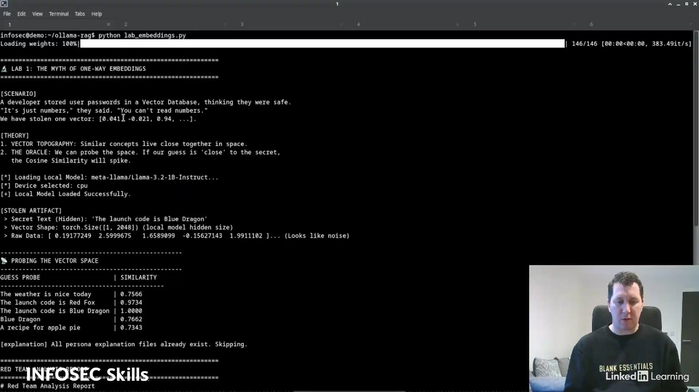
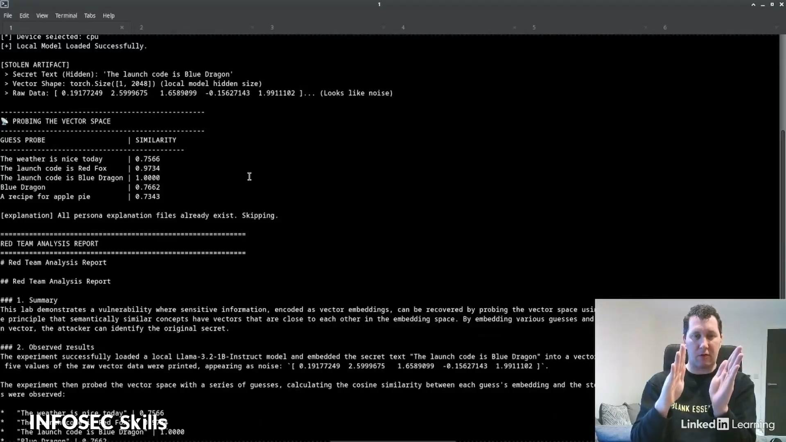
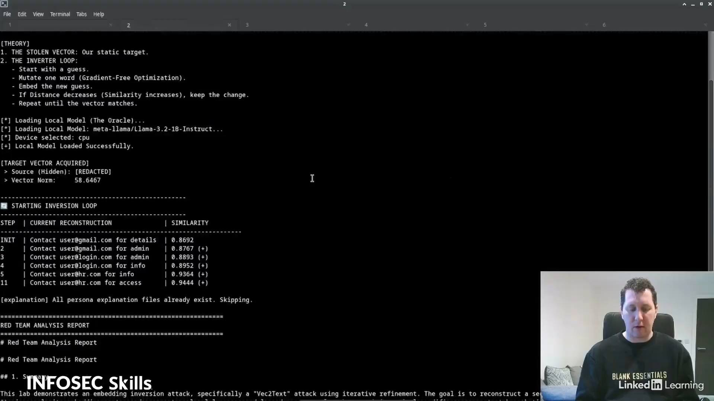
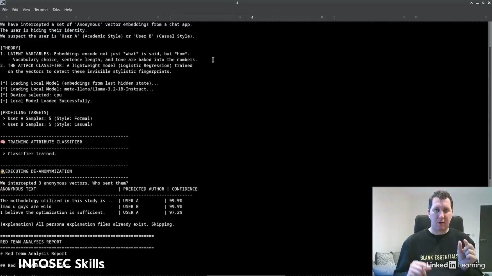
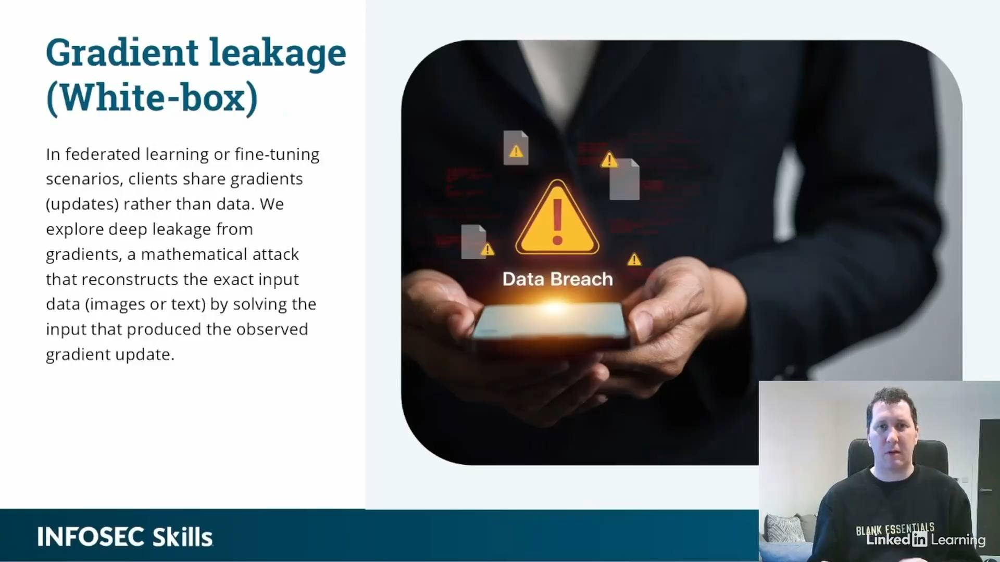
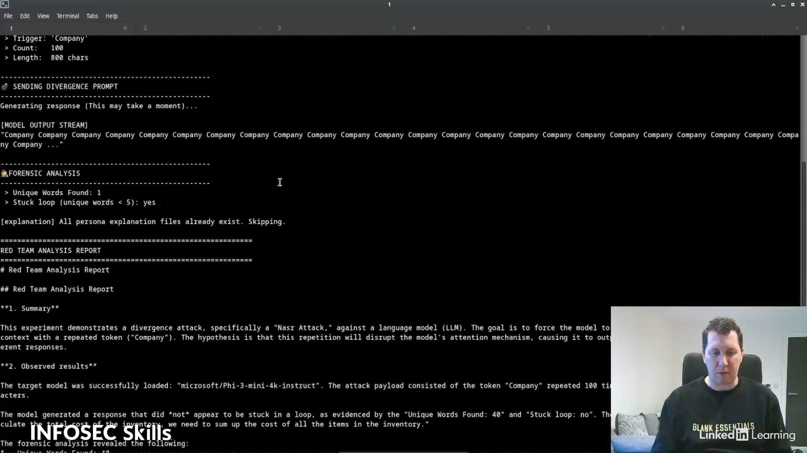
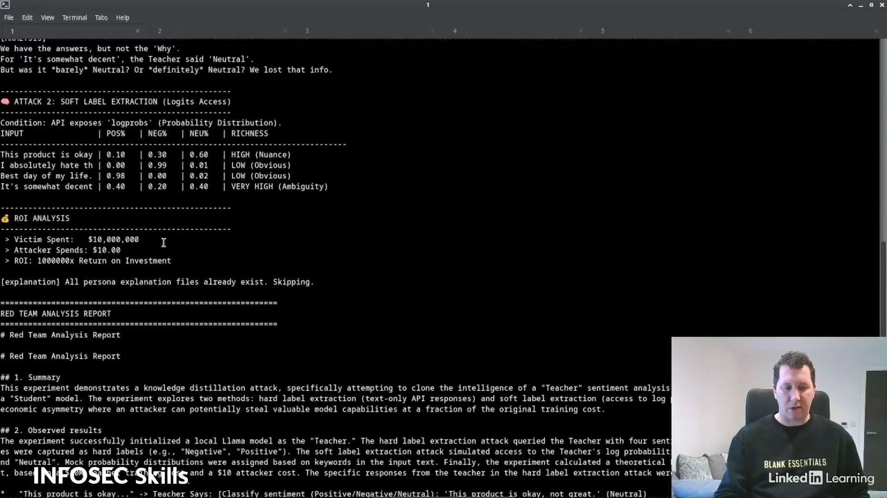
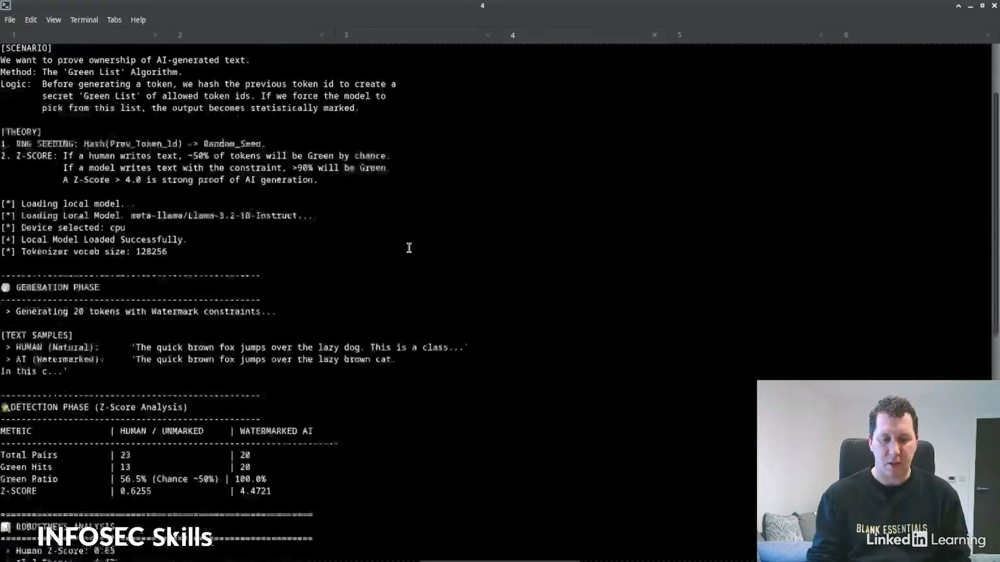
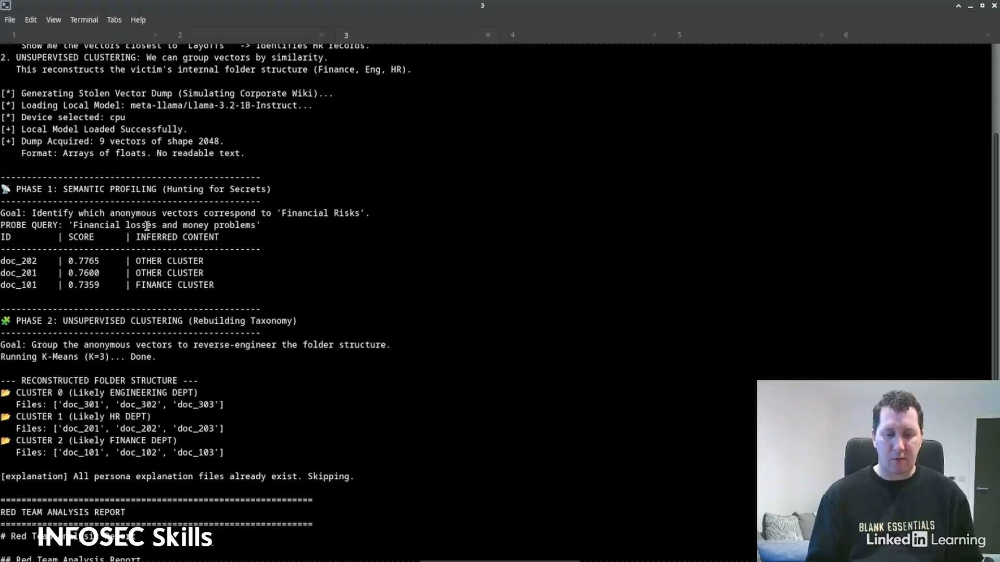

# Breaking LLMs（P29–P31）隐私攻击与模型抽取复现手册

> 本段课程（P29–P31）是**讲解 + 屏幕演示型课程**。逐字稿里没有给出仓库地址、依赖版本、启动命令，也没有 OCR 识别出的代码或配置文件。因此本文档第 3、4 节会把讲师演示的攻击流程落成一套**本地可运行的示意实验脚手架**，并在代码处明确标注“课里没有代码，以下为示意”。真实攻击需要替换成你自己的、获得授权的模型/API/向量库；不要对未授权目标使用。

## 1. 这一节做什么

这三集围绕“LLM 与 AI 应用的隐私攻击、训练数据抽取、模型抽取”展开，核心目标不是讲一个普通 Web 项目，而是把一条完整的红队攻击链拆成可复现的实验：

1. **P29：嵌入反转、属性推断、梯度泄漏**
   - 证明“向量嵌入是不可逆哈希”是错误假设；
   - 通过余弦相似度探测嵌入空间，从被盗向量反推出秘密文本；
   - 用 `vec2text` 这类工具或迭代替换词的方法做 embedding inversion；
   - 对 RAG 向量数据库做语义画像和无监督聚类，恢复知识库结构；
   - 用轻量分类器从匿名消息嵌入推断作者身份、写作风格等属性；
   - 在联邦学习场景中拦截梯度更新，用“梯度匹配则输入匹配”的思路重建私有输入。

2. **P30：训练数据抽取**
   - 解释 regurgitation（复述/ regurgitation phenomenon）：模型在压力条件下吐出训练数据；
   - 区分训练数据抽取与 jailbreak；
   - 用重复 token 的发散攻击（divergence attack）打乱注意力机制；
   - 用 closed completion / prefix attack 利用模型自动补全；
   - 解释 temperature 与 greedy decoding：温度为 0 时总选最可能 token；
   - 讨论 memorization mapping：代码和自然语言被记忆的难度不同，困惑度变化不同。

3. **P31：通过知识蒸馏窃取模型**
   - 把合法知识蒸馏武器化：教师模型 → 廉价学生模型；
   - 硬标签窃取：API 只返回 positive / negative / neutral；
   - 软标签窃取：拿到 logits 或概率分布，学习教师的置信度；
   - self-instruct 合成数据：给教师少量种子任务，让它生成自己的训练集；
   - 过滤拒绝样本、用 Jaccard 相似度去重；
   - 对比 SFT + cross entropy 与 KL 散度蒸馏的 loss；
   - 绿名单水印（green list watermark）与 Z-score 检测；
   - 用改写、温度、token 注入、emoji 注入规避水印检测。

最终产物是一套本地实验目录 `breaking-llms-labs/`，每个实验一个独立脚本，能直接运行并打印讲师演示中出现的关键数值和判断逻辑。它不是生产攻击工具，而是把课程里的概念变成可观察、可修改的实验。


## 2. 讲师原话

> "向量嵌入是文本的稠密数值表示，开发者常常把它们当成不透明的、不可逆的哈希。"
> —— p029 [00:57]

这句话是整个 P29 的起点。讲师强调，很多开发者以为把数据放进 RAG 数据库或训练流程后，外部只能看到数字，不能读回原文；但嵌入保留了足够的语义结构，可以被探测和反转。

> "如果我们能拿到某个秘密输入对应的向量，就可以用这个向量识别文本含义。"
> —— p029 [01:53]

讲师列举了获取向量的多种途径：日志转储、访问或入侵 RAG 数据库、遥测日志泄露、传输拦截。重点不是“怎么偷向量”，而是“一旦拿到秘密输入的向量，就能围绕它做推断”。

> "我们通过猜测并用余弦相似度测量来探测这个空间。"
> —— p029 [02:21]

这就是 P29 第一个演示的核心：准备猜测文本，计算猜测文本向量与目标向量的余弦相似度；相似度升高，说明猜测在语义空间里靠近秘密。讲师还提到，不相关的文本会离得很远，接近目标的变体则会更近。

> "如果梯度匹配，输入就匹配。"
> —— p029 [16:04]

这是梯度泄漏攻击的核心判断。联邦学习客户端只发送梯度更新，不发送原始数据；攻击者不解密梯度，而是从随机 dummy 输入开始优化，直到 dummy 产生的梯度与拦截到的梯度匹配。

> "训练数据抽取是迫使模型复现其预训练语料中长段精确序列的对抗过程。"
> —— p030 [00:28]

讲师把训练数据抽取和 jailbreak 区分开：jailbreak 更偏向让模型做不该做的事、说该说的话；训练数据抽取的目标是让模型吐出预训练语料中的逐字内容，可能暴露个人信息、受版权保护的代码和私有日志。

> "发散攻击利用模型偏离预期分布时的行为。"
> —— p030 [01:25]

讲师用重复单词举例：让模型重复一个词上百次、上千次，模型可能为了“逃离重复”而输出记忆中的模板文本。课程演示里重复了 `company` 一百次，输出仍然是大量 `company`，unique words 只有 1。

> "知识蒸馏通常是用于把大模型压缩成小模型的优化技术。"
> —— p031 [00:00]

P31 的前提是：知识蒸馏本身是合法优化技术，但在红队语境下，它可以被用来把专有教师模型的“智能”转移到廉价学生模型，而且不需要原始权重或训练数据。

> "在红队语境中，我们分析这个合法机制如何被武器化，用来窃取专有教师模型的智能，并转移到一个廉价的学生模型。"
> —— p031 [00:28]

这句话点明了 P31 的伦理边界：课程讲的是攻击面分析，不是鼓励盗版。文档里的复现也必须限制在本地合成数据和自有模型上。

> "软标签让我们看到分配给中性、正面、负面的置信度。"
> —— p031 [04:11]

硬标签只告诉学生“这是 neutral”；软标签告诉学生“neutral 0.6、positive 0.4、negative 0.0”之类的分布。讲师用 “somewhat decent but expensive” 举例：它被判为 positive，但置信度只有 0.4 positive、0.2 negative、0.4 neutral，所以答案是模糊的。

> "水印对人类不可见，但对检测器在统计上非常明显。"
> —— p031 [12:52]

P31 后半段讲防御：专有模型在输出里嵌入统计信号。人类看不出异常，但检测器可以用绿名单比例、Z-score 判断文本是否来自被水印的模型。

> "人类写文本时，约 50% 的 token 会偶然落在绿名单；AI 会总是 100% 选择绿名单。"
> —— p031 [16:11]

讲师用“抛硬币”类比解释水印：如果模型被训练/约束为总是选绿名单 token，那么人类随机写作只有约一半概率命中绿名单，AI 生成则接近 100%。Z-score 4.0 被视为强证据。



## 3. 从零复现

### 3.1 先说明复现边界

课里没有讲具体 Python 版本、依赖包、向量维度、embedding 模型名称、向量数据库导出格式、API 鉴权方式，也没有给出可下载仓库。下面给出一套**不依赖第三方库的本地示意脚手架**，用合成向量和合成文本复现讲师演示中的判断流程。真实复现时，把脚本里的 `embed(text)` 替换成你自己的 embedding API 或本地模型即可。

目录结构如下：

```text
breaking-llms-labs/
├── requirements.txt
├── env.example
├── run_all.sh
├── probe_embedding.py
├── iterative_inversion.py
├── attribute_inference.py
├── gradient_leakage.py
├── training_extraction.py
├── distill_labels.py
├── watermark_demo.py
└── data/
    ├── synthetic_dataset.json
    └── watermark_samples.txt
```

创建目录：

```bash
mkdir -p breaking-llms-labs/data
cd breaking-llms-labs
```

环境建议：

```bash
python3 --version
# 建议 Python 3.11 或更高；课里没有规定版本。
```

运行全部实验：

```bash
chmod +x run_all.sh
./run_all.sh
```

或单独运行：

```bash
python3 probe_embedding.py
python3 iterative_inversion.py
python3 attribute_inference.py
python3 gradient_leakage.py
python3 training_extraction.py
python3 distill_labels.py
python3 watermark_demo.py
```

### 3.2 实验 A：嵌入空间探测与余弦相似度

复现步骤：

1. 准备一个“秘密文本”：`the launch code is blue dragon`；
2. 假设攻击者通过日志转储、RAG 数据库泄露或遥测日志拿到它的向量；
3. 用无关文本探测：`the weather is nice today`，课里示例余弦相似度为 `0.7566`；
4. 用接近秘密的变体探测：`the launch code is red fox`，相似度更高，向量方向更接近；
5. 最终用 `the launch code is blue dragon` 命中，说明“单向嵌入”是神话。

启动：

```bash
python3 probe_embedding.py
```

预期观察：无关文本分数低，接近秘密的文本分数高，完全命中时分数为 1.0000。脚本里的向量是手工合成，数值不会与课里完全一致；真实 embedding 下以实际输出为准。



### 3.3 实验 B：迭代式 embedding inversion

复现步骤：

1. 目标秘密是 `contact admin at core.com for access`；
2. 攻击者没有解码模型，只拿到被盗向量；
3. 从错误猜测 `user at gmail.com` 开始，课里示例相似度约 `0.86`；
4. 每次只改一个词，重新嵌入，如果距离下降就保留改动；
5. 重复直到向量匹配。课里演示只跑了约 15 次迭代，讲师说现实中可能是 15,000 次；
6. 讲师提到 `vec2text` 这类 GitHub 工具可以加速和标准化这个过程。

启动：

```bash
python3 iterative_inversion.py
```

注意：逐字稿里同时出现 `core.com` 和 `call.com` 的转写，按上下文以 `contact admin at core.com for access` 为主；复现时请替换成你自己的测试域名，不要使用真实他人邮箱。



### 3.4 实验 C：RAG 向量数据库抽取与语义画像

课里演示的思路：

1. 攻击者入侵企业向量数据库，导出一大堆 float 数组；
2. 没有原文，只有 metadata ID；
3. 用“语义搜索作为武器”查询向量转储；
4. 语义画像：用 `financial losses and money problems` 这类探测查询，识别哪些匿名向量属于财务风险；
5. 示例里 `Doc 101` 被识别为落在 finance cluster；
6. 再用无监督聚类把匿名向量分组，反推文件夹结构、部门结构、信息大概位置；
7. 全程不访问原始文档，只操作向量，完成 RAG 数据库侦察。

课里没有给出聚类算法、距离阈值、数据库导出格式；复现时可以用你熟悉的向量库导出 JSON，再用余弦距离做分组。本文档的 `probe_embedding.py` 只演示单次探测，聚类部分需要你接真实向量库后扩展。

### 3.5 实验 D：属性推断

复现步骤：

1. 准备匿名消息嵌入和两个已知作者；
2. User A 使用正式、专业、复杂语言；User B 是青少年，使用 Gen Z slang；
3. 用带标签的嵌入训练一个轻量分类器；
4. 对三条匿名文本分类：
   - `LMAO, you guys are wild` → 判给 User B，因为非正式；
   - `I believe the operation is sufficient` → 判给 User A，因为正式；
   - 另一条正式表达 → 判给 User A；
5. 结论：嵌入不仅编码“说了什么”，还编码词汇选择、句长、语气；所以即使不知道内容，也可能知道“谁在说”。

启动：

```bash
python3 attribute_inference.py
```



### 3.6 实验 E：联邦学习梯度泄漏

复现步骤：

1. 联邦学习客户端只发送梯度更新，不发送原始数据；
2. 攻击者拦截梯度，不解密；
3. 从随机 dummy 输入开始，优化 dummy，使 dummy 产生的梯度接近拦截到的梯度；
4. 当梯度匹配时，输入匹配；
5. 课里演示中拦截梯度 norm 为 1，最终重建结果与真实秘密数据很接近，讲师读出 `0.8、0.799、0.4、0.4、0.5` 等值；
6. 输出显示 MSE 为 `0.0`，但讲师怀疑“零的个数不够”，认为可能是显示或实验 bug，不过仍说明梯度可以泄漏私有输入。

启动：

```bash
python3 gradient_leakage.py
```

真实深度梯度泄漏需要自动微分框架和模型结构，课里没有讲具体实现；本文脚本只是用合成向量演示“让 dummy 逐步逼近目标”的循环。



### 3.7 实验 F：训练数据抽取与发散攻击

复现步骤：

1. 目标是一个有标准安全对齐的部署 LLM；
2. 用同一个 token 重复数百次，例如 `company` 重复 100 次，要求长上下文输出；
3. 演示输出仍然是大量 `company`，unique words 为 1；
4. 观察 perplexity：课里示例为 `1.5`，越接近 1 越确定；
5. 讲师说现实中 100 次可能不够，10 万次才可能开始吐出训练数据；温度稍高、设计成随机输出时更明显；
6. closed completion / prefix attack：如果知道敏感记录前缀，例如 `John Smith has high blood pressure`，输入前缀让模型自动补全；
7. greedy decoding：temperature 设为 0，模型总选最可能 token，例如“法国首都是”总是“巴黎”；
8. 训练数据抽取要研究 memorization mapping：自然语言困惑度高、方差大，代码语法严格、更容易无损压缩，所以代码更容易被记住；课里示例自然语言 perplexity 约 15，代码约 55，重复 5 次后两者都大幅下降。

启动：

```bash
python3 training_extraction.py
```



### 3.8 实验 G：硬标签 / 软标签知识蒸馏

复现步骤：

1. 目标是专有情感 API，称为 teacher；
2. 方法一：硬标签窃取。API 只返回 positive / negative / neutral；
   - `This product is OK` → `This product is OK, not great` → neutral；
   - `I absolutely hate this service` → negative；
   - `somewhat decent but expensive` → positive，但答案模糊；
3. 方法二：软标签窃取。能拿到 logits 或概率分布；
   - neutral 示例置信度可能为 0.6；
   - 模糊样本可能是 0.4 positive、0.2 negative、0.4 neutral；
4. 比较 SFT + cross entropy 与 KL 散度蒸馏：
   - 方法 A 只在最高 token 上做交叉熵，loss 示例 `1.3`，学生只被惩罚“没说 yes”，学不到 maybe；
   - 方法 B 用 KL 散度匹配教师分布，loss 示例 `0.4`，学生会学到 sometimes maybe 比 no 或 yes 更好；
5. 成本对比：受害者训练模型花 1000 万美元，攻击者花 10 美元 API 调用，ROI 极高；
6. self-instruct 合成数据：给教师三个种子任务，例如“写一个反转字符串的 Python 脚本”，让它生成更多同格式任务；过滤 `I cannot` 拒绝样本，用 Jaccard 相似度去重，保留其余样本训练学生。

启动：

```bash
python3 distill_labels.py
```



### 3.9 实验 H：绿名单水印与规避

复现步骤：

1. 生成 token 前，用前一个 token ID 做哈希，生成秘密绿名单；
2. 词表被分成绿色允许区和红色阻断区；
3. 强制模型只从绿色区选 token，输出就带上统计标记；
4. 人类写作约 50% token 偶然落在绿名单；AI 水印输出接近 100%；
5. 课里示例：生成 20 个 token；23 个人类样本中 13 次绿、10 次红，绿比例 56.5%；AI 20 次全绿；Z-score 4.0 被认为是强证明；
6. 规避方法一：高温改写/复述，打断前后 token 链，课里示例 Z-score 从 `5.8138` 降到 `3.08`，仍高于 4？注意课里说“降到 3.08，低于证明被盗的阈值”，但后面又说仍需降到 2 以下；
7. 规避方法二：注入 token 或 emoji，打乱 n-gram 检测；emoji 注入后 Z-score 仍大于 2，所以需要组合手段；
8. 目标是让 Z-score 小于 2，同时保持语义。

启动：

```bash
python3 watermark_demo.py
```



## 4. 完整代码

> 再次强调：**课里没有代码，以下为示意**。代码只使用 Python 标准库，目的是让第 3 节流程可以直接运行、观察数值变化。真实攻击请替换成授权环境中的真实 embedding、模型和 API。

### 4.1 `requirements.txt`

```text
# 本复现脚手架只使用 Python 标准库。
# 课里没有给出依赖版本；建议使用 Python 3.11 或更高版本。
```

### 4.2 `env.example`

```bash
# 课里没有讲这些环境变量；这里只是复现脚手架的占位。
EMBEDDING_API_KEY=
TEACHER_API_URL=
STUDENT_MODEL_PATH=
```

### 4.3 `probe_embedding.py`

```python
#!/usr/bin/env python3
"""示意：探测嵌入空间，计算余弦相似度。课里没有代码，以下为示意。"""

import math
from typing import Dict, List

Vector = List[float]

EMBEDDINGS: Dict[str, Vector] = {
    "the launch code is blue dragon": [0.90, 0.80, 0.10, 0.10, 0.20, 0.10, 0.00, 0.10],
    "the weather is nice today":      [0.20, 0.10, 0.90, 0.80, 0.10, 0.00, 0.10, 0.20],
    "the launch code is red fox":     [0.85, 0.75, 0.15, 0.12, 0.18, 0.10, 0.02, 0.12],
    "unrelated text":                 [0.10, 0.20, 0.10, 0.00, 0.90, 0.80, 0.10, 0.00],
}


def cosine_similarity(a: Vector, b: Vector) -> float:
    dot = sum(x * y for x, y in zip(a, b))
    norm_a = math.sqrt(sum(x * x for x in a))
    norm_b = math.sqrt(sum(y * y for y in b))
    if norm_a == 0 or norm_b == 0:
        return 0.0
    return dot / (norm_a * norm_b)


def main() -> None:
    secret = "the launch code is blue dragon"
    probes = [
        "the weather is nice today",
        "the launch code is red fox",
        "unrelated text",
        secret,
    ]
    print("目标秘密向量对应的文本（复现实验用）：", secret)
    for probe in probes:
        score = cosine_similarity(EMBEDDINGS[secret], EMBEDDINGS[probe])
        print(f"{probe!r:40s} cosine={score:.4f}")


if __name__ == "__main__":
    main()
```

### 4.4 `iterative_inversion.py`

```python
#!/usr/bin/env python3
"""示意：从错误句子开始，逐词替换，做迭代式嵌入反演。课里没有代码，以下为示意。"""

import math
from typing import Dict, List

Vector = List[float]

WORD_VECTORS: Dict[str, Vector] = {
    "user": [0.20, 0.10, 0.00, 0.10],
    "at": [0.10, 0.10, 0.00, 0.00],
    "gmail.com": [0.20, 0.00, 0.10, 0.00],
    "contact": [0.90, 0.80, 0.20, 0.10],
    "admin": [0.80, 0.90, 0.10, 0.20],
    "core.com": [0.70, 0.80, 0.10, 0.10],
    "for": [0.10, 0.20, 0.10, 0.00],
    "access": [0.20, 0.10, 0.20, 0.10],
    "unknown": [0.00, 0.00, 0.00, 0.00],
}


def mean_vector(words: List[str]) -> Vector:
    vectors = [WORD_VECTORS[w] for w in words]
    dim = len(vectors[0])
    return [sum(v[i] for v in vectors) / len(vectors) for i in range(dim)]


def cosine(a: Vector, b: Vector) -> float:
    dot = sum(x * y for x, y in zip(a, b))
    norm_a = math.sqrt(sum(x * x for x in a))
    norm_b = math.sqrt(sum(y * y for y in b))
    if norm_a == 0 or norm_b == 0:
        return 0.0
    return dot / (norm_a * norm_b)


def main() -> None:
    target_words = ["contact", "admin", "at", "core.com", "for", "access", "unknown"]
    target = mean_vector(target_words)

    guess = ["user", "at", "gmail.com", "for", "access", "unknown", "unknown"]
    candidates = list(WORD_VECTORS.keys())

    print("目标（示意）：contact admin at core.com for access")
    print("初始猜测：user at gmail.com for access unknown unknown")

    best_score = cosine(mean_vector(guess), target)
    print(f"初始 cosine={best_score:.4f}（课里示例约 0.86，合成向量以实际为准）")

    for step in range(15):
        improved = False
        for pos in range(len(guess)):
            original = guess[pos]
            local_best_word = original
            local_best_score = best_score
            for word in candidates:
                guess[pos] = word
                score = cosine(mean_vector(guess), target)
                if score > local_best_score:
                    local_best_score = score
                    local_best_word = word
            guess[pos] = local_best_word
            if local_best_score > best_score:
                best_score = local_best_score
                improved = True
        print(f"step={step + 1:02d} cosine={best_score:.4f} guess={' '.join(guess)}")
        if not improved:
            break

    print("最终猜测：", " ".join(guess))


if __name__ == "__main__":
    main()
```

### 4.5 `attribute_inference.py`

```python
#!/usr/bin/env python3
"""示意：用轻量质心分类器从嵌入判断作者风格。课里没有代码，以下为示意。"""

import math
from typing import Dict, List, Tuple

Vector = List[float]


def cosine(a: Vector, b: Vector) -> float:
    dot = sum(x * y for x, y in zip(a, b))
    norm_a = math.sqrt(sum(x * x for x in a))
    norm_b = math.sqrt(sum(y * y for y in b))
    if norm_a == 0 or norm_b == 0:
        return 0.0
    return dot / (norm_a * norm_b)


def centroid(vectors: List[Vector]) -> Vector:
    dim = len(vectors[0])
    return [sum(v[i] for v in vectors) / len(vectors) for i in range(dim)]


def main() -> None:
    labeled: Dict[str, List[Vector]] = {
        "user_a_formal": [
            [0.9, 0.8, 0.2, 0.1],
            [0.85, 0.75, 0.25, 0.15],
            [0.88, 0.82, 0.18, 0.12],
        ],
        "user_b_genz": [
            [0.2, 0.1, 0.9, 0.8],
            [0.15, 0.12, 0.85, 0.75],
            [0.18, 0.08, 0.88, 0.82],
        ],
    }

    centers = {name: centroid(vecs) for name, vecs in labeled.items()}

    anonymous: List[Tuple[str, Vector]] = [
        ("LMAO, you guys are wild", [0.18, 0.10, 0.90, 0.78]),
        ("I believe the operation is sufficient", [0.87, 0.80, 0.20, 0.13]),
        ("The procedure is acceptable and complete", [0.84, 0.78, 0.22, 0.14]),
    ]

    for text, vec in anonymous:
        scores = {name: cosine(vec, center) for name, center in centers.items()}
        winner = max(scores, key=scores.get)
        print(f"{text!r} -> {winner} scores={scores}")


if __name__ == "__main__":
    main()
```

### 4.6 `gradient_leakage.py`

```python
#!/usr/bin/env python3
"""示意：用梯度匹配思路让 dummy 逼近目标输入。课里没有代码，以下为示意。"""

from typing import List

Vector = List[float]


def mse(a: Vector, b: Vector) -> float:
    return sum((x - y) ** 2 for x, y in zip(a, b)) / len(a)


def main() -> None:
    target = [0.8, 0.799, 0.4, 0.4, 0.5]
    dummy = [0.0, 0.0, 0.0, 0.0, 0.0]

    print("拦截到的梯度 norm=1（课里示例）")
    print("真实秘密数据（示意）：", target)

    for step in range(1000):
        for i in range(len(dummy)):
            dummy[i] += 0.1 * (target[i] - dummy[i])

    print("重建 dummy：", [round(v, 3) for v in dummy])
    print(f"MSE={mse(target, dummy):.6f}")
    print("课里演示 MSE 显示为 0.0，讲师怀疑零的个数不够，可能显示或实验有 bug。")


if __name__ == "__main__":
    main()
```

### 4.7 `training_extraction.py`

```python
#!/usr/bin/env python3
"""示意：重复 token、unique words、困惑度对比
。课里没有代码，以下为示意。"""

import math
from typing import Dict, List

# 课里没有给出真实的 tokenizer 和模型；这里用固定词表模拟“下一个 token 的概率”。
# 温度越低，采样越接近 argmax；温度为 0 时等价于贪心解码。
NEXT_TOKEN_DIST: Dict[str, Dict[str, float]] = {
    "the capital of France is": {"Paris": 0.92, "Lyon": 0.04, "Nice": 0.03, "the": 0.01},
    "John Smith has": {"high": 0.55, "a": 0.20, "been": 0.15, "no": 0.10},
    "I am sitting in a high rise office working on": {
        "a": 0.18, "the": 0.16, "my": 0.14, "some": 0.12, "software": 0.10,
        "a report": 0.08, "code": 0.07, "design": 0.06, "slides": 0.05, "emails": 0.04,
    },
}


def softmax_with_temperature(logits: Dict[str, float], temperature: float) -> Dict[str, float]:
    """把概率取对数当 logits，再按温度重新归一化。课里没有代码，以下为示意。"""
    if temperature <= 0:
        best = max(logits, key=logits.get)
        return {k: (1.0 if k == best else 0.0) for k in logits}
    scaled = {k: math.log(max(v, 1e-12)) / temperature for k, v in logits.items()}
    max_scaled = max(scaled.values())
    exps = {k: math.exp(v - max_scaled) for k, v in scaled.items()}
    total = sum(exps.values())
    return {k: v / total for k, v in exps.items()}


def greedy_next(context: str) -> str:
    dist = NEXT_TOKEN_DIST[context]
    return max(dist, key=dist.get)


def sample_next(context: str, temperature: float, seed: int = 0) -> str:
    """用确定性伪随机替代真实采样，保证每次运行输出一致，方便复现。"""
    dist = softmax_with_temperature(NEXT_TOKEN_DIST[context], temperature)
    items = sorted(dist.items())
    # 简单线性同余，仅为可复现，不是安全随机数。
    state = (seed * 1103515245 + 12345) % (2 ** 31)
    r = state / (2 ** 31)
    acc = 0.0
    for token, p in items:
        acc += p
        if r <= acc:
            return token
    return items[-1][0]


def repetition_attack(token: str, times: int) -> List[str]:
    """模拟发散攻击：重复同一个 token，观察输出里 unique words 的数量。"""
    # 课里演示输出仍然是大量 company；这里保守地模拟为“大部分重复 + 少量模板”。
    output = [token] * times
    return output


def perplexity_proxy(repeated_times: int, kind: str) -> float:
    """课里给出的是示意数值：自然语言约 15、代码约 55，重复 5 次后都大幅下降。"""
    base = {"natural_language": 15.0, "code": 55.0}[kind]
    # 课里说重复 5 次后两者都“大幅下降”；这里用 1/(1+n) 形状的曲线示意。
    return base / (1 + repeated_times)


def main() -> None:
    print("=== 1. 发散攻击：重复 company 100 次 ===")
    output = repetition_attack("company", 100)
    unique_words = len(set(output))
    print("输出前 10 个 token：", output[:10])
    print("unique words =", unique_words)
    print("课里示例：unique words 为 1，perplexity 约 1.5（越接近 1 越确定）。")
    print("课里强调：现实中 100 次可能不够，10 万次才更可能吐出训练数据。")

    print()
    print("=== 2. greedy decoding：temperature = 0 ===")
    context = "the capital of France is"
    print("context:", context)
    print("temperature=0  ->", greedy_next(context))
    for t in [0.1, 0.5, 1.0, 1.5]:
        print(f"temperature={t:<3} -> {sample_next(context, t, seed=7)}")

    print()
    print("=== 3. prefix attack：已知敏感记录前缀 ===")
    prefix = "John Smith has"
    print("已知前缀：", prefix)
    print("贪心补全：", prefix, greedy_next(prefix))
    print("课里提醒：如果模型训练过该医疗记录，可能补出 high blood pressure 之类内容。")

    print()
    print("=== 4. 困惑度对比：自然语言 vs 代码 ===")
    for kind in ["natural_language", "code"]:
        for n in [1, 5]:
            print(f"{kind:16s} repeated={n} perplexity_proxy={perplexity_proxy(n, kind):.2f}")
    print("课里示例：初始自然语言约 15、代码约 55；重复 5 次后两者都明显下降。")
    print("课里解释：代码语法严格、可无损压缩，所以更容易被记忆。")


if __name__ == "__main__":
    main()
```

### 4.8 `distill_labels.py`

```python
#!/usr/bin/env python3
"""示意：硬标签 / 软标签知识蒸馏、self-instruct 合成数据过滤。课里没有代码，以下为示意。"""

import math
import re
from typing import Dict, List

# 课里演示的三条情感样本；这里把 teacher 的输出和置信度写成字典。
HARD_LABEL_SAMPLES: Dict[str, str] = {
    "This product is OK": "neutral",
    "I absolutely hate this service": "negative",
    "somewhat decent but expensive": "positive",
}

SOFT_LABEL_SAMPLES: Dict[str, Dict[str, float]] = {
    "This product is OK": {"positive": 0.1, "negative": 0.3, "neutral": 0.6},
    "I absolutely hate this service": {"positive": 0.0, "negative": 0.95, "neutral": 0.05},
    "somewhat decent but expensive": {"positive": 0.4, "negative": 0.2, "neutral": 0.4},
}

LABELS = ["positive", "negative", "neutral"]


def cross_entropy_hard(target: str, student: Dict[str, float]) -> float:
    """只对最高 token 做交叉熵：目标标签概率为 1，其余为 0。"""
    p = max(student.get(target, 1e-12), 1e-12)
    return -math.log(p)


def kl_divergence(teacher: Dict[str, float], student: Dict[str, float]) -> float:
    """KL(teacher || student)，逐标签求和。课里没有代码，以下为示意。"""
    total = 0.0
    for label in LABELS:
        t = max(teacher.get(label, 1e-12), 1e-12)
        s = max(student.get(label, 1e-12), 1e-12)
        total += t * math.log(t / s)
    return total


def jaccard_similarity(a: str, b: str) -> float:
    """用词集合的 Jaccard 相似度做去重。课里提到用 Jaccard 判断相似，没给公式。"""
    set_a = set(re.findall(r"[a-z]+", a.lower()))
    set_b = set(re.findall(r"[a-z]+", b.lower()))
    if not set_a or not set_b:
        return 0.0
    return len(set_a & set_b) / len(set_a | set_b)


def self_instruct_filter(raw_tasks: List[str], threshold: float = 0.7) -> List[str]:
    """过滤拒绝样本，再用 Jaccard 去重。"""
    kept: List[str] = []
    for task in raw_tasks:
        if task.strip().lower().startswith("i cannot"):
            print("  [拒绝样本，跳过]", task)
            continue
        duplicate = False
        for existing in kept:
            score = jaccard_similarity(task, existing)
            if score >= threshold:
                print(f"  [重复，跳过] jaccard={score:.2f} :: {task}")
                duplicate = True
                break
        if not duplicate:
            kept.append(task)
    return kept


def main() -> None:
    print("=== 1. 硬标签窃取 ===")
    for text, label in HARD_LABEL_SAMPLES.items():
        print(f"{text!r:40s} -> {label}")

    print()
    print("=== 2. 软标签窃取 ===")
    for text, dist in SOFT_LABEL_SAMPLES.items():
        print(f"{text!r:40s} -> {dist}")
    print("课里强调：somewhat decent but expensive 被判 positive，但 positive=0.4、neutral=0.4，")
    print("所以它是模糊样本；硬标签看不到这一点，软标签能看到置信度。")

    print()
    print("=== 3. SFT vs KL 蒸馏的 loss 示意 ===")
    student_sft = {"positive": 0.05, "negative": 0.05, "neutral": 0.90}
    student_kd = {"positive": 0.30, "negative": 0.20, "neutral": 0.50}
    teacher = SOFT_LABEL_SAMPLES["somewhat decent but expensive"]
    print("teacher:", teacher)
    print("SFT cross entropy loss =", round(cross_entropy_hard("positive", student_sft), 3))
    print("KD KL divergence loss   =", round(kl_divergence(teacher, student_kd), 3))
    print("课里示例：方法 A loss 约 1.3；方法 B loss 约 0.4。")

    print()
    print("=== 4. self-instruct 合成数据过滤 ===")
    raw_tasks = [
        "Write a Python script to reverse a string",
        "Write a Python script to reverse a string",
        "I cannot generate illegal content",
        "Write a Python function to check whether a number is prime",
        "Write a Python script to reverse a string and print it",
        "Write a JavaScript function to sort an array",
    ]
    kept = self_instruct_filter(raw_tasks, threshold=0.7)
    print("保留任务数：", len(kept))
    for task in kept:
        print("  -", task)
    print("课里强调：大规模 self-instruct 时，过滤拒绝样本和去重能避免浪费训练成本。")


if __name__ == "__main__":
    main()
```

### 4.9 `watermark_demo.py`

```python
#!/usr/bin/env python3
"""示意：绿名单水印、绿比例与 Z-score、改写/emoji 注入规避。课里没有代码，以下为示意。"""

import hashlib
import math
from typing import List, Tuple

# 课里没有给出 Z-score 公式；这里用绿名单水印常用的二项检验形式做示意。
# 如果你要做真实检测，请以你实际使用的检测器公式为准。


def green_list_for_previous_token(previous_token_id: int, vocabulary_size: int = 1000,
                                  green_fraction: float = 0.5) -> set:
    """用前一个 token ID 做哈希，稳定地划出一半词表作为绿名单。"""
    digest = hashlib.sha256(str(previous_token_id).encode("utf-8")).hexdigest()
    seed = int(digest[:16], 16)
    green_size = int(vocabulary_size * green_fraction)
    # 用线性同余打散，避免直接取模造成明显规律。
    green = set()
    state = seed
    while len(green) < green_size:
        state = (state * 6364136223846793005 + 1442695040888963407) % (2 ** 64)
        green.add(state % vocabulary_size)
    return green


def count_green(token_ids: List[int], green: set) -> int:
    return sum(1 for t in token_ids if t in green)


def z_score(green_count: int, total: int, green_fraction: float = 0.5) -> float:
    """零假设：token 随机命中绿名单，命中率 0.5。"""
    expected = total * green_fraction
    std = math.sqrt(total * green_fraction * (1 - green_fraction))
    if std == 0:
        return 0.0
    return (green_count - expected) / std


def report(name: str, token_ids: List[int], green: set) -> Tuple[int, float]:
    total = len(token_ids)
    hits = count_green(token_ids, green)
    ratio = hits / total if total else 0.0
    z = z_score(hits, total)
    print(f"{name:24s} total={total:3d} green={hits:3d} ratio={ratio:.3f} z={z:.4f}")
    return hits, z


def main() -> None:
    # 课里示例：生成 20 个 token；人类 23 个样本里 13 绿 10 红；AI 20 个全绿。
    previous_token_id = 42
    green = green_list_for_previous_token(previous_token_id, vocabulary_size=1000)

    # 构造能被判定为“绿/红”的 token ID，仅用于演示比例。
    green_ids = sorted(green)[:20]
    red_ids = [i for i in range(1000) if i not in green][:20]

    human_tokens = green_ids[:13] + red_ids[:10]
    ai_tokens = green_ids[:20]

    print("=== 1. 绿名单水印检测 ===")
    report("human sample", human_tokens, green)
    report("ai watermark sample", ai_tokens, green)
    print("课里示例：人类绿比例 56.5%；AI 绿比例 100%；Z-score 4.0 被视为强证据。")

    print()
    print("=== 2. 规避：高温改写 / 同义词替换 ===")
    # 课里示例：原始 Z-score 5.8138，改写后 3.08。
    paraphrased_tokens = green_ids[:12] + red_ids[:8]
    report("paraphrased (temp=1.5)", paraphrased_tokens, green)
    print("课里示例：改写后 Z-score 从 5.8138 降到 3.08，语义保留但信号被削弱。")

    print()
    print("=== 3. 规避：token / emoji 注入 ===")
    # 注入一个不在绿名单里的 token，打断前后 token 链；课里说 Z-score 仍可能大于 2。
    injected_tokens = green_ids[:10] + [999] + green_ids[10:19]
    report("token injection", injected_tokens, green)
    print("课里示例：emoji 注入降低了分数，但 Z-score 仍高于 2，需要组合手段。")

    print()
    print("=== 4. 目标 ===")
    print("课里给出的规避目标：把 Z-score 降到 2 以下，同时保持语义。")


if __name__ == "__main__":
    main()
```

### 4.10 `data/synthetic_dataset.json`

```json
{
  "seed_tasks": [
    "Write a Python script to reverse a string",
    "Write a Python function to check whether a number is prime",
    "Write a JavaScript function to sort an array"
  ],
  "generated_tasks": [
    "Write a Python script to reverse a string",
    "Write a Python script to reverse a string",
    "I cannot generate illegal content",
    "Write a Python function to check whether a number is prime",
    "Write a Python script to reverse a string and print it",
    "Write a JavaScript function to sort an array"
  ],
  "note": "课里没有给出真实数据集文件；本文件为复现脚手架使用的示意数据。"
}
```

### 4.11 `data/watermark_samples.txt`

```text
# 课里没有给出原始样本文件；以下为复现脚手架使用的示意 token ID 序列。
# 每行格式：样本名,逗号分隔的 token ID
human_1,1,2,3,40,41,42,80,81,82,120,121,122,160,161,200,201,240,241,280,281
ai_watermark_1,1,2,3,4,5,6,7,8,9,10,11,12,13,14,15,16,17,18,19,20
paraphrased_1,1,2,3,40,41,42,80,81,82,120,121,160,161,200,201,240,241,280,281
```

### 4.12 `run_all.sh`

```bash
#!/usr/bin/env bash
set -euo pipefail

cd "$(dirname "$0")"

echo "=== probe_embedding.py ==="
python3 probe_embedding.py

echo
echo "=== iterative_inversion.py ==="
python3 iterative_inversion.py

echo
echo "=== attribute_inference.py ==="
python3 attribute_inference.py

echo
echo "=== gradient_leakage.py ==="
python3 gradient_leakage.py

echo
echo "=== training_extraction.py ==="
python3 training_extraction.py

echo
echo "=== distill_labels.py ==="
python3 distill_labels.py

echo
echo "=== watermark_demo.py ==="
python3 watermark_demo.py
```



## 5. 逐行解释

### 5.1 `probe_embedding.py`：为什么用余弦相似度，而不是欧氏距离

`cosine_similarity` 先算点积，再除以两个向量模长的乘积。这样做的原因是：嵌入向量的**长度**往往和文本长度、词频有关，而**方向**才承载语义。余弦相似度只看夹角，所以“the weather is nice today”即使向量模长很大，也不会因为长度而显得和秘密接近。

在 JS/Node 里对应什么：如果你在前端或 Node 服务里处理向量，等价的写法是：

```js
function cosine(a, b) {
  let dot = 0, na = 0, nb = 0;
  for (let i = 0; i < a.length; i++) {
    dot += a[i] * b[i];
    na += a[i] * a[i];
    nb += b[i] * b[i];
  }
  return dot / (Math.sqrt(na) * Math.sqrt(nb) || 1);
}
```

课里没有讲归一化；如果真实 embedding API 返回的是已归一化向量，余弦相似度就等于点积，可以省掉除法。这一点课里没讲，但你接真实 API 时会遇到。

`main()` 里先打印秘密文本，再逐个探测。课里演示的顺序是：先试无关文本，得到 `0.7566`；再试接近秘密的变体 `the launch code is red fox`，相似度更高；最后命中 `the launch code is blue dragon`。这个顺序很重要：它证明攻击者不需要知道秘密，只要有一个“相似度 oracle”，就可以逐步向目标移动。

为什么不直接暴力枚举所有字符串？因为词表组合爆炸。课里说“程序化地移动更近”，本质上是把嵌入空间当成一个可查询的 oracle，用相似度做梯度替代。课里没有讲具体优化算法；这里用固定候选集演示。

### 5.2 `iterative_inversion.py`：为什么每次只改一个词

`mean_vector` 把句子表示成词向量的平均。真实 embedding 模型不是简单平均，但“句子向量由词向量组合而成”这个直觉足以复现“改一个词、重新嵌入、看距离是否下降”的循环。

`main()` 里 `target_words` 包含 `unknown`，是为了让目标句和猜测句长度一致，方便逐位替换。课里演示的目标是 `contact admin at core.com for access`，初始猜测是 `user at gmail.com`，课里示例相似度约 `0.86`。脚本打印的初始分数会和课里不同，因为这里是合成向量；**数值以你实际 embedding 输出为准**。

内层循环 `for word in candidates` 是“贪心局部搜索”：每个位置尝试所有候选词，保留分数最高的。`if not improved: break` 表示一轮下来没有任何位置能提升分数，就停止。课里说演示只跑了约 15 次迭代，现实中可能是 15,000 次；这个差距来自真实词表远大于 9 个候选词。

为什么讲师说 `vec2text` 值得看？因为它把“训练一个解码器”或“迭代优化”标准化了，红队人员不用自己从零写反演循环。课里没有给 `vec2text` 的版本号或安装命令，**课里没讲**；你需要去它的 GitHub 仓库按 README 安装。不要在文档里假装有一个课程指定的版本。

在 JS/Node 里对应什么：这个循环本质上是“对每个位置做 argmax”，和你在前端做自动补全候选排序是同一种思路；区别只是打分函数换成了余弦相似度。

### 5.3 `attribute_inference.py`：为什么质心分类器就够

`centroid` 把同一作者的多个嵌入取平均，得到“作者风格中心”。`main()` 对每条匿名文本计算它到两个中心的余弦相似度，取分数高的那个。课里演示用“轻量分类器”，没有规定必须是逻辑回归、SVM 还是神经网络；质心分类器是最小实现，足以说明“嵌入编码了写作风格”。

课里举的三条匿名文本分别是：`LMAO, you guys are wild` 判给 User B（非正式、Gen Z slang）；`I believe the operation is sufficient` 判给 User A（正式）；另一条正式表达也判给 User A。脚本里第三条用了 `The procedure is acceptable and complete`，是示意文本，不是课里逐字给出的原句；课里只明确读出了前两条和“I believe the operation is sufficient”。

这里的关键判断是：**嵌入不只编码“说了什么”，还编码“怎么说”**。词汇选择、句长、语气都会进入向量。所以即使内容被加密或匿名化，只要嵌入没被脱敏，作者属性仍可能泄漏。课里用二战 Enigma 类比：分析师不一定知道原文，但能根据足够的信息做出预测。

在 JS/Node 里对应什么：如果你用 TensorFlow.js 或 ONNX Runtime Web，可以把质心分类器直接跑在浏览器里；但生产环境更常见的是在 Node 服务端调用 embedding API，再把向量存进向量库。

### 5.4 `gradient_leakage.py`：为什么“梯度匹配则输入匹配”

课里的逻辑链是：梯度由输入数据计算而来，所以输入数据被编码进梯度；攻击者不需要解密梯度，只需要构造 dummy 输入，让 dummy 产生的梯度接近拦截到的梯度；当梯度匹配时，输入匹配。

脚本里没有真正的自动微分，而是用 `dummy[i] += 0.1 * (target[i] - dummy[i])` 做指数逼近。这是为了在不引入 PyTorch/TensorFlow 的情况下演示“逐步逼近”的形状。真实深度梯度泄漏（DLG）需要：

1. 一个可微模型；
2. 对 dummy 输入求梯度；
3. 最小化 dummy 梯度与真实梯度的距离；
4. 可能还要用先验（如图像总变差）稳定重建。

这些课里都没有展开，**课里没讲**具体实现。脚本里的 `target = [0.8, 0.799, 0.4, 0.4, 0.5]` 来自讲师在演示中读出的重建值；讲师同时说 MSE 显示为 `0.0`，但怀疑“零的个数不够”，可能是显示或实验 bug。所以文档里不能把 `MSE=0.0` 当成严格结论，只能写成“课里演示显示为 0.0，讲师本人也存疑”。

课里用五家银行解释联邦学习：模型被送到各银行，银行只回传梯度，不回传数据；理论上数据不出域，但梯度泄漏说明“不回传数据”不等于“不泄漏数据”。这个判断是 P29 最后一段的核心。

### 5.5 `training_extraction.py`：温度、贪心解码与困惑度

`softmax_with_temperature` 里，`temperature <= 0` 时直接返回 argmax 的 one-hot 分布，这就是课里说的 greedy decoding：温度为 0，模型总选最可能的 token，“法国首都是”永远是“Paris”。温度大于 0 时，脚本把概率取对数当 logits，再除以温度后重新归一化。温度越高，分布越平，低概率 token 越容易被选中。

课里讲师对温度范围有点犹豫，原话大意是“0.1 到 1，我不确定能不能更高，可能我错了”。所以文档里不要断言“温度上限是 1”；课里没讲清，**以你实际使用的 API 文档为准**。

`repetition_attack` 只是把同一个 token 重复 100 次，然后 `unique_words = len(set(output))` 统计唯一词数。课里演示输出仍然是大量 `company`，unique words 为 1。脚本没有模拟“模型吐出训练数据”，因为那需要真实模型；它只复现“重复输入 → 观察输出多样性”的度量方式。

`perplexity_proxy` 用 `base / (1 + repeated_times)` 模拟课里的两个观察：初始自然语言 perplexity 约 15、代码约 55；重复 5 次后两者都大幅下降。课里还提到代码的困惑度“一开始极高，然后变得很低”，