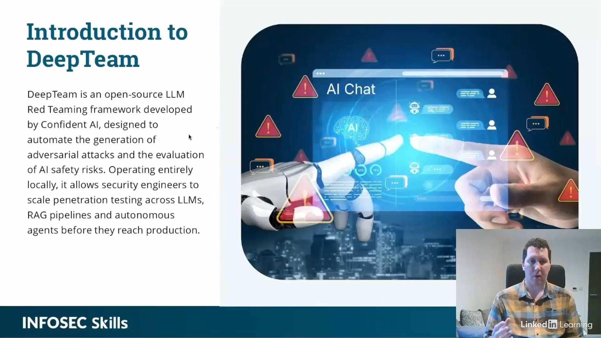
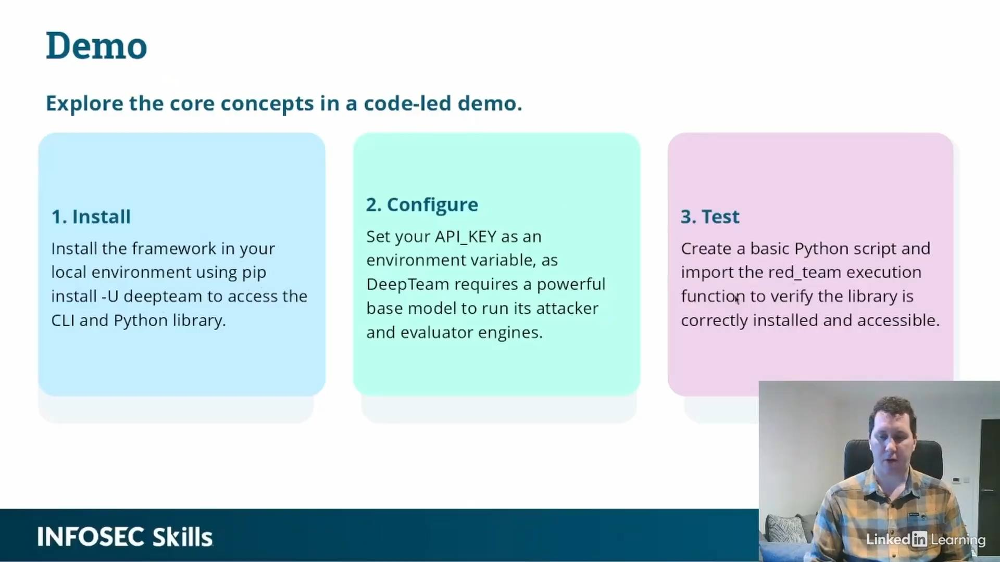
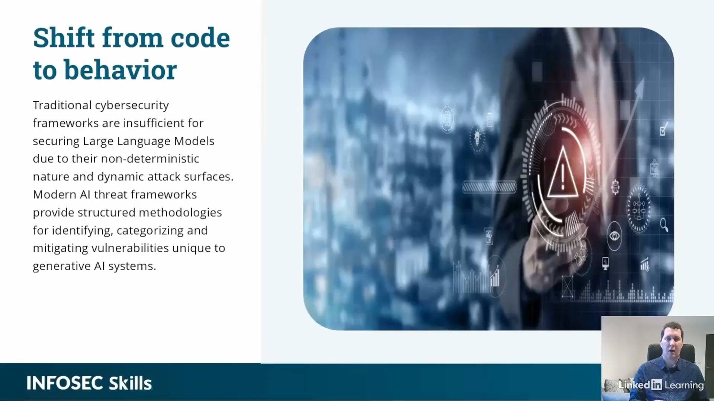
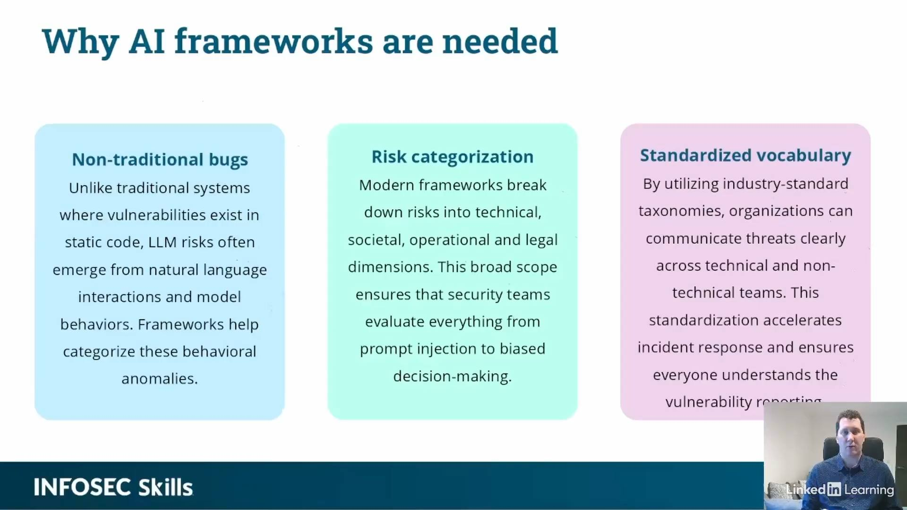
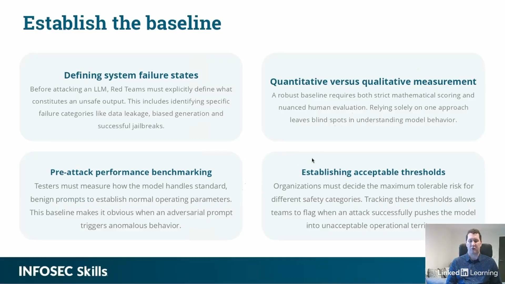
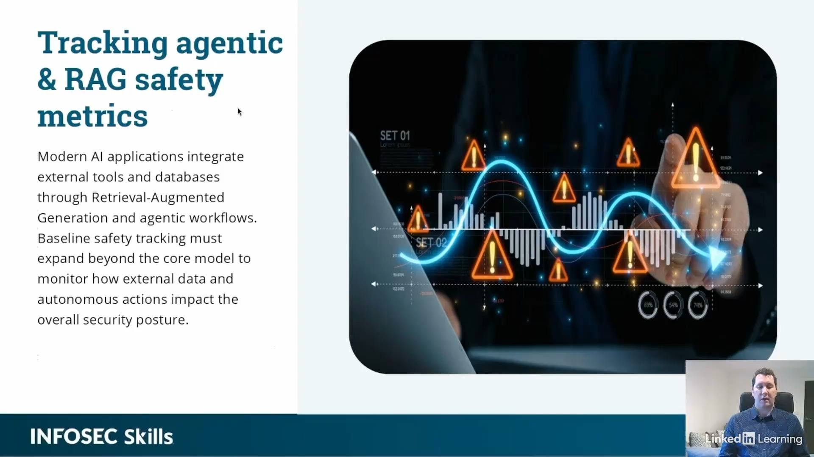
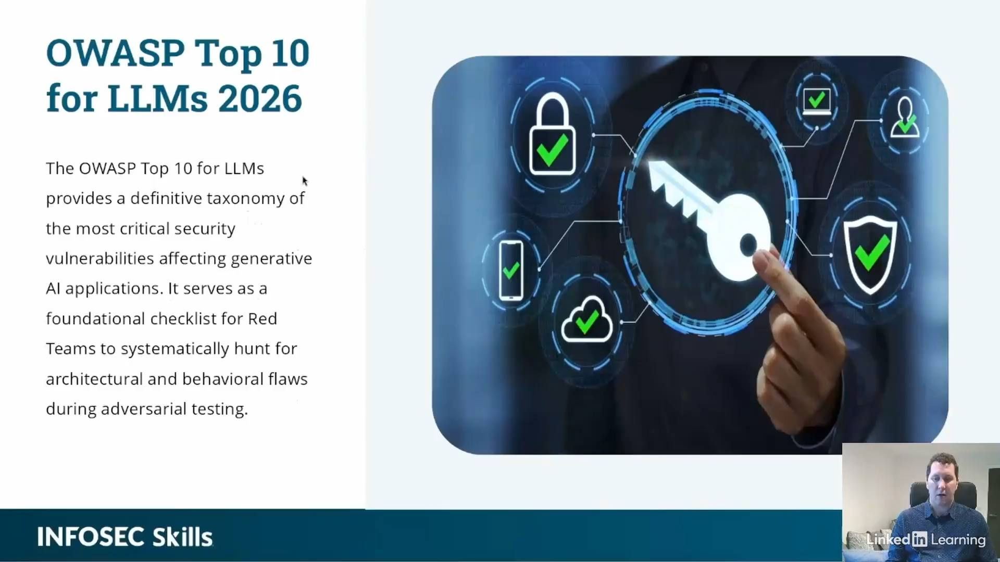
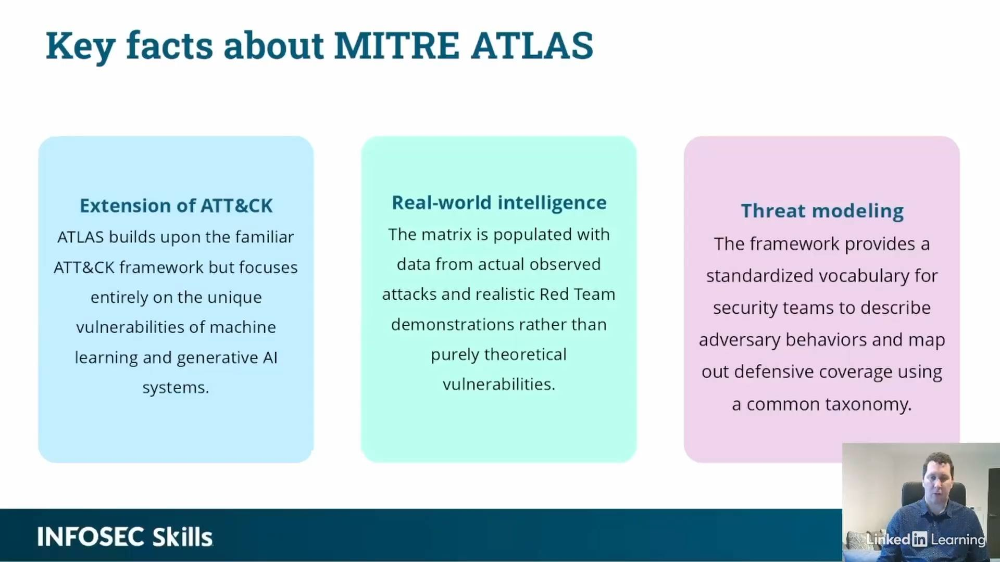

# Breaking LLMs（LLM 攻击面体系课）P42–P46 复现文档

> 说明：本段课程（P42–P46）属于**框架与体系讲解课**，逐字稿里几乎没有可执行代码，只有 P42 给出了 DeepTeam 的安装命令与 API Key 环境变量配置。因此本文档严格按「纯讲解课」的七段结构撰写：第 3 节把讲师的推导过程按步骤复现，第 4 节把讲师给出的方案落成可用的产物（设计决策表、组件职责表、评估指标表、命令清单），并明确标注哪些是课里没有代码、仅为示意。凡逐字稿没讲的内容一律写「课里没讲」，不编造。

---

## 1. 这一节做什么

P42–P46 这五节课，是整条「AI 红队工作流」的**方法论地基**。它们不教你写一个具体的攻击脚本，而是回答四个问题：

1. **用什么工具把红队流程自动化？**（P42：DeepTeam，一个开源 LLM 红队框架，基于 DeepEval）
2. **为什么传统安全框架不够用，必须换成 AI 威胁框架？**（P43：从「代码」到「行为」的范式转移）
3. **在攻击之前，怎么建立一套可量化的安全基线？**（P44：baseline safety metrics）
4. **业界有哪两套权威分类法可以照着打？**（P45：OWASP Top 10 for LLMs；P46：MITRE ATLAS）

把这五节串起来，你得到的就是一条完整的流水线：

```
威胁建模（MITRE ATLAS）
   → 选定漏洞分类（OWASP Top 10 for LLMs）
   → 建立安全基线（baseline metrics）
   → 自动化生成攻击并评估（DeepTeam）
   → 风险报告 → 人工复核 → 修复 → 持续监控
```

对前端转 AI 应用工程师的你来说，这一段的现实意义是：你以后写的每一个 RAG 应用、每一个带工具调用的 Agent，都要按这套分类法自查一遍。**课里没有让你跑一个完整项目**，但给了你一套可以直接抄进团队安全 checklist 的框架。

---

## 2. 讲师原话

下面按主题归类引用，每条都标注了出处页码与时间点。译文为中文，技术产品名保留英文。

**关于 DeepTeam 是什么：**

> "DeepTeam 是由 Confident AI 开发的一个开源 LLM 红队框架。"
> —— p042 [00:00]

> "它被设计用来自动化生成对抗性攻击，并评估 AI 安全风险。它完全在本地运行，让安全工程师可以在 LLM、RAG 流水线和自主 Agent 进入生产环境之前，对它们进行规模化的渗透测试。"
> —— p042 [00:26]

> "因为 DeepTeam 使用了一个叫 DeepEval 的开源测试框架，它是一个非常知名的企业级工具。"
> —— p042 [00:26]

> "它把自己描述为针对 AI 应用或 LLM 的渗透测试。"
> —— p042 [00:55]

**关于安装与配置：**

> "要安装 DeepTeam，你可以用 pip 库：pip install -U DeepTeam。"
> —— p042 [00:55]

> "通过把你的 API Key 设置为环境变量来配置它，例如 export GEMINI_API_KEY=……"
> —— p042 [00:55]

> "然后只需创建一个基础的 Python 脚本，导入红队执行函数，验证它能正常工作。"
> —— p042 [01:21]

**关于回调式目标模型：**

> "DeepTeam 对被测试 AI 系统的底层架构完全无关。所以它不是硬编码 API 集成，而是通过一个轻量的模型回调函数与你的系统交互，这意味着你可以测试从原始基础模型到复杂的多 Agent 聊天机器人。"
> —— p042 [01:21]

**关于漏洞与攻击的区别：**

> "在 DeepTeam 框架里，一个漏洞（vulnerability）代表你想要暴露的不安全行为或弱点，比如毒性、偏见或数据泄露。这个工具预置了模板，用来规模化地诱发特定的失效模式。"
> —— p042 [01:51]

> "漏洞定义要找的是哪种弱点，而攻击（attack）定义的是用来突破 LLM 护栏的对抗手段。DeepTeam 融合了最前沿的研究，动态生成单轮混淆和复杂的多轮对话式攻击。"
> —— p042 [01:51]

> "当开箱即用的模板不能完全匹配你应用特有的威胁模型时，DeepTeam 允许你构建自定义的漏洞类。这种可扩展性确保框架能测试高度专有的业务逻辑缺陷和领域特定的合规风险。"
> —— p042 [02:19]

> "完成一次红队执行后，DeepTeam 会把结果聚合成一份全面的风险评估。这份报告量化模型的安全态势，清晰地展示哪些具体攻击成功绕过了护栏、暴露了哪些已定义的漏洞。"
> —— p042 [02:47]

**关于为什么传统框架不够用：**

> "LLM 和 AI 驱动的应用代表着从代码到行为的一次根本性转变。"
> —— p043 [00:00]

> "传统网络安全框架不足以保护大语言模型，因为它们是非确定性的，攻击面是动态的。"
> —— p043 [00:28]

> "现代 AI 威胁框架提供了结构化的方法论，用来识别、分类和缓解生成式 AI 系统特有的漏洞。"
> —— p043 [00:28]

> "你会看到，大多数现代 AI 威胁框架都是由那些在传统网络安全或合规领域已经非常有声誉的公司构建的。这些公司做了适配，专门创建了管理 AI 风险的新职能。"
> —— p043 [00:58]

> "原因就在于这种从确定性到非确定性的转变。比如你往 SQL 数据库里输入一个恶意载荷，然后返回一个预期的字符串，要么是被拦截的响应，要么是恶意字符串。"
> —— p043 [01:27]

> "关键在于，每次你跑那个测试，无论成功还是失败，你每次都会得到相同的结果。LLM 不同，它们每次要么给你一个略有不同的结果，要么给你一个完全不同的结果。"
> —— p043 [01:53]

> "传统应用接受非常严格的输入类型、给出非常严格的输出类型。LLM 可以接受任何输入，也可以输出任何输出。这就是它们为什么是概率性的，也要求我们从传统网络安全思维做一次彻底的转变。"
> —— p043 [02:22]

**关于为什么需要 AI 框架：**

> "非传统漏洞。传统系统的漏洞存在于静态代码里，而 LLM 的风险往往产生于自然语言交互中的行为。框架帮助把这些行为异常归类。"
> —— p043 [02:51]

> "风险分类。现代框架把风险拆成技术、社会、运营和法律几个维度。这个宽泛的范围确保安全团队做全面的评估。"
> —— p043 [03:17]

> "统一术语。AI 安全领域还很年轻，但通过使用行业标准的分类法，组织可以在技术团队和非技术团队之间清晰地沟通威胁。这种标准化加速了事件响应，也确保每个人都理解漏洞报告。"
> —— p043 [03:17]

> "我很确定，在录制这个课程的当下，这些行业级的风险分类法仍然处于某种开发中的状态。我们有好几套不同的分类框架，而在传统网络安全里，什么算严重风险、什么算高风险、什么算信息级风险，分类是非常清晰的。就 AI 而言，这一切随着技术本身在快速演进。"
> —— p043 [03:46]

**关于核心 LLM 框架分类法：**

> "一个健壮的分类法会把 AI 风险划分成互斥且易于理解的领域。这种结构化的方法帮助红队在对抗测试中系统地搜寻特定类别的漏洞。"
> —— p043 [04:45]

> "首先是安全与隐私域。这个关键领域覆盖数据抽取、提示注入和模型反演这类定向攻击。"
> —— p043 [04:45]

> "然后是毒性与内容危害，我会把它叫做安全域。框架把有害偏见或限制性内容的生成列为首要风险域。"
> —— p043 [05:14]

> "再然后是系统完整性与可用性。攻击者可以通过资源耗尽或有针对性的可用性攻击来破坏模型性能。这大概是最接近传统网络安全的一块。"
> —— p043 [05:14]

> "但它仍然是一个新领域，因为说到资源耗尽，它不再是关于拒绝服务或分布式拒绝服务。它现在是关于运行一个 LLM 所需的高计算资源。说到计算资源，还要考虑成本，成本可以通过一次成功的攻击被推高。"
> —— p043 [05:44]

**关于威胁情报：**

> "威胁情报构成了现代 AI 红队的骨干，它提供真实世界的攻击模式和新兴的利用技术。框架利用情报来确保对抗测试保持相关和全面。"
> —— p043 [06:13]

> "威胁情报在网络安全里当然已经存在很久了。在 AI 领域它还处于婴儿期。但我们会看到为管理它而设计的框架。"
> —— p043 [06:42]

> "静态规则集。生成式 AI 的威胁演进非常快。所以如果你在应用里、在提示词防火墙里、或在 Web 应用防火墙上有一份静态的关键词黑名单，它会很快过时，因为你可以混淆这些关键词来绕过。它也许能滑过传统的 WAF，但攻击面要大得多。"
> —— p043 [06:42]

> "模拟行为。红队把威胁数据结构化，去模仿真实世界攻击者使用的确切战术和流程。这确保 AI 系统是针对当前最先进、最复杂的利用链被测试的。"
> —— p043 [07:11]

> "众包发现。从漏洞赏金和众包红队平台收集洞察，有助于贡献情报。"
> —— p043 [07:39]

> "持续监控。不是部署完产品就说它安全了。如果你这么做，AI 会偏离它最初的目的，新的威胁会被识别出来。所以我们需要持续监控 AI 应用的安全风险。红队当然是其中很大的一部分。"
> —— p043 [07:39]

> "最后是持续迭代。威胁情报形成一个关键的反馈回路。你必须有方法把威胁情报吸收进来，并落实成控制措施。"
> —— p043 [08:08]

**关于 LLM WAF：**

> "随着 AI 特有攻击的数量和复杂度上升，单靠人类分析师已经跟不上威胁态势。现代框架越来越推荐使用专门的 AI 模型来监控、检测和缓解针对已部署 LLM 的攻击。这些能力包括实时提示词检查、异常检测，以及诸如阻断注入攻击这样的响应。"
> —— p043 [08:37]

> "我觉得某种程度上 LLM 让这件事更容易了，因为你在 Web 应用防火墙里依赖的是模式匹配和异常检测。但与其检测模式，你其实可以直接用一个 LLM 去评判另一个 LLM。"
> —— p043 [09:04]

> "所以如果用户输入了一个越狱提示词，然后把这个提示词连同它的响应一起收集起来，你可以把它发给一个独立的裁判 LLM，它很容易就能判断这是否是恶意的，尤其当裁判是一个非常聪明的模型时。然后你可以把它送到威胁情报环节。"
> —— p043 [09:29]

**关于合规：**

> "政府机构和行业组织正在快速引入法规，强制要求对高风险 AI 系统做严格的安全测试。利用现代威胁框架，确保组织——尤其是企业——能够以可证明的方式满足合规，避免严重处罚。"
> —— p043 [09:57]

> "无论你在美国、英国、欧洲还是世界任何地方，AI 监管都在区域层面被引入，而它建立在像 OECD 这样的国际法规之上。"
> —— p043 [10:23]

> "强制测试。我见过的大多数法律都要求你确保系统是安全的、你的 AI 产品对消费者是安全的，这涉及强制测试，不只是开发期间，还包括开发、部署和部署后。"
> —— p043 [10:52]

> "文档记录。无论用户输入什么、给出什么响应，这些都应该被记录，然后被分析。所有这些数据出于合规原因都需要被安全地保存。"
> —— p043 [11:16]

> "影响度量。框架帮助定义 AI 特有缺陷的严重性指标，把它们从低影响分类到严重影响。这种标准化对于向监管者证明最危险的风险已被优先处理、被恰当处置至关重要。"
> —— p043 [11:16]

> "桥接法律。一个定义良好的威胁框架，充当软件工程师和合规官之间的共同语言。这确保技术安全控制满足法律要求。这有点像自上而下：治理设定场景，然后有政策，政策再引出流程。所以我们必须桥接高层治理和真正落地的代码之间的这道鸿沟。"
> —— p043 [11:44]

**关于基线安全指标：**

> "建立基线是 LLM 红队和安全评估中关键的第一步。通过在执行对抗攻击之前定义标准的性能指标，安全团队可以准确量化特定利用的影响，并衡量后续护栏的有效性。"
> —— p044 [00:00]

> "定义系统失效状态。在攻击 LLM 之前，红队必须明确界定什么构成不安全输出。我们之前在给 promptfoo 和 garak 做配置时见过这一点，我们在设置断言，界定什么算成功、什么算失败。"
> —— p044 [00:28]

> "一个失败可能是输出了某个 API Key。所以如果你把失效状态设定为暴露 API Key，那就能让你开发出成功的测试。"
> —— p044 [00:56]

> "定量与定性测量。一个健壮的基线需要严格的数学打分和细致的人工评估，只依赖一种方法会在理解模型行为上留下盲点。因为测试数据量太大了，你不可能让一个人去评估每一个测试。"
> —— p044 [01:23]

> "所以最好的做法是让一个 LLM 去评估结果，然后让人去评估这些数据里任何严重或高风险的部分，然后去缓解它。所以只是跑完所有测试然后说『好，我们有一千个严重漏洞、一百个高风险，很好，我们报告一下』是没意义的。它需要被修复。所以你需要一条有效的管理流水线，这就是人工评估介入的地方。"
> —— p044 [01:53]

> "攻击前性能基准。测试者必须测量模型如何处理标准良性提示词，来建立正常运行参数。这个基线让『对抗提示词触发了异常行为』变得显而易见。这可以简单到训练你的裁判模型理解什么构成安全提示词、给它例子，或者在测试时总是先跑几个良性测试来建立基线。"
> —— p044 [02:20]

> "建立可接受阈值。组织必须各自决定不同安全类别下可容忍的最大风险，这取决于你所在的行业，会不一样。跟踪这些阈值，能让团队在攻击成功把模型推入不可接受的运行区间时发出告警。"
> —— p044 [03:15]

**关于自动化评估指标：**

> "自动化指标提供确定性、快速的 LLM 输出打分，无需人工介入。虽然它们在评估复杂自然语言上有局限，但在高并发的红队测试中，它们对于快速检测基线安全回退是必不可少的。"
> —— p044 [03:41]

> "这些就是经典的模式匹配。精确匹配和模式识别。红队用确定性逻辑去检查输出里是否出现特定的禁止字符串，比如信用卡号或密钥。这就是经典的正则。"
> —— p044 [03:41]

> "正则非常快，也非常有效。但在 LLM 测试里，它不是最后一道防线，它是前置防线。在主攻到来之前，你只是先把它们切掉，剔除掉那些明显安全的响应，比如模型回复『我不能这么做』『我无法回应这个』，你可以匹配到这些，把它们筛掉。"
> —— p044 [04:10]

> "困惑度打分。这个指标衡量语言模型生成文本的可预测程度，所以复杂度的突然飙升可能表明对抗提示词把模型逼进了不稳定或分布外状态。"
> —— p044 [04:38]

> "如果你回想之前的课程，复杂度是 LLM 产生的一个分数，它表明输出中下一个词有多可能。所以你想一想……『法国的首都是哪里？』困惑度分数会表明下一个词、也就是回答会是 Paris，因为困惑度分数会极低，表明这个问题基本上只有一个正确答案。"
> —— p044 [05:07]

> "通过测量这个困惑度分数，如果你收到一个离那个很远、或者复杂度分数很高的输出，比如说远远超出边界，你就可以用它来识别越狱、新型越狱或新型攻击。"
> —— p044 [05:36]

> "基于嵌入的语义相似度。它不比较精确的词，而是评估输出的底层含义是否匹配一个已知的不安全参考文本，帮助检测成功的越狱，即使模型改写了有害响应。"
> —— p044 [06:02]

> "传统指标的局限。正则和模式匹配在识别传统网络安全威胁上很出色。然而 LLM 输出的非确定性本质，往往意味着红队期间的定性评估需要使用先进的语言模型来评估输出。所以你需要一个聪明的裁判来评估这些测试结果，因为正则能做的就那么多。这些评估模型充当自动裁判，应用复杂的评分细则来给安全、毒性和事实性打分。"
> —— p044 [06:29]

**关于 Agentic 与 RAG 安全指标：**

> "现代 AI 应用通过检索增强生成（RAG）和 Agentic 工作流集成外部工具和数据库。所以基线安全跟踪必须扩展到核心模型之外，理解整个 AI 应用栈。"
> —— p044 [06:59]

> "LLM 只是大脑，但它的记忆、它的长期系统记忆，可以通过 RAG 系统实现。"
> —— p044 [07:27]

> "然后如果你把系统的胳膊和腿想成 Agent、Agentic 工具和能力，而且随着时间推移很可能还会有更多东西加进这个栈。它演进得非常快。所以你测试的不只是 LLM，你测试的是整个 AI 驱动的应用栈。"
> —— p044 [07:53]

> "如果你只测 LLM，你的测试就完全不够全面。"
> —— p044 [08:18]

> "上下文相关性与忠实度。在 RAG 系统里，测试者要衡量模型是否严格基于检索到的文档来回答。如果你有一个 RAG 数据库，RAG 数据库的全部目的就是提供准确的答案。"
> —— p044 [08:18]

> "如果你只依赖 LLM 给你高智能的答案，它并不总是准确的。它偶尔会幻觉。它不会知道你公司内部的细节、内部文档。所以 RAG 系统在那里是为了提供事实性、正确的答案。所以跟踪 RAG 数据库的上下文相关性和忠实度极其重要。"
> —— p044 [08:48]

> "工具选择与执行质量。Agentic 系统会使用外部工具和内部工具，测试这些工具是否被正确调用、是否使用了安全的参数，是一个重要的安全跟踪考量。"
> —— p044 [09:15]

> "权限提升。我们需要监控工具调用的深度，确保它们在当前角色的范围内执行，无法突破那个角色。"
> —— p044 [09:15]

> "计划遵循与效率。自主 Agent 把复杂任务拆成步骤。跟踪 Agent 有多严格地遵守它最初的安全计划，帮助测试者识别提示注入成功劫持执行序列的位置。"
> —— p044 [09:43]

> "输出 Agent 的思维链，并识别在思维链的哪个点上 Agent 跑偏了。"
> —— p044 [10:10]

> "持续监控。基线安全跟踪不是一次性事件。它需要在部署生命周期里持续集成。他们需要在开发期间、部署期间和部署后都执行这种 AI 安全测试。"
> —— p044 [10:10]

> "监控实时流量以检测基线漂移。这就进入日志了。你想记录所有响应，然后对这些日志跑风险评估。检测到偏离基线安全必须被标记。如果你发现一个 AI 安全问题，或者有人报告、或者被检测到，那它就需要被标记和管理。"
> —— p044 [10:39]

> "护栏。必须有有效的防御，无论是提示词防火墙，还是在部署前或部署后实施防御。还有告警，跟踪仪表盘和通知，确保一旦出问题，正确的人会被通知到。"
> —— p044 [11:08]

**关于 OWASP Top 10 for LLMs：**

> "OWASP Top 10 for LLMs 提供了一个关于影响生成式 AI 应用的最关键安全漏洞的权威分类法，它充当红队的基线检查清单，用来在对抗测试中系统地搜寻架构和行为缺陷。"
> —— p045 [00:24]

> "如果你在测试中覆盖了 OWASP Top 10，那你就在很大程度上保护了你的 AI 驱动应用或 LLM 模型，也理解了更广的威胁态势。"
> —— p045 [00:53]

> "这些是按顺序排的，就像传统的 OWASP Top 10 一样，第 1 号是最高风险，第 10 号是较低风险，但显然不是最后一个，后面还有几百个。"
> —— p045 [01:15]

> "威胁一，提示注入。攻击者使用精心构造的输入来绕过 LLM 安全过滤器或操纵其底层指令。这可以通过直接注入发生，比如越狱，你试图绕过应用的安全过滤器以提取敏感信息或产生不安全输出；也可以是间接注入，也就是投毒数据，比如通过多模态方式。它可能是一个藏在图片、视频、音频文件、文档或网页里的越狱。而用户可能根本没有意识到自己正在执行这次注入。"
> —— p045 [01:15]

> "威胁二，不安全输出处理。这个漏洞发生在下游应用盲目信任 LLM 生成的输出，没有做输出校验或净化。"
> —— p045 [02:09]

> "这一点不奇怪，任何好的应用开发者都知道，应该在输入进入 LLM 或数据库之前净化输入，也应该净化从那里出来的输出。但这条线会变得模糊，比如在检索增强生成里，你会预期从 RAG 数据库出来的数据是安全的，因为它像是公司内部数据库。所以你不预期里面有恶意内容。但由于间接提示注入之类的原因，你最终可能从那个 RAG 数据库得到不安全的输出。更糟的是，LLM 很可能是内部与 RAG 数据库通信的。所以它不像你做一个外部调用、可以对着防火墙检查，从 RAG 出来的东西并没有以传统方式被过滤、被净化。我觉得这一点非常常被忽略。"
> —— p045 [02:38]

> "威胁三，训练数据投毒。大语言模型的质量取决于它训练所用的数据，RAG 数据库也一样。所以攻击者故意操纵用于训练 LLM 的原始数据或微调数据集，注入隐藏漏洞、恶意因子或定向偏见。"
> —— p045 [03:35]

> "现在有那么多模型，几乎任何人都可以创建一个模型上传到 Hugging Face 或开源出去，让别人使用。如果开发者注入了隐藏漏洞，甚至可能是无意中摄入了一个被投毒的数据集，那你就摊上大问题了。如果一个数据集被很多模型广泛使用，攻击者只需要攻击那一个数据集。"
> —— p045 [04:00]

> "威胁四，模型拒绝服务。攻击者故意构造复杂、无界或资源密集的提示词，迫使 LLM 消耗过量的算力。如果你能构造一个让 LLM 进入循环的提示词，尤其是配合 Agent，你就能把公司的 API 预算抽干。"
> —— p045 [04:52]

> "如果你在复活节周末的周五晚上这么干，它可能不会被发现，然后公司在接下来的周二宣布破产清算，因为他们没有给 API 成本设预算。所以有成本这一面。还有基础设施那一面。LLM 调用和 Agentic 工具是计算密集的，需要大量算力。所以拒绝服务攻击可以聚焦在这一点，而不是 API Key 的使用。"
> —— p045 [05:20]

> "威胁五，供应链漏洞。这不奇怪。LLM 生态严重依赖第三方组件。流水线里的任何组件——基础模型、众包数据集、外部库、工具调用的函数——都可能被投毒。你的整条流水线都可能出问题。"
> —— p045 [05:50]

> "威胁六，敏感信息泄露。LLM 可能无意中记住并聚合专有算法、商业机密或个人信息。LLM 在非常大的数据集上训练，这些数据集可能包含敏感数据，这是一个非常大的问题。而且有那么多人在专门研究如何提取这些信息。所以通过基于数学的越狱尝试，你可以提取这些敏感信息。"
> —— p045 [06:18]

> "威胁七，不安全插件设计。插件让 LLM 与外部 API 和系统交互，但它们经常在处理不受信任的输入时没有恰当的校验或严格的访问控制。"
> —— p045 [06:46]

> "不安全插件一直是漏洞的主要来源，尤其现在，因为有很多人在做 AI 项目，他们可能对网络安全和威胁并不太懂，因为 AI 降低了准入门槛。所以你可能看到有人只是在 Windows 上一键下载了一个本地 MCP 客户端-服务端配置，然后下载了一大堆插件，却完全不知道自己引入了什么风险。其中一个插件就可能与 MCP 服务器交互并引发问题。如果新闻爆出某个不安全插件导致大量客户端丢失敏感数据，我不认为会有人在乎这不是你的错。"
> —— p045 [07:13]

> "威胁八，过度代理权。这发生在 LLM 应用被授予了不必要的权限或过高的自主性。"
> —— p045 [07:37]

> "在运行系统工具时，Agent 需要确保以正确的权限运行。如果需要人在回路，那这一点必须被遵守。所以如果 Agent 需要问人类是否该执行某个动作，那就必须这么做，并确保它不能被绕过。"
> —— p045 [08:06]

> "威胁九，过度依赖。用户和开发者对 LLM 输出的准确性和安全性给予了过多的隐性信任。因为模型容易幻觉，盲目信任会导致糟糕的决策。我最近见过一个真实例子，有人基于 LLM 输出做了一份报告，而那份报告完全是幻觉出来的。"
> —— p045 [08:34]

> "在法庭上提交一份完全幻觉的报告是很尴尬的，因为这意味着你显然没有读任何输出、也没有做事实核查。"
> —— p045 [08:58]

> "威胁十是模型窃取。恶意行为者可以针对 LLM 模型本身，窃取它的架构权重和参数。如果你看过模型抽取那门课，有多种方法可以做到。在这个学习路径里我们会看到那些内容。"
> —— p045 [09:24]

**关于 MITRE ATLAS：**

> "如果你在网络安全行业工作，你大概知道 MITRE，他们为传统网络安全威胁提供了现成的框架。"
> —— p046 [00:00]

> "ATLAS 框架代表『AI 系统的对抗威胁全景』。它充当一个全球可访问、持续更新的知识库，收录针对机器学习模型的对手战术和技术。"
> —— p046 [00:27]

> "关于 MITRE ATLAS 的关键事实：它是 ATT&CK 框架的扩展。ATLAS 建立在熟悉的 ATT&CK 框架之上，但完全聚焦于 LLM 和生成式 AI 系统带来的独特漏洞。"
> —— p046 [00:27]

> "真实世界情报。这个矩阵填充的是来自实际观测到的攻击和真实红队演示的数据，而不是纯理论漏洞。"
> —— p046 [00:56]

> "威胁建模。这个框架为安全团队提供标准化的词汇，用来描述对手行为，并用共同的分类法勾勒攻击覆盖范围。"
> —— p046 [00:56]

> "在任何测试执行之前，威胁建模会是首批步骤之一。所以把威胁模型建立在 MITRE ATLAS 框架上，对任何红队测试来说都是很好的第一步。"
> —— p046 [01:22]

> "要理解战术和技术：ATLAS 矩阵把威胁情报组织成一个结构化的战术与技术网格。这种可视化布局让红队能够勾勒出一次对抗性 AI 行动的完整生命周期，从开始到结束。"
> —— p046 [01:22]

> "框架里的战术与技术。对抗战术代表高层目标，或对手行动背后的根本原因。例子包括侦察、初始访问和敏感数据外泄。"
> —— p046 [01:48]

> "攻击技术描述攻击者用来达成战术目标的具体方法。矩阵里的每个技术都被分配了一个唯一的字母数字标识符，便于跟踪和报告。"
> —— p046 [02:13]

> "所以你可以看到，如果你熟悉 MITRE ATT&CK 框架，你就能理解如何使用 ATLAS 框架。"
> —— p046 [02:13]

> "把 ATLAS 矩阵用于红队。把 ATLAS 矩阵集成到日常红队运营中，能把测试从随机黑客行为提升为高度结构化的风险评估，确保 AI 攻击的每一个阶段都被系统地评估、记录和修复。"
> —— p046 [02:37]

---

## 3. 从零复现

这一节把讲师的推导过程按步骤复现。因为本段是框架课，这里的「复现」指的是**复现讲师的推理链**：需求 → 约束 → 方案 → 取舍。你照着走一遍，就能自己得出「为什么必须用 AI 威胁框架、为什么基线要先建、为什么分类法要两套一起用」的结论。

### 步骤 0：先认清你要保护的对象变了

讲师在 P43 开头就定了调：**从代码到行为**。传统应用的安全边界是「输入类型 → 输出类型」的严格映射；LLM 是「任意输入 → 任意输出」。这一步决定了后面所有框架的形态。

- 需求：保护一个生成式 AI 应用。
- 约束：它是非确定性的（同一输入多次运行结果可能不同），攻击面是动态的（每次交互都可能产生新的行为路径）。
- 结论：传统框架（基于静态代码里的已知漏洞模式）覆盖不到「行为异常」，必须引入新的分类法。

### 步骤 1：把风险拆成互斥的域

讲师在 P43 [04:45] 给出核心 LLM 框架分类法的三个域，这是你自建 checklist 的骨架：

| 域 | 覆盖内容（讲师原话要点） | 对应传统安全概念 |
|---|---|---|
| 安全与隐私域 | 数据抽取、提示注入、模型反演 | 接近传统 AppSec |
| 毒性与内容危害（安全域） | 有害偏见、限制性内容的生成 | 传统安全里没有对应物 |
| 系统完整性与可用性 | 资源耗尽、针对性可用性攻击、成本推高 | 最接近传统 DoS，但对象变成算力与 API 成本 |

取舍点：讲师特别强调「互斥且易于理解」。为什么必须互斥？因为红队要「系统地搜寻特定类别的漏洞」，如果两个域重叠，同一份测试结果会被重复计数，风险报告就失真。

### 步骤 2：把威胁情报接进流程

P43 [06:13]–[08:08] 给了威胁情报的五个关键考量，按顺序复现：

1. **静态规则集会快速过时**——关键词黑名单可以被混淆绕过。所以规则必须能更新。
2. **模拟行为**——用结构化的威胁数据去模仿真实攻击者的战术与流程（TTP）。
3. **众包发现**——从漏洞赏金、众包红队平台收集情报。
4. **持续监控**——部署不等于安全，AI 会漂移。
5. **持续迭代**——情报要形成反馈回路，最终落成控制措施。

这五步其实就是一个闭环：`情报输入 → 模拟 → 测试 → 监控 → 回灌情报`。

### 步骤 3：设计 LLM WAF 的判定逻辑

P43 [08:37]–[09:29] 讲师给了一个非常具体、可以直接落地的架构判断：**用 LLM 评判 LLM**。

复现这个判定链：

```
用户输入 prompt
   → 收集 prompt + 模型响应
   → 发给独立的「裁判 LLM」（judge model）
   → 裁判输出：恶意 / 非恶意
   → 若恶意，送入威胁情报环节
```

取舍点：讲师说这比传统 WAF 的「模式匹配 + 异常检测」更容易，因为不用维护模式库，直接语义判断。代价是裁判模型本身要足够聪明（讲师原话「尤其当裁判是一个非常聪明的模型时」），且引入额外推理成本——这一点课里没展开，属于「你会撞上的」问题（见第 7 节）。

### 步骤 4：建立基线（攻击之前）

P44 整节都在讲这件事。复现顺序：

1. **定义失效状态**：先明确什么算「不安全输出」。讲师举的例子是把「暴露 API Key」定义为 fail state。这一步和前面 promptfoo / garak 里设 assertion 是同一件事。
2. **定量 + 定性双轨**：自动化指标负责规模，人工负责严重/高风险项的复核与修复。讲师明确说「只是跑完测试然后报告一千个严重漏洞是没意义的，它需要被修复」。
3. **攻击前基准**：先跑良性提示词，建立正常运行参数，这样对抗提示词触发的异常才「显而易见」。
4. **可接受阈值**：按行业各自定，超过阈值就告警。
5. **持续监控**：开发、部署、部署后三阶段都要测；实时流量监控检测基线漂移；护栏；告警。

### 步骤 5：选分类法照着打

P45 给 OWASP Top 10 for LLMs（按风险从高到低排序的十项），P46 给 MITRE ATLAS（战术 × 技术的网格）。复现时的用法：

- **威胁建模阶段**用 ATLAS：先按战术（侦察、初始访问、外泄……）铺开，再落到具体技术（每个技术有唯一字母数字 ID）。
- **测试执行阶段**用 OWASP Top 10：逐项过一遍清单，确保架构和行为缺陷都被覆盖。
- 两者关系：ATLAS 回答「攻击者怎么打」，OWASP 回答「我有哪些弱点要查」。讲师在 P45 [00:53] 说，覆盖 OWASP Top 10 就「在很大程度上」保护了应用——注意是「很大程度上」，不是全部。

### 步骤 6：用 DeepTeam 把上面全部自动化

P42 是唯一给了可执行命令的一节。复现顺序：

1. `pip install -U DeepTeam`
2. 设 API Key 环境变量（讲师举例 `export GEMINI_API_KEY=...`）
3. 写一个基础 Python 脚本，导入红队执行函数，验证能跑
4. 用**回调函数**定义目标模型（不硬编码 API 集成，所以能测从裸模型到多 Agent 的任何东西）
5. 选漏洞（vulnerability，定义「找什么弱点」）与攻击（attack，定义「用什么手段突破」）
6. 需要时写自定义漏洞类
7. 跑完拿风险评估报告

---

## 4. 完整代码

> **重要声明**：P42–P46 是框架讲解课，逐字稿里**没有给出完整可运行的项目代码**，OCR 也没有提供任何代码片段。本节把讲师明确给出的命令、配置项、以及他口头描述的结构落成可用的产物。凡标注「课里没有代码，以下为示意」的段落，都是为帮助理解而补的示意，不是讲师原话。

### 4.1 安装与环境配置（讲师明确给出）

讲师在 P42 [00:55] 给出的安装命令与环境变量配置，原样保留：

```bash
# 安装 DeepTeam（注意：讲师念作 "pip install dash capital U DeepTeam"，
# 即 -U 是「升级到最新版」的短参数）
pip install -U DeepTeam

# 配置 API Key 为环境变量（讲师以 Gemini 为例）
export GEMINI_API_KEY="你的APIKey"
```

> 说明：`-U` 是 pip 的 `--upgrade` 短参数，讲师用「dash capital U」把它念了出来。环境变量名 `GEMINI_API_KEY` 是讲师屏幕/口述里出现的名字；如果你用别的模型提供商，变量名要换成对应厂商的（课里没讲其他厂商的具体变量名）。

### 4.2 基础验证脚本（课里没有代码，以下为示意）

讲师在 P42 [01:21] 说「创建一个基础的 Python 脚本，导入红队执行函数，验证它能正常工作」，但**没有展示脚本内容**。以下为示意，用于验证安装是否成功；具体函数名请以 DeepTeam 官方文档为准（课里没讲具体函数签名）：

```python
# verify_deepteam.py
# 课里没有代码，以下为示意：仅用于验证 DeepTeam 是否安装成功
import deepteam

print("DeepTeam 版本:", getattr(deepteam, "__version__", "unknown"))
print("导入成功，可以开始配置红队执行。")
```

运行：

```bash
python verify_deepteam.py
```

### 4.3 目标模型回调（课里没有代码，以下为示意）

讲师在 P42 [01:21] 强调 DeepTeam 通过「轻量的模型回调函数」与被测系统交互，而不是硬编码 API 集成。这个设计对应到代码就是一个函数：输入 prompt，返回模型输出。以下为示意结构：

```python
# target_callback.py
# 课里没有代码，以下为示意：展示「回调式目标模型」的形状
def target_model_callback(prompt: str) -> str:
    """
    被测系统的统一入口。
    - 可以是一个裸基础模型
    - 可以是一个 RAG 流水线
    - 可以是一个多 Agent 聊天机器人
    只要输入 prompt、返回字符串，DeepTeam 就能测。
    """
    # 这里替换成你真实的模型调用
    return my_llm_call(prompt)
```

### 4.4 漏洞与攻击的概念对照表（讲师口述，落成表格）

讲师在 P42 [01:51] 明确区分 vulnerability 与 attack。落成可用的对照表：

| 概念 | 定义（讲师原话要点） | 例子 |
|---|---|---|
| Vulnerability（漏洞） | 你想暴露的不安全行为或弱点 | 毒性、偏见、数据泄露 |
| Attack（攻击） | 用来突破 LLM 护栏的对抗手段 | 单轮混淆、多轮对话式利用 |

### 4.5 基线安全指标清单（P44 落成表格）

讲师在 P44 讲了一整套指标，落成可直接抄进团队 checklist 的表：

| 指标类别 | 具体指标 | 讲师要点 |
|---|---|---|
| 确定性指标 | 精确匹配、模式识别（正则） | 检查输出里是否出现禁止字符串，如信用卡号、密钥；「不是最后一道防线，是前置防线」 |
| 统计指标 | 困惑度（perplexity） | 衡量生成文本的可预测程度；复杂度突然飙升 = 模型被逼进不稳定/分布外状态 |
| 语义指标 | 基于嵌入的语义相似度 | 不比较精确词，比较底层含义是否匹配已知不安全参考文本；能抓改写了的有害响应 |
| 模型裁判 | 评估模型（judge） | 应用复杂评分细则给安全、毒性、事实性打分；因为正则「能做的就那么多」 |
| RAG 指标 | 上下文相关性、忠实度 | 模型是否严格基于检索文档回答 |
| Agentic 指标 | 工具选择与执行质量、权限提升、计划遵循与效率 | 工具是否被正确调用、是否用安全参数、调用深度是否越权、Agent 是否偏离原计划 |

### 4.6 OWASP Top 10 for LLMs 清单（P45 落成表格）

讲师按风险从高到低逐条讲了十项，落成 checklist：

| 编号 | 名称 | 讲师要点 |
|---|---|---|
| 1 | 提示注入（Prompt Injection） | 直接注入（越狱）+ 间接注入（图片/视频/音频/文档/网页里藏越狱，用户可能没意识到） |
| 2 | 不安全输出处理（Insecure Output Handling） | 下游应用盲目信任 LLM 输出、不做校验/净化；RAG 内部通信尤其常被忽略 |
| 3 | 训练数据投毒（Training Data Poisoning） | 操纵原始数据或微调数据集，注入隐藏漏洞、恶意因子、定向偏见；广泛使用的数据集只需攻破一个 |
| 4 | 模型拒绝服务（Model Denial of Service） | 构造复杂/无界/资源密集提示词，逼模型进循环，抽干 API 预算；也打基础设施算力 |
| 5 | 供应链漏洞（Supply Chain Vulnerabilities） | 基础模型、众包数据集、外部库、工具函数，任一环节都可能被投毒 |
| 6 | 敏感信息泄露（Sensitive Information Disclosure） | 模型记住并聚合专有算法、商业机密、个人信息；可用基于数学的越狱提取 |
| 7 | 不安全插件设计（Insecure Plugin Design） | 插件处理不受信任输入时缺校验/访问控制；MCP 客户端一键装插件风险高 |
| 8 | 过度代理权（Excessive Agency） | 授予不必要权限或过高自主性；人在回路必须不可绕过 |
| 9 | 过度依赖（Overreliance） | 用户/开发者对输出准确性过度信任；幻觉报告进法庭的真实案例 |
| 10 | 模型窃取（Model Theft） | 窃取架构权重与参数；方法见模型抽取课 |

### 4.7 MITRE ATLAS 的战术/技术结构（P46 落成表格）

| 概念 | 定义 | 讲师给的例子 |
|---|---|---|
| 战术（Tactic） | 高层目标 / 对手行动背后的根本原因 | 侦察、初始访问、敏感数据外泄 |
| 技术（Technique） | 达成战术目标的具体方法 | 每个技术有唯一字母数字标识符，便于跟踪和报告 |

### 4.8 整条红队流水线（把五节串起来）

```
威胁建模（MITRE ATLAS，P46）
   ↓
漏洞分类（OWASP Top 10 for LLMs，P45）
   ↓
建立基线（baseline metrics，P44）
   ↓
自动化攻击与评估（DeepTeam，P42）
   ↓
风险评估报告 → 人工复核严重/高风险 → 修复 → 持续监控（P43/P44）
```

---

## 5. 逐行解释

这一节逐条解释第 4 节里每个决策/每条配置为什么这样定、不这样会怎样。

**`pip install -U DeepTeam`**
`-U` 是升级到最新版。为什么强调它？因为讲师在 P43 [06:42] 说生成式 AI 威胁演进非常快、静态规则会快速过时——红队框架本身也必须保持最新，否则它内置的攻击模板就是过时的。不升级的后果：你测的是去年的攻击面。

**`export GEMINI_API_KEY=...`**
把 API Key 放环境变量而不是写进代码，是避免密钥进版本库。注意这本身正好对应 OWASP 第 6 项「敏感信息泄露」——讲师在 P44 [00:56] 举的 fail state 例子就是「输出暴露 API Key」。所以这一步既是配置，也是安全实践。

**回调函数而不是硬编码 API 集成**
讲师在 P42 [01:21] 说 DeepTeam「对被测试 AI 系统的底层架构完全无关」。为什么这样设计？因为你要测的对象可能是裸模型、RAG 流水线、或多 Agent 系统（P44 [07:27] 把 LLM 比作大脑、RAG 比作记忆、Agent 比作胳膊腿）。如果框架硬编码了某家 API，你就测不了自建的 RAG 或 Agent。回调函数把「被测系统」抽象成一个 `prompt → response` 的函数，这是唯一能覆盖整个应用栈的接口形状。

**vulnerability 与 attack 分离**
讲师在 P42 [01:51] 明确：漏洞定义「找什么弱点」，攻击定义「用什么手段突破」。为什么必须分开？因为同一个漏洞可以用多种攻击测（比如数据泄露既可用单轮混淆也可用多轮对话），同一套攻击也可打多个漏洞。分开后可以组合，测试矩阵才完整。不分开的后果：你只能做「一对一」的固定测试，覆盖不全。

**自定义漏洞类**
讲师在 P42 [02:19] 说开箱模板不匹配应用特有威胁模型时，可以构建自定义漏洞类，用来测「高度专有的业务逻辑缺陷和领域特定的合规风险」。为什么需要？因为 OWASP Top 10 是通用清单，你的业务逻辑漏洞不在里面。不做的后果：通用测试全过，但你的业务特有风险没被覆盖。

**基线要先于攻击**
P44 [00:00] 说「在执行对抗攻击之前定义标准性能指标」。为什么顺序不能反？因为你要「准确量化特定利用的影响」——没有基线，你无法判断一个异常输出是攻击造成的还是模型本来就这样。讲师在 P44 [02:20] 给的实操是「测试时总是先跑几个良性测试建立基线」。

**正则只做前置防线**
P44 [04:10] 讲师说正则「不是最后一道防线，是前置防线」。为什么？因为它快、确定性，能剔除明显安全的响应（比如「我不能这么做」），把量降下来；但它抓不住改写了的有害响应。所以后面必须接语义相似度和 LLM 裁判。只用正则的后果：漏报改写型越狱。

**困惑度为什么能抓越狱**
P44 [05:07] 用「法国的首都是哪里」举例：正确答案唯一，困惑度极低。如果输出困惑度突然飙升、远离边界，说明模型被逼进了不稳定或分布外状态。这是统计信号，不依赖关键词，所以能抓「新型越狱」。局限：课里没讲阈值怎么定，属于你会撞上的问题。

**用 LLM 评判 LLM**
P43 [09:04] 的逻辑：传统 WAF 靠模式匹配，而 LLM 可以直接语义判断。为什么可行？因为裁判模型可以「应用复杂评分细则」（P44 [06:29]）。代价：裁判本身要够聪明，且每次判定都要一次推理。课里没讲裁判模型的选型和成本控制。

**OWASP 按风险排序**
P45 [01:15] 明确第 1 号最高、第 10 号较低，但「后面还有几百个」。为什么按序？因为资源有限，先打最高风险。注意讲师说覆盖 Top 10 是「很大程度上」保护，不是全部——所以不能只做这十项就收工。

**ATLAS 先做威胁建模**
P46 [01:22] 说「在任何测试执行之前，威胁建模会是首批步骤之一」。为什么？因为 ATLAS 是「战术 × 技术」网格，先铺开战术（侦察、初始访问、外泄），再落到具体技术（带唯一 ID），你才知道要测哪些阶段。不做威胁建模直接开打，就是讲师说的「随机黑客行为」，而不是「高度结构化的风险评估」。

**持续监控三阶段**
P44 [10:10] 说开发、部署、部署后都要测。为什么部署后还要测？因为「AI 会偏离它最初的目的，新威胁会被识别出来」（P43 [07:39]）。一次性测试的后果：上线时安全，三个月后漂移到不安全区。

**合规的桥接作用**
P43 [11:44] 说威胁框架是工程师和合规官的「共同语言」，治理→政策→流程自上而下。为什么重要？因为监管要求「可证明」的安全测试（P43 [09:57]），而框架提供的严重性分级（低到严重）就是向监管者证明「最危险的风险已被优先处理」的证据。

---

## 6. 复现检查清单

照着打勾，确保你把这一段的方法论真正落地了：

**环境与工具**
- [ ] 已执行 `pip install -U DeepTeam`，无报错
- [ ] 已设置模型 API Key 环境变量（如 `GEMINI_API_KEY`），且没有写进代码文件
- [ ] 已写一个基础脚本导入 DeepTeam 并成功运行（验证安装）
- [ ] 已理解「回调函数」是接入被测系统的唯一入口，能写出 `prompt → response` 的函数

**威胁建模**
- [ ] 已用 MITRE ATLAS 的「战术 × 技术」结构，列出你应用可能被攻击的战术阶段（侦察/初始访问/外泄……）
- [ ] 已为每个相关技术记录其唯一字母数字标识符，便于报告

**漏洞分类**
- [ ] 已逐条过 OWASP Top 10 for LLMs，标出你的应用命中了哪几项
- [ ] 特别检查了第 2 项（RAG 内部输出是否被净化）和第 7 项（插件/MCP 是否校验输入）
- [ ] 已确认第 8 项的人在回路不可被绕过

**基线**
- [ ] 已定义至少一个明确的 fail state（例如「输出中出现 API Key」）
- [ ] 已跑过良性提示词建立正常基线
- [ ] 已配置正则前置过滤 + 语义相似度 + LLM 裁判三层
- [ ] 若用了 RAG，已跟踪上下文相关性与忠实度
- [ ] 若用了 Agent，已跟踪工具调用参数、调用深度（权限提升）、计划遵循
- [ ] 已设定各安全类别的可接受阈值

**流程**
- [ ] 已把「LLM 裁判 → 人工复核严重/高风险 → 修复」写成流程
- [ ] 已规划开发/部署/部署后三阶段的持续测试
- [ ] 已配置日志记录所有响应并对日志跑风险评估
- [ ] 已配置告警，确保出问题时正确的人被通知

---

## 7. 课里没讲但你会撞上的

这一节列的是逐字稿里**没有**展开、但你实际动手时一定会遇到的问题。凡这里没写的，就是课里也没讲。

1. **DeepTeam 的具体 API 签名**。讲师只说「导入红队执行函数」，没给函数名、参数、返回结构。你需要查 DeepTeam 官方文档。本文 4.2/4.3 的代码是示意，不是讲师原话。

2. **除 Gemini 外的 API Key 变量名**。讲师只举了 `GEMINI_API_KEY`。用 OpenAI、Anthropic 等时变量名不同，课里没讲。

3. **困惑度的阈值怎么定**。P44 讲了困惑度能抓越狱，但「多高算异常」课里没给数值。你需要用自己的良性基线去标定。

4. **裁判 LLM 的选型与成本**。P43 说「用一个 LLM 评判另一个 LLM」，但没讲裁判用哪个模型、每次判定成本多少、如何控制预算。注意这本身对应 OWASP 第 4 项（模型拒绝服务/成本推高）——你的安全机制自己也可能成为成本风险。

5. **ATLAS 技术的完整 ID 列表**。P46 说每个技术有唯一字母数字标识符，但没列出具体 ID。你需要去 MITRE ATLAS 官网查当前矩阵。

6. **OWASP Top 10 之外的那「几百个」**。P45 [01:15] 明确说 Top 10 之后还有几百个，但课里没展开。别以为过完十项就安全了。

7. **合规的具体法规条文**。P43 提到 OECD、区域级 AI 监管、强制测试、文档留存，但没给具体法条编号。真要合规，得按你所在地区的法规逐条对照。

8. **MCP 插件的具体风险案例**。P45 [07:13] 提到「Windows 上一键下载本地 MCP 客户端-服务端配置，然后装一堆插件」的风险，但没给具体插件名或复现步骤。

9. **「在 JS/Node 里对应什么」**：本段课几乎不涉及锁/事务/并发，唯一相关的是「持续监控」和「日志」——在 Node 里对应的是中间件拦截请求/响应、结构化日志（如 pino）、以及把裁判 LLM 调用做成异步队列，避免阻塞主请求路径。课里没讲这些工程实现，属于你自己要补的。

10. **风险评估报告的字段结构**。P42 [02:47] 说 DeepTeam 会聚合出「全面的风险评估」，量化安全态势、展示哪些攻击绕过了护栏，但没给报告的具体字段名。实际输出字段请以你跑出来的结果为准。

---

**参考截图（按文中主题就近插入，路径原样取自清单）：**















