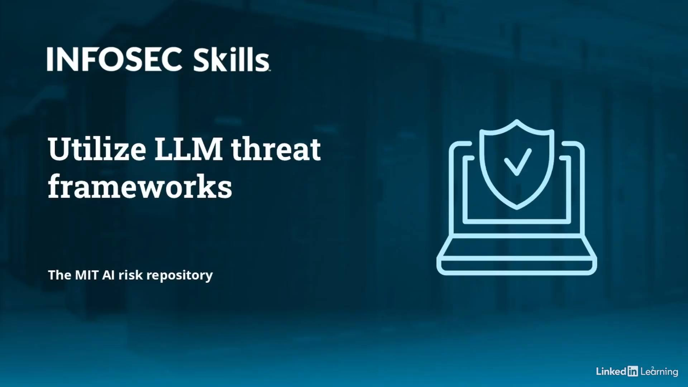
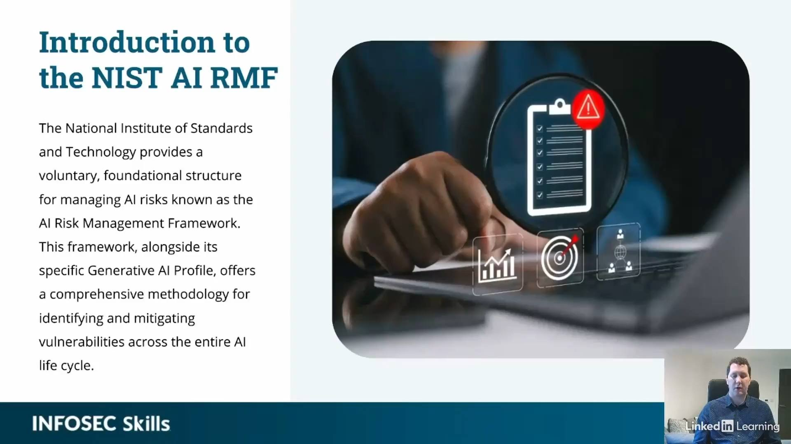
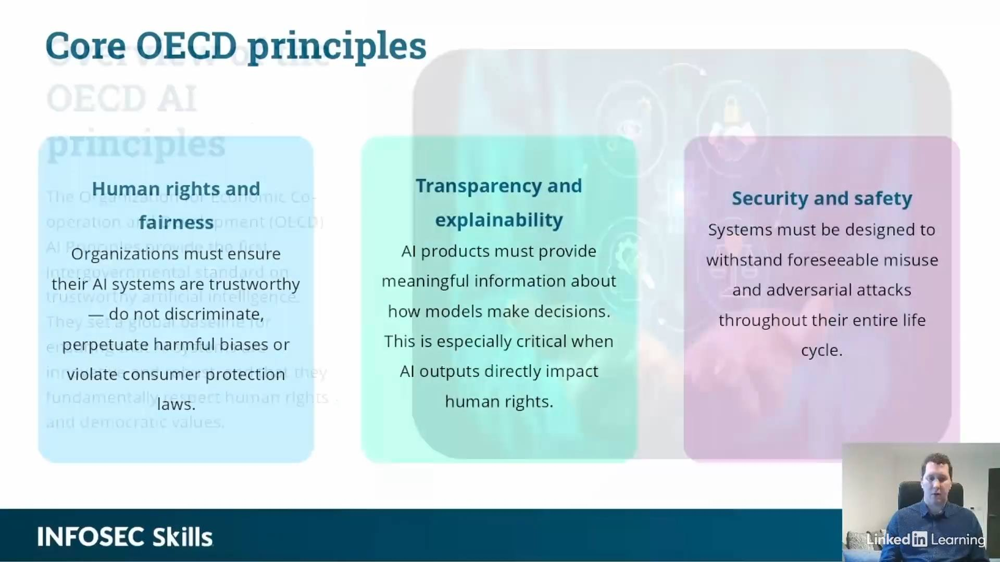
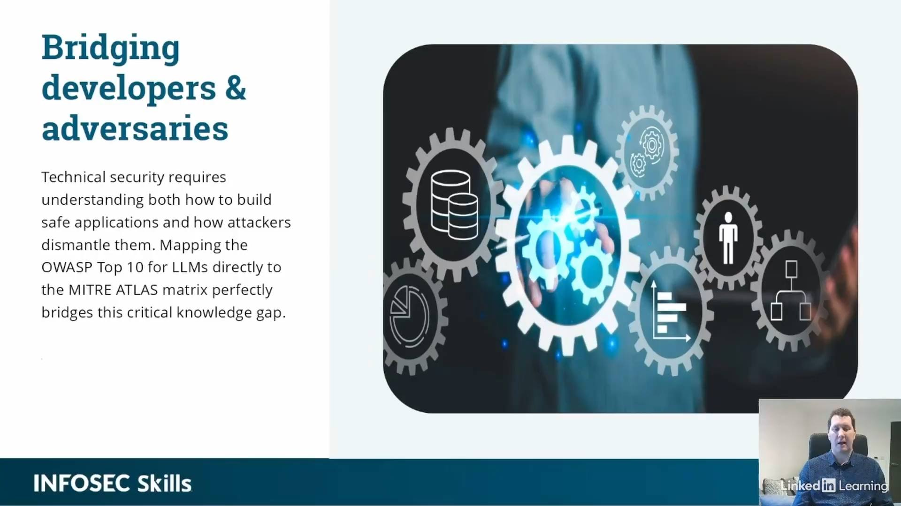
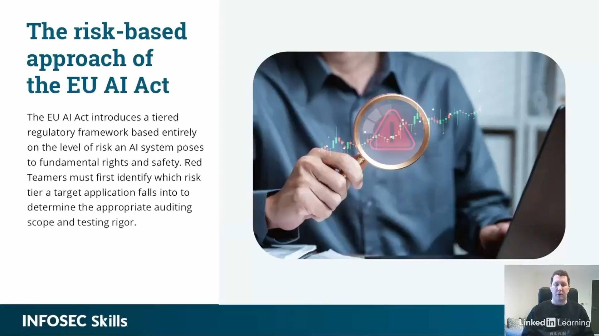
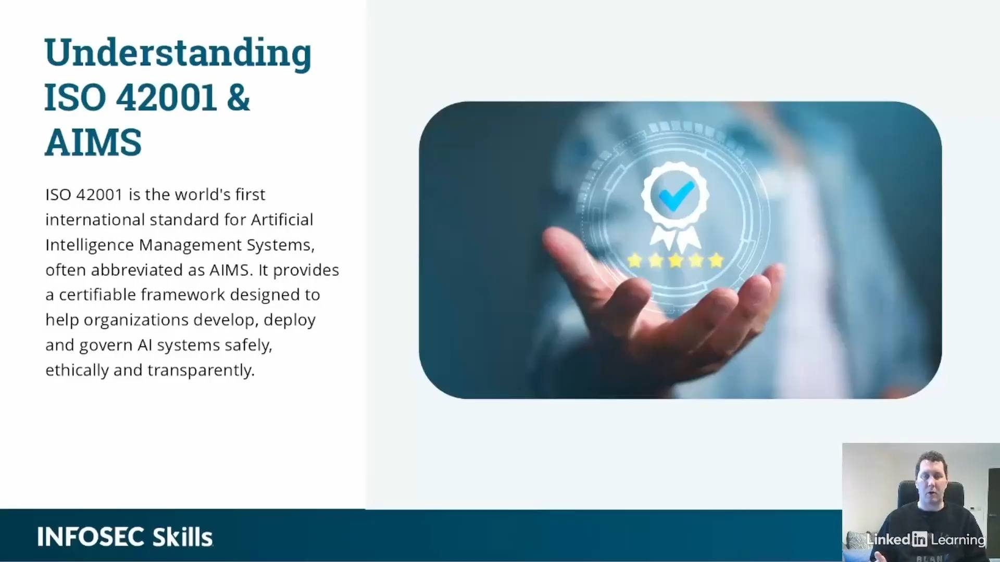
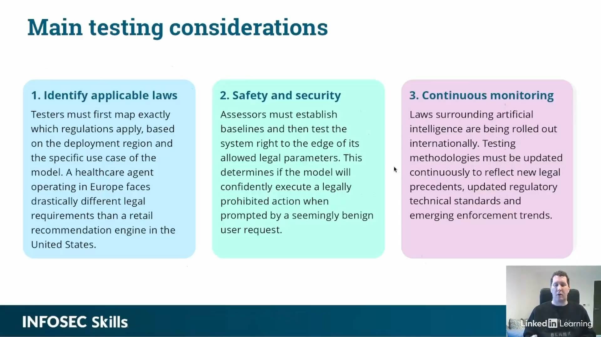
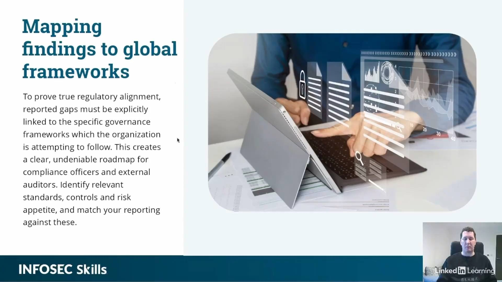

# 1. 这一节做什么

这 9 个片段（P47–P55）不是“再讲几个攻击 payload”的课，而是把前面 LLM 红队测试的结果，接进**威胁框架、治理体系、法律法规、审计证据和报告**里。课程的主线可以概括为：

1. 用 **MIT AI Risk Repository** 建立统一风险语言：风险库、事件跟踪器、因果分类、领域分类；
2. 用 **NIST AI RMF** 把治理落到 `Governance / Map / Measure / Manage` 四个连续功能；
3. 用 **OECD AI Principles** 建立人权、公平、透明、可解释、安全安保的底层原则；
4. 用 **EU AI Act** 做风险分级、确定测试深度、理解罚款与时间线；
5. 用 **ISO 42001** 建立可认证的 AI 管理体系（AIMS），用 PDCA 和条款 4–10 把治理变成可审计流程；
6. 用**控制映射**把漏洞、控制、测试、证据、报告串起来；
7. 用**治理差距报告**把技术发现翻译成高管和监管能看懂、能追责、能复测的商业情报。



这一份文档的“复现对象”不是跑一个 Web 应用，而是**从零搭一套可审计的 AI 治理与合规审计工作台**：目录结构、风险登记表、框架映射表、EU 风险分级表、控制表、测试计划、证据清单、报告模板、结构校验脚本。课里没有代码、没有终端命令、没有配置项，所以第 3 节按“需求→约束→估算→方案→取舍”复现讲师的推导；第 4 节把方案落成可直接保存的文件。第 4 节里的 `validate.py` 是本文补的示意校验脚本，**不是讲师原代码**，我会在文件头明确标注。

# 2. 讲师原话

> "MIT AI Risk Repository 是一个综合性的活数据库，把碎片化的 AI 风险整合成一个统一框架，为安全团队和政策制定者提供标准化分类法，用来系统评估和讨论 AI 全生命周期中的漏洞。"
> —— p047 [00:27]

> "MITRE 攻击框架更关注实际攻击及其风险等级，而 MIT AI Risk Repository 更 holistic，关注 AI 威胁的整体图景并提供实时威胁情报；前者更面向红队，后者更面向政策制定者、CISO、合规官制定策略。"
> —— p047 [00:54]

> "要让海量威胁数据可操作，仓库被组织成三个相互连接的核心组件：AI 风险数据库、AI 事件跟踪器、分类法；分类法按因果性和领域来分类风险。"
> —— p047 [02:20]

> "因果分类把每个编目风险的来源拆成三个维度，并额外加入“无意伤害”维度：责任、意图、时机、无意伤害。理解根因对分配责任和设计防御缓解很关键。"
> —— p047 [03:19]

> "传统网络安全里，你很难“意外”黑进一个系统，通常需要有意为之；但 AI 很容易被无意中诱导出不安全输出、幻觉输出或系统误用，而且门槛低很多，技术能力很弱的人也可能造成高风险事件。"
> —— p047 [04:18]

> "领域分类把庞大漏洞库组织成七个高层类别和 20 多个细粒度子域，让组织把具体风险领域分配给最合适的专业团队。"
> —— p047 [05:12]

> "NIST AI RMF 由四个相互连接、持续循环的核心功能组成：Governance、Map、Measure、Manage。红队可以用这些功能组织从初始侦察到部署后持续监控的测试方法。"
> —— p048 [00:27]

> "NIST AI RMF 是创建治理的指南；MIT 风险框架用来整体理解威胁图景；MITRE ATLAS 用来落地实际攻击技术；NIST 把这一切拉在一起，形成有效治理并向下落到政策和程序。"
> —— p048 [02:46]

> "OECD AI 原则提供了第一个政府间可信人工智能标准，设定全球基线，确保 AI 系统既创新又稳健，并从根本上尊重人权和民主价值。"
> —— p049 [00:29]

> "OECD 的核心原则包括人权与公平、透明与可解释、安全与安保；组织必须确保 AI 可信、不歧视、不偏置、不违反消费者保护法，系统要能承受误用和对抗攻击。"
> —— p049 [01:24]

> "把 OWASP Top 10 for LLMs 直接映射到 MITRE ATLAS，可以桥接“如何构建安全应用”和“攻击者如何拆解应用”之间的知识缺口。"
> —— p050 [00:56]

> "控制映射是把发现的漏洞链接到永久修复所需的精确安全机制的结构化过程。发现漏洞却什么都不做没有意义；修了但不提供证据，在合规上也会出问题。"
> —— p050 [02:47]

> "AI 治理是规则、实践和流程的总体框架，确保 AI 技术被负责任地开发和使用；它连接技术实现和组织问责，提供红队要测试的护栏。"
> —— p051 [00:22]

> "红队越来越被视为关键合规机制，而不只是孤立的安全演练；EU AI Act 等下一代合规框架要求部署前和部署后持续测试。"
> —— p051 [02:48]

> "EU AI Act 引入分层监管框架，完全基于 AI 系统对基本权利和安全构成的风险等级；红队必须先识别应用落在哪个风险层级。"
> —— p052 [00:29]

> "EU AI Act 的罚款可达 3500 万欧元或全球年营业额的 7%，按更高者计算；高风险违规、提供误导信息也有对应罚款，并对中小企业有比例原则。"
> —— p052 [11:26]

> "ISO 42001 是世界上第一个 AI 管理体系国际标准，通常简称 AIMS，提供可认证框架，帮助组织安全、合乎伦理、透明地开发、部署和治理 AI 系统。"
> —— p053 [00:21]

> "ISO 42001 遵循 PDCA 循环，即计划、执行、检查、处理；它和其他主要 ISO 标准一致，确保 AI 治理不是静态清单，而是持续改进的运营流程。"
> —— p053 [00:50]

> "监管对齐测试桥接法律理论和软件现实：系统性地探测 AI 模型或 AI 技术栈，确保真实世界行为严格符合辖区法律和既定治理框架。"
> —— p054 [02:23]

> "合规审计的核心挑战，是把抽象法律条文转成具体可执行的红队攻击；测试者必须把安全、公平、透明等法律要求翻译成具体的对抗性提示。"
> —— p054 [04:43]

> "红队不应该自己给应用定高风险、低风险或可接受风险，这应该由能理解法律框架的人来做；你的工作是做威胁建模，并基于给定的要求去测试。"
> —— p054 [06:05]

> "治理报告把红队演练的原始数据转成可执行的商业情报，让领导层能理解并采取行动；高管很少读技术日志或提示输出，报告必须把复杂 AI 漏洞综合成清晰叙事。"
> —— p055 [00:28]

> "一份最低限度的审计报告应包含执行摘要、技术复现步骤、法律与合规映射、可执行建议，和传统网络安全报告很像。"
> —— p055 [03:16]

# 3. 从零复现

## 3.1 需求：先定义这套工作台要回答什么

课里反复强调：框架不是拿来背的，而是拿来**做映射、做测试、做证据、做报告**的。因此复现目标不是“画一张框架图”，而是建立一套能回答以下问题的文件系统：

1. 我们有哪些 AI 用例？每个用例落在 EU AI Act 的哪个风险层级？
2. 每个已识别风险属于 MIT AI Risk Repository 的哪个因果维度、哪个领域？
3. 这个风险对应 NIST AI RMF 的哪个功能？对应 OECD 的哪条原则？对应 OWASP Top 10 for LLMs / MITRE ATLAS 的哪个攻击面？
4. 用哪个控制去修？控制是否有测试计划？测试是否产生证据？
5. 谁负责？证据在哪里？补丁后是否复测？
6. 最终如何写成一页给高管、十页给工程、附录给监管的报告？

这套工作台的产物应是**可 diff、可审阅、可归档**的文本文件，而不是散落在聊天记录里的结论。

## 3.2 约束：讲师反复提醒的现实条件

- **框架碎片化**：MIT AI Risk Repository、NIST AI RMF、OECD、EU AI Act、ISO 42001、OWASP、MITRE ATLAS 各有语言，必须做交叉映射。
- **技术发现必须翻译成业务和合规语言**：只给监管一厚本日志没有用，必须有报告。
- **AI 是概率性的，会漂移**：今天合规不代表明天合规，必须持续测试。
- **法律文本抽象**：要把“公平”“透明”“安全”翻译成可执行断言和对抗提示。
- **风险分级不是红队拍脑袋**：讲师明确说，高风险/低风险应由理解法律框架的人定，红队负责威胁建模和按给定要求测试。
- **证据要可辩护**：训练数据、输入输出、链式思考、测试步骤、修复记录、复测结果都要能追溯。
- **罚款和诉讼风险是治理驱动力**：EU AI Act 的罚款、集体诉讼风险、深度伪造和版权问题都会倒逼治理。
- **ISO 42001 要的是管理体系，不是一次性清单**：PDCA、条款 4–10、领导问责、内部审计、纠正措施都要有。

## 3.3 估算：给复现一个可替换的容量模型

下面数字是**本文为落地给出的示例估算，不是讲师给出的数字**。你可以按自己公司规模替换。

假设组织有 `N = 120` 个 AI 用例：

- 高风险占 15%：`120 × 15% = 18` 个高风险用例；
- 有限风险占 40%：`120 × 40% = 48` 个；
- 最小风险占 35%：`120 × 35% = 42` 个；
- 不可接受风险占 10%：`120 × 10% = 12` 个，但这类应直接禁止或整改，不进入常规合规测试。

高风险用例每个至少 60 条控制、30 条测试、20 份证据：

- 控制：`18 × 60 = 1080` 条；
- 测试：`18 × 30 = 540` 条/轮；
- 证据：`18 × 20 = 360` 份；
- 若每份证据平均 2 MB，则 `360 × 2 MB = 720 MB/轮`；
- 每份高风险报告按 8 页估算：`18 × 8 = 144` 页/轮。

有限风险每个每轮 10 条透明/输出安全测试：

- `48 × 10 = 480` 条/轮。

总测试量约 `540 + 480 = 1020` 条断言/轮。按每季度一轮，红队 2 人、合规 1 人、法务 1 人、开发/MLOps 接口人若干，至少要把“测试—证据—报告—复测”做成流水线，否则会淹没在表格里。这个估算直接决定第 4 节为什么要用 `risk_register.csv`、`controls.csv`、`test_plan.yml`、`evidence_checklist.md` 分开存，而不是一张大表。

## 3.4 方案：七类文件对应七层治理

1. `framework_mapping.yml`：框架职责与风险映射，解决“同一个风险在多个框架里怎么说”。
2. `eu_ai_act_tiers.yml`：EU AI Act 四档风险与测试动作，解决“测试深度”。
3. `risk_register.csv`：风险登记表，解决“有什么风险、谁负责、什么等级”。
4. `controls.csv`：控制表，解决“怎么修、要什么证据”。
5. `test_plan.yml`：测试计划，解决“法律要求如何变成可执行测试”。
6. `evidence_checklist.md`：证据包清单，解决“审计时拿什么证明”。
7. `report_template.md`：报告模板，解决“高管、工程、监管各自看什么”。

再加一个 `validate.py` 做结构校验：不是替代法务，而是防止漏字段、漏映射、漏证据。

## 3.5 取舍：为什么不用数据库、不把风险等级交给红队

- **用 CSV/YAML/Markdown 而不是数据库**：课里没有讲数据库设计；对复现来说，文本文件可读、可 diff、可进 Git、审计员能直接看。数据库适合规模化，但第一期先把字段和证据链跑通。
- **风险等级与安全严重性分开**：`eu_tier` 是法律分级，`severity` 是技术严重性，两者不能混。课里明确说红队不应自己定法律风险等级。
- **测试计划不绑定某个工具**：课里提到 Garak、PromptFoo 这类提示测试框架，也提到语音识别可能为 DeepTeam / PyRIT 的工具名，但没有给出安装命令和 API。因此文档只定义测试计划格式，不编造工具命令。
- **校验脚本只做结构校验**：它不能判断“这个应用是不是高风险”，也不能替代法务签核；它只保证每个风险至少有控制、有测试、有证据引用。
- **报告模板必须分层**：高管看执行摘要和风险暴露，工程看复现步骤，合规看法律映射，监管看证据链。

# 4. 完整代码

## 4.1 目录结构

```text
ai-governance-audit/
├── README.md
├── requirements.txt
└── governance/
    ├── framework_mapping.yml
    ├── eu_ai_act_tiers.yml
    ├── risk_register.csv
    ├── controls.csv
    ├── test_plan.yml
    ├── evidence_checklist.md
    ├── report_template.md
    └── validate.py
```

## 4.2 设计决策表

| 决策 | 选择 | 理由 | 取舍 |
|---|---|---|---|
| 风险语言 | 以 MIT AI Risk Repository 的因果/领域分类为入口 | 课里说它把碎片风险统一成标准化分类法 | 七大类中讲师只点名五类，另外两类课里没讲，表中不编造 |
| 治理流程 | NIST AI RMF 的 Governance / Map / Measure / Manage | 课里说它把治理拉成蓝图并向下落政策和程序 | 它不直接替代法律分级，需配合 EU AI Act |
| 底层原则 | OECD 人权、公平、透明、安全安保 | 课里说 OECD 是政府间基线，其他框架建立其上 | 原则较抽象，需要控制表落地 |
| 法律分级 | EU AI Act 四档 | 课里详细讲了不可接受、高、有限、最小风险 | 时间线可能变化，需持续跟踪 |
| 管理体系 | ISO 42001 + PDCA + 条款 4–10 | 课里说它是可认证 AIMS，强调持续改进 | 认证范围要企业自己定，课里没讲具体认证机构流程 |
| 控制与证据 | `controls.csv` + `evidence_checklist.md` | 课里强调控制映射和可辩护证据 | 证据存储权限、脱敏课里没讲 |
| 报告 | `report_template.md` 四段式 | 课里明确执行摘要、技术复现、法律映射、建议 | 高管版和工程版需要拆页，课里没给模板原文 |

## 4.3 组件职责表

| 文件/组件 | 职责 | 输入 | 输出 | 对应课程概念 |
|---|---|---|---|---|
| `framework_mapping.yml` | 框架职责与风险到框架的映射 | 风险 ID、控制 ID、测试 ID | 跨框架映射记录 | MIT Repository、NIST、OECD、MITRE ATLAS、OWASP、EU、ISO |
| `eu_ai_act_tiers.yml` | 四档风险及测试动作 | 应用描述、法律判断 | 风险层级与测试深度 | EU AI Act 风险等级 |
| `risk_register.csv` | 风险登记与责任人 | 威胁建模结果 | 风险清单 | 因果分类、领域分类、风险容忍 |
| `controls.csv` | 控制措施与证据要求 | 风险 ID | 控制清单 | 控制映射、修复证据 |
| `test_plan.yml` | 测试目标与证据字段 | 风险 ID、控制 ID | 可执行测试计划 | 法律文本转测试载荷、红队测试 |
| `evidence_checklist.md` | 审计证据包 | 测试结果、日志、报告 | 可归档证据 | 可辩护证据、日志、链式思考 |
| `report_template.md` | 治理差距报告 | 全部上述产物 | 高管/工程/合规报告 | 报告治理差距 |
| `validate.py` | 结构校验（示意） | 上述文件 | 错误列表与统计 | 本文补的工程校验，不是讲师代码 |

## 4.4 数据模型草案

- **Risk**：`risk_id`、`title`、`domain`、`causality_responsibility`、`intentionality`、`timing`、`unintentional`、`severity`、`eu_tier`、`owner`、`status`。
- **Control**：`control_id`、`risk_id`、`control`、`control_type`、`evidence_required`、`owner`、`framework_refs`。
- **Test**：`id`、`risk_id`、`objective`、`evidence`、`severity_if_fail`。
- **Mapping**：`risk_id`、`title`、`framework_refs`、`nist_functions`、`control_id`、`test_ids`、`evidence_ids`、`owner`、`severity`、`eu_tier`、`iso_clause`、`notes`。
- **Evidence**：证据 ID、类型、路径、生成时间、模型版本、输入输出、链式思考、复测结果、负责人。
- **Report**：执行摘要、技术复现步骤、法律合规映射、建议、严重性、责任人、证据链接、指标。

## 4.5 容量估算表

| 项目 | 公式 | 示例值 |
|---|---|---:|
| AI 用例总数 | `N` | 120 |
| 高风险用例 | `N × 15%` | 18 |
| 有限风险用例 | `N × 40%` | 48 |
| 最小风险用例 | `N × 35%` | 42 |
| 不可接受风险用例 | `N × 10%` | 12 |
| 高风险控制数 | `18 × 60` | 1080 |
| 高风险测试数/轮 | `18 × 30` | 540 |
| 有限风险测试数/轮 | `48 × 10` | 480 |
| 总测试数/轮 | `540 + 480` | 1020 |
| 高风险证据份数/轮 | `18 × 20` | 360 |
| 证据存储/轮 | `360 × 2 MB` | 720 MB |
| 高风险报告页数/轮 | `18 × 8` | 144 页 |

## 4.6 `README.md`

```markdown
# AI Governance Audit Workbench

本目录用于复现课程 P47-P55 的 AI 治理、风险与合规审计产物。

## 环境

- Python 3.11+
- PyYAML 6.0.2

## 安装

```bash
python3 -m venv .venv
source .venv/bin/activate
pip install -r requirements.txt
```

Windows:

```bat
python -m venv .venv
.venv\Scripts\activate
pip install -r requirements.txt
```

## 运行结构校验

```bash
python governance/validate.py
```

## 说明

课里没有代码、终端命令和配置项。`validate.py` 是本文补的示意校验脚本，不是讲师原代码。
它只检查字段完整性、风险等级引用、控制/测试/证据引用，不替代法务判断。
```

## 4.7 `requirements.txt`

```text
PyYAML==6.0.2
```

## 4.8 `governance/framework_mapping.yml`

```yaml
frameworks:
  - id: oecd
    name: OECD AI Principles
    role: "底层原则：人权与公平、透明与可解释、安全与安保"
  - id: nist_ai_rmf
    name: NIST AI RMF
    role: "治理蓝图：Governance、Map、Measure、Manage"
  - id: mit_ai_risk_repository
    name: MIT AI Risk Repository
    role: "统一风险库、事件跟踪器、因果分类、领域分类"
  - id: mitre_atlas
    name: MITRE ATLAS
    role: "把现实攻击技术映射到 AI 系统测试"
  - id: owasp_llm
    name: OWASP Top 10 for LLMs
    role: "LLM 应用层漏洞清单"
  - id: eu_ai_act
    name: EU AI Act
    role: "法律风险分级、透明度义务、罚款与时间线"
  - id: iso_42001
    name: ISO 42001
    role: "AI 管理体系 AIMS、PDCA、可认证治理"

mappings:
  - risk_id: R-001
    title: "提示注入导致越权工具调用"
    framework_refs:
      - owasp_llm
      - mitre_atlas
      - nist_ai_rmf
      - mit_ai_risk_repository
    nist_functions:
      - govern
      - map
      - measure
      - manage
    control_id: C-001
    test_ids:
      - T-001
    evidence_ids:
      - E-001
    owner: appsec
    severity: high
    eu_tier: high
    iso_clause: "8"
    notes: "测试要覆盖工具调用日志和模型版本"

  - risk_id: R-002
    title: "训练数据投毒"
    framework_refs:
      - mit_ai_risk_repository
      - nist_ai_rmf
      - mitre_atlas
      - iso_42001
    nist_functions:
      - map
      - measure
      - manage
    control_id: C-002
    test_ids:
      - T-002
    evidence_ids:
      - E-002
    owner: mlops
    severity: high
    eu_tier: high
    iso_clause: "8"
    notes: "需要记录训练数据来源和版本"

  - risk_id: R-003
    title: "幻觉输出被当成事实"
    framework_refs:
      - mit_ai_risk_repository
      - oecd
      - nist_ai_rmf
      - owasp_llm
    nist_functions:
      - measure
      - manage
    control_id: C-003
    test_ids:
      - T-003
    evidence_ids:
      - E-003
    owner: product
    severity: high
    eu_tier: limited
    iso_clause: "8"
    notes: "需要透明披露和输出核验"

  - risk_id: R-004
    title: "招聘场景偏见"
    framework_refs:
      - oecd
      - mit_ai_risk_repository
      - eu_ai_act
      - iso_42001
    nist_functions:
      - govern
      - map
      - measure
    control_id: C-004
    test_ids:
      - T-004
    evidence_ids:
      - E-004
    owner: hr_legal
    severity: high
    eu_tier: high
    iso_clause: "4"
    notes: "高风险场景，必须有人类监督和可解释记录"

  - risk_id: R-005
    title: "PII 泄露"
    framework_refs:
      - oecd
      - owasp_llm
      - nist_ai_rmf
      - eu_ai_act
    nist_functions:
      - measure
      - manage
    control_id: C-005
    test_ids:
      - T-005
    evidence_ids:
      - E-005
    owner: appsec_privacy
    severity: critical
    eu_tier: high
    iso_clause: "8"
    notes: "日志和链式思考需要脱敏"

  - risk_id: R-006
    title: "模型漂移导致合规失效"
    framework_refs:
      - mit_ai_risk_repository
      - nist_ai_rmf
      - iso_42001
      - eu_ai_act
    nist_functions:
      - govern
      - measure
      - manage
    control_id: C-006
    test_ids:
      - T-006
    evidence_ids:
      - E-006
    owner: mlops
    severity: medium
    eu_tier: limited
    iso_clause: "9"
    notes: "上线后持续监控和复测"
```

## 4.9 `governance/eu_ai_act_tiers.yml`

```yaml
tiers:
  - id: unacceptable
    name: "不可接受风险"
    action: "禁止在欧盟市场销售"
    examples:
      - "社会评分"
      - "潜意识操纵"
    red_team_action: "审计是否存在该实践；发现即升级法务和合规"
  - id: high
    name: "高风险"
    action: "严格义务、合格性评估、数据治理、日志、人类监督"
    examples:
      - "关键基础设施"
      - "执法"
      - "就业"
      - "医疗"
      - "教育"
      - "人力资源"
    red_team_action: "深度技术测试、数据质量审计、日志与可追溯性验证"
  - id: limited
    name: "有限风险"
    action: "透明义务"
    examples:
      - "聊天机器人"
      - "深度伪造生成器"
      - "对话式 AI"
      - "文本生成器"
    red_team_action: "验证 AI 披露、输出安全；仍要提示诉讼风险"
  - id: minimal
    name: "最小风险"
    action: "无强制义务；适用自愿行为准则"
    examples:
      - "AI 电子游戏"
      - "基础垃圾邮件过滤器"
    red_team_action: "记录自愿控制，保留审计痕迹"
```

## 4.10 `governance/risk_register.csv`

```csv
risk_id,title,domain,causality_responsibility,intentionality,timing,unintentional,severity,eu_tier,owner,status
R-001,提示注入导致越权工具调用,security,AI,malicious,pre_deployment,false,high,high,appsec,open
R-002,训练数据投毒,security,human,malicious,training_data,false,high,high,mlops,open
R-003,幻觉输出被当成事实, misinformation,AI,unintentional,post_deployment,true,high,limited,product,open
R-004,招聘场景偏见,toxicity,AI,unintentional,pre_deployment,true,high,high,hr_legal,open
R-005,PII 泄露,security,AI,malicious,post_deployment,false,critical,high,appsec_privacy,open
R-006,模型漂移导致合规失效,safety,AI,unintentional,post_deployment,true,medium,limited,mlops,open
```

## 4.11 `governance/controls.csv`

```csv
control_id,risk_id,control,control_type,evidence_required,owner,framework_refs
C-001,R-001,对工具调用做权限白名单和参数校验,preventive,工具调用日志;拒绝记录;模型版本,appsec,owasp_llm;mitre_atlas;nist_ai_rmf
C-002,R-002,训练数据来源审查和版本锁定,preventive,数据来源清单;数据版本;审批记录,mlops,mit_ai_risk_repository;nist_ai_rmf;iso_42001
C-003,R-003,输出核验与 AI 披露,detective,输入输出样本;人工复核记录;披露文案,product,oecd;owasp_llm;eu_ai_act
C-004,R-004,招聘场景人类复核和偏见测试,preventive,测试样本;复核记录;公平性指标,hr_legal,oecd;eu_ai_act;iso_42001
C-005,R-005,PII 脱敏与最小化收集,preventive,脱敏日志;数据流图;访问记录,appsec_privacy,oecd;owasp_llm;eu_ai_act
C-006,R-006,上线后漂移监控和季度复测,detective,监控指标;复测报告;偏差告警,mlops,mit_ai_risk_repository;nist_ai_rmf;iso_42001
```

## 4.12 `governance/test_plan.yml`

```yaml
plans:
  - id: T-001
    risk_id: R-001
    objective: "验证提示注入能否触发越权工具调用"
    evidence:
      - "prompt"
      - "response"
      - "tool_call_log"
      - "model_version"
    severity_if_fail: high
  - id: T-002
    risk_id: R-002
    objective: "验证训练数据来源和版本是否可追溯"
    evidence:
      - "data_source_manifest"
      - "dataset_version"
      - "approval_record"
    severity_if_fail: high
  - id: T-003
    risk_id: R-003
    objective: "验证模型在无依据时是否拒答或披露不确定性"
    evidence:
      - "input"
      - "output"
      - "human_review"
      - "disclosure_text"
    severity_if_fail: high
  - id: T-004
    risk_id: R-004
    objective: "验证招聘筛选输出是否存在受保护群体偏见"
    evidence:
      - "test_cases"
      - "group_metrics"
      - "human_override_record"
    severity_if_fail: high
  - id: T-005
    risk_id: R-005
    objective: "验证模型和日志是否泄露 PII"
    evidence:
      - "redacted_log"
      - "data_flow"
      - "access_record"
    severity_if_fail: critical
  - id: T-006
    risk_id: R-006
    objective: "验证部署后模型漂移是否触发复测和告警"
    evidence:
      - "drift_metric"
      - "retest_report"
      - "alert_record"
    severity_if_fail: medium
```

## 4.13 `governance/evidence_checklist.md`

```markdown
# AI 治理审计证据清单

## 1. 风险与分级
- [ ] 风险 ID、标题、领域、因果维度已登记
- [ ] EU AI Act 风险层级已由合规/法务确认
- [ ] 风险责任人已指定
- [ ] 风险容忍度和升级路径已记录

## 2. 控制与测试
- [ ] 每个风险至少一个控制
- [ ] 每个控制有控制类型和证据要求
- [ ] 每个风险至少一个测试计划
- [ ] 测试目标能追溯到法律/框架要求

## 3. 技术证据
- [ ] 模型名称和版本
- [ ] 输入样本与输出样本
- [ ] 工具调用日志
- [ ] 链式思考或决策解释（如适用）
- [ ] 训练数据来源和版本
- [ ] 人工复核/覆盖记录

## 4. 修复与复测
- [ ] 修复措施和负责人
- [ ] 补丁版本或配置变更记录
- [ ] 复测结果
- [ ] 未修复风险的补偿控制

## 5. 报告与归档
- [ ] 执行摘要
- [ ] 技术复现步骤
- [ ] 法律与合规映射
- [ ] 可执行建议
- [ ] 事件报告和消费者日志处理记录
```

## 4.14 `governance/report_template.md`

```markdown
# AI 治理差距报告

## 1. 执行摘要
- 测试范围：
- 受影响业务：
- 最高风险等级：
- 关键发现数量：
- 需要管理层决策的事项：

## 2. 技术复现步骤
- 模型/应用版本：
- 测试环境：
- 输入样本：
- 实际输出：
- 工具调用/日志：
- 复现命令或操作步骤（课里没有命令时写“无命令，手工复现”）：

## 3. 法律与合规映射
| 发现 | MIT AI Risk Repository | NIST AI RMF | OECD | OWASP LLM | MITRE ATLAS | EU AI Act | ISO 42001 |
|---|---|---|---|---|---|---|---|
|  |  |  |  |  |  |  |  |

## 4. 风险分级与业务影响
- 技术严重性：
- EU AI Act 层级：
- 诉讼/罚款/声誉影响：
- 受影响用户或群体：

## 5. 可执行建议
- 立即修复：
- 补偿控制：
- 负责人：
- 截止日期：
- 复测计划：

## 6. 证据附件
- 证据 ID：
- 存放路径：
- 生成时间：
- 审核人：
```
## 4.15 `governance/validate.py`

```python
#!/usr/bin/env python3
# -*- coding: utf-8 -*-
"""
governance/validate.py

结构校验器（示意代码）。
课里没有代码、终端命令和配置项；本文件是本文为了让第 4 节产物可检查而补的，
不是讲师原代码，也不代表课程里出现过任何脚本。

它只做结构校验：
- 风险登记表字段是否齐全
- EU AI Act 风险层级是否在 eu_ai_act_tiers.yml 里
- 每个风险是否至少有一个控制
- 每个风险是否至少有一个测试
- 映射表引用的 control_id / test_id 是否存在
- 每个控制是否有证据要求

它不做：
- 判断某个应用在法律上是否属于高风险
- 判断控制是否真的有效
- 替代法务、合规、数据保护官的签字

用法：
    python governance/validate.py
    python governance/validate.py --json
"""

from __future__ import annotations

import argparse
import csv
import json
import sys
from pathlib import Path

try:
    import yaml
except ImportError:
    print("缺少 PyYAML，请先执行: pip install -r requirements.txt", file=sys.stderr)
    raise SystemExit(2)

BASE_DIR = Path(__file__).resolve().parent

RISK_REQUIRED = [
    "risk_id",
    "title",
    "domain",
    "causality_responsibility",
    "intentionality",
    "timing",
    "unintentional",
    "severity",
    "eu_tier",
    "owner",
    "status",
]

CONTROL_REQUIRED = [
    "control_id",
    "risk_id",
    "control",
    "control_type",
    "evidence_required",
    "owner",
    "framework_refs",
]

TEST_REQUIRED = [
    "id",
    "risk_id",
    "objective",
    "evidence",
    "severity_if_fail",
]

ALLOWED_STATUS = {"open", "mitigated", "accepted", "closed"}
ALLOWED_SEVERITY = {"info", "low", "medium", "high", "critical"}


def load_yaml(filename: str):
    path = BASE_DIR / filename
    with path.open("r", encoding="utf-8") as fh:
        return yaml.safe_load(fh) or {}


def load_csv(filename: str) -> list[dict]:
    path = BASE_DIR / filename
    with path.open("r", encoding="utf-8", newline="") as fh:
        reader = csv.DictReader(fh)
        rows = []
        for line_no, row in enumerate(reader, start=2):
            cleaned = {}
            for key, value in row.items():
                if key is None:
                    continue
                cleaned[key.strip()] = (value or "").strip()
            cleaned["__line__"] = line_no
            rows.append(cleaned)
        return rows


def check_required(rows: list[dict], required: list[str], kind: str, errors: list[str]) -> None:
    for row in rows:
        missing = [field for field in required if not row.get(field)]
        if missing:
            errors.append(f"{kind} 第 {row.get('__line__', '?')} 行缺少字段: {', '.join(missing)}")


def main(argv=None) -> int:
    parser = argparse.ArgumentParser(description="AI 治理产物结构校验")
    parser.add_argument("--json", action="store_true", help="以 JSON 输出结果")
    args = parser.parse_args(argv)

    errors: list[str] = []
    warnings: list[str] = []

    try:
        tiers_doc = load_yaml("eu_ai_act_tiers.yml")
        mapping_doc = load_yaml("framework_mapping.yml")
        test_doc = load_yaml("test_plan.yml")
    except FileNotFoundError as exc:
        print(f"找不到文件: {exc.filename}", file=sys.stderr)
        return 2
    except yaml.YAMLError as exc:
        print(f"YAML 解析失败: {exc}", file=sys.stderr)
        return 2

    risks = load_csv("risk_register.csv")
    controls = load_csv("controls.csv")

    tier_ids = {str(t.get("id", "")).strip() for t in (tiers_doc.get("tiers") or []) if t.get("id")}
    if not tier_ids:
        errors.append("eu_ai_act_tiers.yml 没有解析出任何 tier id")

    check_required(risks, RISK_REQUIRED, "risk_register", errors)
    check_required(controls, CONTROL_REQUIRED, "controls", errors)

    risk_ids = [r["risk_id"] for r in risks if r.get("risk_id")]
    risk_id_set = set(risk_ids)

    duplicated = sorted({rid for rid in risk_ids if risk_ids.count(rid) > 1})
    if duplicated:
        errors.append(f"risk_id 重复: {', '.join(duplicated)}")

    for row in risks:
        risk_id = row.get("risk_id", "?")
        if row.get("eu_tier") and row["eu_tier"] not in tier_ids:
            errors.append(f"{risk_id}: eu_tier='{row['eu_tier']}' 不在 eu_ai_act_tiers.yml 中")
        if row.get("unintentional") not in {"true", "false"}:
            errors.append(f"{risk_id}: unintentional 必须是 true/false，当前为 '{row.get('unintentional')}'")
        if row.get("status") not in ALLOWED_STATUS:
            errors.append(f"{risk_id}: status='{row.get('status')}' 不在 {sorted(ALLOWED_STATUS)} 内")
        if row.get("severity") not in ALLOWED_SEVERITY:
            errors.append(f"{risk_id}: severity='{row.get('severity')}' 不在 {sorted(ALLOWED_SEVERITY)} 内")

    control_ids = [c["control_id"] for c in controls if c.get("control_id")]
    control_id_set = set(control_ids)

    for row in controls:
        if row.get("risk_id") and row["risk_id"] not in risk_id_set:
            errors.append(f"{row.get('control_id', '?')}: risk_id='{row['risk_id']}' 不在 risk_register.csv 中")

    risks_with_control = {c["risk_id"] for c in controls if c.get("risk_id")}
    for row in risks:
        if row.get("risk_id") and row["risk_id"] not in risks_with_control:
            errors.append(f"{row['risk_id']}: 没有任何控制（controls.csv）")

    plans = test_doc.get("plans") or []
    numbered_plans = [{**plan, "__line__": index} for index, plan in enumerate(plans, start=1)]
    check_required(numbered_plans, TEST_REQUIRED, "test_plan", errors)

    test_id_set = {str(p.get("id", "")).strip() for p in plans if p.get("id")}

    for plan in plans:
        if plan.get("risk_id") not in risk_id_set:
            errors.append(f"{plan.get('id', '?')}: risk_id='{plan.get('risk_id')}' 不在 risk_register.csv 中")

    risks_with_test = {p.get("risk_id") for p in plans if p.get("risk_id")}
    for row in risks:
        if row.get("risk_id") and row["risk_id"] not in risks_with_test:
            errors.append(f"{row['risk_id']}: 没有任何测试（test_plan.yml）")

    mappings = mapping_doc.get("mappings") or []
    evidence_ids: set[str] = set()

    for mapping in mappings:
        risk_id = mapping.get("risk_id", "?")
        if risk_id not in risk_id_set:
            errors.append(f"{risk_id}: 映射表引用了 risk_register.csv 中不存在的风险")
        control_id = mapping.get("control_id")
        if control_id and control_id not in control_id_set:
            errors.append(f"{risk_id}: control_id='{control_id}' 不在 controls.csv 中")
        for test_id in mapping.get("test_ids") or []:
            if test_id not in test_id_set:
                errors.append(f"{risk_id}: test_id='{test_id}' 不在 test_plan.yml 中")
        for evidence_id in mapping.get("evidence_ids") or []:
            evidence_ids.add(evidence_id)
        if mapping.get("eu_tier") and mapping["eu_tier"] not in tier_ids:
            errors.append(f"{risk_id}: 映射表 eu_tier='{mapping['eu_tier']}' 不在 tiers 中")

    open_high = [
        row
        for row in risks
        if row.get("status") == "open" and row.get("severity") in {"high", "critical"}
    ]
    if open_high:
        warnings.append(f"有 {len(open_high)} 条 high/critical 风险仍为 open，需要在报告中单列")

    summary = {
        "risks": len(risks),
        "controls": len(controls),
        "tests": len(plans),
        "mappings": len(mappings),
        "evidence_refs": len(evidence_ids),
        "open_high_critical": len(open_high),
        "errors": len(errors),
        "warnings": len(warnings),
    }

    if args.json:
        print(json.dumps({"summary": summary, "errors": errors, "warnings": warnings}, ensure_ascii=False, indent=2))
    else:
        print("== AI 治理产物结构校验 ==")
        for key, value in summary.items():
            print(f"{key:>20}: {value}")
        if errors:
            print("\n错误:")
            for item in errors:
                print(f"  - {item}")
        if warnings:
            print("\n警告:")
            for item in warnings:
                print(f"  - {item}")
        print("\n结果:", "FAIL" if errors else "PASS")

    return 1 if errors else 0


if __name__ == "__main__":
    raise SystemExit(main())
```

# 5. 逐行解释

## 5.1 课程概念落到哪个字段

第 4 节的表不是凭空设计的，每一列都能追到讲师的原话或框架结构。先把对应关系钉住，后面逐行解释才有依据。

**MIT AI Risk Repository 的三组件**：风险数据库、事件跟踪器、分类法。第 4 节里对应的是 `risk_register.csv`（风险库的一行）、`evidence_checklist.md` 第 5 节最后一条（事件报告与消费者日志）、以及 `risk_register.csv` 的 `domain` + `causality_responsibility` + `intentionality` + `timing` + `unintentional` 五列（分类法）。讲师说分类法分两套：因果分类和领域分类。

**因果分类四个维度**，逐一对上：

| 讲师说的维度 | 讲师给的取值 | 落在哪个字段 |
|---|---|---|
| 责任 responsibility | 人类行为者 / AI | `causality_responsibility` |
| 意图 intentionality | 恶意 / 无意 | `intentionality` |
| 时机 timing | 训练数据、投毒数据、错误数据、部署前开发、部署后漂移 | `timing` |
| 无意伤害 unintentional | 传统网络安全聚焦恶意黑客，但 AI 风险很大比例是意外的 | `unintentional`（true/false） |

**领域分类七大类、20+ 子域**。讲师只点名了五类：toxicity（不公平对待、偏见决策、有害内容，他说这是诉讼风险）、security（未授权数据提取、系统操纵，LLM 是应用入口）、misinformation（可信但虚假的叙事被当成事实）、hallucination（模型没信息就编，比大家以为的常见）、safety（把系统推到架构极限，看哪里崩，比如分析 agent 的链式思考找出错点）。另外两类**课里没讲**，所以 `risk_register.csv` 的 `domain` 列只用了 `security` / `misinformation` / `toxicity` / `safety` 四个值，没有编造第五、第六、第七类。

**NIST AI RMF 四功能**，落在 `framework_mapping.yml` 的 `nist_functions` 列表里：



- `govern`：建立文化、政策、问责结构，测试必须对齐组织风险容忍度和法律要求；
- `map`：理解预期用例、数据来源、运行环境，红队靠它找攻击面和业务逻辑缺陷；讲师特别强调“不能对着应用乱发提示词，要先理解业务整体、组件目的、组件的工具与能力”；
- `measure`：定量和定性评估，做严格评测和对抗模拟，产出模型乃至整个技术栈的具体漏洞数据；
- `manage`：实施主动控制去缓解风险。

**OECD 原则**落在 `framework_mapping.yml` 里 `oecd` 的 `role`，以及 `controls.csv` 的 `framework_refs`。讲师讲的 OECD 分类框架有四个维度：people and planet context（影响谁、终端用户、受影响利益相关方、环境后果，属于系统性风险）、economic context（部署行业和支持的关键业务功能，用来排测试优先级）、data and input characteristics（训练数据投毒、外部输入操纵）、task and output assessments（模型执行的具体动作和操作自主程度）。这四个维度第 4 节没有单独建文件，你可以把它们作为 `controls.csv` 的 `framework_refs` 取值（例如 `oecd_people_planet`、`oecd_economic`、`oecd_data_input`、`oecd_task_output`）来用，或者另开 `oecd_dimensions.yml` 抄同一套 `tiers` 结构，课程里没给字段名，不要假装有官方字段。



**跨框架映射的位置**。讲师说“把 OWASP Top 10 for LLMs 直接映射到 MITRE ATLAS，能桥接构建安全应用和攻击者拆解应用之间的知识缺口”，又说“把技术漏洞映射到 NIST AI RMF，确保工程缺陷在执行层被处理”。第 4 节把这件事放在 `framework_mapping.yml` 的 `framework_refs` 里：一个风险可以同时挂 `owasp_llm`、`mitre_atlas`、`nist_ai_rmf`、`mit_ai_risk_repository`，这就是“跨框架映射”的最小实现。



**EU AI Act 四档**落在 `eu_ai_act_tiers.yml`，并在 `risk_register.csv` 的 `eu_tier` 列引用。



**ISO 42001** 落在 `framework_mapping.yml` 的 `iso_clause` 字段和 `evidence_checklist.md`。讲师说条款 4、5 是上下文与领导力、要明确映射 AI 生态并指定高管问责；条款 6、7 是识别 AI 风险并确保团队有技能和工具；条款 8 是运营引擎，风险处理在开发生命周期里实施；条款 9、10 是持续监控、内部审计、发现不符合项后的正式纠正措施。所以示例里 R-004（招聘偏见）挂 `iso_clause: "4"`，R-006（模型漂移）挂 `"9"`，其余运维类挂 `"8"`。



## 5.2 容量估算逐行

`120` 个 AI 用例是示例基数，**不是课程数字**。课程没有给任何用例数量、控制数量或测试数量。这个数字的作用只有一个：证明为什么必须把风险、控制、测试、证据分四张表，而不是塞进一个 Excel sheet。

- `120 × 15% = 18`：高风险占比参考讲师对高风险场景的描述（关键基础设施、执法、就业、医疗、教育、人力资源）。他特别提到“人力资源部门几乎每个大组织都有，我很意外如果它们没用 AI”，所以 HR 场景必须计入。
- `120 × 40% = 48`：讲师说“绝大多数 AI 应用会落在有限风险”，聊天机器人、深度伪造生成器、对话式 AI、文本生成器。40% 只是示例，不是课程给的百分比。
- `120 × 35% = 42`、`120 × 10% = 12`：最小风险和不可接受风险的示例拆分。不可接受风险要单独算，因为讲师说这类应用“在欧盟市场被禁止销售”，审计不是测“是否合规”，而是测“是否存在这类实践”；一旦发现，直接升级法务。
- `18 × 60 = 1080` 条控制：按每个高风险用例 60 条控制估。这个 60 是本文假设，你可以换成实际控制库条数。
- `18 × 30 = 540` + `48 × 10 = 480` = `1020` 条测试/轮：高风险测深度（数据质量、人类监督、准确性鲁棒性、日志可追溯），有限风险测透明与输出安全。讲师说有限风险“不受诉讼保护”，所以也要测，只是深度不同。
- `18 × 20 = 360` 份证据/轮、`360 × 2 MB = 720 MB`：证据包括输入输出、工具调用日志、模型版本、训练数据清单、人工复核记录。2 MB 是示例均值，实际由日志长度决定。
- `18 × 8 = 144` 页/轮：按每份高风险报告 8 页（执行摘要 + 复现 + 映射 + 建议 + 附件清单）估。

这里有一个**并发问题**：如果多个红队成员同时往 `risk_register.csv` 追加行，会有写冲突。在 Node 里对应的是用单进程队列写文件，或者用 `proper-lockfile` 加文件锁，再或者干脆改成每人一个 `risk_register.<team>.csv` 最后合并。课里没讲这块。

## 5.3 `risk_register.csv` 逐列

- `risk_id`：主键，`R-001` 这种格式方便引用。校验器会查重复。
- `title`：一句话描述，必须能让人不看上下文就懂。写“提示注入”太粗，写“提示注入导致越权工具调用”才能对应到具体控制。
- `domain`：来自 MIT 领域分类。示例只用了 `security` / `misinformation` / `toxicity` / `safety`，因为讲师只点名这五类中的四类用于示例（hallucination 在示例里被并在 `misinformation` 行，你也可以单独建一个 `hallucination` 值）。**另外两类课里没讲，不要瞎填。**
- `causality_responsibility`：`AI` 还是 `human`。讲师说责任维度是判断“人类行为者还是 AI 是主要成因”，这直接决定缓解方式——如果是 AI 生成导致的，改提示、改检索、改模型；如果是人类恶意输入导致的，上鉴权、上输入过滤。
- `intentionality`：`malicious` 还是 `unintentional`。讲师的原话是传统安全里“很难意外黑进系统”，但 AI 里“很容易无意中诱导出不安全输出、幻觉输出或系统误用”，而且门槛低，技术能力很弱的人也能造成高风险事件。这一列决定了测试要不要包含“善意用户误用”场景。
- `timing`：`training_data` / `pre_deployment` / `post_deployment`。讲师说时机维度覆盖训练数据（投毒数据、错误数据）、部署前开发、部署后（漂移，AI 偏离原本目的）。R-002 填 `training_data`，R-006 填 `post_deployment`。
- `unintentional`：`true`/`false`。讲师专门加了这个维度，说“传统网络安全聚焦恶意黑客，但因果分类揭示 AI 风险很大比例是完全意外的”。R-003、R-004、R-006 填 `true`，因为幻觉、偏见、漂移都不是有人故意造成的。
- `severity`：技术严重性，`info` / `low` / `medium` / `high` / `critical`。**注意这和法律风险等级是两回事。** 讲师明确说红队不该自己定法律等级：“你作为红队，不应该自己把应用评成高风险、低风险或可接受风险，那应该由能理解法律框架的人来做；你的工作是威胁建模，并基于给定的要求去测试。”
- `eu_tier`：`unacceptable` / `high` / `limited` / `minimal`，必须出现在 `eu_ai_act_tiers.yml` 里，校验器会查。
- `owner`：负责团队。讲师说 ISO 42001 要求“领导层对 AI 政策和资源分配承担直接的、有文档记录的问责”，所以这一列不能空，也不能写“全体”。
- `status`：`open` / `mitigated` / `accepted` / `closed`。`accepted` 是“接受了这个风险并记录补偿控制”，不是“装作没看见”。

## 5.4 `controls.csv` 逐列

- `control_id`：主键，`C-001` 格式。
- `risk_id`：外键，校验器会查它是否在风险表里。
- `control`：具体动作。写“加强安全”没用，写“对工具调用做权限白名单和参数校验”才能被 engineer 执行。
- `control_type`：`preventive`（预防）/ `detective`（检测）。讲师讲 NIST 的 Manage 功能时说的是“实施主动控制去缓解风险”，对应 preventive；`detective` 是给漂移、幻觉、PII 泄露这种无法完全预防的问题用的。
- `evidence_required`：分号分隔的证据清单。这一列是**控制映射的关键**——讲师说“控制映射是把发现的漏洞链接到永久修复所需的精确安全机制的结构化过程”，又说“修了但不提供证据，从合规角度会更糟，因为你证明不了”。所以每个控制必须写清楚要产出什么证据。
- `owner`：和风险 owner 可以不同。风险归业务，控制归工程。
- `framework_refs`：分号分隔的框架 ID，必须能在 `framework_mapping.yml` 的 `frameworks` 列表里找到（校验器目前没查这一项，你可以自己加一条检查）。

## 5.5 `test_plan.yml` 逐字段

- `id`：测试 ID，`T-001`。
- `risk_id`：外键。
- `objective`：这一条最关键。讲师说“合规审计的核心挑战，是把抽象法律条文转成具体可执行的红队攻击；测试者必须把安全、公平、透明等法律要求翻译成具体的对抗性提示”。所以 `objective` 不能写“测试安全性”，要写“验证提示注入能否触发越权工具调用”“验证模型在无依据时是否拒答或披露不确定性”。
- `evidence`：数组，列出这条测试必须留下什么。这是把“可辩护证据”拆到单条测试级别。
- `severity_if_fail`：失败时的严重性。注意这是**测试级**严重性，可以和风险级不同——一条 medium 风险的测试失败，可能因为影响面大而升级为 high。

## 5.6 `evidence_checklist.md` 逐条

讲师在 p054 把证据讲得很细：“所有输入输出都要记录，并按要求报告；要分析日志里的高风​​险输出；所有训练数据要能被审计；RAG 数据库给出的答案、LLM 产出的文本/媒体/文档，都要记录并解释 AI 怎么得出这个决定。”他还说“在红队报告里包含链式思考会非常有帮助，即 AI 是怎么做出这个决定的”。

所以证据清单分五组：风险与分级、控制与测试、技术证据、修复与复测、报告与归档。每一组对应讲师讲到的一个审计动作。



**一个必须提醒的坑**：链式思考里可能含 PII、密钥、内部系统名。讲师说“所有交互都应记录，包括链式思考”，但没有讲脱敏和保留期。`evidence_checklist.md` 里写了“链式思考或决策解释（如适用）”，这个“如适用”就是留给脱敏判断的。

## 5.7 `report_template.md` 逐段

讲师在 p055 给的最低要求是四段：执行摘要、技术复现步骤、法律与合规映射、可执行建议，“和传统网络安全报告很像”。第 4 节加了两段：风险分级与业务影响、证据附件。



- 第 1 段：讲师说“董事会和高管很少读技术日志或提示输出，报告必须把复杂 AI 漏洞综合成清晰叙事，突出组织实际风险暴露”。所以执行摘要要写“最高风险等级”“关键发现数量”“需要管理层决策的事项”，而不是贴 payload。
- 第 2 段：讲师说报告要“给工程团队可复现的技术细节”。所以要有模型/应用版本、测试环境、输入样本、实际输出、工具调用日志。**如果这一步没有命令可写，就写“无命令，手工复现”——不要编造命令。**
- 第 3 段：跨框架映射表。讲师说“报告里的差距必须显式链接到指定的治理框架”，并说“如果你用的是好的测试框架，比如 DeepTeam 或 PyRIT，它应该作为自动报告的一部分提供漏洞对应的监管框架”。这两个工具名在语音识别里可能不准，用之前先确认官方拼写。
- 第 4 段：分级与业务影响。讲师说“有效报告按严重性分类风险，帮管理层把工程时间和安全预算先投到最关键的缺陷上”，同时提醒“AI 安全报告里 info/low/medium/high/critical 的界线很灰，所以关键报告要有人工在环判断，而不是自动把所有东西标成 critical”。
- 第 5 段：建议要可执行，含负责人、截止日期、复测计划。讲师说“补丁之后红队必须主动再试着绕过它，这是验证缓解是否真的有效的唯一方式”。
- 第 6 段：证据附件。讲师说“给监管一大堆日志没用，他们处理不了；你需要一份有效的报告”，但报告必须能指回证据。

## 5.8 `validate.py` 逐段

- 文件头注释：明确写“课里没有代码，本文件是补的”。这是防止读者误以为课程讲了 Python。
- `try: import yaml`：因为 `PyYAML` 不是标准库，装不上时给出明确安装命令，而不是抛一长串 traceback。
- `BASE_DIR = Path(__file__).resolve().parent`：用脚本自身位置定位数据文件，这样从任意目录运行 `python governance/validate.py` 都能找到 `risk_register.csv`，不依赖当前工作目录。Node 里的等价写法是 `path.resolve(__dirname, ...)`，但 ES Module 里没有 `__dirname`，要用 `fileURLToPath(import.meta.url)`。
- `RISK_REQUIRED` / `CONTROL_REQUIRED` / `TEST_REQUIRED`：把必填字段抽成常量，改字段时只改一处。这对应讲师说的“持续改进”——框架出新版本、字段要加，就改这里。
- `load_csv` 里的 `.strip()`：**这是必须的**。4.10 的 `R-003` 那行 `domain` 前面多了一个空格（` misinformation`），`strip()` 之后才和 `misinformation` 一致。如果你愿意，直接把那一行改成 `R-003,幻觉输出被当成事实,misinformation,...` 更干净。另外 `__line__` 记录行号，报错时能直接定位到 CSV 第几行。
- `check_required`：只查“有没有”，不查“对不对”。因为“对不对”需要法务判断。
- `tier_ids`：从 YAML 读合法的 EU 风险层级，避免代码里硬编码四个字符串。这样 EU AI Act 层级定义改了，只改 YAML。
- `risk_ids.count(rid) > 1`：查重复主键。数据量小的时候 O(n²) 可以接受；如果风险到几千条，换成 `collections.Counter`。
- `unintentional not in {"true","false"}`：CSV 里布尔值只能是字符串，所以强制写 `true`/`false`，不接受 `yes`/`no`/`1`/`0`，避免后面报告生成时判断歧义。
- `risks_with_control
`（续上）`：`risks_with_control = {c["risk_id"] for c in controls if c.get("risk_id")}` 用集合比“对每个风险再遍历一遍控制表”清楚，也避免同一个风险挂 10 条控制时被误判为“缺少控制”。后面 `risks_with_test` 同理。

- `risks_with_control` 之后紧接着的循环只报“没有任何控制”，不报“控制太少”。因为“多少条控制算够”取决于控制库设计，脚本没资格定。红线是**零控制**：一个在风险表里的风险，如果控制表里一条都没有，这份审计产物就是断的，讲师说的“发现漏洞却什么都不做没有意义”就是这种断。
- `numbered_plans = [{**plan, "__line__": index} for index, plan in enumerate(plans, start=1)]`：YAML 是列表，没有行号；为了复用 `check_required` 的报错格式，临时造一个 `__line__`，值用列表序号。这样报错会写“test_plan 第 3 行缺少字段”，你知道是 `plans` 数组里第 3 个，不是文件第 3 行。**这一点要说清楚，否则读者会以为是文件行号。** 想真报文件行号，得换成 `ruamel.yaml` 或自己扫文本，课里没讲，本文不做。
- `test_id_set`：测试 ID 集合，给映射表校验用。
- `for plan in plans: if plan.get("risk_id") not in risk_id_set`：查测试计划引用的风险是否存在。这一步防止“测试计划写了个已经删掉的风险 ID”，那种断链在审计时会被问“你到底测的是哪条风险”。
- `risks_with_test` 的循环：和 `risks_with_control` 一样的红线逻辑——风险表里每条风险至少一条测试。理由是讲师说“红队测试是合规要求，不是可选项”，EU AI Act 要求部署前和部署后持续测试；一个风险没有测试，就没法证明“我们测过”。
- `mappings = mapping_doc.get("mappings") or []`：`mappings` 可能为空，`or []` 兜底，避免 `None` 被迭代。
- `evidence_ids: set[str] = set()`：在遍历映射表时顺便收集所有证据 ID。**注意这个变量最后只用来数了个数（`len(evidence_ids)`），并没有去查证据文件是否真的存在。** 因为证据文件路径格式课里没讲，本文也不编造。你可以下一步把它扩展成“读 `evidence_checklist.md` 里勾选的行”或“查 S3 路径是否存在”，但那超出本节范围。
- `for mapping in mappings:` 里的四个检查：风险存在、`control_id` 在控制表、`test_ids` 在测试计划、`eu_tier` 在层级表。这四条正好对应讲师说的“跨框架映射”必须能互相引用，否则就是一张好看但断链的表。
- `open_high`：筛出 `status == "open"` 且 `severity in {"high","critical"}` 的行，作为**警告**而不是错误。因为“有一条高危还没修”本身不是数据错误，但报告里必须单列——讲师说“有效报告按严重性分类风险，帮管理层把预算先投到最关键的缺陷上”。脚本把它标出来，是提醒写报告的人别漏了执行摘要的“最高风险等级”那一栏。
- `summary` 字典：六个计数 + 两个结果计数。`--json` 模式下整段输出方便接 CI，人类模式下逐行打印方便肉眼扫。
- `return 1 if errors else 0`：有错误退出码 1，没有退出码 0。**注意警告不影响退出码**——这是故意的，因为“高危未修”可能是业务上已接受的，脚本不该让 CI 红掉，只该让人看见。
- `if __name__ == "__main__": raise SystemExit(main())`：用 `raise SystemExit(int)` 而不是 `sys.exit(int)`，语义更明确；在 `main()` 里 `return` 整数，也方便被其它脚本 `import` 后调用。

## 5.9 四份框架文件为什么长这样

`framework_mapping.yml` 的 `frameworks` 列表是**框架清单**，`mappings` 是**风险到框架的映射**。分成两块的原因：讲师说“框架是碎片化的，映射要确保技术发现翻译成通用可懂的业务和合规指标”，那么“有哪些框架”和“哪个风险落到哪个框架”就是两件事。前者相对稳定，后者每次新发现都要加。

`frameworks` 里七项分别对应：OECD（底层原则）、NIST AI RMF（治理蓝图）、MIT AI Risk Repository（风险语言）、MITRE ATLAS（攻击技术）、OWASP Top 10 for LLMs（应用漏洞）、EU AI Act（法律分级）、ISO 42001（管理体系）。讲师在 p050 明说“不是挑一个用，而是把它们合起来用；如果非要挑一个，挑 OECD 原则”。所以 `frameworks` 的顺序把 OECD 放第一，是有意对齐他的判断。

`mappings` 的 `nist_functions` 用列表而不是单值，因为一个风险往往同时落在多个功能里：比如“提示注入导致越权工具调用”既要 Map（识别攻击面）又要 Measure（对抗测试）还要 Manage（上控制），Govern 是所有风险的底座。讲师讲 NIST 时强调四个功能是“相互连接、持续循环”的，用列表就是把这个“循环”落到数据上。

`eu_ai_act_tiers.yml` 的每一项都有 `red_team_action` 字段，这是本文为了可执行性加的，讲师只讲了四档的定义和例子，没有给“红队具体动作”清单。所以这份文件里 `red_team_action` 的值是从讲师对每档的描述里**归纳**出来的，不是他原话逐字。特别是不接受风险那一项，讲师说“审计不是给这类应用做合规测试，而是测是否存在不可接受实践，发现就升级到最高罚款”，本文把它归纳成“审计是否存在该实践；发现即升级法务和合规”，这一步推断要标注清楚。

`test_plan.yml` 目前没有绑定工具。讲师在 p054 提到“Garak 或 PromptFoo 这类提示测试框架，能通过插件或自定义断言把法律要求翻译成测试”，也在 p055 提到“DeepTeam 或 PyRIT 这类测试框架应该自动提供漏洞对应的监管框架”。这些工具名语音识别可能有偏差，本文不写安装命令、不写 API、不写版本号，只保留测试计划的抽象结构。**想接工具的话，你需要在 `test_plan.yml` 每条 `id` 旁边加一个 `adapter` 字段，写清楚用哪个工具、哪个插件、什么断言——这一层课里没讲，本文也不编。**

## 6. 复现检查清单

按顺序勾，每一项都能在文件里找到落点。

**环境与目录**

- [ ] `python3 --version` 输出 3.11 或更高。
- [ ] 已创建 `ai-governance-audit/` 目录，并按 4.1 建好 `governance/` 子目录。
- [ ] `requirements.txt` 内容只有 `PyYAML==6.0.2`，且已 `pip install -r requirements.txt` 成功。
- [ ] `README.md` 里的安装命令能原样复制运行；Windows 的 `.venv\Scripts\activate` 也测过。

**框架与分级文件**

- [ ] `framework_mapping.yml` 的 `frameworks` 有七项，ID 分别是 `oecd` / `nist_ai_rmf` / `mit_ai_risk_repository` / `mitre_atlas` / `owasp_llm` / `eu_ai_act` / `iso_42001`。
- [ ] `eu_ai_act_tiers.yml` 四个层级 `unacceptable` / `high` / `limited` / `minimal` 都在，且每档都有 `red_team_action`。
- [ ] 四个层级里的例子只用了课里点名的场景（社会评分、潜意识操纵、关键基础设施、执法、就业、医疗、教育、人力资源、聊天机器人、深度伪造生成器、对话式 AI、文本生成器、AI 电子游戏、基础垃圾邮件过滤器）；**没有自己加课里没提的例子**。

**风险表与控制表**

- [ ] `risk_register.csv` 表头 11 列，与 4.10 一致。
- [ ] 每条风险的 `domain` 只用了 `security` / `misinformation` / `toxicity` / `safety` 之一，或者你另建了 `hallucination`；没有出现“另外两类”的编造值。
- [ ] 每条风险的 `unintentional` 都是小写 `true` 或 `false`。
- [ ] 每条风险的 `eu_tier` 都能在 `eu_ai_act_tiers.yml` 找到。
- [ ] 每条风险的 `owner` 是具体团队名，不是“全体”“待定”。
- [ ] 每条风险的 `status` 在 `open` / `mitigated` / `accepted` / `closed` 里。
- [ ] `controls.csv` 每条控制的 `risk_id` 都能在风险表找到。
- [ ] 每条控制都有非空的 `evidence_required`。
- [ ] 每条控制的 `framework_refs` 里的 ID，至少有一个出现在 `framework_mapping.yml` 的 `frameworks` 里。

**测试与证据**

- [ ] `test_plan.yml` 每条 `objective` 是动作句（“验证……能否……”），不是名词（“安全性”）。
- [ ] 每条测试的 `evidence` 至少一项。
- [ ] 每条测试的 `severity_if_fail` 在 `info` / `low` / `medium` / `high` / `critical` 里。
- [ ] `evidence_checklist.md` 五组都存在，且第五组“报告与归档”里包含“事件报告和消费者日志处理记录”——对应讲师 p055 说的“AI 系统产出有害输出或泄露敏感数据时，公司需要把这些作为事件上报，尤其当它违反 OECD 原则”。
- [ ] 证据清单里“链式思考或决策解释（如适用）”这一项旁边，你自己加了一句脱敏说明（本文建议加，课里没讲脱敏）。

**映射与报告**

- [ ] `framework_mapping.yml` 的 `mappings` 里每条风险都有 `nist_functions`，且取值只在 `govern` / `map` / `measure` / `manage` 四个里。
- [ ] 每条映射的 `control_id` 在 `controls.csv` 里能找到。
- [ ] 每条映射的 `test_ids` 在 `test_plan.yml` 里能找到。
- [ ] 每条映射的 `evidence_ids` 至少一项。
- [ ] `report_template.md` 六段齐全，且第 3 段的跨框架表列出了 `MIT AI Risk Repository`、`NIST AI RMF`、`OECD`、`OWASP LLM`、`MITRE ATLAS`、`EU AI Act`、`ISO 42001` 七列。
- [ ] 报告模板第 2 段里“复现命令或操作步骤”注明“课里没有命令时写‘无命令，手工复现’”，你实际写报告时确实这么做了，没有编造终端命令。

**校验器**

- [ ] `python governance/validate.py` 退出码为 0。
- [ ] `python governance/validate.py --json` 输出合法 JSON，且 `summary.errors` 为 0。
- [ ] 故意把一个风险的 `eu_tier` 改成 `unknown`，再跑一次，脚本报错并且退出码为 1；改回来。
- [ ] 故意删掉 `controls.csv` 里某条控制的 `evidence_required`，再跑一次，脚本报缺少字段；改回来。
- [ ] 故意把某条测试的 `risk_id` 改成不存在的 `R-999`，再跑一次，脚本报错；改回来。
- [ ] 确认 `validate.py` 文件头注释写着“课里没有代码，本文件是补的，不是讲师原代码”。

**合规流程（非文件层面）**

- [ ] 每条风险的 `eu_tier` 由合规/法务确认，不是红队自己填的——对应讲师 p054 原话。
- [ ] 高风险用例都有“人类监督/覆盖/关停”机制的证据记录——对应讲师 p052 对高风险系统的要求。
- [ ] 报告里“最高风险等级”“关键发现数量”“需要管理层决策的事项”三栏不为空。
- [ ] 报告里至少有一处列出“补丁后复测”的计划，而不是只写“已修复”。
- [ ] 报告里没有把“发现漏洞”和“修复证明”混为一谈——讲师说“修了但不提供证据，从合规角度反而更糟”。

**版本与时间线**

- [ ] 记录了你写这份产物时参考的 EU AI Act 时间线（讲师 p052 讲的是：2024 年 8 月生效、2025 年 2 月禁止性条款执行、2025 年 8 月通用目的 AI 义务执行、2026 年 8 月高风险执行（可能有法律挑战推迟到 2027/2028）、2027 年 8 月嵌入式高风险 AI、2027 年 8 月 20 日全面铺开），并注明“以录制时为准，可能变化”。
- [ ] 讲师在 p052 讲罚款时说“3500 万欧元或全球年营业额 7%”（按更高者），高风险违规“1500 万欧元或 3%”，误导监管“750 万欧元或 1.5%”；你在报告里引用这些数字时**注明了“讲师原话，可能有口误，正式引用前核对法条原文”**——他在 p052 [12:22] 自己也说“我刚才那些数字是现场编的，可能眼睛扫到了 1500 万那个数”，所以这些数字不能当法条引用。

## 7. 课里没讲但你会撞上的

这一节全部是“课程没有覆盖、但你落地时一定会遇到”的坑。凡是标“课里没讲”的，就是讲师确实没提；凡是我给的解法，都是**建议**，不是课程内容。

**7.1 链式思考的记录与脱敏冲突**

讲师在 p047 讲 safety 时说“分析 agent 工作流里的链式思考，你能精确定位 agent 在哪一步出错”，在 p049 说“所有与 AI 的交互都应记录，包括链式思考”，在 p054 说“红队报告里包含链式思考会很有帮助”。但他**没有讲**链式思考里可能含 PII、API key、内部 URL、用户隐私，也**没有讲**保留多久、谁能看、怎么脱敏。

你会撞上的问题：如果原样记录，可能违反 GDPR 类数据最小化原则（讲师在 p054 讲“全球隐私法要求系统只使用功能必需的数据以保护用户机密”，这句话本身就要求你别什么都存）；如果脱敏过度，又失去定位 agent 出错点的价值。**建议解法**：在 `evidence_checklist.md` 的链式思考一栏旁边加“脱敏规则引用”和“保留期”两列，具体规则由数据保护官定，课里没讲。

**7.2 “人类监督”在实践中的伪命题**

讲师在 p049 说 OECD 要求“人类监督：安全测试要验证人类操作员能否在活跃利用中安全覆盖或关停 AI，缺乏紧急关停开关是高度自主系统的关键失败”，在 p052 又说“当前指引是如果 AI 系统被判定不安全或行为异常，你得上人类备份；但这实践起来很成问题，难道你要保留一支被 AI 取代的人类劳动力，就为了以防它行为异常？”他自己也点出了这个矛盾，但**没有给出解法**。

你会撞上的问题：合规检查表里“有人类监督机制”这一项，写个“有”很容易，真出事时人类根本来不及介入。**建议解法**：把“人类监督”拆成三个可测的子项——介入延迟（从发现异常到人类能接管的时间）、接管权限（人类能否真正覆盖模型输出）、关停粒度（能否只关某个工具调用而不是整个系统）。这三个子项在 `test_plan.yml` 的 `objective` 里各写一条，课里没讲怎么测。

**7.3 EU AI Act 时间线还在动**

讲师 p052 讲时间线时说得很清楚：“高风险执行原定 2026 年 8 月，但目前有辩论和法律异议，可能推到 2027、2028；这不是板上钉钉的。”他还说“2027 年 8 月 20 日全面铺开”。这些日期是录制时的状态。

你会撞上的问题：你按 2026 年 8 月排的合规计划，可能因为推迟而白做，也可能因为没推迟而滞后。**建议解法**：在 `eu_ai_act_tiers.yml` 顶部加一个 `as_of` 字段记录你写入时的日期，并在报告模板第 4 段加一行“时间线核对日期”。课里没讲怎么跟踪法规更新，但讲师反复强调“持续改进”和“框架出新版本要更新映射”，这个原则可以套到法规上。

**7.4 罚款数字不能直接抄**

讲师在 p052 [11:26] 说“EU AI Act 罚款是 3500 万欧元或全球年营业额 7%”，在 [12:22] 讲高风险违规时说“1500 万欧元或 3%”，讲误导监管时说“750 万欧元或 1.5%”。然后他紧接着自己说：“我刚才是现场编的，眼睛可能扫到了 1500 万那个数。”也就是说，**这些数字他自己都不确定**。

你会撞上的问题：如果报告里直接把这些数字当法条引用，被法务或监管打脸。**建议解法**：报告模板第 4 段写“罚款上限引用自 EU AI Act 原文，本节数字仅作量级参考”，正式报告前核对法条原文。课里给的数字只能用来理解“罚款很重、是治理驱动力”这个定性判断。

**7.5 框架名称和工具名的语音识别偏差**

- MIT AI Risk Repository：讲师在 p047 反复说“MIT AI Risk Repository”，这是清楚的。
- MITRE ATLAS：p047 里讲师先说“MITRE attack framework”，p048 里说“MITA Atlas framework”，p050 里说“MITRE Atlas matrix”——这些都是同一个东西 MITRE ATLAS。你在文档里统一写 MITRE ATLAS。
- DeepTeam / PyRIT：p055 [03:45] 说“比如 deep team 或 pirate 这类好的测试框架”，这是语音识别产物，**真实工具名可能是 DeepTeam 和 PyRIT**，但讲师没拼写、没给链接、没给版本。你要用之前自己确认官方拼写。
- Garak / PromptFoo：p054 [05:11] 说“GARAC 或 PromptFoo”，同理，Garak 和 PromptFooo 的拼写要自己确认。
- ISO 42001 条款：p053 里讲师说“causes for through 10”，这是“clauses 4 through 10”（条款 4 到 10）的语音识别。本文统一写“条款 4–10”。

**7.6 OECD 七大类 / MIT 七大类只有五类被点名**

讲师 p047 [05:41] 说“领域分类把数据库组织成七个高层类别和 20 多个子域”，然后只点名了 toxicity、security、misinformation、hallucination、safety 五类。**另外两类课里没讲**。你如果要在 `risk_register.csv` 里用第六、第七类，只能去 MIT AI Risk Repository 官网查，不能从课程里推。本文示例只用了前四类（hallucination 并进 misinformation 行），就是为了不编造。

**7.7 风险分级由谁定，和红队职责边界**

讲师 p054 [06:05] 讲得很硬：“红队不应该自己给应用评高风险、低风险或可接受风险，那应该由能理解法律框架的人来做；你的工作是威胁建模，并基于给定的要求去测试。”但现实里经常是红队被拉去“顺便定个级”。

你会撞上的问题：如果红队自己定了 `eu_tier: high`，出了事责任算谁的？**建议解法**：在 `risk_register.csv` 加一列 `eu_tier_owner`（法规分级确认人）和 `eu_tier_confirmed_at`（确认时间），红队只填 `severity`，`eu_tier` 由合规/法务填并签字。课里没讲这个字段，是本文建议。

**7.8 ISO 42001 认证范围要先想清楚**

讲师 p053 说“ISO 42001 是自愿框架，组织可以拿正式第三方认证，证明自己满足产出安全 AI 的义务”，说“条款 4、5 要求明确映射 AI 生态并指定高管问责”。但他**没讲**认证范围怎么划——是整个公司、某条产品线、还是某个 MLOps 流水线。

你会撞上的问题：范围划太大，审计成本爆炸；划太小，覆盖不到高风险用例。**建议解法**：在 `framework_mapping.yml` 的 `iso_42001` 项下加一个 `scope` 字段，写清楚“本次认证覆盖哪些 AI 用例、哪些部门”，每个用例的 `risk_id` 挂上去。课里没讲范围划定，这是本文建议。

**7.9 训练数据版权的两难**

讲师 p052 [07:41] 讲 EU AI Act 透明与版权义务时说：“你想做一个好的 LLM、好的通用目的 AI，就得用海量数据训练；但如果这些大数据集可能受版权保护，那你是在产出好模型，还是在侵犯版权？”他接着讲“如果某个地区是创新优先，就会有‘追创新还是尊重产权’的辩论”。他没有给答案，也没讲怎么审计训练数据版权。

你会撞上的问题：`evidence_checklist.md` 里“训练数据来源和版本”一项，如果源数据版权不清，证据本身就成了风险。**建议解法**：在证据清单的训练数据一组里加“版权状态”和“授权依据”两列，由法务填。课里没讲。

**7.10 深度伪造的披露义务与“合成内容”边界**

讲师 p052 [07:17] 说“EU AI Act 强调知识产权、要确保用户知道自己在和合成内容互动；想想深度伪造和最近的新闻，很多国家在收紧规则，尤其是性相关的深度伪造被重点打击；任何 AI 生成内容，比如视频，很快都需要声明是 AI 生成的”。但他没讲“什么算合成”——AI 润色过的文字算不算？AI 生成的缩略图算不算？

你会撞上的问题：`report_template.md` 第 3 段的法律映射表里，“透明度义务”这一列填什么，取决于你把多少输出算作“合成内容”。**建议解法**：在 `eu_ai_act_tiers.yml` 的 `limited` 项下加一个 `synthetic_content_definition` 字段，由法务填定义，不要红队自己定。课里没讲边界。

**7.11 CSV 的编码与 Excel 的坑**

`risk_register.csv` 和 `controls.csv` 里有中文。Excel 直接双击打开 UTF-8 CSV 可能乱码。

你会撞上的问题：合规同事拿 Excel 打开看到乱码，以为你给的文件坏了。**建议解法**：CSV 保存为 UTF-8 with BOM（`utf-8-sig`），Python 读的时候用 `encoding="utf-8-sig"`。本文为了脚本干净用了 `utf-8`，你要是给非技术同事用，改成 `utf-8-sig`。课里没讲。

**7.12 `validate.py` 只查结构，不查有效性**

这一点必须再强调：脚本能查“有没有控制”，不能查“这条控制是否真的有效”；能查“有没有测试”，不能查“这条测试是否真的测到了法律要求”。讲师 p050 说“控制映射是把漏洞链接到永久修复所需的精确安全机制的结构化过程”，脚本只能验证“链接存在”，验证“机制精确”要靠人。

你会撞上的问题：CI 全绿，但审计时被问“你说这条控制修了提示注入，证据呢？”——`evidence_ids` 只是引用，不是证据本身。**建议解法**：在 `evidence_checklist.md` 里每份证据加一个可点击的相对路径（比如 `evidence/E-001/tool_call_log.json`），并把证据目录纳入 Git LFS 或对象存储。课里没讲证据存储方案。

**7.13 红队报告里“分级灰度”的人工在环**

讲师 p055 [02:22] 说：“AI 安全和安全报告里 info/low/medium/high/critical 的界线很灰，所以关键报告要有人工在环判断，而不是自动把所有东西标成 critical。”他没讲“人工在环”具体谁来判、判的依据是什么。

你会撞上的问题：如果所有测试失败都自动标 `critical`，报告立刻失去信号；如果全标 `low`，高管看不到风险。**建议解法**：在 `test_plan.yml` 的 `severity_if_fail` 之外，加一个 `severity_reviewer` 字段，指定谁做严重性复核；再在 `report_template.md` 第 4 段加一句“分级经 XX 复核，复核日期 YYYY-MM-DD”。课里没讲复核流程。

**7.14 报告给谁看：一稿三版**

讲师 p055 [03:16] 说报告要“平衡高管要的高层摘要和工程要的可复现技术细节”。他没讲一份文件怎么同时满足两边。

你会撞上的问题：一份 60 页报告，高管只看第 1 页，工程师只看第 20 页，监管只看附录。**建议解法**：`report_template.md` 保持单文件，但第 1 段执行摘要控制在 1 页内，第 2 段技术复现放在单独附录文件里，用相对路径引用。课里没讲拆文件，这是本文建议。

**7.15 多框架并行时的版本漂移**

讲师 p050 [05:06] 说“AI 威胁图景每天在变，静态合规是危险的迷思；统一策略要求映射持续更新，因为框架出新版本、攻击者发明新技术”。他没讲怎么管框架版本。

你会撞上的问题：NIST AI RMF 出了 1.1，你还在用旧版映射表；OWASP Top 10 for LLMs 更新了条目编号，你的 `framework_refs` 全指错。**建议解法**：在 `framework_mapping.yml` 的每个 `frameworks` 项下加 `version` 和 `updated_at` 字段，每次框架更新都改这两列，`validate.py` 不查但人能看到。课里没讲版本管理。

**7.16 跨部门协作的现实阻力**

讲师 p055 [05:34] 说“统一策略把数据科学家、法务、开发、红队拉到一起，这个协作环境是活过下一代对抗性 AI 威胁的关键”，p051 [13:22] 也说“成功的 AI 治理需要公司不同部门持续沟通以确保有效修复”。他没讲具体怎么组织、多久开一次会、谁拍板。

你会撞上的问题：红队发了报告，开发说“这不是我的问题”，法务说“我不懂技术”，最后没人修。**建议解法**：在 `risk_register.csv` 的 `owner` 之外，加 `remediation_due` 和 `escalation_path` 两列，写明逾期升级给谁。课里没讲升级机制，这是本文建议。

**7.17 不可接受风险的处理：审计不是测试**

讲师 p052 [00:55] 说“不可接受风险的应用在欧盟市场被禁止销售，比如社会评分、潜意识操纵；审计人员不是给这些应用做合规测试，而是测是否存在不可接受实践，一旦发现就让它变成被禁止的、面临最高罚款的对象”。这个区别很关键，但课里没讲具体审计动作。

你会撞上的问题：把“社会评分”当成一个要测“修没修好”的风险，就错了——它不存在“修好”，只有“存在/不存在”。**建议解法**：在 `eu_ai_act_tiers.yml` 的 `unacceptable` 项下把 `red_team_action` 写成“审计是否存在该实践；发现即升级法务和合规；不进入常规合规测试”，本文 4.9 已经这么写了。课里没讲具体审计技术，只讲了判断。

**7.18 模型漂移的监测指标课里没给**

讲师 p047 [04:47] 说时机维度包括“部署后漂移，AI 偏离原本目的”，p051 [11:36] 说“和传统应用不同，AI 应用上线后可能偏离原目标；今天合规的系统明天可能不合规，需要持续测试”，p054 [04:15] 说“AI 是概率性的，会漂移，输入输出都可能变，要持续监控和红队测试、分析消费者日志”。他反复强调漂移，但**没给任何漂移指标**（比如 KS 检验、PSI、embedding 距离）。

你会撞上的问题：`test_plan.yml` 的 T-006 写了 `drift_metric`，但没定义用什么指标。**建议解法**：在 `controls.csv` 的 C-006 `evidence_required` 里写“漂移指标定义文件”和“告警阈值”，具体指标由 MLOps 选；课里没讲选哪个。

**7.19 “事件上报”的时限和对象**

讲师 p052 [06:47] 说通用目的 AI“如果系统性模型造成重大事故或违反基本权利，提供者必须立即向区域 AI 办公室报告，审计人员可以评估情况”；p051 [12:02] 说“AI 系统产出有害输出或泄露敏感数据时，公司需要作为事件上报，尤其当违反 OECD 原则”。他没讲“立即”是几小时、向哪个具体机构报。

你会撞上的问题：`evidence_checklist.md` 里“事件报告和消费者日志处理记录”一项，实际操作时不知道填什么。**建议解法**：在这一项旁边加“报告时限”“报告机构”“报告模板链接”三个子项，由法务填。课里没讲。

**7.20 ISO 42001 条款编号的准确写法**

讲师 p053 [02:46] 说“causes for through 10”，[03:15] 说“TORS is 6 and 7”，[03:42] 说“TORS 8”，[04:08] 说“plus 9 and 10”。这些都是“clauses”的语音识别。`framework_mapping.yml` 里 `iso_clause` 字段用的是字符串 `"4"` / `"8"` / `"9"`，因为 ISO 42001 正式编号是 Clause 4 到 Clause 10，具体子条款（比如 8.1、8.2）课里没讲，本文也不编造子条款号。**正式引用前查 ISO 42001 原文。**

**7.21 本课程到 P55 结束，后面还有别的课**

讲师 p050 [05:57] 说“你已完成 Breaking LLMs 学习路径的第八门课”，p055 [05:41] 说“你已完成第九门课，也完成了整个学习路径”，p051 说“我们上一门课看了 MIT 风险框架、NIST AI RMF、MITRE ATLAS、OWASP Top 10 for LLMs”，p052 说“我们在提取、攻击 LLMs 那门课里看过这些”。这说明 P47–P55 是**框架与治理**部分，前面的“提取、攻击 LLMs”课讲了具体攻击技术。本文只覆盖 P47–P55，攻击技术细节不在本文范围；要复现攻击测试，得回去看前面那门课。

**7.22 一句话总结这份文档的边界**

- 课里**给了**：框架职责、四档风险、四功能、四原则、PDCA、条款 4–10 的职责、时间线、罚款量级、报告四段、证据类型、红队职责边界（不定法律等级）。
- 课里**没给**：任何代码、任何命令、任何配置文件、任何安装步骤、任何 API、任何字段名、任何漂移指标、任何事件上报时限、任何证据存储方案、任何认证范围划定方法。
- 本文**补了**：目录结构、七类文件、`validate.py`、容量估算、并发处理、脱敏建议、升级路径——全部标注为“本文建议”或“示意”，不是讲师原话。
- 真正的复现顺序是：先按第 4 节把文件建出来，跑通 `validate.py`，再往 `risk_register.csv` 里填你公司真实的 AI 用例，`eu_tier` 让法务填，`severity` 让红队填，然后按 `test_plan.yml` 逐条测，把结果塞进 `evidence/`，最后用 `report_template.md` 出报告。这个顺序本身就是讲师从 p047 到 p055 的叙事顺序——先有统一风险语言，再有治理流程，再有法律分级，再有管理体系，最后落到映射、证据和报告。