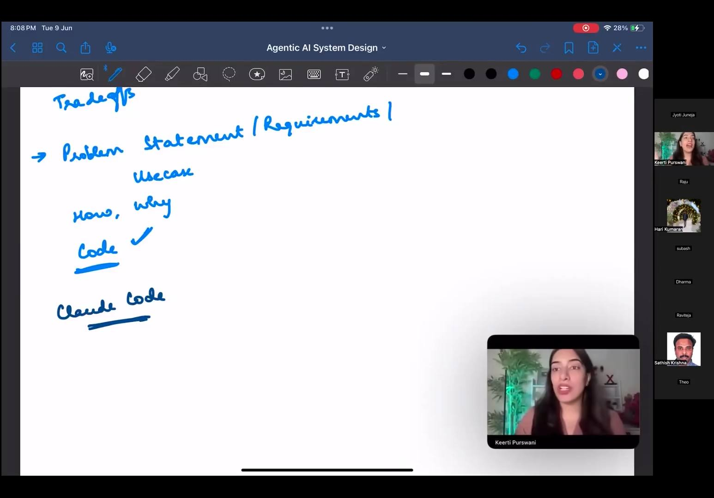
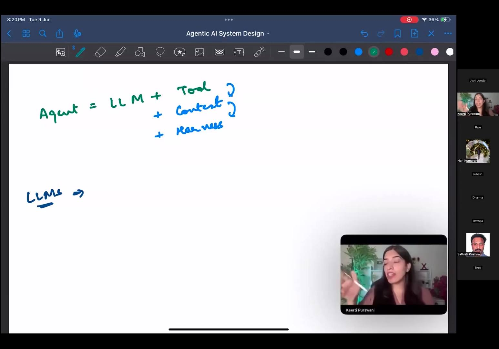
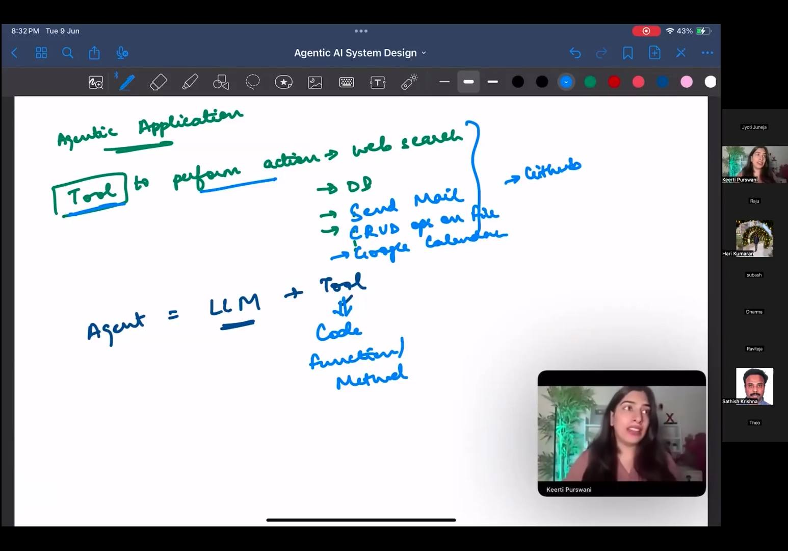
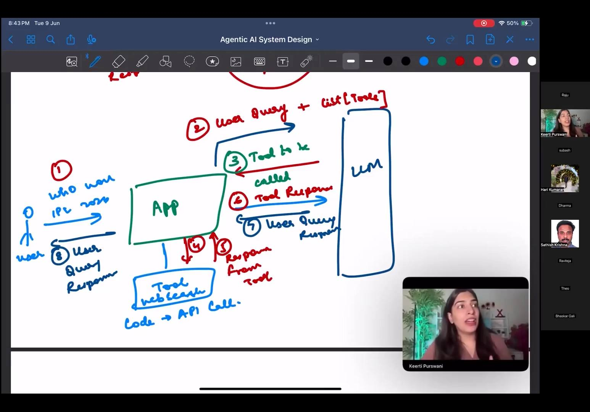
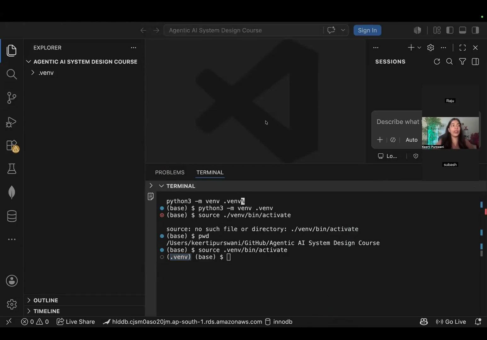

# Agentic AI System Design 第 1 课：从零搭建语义 RAG（Semantic RAG）

> 课程编号：BV1ntMt6TEe4 ｜ 覆盖 P001（0:00–60:48，第 1/3 段）
> 本文档按「项目实现逻辑」重组，不按时间顺序流水账。读者照着第 3、4 节可以完整复现讲师在课上做的环境搭建与语义 RAG 骨架。

---

## 1. 这一节做什么

这一节是整门课的开篇，讲师做了三件事，并且明确说「今天大部分是复习，但会讲很多新东西」：

1. **定调**：这门课不是「背一个标准答案」，而是训练**系统设计的思考过程（thought process）与取舍（trade-off）**。讲师反复强调不存在唯一正确解——Netflix 的架构不是唯一正确解，Claude Code 和 Cursor 处理同一个「大代码库」用例的方式也完全不同，两家都各自写博客说明了自己的做法。
2. **复习 Agent 与 RAG 的第一性原理**：LLM 是什么、LLM 的四大短板（知识截止、无状态、上下文窗口/成本限制、非确定性）、Agent = LLM + Tool、RAG = Retrieval Augmented Generation、以及一次完整 RAG 调用的六步流程。
3. **动手搭环境 + 开写语义 RAG**：从空文件夹开始，建 Python 虚拟环境 → 建 `rag/` 目录 → 写 `requirements.txt` → `pip install` → 建 `.env` 放 API Key → 准备写第一个「语义 RAG」（semantic RAG），检索源选的是**一个示例代码库**（因为期末 capstone 项目就是做一个能用的 Claude Code）。

本节结束时，你已经拥有一个可运行的 Python 工程骨架，并且理解了后面所有 RAG 变体（agentic RAG、graph rag、HyDE、query rewriting）要解决的**具体问题**是什么。

**本节不做什么**（讲师明确划界）：
- 不讲模型内部原理（pre-training、fine-tuning、KV caching、latency optimization 属于「模型创建」和「推理工程」两条线，不是本课）。
- 不讲 embedding 是怎么生成的（「那是 LLM 内部原理，本课不覆盖」），但会讲**怎么选 embedding 模型、维度怎么定**。
- 不讲 RAG 评估细节（RAGAS）——排到后面。

---

## 2. 讲师原话

> "这门课的重点也会是思考过程。"
> —— p001 [02:19]

> "重点永远不是去构建一个唯一正确的解决方案，因为永远不会有唯一正确的解决方案。请把这一点记在心里，这在整个课程中会极其重要。我们的重点是在每一个地方理解取舍。"
> —— p001 [03:45]

> "我们最终的目标、期末项目（capstone project），是要做一个 Claude Code，而且它不会是一个 demo 项目，它应该完全像 Claude Code 一样工作。基本上当你输入之后，Claude Code 应该能启动；如果有一个代码库，它应该能理解这个代码库，它应该做索引，它应该实现功能，它应该调试问题，一切都应该像 Claude Code 一样工作。"
> —— p001 [05:07]

> "Agent 就是 LLM 加工具（LLM plus tool）。"
> —— p001 [15:04]

> "Agent 就是 LLM 加上下文（LLM plus context）。"
> —— p001 [15:04]

> "Agent 就是 LLM 加 harness，这是演化出来的新定义。"
> —— p001 [15:32]

> "所以 LLM 能理解自然语言，但它不能执行任何动作。工具不能理解自然语言，但它能执行动作。这两者合在一起就构成了一个 agent。"
> —— p001 [27:23]

> "如果这个工具是从某处获取信息、检索信息的工具，那它就叫做 RAG。就这么简单。"
> —— p001 [27:51]

> "RAG 的全称是什么？Retrieval Augmented Generation（检索增强生成）。为什么会有这个词？因为我们从工具里检索出一些信息，把这个信息加到 query 上，然后用 LLM 来生成答案。"
> —— p001 [30:16]

> "LLM 是不会去调用工具的。GPT 不会为你执行任何动作。GPT 只能回答你的问题。你发一个 query，它回一个回答。Gemini、DeepSeek 这些是第三方，是 Google 做的，你不会去要求 Google 帮你调用工具，对吧？那是你自己写的代码，只有你、你的应用才能做这件事。"
> —— p001 [41:01]

> "工具是什么？归根到底它就是一些代码，就是我们在应用侧写的一些代码来执行某个动作。它就是一个函数、一个方法，或者一组指令。"
> —— p001 [26:54]

> "在 agentic AI 里我们怎么捕捉语义？把每个词、每个句子转换成 embedding。"
> —— p001 [45:11]

> "Embedding 就是一个向量，就是一组数字。所以每次你处理自然数据时，内部其实都是数学，内部一切都以向量的形式存储。这就是为什么我们要用向量数据库。"
> —— p001 [45:40]

> "Embedding 是怎么生成的，这不是本课的一部分。我们知道向量被生成出来了，我们要处理的是向量数据库。"
> —— p001 [46:08]

> "我完全是从一个空文件夹开始的。里面什么都没有。我会从搭建环境开始，一切从零开始。"
> —— p001 [49:26]

> "为什么需要虚拟环境？在我的系统里，我在做比如五个不同的项目。每个项目我想要不同版本的库。我想要为这个特定项目准备一个干净的环境，我想要安全，我想要对这个项目做版本控制。"
> —— p001 [50:51]

> "我创建了一个 requirements.txt。我把所有需要的东西都放进去了。"
> —— p001 [53:14]

> "为什么需要 .env 文件？为了放我的 key。"
> —— p001 [55:33]

> "现在，当我们尝试检索信息时，我可以从哪些地方检索？可以从 PDF 文件，可以从数据库，可以从 web 搜索，可以爬一个站点，可以用任何资源。"
> —— p001 [57:55]

> "今天我要做的是拿一个示例项目、一个示例代码库，然后尝试从中检索信息。也就是说，我们要构建的是一个基础的 coding agent。"
> —— p001 [58:52]

---

## 3. 从零复现

### 3.0 前置条件

| 项 | 要求 | 说明 |
|---|---|---|
| Python | 3.10+（建议 3.11） | 讲师没有指定版本号，课里没讲具体版本 |
| 编辑器 | VS Code（讲师用的）或任意 IDE | 讲师原话：「我用的是 VS Code，你可以用任何 IDE，这没有关系」 |
| LLM API Key | OpenAI / Anthropic / Groq / Kimi 任选 | 讲师用 OpenAI；明确说 Groq 有免费额度，Kimi 约 75 元/月 |
| 终端 | macOS 用 zsh/bash；Windows 用 PowerShell | 讲师在 Mac 上演示 |

> 讲师对「用本地小模型（Gemma、Qwen）替代 API」的答复：本地小模型**性能会受影响**，可能跑不好。他的建议是花 5–10 美元买 token，这是值得的基础投入。

### 3.1 步骤一：创建并激活虚拟环境

在**项目根目录**（不是 `rag/` 里面）执行：

```bash
python3 -m venv .venv
source .venv/bin/activate
```

Windows PowerShell 对应：

```powershell
python -m venv .venv
.venv\Scripts\Activate.ps1
```

激活成功的标志：终端提示符前面出现 `(.venv)`。

> 讲师原话解释为什么要虚拟环境：一台机器上并行 5 个项目，每个项目要不同版本的库，需要「一个干净的环境 + 安全 + 版本控制」。
>
> 有学员问「是不是该用 uv」，讲师回答：可以用 uv，也可以用 brew，都行——**课里没讲 uv 的具体用法**。

### 3.2 步骤二：创建项目目录结构

讲师在激活虚拟环境后，创建了一个名为 `rag` 的文件夹，所有类型的 RAG 代码都放进去。

最终目录结构（本课第 1 段结束时达到的状态）：

```
项目根目录/
├── .venv/                  # 虚拟环境（不要提交到 git）
└── rag/
    ├── requirements.txt    # 依赖清单
    ├── .env                # API Key（不要提交到 git）
    └── （后续的 .py 文件）
```

```bash
mkdir rag
cd rag
```

> 讲师在这里踩了一个真实的坑并当场演示：他在**根目录**执行 `pip install -r requirements.txt` 报错，因为 `requirements.txt` 在 `rag/` 里面。他的原话是「哦，我得进到 rag 里面。抱歉。所以让我进到 rag 里，现在来安装。」——复现时请务必先 `cd rag`。

### 3.3 步骤三：写 requirements.txt 并安装

在 `rag/requirements.txt` 里写依赖（**注意：讲师在屏幕上滚动了这个文件，但逐字稿没有逐行念出内容，OCR 也没有提供，所以下面这份清单是「按本节实际用到的能力」给出的最小可用集合，不是讲师原文件的逐字复制**）：

```text
openai>=1.40.0
python-dotenv>=1.0.0
numpy>=1.26.0
```

安装：

```bash
pip install -r requirements.txt
```

> **诚实标注**：讲师说「我把所有需要的东西都放进去了」，但**具体包名和版本号课里没讲、OCR 也没有**。上面三个包对应本节确定会用到的能力：调 LLM（`openai`）、读 `.env`（`python-dotenv`）、算向量相似度（`numpy`）。如果你要跟着后面的课程走，向量库（如 chromadb / faiss）会在后续课时加入，**本段尚未安装**。

### 3.4 步骤四：创建 .env 并写入 API Key

在 `rag/.env` 中：

```bash
OPENAI_API_KEY=sk-你的真实key
```

如果你用 Groq 或 Kimi，就换成对应厂商的变量名（**具体变量名课里没讲**，以各家 SDK 文档为准）。

> 讲师特别说明：他会**每天更换 key**，所以不要试图抄他的 key，「抄了也没用」。他也明确拒绝了「用你的 key」的请求。

### 3.5 步骤五：准备检索源——一个示例代码库

讲师说今天不做 PDF、不做网页爬取，而是**拿一个示例代码库**做检索源，理由是期末项目就是 Claude Code，所以从代码库检索开始最贴合主线。

复现时你可以在 `rag/` 下放一个 `sample_repo/` 目录，塞几个 `.py` 文件进去（内容随意，比如一个带 `checkout` 逻辑的小模块，正好呼应讲师举的「payment failure ↔ checkout exception」的例子）。

### 3.6 步骤六：跑通一次「语义 RAG」的最小闭环

讲师在本段末尾停在「我们要把代码库存进向量数据库」这一步，**没有在本段内把完整代码敲完**。为了让文档可执行，下面第 4 节给出一个**完整可运行的单文件实现**，它严格对应讲师讲的六步流程（见 3.7），并标注了哪些是讲师明确讲过的、哪些是补全实现细节。

### 3.7 讲师讲的 RAG 六步流程（这是全课的地基，必须背下来）

讲师在白板上完整推导了一遍「用户问：2026 年 IPL 谁赢了？」这个例子：

| 步骤 | 发生什么 | 谁在做 |
|---|---|---|
| 1 | 用户发出 query | 用户 |
| 2 | 应用把 **用户 query + 可用工具列表** 一起发给 LLM | 你的应用 |
| 3 | LLM 判断自己没这个知识，返回「应该调用哪个工具」 | LLM（只输出文本，不执行） |
| 4 | **应用**真正执行工具调用 | 你的应用 |
| 5 | 工具返回结果（HTTP 状态码 + body + header 这种结构化东西） | 工具（就是你的代码） |
| 6 | 应用把工具结果**再发回 LLM**，LLM 生成自然语言答案返回用户 | 应用 + LLM |

讲师强调的两个关键点：

- **工具列表必须由应用显式传给 LLM**。有学员问「LLM 怎么知道我有这些工具」，讲师答：「我们显式地发给它，应用应该把工具列表和用户 query 一起发过去，否则 LLM 不会知道。」
- **工具结果不能直接甩给用户**。有学员问「为什么工具结果还要回给 LLM」，讲师答：工具返回的是 `200` 状态码 + body + header 这种 JSON 结构，你问的是英文，你不想收到 JSON schema，你想收到一句英文回答；工具调用失败返回 4XX/5XX 时，你也想收到「抱歉我们没找到」而不是一个错误码。

---

## 4. 完整代码

> **重要声明**：本段课程中，讲师完成了环境搭建（虚拟环境、目录、requirements.txt、.env），并开始讲语义 RAG 的设计，但**没有在本段内把 RAG 的 Python 代码完整敲完**（他在 60:48 处停在「我们要把它存进向量数据库，对吧？」）。因此下面这份代码是**按讲师讲的六步流程 + 语义检索原理补全的可运行实现**，每一处都标注了依据。**课里没有逐行给出这份代码，请把它当作「照流程可跑通的最小实现」，而不是讲师原稿。**

### 4.1 `rag/requirements.txt`

```text
openai>=1.40.0
python-dotenv>=1.0.0
numpy>=1.26.0
```

### 4.2 `rag/.env`

```bash
OPENAI_API_KEY=sk-你的真实key
```

### 4.3 `rag/semantic_rag.py`（完整文件，可直接保存运行）

```python
"""
语义 RAG（Semantic RAG）最小实现
对应课程 P001 讲的六步流程：
  1. 用户 query
  2. 应用把 query + 工具列表发给 LLM
  3. LLM 决定调用哪个工具
  4. 应用执行工具
  5. 工具返回结果
  6. 应用把结果回传 LLM，生成自然语言答案

本文件的「工具」= 从示例代码库中做语义检索。
"""

import os
import json
from pathlib import Path

import numpy as np
from dotenv import load_dotenv
from openai import OpenAI

load_dotenv()

client = OpenAI(api_key=os.getenv("OPENAI_API_KEY"))

EMBED_MODEL = "text-embedding-3-small"
CHAT_MODEL = "gpt-4o-mini"
SAMPLE_REPO = Path(__file__).parent / "sample_repo"


# ---------- 第一步：把代码库切成 chunk ----------
def load_chunks(repo_dir: Path, max_chars: int = 800) -> list[dict]:
    """遍历代码库，按文件读取并按字符数切块。
    课里没讲具体 chunk 策略，这里用最朴素的定长切分。"""
    chunks = []
    for path in sorted(repo_dir.rglob("*")):
        if not path.is_file():
            continue
        if path.suffix not in {".py", ".js", ".ts", ".md", ".txt"}:
            continue
        text = path.read_text(encoding="utf-8", errors="ignore")
        for i in range(0, len(text), max_chars):
            piece = text[i : i + max_chars]
            if piece.strip():
                chunks.append(
                    {"source": str(path.relative_to(repo_dir)), "text": piece}
                )
    return chunks


# ---------- 第二步：把 chunk 转成 embedding（向量） ----------
def embed_texts(texts: list[str]) -> np.ndarray:
    """调用 embedding 模型，把自然语言转成向量。
    讲师原话：embedding 就是一组数字，内部一切都是数学。"""
    resp = client.embeddings.create(model=EMBED_MODEL, input=texts)
    vectors = [item.embedding for item in resp.data]
    return np.array(vectors, dtype=np.float32)


# ---------- 第三步：建索引（本课用内存 numpy 数组代替向量数据库） ----------
class InMemoryVectorStore:
    def __init__(self):
        self.vectors: np.ndarray | None = None
        self.chunks: list[dict] = []

    def add(self, chunks: list[dict]):
        self.chunks = chunks
        self.vectors = embed_texts([c["text"] for c in chunks])
        # 归一化，方便用点积算余弦相似度
        norms = np.linalg.norm(self.vectors, axis=1, keepdims=True)
        self.vectors = self.vectors / np.clip(norms, 1e-8, None)

    def search(self, query: str, top_k: int = 3) -> list[dict]:
        q = embed_texts([query])[0]
        q = q / max(np.linalg.norm(q), 1e-8)
        scores = self.vectors @ q
        idx = np.argsort(-scores)[:top_k]
        return [
            {**self.chunks[i], "score": float(scores[i])} for i in idx
        ]


# ---------- 第四步：把检索包装成「工具」，交给 LLM 决策 ----------
TOOLS = [
    {
        "type": "function",
        "function": {
            "name": "search_codebase",
            "description": "在示例代码库中做语义检索，返回最相关的代码片段。",
            "parameters": {
                "type": "object",
                "properties": {
                    "query": {
                        "type": "string",
                        "description": "要检索的自然语言问题，例如：支付失败是在哪里处理的",
                    }
                },
                "required": ["query"],
            },
        },
    }
]


def run_agent(store: InMemoryVectorStore, user_query: str) -> str:
    messages = [
        {
            "role": "system",
            "content": "你是一个代码库助手。需要查代码时调用 search_codebase 工具。",
        },
        {"role": "user", "content": user_query},
    ]

    # 步骤 2：query + 工具列表一起发给 LLM
    first = client.chat.completions.create(
        model=CHAT_MODEL, messages=messages, tools=TOOLS
    )
    msg = first.choices[0].message

    # 步骤 3：LLM 只返回「要调哪个工具」，它自己不执行
    if not msg.tool_calls:
        return msg.content or ""

    messages.append(msg)

    # 步骤 4 & 5：应用执行工具，拿到结果
    for call in msg.tool_calls:
        args = json.loads(call.function.arguments)
        hits = store.search(args["query"], top_k=3)
        tool_result = "\n\n".join(
            f"[{h['source']} score={h['score']:.3f}]\n{h['text']}" for h in hits
        )
        messages.append(
            {
                "role": "tool",
                "tool_call_id": call.id,
                "content": tool_result,
            }
        )

    # 步骤 6：把工具结果回传 LLM，生成自然语言答案
    final = client.chat.completions.create(model=CHAT_MODEL, messages=messages)
    return final.choices[0].message.content or ""


if __name__ == "__main__":
    chunks = load_chunks(SAMPLE_REPO)
    print(f"共切出 {len(chunks)} 个 chunk")
    store = InMemoryVectorStore()
    store.add(chunks)

    while True:
        q = input("\n你问：").strip()
        if q in {"exit", "quit"}:
            break
        print("\n助手：", run_agent(store, q))
```

### 4.4 `rag/sample_repo/checkout.py`（示例检索源，内容可自定）

```python
class CheckoutException(Exception):
    """支付流程失败时抛出。"""
    pass


def process_payment(order, gateway):
    try:
        return gateway.charge(order.amount, order.currency)
    except gateway.Declined as e:
        raise CheckoutException(f"payment declined: {e}") from e
```

### 4.5 运行

```bash
cd rag
python semantic_rag.py
```

预期交互：

```
共切出 N 个 chunk

你问：支付失败是在哪里处理的
助手： 支付失败在 checkout.py 的 process_payment 中处理，捕获 gateway.Declined 后抛出 CheckoutException……
```

> 这段输出格式是示意，**实际措辞由模型决定**——这正是讲师反复强调的「非确定性」。

---

## 5. 逐行解释

### 5.1 为什么是 `LLM + Tool` 而不是「LLM 自己上网」

讲师把 LLM 的能力边界切得很干净：

- LLM 的**唯一**本职是「你发一个 query，它回一个自然语言答案」。
- LLM **不能**做 web search、**不能**连你的数据库、**不能**执行任何动作。
- 工具**不能**理解自然语言，但它**能**执行动作。
- 两者互补 → agent。

对应到代码：`TOOLS` 这个 JSON schema 就是「工具的自然语言说明书」，它被塞进 `client.chat.completions.create(..., tools=TOOLS)` 里发给模型。模型看完说明书，**只输出一个「我要调 search_codebase，参数是 xxx」的文本结构**（`msg.tool_calls`），真正的 `store.search(...)` 是在你的 Python 进程里跑的。这就是讲师那句「GPT 不会为你执行任何动作，只有你的应用能」的代码体现。

> 前端类比：这就像你给一个只会返回 JSON 的接口定义了 OpenAPI schema，接口返回「请调用 /search?q=xxx」，然后**你的前端代码**去发这个请求。模型是那个只会说话的接口，fetch 是你写的。

### 5.2 为什么工具结果要「回传 LLM」而不是直接返回

讲师的原话逻辑：工具返回的是 `200` + body + header 这种结构化东西，用户问的是英文，用户想收到英文。所以第 6 步必须再调一次 LLM，把 `role: "tool"` 的消息喂回去，让模型用自然语言复述。

代码里对应：`messages.append({"role": "tool", ...})` 之后**再发一次** `client.chat.completions.create`。少这一次调用，用户就会看到一坨 JSON——这是新手最常犯的错。

### 5.3 为什么用 embedding 而不是关键词搜索

讲师举的例子是全课最关键的类比：

- 「我 feeling happy」和「我 excited」→ 语义相同。
- 代码库里问「为什么支付失败」，代码里写的是 `checkout exception` → **字面不同，语义相同**。

关键词搜索（grep）找不到，语义搜索能找到。而「捕捉语义」的手段就是把词/句/段转成 **embedding（一组数字/向量）**，然后在向量空间里比距离。这就是为什么「要用向量数据库」。

代码里 `embed_texts()` 调 `text-embedding-3-small` 拿到向量，`InMemoryVectorStore.search()` 用**归一化后的点积**（等价于余弦相似度）排序。生产环境这一步会换成真正的向量库，但**本段课里还没装向量库**。

> 讲师明确划界：embedding **怎么生成**不讲（属于模型内部原理），但**怎么选 embedding 模型、维度怎么定**后面会讲。

### 5.4 为什么 `requirements.txt` 要单独一个文件

讲师的原话理由是「所有库都放里面，一条命令全装」。这在工程上对应可复现性：换一台机器、换一个组员，`pip install -r requirements.txt` 就能得到一致环境。这也是他坚持用虚拟环境的原因——五个项目五套依赖，不能互相污染。

### 5.5 为什么 `.env` 而不是把 key 写死在代码里

讲师只说了一句「为了放我的 key」，但配套动作很关键：他**每天换 key**。把密钥从代码里剥离，才能做到「换 key 不改代码、key 不进 git」。复现时请把 `.env` 加进 `.gitignore`（**课里没讲 .gitignore，这是你该补的**）。

### 5.6 讲师在这一段埋下的「问题清单」（后面课时会逐个解决）

讲师在讲完六步流程后，让学员提问题，并明确说「这些正是我们要解决的问题」：

| 学员提的问题 | 讲师的态度 | 归属 |
|---|---|---|
| LLM 选错工具怎么办 | 「很好，我们会处理」 | agentic RAG / 工具选择 |
| 工具太多怎么办 | 同上 | 工具路由 |
| 工具不存在怎么办 | 同上 | 容错 |
| 用户 query 有拼写错误/无关词 | 「很好的问题，都会回答」 | query rewriting |
| LLM 要扫描所有工具，context 消耗大 | 「很好」 | 工具检索 / 上下文工程 |
| 工具返回的 context 太长 LLM 读不下 | 「也是好问题」 | 上下文压缩 |
| 工具调用失败返回 4XX/5XX | 讲师当场解释：要转成英文回答 | 错误处理 |

**这一段没有给出这些问题的答案**，只确认了它们是后续课程的主线。复现时不要以为跑通上面的 demo 就结束了——它只是「能跑」，离「生产可用」还差这一整张表。

---

## 6. 复现检查清单

按顺序打勾，任何一项失败都先解决再往下：

- [ ] `python3 --version` 输出 3.10 以上
- [ ] 在项目根目录执行 `python3 -m venv .venv` 成功，目录下出现 `.venv/`
- [ ] `source .venv/bin/activate` 后提示符出现 `(.venv)`（Windows 用 `.venv\Scripts\Activate.ps1`）
- [ ] `mkdir rag && cd rag`，**确认当前目录是 `rag/`**（讲师就在这里踩过坑）
- [ ] `rag/requirements.txt` 存在，内容为第 4.1 节三个包
- [ ] `pip install -r requirements.txt` 无报错
- [ ] `rag/.env` 存在，`OPENAI_API_KEY` 已填真实值
- [ ] `python -c "from dotenv import load_dotenv; import os; load_dotenv(); print(bool(os.getenv('OPENAI_API_KEY')))"` 输出 `True`
- [ ] `rag/sample_repo/` 下至少有一个代码文件
- [ ] `python semantic_rag.py` 能打印出 chunk 数量（>0）
- [ ] 输入「支付失败是在哪里处理的」，能收到一段**自然语言**（不是 JSON）回答
- [ ] 输入 `exit` 能正常退出
- [ ] `.env` 已加入 `.gitignore`（课里没讲，但你必须做）

---

## 7. 课里没讲但你会撞上的

1. **`requirements.txt` 的确切内容**。讲师滚动展示了文件但没念，OCR 也没有。第 4.1 节是最小可用集合，不是原稿。后续加向量库时你会需要追加 `chromadb` 或 `faiss-cpu`——**具体选哪个课里本段没讲**。
2. **chunk 策略**。讲师说「要理解代码库并存起来」，但**按什么粒度切（按函数？按文件？按 token？）本段没讲**。第 4.3 节用的是最朴素的定长字符切分，生产上这是要调的参数。
3. **向量数据库选型**。讲师明确说「我们要处理向量数据库」，但**本段结束时还没装**。第 4.3 节用 numpy 内存数组顶替，重启即丢，只适合验证流程。
4. **embedding 维度怎么定、模型怎么选**。讲师说「这些我们都会讲」，但**本段没讲**。代码里 `text-embedding-3-small` 是占位选择。
5. **成本**。每次 `store.add()` 会对所有 chunk 调一次 embedding API，每次提问调一次 embedding + 至少一次 chat。代码库大时这会很贵——**课里没讲批处理与缓存**。
6. **并发/事务**。本段完全不涉及。如果你以后要把索引写进真正的数据库，注意 Python 的 GIL 和异步 IO；**在 JS/Node 里对应的是单线程事件循环 + `Promise.all` 并发 embedding 请求**，概念上一样：IO 密集用并发，CPU 密集（算相似度）用批处理。
7. **Windows 路径与编码**。代码里用了 `encoding="utf-8", errors="ignore"`，因为 Windows 下读文件默认编码可能不是 UTF-8。讲师在 Mac 上演示，**没讲 Windows 的坑**。
8. **`.gitignore`**。讲师没提，但你不加就会把 `.venv/` 和 `.env` 提交上去。
9. **本地模型替代方案**。讲师说 Gemma/Qwen 这类本地小模型「性能会受影响」，但**没给具体降级幅度或替代配置**。
10. **MCP**。有学员问「AI IDE 里配合 MCP 工具是不是 RAG 的例子」，讲师答「是 RAG，MCP 我们后面再讲」——**本段没有展开 MCP**，不要在这里自行脑补。

---

## 附：本节关键概念速查（全部来自讲师原话）

| 概念 | 讲师的定义 |
|---|---|
| LLM 举例 | Gemini、GPT、Kimi K2、Qwen、DeepSeek。**OpenAI 是模型提供商不是 LLM；ChatGPT 是应用不是 LLM** |
| LLM 四大短板 | ① 知识截止（训练到某个日期）② 无状态（每次请求都是全新请求，记忆由应用管理）③ 上下文窗口/ token 成本限制 ④ 非确定性（同一 prompt 输出不同） |
| Agent 三种定义 | LLM + Tool（最早）／LLM + Context／LLM + Harness（最新演化） |
| RAG 全称 | Retrieval Augmented Generation；retrieve → augment（加到 query 上）→ generate |
| 非检索类工具举例 | 发邮件、创建文件、文件 CRUD、数据库写、排序文件、Google Calendar、GitHub Actions |
| 检索源举例 | PDF、数据库、web 搜索、爬站点、代码库、Python 文件 |
| 本课不覆盖 | 模型内部原理、KV caching、推理优化、embedding 如何生成 |
| 本课覆盖 | 各类 RAG 的代码实现、RAG 评估（RAGAS）、选型取舍、面试题 |









