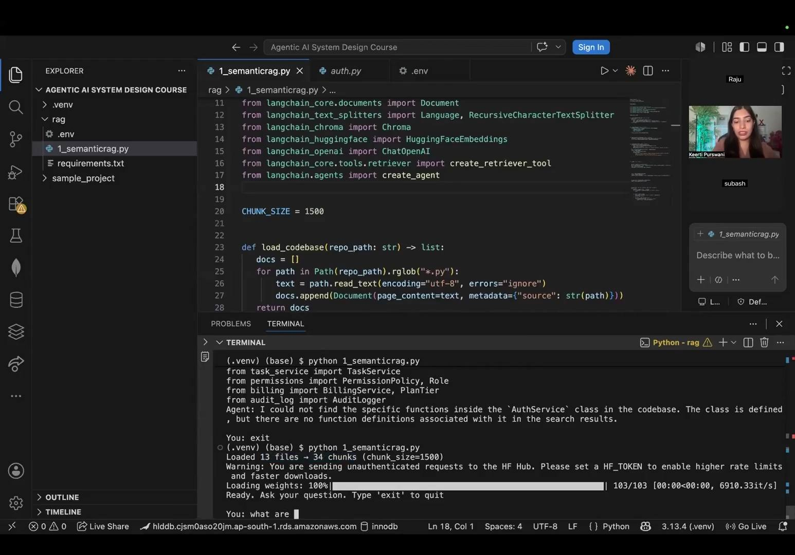
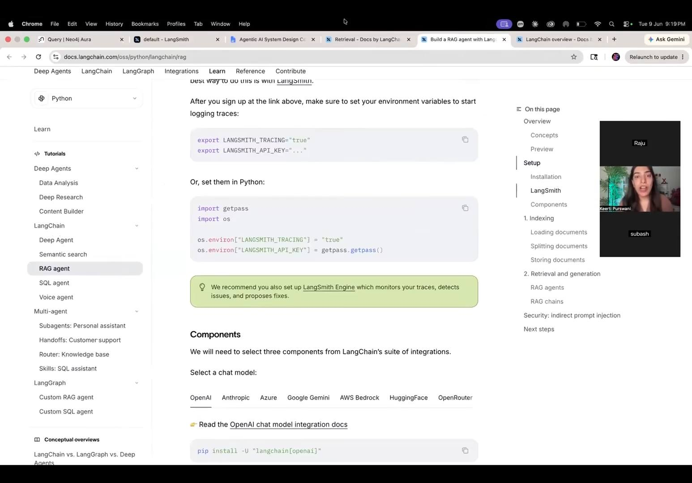
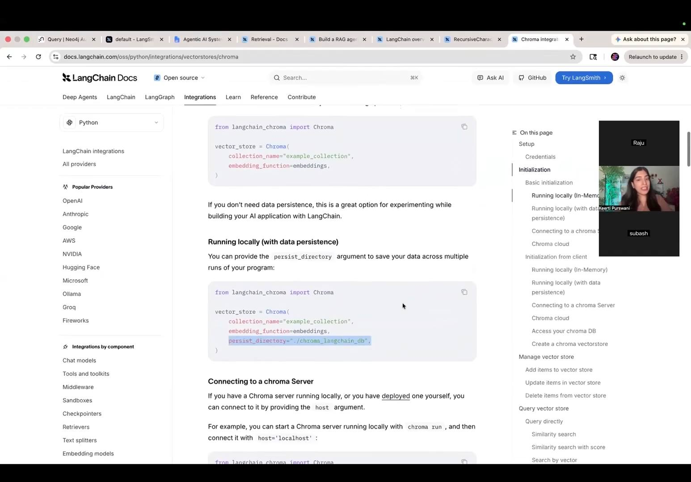
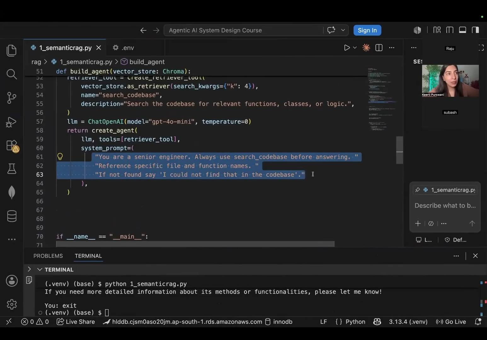
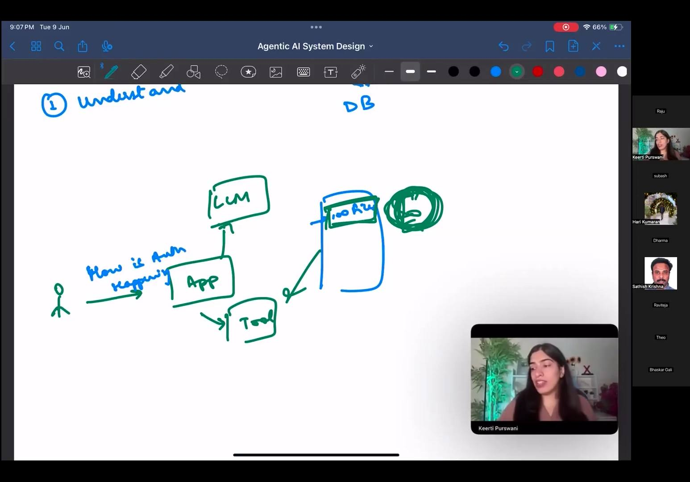

# Agentic AI System Design 课程复现文档：代码库 RAG Agent（P001）

> 覆盖范围：P001 第 2/3 段，61:17–123:13。本文只复现这一段；P001 前面的环境准备和后面的内容不在本文范围内。  
> 最终产物：一个可以运行的 `rag/semantic_basic_rag.py`，把 `sample_project/` 里的 Python 代码切块、嵌入、存入内存 Chroma，挂成 retriever 工具交给 agent，并用 LangSmith 观察完整调用链。

## 1. 这一节做什么

这一段的目标十分明确：先写出一个最简单的代码库 RAG agent，再用 trace 和实验把它改进。

最终要跑起来的流程是：

1. 读取 `sample_project/` 下所有 `.py` 文件；
2. 用 LangChain 的 Python 递归切分器把每个文件切成 chunk；
3. 用 HuggingFace 的 embedding 模型把 chunk 转成向量；
4. 存进 Chroma。这里故意不传持久化目录，所以向量只存在内存里；
5. 把 Chroma 包成 retriever 工具，工具名必须叫 `search_codebase`，因为 trace 里显示的就是这个名字；
6. 用 `create_agent(model, tools, system_prompt)` 创建 agent；
7. 在终端输入问题，agent 自己决定调用 `search_codebase`，拿到代码片段后再生成回答；
8. 打开 LangSmith，看 system prompt、user query、tool call、tool response、第二次 LLM call、token 数；
9. 把 `CHUNK_SIZE` 从 256 改成 1500，再改成 2500
改成 2500，对比回答完整度和 token 花费。这就是本段最后十五分钟的「同一个问题、三种 chunk size」实验，也是整段课的主线：先跑通最朴素的版本，再用 trace 找出它为什么答不对。

## 2. 讲师原话

这一节按「为什么切 → 怎么切 → 怎么存 → 怎么跑 → 怎么观测 → 怎么调」的顺序摘录，都是原文翻译，不是概括。

**为什么不能把整个代码库发给 LLM**

> "为什么不把全部数据发过去？你打算把一千个文件发给 LLM。你知道每个 token 都要花钱，上下文有限……它没法从这一千个文件里判断哪部分是重点、用户问的是什么，它会丢掉上下文。"
> —— p001 [64:56]

> "上下文长度有限。LLM 不支持一次把一千个文件塞进上下文。"
> —— p001 [65:25]

> "在 RAG 里我们想做什么？有一个用户，有一个应用，用户发出查询，比如『认证是怎么做的』。我的代码库里有比如 100 个文件……工具的工作就是找到写认证的那一部分代码。它可能是一个类，可能是一个函数，但我们必须判断有多少数据是和这次查询相关的。"
> —— p001 [63:38]

**为什么「按字符切代码」不行**

> "如果我在一个类的中间切、在函数中间切，甚至在一行代码的中间切——比如代码长这样，中间有一串参数，而我正好从这里切开，即使你做了 overlap，如果这里有 10 个参数呢？你可能只 overlap 到这里。或者一个函数有 100 行，你正好切在中间，重叠部分只有这么一点，但你依然不知道这个函数属于哪个类、这个类里还有哪些函数。"
> —— p001 [66:52]

> "同一个函数名可以出现在不同的类里，你怎么知道这个函数属于哪个类？你怎么知道一个类里有哪些函数？你怎么回答用户的查询？如果我用 Claude Code 问『这个类里有哪些函数』，它答不出来，随便给我几个函数，你还会再用它吗？"
> —— p001 [67:47]

**框架不是重点，概念才是**

> "有很多框架可以用来构建应用：LangChain、LangGraph、Google ADK（Agent Development Kit）、OpenAI SDK，还有微软的框架……这些你都可以用。概念是一样的，只是 API 会变。"
> —— p001 [71:11]

> "全世界的框架你都可以用，只要你理解概念、跟着文档走，你就能切换到任何框架。"
> —— p001 [72:07]

> "最新的定义说，agent 就是 model 加 harness（模型加支架）。下周有一周专门讲 harness engineering。"
> —— p001 [73:35]

> "创建 agent 就这么简单：给它模型、给它工具、给它 system prompt。"
> —— p001 [75:20]

**RAG 的两段式**

> "RAG 有两个部分：一个是 retrieval（检索），一个是 generation（生成）。检索是取回上下文，增强是把它加上，然后才是生成对用户问题的回答。"
> —— p001 [76:19]

**LangChain 的递归切分到底怎么切**

> "它先按 class 切，看这个 class 是不是大于 256，如果大于就再按 function 切……它会递归地一直切下去，确保没有任何一个 chunk 超过 256。"
> —— p001 [81:22]

> "256 是什么？是字符数，是我配置的最大 chunk size。我可以设成 1000，也可以设成 10000，我们会改一改看会发生什么。"
> —— p001 [83:13]

> "chunk size 是 128 的倍数并不是必须的。"
> —— p001 [77:46]

**内存里的向量库**

> "我没有给 Chroma 持久化目录，所以它只存在内存里，存在 RAM 里。每次我重新运行这个文件会发生什么？它会丢。"
> —— p001 [86:05]

> "你可以用任何 embedding 模型。我用的是 HuggingFace 的这个 embedding 模型，你也可以直接用 OpenAI 的 embedding 模型。不要卡在模型名字上。"
> —— p001 [87:03]

> "HuggingFace 的 embedding 模型是一个本地模型，一个免费的开源模型。"
> —— p001 [122:45]

**第一次跑起来**

> "能看到吗？加载了 13 个文件，173 个大小为 256 的 chunk。"
> —— p001 [91:18]

> "『auth service 类负责处理登录和基本的访问控制』——不错吧？"
> —— p001 [91:44]

> "它找不到这个类里有哪些具体函数。这不太行，对吧？"
> —— p001 [93:30]

**开启 tracing**

> "你必须创建一个账号、创建一个 API key，然后把它集成进去。集成要做的所有事就是在 .env 文件里加这两行。"
> —— p001 [94:57]

> "如果你不用 LangChain，怎么用 LangSmith？我也会教你写自己的日志系统。每个框架都有自己的 tracing 方式，Google ADK 也有 tracing。"
> —— p001 [97:46]

**读 trace：模型怎么知道有工具、为什么要第二次调用**

> "这个工具的名字叫什么？retriever tool 的名字是 search_codebase，对吧？"
> —— p001 [100:34]

> "这个回答被送回去了……有人问，为什么还需要再来一次 LLM 调用？因为这是从 vector DB 里取出来的 chunk。"
> —— p001 [101:30]

> "118 和 312 是什么？是 token 数。"
> —— p001 [102:55]

> "每次我做这个调用，它都要把整个代码库重新走一遍，重新生成 embedding 再放进 Chroma。如果我不想让它反复做这件事，我会怎么做？我会把它持久化到 DB 里。"
> —— p001 [104:21]

**为什么 k=4 却只覆盖到 `__init__`**

> "我的 chunk size 太小了，即使我想取 4 个 chunk，也只能取到 init 为止。"
> —— p001 [107:08]

> "你能看到 import 本身就占了这么多空间，我在 init 就把 4 次检索用完了。"
> —— p001 [107:37]

**循环是谁在循环**

> "为什么会出现循环？因为我们用了框架，框架有一些标准的默认行为。"
> —— p001 [109:30]

> "能看到这个 tool retry middleware，max retry 是 2 吗？默认就是 2。这是初始调用里最大的重试次数。"
> —— p001 [117:46]

> "在我这行代码里，我们没有显式设置它，用的是 LangChain 的默认值。"
> —— p001 [120:54]

**三个 chunk size 的对比**

> "chunk 数少多了吧？之前是 172，现在是 34。因为 chunk 变大了，chunk 的数量就减少了。但每个 chunk 的输出也会更大，所以你会在 LLM 调用上花更多 token。"
> —— p001 [111:20]

> "有三个函数出现在回答里，init、register、login。但实际文件里的 get_current_user 和 logout 呢？为什么没出来？因为 1500 的 chunk 到这就结束了。"
> —— p001 [112:40]

> "这一次所有函数都出来了：init、register、login、get user 和 logout。"
> —— p001 [115:54]

**怎么选 chunk size / 要不要背代码**

> "怎么选 chunk size？我说过没有唯一正确答案。我们明天会讲不同的 chunking 策略。"
> —— p001 [122:16]

> "请不要背任何东西。你要记住的是：什么是 RAG、什么是 agent、背后的概念是什么、什么是 chunking、我们是怎么做的、它的优缺点。代码会一直变，LangChain、LangGraph 会一直变。"
> —— p001 [120:54]

> "tokenization 通常是你有一段文本，为了训练或微调 LLM 而做分词……chunking 这个词是用在你有巨大文档、想把它切开的时候。"
> —— p001 [123:13]

## 3. 从零复现

### 3.1 前置条件

- Python 3.10+（课里没讲版本，这是能跑通这几套库的下限，见第 7 节）
- 一个 OpenAI（或任意兼容 OpenAI 协议的）API key，用于 agent 的 LLM；讲师原话是「现在先用任何模型都行」
- 一个 LangSmith 账号 + API key（免费额度 5000 条 trace，讲师明确说过够用）
- 能联网。第一次跑会从 HuggingFace 拉 embedding 模型

### 3.2 目录结构

```
agentic-rag-demo/
├── .env
├── .env.example
├── requirements.txt
├── rag/
│   └── semantic_basic_rag.py
└── sample_project/
    ├── __init__.py
    ├── auth_service.py
    ├── billing.py
    ├── config.py
    ├── db.py
    ├── main.py
    ├── models.py
    ├── notifications.py
    ├── permissions.py
    ├── task_service.py
    ├── utils.py
    ├── validators.py
    └── tests/
        └── test_auth.py
```

`sample_project/` 里一共 13 个 `.py` 文件，这样终端里能复现出「加载了 13 个文件」这句话。`__init__.py` 和 `tests/test_auth.py` 也要有，`rglob("*.py")` 会把它们都算进去。

### 3.3 建环境、装依赖

```bash
cd agentic-rag-demo
python -m venv .venv
source .venv/bin/activate        # Windows: .venv\Scripts\activate
pip install -r requirements.txt
```

依赖清单见第 4 节。装完之后验证一句：

```bash
python -c "import langchain, chromadb, sentence_transformers; print('ok')"
```

### 3.4 写 .env

```bash
cp .env.example .env
# 然后打开 .env 把 key 填进去
```

三个变量：

- `OPENAI_API_KEY`：给 LLM 用（你要是换成别的模型服务，变量名跟着换）
- `LANGSMITH_TRACING=true`：把整个调用链上报
- `LANGSMITH_API_KEY`：上面在 LangSmith 里创建的 key

讲师的措辞是「加 lang smith tracing 和 lang smith api key 这两行」，屏幕上具体变量怎么拼写，课里没念出来；现代 LangSmith 文档用的是 `LANGSMITH_TRACING` / `LANGSMITH_API_KEY`，旧文档是 `LANGCHAIN_TRACING_V2` / `LANGCHAIN_API_KEY`。两套都认，选一套抄进 `.env` 就行，见第 7 节。

### 3.5 建 sample_project（最小骨架）

讲师的 sample project「就是基本的 auth、billing、DB、models、notifications、permissions」，原始仓库课里没有给出下载链接，也没有逐个文件贴出来。第 4 节给的是按 trace 里出现过的类名和函数名重建的最小骨架：`AuthService` 的五个方法名（`__init__` / `register` / `login` / `get_current_user` / `logout`）和 `AuthError`、`PermissionPolicy` 都是屏幕上看得到的，其余文件只要保证能被切出若干 chunk 即可。

### 3.6 跑第一次

```bash
python rag/semantic_basic_rag.py
```

预期输出依次是：

```
Loaded 13 files
N chunks of the chunk size 256
What should I ask?
```

`N` 取决于你文件内容多少，讲师那套是 173。第一次运行时中间会有几秒到几十秒的停顿，因为要下载/加载 embedding 模型，然后才是「13 个文件全读一遍 → 全部切块 → 全部 embed → 全部写进 Chroma」。讲师对此的说法是：

> "第一次加载 Claude、第一次让它理解整个代码库，是要花时间的，对吧？"
> —— p001 [90:48]

### 3.7 按顺序问这四个问题

在 `What should I ask? ` 后面依次输入（每问一次都要重跑一次脚本，因为向量库在内存里）：

1. `what does auth service do` → 应该给出「负责登录和基本访问控制」这类回答。这条能过。
2. `what does permission policy class do` → 也能给出个像样的回答。
3. `what are the functions inside AuthService` → **大概率答「找不到具体函数」**。这不是你环境搭错了，这就是讲师要展示的缺陷。
4. 同一个问题再跑一次，打开 LangSmith，数一数 tool call 出现了几次。

### 3.8 打开 LangSmith 看 trace

登录 LangSmith → 左侧 Projects → 找到默认项目（不给项目名时会进 `default`）→ 点最新那条 run。你要能在页面上定位到这些块：

- 第一次 LLM 调用：Input 里同时有 system prompt 和用户问题；Output 是一个 tool call，工具名 `search_codebase`
- 工具执行：入参是检索 query，出参是若干个 chunk 的文本
- 第二次 LLM 调用：Input 里多了工具返回的那段代码；Output 是最终回答
- 每一步右上角/侧边的 token 计数（讲师读到的两个数是 118 和 312）

> "你能看到一次请求里每一次对模型的子请求、对工具的子请求，也能看到这一个月用了多少 token、花了多少钱。"
> —— p001 [103:52]

### 3.9 做三组 chunk size 实验

改 `rag/semantic_basic_rag.py` 顶部的常量，每次重跑，问同一个问题 `what are the functions inside AuthService`：

| `CHUNK_SIZE` | chunk 数（讲师环境） | 回答覆盖到的函数 | 观察 |
|---|---|---|---|
| 256 | 173（改大后 172） | 只到 `__init__` | k=4 全被 import 和类定义吃掉 |
| 1500 | 34 | `__init__` / `register` / `login` | 缺 `get_current_user`、`logout`；token 从约 430 涨到 985 |
| 2500 | 更少 | 五个函数全齐 | 更慢、更贵，但答对了 |

讲师在 1500 那
。那组里最后停在「这次回答只覆盖到 login 就结束了」——`get_current_user` 和 `logout` 没出现。直到把 `CHUNK_SIZE` 加到 2500，五个函数才第一次全齐。



三组跑完，回 LangSmith 把同一类请求的 token 数对比一下：讲师读到的是「上一次大约 430，这一次 985」。注意他在 113:08 念的是「chunk 数 985」，从面板上下文看这是 token 计数而不是 chunk 数量（那次 chunk 数是 34）；课里没有说清这个字段的确切名字，**该字段名请以你实际面板显示为准**。他自己对这件事的结论是：

> "所以这不只是 chunk size 的问题，还跟循环执行了多少次有关，对吧？"
> —— p001 [113:08]

到这里，第一次实验就完整了：不改任何策略，只调一个 `CHUNK_SIZE`，就能看到「答不出来 → 答一半 → 答全」三种状态，同时看到 token 单向上涨。这就是本段课留给你的可复现基线。

## 4. 完整代码

> 说明：讲师在课上直接复制粘贴了他自己的文件，原始仓库没有随课程公开，OCR 清单里也没有截到代码正文。下面这份是按逐字稿里出现过的**硬事实**重建的可运行版本：文件夹叫 `rag`、文件名语义上是 `semantic_basic_rag.py`、工具名 `search_codebase`、`k=4`、`CHUNK_SIZE=256`（后改 1500、2500）、Chroma 不传持久化目录、HuggingFace embedding、`create_agent(model, tools, system_prompt)` 三件套。**依赖版本、导入路径、sample_project 的具体文件内容课里没给**，这些是本文件的补齐部分，按第 7 节可替换。



### 4.1 `requirements.txt`

课里没给依赖清单，这是跑通本文件所需的最小集合：

```text
langchain>=1.0,<2.0
langchain-core>=1.0
langchain-openai>=1.0
langchain-chroma>=1.0
langchain-huggingface>=1.0
langchain-text-splitters>=1.0
chromadb>=1.0
sentence-transformers>=3.0
python-dotenv>=1.0
```

### 4.2 `.env.example`

```dotenv
# LLM：讲师说“现在先用任何模型都行”，这里用 OpenAI 兼容接口举例
OPENAI_API_KEY=sk-xxxxxxxxxxxxxxxxxxxxxxxx
LLM_MODEL=gpt-4o-mini

# LangSmith tracing：讲师原话是“加 lang smith tracing 和 lang smith api key 这两行”
LANGSMITH_TRACING=true
LANGSMITH_API_KEY=lsv2_pt_xxxxxxxxxxxxxxxxxxxxxxxx
LANGSMITH_PROJECT=agentic-rag-demo
```

### 4.3 `rag/semantic_basic_rag.py`（主文件，可直接保存运行）

```python
"""
semantic_basic_rag.py —— 最朴素版本的代码库 RAG Agent。

流程（与课上一一对应）：
    1. 读取 sample_project/ 下所有 .py 文件            -> load_codebase()
    2. 用 LangChain 的 Python 递归切分器切 chunk        -> split_documents()
    3. HuggingFace embedding + Chroma（不持久化）      -> build_vector_store()
    4. Chroma 包成 retriever 工具 search_codebase       -> build_agent()
    5. 创建 agent，读一个问题，跑完整调用链             -> main()

运行：
    python rag/semantic_basic_rag.py
"""

import os
from pathlib import Path

from dotenv import load_dotenv

# 先加载 .env，再让 langchain / langsmith 去读环境变量
load_dotenv()

from langchain.agents import create_agent
from langchain_openai import ChatOpenAI
from langchain_chroma import Chroma
from langchain_huggingface import HuggingFaceEmbeddings
from langchain_core.documents import Document
from langchain_text_splitters import Language, RecursiveCharacterTextSplitter

try:  # LangChain 1.x
    from langchain.tools import create_retriever_tool
except ImportError:  # 旧版本回退路径，见第 7 节
    from langchain_core.tools.retriever import create_retriever_tool


# ---------------------------------------------------------------- 可调参数
REPO_PATH = Path(__file__).resolve().parent.parent / "sample_project"
CHUNK_SIZE = 256          # 讲师：256 是字符数，不是 token；128 的倍数不是必须的
CHUNK_OVERLAP = 0         # 课里没讲 overlap 取值，后面再讲
K = 4                     # 讲师：一次检索返回 4 个 chunk，会改成 2、1 做实验
EMBEDDING_MODEL = "sentence-transformers/all-MiniLM-L6-v2"
LLM_MODEL = os.getenv("LLM_MODEL", "gpt-4o-mini")

SYSTEM_PROMPT = (
    "You are a software engineer answering questions about a Python codebase. "
    "When the question is about the code, always call the `search_codebase` tool "
    "to retrieve the relevant source code before answering. "
    "Answer only from the retrieved code. If the retrieved code does not contain "
    "the answer, say that you could not find it in the codebase."
)


# ---------------------------------------------------------------- 1. 加载
def load_codebase(repo_path: Path) -> list[Document]:
    """把 repo_path 下所有 .py 文件读成 Document 列表。"""
    files = sorted(repo_path.rglob("*.py"))
    docs: list[Document] = []
    for path in files:
        rel = path.relative_to(repo_path).as_posix()
        try:
            text = path.read_text(encoding="utf-8", errors="ignore")
        except OSError as exc:
            print(f"skip {rel}: {exc}")
            continue
        if not text.strip():
            continue
        docs.append(Document(page_content=text, metadata={"source": rel}))
    print(f"Loaded {len(docs)} files")
    return docs


# ---------------------------------------------------------------- 2. 切分
def split_documents(docs: list[Document]) -> list[Document]:
    """按 Python 语法递归切分，保证每个 chunk <= CHUNK_SIZE。"""
    splitter = RecursiveCharacterTextSplitter.from_language(
        language=Language.PYTHON,
        chunk_size=CHUNK_SIZE,
        chunk_overlap=CHUNK_OVERLAP,
    )
    chunks = splitter.split_documents(docs)
    print(f"{len(chunks)} chunks of the chunk size {CHUNK_SIZE}")
    return chunks


# ---------------------------------------------------------------- 3. 向量库
def build_vector_store(chunks: list[Document]) -> Chroma:
    """embedding 全部 chunk 并写入 Chroma。不传 persist_directory => 只存内存。"""
    embeddings = HuggingFaceEmbeddings(model_name=EMBEDDING_MODEL)
    vector_store = Chroma.from_documents(documents=chunks, embedding=embeddings)
    return vector_store


# ---------------------------------------------------------------- 4. Agent
def build_agent(vector_store: Chroma):
    """retriever -> retriever tool -> agent。"""
    retriever = vector_store.as_retriever(search_kwargs={"k": K})
    retriever_tool = create_retriever_tool(
        retriever,
        name="search_codebase",
        description=(
            "Search the Python codebase for classes, functions and logic. "
            "Input should be a natural-language question about the code."
        ),
    )
    model = ChatOpenAI(model=LLM_MODEL, temperature=0)
    return create_agent(
        model=model,
        tools=[retriever_tool],
        system_prompt=SYSTEM_PROMPT,
    )


# ---------------------------------------------------------------- 5. 入口
def main() -> None:
    docs = load_codebase(REPO_PATH)
    chunks = split_documents(docs)
    vector_store = build_vector_store(chunks)
    agent = build_agent(vector_store)

    question = input("What should I ask?\n").strip()
    if not question:
        print("empty question, exit")
        return

    result = agent.invoke({"messages": [{"role": "user", "content": question}]})
    print("\n=== answer ===")
    print(result["messages"][-1].content)


if __name__ == "__main__":
    main()
```



### 4.4 `sample_project/__init__.py`

```python
"""Sample project used only as the corpus for the RAG agent."""

__version__ = "0.1.0"
```

### 4.5 `sample_project/auth_service.py`

```python
"""Authentication service: register / login / current user / logout."""

from __future__ import annotations

from dataclasses import dataclass
from datetime import datetime, timedelta, timezone

from sample_project.db import Database
from sample_project.models import Session, User
from sample_project.notifications import NotificationService
from sample_project.permissions import PermissionPolicy
from sample_project.validators import validate_email, validate_password


class AuthError(Exception):
    """Raised when authentication or authorisation fails."""


@dataclass
class AuthResult:
    user: User
    token: str
    expires_at: datetime


class AuthService:
    """Handles login and basic access control for the application."""

    TOKEN_TTL = timedelta(hours=12)

    def __init__(
        self,
        db: Database,
        notifications: NotificationService,
        permissions: PermissionPolicy,
    ) -> None:
        self.db = db
        self.notifications = notifications
        self.permissions = permissions

    def register(self, email: str, password: str) -> AuthResult:
        """Create a user, hash the password and return a session token."""
        validate_email(email)
        validate_password(password)
        if self.db.find_user_by_email(email) is not None:
            raise AuthError("email already registered")
        user = User(email=email, password_hash=f"hashed::{password}")
        self.db.save_user(user)
        self.notifications.send_welcome(email)
        return self._issue_token(user)

    def login(self, email: str, password: str) -> AuthResult:
        """Verify credentials and issue a session token."""
        user = self.db.find_user_by_email(email)
        if user is None:
            raise AuthError("unknown user")
        if user.password_hash != f"hashed::{password}":
            raise AuthError("wrong password")
        return self._issue_token(user)

    def get_current_user(self, token: str) -> User:
        """Resolve a token to a user, or raise AuthError when expired."""
        session = self.db.find_session_by_token(token)
        if session is None:
            raise AuthError("invalid token")
        if session.expires_at < datetime.now(timezone.utc):
            raise AuthError("token expired")
        return self.db.get_user(session.user_id)

    def logout(self, token: str) -> None:
        """Delete the session so the token can no longer be used."""
        self.db.delete_session(token)

    def _issue_token(self, user: User) -> AuthResult:
        token = f"tok_{user.id}_{int(datetime.now(timezone.utc).timestamp())}"
        expires_at = datetime.now(timezone.utc) + self.TOKEN_TTL
        self.db.save_session(Session(token=token, user_id=user.id, expires_at=expires_at))
        return AuthResult(user=user, token=token, expires_at=expires_at)
```

### 4.6 `sample_project/permissions.py`

```python
"""Permission policy: role based checks."""

from sample_project.models import User


class PermissionDenied(Exception):
    """Raised when a user is not allowed to perform an action."""


class PermissionPolicy:
    """Manages roles and permissions for users and resources."""

    ROLE_RULES = {
        "admin": {"read", "write", "delete", "manage"},
        "member": {"read", "write"},
        "guest": {"read"},
    }

    def can(self, user: User, action: str) -> bool:
        allowed = self.ROLE_RULES.get(user.role, set())
        return action in allowed

    def require(self, user: User, action: str) -> None:
        if not self.can(user, action):
            raise PermissionDenied(f"role {user.role} cannot {action}")
```

### 4.7 `sample_project/db.py`

```python
"""Very small in-memory database used by the sample project."""

from sample_project.models import Session, User


class Database:
    def __init__(self) -> None:
        self._users: dict[str, User] = {}
        self._sessions: dict[str, Session] = {}
        self._next_id = 1

    def save_user(self, user: User) -> User:
        user.id = self._next_id
        self._next_id += 1
        self._users[user.email] = user
        return user

    def find_user_by_email(self, email: str) -> User | None:
        return self._users.get(email)

    def get_user(self, user_id: int) -> User:
        for user in self._users.values():
            if user.id == user_id:
                return user
        raise KeyError(f"user {user_id} not found")

    def save_session(self, session: Session) -> None:
        self._sessions[session.token] = session

    def find_session_by_token(self, token: str) -> Session | None:
        return self._sessions.get(token)

    def delete_session(self, token: str) -> None:
        self._sessions.pop(token, None)
```

### 4.8 `sample_project/models.py`

```python
"""Data models."""

from dataclasses import dataclass, field
from datetime import datetime


@dataclass
class User:
    email: str
    password_hash: str
    role: str = "member"
    id: int = 0


@dataclass
class Session:
    token: str
    user_id: int
    expires_at: datetime


@dataclass
class Invoice:
    id: int
    user_id: int
    amount_cents: int
    currency: str = "USD"
    lines: list[str] = field(default_factory=list)
```

### 4.9 `sample_project/billing.py`

```python
"""Billing: invoices and charges."""

from sample_project.db import Database
from sample_project.models import Invoice


class BillingError(Exception):
    """Raised when a billing operation fails."""


class BillingService:
    def __init__(self, db: Database) -> None:
        self.db = db

    def create_invoice(self, user_id: int, amount_cents: int) -> Invoice:
        if amount_cents <= 0:
            raise BillingError("amount must be positive")
        invoice = Invoice(id=amount_cents, user_id=user_id, amount_cents=amount_cents)
        return invoice

    def charge(self, invoice: Invoice) -> bool:
        if invoice.amount_cents > 100_000:
            raise BillingError("amount over limit, manual review required")
        return True
```

### 4.10 `sample_project/notifications.py`

```python
"""Notification service (email / in-app)."""


class NotificationService:
    def __init__(self) -> None:
        self.sent: list[tuple[str, str]] = []

    def send_welcome(self, email: str) -> None:
        self.sent.append(("welcome", email))

    def send_reset_password(self, email: str) -> None:
        self.sent.append(("reset_password", email))
```

### 4.11 `sample_project/task_service.py`

```python
"""Task service."""

from sample_project.db import Database
from sample_project.permissions import PermissionPolicy
from sample_project.models import User


class TaskService:
    def __init__(self, db: Database, permissions: PermissionPolicy) -> None:
        self.db = db
        self.permissions = permissions

    def create_task(self, user: User, title: str) -> dict:
        self.permissions.require(user, "write")
        return {"title": title, "owner": user.id, "done": False}

    def list_tasks(self, user: User) -> list[dict]:
        self.permissions.require(user, "read")
        return []
```

### 4.12 `sample_project/validators.py`

```python
"""Input validators."""


class ValidationError(Exception):
    """Raised when user input is invalid."""


def validate_email(email: str) -> None:
    if "@" not in email or email.startswith("@") or email.endswith("@"):
        raise ValidationError(f"invalid email: {email}")


def validate_password(password: str) -> None:
    if len(password) < 8:
        raise ValidationError("password must be at least 8 characters")
```

### 4.13 `sample_project/utils.py`

```python
"""Small helpers."""

from datetime import datetime, timezone


def now_utc() -> datetime:
    return datetime.now(timezone.utc)


def to_cents(amount: float) -> int:
    return int(round(amount * 100))


def slugify(value: str) -> str:
    return "-".join(value.lower().split())
```

### 4.14 `sample_project/config.py`

```python
"""Configuration values."""

import os

DATABASE_URL = os.getenv("DATABASE_URL", "sqlite:///./app.db")
TOKEN_TTL_HOURS = int(os.getenv("TOKEN_TTL_HOURS", "12"))
MAX_INVOICE_CENTS = 100_000
DEBUG = os.getenv("DEBUG", "false").lower() == "true"
```

### 4.15 `sample_project/main.py`

```python
"""Entry point of the sample project."""

from sample_project.auth_service import AuthService
from sample_project.db import Database
from sample_project.notifications import NotificationService
from sample_project.permissions import PermissionPolicy


def build_app() -> AuthService:
    db = Database()
    return AuthService(db=db, notifications=NotificationService(), permissions=PermissionPolicy())


def main() -> None:
    auth = build_app()
    result = auth.register("demo@example.com", "supersecret")
    print(result.token)


if __name__ == "__main__":
    main()
```

### 4.16 `sample_project/tests/test_auth.py`

```python
"""Minimal tests (they only exist to add more code to the corpus)."""

from sample_project.auth_service import AuthService, AuthError
from sample_project.db import Database
from sample_project.notifications import NotificationService
from sample_project.permissions import PermissionPolicy


def make_service() -> AuthService:
    return AuthService(Database(), NotificationService(), PermissionPolicy())


def test_register_and_login() -> None:
    auth = make_service()
    auth.register("a@b.com", "supersecret")
    assert auth.login("a@b.com", "supersecret").token


def test_wrong_password() -> None:
    auth = make_service()
    auth.register("a@b.com", "supersecret")
    try:
        auth.login("a@b.com", "wrong")
    except AuthError:
        return
    raise AssertionError("expected AuthError")
```

## 5. 逐行解释

**`load_dotenv()` 放在所有 langchain import 之前。** LangSmith 是读进程环境变量决定要不要上报的，如果先 import 再加载 `.env`，某些版本里 tracing 会读到空值——表现就是「trace 面板一直是空的」。讲师在 96:47 的做法是打开 `.env` 加两行然后重跑，本质就是把环境变量在启动时准备好。

**`REPO_PATH` 用 `Path(__file__).resolve().parent.parent` 拼。** 讲师只说了「我在 `rag` 文件夹里新建一个文件」，没说 cwd 怎么处理。用绝对路径的好处是：你在项目根跑、在 `rag/` 里跑，读到的都是同一个 `sample_project/`。如果用相对路径 `Path("sample_project")`，在 `rag/` 目录下执行就会读到空目录，然后你会看到 `Loaded 0 files`，误以为是 embedding 坏了。

**`repo_path.rglob("*.py")`。** `rglob` 是递归匹配，所以 `sample_project/tests/test_auth.py` 也会被读到——这就是「13 个文件」里包含测试文件的原因，也是为什么讲师说「它会遍历所有文件」。`sorted()` 只是为了每次跑的顺序一致，便于对照 chunk 数。

**`Document(page_content=text, metadata={"source": rel})`。** `metadata` 是唯一让 chunk 记住「我来自哪个文件」的东西。注意它只到**文件级**：chunk 里没有「属于哪个 class、哪个 function」的字段。讲师在 67:47 抱怨的正是这件事——「你怎么知道这个函数属于哪个类？」这个 metadata 回答不了。后面讲的 AST 切分、给 chunk 加序号（69:13 有人问「能不能给 chunk 加序号」，讲师答「可以，没有唯一正确的解法」）都是在补这个信息。

**`RecursiveCharacterTextSplitter.from_language(language=Language.PYTHON, ...)`。** 这是讲师讲的「text splitter + 告诉他我在拆 Python」的那一步。它在内部按 Python 的分隔符层级递归下降：先按 class 边界，再看这块是否超过 `chunk_size`，超过就按 function 边界再切，还超过就继续往下、最后退化成按字符切。所以讲师说「如果一个函数大于 250，它其实不该那么大，但如果真那么大，它还是会从中间切开」——这正是 84:08 那位同学问的「切在 class/function 中间，不是又回到最初的问题了吗」，讲师答「正是如此，所以后面还要讲更多方案」。

**`chunk_size=256` / `chunk_overlap=0`。** 256 是**字符数**，包含空格和缩进，不是 token。讲师在 112:12 明确说过：「256 大约是 256 个字符，也包括空格。」`chunk_overlap` 课上没讲取值——有人问「chunk overlap 是什么」，讲师说「先注意到这里有 overlap，我们回头再讲」（85:07），然后这段课就结束了。所以这里给 0，保证行为可预测；你想看 overlap 的影响，把它改成 40 再跑一遍，会看到 chunk 数变多、边界处的重复代码变多。

**`Chroma.from_documents(documents=chunks, embedding=embeddings)` 不传 `persist_directory`。** 这是「存在内存里」的唯一开关。讲师的原话是「每次我重新运行这个文件会发生什么？它会丢。」对应到你的日常：每次 `python rag/semantic_basic_rag.py` 都要重新 embed 全部 chunk，13 个文件大概几秒，真实项目几千个文件就是几分钟到几十分钟。讲师在 104:21 把这件事点破了：「如果我不想让它反复做，我会持久化到 DB 里。」持久化怎么做，这一段没写代码。

**`HuggingFaceEmbeddings(model_name=...)`。** 讲师说「我用的是 HuggingFace 的 embedding 模型，你也可以直接用 OpenAI 的 embedding 模型，不要卡在模型名字上」。他还补了一句重要的话：「这是一个本地模型，免费的开源模型」——意思是 embedding 在你自己机器上算，不花 API 钱，只有 LLM 那一步花钱。这也解释了为什么第一次运行会卡住几秒：模型权重在下载/加载，与你的代码无关。

**`vector_store.as_retriever(search_kwargs={"k": K})`，`K = 4`。** 讲师说「我告诉它我要多少个向量作为响应，现在是 4，我们会改成 2、1 看会发生什么」。这里要理解 k 的语义：k 是**返回的 chunk 条数**，不是「返回 4 个不同函数的代码」。所以才会出现 107:37 那个现象——4 个 chunk 全被文件头的 import 和 `AuthService` 的类定义、`__init__` 吃掉，`register`、`login` 一个都没进上下文。回答「只有 init」不是模型偷懒，是它压根没看到后面。

**`create_retriever_tool(retriever, name="search_codebase", description=...)`。** 这个名字不能随便改。讲师在 100:34 是对着 trace 念出来的：「retriever tool 的名字是 search_codebase，对吧？」——trace 里第一次 LLM 调用的 Output 之所以是「去调用 search_codebase」，就是因为这个名字连同 description 一起被塞进了模型的工具列表。你如果改成 `code_search`，trace 里那行字就变了，其它行为不变。

**`description` 决定模型会不会调工具、用什么 query 调。** 讲师没逐字念他的 description。这里写的是「输入应该是一个关于代码的自然语言问题」。这一段描述直接影响了 101:01 那次工具调用的入参：你看到 tool call 的 query 是 `auth service` 而不是用户的整句话，就是模型按 description 自己改写的。

**`create_agent(model=..., tools=[...], system_prompt=...)`。** 讲师原话：「创建 agent 就这么简单：给它模型、给它工具、给它 system prompt。」这三个参数在 trace 里都能对上：`system_prompt` 就是你打开 trace 后 Input 里那条 system 消息（100:12 讲师指着屏幕说「这条 system 是从哪来的？就是我们创建 agent 时给的 system prompt」）；`tools` 就是那条 tool call 的候选列表；`model` 决定 token 怎么计费。他还补了句概念：「最新的定义说，agent 就是 model 加 harness」，下周专门讲 harness engineering。



**`agent.invoke({"messages": [{"role": "user", "content": question}]})` 里藏着一个循环。** 这是全段最容易被忽略的一行。你只调了一次 `invoke`，但 LangSmith 里会看到：LLM 调用 → tool call → LLM 调用 → 又 tool call → …。讲师在 109:03 数了一遍：先数出「4 次」，翻了一下屏幕又说「一、二、三、四、五、六」。这个次数不是他写的循环，是框架的默认行为：

> "为什么会出现循环？因为我们用了框架，框架有一些标准的默认行为。"
> —— p001 [109:30]

真正控制它的是 tool retry middleware，`max_retry` 默认 2：

> "能看到这个 tool retry middleware，max retry 是 2 吗？默认就是 2。这是初始调用里最大的重试次数。"
> —— p001 [117:46]

> "在我这行代码里，我们没有显式设置它，用的是 LangChain 的默认值。"
> —— p001 [120:54]

也就是说：模型判断「这次检索回来的东西不够答」，就会再调一次工具；框架允许它重试，重试到上限才放弃，最后输出「我找不到」。想省 token，就把重试次数压下去——讲师在 119:08 说得很直接：「如果我们把重试改成 1 或 2，它就不会一直重试，我们能省 token。」具体在哪个 API 上传这个参数，这一段课里只指了文档页面，**没有写代码**，属于「课里没讲」。

**`result["messages"][-1].content`。** `invoke` 返回的是整个消息列表（system、user、AI 的 tool_call 消息、tool 消息、最终 AI 消息），最后一条才是给用户看的回答。你在 trace 里看到的「第二次 LLM 调用之后的那段文本」就是它。前排同学问过「为什么不能直接把工具返回的 chunk 发给用户」，讲师的反问就是这里的分界线：chunk 是原始代码，最终回答是模型读完 chunk 之后生成的。

**关于 118 和 312。** 讲师指着 trace 说这两个数是 token 数。第一次 LLM 调用只有 system + user，所以小（118）；第二次调用要额外带上工具返回的代码块，所以大（312）。两者相减，约等于「你为检索到的代码付的那部分钱」。这也是他后面反复强调「chunk 变大 → 每次调用 token 变多 → 钱变多」的量化依据：`CHUNK_SIZE` 从 256 改到 1500，chunk 数从 173 掉到 34，但每个 chunk 变长，总 token 反而上涨（讲师读到的「430 → 985」）。

**为什么 import 会占掉整个预算。** 打开 `sample_project/auth_service.py` 看前 20 行：`from __future__` 加五行 import，再加 docstring、`AuthError`、`AuthResult` 数据类，256 字符在 `class AuthService:` 那一行之前就用完了。所以 k=4 的四个 chunk 是：文件头、类定义开头、`__init__`、以及往下一点点的重复。这就复现了 107:08 的现象。把 `CHUNK_SIZE` 提到 2500 后，一个 chunk 就能装下整个类，五个方法一起进上下文，回答才全。



## 6. 复现检查清单

跑之前：

- [ ] Python 3.10+，`python -V` 确认
- [ ] `pip install -r requirements.txt` 无报错
- [ ] `python -c "import langchain, chromadb, sentence_transformers; print('ok')"` 输出 `ok`
- [ ] `.env` 存在，且 `OPENAI_API_KEY` 已填
- [ ] `.env` 里 `LANGSMITH_TRACING=true` 且 `LANGSMITH_API_KEY` 已填
- [ ] `sample_project/` 下有 13 个 `.py`（含 `__init__.py` 和 `tests/test_auth.py`）
- [ ] `rag/semantic_basic_rag.py` 里的 `REPO_PATH` 指向那个目录（用 `__file__` 拼就不用管 cwd）

第一次运行：

- [ ] 终端打印 `Loaded 13 files`
- [ ] 终端打印 `N chunks of the chunk size 256`（N 与讲师不同是正常的，取决于文件内容）
- [ ] 终端停在 `What should I ask?`
- [ ] 输入 `what does auth service do`，能拿到「负责登录和基本访问控制」这类回答
- [ ] 输入 `what does permission policy class do`，也能拿到像样的回答
- [ ] 输入 `what are the functions inside AuthService`，回答**不完整或直接说找不到**
- [ ] 同一个问题再跑一次，回答仍不稳定——说明它确实只看到了部分 chunk

trace 检查：

- [ ] LangSmith 项目里出现了新的 run
- [ ] 第一次 LLM 调用的 Input 里能看到 system 消息（内容 = 你写的 `SYSTEM_PROMPT`）
- [ ] 第一次 LLM 调用的 Output 是一次 tool call，名字是 `search_codebase`
- [ ] 工具节点能看到若干段代码文本作为输出
- [ ] 第二次 LLM 调用的 Input 里多了那段工具输出
- [ ] 能看到每一步的 token 计数（字段名以你面板显示为准）
- [ ] 那个答不出的问题，tool call 出现了不止一次（讲师现场数到 4 次，又说 6 次）

三组实验：

- [ ] `CHUNK_SIZE=256`：记录 chunk 数、回答覆盖到哪些函数、整条请求 token
- [ ] `CHUNK_SIZE=1500`：chunk 数明显减少，回答覆盖到 `init/register/login`，token 上升
- [ ] `CHUNK_SIZE=2500`：五个函数全齐，耗时和 token 进一步上升
- [ ] 三组用的是同一个问题 `what are the functions inside AuthService`
- [ ] 能用自己的话解释「chunk 变大 → chunk 数变少 → 单次 token 变多」这条因果链

## 7. 课里没讲但你会撞上的

**1）`create_agent` 的导入路径。** 讲师说的是「给它模型、给它工具、给它 system prompt」，但没念 import。LangChain 1.x 里它在 `langchain.agents`，早期版本没有这个函数（那时用 `create_tool_calling_agent` + `AgentExecutor`）。你装到老版本会看到 `ImportError: cannot import name 'create_agent'`，解法只有升级 `langchain>=1.0`。

**2）`create_retriever_tool` 的位置变过。** 我的代码用 try/except 兜了两条路径：`langchain.tools` 和 `langchain_core.tools.retriever`。这两处都没有就 `pip show langchain-core` 看版本。**课里没讲这个细节**，讲师是直接粘贴能跑的代码。

**3）LangSmith 的两个变量名。** 讲师只说「加 lang smith tracing 和 lang smith api key 这两行」，变量名是 `LANGSMITH_*` 还是 `LANGCHAIN_*_V2`，他在屏幕上没念。两套在新版 LangSmith 里都认，但你如果两者混着写、或者 `.env` 没被 `load_dotenv()` 提前加载，trace 面板就会一直是空的。遇到空面板，先 `python -c "import os; print(os.getenv('LANGSMITH_TRACING'))"` 确认变量真的进了进程。

**4）embedding 模型第一次会下载。** 讲师说它「是本地模型、免费的」，但没说第一次要下权重。断网/公司代理环境下会卡在 `HuggingFaceEmbeddings(...)` 那一行很久，然后报连接错误。想换成 API 型 embedding（讲师说过「你也能用 OpenAI 的 embedding」），把 `HuggingFaceEmbeddings` 换成 `OpenAIEmbeddings` 即可，代码其它地方不用动——但 token 成本就从 0 变成按量计费了。

**5）向量库不持久化，所以你每次都要重跑整个 pipeline。** 这是课上刻意留的坑，不是你配错了。要做持久化（讲师在 104:21 提过「我会持久化到 DB」但没写代码），给 `Chroma.from_documents` 传 `persist_directory="./chroma_db"`，并且改成「已存在就 `Chroma(persist_directory=..., embedding_function=...)` 直接加载、跳过切分和嵌入」。这一步在本段课里**没有代码**。

**6）k 和 chunk 数的关系是这道题的核心，但没有标准答案。** k=4 只保证 4 条 chunk，不保证覆盖 4 个函数。讲师反复说「没有唯一正确的解法」「