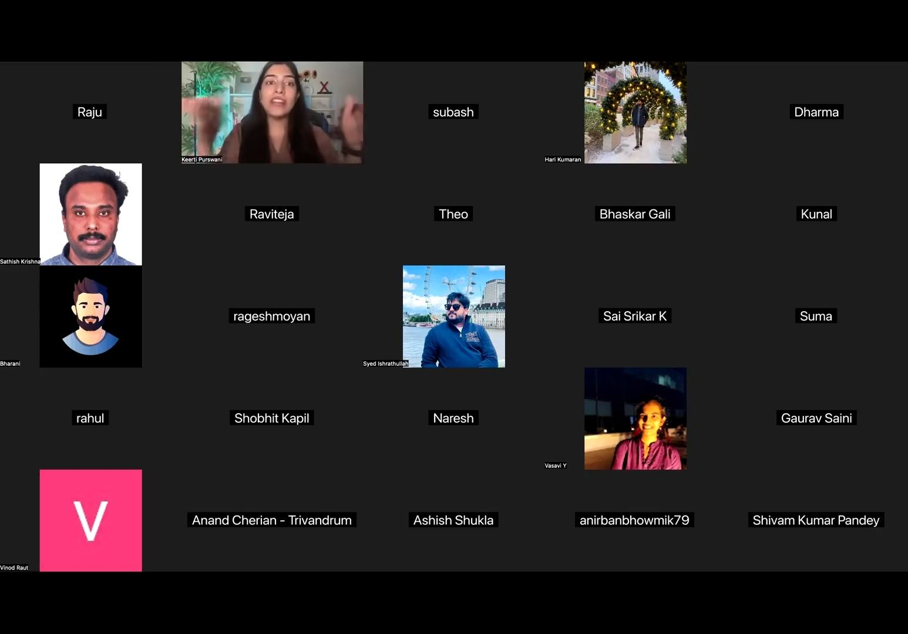
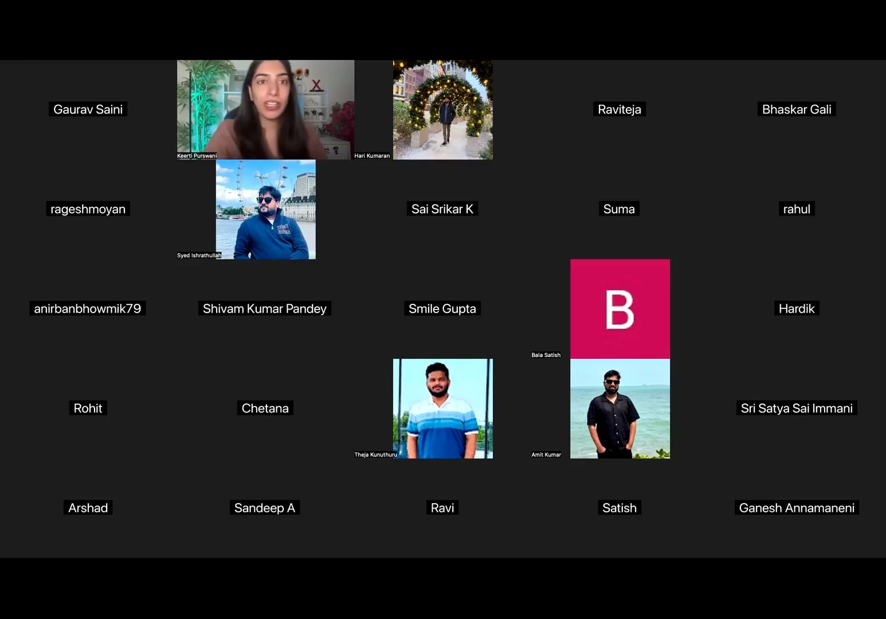
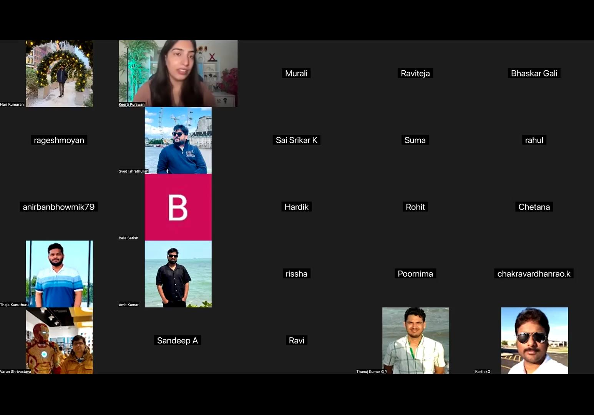
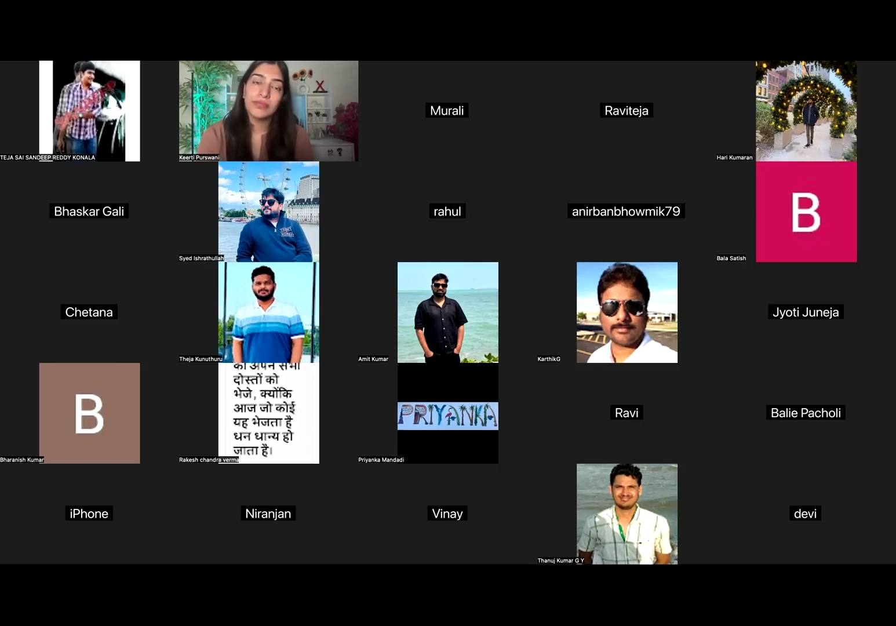

# Agentic AI System Design（系统设计 × Agent）第一课（下）：RAG 索引管线的关键判断与工程落地

> 本文对应 `BV1ntMt6TEe4` 的 `p001` 第 3/3 段，时间码 **123:41–176:48**。
> **这一段是答疑 + 课程收尾，逐字稿里没有任何代码，OCR 结果为空。** 因此本文不虚构"讲师写过的代码"，而是把讲师在这 40 多分钟里反复强调的判断，落成一份**可以照着搭起来的 RAG 索引管线设计 + 可运行的示意实现**。文中每一处"课里没有代码"的示意内容都已明确标注。

---

## 1. 这一节做什么

这一段不是新知识讲授，是一次长答疑。但答疑里散落着**整门课后面所有大章节的骨架**：chunking 策略、freshness/re-index、guardrails、context window、tracing、模型可替换性。本文把它们收拢成一条可以动手复现的路径：

**你要在这一节结束时拿到的东西：**

| 产出 | 对应讲师判断 | 落在本文哪一节 |
|---|---|---|
| token 与 chunk 的尺度换算表 | p001 [123:41] | 第 3 节 Step 2 |
| 一份 RAG 索引 → 检索 → 生成 的组件职责划分 | p001 [133:53]、[134:20] | 第 4 节 表 4-2 |
| 一份容量估算（chunk 数、向量存储、上下文占用） | p001 [124:39]、[137:57] | 第 4 节 表 4-5 |
| 一份"重试该由谁决定"的决策归属表 | p001 [128:17]–[128:45] | 第 4 节 表 4-1 D5 |
| 一份可用于增量更新（freshness）的数据模型草案 | p001 [134:20] | 第 4 节 表 4-4 |
| 一个能跑出"基础 chunking 在代码上失效"现象的 Python 文件 | p001 [140:54]、[142:21] | 第 4 节 代码 4-1 |
| 一份外部 LLM 调用前的安全检查点清单 | p001 [143:49]、[145:41] | 第 3 节 Step 8 |

**本段还讲了、但无法写成复现步骤的内容**（信息完整起见列在这里，不展开成流水账）：

- 课程资料只发在站点上，不发聊天窗口、不发 Discord；发到 Discord 会被清理，因为内容是付费的（p001 [124:10]）。
- 第二天课程时间：晚上 8 点整，内容是各种 chunking 策略、Graph RAG、Agentic RAG（p001 [129:40]）。
- 录播在课后 1–2 小时（含处理时间）上线（p001 [148:01]）。
- 结课后会发各方向的面试题库：RAG、安全、freshness、validation、context engineering、harness engineering、LLM ops、evals（p001 [147:03]）。
- 前置知识补课路径：hands-on journey 课程第 4 周就是 agentic 部分；或看 prerequisite 区里两个免费 YouTube 视频（p001 [155:45]）。
- 建议把提问挪到 Q&A section，便于组织和清理（p001 [156:41]）。
- 会在课程中期（约 1.5–2 周后）组织学员之间互做 mock interview，可录制回看，讲师偶尔参与评估（p001 [159:32]）。
- 本课程**不**教"怎么用好 Claude Code / Copilot / Cursor"这类工具使用技巧，只教它们内部是怎么运转的（p001 [162:49]）。
- 公司只发 Copilot / Cursor 的 key 时，那不能当 LLM key 用（p001 [135:42]）。



---

## 2. 讲师原话

以下引用均为逐字稿中文翻译，技术产品名保留英文。

> "Token 通常被认为是小字符。Chunk 通常更大，比如 100，这次用到的 chunk size 是 256、1500、2500，对吧？所以 chunk 通常更大，token 通常更小。token 这个词一般用在你训练 LLM 或者做微调的时候；chunking 是用在做 embedding、把内容切分成块的时候。"
> —— p001 [123:41]

> "增大 chunk size 会不会增加 token 成本？会，它会增加 token 成本。它也会让 embedding 的……你看，embedding 是固定大小的。假设 embedding 维度是 100 个字符，在这 100 个字符里，你想表示一个词还是一句话，你能表示多少？"
> —— p001 [124:39]

> "维度越大，你越能理解含义，因为你捕捉了更多语义上下文、更多字符；但你同时也会占用更多空间。所以这又回到取舍。没有唯一正确的 embedding 维度。"
> —— p001 [125:09]

> "Embedding 维度对一个模型来说是固定的，训练模型的时候就决定了。如果你用 OpenAI 的 embedding 模型，维度大小是固定的；如果你用 Hugging Face 的模型，取决于你用的是哪个模型。"
> —— p001 [125:37]

> "Embedding 就是数据在 VectorDB 里被存储的方式？是的，embedding 本质上就是一个向量，就是一串数字，它就是这样被存起来的。"
> —— p001 [126:03]

> "它确实会去取，但它只取四条。假设这块 chunk 从 login 开始、到 logout 结束……如果我在函数描述里写上『这个 login 函数在 auth service 里面』，它就能取到。"
> —— p001 [126:52]

> "Hugging Face 我只是用来生成 embeddings。我后面会改代码、改用 OpenAI embeddings。我只是想说明：你的 agent 可以用一个模型，embedding 可以用另一个模型。这就是我要表达的点——这是两个不同的概念。"
> —— p001 [127:47]

> "工具不决定怎么重试。谁来决定什么时候重试？……是 LLM 决定，framework 不决定，tool 不决定。因为谁有智能？谁来判断这个答案够不够好？LLM 有智能。Tool 就是那段代码，它有没有智能去判断答案够不够好、该不该重试？这个逻辑写不进代码。"
> —— p001 [128:17]

> "这段逻辑没法写在代码里，它太抽象了，它处理的是自然语言。framework 也处理不了。谁在处理？LLM。LLM 能看出这个回答够不够好。"
> —— p001 [128:45]

> "你在 Claude 里打开 repo 问一个问题，内部到底发生了什么？它并不是没有做 RAG，它内部一直在做，它在用 retrieval，没有 retrieval 它什么都答不出来。当你打开 repo 的那一刻，后台就已经开始建立这些东西了。"
> —— p001 [133:53]

> "repo 一直在变，生产环境里我们不可能每次都重新做 chunking。有没有策略？有的。有一个关于 freshness 的概念——我们怎么重新索引发生变化的部分，这个我们也会讲，也会做。"
> —— p001 [134:20]

> "Claude Code 是你正在用的应用，也是我们接下来要构建的那个应用。如果他们给你的是 LLM 的 key，那你就能用。你不可能用 cursor 的 key 或者 Claude Code 的 key，那些是应用的 key。"
> —— p001 [135:42]

> "LLM 不在内存里保留任何东西，所以是我们的应用在保存。……这叫 context window，你为模型算 token 的时候，它会告诉你最大上下文长度是多少，每个模型都不一样。"
> —— p001 [137:57]

> "这不是模型的问题。……我们做了 chunking，存进了 vector DB。chunking 有很多种做法，我给你看的是非常基础的 chunking 策略，它不行，对代码来说不够好。如果只是普通文本它会有效，但对代码这个策略不行。"
> —— p001 [140:54]

> "今天教的这个 chunking 策略，在生产环境的代码搜索里是不会用的，它只用于基于文本的搜索。"
> —— p001 [142:21]

> "我们会深入讲安全层。我们会实现 guardrails，那会是一个专门的 session。安全在生产里是非常非常重要的东西。"
> —— p001 [143:49]

> "我们发给 OpenAI 的东西，我们控制不了它们不会拿去训练——这不在我们的控制范围内。"
> —— p001 [144:18]

> "第一个答案是 guardrails，我们会有一个专门的 session，我们会把那些信息、把 PII 脱敏，这样它就不会到 LLM 那边去，而我们仍然能拿到回答。第二个，如果你对『任何东西都不去外部 LLM』严格到这种程度，那你只能用开源模型，通过你自己的本地服务提供，也就是在你自己组织内部有一套推理系统，那样什么都不会离开你的组织。"
> —— p001 [145:41]

> "除了从调用云端 LLM 变成调用本地的 LLM，其他都不变。构建生产级 agent 应用的所有概念、其他一切都不变，只是那一次调用变了。"
> —— p001 [150:46]

> "人们知道 RAG，但他们不知道什么才是好的 chunking 策略，不知道各种策略的优缺点和 trade-off。这就是生产级系统登场的地方。fine-tuning 通常由 ML engineer 来做，KV cache 这类优化由 inference engineer 来做。"
> —— p001 [152:09]

> "大部分写代码的部分，coding agent 已经能替我们做了，所以慢慢地那方面的期望会降低。你理解概念吗？你能用 coding agent 把它建出来吗？你理解不同构建方式的 trade-off 和优缺点吗？这才是 coding agent 做不到的。"
> —— p001 [154:21]

> "这取决于你用什么框架，不取决于模型。如果你直接调模型，比如直接用 OpenAI 的 API key，那这种情况下你就得自己记录日志，因为你没有用框架。"
> —— p001 [168:23]

> "当你说 RAG 对你的用例仍然适用时——文档本身是不同的，只是你处理的数据不同。我们的用例里是代码，也可能是任何数据。除此之外，我们讲的一切都一样，概念上它们是一样的。"
> —— p001 [174:06]

> "应用不一样。应用会有不同的 chunking 策略、不同的存储方式、不同的 context、不同的 prompt、不同的 harness，一切都是不同的。我只是改了 chunk size，你就看到 query 响应的差别了。"
> —— p001 [174:36]


---

## 3. 从零复现

这一段没有"敲命令"的环节，所以复现方式是：**按讲师给出的约束，一步步把 RAG 索引管线的设计推出来**，每一步都写清"为什么这么定、不这么定会怎样"。

### Step 0 需求定义

**需求**：给一个代码仓库，用户用自然语言提问，系统返回基于仓库内容的答案。

讲师对这一点的表述是，我们要建的是"类似 Anthropic API 那样的东西"，而不是"使用它"；目标是 production ready，不是 demo（p001 [131:30]–[131:59]）。同时他明确说了 Claude Code 打开 repo 时"内部就是在做 RAG"（p001 [133:53]）。所以需求可以精确化为：

1. 输入：repo（会持续变化）
2. 中间产物：可检索的索引（chunk + 向量 + 元数据）
3. 查询路径：question → 检索 top-k → 拼上下文 → LLM 生成
4. 输出：答案，以及"答案够不够好、要不要重试"的判断信号

**这一步不做的事**：不评估模型内部能力，不讨论 LLM 内部结构。讲师说了"我们不会讨论 LLM 的内部实现，但其余所有问题都会回答"（p001 [126:27]）。

### Step 1 约束清点（全部来自本段逐字稿）

| # | 约束 | 出处 |
|---|---|---|
| C1 | chunk 是比 token 更大的单位，课里出现的量级是 256 / 1500 / 2500 | [123:41] |
| C2 | embedding 维度由模型固定，应用层改不了 | [125:37] |
| C3 | 维度越大语义越全，但占空间越多，是取舍 | [125:09] |
| C4 | 检索返回条数有限，课里是 4 条 | [126:52] |
| C5 | context window 每个模型不同，由模型决定 | [137:57] |
| C6 | LLM 本身不保存任何记忆，状态在应用侧 | [137:57] |
| C7 | repo 持续变化，不能每次全量重建索引 | [134:20] |
| C8 | 发给外部 LLM 的数据不可控 | [144:18] |
| C9 | agent 模型与 embedding 模型可以是两个不同模型 | [127:47] |
| C10 | 基础的语义 chunking 不适用于代码 | [140:54]、[142:21] |
| C11 | 重试决策权在 LLM，不在 tool，也不在 framework | [128:17]、[128:45] |
| C12 | tracing 的归属取决于框架，不取决于模型 | [168:23] |

### Step 2 概念对齐：token 与 chunk 不是一回事

很多人卡在这里。讲师的区分非常干脆（[123:41]）：

- **token**：小字符单位，用于训练 / 微调 LLM 时的计量。
- **chunk**：更大的单位，用于 embedding 之前的分块。

课里给出的 chunk 尺寸样本：**256、1500、2500**。这是一张尺度表：

| 用途 | 单位 | 课里出现的量级 | 谁在用 |
|---|---|---|---|
| 训练 / 微调 | token | 未给具体数 | 训练侧 |
| Embedding 前分块 | chunk | 256 / 1500 / 2500 | 索引侧 |
| 检索返回 | 条数 | 4 | 检索侧 |
| 上下文装载 | context window | 每模型不同 | 推理侧 |

注意 C1 与 C4 的联动后果：**chunk 越大，同样 k=4 条塞进 context window 的字符就越多**；chunk 越大，token 成本越高（讲师在 [124:39] 直接确认了这一点）。所以 chunk size 不是一个孤立参数，它会同时推高**索引成本**和**每次查询的输入 token 成本**。

### Step 3 估算（写出算式）

课里没有给具体仓库规模，以下数字是**演示假设**，用来把算式立起来；只要换掉假设，算式本身不变。

假设：仓库 2,000 个文件，平均每文件 150 行，平均每行 10 token。

```
仓库总 token ≈ 2,000 × 150 × 10 = 3,000,000 token
```

按两种 chunk size 切：

```
chunk=256  →  3,000,000 ÷ 256  ≈ 11,719 块
chunk=1500 →  3,000,000 ÷ 1500 =  2,000 块
```

向量存储（设 embedding 维度为 D，float32 每维 4 字节）：

```
每块字节数 = D × 4
chunk=256  →  11,719 × (D × 4)
chunk=1500 →   2,000 × (D × 4)
```

若 D = 1536（**演示假设，课里只举过"维度是 100 个字符"这样的例子，没有给具体维度值**）：

```
chunk=256  →  11,719 × 6,144 B ≈ 70 MB
chunk=1500 →   2,000 × 6,144 B ≈ 12 MB
```

单次查询的上下文占用（k=4）：

```
chunk=256  →  4 × 256  = 1,024 token
chunk=1500 →  4 × 1500 = 6,000 token
```

这就是讲师那句"增大 chunk size 会增加 token 成本"的算术形态（[124:39]）。**结论不是"选小的"或"选大的"，而是：chunk size 决定索引规模与单次查询成本的比值，必须对着 context window 来定。**

### Step 4 方案：六段式管线

讲师在 [133:53] 描述了 Claude Code 打开 repo 时的内部行为，把它展开就是下面六段：

```
repo ──▶ Parser ──▶ Chunker ──▶ Embedder ──▶ VectorStore
                                                  │
question ──▶ Embedder ─────────────────────────▶ Retriever ──▶ top-k
                                                                  │
                                                        Prompt Assembler
                                                                  │
                                                              Guardrail
                                                                  │
                                                                 LLM
                                                                  │
                                                     answer / retry 信号
```

每一段"做什么 / 不做什么"见第 4 节表 4-2。这里强调两个容易放错位置的职责：

1. **Retriever 不做"够不够好"的判断。** 它只负责按相似度取 k 条。判断在 LLM（C11）。
2. **Guardrail 在 Parser 阶段就该介入。** 学员在 [142:51] 问"敏感数据应该在 chunking 之前就限制吗"，讲师的回答指向的是"安全层 / guardrails 会有专门一节"，并且在 [145:41] 把"PII 脱敏，让信息不到 LLM 那边去"列为第一个答案。所以脱敏的位置是**入库前 + 出库前双点**，而不是只在出口。

### Step 5 重试归属：写死一个决策表

这是本段最容易被忽略、但对工程实现影响最大的一条。讲师连问了三遍"谁决定重试"（[128:17]–[128:45]），结论是：

| 角色 | 能不能决定重试 | 原因 |
|---|---|---|
| Tool（那段函数代码） | 不能 | 它是确定性的代码，没有判断自然语言质量的能力 |
| Framework | 不能 | 它调度，但不理解语义 |
| **LLM** | **能** | 只有它具备"这个回答够不够好"的判断力 |

工程含义：**重试逻辑不能写成 `if response.length < N: retry()` 这种形式**。它必须是一次 LLM 判定，也就是你要么让主模型在输出里带一个"是否需要重试"的结构化字段，要么单独发一次判定调用。

### Step 6 freshness：增量重建

C7 的解法在 [134:20] 被点名但不展开。可复现的最小方案是**内容哈希 + 路径双键**：

```
对每个 chunk 记录 (file_path, start_offset, content_hash)
重建时：
  1. 对每个文件算整体 hash，与上次一致 → 跳过
  2. 不一致 → 对该文件重新 parse + chunk
  3. 新 chunk 的 content_hash 已存在 → 复用旧向量
  4. 旧 chunk 在新版本中消失 → 标记删除
```

数据模型见第 4 节表 4-4。**注意：具体的 freshness 策略细节课里没讲，这里给的是按讲师"不能每次全量重建"这一约束推出的最小实现。**

### Step 7 模型选择：三处可替换点

讲师在 [127:47] 明确说了：用 Hugging Face 只是为了生成 embedding，agent 用的是另一个模型，"这是两个不同的概念"。结合 [150:46]（本地模型只改调用层）和 [168:23]（tracing 归属框架），可替换点是三处：

| 替换点 | 课里说的 | 换掉时要改什么 |
|---|---|---|
| Embedding 模型 | [125:37] 维度由模型固定 | **必须全量重建索引**（维度或空间变了，旧向量不可复用） |
| Agent / 生成模型 | [127:47] 与 embedding 是两回事 | 只改调用层，prompt 与 harness 可能要跟着调 |
| 云 → 本地 | [150:46] 只改调用 | 其余概念全不变 |

这是一个非常实用的判断：**换生成模型是配置级改动，换 embedding 模型是数据迁移级改动。** 很多人把这两件事混为一谈，结果换了个 embedding 模型发现检索全乱。

### Step 8 安全检查点

按 [143:49]、[144:18]、[145:41] 三条，落成四个检查点：

| 检查点 | 位置 | 拦截什么 |
|---|---|---|
| S1 | Parser 之后、Chunker 之前 | 入库前的敏感字段（token、密钥、身份证号等） |
| S2 | Chunk 落盘前 | 确保被索引的内容本身已脱敏 |
| S3 | Prompt 组装后、调 LLM 前 | 出口复查，防止检索结果里带出未脱敏内容 |
| S4 | 日志 / tracing 落盘前 | trace 里同样不能有明文 PII |

讲师的态度很明确：**发出去的数据是否被用于训练，我们控制不了**（[144:18]）。所以安全只能做在"发出去之前"。这也直接回答了他给的那道面试题（[145:41]）：要么脱敏，要么整套搬到组织内自建推理。

### Step 9 验证：为什么基础语义 chunking 在代码上会失败

这是本段唯一一个可以**动手跑出来**的现象。讲师的描述是（[140:54]）：

- 问"这个文件里有哪些函数"
- 系统返回了 imports 相关内容
- 但没返回 login / logout 函数
- 原因是"它不知道这两个函数属于同一个文件"
- 即使用了 overlap，还是没解决
- 结论不是模型的问题，是 chunking 策略的问题
- 这个策略对普通英文文本有效，对代码无效（[142:21]）

第 4 节的代码 4-1 就是用最小实现把这个现象跑出来：**固定窗口切分会把 `def login` 和 `def logout` 切到不同块里，于是"它们是同一个文件的兄弟函数"这层关系就丢了。**



---

## 4. 完整代码

> **重要声明：本段逐字稿里没有任何代码，OCR 结果为空。以下 4-1 是示意实现，不是讲师写过的代码。**
> 它的唯一目的是让你在自己机器上**复现 [140:54] 那个"基础 chunking 在代码上失效"的现象**，从而真正理解为什么后面要讲更好的 chunking 策略。

### 表 4-1 设计决策表

| 编号 | 决策 | 讲师依据 | 备选方案 | 为什么不选 / 代价 |
|---|---|---|---|---|
| D1 | 索引以 chunk 为单位切分，量级 256 / 1500 / 2500 | [123:41] | 按 token 逐字索引 | token 太小，检索粒度没意义 |
| D2 | embedding 维度交给模型，应用层不调 | [125:37] | 自行截断/补齐维度 | 维度是训练时定死的，应用层改就是破坏语义 |
| D3 | agent 模型与 embedding 模型可以不同 | [127:47
| D3 | agent 模型与 embedding 模型可以不同 | [127:47] | 强行统一成一个模型 | 两个模型的职责不同，绑死会限制替换与降本空间 |
| D4 | 检索固定返回 k=4 条 | [126:52] | 动态 k | 课里只给了 4 这个值；动态 k 会改变上下文占用，需重新对 context window 核算 |
| D5 | chunk 元数据里带上"所属服务/文件"这类归属信息 | [126:52]、[127:22] | 只存纯文本 | 不存归属信息时，只写了 `login`/`logout` 的块无法被"auth service"这类查询召回 |
| D6 | 重试判定交给 LLM，不写在代码里 | [128:17]、[128:45] | `if len(resp) < N: retry()` | 讲师原话：这个逻辑写不进代码，它处理的是自然语言 |
| D7 | 索引增量更新，不全量重建 | [134:20] | 每次全量 rechunk | repo 持续变化，全量重建在生产上不可接受 |
| D8 | PII 脱敏在入库前 + 出库前双点 | [142:51]、[143:49]、[145:41] | 只在出口脱敏 | 已入库的明文会长期留存，且会从其他路径泄漏 |
| D9 | tracing 跟随框架而非模型 | [168:23] | 按模型选 tracing | 讲师原话：取决于你用什么框架，不取决于模型 |
| D10 | 概念优先于框架 | [169:52] | 只学一个框架 | 讲师原话：焦点在概念上，不在某个特定框架 |

### 表 4-2 组件职责表

| 组件 | 输入 | 输出 | 该做 | 不该做 |
|---|---|---|---|---|
| Parser | repo 文件树 | 文本 + 结构信息 | 读文件、保留路径、脱敏 S1 | 不做语义判断 |
| Chunker | 文本 + 结构 | chunk 列表 | 按策略切块、写元数据（路径/偏移/归属） | 不决定检索条数 |
| Embedder | chunk 文本 | 向量 | 调 embedding 模型，维度由模型定 | 不改维度、不混用两个 embedding 模型 |
| VectorStore | 向量 + 元数据 | 持久化索引 | 存向量、存元数据、支持按 hash 去重 | 不做业务判断 |
| Retriever | query 向量 | top-k chunk | 按相似度取 k 条 | **不判断"够不够好"**（C11） |
| Prompt Assembler | top-k + 用户问题 | 完整 prompt | 拼上下文、标注来源、控制总长度 | 不超 context window |
| Guardrail | prompt / 响应 | 放行或拦截 | S3/S4 检查、PII 遮罩 | 不替代 LLM 的语义判断 |
| LLM | prompt | 答案 + 重试信号 | 生成答案、判定是否需要重试 | 不负责持久化状态（C6） |

### 表 4-3 重试判定接口草案（示意，课里没给字段定义）

| 字段 | 类型 | 含义 | 备注 |
|---|---|---|---|
| `answer` | string | 最终回答 | — |
| `retry` | boolean | 是否要求重试 | **由 LLM 给，不由代码推** |
| `reason` | string | 重试原因 | 便于排查与 eval |
| `missing` | string[] | 缺哪些信息 | 可回流成新的检索 query |

> 字段名是本表自定的，**课里没有给过任何字段定义**，请按你的实现调整。

### 表 4-4 chunk 数据模型草案（支撑 freshness）

| 字段 | 类型 | 用途 |
|---|---|---|
| `chunk_id` | string | `{file_path}:{start}-{end}`，便于定位 |
| `file_path` | string | 归属文件，也是 D5 的元数据来源 |
| `start` / `end` | int | 原文偏移，重建时对齐用 |
| `text` | string | 已脱敏的 chunk 正文 |
| `content_hash` | string | 跨版本复用向量的键 |
| `owner_service` | string \| null | 如 `auth`，对应 D5 的归属信息 |
| `model_id` | string | 生成该向量的 embedding 模型，用于识别"该重建了" |
| `indexed_at` | string | 最后索引时间 |

`model_id` 这一列直接落实 Step 7 的结论：**换了 embedding 模型，靠这一列就能筛出全部需要重建的 chunk。**

### 表 4-5 容量估算表（对齐 Step 3 算式）

| 项 | chunk=256 | chunk=1500 | 算式 |
|---|---|---|---|
| chunk 数量 | ≈11,719 | 2,000 | 总 token ÷ chunk size |
| 向量存储（D=1536，假设） | ≈70 MB | ≈12 MB | 块数 × D × 4 B |
| 单次查询上下文（k=4） | 1,024 token | 6,000 token | k × chunk size |
| 索引侧成本 | 更高（块多） | 更低 | 块数 × embedding 调用 |
| 单次查询成本 | 更低 | 更高 | 上下文 token 数 |

### 代码 4-1 `rag_demo/fixed_window_chunking_demo.py`

```python
# rag_demo/fixed_window_chunking_demo.py
# 课里没有代码，以下为示意实现。
# 目的：复现 p001 [140:54] 描述的现象——
#   用固定窗口切代码，login 与 logout 会被切到不同的块，
#   于是"它们是同一个文件的兄弟函数"这层关系丢失，
#   即使用了 overlap 也救不回来。

from __future__ import annotations

import hashlib
import re
from dataclasses import dataclass

CHUNK_SIZE = 256   # 课里出现过的 chunk 尺寸之一 [123:41]
OVERLAP = 32       # 课里提到"加了 overlap 仍然不行" [140:24]
TOP_K = 4          # 课里检索返回 4 条 [126:52]


# ---------------------------------------------------------------- 原始数据
SAMPLE_FILES: dict[str, str] = {
    "src/auth/service.py": '''import hashlib
import hmac
import os
import time
from typing import Optional

SECRET_KEY = b"dev-only-secret"
SESSION_TTL_SECONDS = 3600

_sessions: dict[str, dict] = {}


def _now() -> int:
    return int(time.time())


def login(username: str, password: str) -> Optional[str]:
    """校验账号密码，成功则返回 session token。"""
    expected = hmac.new(SECRET_KEY, username.encode(), hashlib.sha256).hexdigest()
    if not hmac.compare_digest(expected, password):
        return None
    token = os.urandom(16).hex()
    _sessions[token] = {"user": username, "expires_at": _now() + SESSION_TTL_SECONDS}
    return token


# ---- 中间填充代码：模拟真实文件里 login 与 logout 之间隔了很远 ----
# 这里放一段较长的说明，用来把 logout 推到后面的 chunk 里。
# 真实仓库中这段通常是权限校验、审计日志、限流、错误码映射等。
# 为了让演示结果稳定，这段故意写得比较长。
#
# 审计日志要点：
#   1. 每次登录成功/失败都要落一条记录；
#   2. 记录里不能出现明文密码；
#   3. 记录要能按 request_id 串起来；
#   4. 失败次数要能触发限流。
#
# 限流要点：
#   1. 按 username 维度限流；
#   2. 按 IP 维度限流；
#   3. 阀值与窗口做成可配置；
#   4. 超限返回统一的错误码。
#
# 错误码映射：
#   AUTH_INVALID_CREDENTIALS  -> 401
#   AUTH_SESSION_EXPIRED      -> 401
#   AUTH_TOO_MANY_ATTEMPTS    -> 429
#   AUTH_INTERNAL_ERROR       -> 500
# ------------------------------------------------------------------


def logout(token: str) -> bool:
    """注销 session，成功返回 True。"""
    if token in _sessions:
        del _sessions[token]
        return True
    return False


def whoami(token: str) -> Optional[str]:
    """按 token 取当前用户，过期返回 None。"""
    session = _sessions.get(token)
    if not session:
        return None
    if session["expires_at"] < _now():
        del _sessions[token]
        return None
    return session["user"]
''',
}


# ---------------------------------------------------------------- 数据结构
@dataclass
class Chunk:
    chunk_id: str
    file_path: str
    start: int
    end: int
    text: str
    content_hash: str
    owner_service: str | None = None
    model_id: str = "demo-embedding"
    indexed_at: str = ""


def content_hash(text: str) -> str:
    return hashlib.sha1(text.encode("utf-8")).hexdigest()


# ---------------------------------------------------------------- 切块
def fixed_window_chunks(
    file_path: str,
    text: str,
    chunk_size: int = CHUNK_SIZE,
    overlap: int = OVERLAP,
) -> list[Chunk]:
    """课里演示过的那种最基础策略：固定窗口 + 重叠。"""
    if overlap >= chunk_size:
        raise ValueError("overlap 必须小于 chunk_size，否则步长为 0，会死循环")
    step = chunk_size - overlap
    chunks: list[Chunk] = []
    start = 0
    while start < len(text):
        end = min(start + chunk_size, len(text))
        body = text[start:end]
        chunks.append(
            Chunk(
                chunk_id=f"{file_path}:{start}-{end}",
                file_path=file_path,
                start=start,
                end=end,
                text=body,
                content_hash=content_hash(body),
            )
        )
        if end == len(text):
            break
        start += step
    return chunks


# ---------------------------------------------------------------- 检索
def tokenize(s: str) -> set[str]:
    return set(re.findall(r"[A-Za-z_][A-Za-z0-9_]*", s.lower()))


def similarity(query_tokens: set[str], chunk_text: str) -> float:
    """课里没有代码，这里用词面重叠代替向量相似度，只为把现象跑出来。"""
    chunk_tokens = tokenize(chunk_text)
    if not chunk_tokens:
        return 0.0
    return len(query_tokens & chunk_tokens) / len(query_tokens)


def retrieve(query: str, chunks: list[Chunk], top_k: int = TOP_K) -> list[tuple[float, Chunk]]:
    q = tokenize(query)
    scored = [(similarity(q, c.text), c) for c in chunks]
    scored.sort(key=lambda pair: pair[0], reverse=True)
    return scored[:top_k]


# ---------------------------------------------------------------- 演示
def which_chunk(chunks: list[Chunk], needle: str) -> list[str]:
    return [c.chunk_id for c in chunks if needle in c.text]


def main() -> None:
    all_chunks: list[Chunk] = []
    for path, body in SAMPLE_FILES.items():
        all_chunks.extend(fixed_window_chunks(path, body))

    print(f"chunk_size={CHUNK_SIZE} overlap={OVERLAP} 共切出 {len(all_chunks)} 块")
    for c in all_chunks:
        print(f"  {c.chunk_id}  hash={c.content_hash[:8]}  len={len(c.text)}")

    print("\n--- 归属检查（这是 p001 [140:54] 的核心现象）---")
    login_in = which_chunk(all_chunks, "def login")
    logout_in = which_chunk(all_chunks, "def logout")
    print("def login  落在:", login_in or "没找到")
    print("def logout 落在:", logout_in or "没找到")
    same = bool(login_in) and bool(logout_in) and set(login_in) == set(logout_in)
    print("两者是否同一块:", same)
    print("→ 不同块意味着：任何一块都不知道另一个函数存在，",
          "更不知道它们属于同一个文件。overlap 也补不回这层关系。")

    query = "Which functions are defined in src/auth/service.py?"
    print(f"\n--- 检索 query: {query} ---")
    for rank, (score, c) in enumerate(retrieve(query, all_chunks), start=1):
        preview = c.text.replace("\n", " ")[:70]
        print(f"  #{rank} score={score:.3f} {c.chunk_id} | {preview}")

    hit = {"login", "logout"} & tokenize(
        " ".join(c.text for _, c in retrieve(query, all_chunks))
    )
    print("\n召回到的目标函数名:", sorted(hit) or "（一个都没召回）")

    # 对照实验：给每块补上归属信息（对应 D5 / [126:52]）
    print("\n--- 对照实验：chunk 里补上 owner_service 元数据 ---")
    enriched = [
        Chunk(
            chunk_id=c.chunk_id,
            file_path=c.file_path,
            start=c.start,
            end=c.end,
            text=f"# file: {c.file_path}\n# service: auth\n" + c.text,
            content_hash=c.content_hash,
            owner_service="auth",
        )
        for c in all_chunks
    ]
    query2 = "auth service login logout"
    for rank, (score, c) in enumerate(retrieve(query2, enriched), start=1):
        print(f"  #{rank} score={score:.3f} {c.chunk_id}")


if __name__ == "__main__":
    main()
```

### 代码 4-2 `rag_demo/retry_policy.py`（示意：把重试判定交给 LLM）

```python
# rag_demo/retry_policy.py
# 课里没有代码，以下为示意。
# 依据 p001 [128:17]-[128:45]：重试由 LLM 决定，tool 与 framework 都不决定。

from __future__ import annotations

from dataclasses import dataclass

MAX_ATTEMPTS = 2  # 课里没给数值，这里只是防止无限重试

RETRY_JUDGE_PROMPT = """你是判定器。给定用户问题与候选上下文，判断这些上下文是否足以回答问题。

只输出 JSON，不要输出任何多余文字：
{
  "retry": true 或 false,
  "reason": "一句话说明",
  "missing": ["仍然缺失的信息"]
}

判定标准：
- 若上下文里没有直接支撑答案的内容，retry = true；
- 若上下文足够，retry = false；
- 不要猜测，不要用你自己的知识补全。
"""


@dataclass
class JudgeResult:
    retry: bool
    reason: str
    missing: list[str]


def decide_retry(call_llm, question: str, contexts: list[str]) -> JudgeResult:
    """call_llm(prompt, payload) -> str，返回模型原始输出。

    注意：这里没有写 if len(answer) < N 之类的规则。
    是否重试完全由模型判断，代码只负责解析结果与限次。
    """
    payload = {
        "question": question,
        "contexts": contexts,
    }
    raw = call_llm(RETRY_JUDGE_PROMPT, payload)
    return parse_judge(raw)


def parse_judge(raw: str) -> JudgeResult:
    import json

    try:
        data = json.loads(raw)
    except json.JSONDecodeError as exc:
        # 解析失败不等于"需要重试"，这里保守地判定为不重试并记录原因
        return JudgeResult(retry=False, reason=f"judge 输出不可解析: {exc}", missing=[])
    return JudgeResult(
        retry=bool(data.get("retry", False)),
        reason=str(data.get("reason", "")),
        missing=[str(x) for x in data.get("missing", [])],
    )


def run_with_retry(call_llm, retrieve, question: str) -> str:
    contexts: list[str] = [c.text for c in retrieve(question)]
    for attempt in range(1, MAX_ATTEMPTS + 1):
        answer = call_llm("ANSWER_PROMPT_PLACEHOLDER", {"question": question, "contexts": contexts})
        verdict = decide_retry(call_llm, question, contexts)
        if not verdict.retry:
            return answer
        if not verdict.missing:
            break
        # 用模型给出的缺失项改写 query 再检索一次
        contexts = [c.text for c in retrieve(" ".join(verdict.missing))]
    return answer
```

> `ANSWER_PROMPT_PLACEHOLDER` 是占位符，**课里没有给过 prompt 原文**，请自行替换。



---

## 5. 逐行解释

### 5.1 关于表 4-1 的每一条决策

**D1（chunk 为单位，量级 256/1500/2500）**：为什么不能按 token 切？因为讲师把 token 定位在"训练 / 微调"的计量单位（[123:41]），而 chunk 是"做 embedding 时切出来的块"。如果你按 token 粒度建索引，每块太短，语义不成立，检索出来的东西没法用；反过来 chunk 太大，k=4 条就会把上下文撑爆。256 和 1500 之间差了近 6 倍，正好是"索引成本 vs 查询成本"这条曲线的两端。

**D2（维度交给模型）**：讲师说得非常明确——"维度对一个模型来说是固定的，训练时就决定了"（[125:37]）。所以应用层做维度截断是错的，等于破坏模型学到的语义空间。你唯一能做的是**选模型**，不是调维度。这就是为什么 D2 的否决栏写"破坏语义"。

**D3（两个模型可以不同）**：这一条是讲师专门澄清的（[127:47]）。他课上用 Hugging Face 生成 embedding、用 OpenAI 跑 agent，有学员困惑，他的回答是"我只是想说明这是两个不同的概念"。工程上的价值在于：embedding 通常量大、便宜、可以本地跑；生成模型量小、贵、要质量。绑成一个模型等于放弃这个优化空间。

**D4（k=4）**：这个数字来自讲师描述检索行为时的原话——"它确实会去取，但它只取四条"（[126:52]）。这里要小心：4 是**课上观察到的值**，不是通用最优值。写进文档时必须带上"课里只给了 4"这个限定，否则读者会以为 4 是标准答案。

**D5（元数据带归属）**：这是本段信息密度最高的一条。讲师描述的现象是：一个块里只有 `login` 和 `logout`，没有出现 `auth service` 这几个字，所以按 "auth service" 检索时召不回来；他给的解法是"在函数描述里写上这个 login 函数在 auth service 里面"（[126:52]、[127:22]）。这本质上是**在文本之外补一层结构化归属**。落地方式就是代码 4-1 的对照实验：给每块文本头部注入 `# service: auth`，或者把归属存进元数据参与过滤。

**D6（重试交给 LLM）**：讲师的原话逻辑链是"谁有智能 → LLM → 所以 LLM 决定"（[128:17]、[128:45]）。反面教材就是 `if len(answer) < 200: retry()`——长度短不代表答不出来，长度长也不代表答对了。代码 4-2 就按这个原则写：`decide_retry` 里没有任何基于长度的规则，只有一次模型判定 + 解析 + 限次。

**D7（增量更新）**：讲师只说了"不能每次都重新 chunking，有一个 freshness 的概念"（[134:20]），没有给方案。表 4-4 的 `content_hash` + `model_id` 两列是按这个约束推出来的最小可行解：hash 解决"内容没变就别重算"，model_id 解决"模型换了就必须全重算"。

**D8（双点脱敏）**：学员问的是"应该在 parsing 阶段就限制敏感数据吗"（[142:51]），讲师把这个问题归到 guardrails 那一节，并在 [145:41] 给出脱敏这个答案。所以两个点都要：入库前脱敏，避免明文长期留存；出库前复查，避免其他路径带出未脱敏内容。

**D9 / D10（tracing 跟框架、概念优先）**：讲师在 [168:23] 讲得很清楚——LangSmith 是 LangChain/LangGraph 生态的监控，Google ADK 有自己的 tracing 方式，**取决于框架不取决于模型**；如果你直接调 OpenAI API，就得自己记日志。所以 tracing 方案不能按"我用了哪个模型"来选。

### 5.2 关于代码 4-1 的逐段解释

**`CHUNK_SIZE = 256`**：直接取课里出现过的值（[123:41]），让现象可复现。

**`OVERLAP = 32`**：课里提到"即使加了 overlap 仍然不行"（[140:24]）。这里保留 overlap 就是为了让读者亲眼看到：**重叠不能修复结构关系的丢失**。重叠只能让边界处的文字多出现一次，但两块之间仍然互不知道对方存在。

**`fixed_window_chunks` 里的 `step = chunk_size - overlap`**：标准滑动窗口。注意 `if overlap >= chunk_size: raise` 这个保护——overlap 等于 chunk_size 时 step 为 0，会死循环。这类边界在真实实现里一定要拦。

**`chunk_id = f"{file_path}:{start}-{end}"`**：把路径和偏移编进 ID。好处是重建索引时能精确对齐，坏处是内容变了 ID 就变，所以跨版本复用必须靠 `content_hash` 而不是 ID。这也解释了表 4-4 为什么两个字段都要。

**`similarity` 用词面重叠而不是向量**：这是刻意简化。本文件不依赖任何 API key、不依赖 numpy、不依赖向量库，任何人 `python fixed_window_chunking_demo.py` 就能跑。代价是它衡量的是词面而非语义——但对"login 和 logout 是否在同一块"这个问题，词面相似度完全够用，因为问题出在**切分**，不在**相似度算法**。

**`which_chunk` 打印归属**：这是把 [140:54] 的现象变成可验证的输出。如果 `def login` 和 `def logout` 落在不同块，`same` 就是 `False`，读者能直接看到"关系丢失"发生在哪一步。

**`main()` 里的对照实验**：给每块前置 `# file: ...` 和 `# service: auth` 两行，再用 "auth service login logout" 检索。这就是把 D5 从"说法"变成"能跑出差别"的最小验证。

### 5.3 关于代码 4-2 的逐段解释

**`RETRY_JUDGE_PROMPT` 要求只输出 JSON**：因为判定结果要被代码消费。如果不约束格式，你就得在代码里做脆弱的字符串匹配，那就又变回"用代码判断语义"了。

**`parse_judge` 解析失败时返回 `retry=False`**：这是一个刻意的保守选择。解析失败意味着判定器本身出问题，此时无限重试只会放大故障与成本。这条不是课里讲的，是工程上的默认防御。

**`run_with_retry` 用 `verdict.missing` 改写 query**：这是把"LLM 判定"和"检索"接起来的关键一步。否则重试只是把同一个 query 再发一次，结果不会变。

**`MAX_ATTEMPTS = 2`**：课里没给数值。这里存在的意义是**兜底**——即使"该不该重试"由 LLM 决定，"最多重试几次"仍然必须是代码里的硬约束，否则模型可以一直说"再试试"。



> **截图说明**：本段可选截图清单共 5 张，上文已全部使用（[123:47]、[135:34]、[147:22]、[159:09]、[170:56]）。清单中没有第 6 帧，故此处的图片数量以清单上限为准。

---

## 6. 复现检查清单

按顺序打勾，全部通过说明你把这一段的设计真正落地了。

**环境**

- [ ] Python 3.11+（代码用到 `str | None` 与 `list[str]` 语法；3.9 以下会报错）
- [ ] 目录结构建好：`rag_demo/fixed_window_chunking_demo.py`、`rag_demo/retry_policy.py`
- [ ] 代码 4-1 无第三方依赖，不需要 API key、不需要 `pip install` 任何东西
- [ ] 代码 4-2 是示意，需要你自备 `call_llm` 实现与 `ANSWER_PROMPT_PLACEHOLDER`

**跑通代码 4-1**

- [ ] `python rag_demo/fixed_window_chunking_demo.py` 能正常结束，无异常
- [ ] 输出里有 `chunk_size=256 overlap=32 共切出 N 块`，N 为正数
- [ ] 每块都打印了 `chunk_id`、`hash`、`len`，且 `len <= 256`
- [ ] 归属检查里 `两者是否同一块: False`（这就是要复现的现象）
- [ ] 检索段打印了 4 条结果（`TOP_K = 4`），每条都带 `score` 与 `chunk_id`
- [ ] `召回到的目标函数名` 一行显示 `login` 和 `logout` 没有同时被召回
- [ ] 对照实验段打印了 4 条结果，`auth service login logout` 的命中情况与上一段有可见差别
- [ ] 把 `OVERLAP` 改成 64、128 再跑一次，确认 `两者是否同一块` **仍然是 False**（对应讲师"加了 overlap 还是不行"）

**对照约束**

- [ ] 你能指着表 4-5 说出：`chunk=256` 与 `chunk=1500` 分别在"索引成本"和"单次查询成本"上占优
- [ ] 你能说出为什么换 embedding 模型必须全量重建索引，而换生成模型不用（对应 Step 7 与表 4-4 的 `model_id`）
- [ ] 你能说出重试判定为什么不能写成 `if len(answer) < N`
- [ ] 你的 guardrail 至少在两个位置有拦截点（入库前、调 LLM 前），不是只有出口
- [ ] 你的 chunk 元数据里有 `file_path`，且能解释为什么只有纯文本会导致 [126:52] 那个召回失败

**能回答的判断题**

- [ ] Token 与 chunk 的区别，以及各自用在什么阶段
- [ ] 增大 chunk size 会不会同时影响 token 成本与检索效果，为什么
- [ ] embedding 维度是应用层能调的吗，为什么
- [ ] LLM 有没有"记忆"，没有的话状态存在哪
- [ ] 同一份代码，换一个应用（Copilot vs Claude）为什么回答质量不同

---

## 7. 课里没讲但你会撞上的

以下都是本段逐字稿**没有给出实现细节**、但你按上面的方案动手时一定会遇到的问题。写在这里是为了让你不把它们当成"我理解错了"。

**1. 同名函数如何消歧——课里点到了但没给方案。**
学员在 [129:12] 问"不同 class 里有同名函数，靠相似度怎么选"，讲师回答是"这取决于 retrieval 怎么做，这正是我们要处理的案例"。所以这一条在本段是**悬而未决**的。你会撞上的具体形态：两个服务各有一个 `login`，纯向量检索会把它们混在一起。可行的缓解方向是给 chunk 加路径/服务过滤（也就是 D5 那层元数据），但**具体算法课里没讲**。

**2. 嵌套函数的上下文——课里明确说了"今天不行"。**
学员在 [139:55] 问嵌套函数上下文的关联，讲师的回答是：今天没有做到，明天会讲 overlap 长什么样、怎么让它注意到上下有函数（[140:24]、[140:54]）。所以你现在跑代码 4-1 得到"关系丢失"是**预期结果**，不是你的 bug。

**3. skills / plugins 不能通过 API 跑——课里给了否定答案。**
学员问"在 Claude 里写了 skill，能不能通过 API 跑"，讲师回答"不行，因为这些是特定于你的 coding agent（Claude Code）的"（[138:57]）。你会撞上的是：想把课上看到的 skill 当普通函数调用，结果发现它不是一个独立可调用的东西。

**4. freshness 的具体策略——课里只说"会讲"。**
[134:20] 只确认了"有一个 freshness 的概念、会做"，没有任何字段或算法。表 4-4 是按约束推出来的草案，你需要按自己仓库的规模调整（比如是否需要按目录做批量 hash、是否需要软删除标记）。

**5. 安全层的完整实现——课里明确说"会有专门一节"。**
[143:49]、[144:18]、[145:41] 三次提到 guardrails / safety 会是独立 session。本文给的 S1–S4 只是检查点的位置，**不含具体脱敏规则与工具**。

**6. 本地模型怎么接——课里说"只改调用"，但没说怎么部署。**
[150:46] 的原话是"除了从调云端变成调本地，其他都不变"，并提到也许三四天后会演示。所以本地推理服务怎么起、显存怎么估，**课里没讲**。你会撞上的是：模型换成本地后 `context window` 变了，表 4-5 的估算要重算。

**7. 公司发的 key 不是 LLM key。**
[135:42] 明确区分：Claude Code 的 key、Cursor 的 key 是**应用**的 key，不能当 LLM key 用；要用得是 Anthropic 或 OpenAI 的 LLM key。另外讲师提醒，公司提供的 key 通常限制很严，从个人笔记本访问大概率被拦（[136:07]）。

**8. 直接调 API 就没有 tracing——课里说了要自己记。**
[168:23]：如果你不走框架、直接调 OpenAI API，那日志要自己记。你会撞上的是：没有框架时，重试次数、每次检索到的 chunk、judge 的判定结果，全都没有地方落——而这恰恰是后面做 eval 最需要的数据。

**9. 不同应用、同一个模型，结果不同——不是模型的问题。**
学员在 [174:36] 说他用同一个 Sonnet 模型，Copilot 和 Claude 输出不一样，讲师回答是"应用不一样：不同的 chunking 策略、不同的存储、不同的 context、不同的 prompt、不同的 harness，一切都是不同的"，并补了一句"我只是改了 chunk size，你就看到 query 响应的差别了"（[175:05]）。所以你在自己项目上调参时，**先怀疑 chunking 与上下文组装，再怀疑模型**。

**10. 面试里真正会被问的是取舍，不是语法。**
[154:21] 的原话是：写代码的部分 coding agent 已经能做了，期望会降低；"你理解概念吗、你能用 coding agent 把它建出来吗、你理解不同方式的 trade-off 吗"才是分水岭。所以本文第 4 节那几张表（决策表、职责表、容量表）本身就是你要能讲出来的东西——**表格比代码更接近这一段的核心产出**。