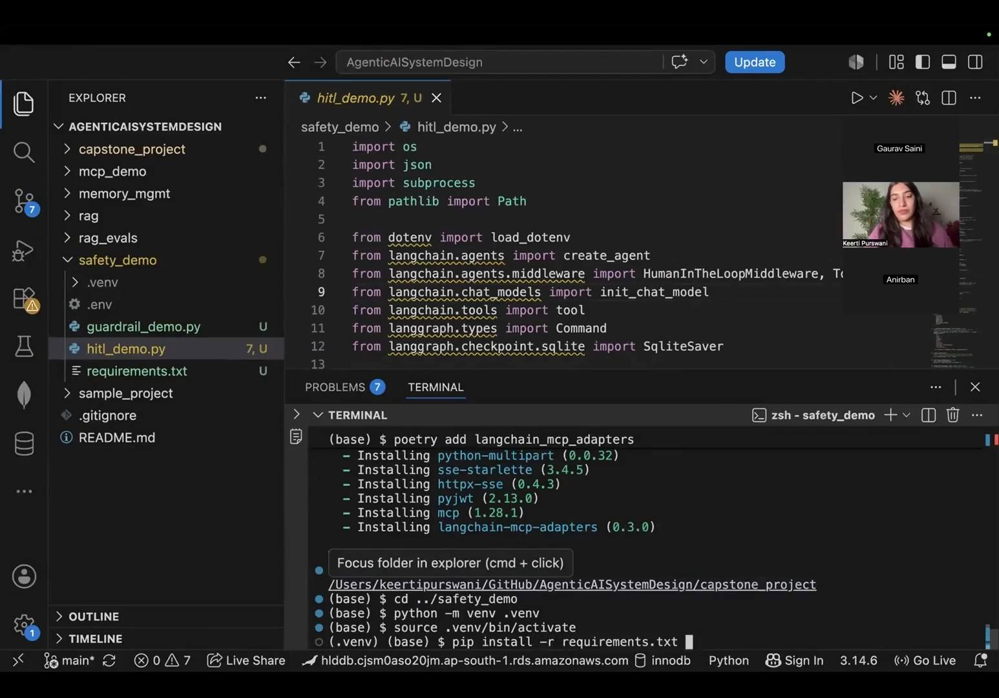
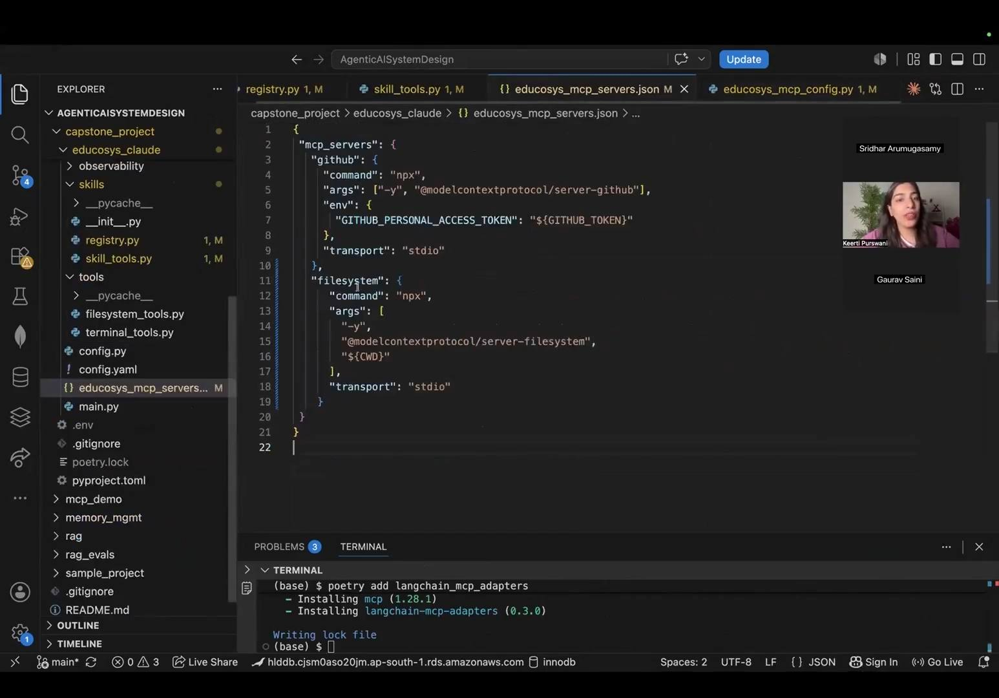
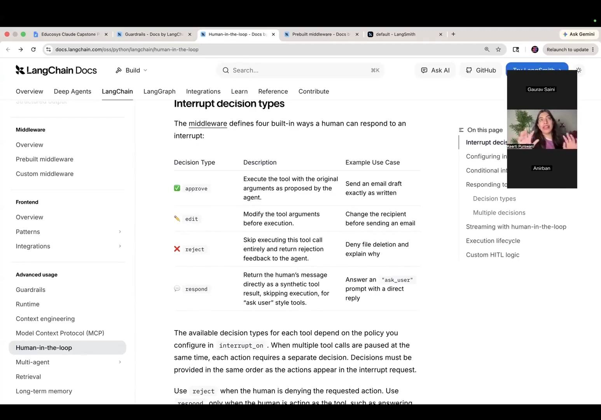
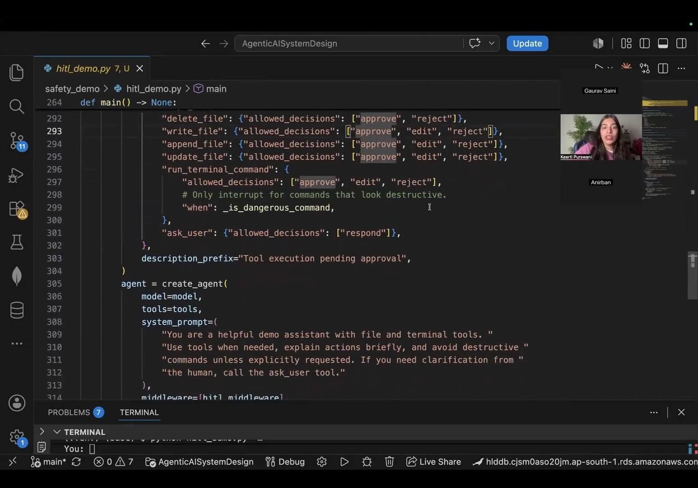

# Agentic AI System Design（p010）复现文档：Skills 加载、Filesystem MCP 与 Human-in-the-Loop

---

## 1. 这一节做什么

p010 这一节把前面几节课的「Claude Code 山寨版」项目往前推了三步，同时开了一个新主题。按实现顺序，它做了四件事：

1. **修掉上一节留下的两个 bug，并把 skills 真正跑通。**
   昨天的 bug 是：把 MCP 改成 async 时顺手把 DB 路径改到了 `.edu-courses` 下面，而且从 Google Doc 里贴了旧代码；另外 `.memory` 目录不存在时程序没有自己创建。修完之后，讲师用一个**全新的空文件夹**启动 `edu-courses` CLI，让它自动生成 `.edu-courses/`、`chroma_db/`、`memory/`，然后跑 `ask "create a to-do app using HTML CSS JavaScript"`，先看「没有 skill 时 UI 有多丑」，再装上 `frontend-design` skill 跑第二轮，对比效果。
2. **把「自己写的 filesystem tools」换成官方 Filesystem MCP Server。**
   理由：后面要做 long running task、要生成很复杂的目录和文件结构，自己写的那套 `read_file / write_file` 不够用。改法只有一处：在 MCP 的 JSON 配置里，在 GitHub server 后面加一个逗号，再加一个 server。这里有两个坑——必须显式写 `transport: stdio`，以及 allowed directory 必须跟着**当前项目目录**走，所以要在加载 JSON 的那层 config 里把路径替换成 `cwd`。
3. **复习 middleware，并把它抬成今天的主角概念。**
   middleware 就是在「进 agent 之前、进模型之前、调工具之前」插一段自己的逻辑；课里已经用过三种：模型调用次数限制、工具调用次数限制、summarization（短期记忆压缩）。框架（LangChain / LangGraph / Google ADK）已经预置了一批 middleware，其中就包括安全相关的。
4. **正式讲 Human-in-the-Loop（HITL）。**
   这是本节篇幅最大、也最需要照着复现的部分：什么场景要人批准（破坏性任务、从外部下载依赖、支付、任何重大操作）；中断插在「模型已经决定要调哪个工具、但工具还没执行」这一刀上；人类四种决策 approve / edit / reject / respond；**为什么必须配 checkpointer（memory）**；**每个工具可以有自己的一套 allowed decisions**；**条件中断**（函数返回 true/false，比如只读 SELECT 放行、写库和 `rm/format/shutdown` 才拦）；最后用 `safety-demos` 这个独立项目跑通两个真实案例（建文件→approve，删文件→reject），并在 LangSmith 里看到那个 `interrupt` 节点。

> 说明：本节是连续项目的第 10 页，`edu-courses` 这个 CLI 本体是前几节课写出来的，本页只改了它的 **MCP 配置**和 **skills 目录**。所以本文档分成两块可复现单元：
> - **单元 A（依赖前置项目）**：skills + MCP 的改动，照着改你已有的 `edu-courses` 项目；
> - **单元 B（完全独立可跑）**：`safety-demos` 里的 HITL 演示，从空文件夹开始就能跑起来。
>
> 第 4 节里凡是讲师没有逐字投在屏幕上、由我按他的口述重建的代码，都会在该代码块上方明确标注。

---

## 2. 讲师原话

**关于「该学什么、不该纠结什么」：**

> "框架变得非常快。你去打开 LangChain 一年前那个视频对应的文档，会发现完全不一样了。因为连这些公司自己都有巨大压力要跟上行业。我本人跟 Google ADK 团队聊过，跟真正写文档的人聊过，他们说：API 一定会变，但概念不会变。"
> —— p010 [02:46]

> "所以整个课程我更关注概念。你用的是哪个包、哪个框架、格式怎么写，真的不重要。语法不重要，你有没有理解概念才重要。"
> —— p010 [03:14]

> "不要纠结用哪个模型，模型会变。在 agentic system design 里，你要关注的是整个系统，而不是模型本身、不是 Python 语法、不是框架本身。"
> —— p010 [03:43]

**关于 MCP 复习与 MCP vs Skills：**

> "如果很多公司都在暴露自己的工具，而我要用别人的工具，我应该遵循什么标准协议？MCP。那我的应用在 MCP 里叫什么？叫 MCP host。我负责创建 client，每个 client 和 server 是一对一连接。如果我要再加一个 server，要改什么？只改 JSON 文件，加一个 server 就行。"
> —— p010 [04:10]

> "MCP 和 skills 有关系吗？没有。MCP 是使用工具的协议、是标准；skills 是给重复性任务用的，它就是一堆指令放在一个文件夹里。"
> —— p010 [05:07]

**关于昨天那两个 bug：**

> "昨天我犯的错其实和短期记忆完全无关：因为我们在用 MCP，我得把它改成 async，改的时候我顺手把 DB 路径也改了——路径在 config 里，我改成它应该在 `.edu-courses` 里面——然后我又从 Google Doc 里贴了旧的文档、旧的代码，所以它跑不起来。另一个错是：`.memory` 如果不存在，代码应该自己创建它。就那一行有问题，我已经改了。"
> —— p010 [06:02]

**关于 skills 的行业标准：**

> "标准是：建一个文件夹，文件夹里建一个 `SKILL.md`。这是整个行业暴露 skill 的方式。代码里会先看到那三个横线（`---`），从里面取 metadata，剩下的就是 body。metadata 里抽出 name 和 description，一开始只把这两个发给模型；等 `load_skill` 被调用，再把全文发过去。"
> —— p010 [11:44]

> "怎么知道要去搜 skill？因为我们内部加了一个工具。你看，frontend design 被选中了，整个内容被加载并发出去。前面发的是什么？工具里有 search codebase、search code，这是 system prompt，`load_skill`、`run_command` 全都在。`load_skill` 的作用是：按名字加载某个 skill 的指令。那有哪些 skill 可用？它会把整个列表提取出来发过去。"
> —— p010 [13:38]

**关于 Filesystem MCP 的两个坑：**

> "在 MCP 里我们必须告诉它在哪里跑，怎么告诉？用 transport。如果你忘了这一步，运行时会直接报错，说你没有指定 transport。所以这里写 transport: stdio。"
> —— p010 [20:11]

> "这里还有一个更细的点。我会在不同项目里跑 edu-courses，我要的文件系统权限是那个项目的权限。你给 filesystem 授权是授某一个目录，但我希望授的是「你当前在哪个项目就授哪个」。所以我在加载 server JSON 的 config 里，把路径替换成 cwd，就这样。"
> —— p010 [21:09]

**关于 middleware：**

> "当时我们的循环花了太多 tool call、太多 model call、太多 token，我们加了什么？加了 middleware，限制工具调用次数和模型调用次数。还有一次 middleware 是用在哪？summarization——消息太多时做摘要。"
> —— p010 [26:17]

> "middleware 是个很重要的概念：在进 agent 之前、进模型之前、调工具之前，做点自己的事，调个函数。"
> —— p010 [26:45]

**关于 HITL 的适用场景与术语：**

> "很多场景需要人介入，尤其是破坏性任务，比如删除；或者任何外部任务——从网上下载库；或者支付；或者任何你认为需要人批准的重大操作。所有这些关键任务、破坏性任务，都应该接进工作流。"
> —— p010 [28:37]

> "面试里请把这些术语用对。关键任务（critical task）、破坏性任务（destructive task）——概念大家都懂，但你在 45 分钟里把术语用准，是加分的。"
> —— p010 [29:06]

**关于中断插在哪、为什么必须有 memory：**

> "Human-in-the-loop 这个 middleware 的作用是：暂停执行，等人类批准工具调用。工具调用才是真正采取动作的地方，所以暂停就专门卡在工具调用这一步。"
> —— p010 [31:26]

> "你查一下文档就会发现，他们写了：你必须配置 checkpointer，必须有 memory，否则 human in the loop 用不了。没有 memory，human in the loop 根本不工作。这非常合理——因为人类的决策返回给 LLM 时，LLM 得知道之前发生了什么。"
> —— p010 [39:23]

> "有些工具我想给 approve / reject，有些工具我想给 approve / edit / reject，有些工具我想给 respond。所以人类能做的决策是逐个工具决定的，不是每个工具都必须有全部选项。"
> —— p010 [40:18]

**关于条件中断：**

> "还有一种情况：只在满足某个条件时才要人批准。写法就是一个函数，返回 true 或 false。比如：暂停那些不是只读 SELECT 的 SQL。只读查询就放行，写查询就必须人批准。或者：写到工作区之外，就要人批准。"
> —— p010 [45:52]

**关于怎么恢复中断：**

> "这是 LangGraph 特有的写法，但不用太担心：invoke 的时候要带上 version='v2' 这个 config。重点是他们说了恢复长什么样。"
> —— p010 [47:18]

> "你 `agent.invoke` 的时候，必须传一个 command，在里面说明这些就是决策。这就是它们期望的格式：你从这里恢复你的审批、恢复你的整个 workflow。所以我们的代码里，`handle_interrupts` 最后做的就是再发一次 agent 调用，把 command 和决策传进去。这就是为什么 memory 在这里极其重要。"
> —— p010 [63:30]

> "每当我们中断，我们就结束了第一次 invoke，然后再做一次 invoke。所以 human in the loop 里必须有 memory。"
> —— p010 [67:09]

---

## 3. 从零复现

### 3.0 环境前提

| 项 | 要求 | 备注 |
|---|---|---|
| Python | 3.11+（3.10 也可，但别用 3.9 以下） | `python --version` |
| Node.js | 18+，需要能用 `npx` | Filesystem / GitHub MCP server 都用 npx 拉起 |
| OpenAI API Key | 能用 `gpt-4o-mini` 级别的模型即可 | 课里讲师用的是转写成 "GPT-5 nano / GPT-5.5" 的模型，**具体模型名以你账号可用为准** |
| LangSmith | 可选但强烈建议 | 讲师全程用它看 trace；你要看到那个 `interrupt` 节点就得开 |
| Docker | 可选 | 讲师说 filesystem MCP 也可以「用 docker 跑」，本课走的是 npx 路线 |

---

### 3.1 单元 A：把 skill 装上，把 filesystem MCP 接上

#### Step A1 — 建 skills 目录

`skills` 放在哪，完全由项目 config 决定。讲师原话：config 里写的是 `.edu-courses/skills`，所以 skill 必须建在**这个目录下面**，不是随便找个地方放。

```bash
# 在项目根目录（讲师管它叫 capstone project）执行
mkdir -p .edu-courses/skills/frontend-design
```

目录形态必须严格是「**一个 skill 一个文件夹，文件夹里一个 `SKILL.md`**」，这是行业标准，不是本项目自创。

```bash
# Windows PowerShell 等价写法
New-Item -ItemType Directory -Force .edu-courses\skills\frontend-design
```

#### Step A2 — 写入 `SKILL.md`

内容结构固定三段式：`---` 包住的 YAML front matter（至少 `name` 和 `description`），`---` 之后全是 body（给模型看的指令正文）。

完整内容见第 4.3 节。讲师的做法是「literally just copy and paste」——从现成的 frontend design skill 里整段复制。你没那个文件的话，用第 4.3 节我给的等价版本。

#### Step A3 — 清掉旧产物再跑一轮（对照组）

讲师先把上一轮生成的 `index.html` 之类全删了，然后跑 **不带 skill** 的版本做对照：

```bash
# 注意：这个命令属于前几节课写出来的 edu-courses CLI，本页没有展示它内部实现
edu-courses ask "create a to-do app using HTML CSS JavaScript"
```

你应该看到的现象（讲师的原话复述）：
- 命令会跑很久（讲师原话：`it's going to take some time`）；
- 打开 LangSmith 能看到它在 `search codebase` → 列目录 → 反复检查某个文件是否存在，讲师一度怀疑是死循环；
- 最后**居然成功了**，但 UI 很差。讲师把这归因于模型：早先用的是转写为 "GPT 4.0" 的模型所以很丑，这一轮换成更强的模型后「fairly decent, not bad」；
- 成本：讲师说这一轮「just spent $0.2」。

#### Step A4 — 装上 skill 再跑一轮（实验组）

```bash
edu-courses ask "create to-do app using HTML CSS JavaScript with a nice frontend"
```

关键词是 **with a nice frontend**——这句才让它去匹配 `frontend-design` 这个 skill 的 description。

预期在 LangSmith 里看到的链路（讲师逐个指过）：
1. `search_codebase`（先看仓库里已有什么）
2. 模型决定调 `load_skill`，参数是 `frontend-design`
3. middleware / tool 把 `SKILL.md` 全文塞进上下文
4. 开始写文件：列文件、写文件、`run_command`（跑 CSS 之类）
5. 最终回复「everything is done」

结果：UI 明显变好，增删改查都能用。讲师的原话是「This is how easy it is to use skills」。

> **关键点复述**：模型并不是一开始就看到 `SKILL.md` 全文的。system prompt 里只放了「有哪些 skill + 每个 skill 的 name 和 description」；全文是靠 `load_skill` 这个工具在需要时才拉进来的。这就是 skill 的加载机制，也是它比一股脑塞 prompt 省钱的原因。

#### Step A5 — 改 MCP 配置，接上 Filesystem MCP

打开项目里的 MCP JSON 配置文件（讲师叫它 `server.json` / MCP config），在 GitHub server 后面**加一个逗号**，再加一段 filesystem：

```jsonc
{
  "mcpServers": {
    "github": { "...": "原有配置，token 走环境变量" },
    "filesystem": {
      "transport": "stdio",
      "command": "npx",
      "args": ["-y", "@modelcontextprotocol/server-filesystem", "${CWD}"]
    }
  }
}
```

两个必做动作：

1. **`"transport": "stdio"` 不能漏。** 讲师原话：忘了这步，运行时直接报错说没指定 transport。
2. **allowed directory 用 `${CWD}` 占位**，然后在**加载这份 JSON 的那层 config 代码**里把它替换成当前工作目录（`os.getcwd()`）。讲师特意点出：那个 config 文件本来只干两件事——加载 JSON、替换环境变量；现在多干第三件——替换 CWD。

完整 `config.json` 见 4.1，加载器见 4.2。

#### Step A6 — 验证 MCP 接上了

跑一次 `edu-courses ask "create a to-do app using HTML CSS JavaScript with a nice frontend"`，然后在 LangSmith 的 system prompt 里确认工具列表里出现了 filesystem MCP 提供的这些工具：

`read_text_file`、`read_media_file`、`read_multiple_files`、`write_file`、`get_file_info`、`list_allowed_directories`

讲师原话：这套 MCP「已经帮你把这些都处理好了」，所以比自己写 `read_file / write_file` 更稳，尤其是长任务。

---

### 3.2 单元 B：`safety-demos` —— Human-in-the-Loop 完整可跑项目

这一段是**全新的空文件夹**，跟前置项目无关，可以独立复现。

#### Step B1 — 建目录、建虚拟环境

讲师强调他特意**不在 capstone project 里跑**，而是另建了一个 `safety-demos`，并给它单独建了虚拟环境：

```bash
mkdir safety-demos
cd safety-demos

python -m venv .venv

# macOS / Linux
source .venv/bin/activate
# Windows PowerShell
# .venv\Scripts\Activate.ps1
```



#### Step B2 — 装依赖

```bash
pip install -r requirements.txt
```

`requirements.txt` 里课里点名的是：`langchain`、`langchain-openai`、`python-dotenv`，以及**做 checkpointer / memory 用的那个包**（讲师原话：「This is important for memory, for checkpoint」）。完整内容见 4.4。

#### Step B3 — 写 `.env`

```ini
OPENAI_API_KEY=sk-xxxxxxxx
MODEL_NAME=gpt-4o-mini

# 想在 LangSmith 里看 interrupt 节点就打开这三行
LANGCHAIN_TRACING_V2=true
LANGCHAIN_API_KEY=lsv2_xxxxxxxx
LANGCHAIN_PROJECT=safety-demos
```

> 课里没有念出 LangSmith 的具体环境变量名（讲师只是说「let's see in LangSmith what is happening」）。上面三行是 LangSmith 官方常用写法，你按自己控制台给的 key 填。

#### Step B4 — 跑起来

```bash
python hitl_demo.py
```

#### Step B5 — 第一个案例：建文件 → approve

```
你: create a file binary_search.cpp and add C++ demo code in my present directory
```

预期：模型先调 `list_files` 看目录，然后提出 `write_file(binary_search.cpp, <整段 C++ 代码>)`，**此时流程卡住**，终端打印出待执行工具名、参数（整段代码）、允许的决策（`['approve','edit','reject']`）。

输入 `approve` → 文件被创建。讲师现场看到的效果：

- `binary_search.cpp` 出现在当前目录；
- 还出现了一个 `.data` 目录（SQLite checkpointer 的落盘位置，讲师原话「where the memory is also there, which is fine」）；
- 助手回复「everything is done」。

成本与模型：讲师说他用的是转写为 "GPT five nano" 的模型，产出「of course this could have been better，但你懂意思就行」。

#### Step B6 — 第二个案例：删文件 → reject

```
你: delete this file
```

注意两点，都是讲师当场指出的：

1. **不用再说文件名。** 因为有 memory（checkpointer），上下文还在，模型知道「this file」是哪个。
2. **这次的 allowed decisions 只有 approve 和 reject，没有 edit。** 讲师原话：建文件时 edit 有意义（因为有代码可以改），删文件时 edit 没有意义。

输入 `reject` → 终端要求填拒绝原因 → 填「I don't want to give permission」→ 文件**没有被删**。

> 有个小插曲值得记下来：讲师原本说「删除时只给 approve/reject」，有学员在 chat 里说「delete 也显示了 edit」。讲师当场用 demo 复现反驳了——他指的是那个「请输入决策或原因」的提示文本是他自己硬编码的提示语，不是 `edit` 这个决策选项。也就是说：**屏幕上出现 "edit" 这个词 ≠ 这个工具允许 edit 决策**，要看 `allowed_decisions` 列表。

#### Step B7 — 在 LangSmith 里确认 interrupt

打开对应 trace，按时间戳找到这次会话，你会看到：

- 输入是那句 create a binary search 的需求；
- 依次是 `list_files` 之类的工具节点；
- 然后是 **human-in-the-loop middleware 节点**；
- 节点里有一个 **`interrupt`**，内容就是发给人类的那条消息（工具名 + 参数 + 描述 + allowed decisions）；
- 你 approve 之后，又发生了一次 invoke，流程继续往下跑。

讲师原话：这个 `interrupt` 就是文档里说的那个 interrupt，跟我们看到的一模一样。第二次删除请求时同样会再出一次 interrupt。

---

## 4. 完整代码

### 4.0 目录结构

```
<项目根>/
├── config.json                      # MCP servers（GitHub + Filesystem）
├── mcp_config.py                    # 加载 config.json，替换 ${ENV} 和 ${CWD}
├── .env                             # GITHUB_TOKEN / OPENAI_API_KEY ...
└── .edu-courses/
    ├── skills/
    │   └── frontend-design/
    │       └── SKILL.md             # 一个 skill 一个文件夹，里面一个 SKILL.md
    ├── chroma_db/                   # config 里 vector_store=chroma 时自动生成
    └── memory/

safety-demos/                        # 独立项目，单独虚拟环境
├── .venv/
├── .env
├── requirements.txt
├── hitl_demo.py
└── .data/                           # 运行时自动创建，SQLite checkpointer 落盘
    └── hitl.db
```

### 4.1 `config.json`（MCP servers）

> **标注**：讲师在屏幕上展示过这段配置的分段内容（github 段已有、filesystem 段是这次新加的、`transport` 那行是重点、`${CWD}` 是他自己加的占位），但**没有逐字贴出整份 JSON**。下面是按他口述重建的可运行版本，字段名如 `mcpServers` / `args` 以你实际安装的 MCP client 为准。

```json
{
  "mcpServers": {
    "github": {
      "transport": "stdio",
      "command": "npx",
      "args": ["-y", "@modelcontextprotocol/server-github"],
      "env": {
        "GITHUB_PERSONAL_ACCESS_TOKEN": "${GITHUB_TOKEN}"
      }
    },
    "filesystem": {
      "transport": "stdio",
      "command": "npx",
      "args": [
        "-y",
        "@modelcontextprotocol/server-filesystem",
        "${CWD}"
      ]
    }
  }
}
```

Windows 上如果 `npx` 直接拉起报 `ENOENT`，改成：

```json
    "filesystem": {
      "transport": "stdio",
      "command": "cmd",
      "args": ["/c", "npx", "-y", "@modelcontextprotocol/server-filesystem", "${CWD}"]
    }
```

（这个 Windows 写法课里没讲，见第 7 节。）

### 4.2 `mcp_config.py`（加载 JSON + 替换 env + 替换 CWD）

> **标注**：讲师说这个 config「本来只负责加载这个 JSON、替换环境变量」，这次「多了一件事，把 CWD 也替换成当前路径」。**具体实现他没逐字展示**。下面是按这段描述重建的最小可运行版本。

```python
"""
mcp_config.py
职责：读 config.json -> 替换 ${ENV_VAR} 和 ${CWD} -> 返回 dict 给 MCP client 用。
"""
import json
import os
from pathlib import Path


def load_mcp_config(path: str = "config.json") -> dict:
    raw = Path(path).read_text(encoding="utf-8")

    # 1) 先替换 ${CWD}：当前工作目录（也就是"你人在哪个项目里，就给哪个项目授权"）
    raw = raw.replace("${CWD}", os.getcwd())

    # 2) 再替换 ${GITHUB_TOKEN} 这类环境变量占位符
    for key, value in os.environ.items():
        raw = raw.replace("${" + key + "}", value)

    config = json.loads(raw)

    # 3) 兜底检查：每个 server 必须有 transport，否则运行时会报"没有指定 transport"
    for name, server in config.get("mcpServers", {}).items():
        if "transport" not in server:
            raise ValueError(f"MCP server `{name}` 缺少 transport 字段")
        if "${" in json.dumps(server, ensure_ascii=False):
            raise ValueError(f"MCP server `{name}` 还有没被替换的占位符，检查 .env")

    return config


if __name__ == "__main__":
    print(json.dumps(load_mcp_config(), indent=2, ensure_ascii=False))
```

### 4.3 `.edu-courses/skills/frontend-design/SKILL.md`

> **标注**：讲师说「literally just copy and paste」——从现成的 frontend design skill 整段复制，**没有在课上念出正文**。下面是"能复现出同样效果"的等价版本，正文你可以换成任何你喜欢的写法，只要保持「`---` + name/description + `---` + body」这个结构。

```markdown
---
name: frontend-design
description: Use this skill whenever the user asks for a UI, a landing page, a dashboard, a to-do app, or any HTML/CSS/JS front end. It produces a modern, polished, responsive design instead of a bare-bones one.
---

# Frontend Design

When you build any front end, follow these rules.

## Layout
- Use a 12-column mental grid. Never let content touch the viewport edge; keep at least 24px padding.
- One clear focal point per screen. Do not center everything.
- Use a max-width container (e.g. 1100px) and center it.

## Typography
- One font family for UI, at most one display font.
- Type scale: 12 / 14 / 16 / 20 / 24 / 32 / 48.
- Line height 1.5 for body, 1.2 for headings.
- Never use pure black on pure white; use #111 on #fafafa.

## Color
- Pick one accent color and use it only for primary actions and active states.
- Neutral palette: one background, one surface, one border, two text tones.
- Support light and dark via CSS variables.

## Components
- Buttons: 8px radius, clear hover and focus-visible states, disabled state at 40% opacity.
- Inputs: label above, hint below, error in red with an icon.
- Lists: empty state must be designed, not an empty white box.
- Every interactive element needs `:hover`, `:focus-visible`, and a transition of 120-200ms.

## Motion
- Only animate opacity and transform. Nothing else.
- 150ms ease-out for enters, 100ms for exits.

## Output
- Single self-contained index.html unless the user asks for a framework.
- No placeholder lorem ipsum in the final output: use realistic sample data.
```

### 4.4 `safety-demos/requirements.txt`

> **标注**：讲师点名了 `langchain`、`langchain-openai`、`python-dotenv`，以及"做 checkpoint/memory 的那个包"。**版本号课里没讲**，下面不锁版本；用 `pip freeze` 记你自己的版本。

```txt
langchain
langchain-openai
langgraph
langgraph-checkpoint-sqlite
python-dotenv
```

### 4.5 `safety-demos/.env.example`

```ini
OPENAI_API_KEY=sk-replace-me
MODEL_NAME=gpt-4o-mini

LANGCHAIN_TRACING_V2=true
LANGCHAIN_API_KEY=lsv2-replace-me
LANGCHAIN_PROJECT=safety-demos
```

### 4.6 `safety-demos/hitl_demo.py`（本节主文件，可直接运行）

> **标注**：**讲师在这一节里逐段走读了这个文件**（"So let's start from main"）：他确认了里面依次是「加载环境变量 → build model → build tools → memory/checkpointer（用 SQLite）→ 打印语句 → HumanInTheLoopMiddleware（逐工具 allowed decisions + 危险命令条件）→ create_agent 传 middleware 和 checkpointer → while 循环 → handle_interrupts 里再发一次带 decisions 的 invoke」。但**他没有逐字贴出完整源码，也没有 OCR 结果**。下面是严格按他口述重建、可直接运行的版本。凡是签名/键名可能随版本变的地方，代码里都加了 `# 以你安装的版本为准` 注释，第 7 节另有汇总。

```python
"""
safety-demos/hitl_demo.py
Human-in-the-loop 演示：
  1) 模型决定调工具 -> middleware 中断 -> 人类 approve / edit / reject / respond
  2) 人类的决策通过 Command(resume=...) 送回，第二次 invoke 继续跑
  3) 必须有 checkpointer（这里用 SQLite），否则中断没法恢复

运行：
    python hitl_demo.py
"""
import json
import os
import sqlite3
import subprocess
from pathlib import Path

from dotenv import load_dotenv
from langchain.agents import create_agent
from langchain.agents.middleware
import HumanInTheLoopMiddleware
from langchain_core.tools import tool
from langchain_openai import ChatOpenAI
from langgraph.checkpoint.sqlite import SqliteSaver
from langgraph.types import Command


# ---------- 1) 环境变量 & 模型 ----------
load_dotenv()

MODEL_NAME = os.getenv("MODEL_NAME", "gpt-4o-mini")
model = ChatOpenAI(model=MODEL_NAME, temperature=0)


# ---------- 2) 工具集 ----------
# 讲师原话：这里就是一堆工具，不同函数而已，没什么花哨的。
@tool
def list_files(directory: str = ".") -> str:
    """列出某个目录下的所有文件（不含子目录递归）。"""
    p = Path(directory)
    if not p.exists():
        return f"目录不存在: {directory}"
    return "\n".join(sorted(x.name for x in p.iterdir()))


@tool
def read_file(path: str) -> str:
    """读取一个文本文件的全部内容。"""
    return Path(path).read_text(encoding="utf-8")


@tool
def write_file(path: str, content: str) -> str:
    """写入（覆盖）一个文件。文件不存在时创建。"""
    Path(path).parent.mkdir(parents=True, exist_ok=True)
    Path(path).write_text(content, encoding="utf-8")
    return f"已写入 {path}（{len(content)} 字符）"


@tool
def append_file(path: str, content: str) -> str:
    """在文件末尾追加内容。"""
    with open(path, "a", encoding="utf-8") as f:
        f.write(content)
    return f"已追加到 {path}"


@tool
def update_file(path: str, old: str, new: str) -> str:
    """把文件里的一段旧文本替换成新文本。"""
    text = Path(path).read_text(encoding="utf-8")
    if old not in text:
        return f"未在 {path} 中找到要替换的文本"
    Path(path).write_text(text.replace(old, new), encoding="utf-8")
    return f"已更新 {path}"


@tool
def delete_file(path: str) -> str:
    """删除一个文件。这是破坏性操作。"""
    p = Path(path)
    if not p.exists():
        return f"文件不存在: {path}"
    p.unlink()
    return f"已删除 {path}"


@tool
def run_terminal_command(command: str) -> str:
    """在当前目录执行一条 shell 命令，返回 stdout + stderr。"""
    proc = subprocess.run(
        command,
        shell=True,
        capture_output=True,
        text=True,
        timeout=120,
    )
    out = (proc.stdout or "") + (proc.stderr or "")
    return f"exit={proc.returncode}\n{out[:4000]}"


@tool
def ask_user(question: str) -> str:
    """向人类提一个问题并等待回答。用于需要澄清时。"""
    return input(f"[ask_user] {question}\n> ")


tools = [
    list_files,
    read_file,
    write_file,
    append_file,
    update_file,
    delete_file,
    run_terminal_command,
    ask_user,
]


# ---------- 3) 危险命令判定（条件中断用的谓词） ----------
# 讲师原话：只要看到 rm、delete、format、shutdown、reboot 这类，就是危险命令、破坏性命令，
# 这种情况必须中断；其它终端命令可以直接放行。
# 注意：下面是朴素子串匹配，误伤说明见第 7 节。
DANGEROUS_KEYWORDS = [
    "rm", "delete", "del ", "format", "shutdown", "reboot",
    "mkfs", "dd if=", "> /dev/sda", "sudo",
]


def is_dangerous_command(tool_call: dict) -> bool:
    """返回 True = 需要人类批准；False = 直接放行。"""
    args = tool_call.get("args") or {}
    command = str(args.get("command", ""))
    lowered = command.lower()
    return any(k in lowered for k in DANGEROUS_KEYWORDS)


# ---------- 4) Memory / Checkpointer ----------
# 讲师原话：human in the loop 必须有 checkpointer，没有 memory 它根本不工作。
# 这里用 SQLite，落盘到 .data/hitl.db。check_same_thread=False 是因为同一进程里
# 可能在不同线程复用这个连接。
Path(".data").mkdir(exist_ok=True)
conn = sqlite3.connect(".data/hitl.db", check_same_thread=False)
checkpointer = SqliteSaver(conn)


# ---------- 5) Human-in-the-Loop middleware ----------
# 逐工具指定 allowed decisions。键是工具名，值是该工具允许的决策列表
# （键名 allowed_decisions / when 以你安装的版本为准，见第 7 节）。
hitl_middleware = HumanInTheLoopMiddleware(
    interrupt_on={
        # 破坏性操作：只能批准或拒绝，不允许改参数（改一个 rm 命令没有意义）
        "delete_file": {
            "allowed_decisions": ["approve", "reject"],
            "description": "tool execution pending",
        },
        # 有产出物的操作：允许编辑，因为人类可能想改代码内容
        "write_file": {
            "allowed_decisions": ["approve", "edit", "reject"],
            "description": "tool execution pending",
        },
        "append_file": {
            "allowed_decisions": ["approve", "edit", "reject"],
            "description": "tool execution pending",
        },
        "update_file": {
            "allowed_decisions": ["approve", "edit", "reject"],
            "description": "tool execution pending",
        },
        # 终端命令：只在危险命令时中断（条件中断）
        "run_terminal_command": {
            "allowed_decisions": ["approve", "reject"],
            "when": is_dangerous_command,
            "description": "tool execution pending",
        },
        # 只读类工具：不需要任何人工检查
        "list_files": False,
        "read_file": False,
        "ask_user": False,
        "is_dangerous_command": False,
    }
)


# ---------- 6) 建 agent：middleware + checkpointer 一起传进去 ----------
agent = create_agent(
    model=model,
    tools=tools,
    middleware=[hitl_middleware],
    checkpointer=checkpointer,
)


# ---------- 7) 中断处理：把人类的决策组好，再发一次 invoke ----------
def handle_interrupts(result: dict, config: dict) -> dict:
    """
    讲师原话：只要发生中断，第一次 invoke 就结束了，我们要再做一次 invoke。
    所以这里做的唯一一件事，就是按它们期望的格式组好 decisions，然后 Command(resume=...)。
    """
    interrupts = result.get("__interrupt__") or []
    if not interrupts:
        return result

    decisions = []

    for intr in interrupts:
        value = getattr(intr, "value", intr) or {}
        requests = value.get("action_requests", []) if isinstance(value, dict) else []

        for req in requests:
            tool_name = req.get("name") or req.get("tool", "unknown")
            args = req.get("args", {})
            allowed = req.get("allowed_decisions", ["approve", "reject"])

            print("\n" + "=" * 60)
            print(f"[待执行工具] {tool_name}")
            print(f"[参数] {json.dumps(args, ensure_ascii=False, indent=2)}")
            print(f"[允许的决策] {allowed}")
            print("=" * 60)

            choice = input("decision (approve/edit/reject/respond) 或直接写原因 > ").strip()

            # 讲师补过一句：屏幕上那行「decision or reason」是他硬编码的提示文本，
            # 出现 "edit" 这个词不代表这个工具允许 edit 决策，要看 allowed 列表。
            picked = choice.lower()

            if picked == "approve" and "approve" in allowed:
                decisions.append({"type": "approve"})

            elif picked == "reject" and "reject" in allowed:
                reason = input("为什么拒绝？> ").strip()
                decisions.append({"type": "reject", "message": reason})

            elif picked == "edit" and "edit" in allowed:
                edited_raw = input("编辑后的参数（JSON）> ").strip()
                decisions.append(
                    {
                        "type": "edit",
                        "edited_action": {
                            "name": tool_name,
                            "args": json.loads(edited_raw),
                        },
                    }
                )

            elif picked == "respond" and "respond" in allowed:
                message = input("你要补充的内容 > ").strip()
                decisions.append({"type": "respond", "message": message})

            else:
                # 兜底：用户输入不合法或该工具不允许这个决策，一律按拒绝处理
                print(f"`{choice}` 不是该工具允许的决策，按 reject 处理。")
                decisions.append(
                    {"type": "reject", "message": f"invalid decision: {choice}"}
                )

    # 关键一步：带着 decisions 再 invoke 一次，流程从这里恢复
    # （有的版本要求包一层 {"decisions": [...]}，按报错提示改即可）
    return agent.invoke(Command(resume=decisions), config=config)


# ---------- 8) 主循环 ----------
def main() -> None:
    # thread_id 决定"这一段记忆属于哪个会话"；version="v2" 是新中断协议的开关
    config = {
        "configurable": {"thread_id": "demo-thread-1"},
        "version": "v2",
    }

    print("输入 exit / quit 退出。试试：create a file binary_search.cpp and add C++ demo code")

    while True:
        query = input("\n你: ").strip()
        if query.lower() in {"exit", "quit", ""}:
            break

        result = agent.invoke(
            {"messages": [{"role": "user", "content": query}]},
            config=config,
        )

        # 可能连续多次中断（模型一次提了多个工具调用），所以要循环处理
        while result.get("__interrupt__"):
            result = handle_interrupts(result, config)

        print("\nassistant>", result["messages"][-1].content)


if __name__ == "__main__":
    main()
```

---

## 5. 逐行解释

### 5.1 先说清两个单元的关系

这份文档里有两套东西：**单元 A** 改的是你已有的 `edu-courses` 项目（`config.json` + `.edu-courses/skills/`），**单元 B** 是一个全新的 `safety-demos` 项目。讲师之所以另开 `safety-demos`、另建一个虚拟环境，是因为他不想让演示污染 capstone 项目——原话是「right now I'm inside safety demo, I'm outside my capstone project. When we work in the project, I'm usually inside the capstone project, depending on what demo I'm showing you」。「按 demo 分环境」这个习惯本身值得抄，尤其是你后面要接 MCP、要装一堆 `langchain-*` 的时候。


这张是复习页。要点只有三句，但必须记住，因为后面加 filesystem server 全靠它：**应用叫 MCP host**；**host 负责创建 client，一个 client 对一条 server 连接，是一对一**；**要加一个新 server，改动只落在 JSON 配置里**。讲师就是用「加一个 server 只改 JSON」这句话直接过渡到 filesystem MCP 的。

### 5.2 `SKILL.md` 为什么长这样

`SKILL.md` 的结构不是随便定的，它对应着代码里的解析逻辑：

1. 文件开头三个横线 `---` 之间的部分是 **metadata（front matter）**，代码从里面取 `name` 和 `description`；
2. 第二个 `---` 之后的所有内容都是 **body**，也就是给模型看的指令正文；
3. **启动时只把 `name` + `description` 发给模型**（省 token），**body 要等 `load_skill` 工具被调用才发**。

讲师原话复述：「代码里会先看到那三个横线，然后从里面取 metadata，剩下的就是 body；metadata 里抽出 name 和 description，一开始只把这个发给模型，后面才把全部发过去。」

所以你的 `description` 写得好不好，直接决定模型**会不会**去调 `load_skill`。讲师那次能触发 skill，是因为他 prompt 里带了 **with a nice frontend** 这类词；如果 description 里只有「前端设计」四个字而没有触发词，模型很可能压根不去查。

### 5.3 `mcp_config.py` 里那三行的顺序

1. **先替换 `${CWD}`，再替换 env。** 顺序其实无所谓（`${CWD}` 是自定义占位符，不会跟环境变量撞），但讲师强调的重点是「这个 config 文件本来只干加载 JSON 和替换 env 两件事，现在多干第三件事：把 CWD 也替换掉」。
2. **`os.getcwd()` 取的是「你人现在在哪个目录」，不是配置文件所在目录。** 这就是讲师说的「我在哪个项目里跑 edu-courses，就给哪个项目开文件权限」。换成 JS/Node 的说法：等价于 `process.cwd()`，**不是** `__dirname`——这点在 Node 里踩过坑的人会立刻懂，两者完全不同。
3. **兜底校验必须有。** 讲师点名的第一个坑就是「忘了写 transport，运行时会直接报错说没指定 transport」。与其等 MCP client 报一句看不懂的错，不如在加载阶段就抛 `ValueError`。



### 5.4 为什么要换成 Filesystem MCP

讲师给的理由很实在：**自己写的那套 `read_file / write_file` 在后面做长任务时「not going to perform that well」**。而官方 MCP server 已经把 `read_text_file / read_media_file / read_multiple_files / write_file / get_file_info / list_allowed_directories` 这些全做了，包括你没空处理的边界情况。这也是个通用的工程判断：**文件系统这类「基础能力」，不要自己造轮子**。

讲师还留了余地：「你继续用自己的 filesystem 工具也行，我只是觉得这个有意思，演示一次。」

### 5.5 HITL 的流程推导（这是本节的骨架）

讲师让大家先别看文档、自己想「如果让你实现 HITL 你会怎么做」，然后把现在的流程一步步写出来：

1. 用户 query 进来；
2. **query + 工具列表**一起发给 LLM；
3. LLM 说「应该调用 X 工具」；
4. **← 中断插在这里**（工具还没执行）；
5. 人类响应；
6. 把工具结果发回 LLM；
7. LLM 出最终回复，返回给用户。

第 2–3 步是**框架**帮你做的（现在的 `create_agent`）。所以 middleware 只要负责第 4–6 步，而它要干三件事：**① 检测中断；② 读取人类响应；③ 根据响应决定下一步**。讲师的原话是「这逻辑很简单，你完全可以自己写出来，但看看框架是怎么处理的会更有意思」。


### 5.6 四种决策，每个工具可以不一样

- **approve**：批准，原样执行。讲师举例：「这份邮件草稿看起来不错，发吧。」
- **edit**：改参数再执行。讲师举例：「不行，我要改这封邮件。」
- **reject**：不执行，而且**拒绝理由会回传给 LLM**（所以 LLM 下一轮能学到东西）。
- **respond**：不执行工具，改为让人类直接给一段回复/补充信息。讲师举的例子是让人类选技术栈：「这个项目要用 HTML/CSS，还是 Next.js/React，你可以在这里选。」

**关键规则：每个工具的 allowed decisions 是独立配置的，不是一刀切。** 讲师原话：「对于某些工具我只想 approve/reject，对于某些工具我想 approve/edit/reject，对于某些工具我想给 respond……这个决策是逐个工具决定的，不是每个工具都必须有全部选项。」代码里就是 `interrupt_on` 那个字典。



### 5.7 条件中断只有一个要求：返回 true/false

`is_dangerous_command` 是整个文件里最短、但概念最重的函数。讲师原话：「它就是一个函数调用，返回 true 或 false。比如：暂停那些不是只读 SELECT 的 SQL；如果是只读 SELECT，直接放行，如果不是（写查询），就必须人批准。或者：写到工作区之外，就要人批准。」

所以这个谓词**只管「要不要拦」，不管「拦下来给什么选项」**——选项在 `allowed_decisions` 里。两件事分开配，这是设计上的正确切分。

### 5.8 checkpointer：为什么它是硬性前提

讲师把这条当成「一定要记住」的点反复说了三次：**没有 checkpointer，HITL 不工作。**

原因是结构性的：中断发生时，**第一次 `invoke` 已经结束了**（函数返回了）；人类的决策到达时，程序要**再发一次 `invoke`** 才能继续。中间这段时间，agent 的状态（消息历史、走到哪一步、待执行的是哪个工具）必须存在某个地方——这就是 checkpointer。

> 在 JS/Node 里对应什么：把 checkpointer 理解成「会话存储」。`thread_id` 就是 session id；`SqliteSaver` ≈ 一个把 session 存到 SQLite 的 store；人类批准 ≈ 一个 `await` 在这里被 resolve。区别是 JS 里你会用一个 pending Promise 或者一个 DB 记录来暂存，LangGraph 帮你把「暂存 + 恢复」封在 checkpointer 里了。

讲师说「in-memory saver / async Postgres saver 都行」，他用 SQLite 是因为要演示「落盘」。跑完你会看到目录里多出一个 `.data/` ——讲师原话「where the memory is also there, which is fine」。

### 5.9 `create_agent` 只多两个参数

```python
agent = create_agent(model=model, tools=tools, middleware=[hitl_middleware], checkpointer=checkpointer)
```

就这两个：`middleware`（决定「拦不拦、拦下来给什么选项」）和 `checkpointer`（决定「拦下来之后靠什么恢复」）。其他全是前几节课已有的东西。

### 5.10 `handle_interrupts`：本节唯一「稍微 tricky」的地方

讲师原话：「main 里有一个 while 循环，一直在问用户；`agent.invoke` 之后，一旦发生中断，就在这个函数里处理中断——我们会再发一次 agent 调用，把 decisions 传进去。」

代码里干了三件事：

1. **读中断**：`result["__interrupt__"]`，里面每一条带 `action_requests`，每一条 request 里有工具名、参数、allowed decisions。讲师说的「它在 interrupts 里 basically 是一个 list，你可以看到 action request，里面有 tool name、有哪些 allowed decisions、参数是什么」，指的就是这个结构。
2. **组 decisions**：遍历每个 request；approve 就 append `{"type": "approve"}`；reject 就把**理由**带上；edit 就把**改后的参数**带上。讲师原话「如果 choice 是 approve 我就加进去；如果是 reject，我就把拒绝的理由、拒绝的决定加进去；如果是 edit，就加上编辑后的东西」。
3. **第二次 invoke**：`agent.invoke(Command(resume=decisions), config=config)`。讲师原话「他们期望决策以特定格式给出，你要把它组装出来……你的 workflow 就从这里恢复」。

还有一个容易漏的：`config` 里那个 **`version: "v2"`**。讲师明确说这是「framework specific cheese」——LangGraph 特有写法，以前不是这么处理的，现在必须带上。别自己发明格式，照文档抄。



### 5.11 两个工具细节

- **`ask_user`**：这个工具让模型可以反过来向人提问（`input()`）。讲师把它列在工具清单里，是为了后面「planner 需要人签字确认设计」那类场景做铺垫。
- **`run_terminal_command` 的 `timeout=120`**：这是重建时加的。课里没讲超时——但长任务里模型可能生成一条会挂住的命令，没有超时你的 demo 会永远卡着，见第 7 节。

---

## 6. 复现检查清单

### 单元 A（skills + Filesystem MCP）

- [ ] `.edu-courses/skills/frontend-design/SKILL.md` 存在，**第一行是 `---`**，metadata 里有 `name` 和 `description`。
- [ ] 删掉上一轮生成的 `index.html` 等产物，跑一次**不带 "nice frontend"** 的 prompt，确认基线效果（丑，但能跑）。
- [ ] 跑一次**带 "with a nice frontend"** 的 prompt，效果明显变好。
- [ ] LangSmith 里这次 trace 能按顺序看到：`search_codebase` → `load_skill`（参数是 `frontend-design`）→ 写文件 → `run_command` → 最终回复。
- [ ] system prompt 里确认存在 `load_skill`、`run_command`、`search_codebase`，且**只出现 name 和 description**，不是整份 SKILL.md。这是验证「先发元数据、后发全文」有没有生效的关键点。
- [ ] `config.json` 里 filesystem 段写了 `"transport": "stdio"`。
- [ ] `config.json` 里 filesystem 的目录参数是 `${CWD}`，且 `mcp_config.py` 里有 `.replace("${CWD}", os.getcwd())`。
- [ ] **换一个项目目录再跑一次**，确认 filesystem 权限跟着换了目录（这是讲师特意设计的「你在哪个项目就授哪个」）。如果不跟着走，说明你替换成了硬编码路径。
- [ ] LangSmith 的工具列表里能看到 `read_text_file / write_file / list_allowed_directories` 这类 MCP 提供的工具名。

### 单元 B（HITL）

- [ ] `python hitl_demo.py` 启动不报 import 错误（如果报 `HumanInTheLoopMiddleware` 找不到，见第 7 节第 2 条）。
- [ ] 输入 `create a file binary_search.cpp and add C++ demo code`。
- [ ] 终端出现 `[待执行工具] write_file`、`[允许的决策] ['approve', 'edit', 'reject']`、`tool execution pending`。
- [ ] 输入 `approve` → `binary_search.cpp` 出现在当前目录，`.data/hitl.db` 出现（该文件名以你的实现为准）。
- [ ] 输入 `delete this file`（**不写文件名**）→ 模型能理解指的是哪个文件。**如果它反问你是哪个文件，说明 checkpointer 没生效，回去查 `thread_id` 有没有在两次 invoke 之间保持一致。**
- [ ] 第二个中断的 `[允许的决策]` 是 `['approve', 'reject']`，**没有 edit**。
- [ ] 输入 `reject` + 填一个理由 → 文件**没有被删**，助手回复里能看到「因为你说不要删」这类内容（拒绝理由回传生效）。
- [ ] LangSmith trace 里能看到 `interrupt` 节点，并且 approve 之后有一次新的 invoke 从该点继续。
- [ ] （可选）把 `delete_file` 的 allowed decisions 改成 `["approve"]` 再跑，然后输入 `reject` —— 应该走到代码里的兜底分支打印「不是该工具允许的决策」。这验证了 allowed 列表**真的**在起作用，而不是摆设。

---

## 7. 课里没讲但你会撞上的

**1. `$0.2` 一次 demo，别在循环里乱按。** 讲师当场说「just spent $0.2」。他把「一轮生成」和「模型强弱」直接挂上了钩：同一句 prompt，弱模型很丑、强模型还行，但**强模型更慢更贵**。你在做对照实验时，建议固定模型、只改一个变量（有无 skill），否则你分不清是 skill 起效还是模型起效。

**2. `create_agent` / `HumanInTheLoopMiddleware` 是新的 API，签名会漂。** 讲师自己说了：「API 会变，概念不会变。」文件里 `interrupt_on` 的值的形态（`{"allowed_decisions": [...]}`、条件中断那个键叫 `when` 还是别的）、以及 `Command(resume=...)` 到底收一个 list 还是 `{"decisions": [...]}`，都可能随你 `pip install` 的版本变。**判据很简单**：如果启动就 `TypeError` / `ImportError`，去看你的版本对应的文档，别改代码逻辑；如果运行到 `handle_interrupts` 才报「resume 格式不对」，按报错提示把 list 包一层即可。讲师明确说过这个 API 以前不是这么处理的。

**3. MCP 会把你的 sync/async 打翻。** 讲师昨天的 bug 起因就是「因为我们在用 MCP，我得把它改成 async/sync」。MCP Python client 本质是异步的，所以一旦你的工具层要跟 MCP server 通信，很多函数就得改成 `async def`，或者用同步包装器桥接。**这是接 MCP 时最容易撞的第一堵墙。** 讲师那次改动还连带把 DB 路径改错、又从旧文档贴了旧代码——所以他强调：**改 async 的时候，一次只改一件事，改完立刻跑。**

**4. `.memory` 目录不存在时没人帮你建。** 讲师点名的第二个 bug：「如果 `.memory` 不存在，代码应该去创建它，就那一行有问题。」任何落盘类的东西（memory 目录、`.data` 目录、`chroma_db` 目录）都要在启动时 `mkdir(exist_ok=True)`，而不是等写的时候才炸。这份文档里 `mcp_config.py` 和 `hitl_demo.py` 都已经显式建了。

**5. `is_dangerous_command` 的子串匹配会误伤。** `"rm"` 会命中 `confirm`、`perform`、`platform`；`"del "` 会命中 `delete` 之外的一堆东西。正确做法是用正则词边界，比如 `re.search(r"\brm\b", command)`，或者干脆做成白名单。课里没讲这个，但你的 demo 跑到「`git commit -m confirm` 被拦下来要你批准」时就会明白。

**6. 中断可能是复数的。** 模型一口气提出三个工具调用，就会产生多条 `action_requests`。所以 `handle_interrupts` 里对每个 request 都要组一条 decision，`main` 里用 `while` 反复处理直到没有 `__interrupt__`。如果你只处理第一条，第二条会被静默丢掉，症状是「我只批准了一次，怎么两个文件都写了 / 都没写」。

**7. Windows 上 `npx` 拉起 MCP server 常常 `ENOENT`。** 因为 `command` 不会经过 shell，直接 exec `npx` 在某些 Windows 环境下找不到 `npx.cmd`。解法是用 `cmd /c npx ...`（见 4.1 的第二段）。课里没讲，讲师只说了「如果我用的是 Windows，我也可以这么做」。

**8. `thread_id` 是记忆的开关，不是装饰。** 同一个 `thread_id` = 同一段记忆。讲师上一轮 demo 就踩了个小坑：「I think it has combined my previous memory to date this time's memory」——他在 LangSmith 里翻 trace 时发现上一轮的记忆串进了这一轮，导致看不懂。**每次想做干净对照，就换一个新 `thread_id`。** 这也解释了为什么你只用一句 `delete this file` 就能删到刚才那个文件：那是 `thread_id` 的功劳，不是模型突然变聪明。

**9. 关于「edit 到底出没出现过」这个插曲。** 讲师说删除只给 approve/reject，有学员在 chat 里说看到了 edit；讲师当场复现证明「那个 `edit` 是我硬编码的提示文本里带的词，不是 allowed decision」。所以**复盘 HITL 时永远看 allowed decisions 列表，不看提示文案**。这条对你自己写 UI 也成立：别让提示文案和实际可选项脱节。

**10. 这节课没做完的事。** 讲师明确交代：HITL 只是「两个小但很重要的主题」里的第一个，第二个是 **guardrails**（`safety-demos` 里第二个 demo 就是给它留的位）；HITL 之后还有 **long running tasks / planning**，然后才是 **multi-agent 架构**，另外「testing 和 observability 也还有一些东西要做」。所以 `safety-demos` 这个项目在下一节会继续长大，别跑完就删。