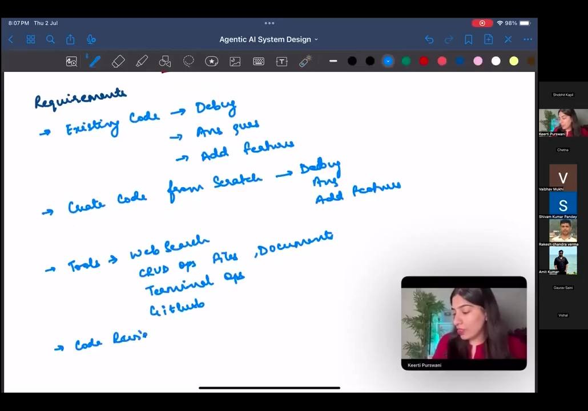
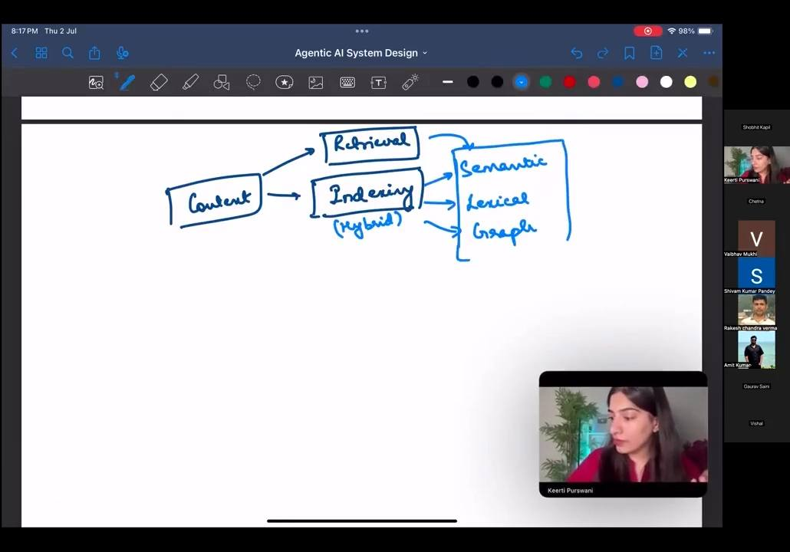
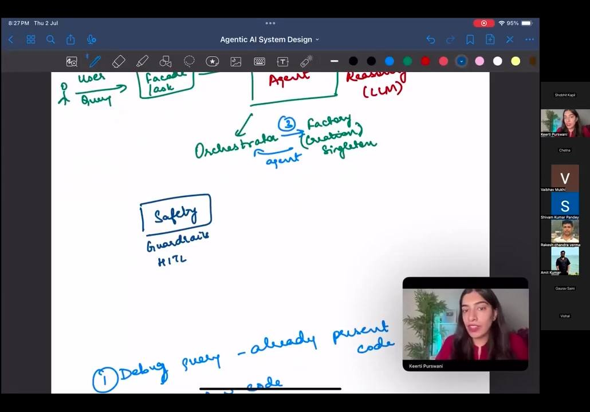
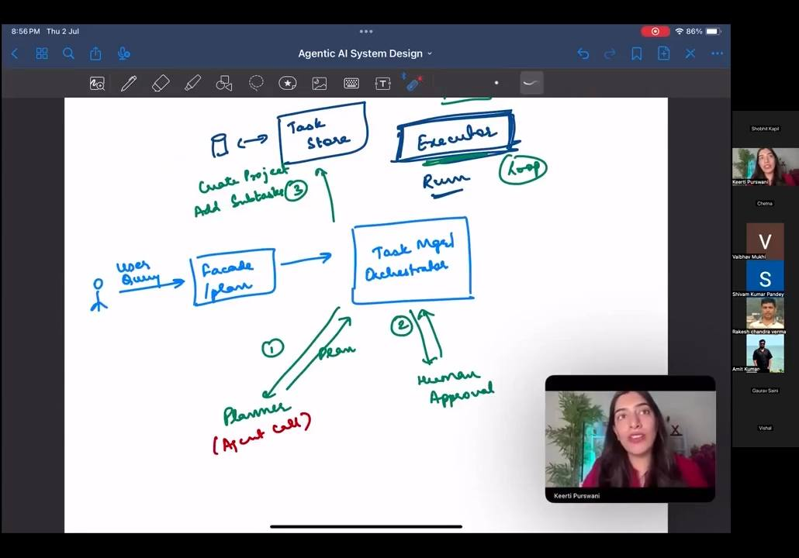
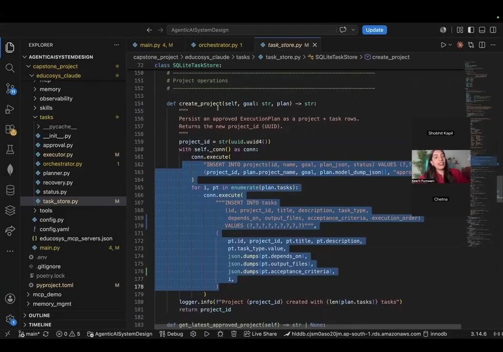
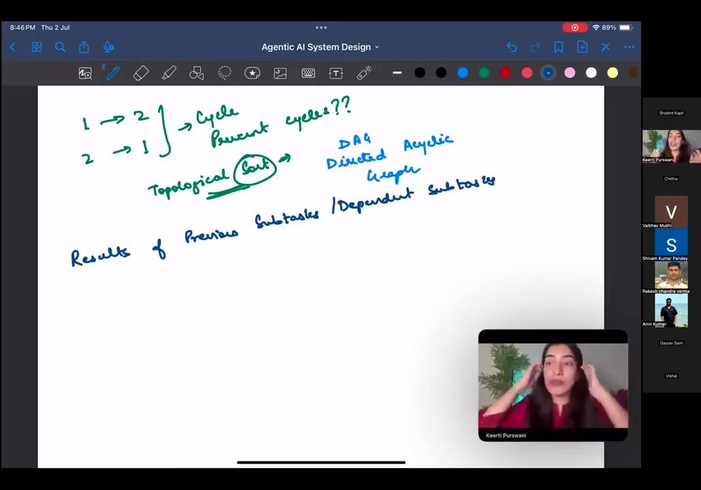

# Agentic AI System Design（P11）：把 Plot Code 从头到尾设计一遍

> **关于名字的说明（先读这一段，后面不重复）**：这一节讲师要设计的系统，在逐字稿里被 ASR 识别成 `plot code` / `cloud code` / `due course` 等好几种写法，指的都是同一个东西——一门课一路在做的那款「命令行编程 Agent」（Claude Code 那一类）。本文正文统一写 **Plot Code**，引用讲师原话时按逐字稿的中文译文保留他的说法。凡是逐字稿里没出现、只是本文补的东西，都会明确标出来。

---

## 1. 这一节做什么

前面几周是「拆零件」：context 怎么搭、retriever 怎么写、indexer 怎么跑、agent 怎么造、工具怎么接、guardrail 怎么做、trace 怎么打。P11 这一节是**收口**：讲师拿 Plot Code 当靶子，把所有这些零件在白板上拼成一套**能讲给面试官听、也能照着写代码的端到端架构**。

这一节要交付的东西有四样，缺一样都不算完成：

1. **一套分层架构图**（facade / 安全 / agent / context / 执行 / 观测 / 新鲜度 / 缓存），每一层能说清「为什么在这一层、不放别的层会怎样」。
2. **两条完整数据流**：一条 **ask 流**（单轮、ReAct agent、调工具改文件），一条 **plan 流**（长任务、planner 拆解 → 人工审批 → 落库 → executor 循环执行）。
3. **一份任务数据模型**（Project / Task / 依赖 / 状态 / 结果），以及为什么必须有它——为了**可恢复**、为了**并行**、为了**后续追问**。
4. **代码里四个真实入口的走读**：`handle_plan_command` → `create_project` → `orchestrator.run` → `get_ready_tasks` / 依赖检查。

换句话说：学完这一节，你应该能在白板上、在 45 分钟里，把「设计一个 Claude Code」这道题从头画到尾，并且每一笔都能解释。

---

## 2. 讲师原话

**关于「先问需求」这个反射**：

> "首先，如果有人让你设计 plot code，你的第一反应是什么？"
> —— p011 [02:18]

> "我们得快速谈一下需求。功能需求先来：如果已经有代码，我们应该能调试它、回答关于它的问题、给它加功能；或者从零创建代码，并且能做调试、回答、加功能这些动作。"
> —— p011 [03:16]

**关于安全层和 HLD**：

> "在安全这块……首先你明不明白，如果来了太多请求会怎样？我们讲的是系统设计，所以当然要考虑 HLD。同学们，Agentic 系统设计就是普通 HLD 加上 Agent 特有的那些东西。"
> —— p011 [07:22]

**关于「ask 还是 plan」该由谁判断**：

> "Ask 和 plan，昨天有个问题：是否必须由用户来说这条是 ask 类型、这条是 plan 类型？我们能不能自己处理？你会怎么做？"
> —— p011 [09:38]

> "你可以加一个 query classifier，让它判断这是一个普通问题，还是一个长时间运行、需要规划的任务。"
> —— p011 [10:04]

> "这个分类器里你能写出确切的代码来理解 query 吗？你会写代码吗？还是你会做什么？你能靠代码理解 query 吗？不能。那谁来帮我们理解 query？所以会有一个额外的 agent，或者说一个 query classifier agent。"
> —— p011 [10:34]

**关于索引属于哪一层、生产环境用什么索引**：

> "索引属于哪一层？根据我们写过的代码，它属于 context 层。context 里还有什么？retrieval。"
> —— p011 [12:55]

> "在生产系统里我们做混合索引（hybrid indexing），是的，生产环境用的就是 hybrid。可以同时用语义、词法，还有图。"
> —— p011 [13:18]

> "语义索引存在什么数据库里？向量数据库，比如 Qdrant、Chroma。词法的比如 Elasticsearch，图数据库比如 Neo4j。"
> —— p011 [13:47]

**关于 agent 是什么类型、工具怎么分**：

> "这是一个什么类型的 agent？是 ReAct agent。ReAct 代表什么？Reasoning and Action，推理和行动。"
> —— p011 [16:40]

> "如果用 MCP 工具，我们要创建什么？我们要创建一个 MCP client，也就是一个 multi-server client，去连不同的 MCP server。"
> —— p011 [18:09]

> "自定义工具里我们还会有一类非常特殊的工具，就是 retriever tool，它去和这些 retriever 对话，负责我们的 RAG 流程。"
> —— p011 [18:38]

> "记忆主要有哪几种？可以是短期记忆和长期记忆。长期记忆我们代码里没实现，但长期记忆也有三种类型：episodic（情景）、procedural（程序）、semantic（语义）。"
> —— p011 [19:32]

**关于可恢复性和落库**：

> "我们想要可恢复性、要处理崩溃，下一步应该做什么？应该把它存到数据库里。"
> —— p011 [33:02]

> "我们这个项目里用的是什么？用的是 SQLite。所以我们需要持久化，就应该有一层专门负责和这个持久层、和 DB 打交道。在我们的代码里它叫什么？Task Store。"
> —— p011 [33:29]

**关于依赖、环和拓扑排序**：

> "有没有可能出现环？做 1 之前必须先做 2，做 2 之前必须先做 1，你最后就陷进环里了。那怎么防止环？我们拿到的任务必须是拓扑排序过的。"
> —— p011 [37:47]

> "说白了就是你要保证你建的是一张有向无环图（DAG）。没听过这些也没关系，你只要记住一件事：在挑某个任务之前，它依赖的任务都已经做完了。"
> —— p011 [39:12]

**关于并行写库**：

> "如果两个任务并行跑、同时更新或者覆盖 checkpoint 呢？好问题，那我们就得把 DB 这一块处理好。"
> —— p011 [42:25]

> "首先，当我们有 DB、做 DB 更新时，我们要做哪种更新？HLD 的概念，其实不是 agent 的概念——原子更新。所以我们会做原子更新，保证同一时刻只有一行在被改。"
> —— p011 [42:48]

**关于把子任务结果写回 DB**：

> "你完成一个任务，就会产出一个 result，result 的意思就是给我一个这次任务发生了什么的 summary。每个任务我在 DB 里都会存它。一旦你把状态更新成 completed，你就同时把 result 更新上去。"
> —— p011 [43:45]

**关于任务类型决定模型和工具**：

> "任务也是有类型的，可以是 design、implement、test、code review，什么都行。你发现没有，如果它是测试，我可以用一个不一样的、更小的 LLM；实现我想用更好的 LLM；设计我想用推理型 LLM。"
> —— p011 [46:08]

> "所以这里用多 agent 是说得通的。虽然我们还没专门讲多 agent 架构，但我们在这一节里其实已经在用了。"
> —— p011 [47:02]

**关于 executor 的循环**：

> "执行器会有一个循环。你能想到这个循环的条件吗？while 还有东西是 pending 的。只要还有 pending，我们就得一个一个把任务挑出来，执行它，并通过 task store 更新 DB。"
> —— p011 [52:38]

**关于单一职责**：

> "每个文件只有一个职责，SOLID 里的单一职责原则。所以只有这个文件应该和我的 task DB 交互，其他任何文件都不行，我们就是这么设计的。"
> —— p011 [58:12]

**关于「什么时候能挑一个任务」**：

> "我不能随便从表里挑一个任务。什么时候能挑任务？它依赖的任务都已经完成了，而且它自己是 pending 状态。"
> —— p011 [65:07]

**关于自建 tracing（下一周的引子）**：

> "如果你连 LangSmith 都不想让数据流过去，你也可以在自己的系统里做 tracing。我们下周会讲 LangFuse，它帮我们在自己的系统里做 tracing，数据就不会流出去了。"
> —— p011 [26:00]



---

## 3. 从零复现

这一节按讲师在课上带着大家推进的顺序复现。你拿一块白板，照着一步步往下画，画完就是一整套设计。

### 第 1 步：需求（大概 2 分钟，速过）

讲师反复强调：**先问需求，再画框**。他不要求在这一步纠缠，但必须有。

功能需求（existing code 和 from scratch 两条路都要覆盖）：

| 编号 | 需求 | 说明 |
|---|---|---|
| F1 | 已有代码时能 debug | 定位 bug、给出修改、真的把文件改掉 |
| F2 | 已有代码时能答疑 | 「这个函数干嘛的」这类问题 |
| F3 | 已有代码时能加功能 | 改多个文件、加新文件 |
| F4 | 从零创建代码 | 没有仓库的时候也能开工 |
| F5 | 工具集成 | web search、文件 CRUD、文档、终端命令、GitHub、数据库、RAG（检索代码）、测试执行、代码评审 |

工具清单是课上大家一句一句补出来的，讲师的说法是这些属于「绝对的基础」：web search、对文件的增删改查、文档、终端操作、最好还有 GitHub、数据库相关工具。**RAG 本身也算一个工具**——因为「检索已有代码」这件事在 agent 眼里就是调一个 retriever tool。

非功能需求（讲师归到 HLD 里讲）：安全（限流、注入检测、PII、内容过滤）、可恢复（崩溃能接着跑）、可观测（logs + tracing）、质量（eval / QA）、新鲜度（代码变了索引要更新）、成本（缓存、token 预算）。

### 第 2 步：约束——先问清楚「本地还是云端」

这是这一节最容易被忽略、但讲师专门停下来纠正的一个点：

- 如果是**用户自己机器上跑**的本地 CLI（讲师举的例子就是「只跑在用户机器上」那种形态），**限流不适用**。
- 如果是**云端多租户**服务，限流是第一道必须有的闸门：一百万个请求不能直接打到 agent 上。

所以架构图上「Security 层有没有 rate limiter」这个框，取决于你的部署形态。**这一条在面试里是加分项**：先问部署形态，再决定画不画限流。

### 第 3 步：估算（课里没讲，以下是本文按讲师给的需求推的，用的时候请标明来源）

课上没有做容量估算。为了让这份文档能「照着复现」，补一张最小估算表，参数你可以自己替换：

| 项 | 假设 | 算式 | 结论 |
|---|---|---|---|
| 单仓库索引量 | 5000 个文件，平均 200 行 | 5000 × 200 = 1,000,000 行 | 约 100 万行、几百万 token 量级 |
| chunk 数 | 每 60 行一个 chunk | 1,000,000 ÷ 60 ≈ 16,700 | 约 1.7 万个 chunk，单机向量库完全扛得住 |
| 索引耗时 | 每个 chunk 一次 embedding，限 50 并发 | 16,700 ÷ 50 ≈ 334 批 | 分钟级，可以做成启动时后台跑 + 进度提示 |
| plan 流任务数 | 一次 /plan 拆 10–40 个子任务（讲师原话是 10、20、40 都可能） | — | executor 的循环必须能跑几十轮，不能写成一次性 script |
| 单任务上下文 | 依赖任务结果的 summary，每条几百 token | 3 个依赖 × 500 token = 1500 token | 依赖结果必须「摘要化」后再喂，不能把整个文件塞进去 |

### 第 4 步：方案 A —— ask 流（简单任务）

按讲师画的顺序，从外到内：

```
用户 → [UI/CLI] → [Facade / main]
                      ├─ Security 层：rate limiter（云端才有）、injection detector、PII scanner、content filtering/moderation
                      ├─ Query Classifier（一个 agent，不是 if-else）
                      │     ├─ 简单任务 → Agent 层（orchestrator + factory）
                      │     └─ 长任务   → 任务编排（plan 流）
                      └─ ...
```

Facade 的定位：用户只看得见 `ask` / `plan` / `status` / `help` 这些选项，内部结构他完全不知道。这一层就是「main function」，是唯一入口。

**为什么要 query classifier 而不是 if-else**：讲师的原话是——你没法写代码判断一句话是不是「需要规划的长任务」，理解语义这件事只能交给 LLM，所以它是一个**独立的 agent**。

Agent 层的内部：

- `orchestrator`：管 ask 这一类查询。
- `factory`：管 agent 的创建。讲师指出当前实现**每次都 new 一个对象**，其实可以做成**单例**（singleton）。
- agent 本体是 **ReAct agent**（Reasoning + Action），随身的资产是 **tools** 和 **skills**。
- tools 分两类：
  - **custom tools**（自己写的），其中有一类特别的叫 **retriever tool**，专门和 retriever 对话，扛 RAG 流程；
  - **MCP tools**：需要建一个 **MCP client**，具体是 **multi-server client**，去连多个 MCP server；这个 client 由 **host** 创建。

Context 层（和 agent 层并列、被 retriever tool 调用）包含三样：

- **retrievers**
- **indexers**
- **memory**（短期 / 长期；长期又分 episodic、procedural、semantic）
- 索引本身是 **hybrid**：语义（向量库 Qdrant / Chroma）+ 词法（Elasticsearch）+ 图（Neo4j）

索引的时机：**应用启动时索引一次**。讲师特意澄清——这时候不叫增量索引；「随着代码变化不断重新索引」才叫增量索引，那是 freshness 层要干的事。

**ask 流（以 debug 为例）的完整走法**，这是讲师带着走了两遍的主干：

1. 应用启动 → 索引已经建好。
2. 用户发 debug 类问题 → 打到 facade。
3. facade 过完安全检查 → 进 agent 层 → orchestrator。
4. orchestrator 判断需要 agent → factory 造一个（或取单例）。
5. 进入 ReAct loop：先给 LLM 看问题，LLM 判断「这是 debug」→ 决定先检索。
6. 调 retriever tool → 打到各个索引 → 拿回若干 chunk。
7. chunk 回给 LLM → LLM 分析「错在哪、该改成什么」→ 告诉 agent 该调哪个工具。
8. agent 调文件系统工具（这个工具可能是 custom tool，也可能是 MCP tool）→ 文件真的被改。
9. 工具结果再回给 LLM（改成功了 / 没权限 / 其它）→ LLM 组织最终答复。
10. 答复回到 facade → 回给用户。



### 第 5 步：方案 A 补充 —— 除了主干，还有哪些层

讲师让大家一起数，最后数出来这几层，**每一条都要能在架构图上找到位置**：

| 层 | 负责什么 | 课上的原话要点 |
|---|---|---|
| Safety | guardrails、human-in-the-loop、response validation、injection 检测 | 「hacking 这些都属于 guardrails，属于 human-in-the-loop 这一挂」 |
| Quality Assurance（也可以叫 eval 层） | 质量检查、验证、token budgeting | 「可以和 safety 合并，也可以独立一层」 |
| Observability | logs、tracing | 现在用的是 **LangSmith**；不想让数据出网就用 **LangFuse** 自建（下周讲） |
| Freshness | 代码变了重新索引，何时 re-index、怎么 re-index、有哪些方案 | 「这一整块今天要花很多时间讲」 |
| Caching | 在多个位置都能缓存 | 「这里、这里、这里，有非常多地方可以缓存」 |

关于 **token budgeting**：讲师明确说它**不是一个独立的层**，可以塞进 safety 或 QA 任意一层里。缓存的具体位置和新鲜度的具体策略，这一节只讲了「存在于哪一层」，细节推到后面——这一点在第 7 节会再标一次。



### 第 6 步：方案 B —— plan 流（长任务）

公共部分（不用重画）：context、observability、safety、QA 全部复用。差别只在「谁来决定怎么干」。

```
用户 /plan → Facade（安全） → Query Classifier
                                  └→ 长任务 → 任务编排器（orchestrator / task manager）
                                        1) Planner：拆解任务，产出 plan
                                        2) 人工审批：approve / edit / reject
                                        3) Task Store：落库（project + subtask）
                                        4) Executor：循环取 ready task 执行
                                        5) 每步回写 status / result
```

逐步拆开讲，每一步都有讲师强调的「为什么」：

**6.1 Planner 产出结构化 plan。** 讲师问：「我们代码里怎么保证拿到固定格式的 plan？用了什么？」答案是 **Pydantic 定义结构化输出（structured output）**——先定义类长什么样，agent 就按这个形状返回。plan 的形状他念了一遍：**project name、goals、summary，还有给每个任务标 tag/类型**。

**6.2 人工审批。** 拿到 plan 后立刻进 HITL，用户三种动作：approve / edit / reject。这一节走的是 happy path（approved），但讲师在代码走读里把 reject 的循环讲清楚了：**reject → 返回 None → 重新规划 → 再次呈现 → 直到你批准为止**；edit 则更新 plan 后继续。

**6.3 落库。** 为什么要存？两个词：**resumability（可恢复）** 和 **crash（崩溃）**。存哪儿？**SQLite**。谁负责存？单独一层 **Task Store**——「只有一个文件和 task DB 打交道」，这是 SOLID 的单一职责。

**6.4 初始状态。** 新拆出来的子任务**不是** in progress。讲师特意纠正了同学：「还没开始的东西能叫 in progress 吗？」→ 应该叫 **pending / to-do / yet to start**。

**6.5 状态枚举。** 课上列全了：**pending、in progress、completed、skipped（人工说这步跳过）、failed、blocked（比如请求太多或者别的原因卡住）**。并明确说明：代码里 `blocked` 和 `skipped` 目前**没有真的被设置**，属于复杂场景，这一版没做那么细。

状态迁移路径（讲师在代码旁讲的）：

```
pending ──(被选中)──> in progress ──(成功)──> completed
                          └──(失败)──> 有 retry ──> 回到 pending ──> 再失败且无 retry ──> failed
```

**6.6 依赖与并行。** 任务带一个 **depends_on 列表**。要不要并行，取决于依赖：三个任务互相不依赖就能并行；但只要有一个是前置，就不能并行。挑任务的前提是——**它 depends_on 里的任务要么 completed，要么被 skip 掉了**（讲师说「completed 或者我们决定不做」，两者都算「可以往下走」）。

**6.7 防环。** 讲师自问：会不会出现 1 依赖 2、2 依赖 1？会，那就死锁成环。解法是**拓扑排序**，本质是保证这是一张**有向无环图（DAG）**。他还特意安抚没学过 DSA 的同学：不用纠结算法细节，只要记住一条——**挑任务之前，它依赖的任务都已经做完了**。

怎么保证 LLM 生成的 plan 天然满足？**靠 prompt**：让 LLM 为每个任务输出「它依赖哪个任务」，plan 一出来依赖关系就有了。

**6.8 依赖任务的结果怎么传给下一个任务。** 讲师举的例子：先做 design，接着写代码时要参考设计；或者加 CSS 之前要看组件长什么样。最简单的做法是用 **checkpointer** 一把梭，但讲师说「那样是让生活变简单，我们不是要搞懂内部怎么跑吗」——所以这一版走显式路线：

> 每个任务完成时，不只是把 status 改成 completed，**同时写一条 result（这次任务干了什么的 summary）**。轮到某个任务时，把它 depends_on 里那些任务的 result 读出来，一起喂给它。

result **要持久化**，因为后面会有大量追问（follow-up questions）。同学问「任务全完成后能不能丢掉」，讲师回答：看设计，可以丢，但留着更有用；**archive policy 也是可以加的**。

**6.9 并行写库怎么办。** 同学问「两个并行任务同时更新或覆盖 checkpoint」——讲师先纠正概念：这是 DB 的事，不是 agent 的事；做法是**原子更新**，保证同一时刻只有一行在被改。

> **在 JS/Node 里对应什么**：SQLite 用 `better-sqlite3` 时，写操作是同步的，天然串行；如果换 Postgres，就得靠事务 + 行级锁（课里没讲 `SELECT ... FOR UPDATE SKIP LOCKED`，这是常见做法，但**不是讲师说的**）。前端同学可以把「原子更新」理解成 Redux 里那种「一次 dispatch 只改一个 slice，绝不做读-改-写三步式更新」。

**6.10 任务类型 → 不同模型、不同工具。** 这是讲师说「我们其实已经在用多 agent 架构」的那一段：

| 任务类型 | 用什么 LLM | 用什么工具 |
|---|---|---|
| design | 推理型 LLM | 基本只读、看结构 |
| implement | 更强的 / 代码微调过的 LLM | 需要文件系统写权限 |
| test | 更小的 LLM 就够 | 终端命令更重要 |
| code review | — | 主要读；写只写那一个 review 文件 |

讲师的定义很干脆：**Agent = LLM + tools + 其它**，所以「不同的 agent」本质上就是「不同的 LLM + 不同的工具组合」。他还回应了同学「能不能让 LLM 在任务列表里直接告诉你该用哪个模型」——**可以，但有点过度设计**；按 task type 映射就够了。

**6.11 Executor 的循环。** 

> while 还有任务处于 pending（或 in progress）：
>   1. 选出 ready 的任务（pending + 依赖已满足）
>   2. 执行
>   3. 用 task store 回写 status / result
> 全部没有了 → 打印最终 summary。



### 第 7 步：把设计落到代码（讲师实际走读的四个文件）

这一节后半段讲师打开了仓库，走了四个地方。你复现时目录名可以不同，但**职责划分必须一样**：

1. `orchestrator`（在 task 层里）里的 **`handle_plan_command`**：入口。先判断是「已有项目 → 走 store + recovery manager 恢复」，还是「新项目 → 走下面这条」。
2. **`create_plan`**：一次 agent call，用结构化输出拿 plan（project name / goals / summary / tag）；然后 **`present_plan_for_approval`**——讲师说它「literally 就是个 print 语句」，让你选 approve / modify / reject，reject 返回 None 就重新规划，直到批准。
3. **`TaskStore.create_project`**：把批准后的 plan 持久化成 **project 行 + task 行**（`INSERT INTO project`、`INSERT INTO task`）。讲师强调：**只有这个文件碰 task DB**。
4. **`orchestrator.run`**：主循环 → **`get_ready_tasks`**（按 `execution_order` 取 pending 的）→ **依赖检查**（对每个 pending 任务的 `depends_on` 列表逐个查是否完成，返回 bool）→ 交给 executor。





---

## 4. 完整代码

> **重要声明**：这一节是**设计课**，逐字稿里没有任何一行完整代码被念出来，也没有提供 OCR。所以下面不是「复制粘贴就能跑的课程源码」，而是**按讲师的架构落成可实现的产物**：组件职责表、数据模型草案、DDL、状态机、关键算法伪代码。凡是示意代码，都会标「课里没有代码，以下为示意」。
>
> 课程原实现是 **Python**（用了 Pydantic 做结构化输出、SQLite 做持久化、LangSmith 做 tracing，checkpointer 是 LangGraph 体系里的概念）。因为本课读者是前端转 AI 应用工程师，示意代码用 **TypeScript** 写，逻辑一一对应；Python 语法你「知道即可」。

### 4.1 组件职责表（照这个分文件，就不会乱）

| 层 | 组件 | 单一职责 | 可以和谁说话 |
|---|---|---|---|
| 入口 | `cli` / `facade` | 解析命令（ask / plan / status / help），唯一对外门面 | security → classifier |
| 安全 | `security` | rate limit（云端才启用）、injection 检测、PII 扫描、内容过滤 | facade |
| 分类 | `queryClassifier` | 判断简单任务 vs 长任务 | facade → orchestrator |
| Agent | `agentFactory` | 造 agent，建议单例 | orchestrator |
| Agent | `orchestrator` | ask 流调度；plan 流的 `handle_plan_command` / `run` 也在这里 | factory / planner / taskStore / executor |
| Agent | `reactAgent` | Reasoning + Action 循环 | tools |
| 工具 | `customTools` | 自己写的工具 | agent |
| 工具 | `retrieverTool` | 唯一碰 retriever 的工具，扛 RAG | retrievers |
| 工具 | `mcpClient`（multi-server） | 由 host 创建，连多个 MCP server | agent |
| Context | `indexers` | 启动时索引：semantic / lexical / graph | 向量库 / ES / Neo4j |
| Context | `retrievers` | 检索，和被索引的数据源一一对应 | retrieverTool |
| Context | `memory` | 短期 + 长期（episodic / procedural / semantic） | agent |
| 规划 | `planner` | 一次 agent call，结构化输出 plan | taskStore |
| 持久化 | `taskStore` | **唯一**读写 task DB 的组件 | SQLite |
| 执行 | `executor` | 取 ready task、执行、回写 | taskStore / agentFactory |
| 恢复 | `recoveryManager` | 已有项目时恢复现场 | taskStore |
| 观测 | `observability` | logs + tracing（LangSmith，或自建 LangFuse） | 全局 |
| 质量 | `qa` / `safety` | 质量校验、token budgeting | 全局 |
| 新鲜度 | `freshness` | 变更后 re-index 的策略与触发 | indexers |

### 4.2 数据模型草案（字段名全部来自讲师在屏幕上念出来的列）

**Project**

| 字段 | 类型 | 说明 |
|---|---|---|
| `project_id` | string | 主键 |
| `title` | string | 来自 plan 的 project name |
| `goals` | text | plan 里的 goals |
| `summary` | text | plan 里的 summary |
| `created_at` | datetime | — |

**Task**（讲师逐条念过，一个都不能少）

| 字段 | 类型 | 说明 |
|---|---|---|
| `project_id` | string | 外键 → Project |
| `title` | string | 任务标题 |
| `description` | text | 任务描述 |
| `task_type` | enum | design / implement / test / code_review |
| `status` | enum | 见 4.3 |
| `depends_on` | list | **是列表**，存依赖的 task id |
| `output_files` | list | 这个任务产出/改动了哪些文件 |
| `acceptance_criteria` | text | 验收标准（讲师说「这部分我之前没跟你们讲」） |
| `result` | text | 完成时写入的 summary |
| `created_at` / `started_at` / `completed_at` | datetime | 三个时间戳 |
| `execution_order` | int | 取任务时按它排序 |
| `retries` / `max_retries` | int | 重试次数与上限 |

### 4.3 SQLite DDL（课里没有代码，以下为示意；列名取自讲师念出的字段）

```sql
-- schema.sql  —— 课里没有代码，以下为示意
PRAGMA journal_mode = WAL;      -- 允许读写并发，单写多读

CREATE TABLE IF NOT EXISTS project (
  project_id  TEXT PRIMARY KEY,
  title       TEXT NOT NULL,
  goals       TEXT,
  summary     TEXT,
  created_at  TEXT NOT NULL
);

CREATE TABLE IF NOT EXISTS task (
  task_id             TEXT PRIMARY KEY,
  project_id          TEXT NOT NULL REFERENCES project(project_id),
  title               TEXT NOT NULL,
  description         TEXT,
  task_type           TEXT NOT NULL CHECK (task_type IN ('design','implement','test','code_review')),
  status              TEXT NOT NULL DEFAULT 'pending'
                      CHECK (status IN ('pending','in_progress','completed','failed','blocked','skipped')),
  depends_on          TEXT NOT NULL DEFAULT '[]',   -- JSON 数组，SQLite 没有原生 list
  output_files        TEXT NOT NULL DEFAULT '[]',
  acceptance_criteria TEXT,
  result              TEXT,
  created_at          TEXT,
  started_at          TEXT,
  completed_at        TEXT,
  execution_order     INTEGER NOT NULL,
  retries             INTEGER NOT NULL DEFAULT 0,
  max_retries         INTEGER NOT NULL DEFAULT 2
);

CREATE INDEX IF NOT EXISTS idx_task_project_status ON task(project_id, status, execution_order);
```

### 4.4 任务状态机（课里没有代码，以下为示意）

```
pending ──pick──> in_progress ──ok──> completed
   ▲                   │
   │                   └─err─> retries < max_retries ? 回到 pending : failed
   │
   └── skipped（人工决定跳过，视为「满足依赖」）
   └── blocked（预留，课里代码没有真的设置）
```

### 4.5 `create_project`（课里没有代码，以下为示意）

```ts
// taskStore.ts —— 课里没有代码，以下为示意
// 职责：唯一碰 task DB 的组件（SOLID 单一职责）
export function createProject(db: DB, plan: Plan): { projectId: string } {
  const projectId = crypto.randomUUID();
  const now = new Date().toISOString();

  const insertProject = db.prepare(
    `INSERT INTO project (project_id, title, goals, summary, created_at)
     VALUES (?, ?, ?, ?, ?)`
  );
  const insertTask = db.prepare(
    `INSERT INTO task
       (task_id, project_id, title, description, task_type, status,
        depends_on, output_files, acceptance_criteria,
        created_at, execution_order, retries, max_retries)
     VALUES (?, ?, ?, ?, ?, 'pending', ?, '[]', ?, ?, ?, 0, ?)`
  );

  // 原子更新：整个落库在一个事务里，要么全成，要么全不成
  const tx = db.transaction(() => {
    insertProject.run(projectId, plan.projectName, plan.goals, plan.summary, now);
    plan.tasks.forEach((t, i) => {
      insertTask.run(
        t.id, projectId, t.title, t.description, t.type,
        JSON.stringify(t.dependsOn ?? []),   // 初始状态一律 pending
        t.acceptanceCriteria ?? null,
        now, i, t.maxRetries ?? 2
      );
    });
  });
  tx();

  return { projectId };
}
```

### 4.6 `getReadyTasks`（课里没有代码，以下为示意；这就是讲师在 66:36 之后走的那段）

```ts
// executor.ts —— 课里没有代码，以下为示意
type TaskRow = {
  task_id: string; status: string; depends_on: string;
  execution_order: number; result: string | null;
};

// 第一步：只取 pending，按 execution_order 排
function getPendingTasks(db: DB, projectId: string): TaskRow[] {
  return db.prepare(
    `SELECT * FROM task
      WHERE project_id = ? AND status = 'pending'
      ORDER BY execution_order ASC`
  ).all(projectId) as TaskRow[];
}

// 第二步：对每个 pending 任务，检查它的 depends_on 是不是都「完成或跳过」
function depsAreDone(db: DB, task: TaskRow): boolean {
  const deps: string[] = JSON.parse(task.depends_on);
  for (const depId of deps) {
    const row = db.prepare(`SELECT status FROM task WHERE task_id = ?`).get(depId) as { status: string } | undefined;
    if (!row) return false;
    if (row.status !== 'completed' && row.status !== 'skipped') return false;
  }
  return true;   // 讲师：返回一个 bool，true / false
}

export function getReadyTasks(db: DB, projectId: string): TaskRow[] {
  return getPendingTasks(db, projectId).filter((t) => depsAreDone(db, t));
}
```

### 4.7 executor 主循环（课里没有代码，以下为示意）

```ts
// executor.ts —— 课里没有代码，以下为示意
export async function runProject(db: DB, projectId: string, factory: AgentFactory) {
  while (true) {
    const pending = countByStatus(db, projectId, 'pending');
    const running = countByStatus(db, projectId, 'in_progress');

    // 讲师讲的终止条件：没有任何 pending，也没有任何 in_progress
    if (pending === 0 && running === 0) {
      printFinalSummary(db, projectId);
      return;
    }

    const ready = getReadyTasks(db, projectId);
    if (ready.length === 0) {
      // 依赖成环或全部失败，课里没讲这一支怎么处理，见第 7 节
      throw new Error('no ready task but project not finished');
    }

    for (const task of ready) {
      markInProgress(db, task.task_id);               // status -> in_progress, 写 started_at
      const depResults = loadDependencyResults(db, task); // 读 depends_on 的 result
      const agent = factory.createFor(task.task_type);    // 按 task_type 选 LLM + 工具
      try {
        const summary = await agent.run(task, depResults);
        markCompleted(db, task.task_id, summary);     // status -> completed + 写 result
      } catch (e) {
        markFailure(db, task.task_id);                // 见 4.4 的重试迁移
      }
    }
  }
}
```

### 4.8 容量估算表（课里没讲，本文补）

见 3.3 那张表。核心结论：单仓库 1.7 万 chunk、分钟级索引、几十轮 executor 循环、依赖结果必须摘要化。

---

## 5. 逐行解释

**为什么最外层一定要有 facade？**
讲师的说法是：用户只看得见 `ask / plan / status / help`，他完全不知道里面有什么。**单一入口的价值在于：安全检查、限流、日志、trace 全部只需要在这一个地方挂一次**。如果你让用户直接打到 orchestrator，那每一项横切能力都要在每个入口重复一遍，漏一个就是一个洞。

**为什么安全层要做成「层」而不是几个 if？**
课上列的是四件不同的事：rate limiter（防流量）、injection detector（防提示词注入）、PII scanner（防敏感信息外流）、content filtering / moderation（防 hacking、ransomware 这类词被当成正常请求送进去）。这四件事的共同点是：**它们都在 LLM 之前，且都不该由 LLM 判断**。让 LLM 自己判断「我这条请求危不危险」是循环论证；所以你必须在 facade 后面、classifier 前面插一层确定性代码。

**为什么 classifier 必须是 agent 而不是代码？**
讲师在 10:34 自己把这个坑挖出来又填上：你能写代码判断一句话是不是长任务吗？不能。理解语义只能靠模型。所以这里是一个 **query classifier agent**。反过来说，**如果这件事能用规则判定，就不该用 agent**——这是整门课反复出现的成本意识。

**为什么索引属于 context 层，而不是「启动脚本」？**
因为**检索和索引必须共用同一套数据源**。你在 semantic 里存了向量，检索时就只能查那个向量库；你在 ES 里存了词法，检索时也只能查 ES。把 indexer 和 retriever 放在同一层（context），是为了让「写进去的形状」和「读出来的形状」永远对齐。这也是为什么生产环境用 **hybrid**：只在语义库里放，会漏掉精确的符号名匹配（函数名、变量名）；只在词法里放，会漏掉「这段代码在讲什么」的语义相似。

**为什么启动时只做一次「索引」，不叫「增量索引」？**
讲师特意纠正过：应用第一次启动，把代码切块、embedding、入库，这叫 **indexing**。**incremental indexing** 是指「代码在变，你跟着不停地重新索引」。这一节只做前者，后者是 freshness 层的活。

**为什么 retriever 要包成一个 tool？**
因为在 ReAct agent 眼里，世界只有「工具」这一种东西。检索如果写在 agent 外面，agent 就没法自己决定「我要不要检索、检索几轮」；包成 retriever tool 之后，「先检索再改代码」这件事就变成了 agent 的一次自主决策。**RAG 在 agent 架构里不是一条固定管线，而是一个可被调用的工具**——这是这一节最值钱的认知之一。

**为什么 MCP 要一个 multi-server client？**
因为工具来源不止一个 MCP server。host 创建 client，client 同时连多个 server——这样 agent 侧看到的工具列表是聚合过的，不需要知道每个工具背后是哪个进程。

**为什么 factory 要做成单例？**
讲师指出当前每次都在 new。对 agent 这种「创建成本高、无状态或可复用」的对象，反复 new 就是浪费。**注意：这一点他没给最终结论，只是指出「可以做成单例」**，你自己实现时按需决定。

**为什么 plan 流必须落库？**
两个关键词：**resumability** 和 **crash**。用户在 30 个任务的第 12 个任务时关了终端，如果没有 DB，前面 11 个任务白做。落库之后，下次进来走 recovery manager，「从哪儿断的从哪儿接着跑」。

**为什么初始状态是 pending 而不是 in_progress？**
讲师当场纠正了同学。这不是命名洁癖：**in_progress 是 executor 的「占用标记」**。如果你把还没开始的任务标成 in_progress，executor 的终止条件（「没有 pending 也没有 in_progress」）就永远不成立，程序会死循环；并行调度时还会误判「这个任务有人在跑」。

**为什么依赖要存成列表 + 为什么必须拓扑有序？**
存列表是为了支持「一个任务依赖多个前置」（比如「写测试」依赖「实现」和「设计」）。拓扑排序是为了防环：如果 A 依赖 B、B 依赖 A，那 getReadyTasks 永远返回空，executor 卡死。讲师的话很朴素：**挑任务之前，它依赖的任务都做完了**——这句话成立的数学前提就是 DAG。

**为什么结果要写成 result summary，而不是直接挂 checkpoint？**
讲师承认 checkpointer 更省事，但他的目标是「搞懂内部」。显式 result 的好处是：**可读、可审计、可以给人看、可以作为 follow-up 的上下文**。代价是你要自己管写入时机（completed 和 result 必须一起写）。

**为什么必须原子更新？**
两个并行任务同时改库，如果各自做「读 → 改 → 写」，后写的会覆盖先写的。原子更新保证同一时刻只有一行在被改。**在 Node 里就是：一次事务里只办一件事，不要跨事务攒状态。**

**为什么 task_type 要影响 LLM 和工具？**
成本。design 需要推理，implement 需要强代码能力，test 用小模型就够。工具侧更明显：implement 要文件写权限；code review 只需要读 + 写那一个 review 文件；test 最需要终端。**这四类任务拼起来，就是「我们已经在使用多 agent 架构」的证据。**

**为什么 `taskStore` 是唯一碰数据库的文件？**
SOLID 单一职责。好处是：换数据库（SQLite → Postgres）只改一个文件；出问题只查一个文件；测试时只需要 mock 一个东西。**在 Node 里对应什么：把 DB 访问全收进一个 repository 模块，路由/service 层一律不 import `sqlite3`。**

**为什么 executor 的终止条件是「无 pending 且无 in_progress」？**
只看 pending 不够——因为任务可能是「被取走但还没跑完」的状态（in_progress）。只看 in_progress 也不够——排队中的还在 pending。两个都为 0 才是真的结束，这时候打印最终 summary。

**为什么审批要写成循环？**
因为用户可能连续 reject。reject → 返回 None → 重新规划 → 再呈现 → 直到批准。如果不写成循环，一次 reject 整个流程就退出了，用户得重新敲 `/plan`，前面所有上下文白丢。

---

## 6. 复现检查清单

画完 / 写完，逐条打勾：

- [ ] 我在白板最外层画了 **facade**，并且写清了它对用户暴露的命令：`ask` / `plan` / `status` / `help`。
- [ ] facade 后面紧跟 **security 层**，四个框都在：rate limiter、injection detector、PII scanner、content filtering。**并且我注明了 rate limiter 只在云端形态下启用**。
- [ ] 我画了 **query classifier**，并注明它是 **agent**，不是 if-else。
- [ ] Agent 层里有 **orchestrator** 和 **factory**，factory 旁标注「可单例」。
- [ ] agent 标注为 **ReAct**（Reasoning + Action）。
- [ ] tools 分成 **custom tools** 和 **MCP tools** 两支；MCP 那支画了 **host → multi-server client → 多个 server**。
- [ ] custom tools 里有 **retriever tool**，指向 retrievers。
- [ ] **context 层**画了 retrievers、indexers、memory 三块；memory 分短期 / 长期，长期又标了 episodic / procedural / semantic。
- [ ] 索引标了 **hybrid**：semantic（Qdrant / Chroma）+ lexical（Elasticsearch）+ graph（Neo4j）。
- [ ] 我说明了**索引发生在应用启动时**，且这一版**不是增量索引**。
- [ ] 我单独画了 **safety / QA / observability / freshness / caching** 五块，并注明 token budgeting 不单独成层。
- [ ] ask 流我完整走了 10 步（facade → orchestrator → factory → ReAct loop → retriever tool → LLM 分析 → 文件工具改文件 → 结果回 LLM → 最终答复 → 用户）。
- [ ] plan 流我画了 planner → 审批 → taskStore 落库 → executor 循环。
- [ ] plan 里我注明用了 **structured output（Pydantic）**，字段是 project name / goals / summary / task tag。
- [ ] 审批我写了三种动作 **approve / edit / reject**，并且 reject 是**循环重规划**。
- [ ] 数据库我选了 **SQLite**，并单独拆出 **Task Store** 这一层，标注「唯一碰 DB 的文件」。
- [ ] 子任务初始状态是 **pending**（不是 in_progress）。
- [ ] 状态枚举写全：pending / in_progress / completed / skipped / failed / blocked，并注明 blocked 与 skipped 这版没真正用。
- [ ] task 表字段齐了：task_id、project_id、title、description、task_type、status、depends_on、output_files、acceptance_criteria、result、created_at、started_at、completed_at、execution_order、retries、max_retries。
- [ ] 我讲了**拓扑排序 / DAG** 防环，以及「靠 prompt 让 LLM 在 plan 里给 depends_on」。
- [ ] 我讲了**result summary 回填 + 下游任务读取依赖结果**，并说明为什么不用 checkpointer。
- [ ] 我讲了**原子更新**应对并行写库。
- [ ] 我讲了 **task_type → 不同 LLM / 不同工具**，并点出这就是多 agent。
- [ ] executor 循环条件写对了：**无 pending 且无 in_progress** 才结束。
- [ ] `get_ready_tasks` 两步逻辑写对了：先取 pending 按 execution_order 排，再过滤掉依赖未完成的。
- [ ] 已有项目的情况我画了 **recovery manager** 分支。
- [ ] 我提到了 **LangSmith**（当前 tracing）和 **LangFuse**（自建 tracing，下周讲）。

---

## 7. 课里没讲但你会撞上的

以下都是**这一节的逐字稿和屏幕内容里没有的**，但你自己动手时一定会遇到。列出来，是为了让你别以为是自己漏听了。

1. **Freshness 的具体实现**。讲师说「这一整块今天要花很多时间讲」，但这一节实际只讲了「freshness 层存在、负责 re-index、要考虑何时与如何 re-index」，**具体策略（文件监听？git diff？定时全量？）没讲**。你实现时会立刻撞上：怎么判断哪些文件变了。

2. **缓存到底放哪几处**。讲师原话是「这里、这里、这里，有非常多地方可以缓存」，画了几个圈，但**没有逐一列出位置**（猜测是 classifier 结果、检索结果、embedding、LLM 响应