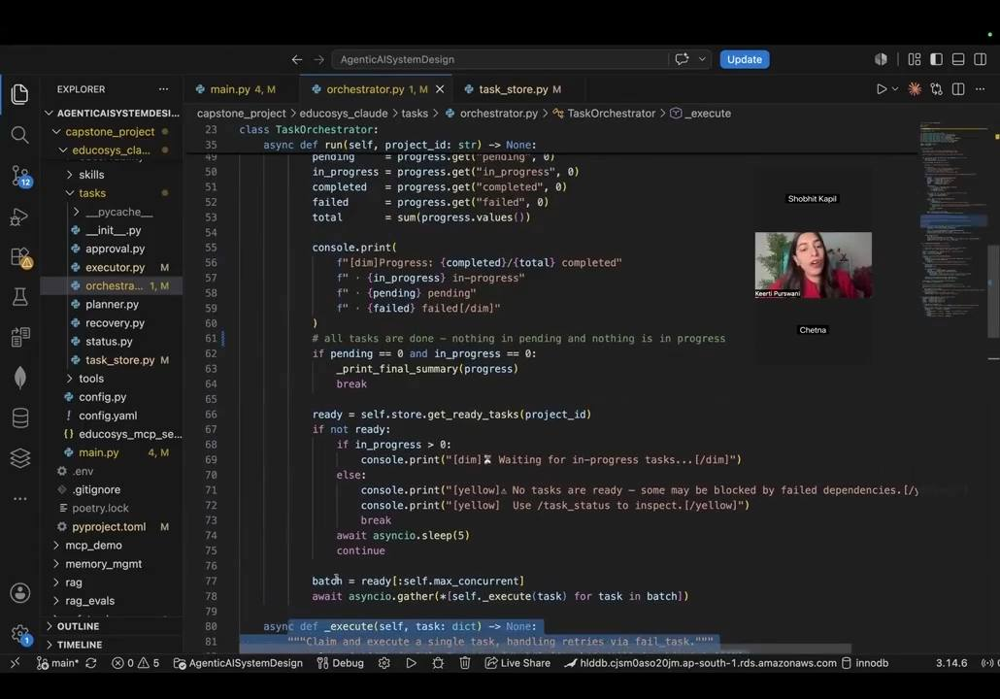
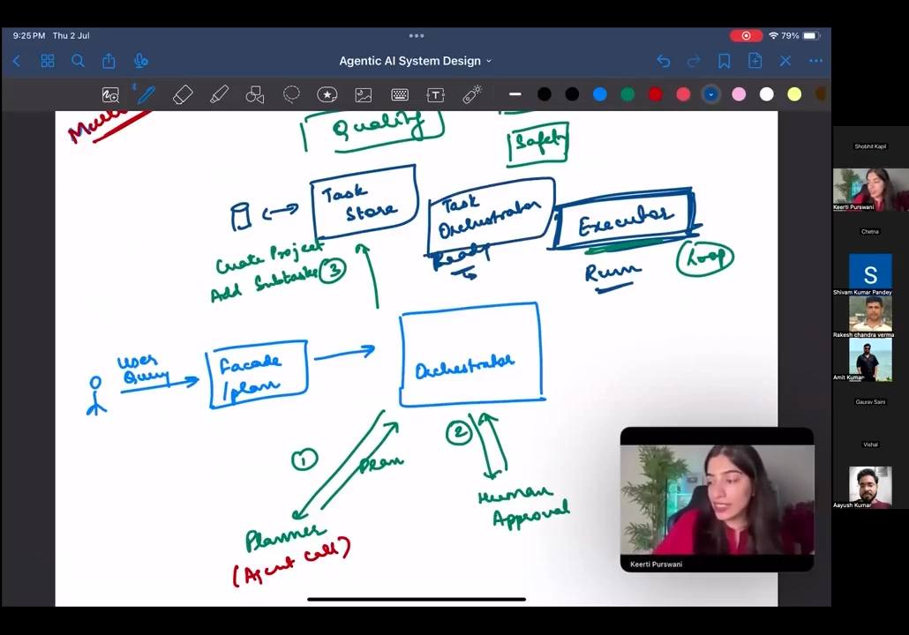
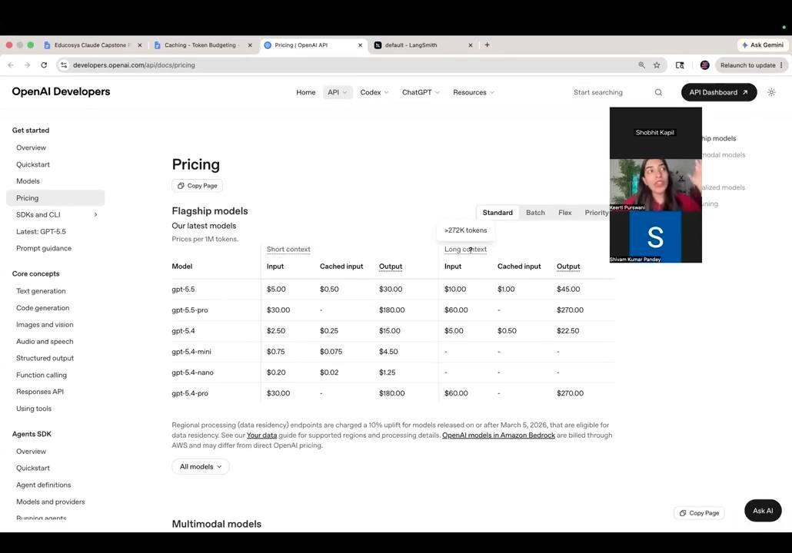
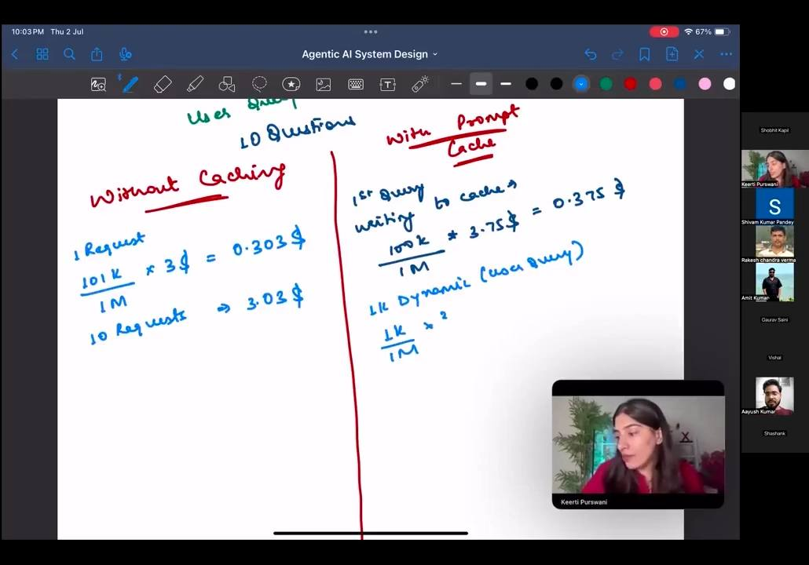
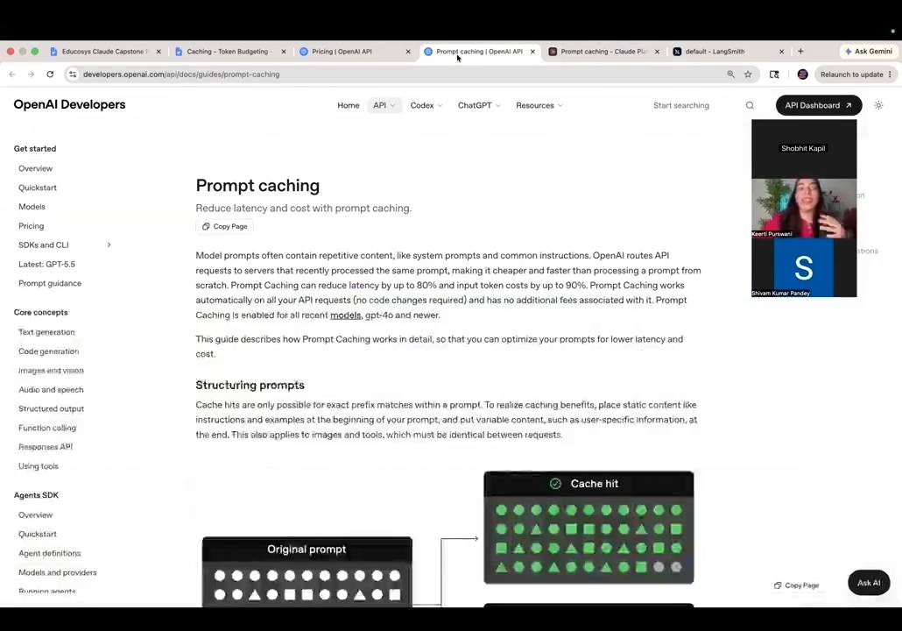

# Agentic AI System Design（P11 第 2/2 段）复现文档

> 本段课程（70:41–145:18）是整门课的收尾段，内容分两大块：**（A）把任务编排器（Task Orchestrator）与执行器（Executor）的并行调度逻辑讲完并跑通一次真实 demo**；**（B）转入理论，讲 re-indexing（重建索引）与 prompt caching（提示缓存）的机制与成本计算**。本段**没有 OCR 结果**，所有代码细节均来自逐字稿口述，凡逐字稿未念出的实现细节，本文一律标注「课里没讲」。

---

## 1. 这一节做什么

这一段要完成两件事，缺一不可：

**第一件：把「计划 → 审批 → 建项目 → 调度 → 执行 → 评分」这条链路彻底跑通。**

前面几段已经做完了 `/plan` 命令、`planner.py` 生成计划、用户审批、在 task store 里创建项目。这一段补上最后两块拼图：

1. **Task Orchestrator（任务编排器）**：负责查询数据库，判断哪些子任务「已就绪」（所有依赖都处于 completed 或 skipped 状态），把就绪任务**并行**捞出来，用 `max_concurrent` 控制并发数，用一个 `while` 循环 + `sleep` 轮询等待依赖完成。
2. **Executor（执行器）**：真正执行单个子任务。执行前要**原子地**把任务状态从 `pending` 改成 `in_progress`（这就是「认领任务」），然后把所有依赖任务的 `result` 取出来，塞进 system prompt，调用 LLM 流式执行，最后用 **LLM as judge** 给这次执行打分。

**第二件：讲清两个面试高频理论点。**

1. **Re-indexing**：代码改了，索引必须更新，否则 RAG 答不出来。四个触发点：启动加载时、用户手动 `/reindex`、文件变更监听（watchdog + debouncing）、大功能完成后重建图索引/依赖索引。
2. **Prompt caching**：静态上下文（system prompt、工具定义、检索到的知识库）放前面并被缓存，动态的用户 query 放后面。缓存写入比普通输入贵，缓存命中比普通输入便宜得多。讲师用一组真实数字算出了 10 次请求下 3.03 美元 vs 0.297 美元的差距，并现场跑了 demo 验证 40.9% / 45.6% 的节省。

---

## 2. 讲师原话

### 2.1 关于「就绪判定」的返回值逻辑

> "未完成或未跳过的依赖数量应该是 0。所以如果它等于 0，我就返回 true，否则返回 false。也就是说，只要有一个依赖不处于 completed 或 skipped 状态，我就返回 false。这样可以吗？"
> —— p011 [71:09]

> "这 literally 就是数据库查询，拜托。所以我拿到了 ready task，等一下我们回去，现在 ready task 在我手上了。大家都 OK 吗？现在我可以去挑这些任务了。"
> —— p011 [71:39]

### 2.2 关于并行与 max_concurrent

> "大家都理解我想并行地挑任务吧？是的，这就是为什么我有一个配置叫 max concurrent，表示你最多能并行跑多少个。这是一个 Python 的 API，如果你想并行跑东西，这个函数基本上会为这 max concurrent 数量的任务并行地被调用。"
> —— p011 [72:07]

> "所以这个 execute 函数会为这 max concurrent 个任务并行地被调用。这讲得通吗？这就是并行处理。"
> —— p011 [72:34]

> "我们怎么知道哪些任务需要并行？看，任何已经就绪的任务，我们就可以并行地把它们捞起来。所以当我们捞的时候，我们要确保所有依赖都完成了，对吧？所以任何就绪的任务都可以被并行捞起。"
> —— p011 [73:04]

### 2.3 关于那个 sleep 为什么必须存在

> "这里我加了一个 sleep，你们能告诉我为什么吗？……是的，这是并发不是并行，你说得对。你能告诉我为什么有 sleep 吗？因为有时候会发生这种情况……"
> —— p011 [73:31]

> "假设任务 7 依赖任务 2、3、4。假设任务 1、5、6 都完成了……也许任务 2 完成了，也许这个还在进行中。那么现在发生的是：因为它在进行中，所以它不就绪。大家都理解吗？因为它在进行中，所以它不就绪。但它可能 1 秒、2 秒、3 秒之后就完成了。所以我必须等这些全部结束，然后才能捞。所以在 while 循环里，我在等它们全部结束。"
> —— p011 [74:29]–[74:57]

> "所以我有一个循环，直到没有任何 pending、没有任何 in progress，那时我才会跳出循环。但有可能我因为依赖正在跑而一个任务都捞不到，所以我加了一个 sleep，这样也许 5 秒后这个家伙就完成了，我可以再检查一次你准备好了没有。"
> —— p011 [75:26]

> "是的，这就像每隔 X 秒去轮询一次状态。"
> —— p011 [75:55]

> "即使它 5 秒内没完成，还会有下一轮循环，我们再等 5 秒，然后再检查一次它们准备好了没有。"
> —— p011 [76:22]

> "看，如果它没就绪，我就等 5 秒，看看也许别的东西现在准备好了，也许依赖完成了，我再检查一次 ready。顺便说，如果我在 sleep，我就是在 continue，continue 的意思是我回到这个 while 循环里，再检查一次 ready。"
> —— p011 [76:45]

### 2.4 关于「认领任务」的原子性

> "在捞之前我们要原子地检查，因为我们在跟数据库打交道，确认它是 pending，然后我们把它更新成 in progress。这样可以吗？这就是你认领一个任务的方式。你怎么认领任务？把状态从 pending 改成 in progress。这样行吗？是的，所以在 claim 里我把状态从 pending 改成 in progress。"
> —— p011 [79:10]–[79:38]

### 2.5 关于依赖结果的传递

> "要跑任何任务，我需要什么？依赖任务的结果，我需要把它传给这个子任务。还记得我跟你说的 results 那部分吗？依赖任务的输出。"
> —— p011 [80:07]

> "在这个查询里，我只是在取所有依赖的结果，这没什么。就是看它依赖哪些任务。所以如果我在 task 7，我就去 tasks 表拿 2、3、4 的结果，然后传过去。就这样。"
> —— p011 [82:55]

> "你看到 LLM 了吗？我在构建 system prompt。在这个 system prompt 里我在做什么？我在把依赖的输出或结果传进去。我在创建 agent，我在流式输出，我在跑整个流程，我拿到输出。"
> —— p011 [83:52]

### 2.6 关于 LLM as judge

> "你看到这里的 LLM as judge 了吗？看到没？所以每个任务之后我都会调用 LLM as judge，给这次执行打一个分，看它表现得多好。"
> —— p011 [84:48]

> "你能猜到为什么我用 acceptance criteria 吗？有两三件事。一是在创建计划时我有 acceptance criteria，后面这个也会被用于评判，也就是 LLMS judge。所以我们用它来评估每个任务：这个任务表现得多好？"
> —— p011 [88:57]

### 2.7 关于 re-indexing 的四个触发点

> "在代码里我做的是在四个地方做了 re-indexing，索引在四个地方发生。一个是我们基础 RAG 里做的很简单的那个：一启动、一加载文档，在 initialize 里我们就做索引。"
> —— p011 [94:15]

> "第二，像 `/plan`、`/ask` 那样，我加了一个 `/reindex`，这是用户的一个正式输入，意思是：不，我要你再索引一次。这是一种可能：更新我的索引。"
> —— p011 [94:44]

> "在 Claude Code 里有两件事应该自动发生。一是每当我在任何文件里做任何改动——这非常重要，面试会问，请听好——只要有文件改动，这可以是任何改动，可以是 AI 做的，可以是我们的 agent 做的，也可以是我们自己做的。"
> —— p011 [95:13]

> "假设我把函数名从 order manager 改成 order handler。假设我做了这个改动。那如果我下一个问题问 order handler，你的 agent 回答「没有这个东西」，你觉得这是好行为吗？不是。所以想一想，这怎么发生？如果人做了改动，紧接着就有一个关于这个更新的问题过来，那我们的代码应该被更新，因为最终问题只能靠 RAG 来回答，所以索引必须更新。"
> —— p011 [96:12]–[96:41]

> "另一个 re-indexing 的触发点可以是：当你完成一个巨大的规划任务、一个大功能之后，你可以再索引一次。"
> —— p011 [106:38]

> "所以这是在启动时，或者加载你的 Claude Code 时。这是用户手动触发。这个可以有。这是文件变更检测器。"
> —— p011 [107:06]

### 2.8 关于 watchdog 与 debouncing

> "如果人在做改动，那就比较容易，因为我们可以用操作系统的函数来检测。每个操作系统——Windows、macOS——都有一个 watcher，它会发出事件，有一个 observer 在观察有没有变化，一旦有变化我们就会被通知。"
> —— p011 [98:36]–[99:03]

> "在代码里你会看到我用了一个叫 watchdog 的东西，这是我用来检测变化并相应采取行动的库。"
> —— p011 [99:03]

> "如果你在打字，我打了 A、B、C，你觉得我打 A 的那一秒就应该开始重新索引吗？然后打 B 又索引一次？然后 C 又索引一次？你觉得这样好吗？……所以 re-indexing 里有一个非常重要的概念叫 debouncing。"
> —— p011 [99:29]–[99:56]

> "不只是点保存才触发，因为也可能是自动保存，每次改动都被保存。所以本质上发生的是——我讲一个很简单的概念，它看起来很显而易见。假设我在第 0 秒做了改动，我可以等 5 秒再保存，也许用户还在打字。如果第 3 秒又来了一个改动，我就应该在第 8 秒再索引。这就是 debouncing，就这么简单：与其反复重新索引，你等几秒，这个时间你自己定，叫 debouncing time。"
> —— p011 [100:24]–[101:21]

> "如果中间有任何改动，比如第 3 秒，你就重置，再等一个 debouncing 时间。如果这 5 秒内没有改动，你就重新索引；否则你就知道用户现在正在写。"
> —— p011 [101:50]

> "所以如果面试官问你：我做了改动你会怎么做？你会讲 re-indexing，然后你会讲：与其每秒都索引，我会做 debouncing，等几秒再重新索引。在几次改动之后重新索引，这叫增量重新索引（incremental re-indexing）。"
> —— p011 [102:19]

> "有人问什么是 watcher？这就是文件系统变更检测器。有很多库做这个，有操作系统级 API，基本上就是文件有任何变化你会被通知，基于此你可以做重新索引。"
> —— p011 [104:15]

### 2.9 关于 re-indexing 内部怎么替换 chunk

> "re-indexing 内部怎么发生，跟我们做过的一样。我们可以索引到语义（semantic）或 BM25，同样的事情在发生，只是少数 chunk 或类被更新了，就是这样。"
> —— p011 [108:29]

> "哪个 chunk 要被替换，这是检测器告诉你的：这个文件变了。检测器会告诉你这个文件变了，所以它会移除那个文件对应的那个 chunk，然后更新那些 chunk，再索引一次并更新，是的，靠 metadata。"
> —— p011 [108:54]

### 2.10 关于 prompt caching 的定价

> "你们有没有注意到，写入缓存和读取缓存的 token 成本是不一样的？"
> —— p011 [109:52]

> "看 GPT 5.5，你看到 input、output、cached input 的定价是不同的吗？……对 OpenAI 来说，短上下文是小于 272 token，长上下文是大于 272 token。"
> —— p011 [110:45]–[111:13]

> "拿 Claude Sonnet 举例，正常 input 是每百万 token 3 美元。……缓存写入是每百万 token 3.75 美元。你看到了吗？缓存写入的定价比正常 input 还高。"
> —— p011 [112:09]–[112:39]

> "但如果我从缓存本身拿到返回，这叫 cache hit，那他们的收费是每百万 token 0.3 美元。"
> —— p011 [113:34]

### 2.11 关于成本计算

> "查询里哪部分不变、哪部分变化很大？system prompt，你说对了。而且这些公司也说，query 开头应该放静态内容，静态上下文应该先放，通常就是 system prompt。"
> —— p011 [114:32]–[115:01]

> "假设 system prompt 是 40,000 token……工具定义列表也是随用户 query 一起发的，对吧？这里我们算 20k token……然后假设我有一些检索到的信息、知识库，假设这也是 40k token。那静态上下文总共多少？40 加 40 加 20，100k。但用户 query 通常很小，比如 1k token。"
> —— p011 [115:55]–[117:19]

> "假设有 10 个问题进来，我们看看用缓存花多少钱、不用缓存花多少钱。"
> —— p011 [117:19]

> "不用缓存：总共 101k token，每百万 3 美元，那一个请求花多少？0.303 美元。10 个请求就是 3.03 美元。"
> —— p011 [118:18]–[119:16]

> "用 prompt caching：第一个 query 里 system prompt 会被写入缓存，所以第一个 query 我们会花更多钱。写入缓存：100k / 1M × 3.75 = 0.375 美元。加上动态的 1k：1k / 1M × 3 = 0.003 美元。所以第一个 query 总成本是 0.378 美元。"
> —— p011 [119:45]–[121:12]

> "第 2 到第 10 个 query，因为有 cache hit，100k token 按 0.3 美元每百万算，就是 0.03 美元；动态内容还是 1k，0.003 美元。所以每个请求 0.033 美元，9 个请求就是 0.297 美元。"
> —— p011 [121:41]–[122:36]

> "你能看到差别吗？3.03 和 0.297。"
> —— p011 [122:36]

### 2.12 关于 demo 实测结果

> "我用的是 GPT-4O。第一个会有 cache hit 吗？因为这是第一个 query，cache 里可能已经有 system prompt 了吗？不可能。所以之后全都是 hit，因为 system prompt 已经被缓存了。……我现在花了 0.03 美元，如果不用缓存我会花 0.05 美元，光 10 个请求就省了 40.9%。"
> —— p011 [126:27]–[127:21]

> "如果我再跑一次，第一个会是 hit 还是 miss？因为它已经在缓存里了。……之前我是 1 miss 9 hit，现在是 10 hit。你能看到吗？现在我省了 45.6%。"
> —— p011 [127:21]–[127:51]

> "如果我在 system prompt 里改点东西，比如改 engineering，你觉得 prompt 变了吗？缓存还能工作吗？所以第一个会是 miss，之后是 hit。"
> —— p011 [127:51]–[128:19]

> "你还可以给一个 key。如果我改这个 key，第一个是 hit 还是 miss？因为缓存用的 key 变了，第一个又会是 miss。理解了吧，有很多因素要考虑。"
> —— p011 [128:46]–[129:14]

> "对了解 LLM 内部的人——LLM 内部缓存是怎么发生的？KV caching。它不是持久的，有时间 to live，会存一段时间，某些 provider 可以配置。"
> —— p011 [129:14]

### 2.13 关于 OpenAI 与 Anthropic 的差异

> "OpenAI 是隐式的，他们帮你处理；Anthropic 是显式的，你必须写 cache control，说明这是要缓存的类型、你想缓存什么，你还可以给条件：什么时候缓存、缓存多少。"
> —— p011 [131:08]

> "OpenAI 是隐式的，意思是他们替你做，你对它没有太多控制权。他们说至少要有这么多 token 才能缓存，而且他们是按批次缓存的。"
> —— p011 [131:36]

> "如果我的 system prompt 不够大，OpenAI 根本不会做任何缓存，你能看到全是 miss。它必须足够大。你能看到我打印的警告：如果低于 1024 token，它就不缓存。超过 1024 token 它才缓存，然后按 128、128、128 这样缓存。"
> —— p011 [132:06]–[132:59]

> "缓存是按关键词还是按语义？是按关键词。记得我改一个词它就变了吗？所以是按关键词。"
> —— p011 [133:25]

### 2.14 关于 query classifier 与首响应速度

> "在 RAG 查询里，query classifier 会告诉你可能需要哪些工具，你可以据此创建 agent。就像我们做 task type 一样，你可以做类似的东西：这是简单的 hi/hello 查询，还是设计查询、实现查询、研究类查询？"
> —— p011 [137:02]–[137:29]

> "query classifier 听起来很好——为什么还要用户去敲 `/plan`、`/ask`？但问题是，你加的步骤越多，耗时越长，因为多了一次 agent 调用，agent 做决策再回来，你要花时间、钱、token。通常的做法的第一响应要非常快，让用户觉得响应很快。这就是为什么 Claude Code 和 Cursor 都至少做了这一层分流，给你 planning / asking 的选项。"
> —— p011 [137:58]–[138:26]

### 2.15 关于 TTL 与并行请求的缓存问题

> "假设我有 chatbot，晚上 7 点有很多并发用户。如果我给了 5 分钟 TTL，至少能省下这些用户的 prompt 成本。……这 5 分钟是从第一次请求算，还是从最后一次 hit 算？是从 hit 算。"
> —— p011 [139:20]–[140:17]

> "如果我有 1023 token，你会花更多钱。更惨的是你第一次命中缓存花了更多钱，然后 5 分钟后又要重新命中。所以也许我干脆做到 900 token 就凑到 1100，保险一点。"
> —— p011 [141:13]–[141:43]

> "假设我有 10、20 个并行请求，system prompt 一样。因为它们是并行的，缓存不会发生，因为所有请求是同时的。……我试过 6–10 个并行请求、只有最后几行是动态的，缓存非常少；但如果我串行发，时间当然增加，但缓存发生得更多。"
> —— p011 [142:09]–[143:05]

> "有个概念叫 warm up。你先发一个 query，叫 warm up query，然后再把你的原始 query 并行发出去，这也可以。"
> —— p011 [143:05]–[143:34]

### 2.16 关于 demo 失败的原因（GPT-5.5 与 token 上限）

> "这个失败了，还在 pending。因为我肯定在烧很多 token，5.5 需要很多 token。而且代码里我给 max token 设了上限，我设了 3000。所以它肯定失败了，而且花这么长时间，肯定在循环里。我想让你们试的是用 4.0。"
> —— p011 [135:19]–[135:48]

---

## 3. 从零复现

本节按「你要照着敲什么」的顺序组织。**注意：本段逐字稿是口述讲解，讲师没有逐行念代码，也没有 OCR。** 下面给出的代码是依据逐字稿描述的逻辑重建的可运行版本，凡是逐字稿没交代的实现细节，都在注释里标了「课里没讲，此处为可运行的最小实现」。

### 3.1 环境与依赖

```bash
# Python 3.11+
python -m venv .venv
source .venv/bin/activate        # Windows: .venv\Scripts\activate

pip install \
  "openai>=1.40.0" \
  "anthropic>=0.34.0" \
  "watchdog>=4.0.0" \
  "pyyaml>=6.0" \
  "chromadb>=0.5.0" \
  "langsmith>=0.1.0" \
  "python-dotenv>=1.0.0"
```

环境变量（`.env`）：

```bash
OPENAI_API_KEY=sk-...
ANTHROPIC_API_KEY=sk-ant-...
LANGCHAIN_TRACING_V2=true
LANGCHAIN_API_KEY=lsv2_...
LANGCHAIN_PROJECT=agentic-course
```

> 课里没讲具体的包版本号，上面是能跑通的最小版本约束。`langsmith` 用于讲师演示里观察 trace 的界面。

### 3.2 目录结构

```
project/
├── config.yaml
├── .env
├── main.py
├── orchestrator/
│   ├── __init__.py
│   ├── command_handler.py      # /plan /ask /reindex 分发
│   ├── planner.py              # 生成 plan + execution plan
│   └── task_orchestrator.py    # 就绪判定 + 并行捞取 + while 轮询
├── executor/
│   ├── __init__.py
│   ├── task_executor.py        # claim + 取依赖结果 + 调 LLM
│   └── judge.py                # LLM as judge 打分
├── store/
│   ├── __init__.py
│   ├── task_store.py           # SQLite/Postgres 任务表
│   └── schema.sql
├── rag/
│   ├── __init__.py
│   ├── indexer.py              # 索引 / 增量重建
│   └── watcher.py              # watchdog + debouncing
└── cache/
    ├── __init__.py
    └── prompt_cache_demo.py    # 缓存成本计算 + 实测 demo
```

### 3.3 第一步：建任务表

`store/schema.sql`：

```sql
CREATE TABLE IF NOT EXISTS tasks (
    id            TEXT PRIMARY KEY,
    project_id    TEXT NOT NULL,
    title         TEXT NOT NULL,
    description   TEXT NOT NULL,
    status        TEXT NOT NULL DEFAULT 'pending',   -- pending | in_progress | completed | skipped | failed
    depends_on    TEXT NOT NULL DEFAULT '[]',        -- JSON 数组，存 task id
    acceptance    TEXT NOT NULL DEFAULT '',
    result        TEXT,
    score         REAL,
    created_at    TIMESTAMP DEFAULT CURRENT_TIMESTAMP
);

CREATE INDEX IF NOT EXISTS idx_tasks_project_status
    ON tasks (project_id, status);
```

> 状态枚举里 `completed` / `skipped` 是逐字稿明确提到的两个「算作已完成」的状态；`in_progress`、`pending` 也是逐字稿原话。`failed` 是课里没讲、但实际跑起来必然会遇到的，此处补上。

### 3.4 第二步：就绪判定（对应 [71:09]）

核心 SQL 逻辑：**统计该任务的所有依赖中，状态既不是 completed 也不是 skipped 的个数，等于 0 才算就绪。**

```python
def is_ready(conn, task_id: str) -> bool:
    row = conn.execute(
        "SELECT depends_on FROM tasks WHERE id = ?", (task_id,)
    ).fetchone()
    deps = json.loads(row["depends_on"]) if row and row["depends_on"] else []
    if not deps:
        return True
    placeholders = ",".join("?" * len(deps))
    not_done = conn.execute(
        f"""SELECT COUNT(*) AS c FROM tasks
            WHERE id IN ({placeholders})
              AND status NOT IN ('completed', 'skipped')""",
        deps,
    ).fetchone()["c"]
    return not_done == 0
```

> 在 JS/Node 里对应：`deps.filter(d => !['completed','skipped'].includes(d.status)).length === 0`。这里没有锁的问题，因为只是读。

### 3.5 第三步：并行捞取 + while 轮询（对应 [72:07]–[76:45]）

```python
import time
from concurrent.futures import ThreadPoolExecutor

def run_project(conn, project_id: str, max_concurrent: int = 3, poll_seconds: int = 5):
    while True:
        pending = conn.execute(
            "SELECT COUNT(*) AS c FROM tasks WHERE project_id=? AND status IN ('pending','in_progress')",
            (project_id,),
        ).fetchone()["c"]
        if pending == 0:
            break

        ready = [t for t in fetch_pending(conn, project_id) if is_ready(conn, t["id"])]
        if not ready:
            time.sleep(poll_seconds)   # 依赖还在跑，等一会儿再查
            continue

        with ThreadPoolExecutor(max_workers=max_concurrent) as pool:
            list(pool.map(lambda t: execute_task(conn, t), ready))
```

三个要点，逐字稿都强调过：

1. `max_concurrent` 是配置项，控制并行度（[72:07]）。
2. `sleep` 不是随便加的，是因为「依赖正在跑 → 任务不就绪 → 捞不到 → 必须等」（[74:57]）。
3. `continue` 回到 while 顶部重新查 ready（[76:45]）。

### 3.6 第四步：认领任务（原子性，对应 [79:10]）

```python
def claim_task(conn, task_id: str) -> bool:
    cur = conn.execute(
        "UPDATE tasks SET status='in_progress' WHERE id=? AND status='pending'",
        (task_id,),
    )
    conn.commit()
    return cur.rowcount == 1
```

> 这就是「原子地检查 pending 并改成 in_progress」。在 JS/Node 里对应一条 `UPDATE ... WHERE status='pending'` 然后看 `changes` 是否为 1；如果用 Prisma，就是 `updateMany({ where: { id, status: 'pending' }, data: { status: 'in_progress' } })` 然后判断 `count === 1`。**不要先 SELECT 再 UPDATE**，那中间有竞态。

### 3.7 第五步：取依赖结果 + 调 LLM（对应 [80:07]–[83:52]）

```python
def execute_task(conn, task):
    if not claim_task(conn, task["id"]):
        return  # 别人已经认领了

    deps = json.loads(task["depends_on"] or "[]")
    dep_results = []
    if deps:
        placeholders = ",".join("?" * len(deps))
        rows = conn.execute(
            f"SELECT id, title, result FROM tasks WHERE id IN ({placeholders})", deps
        ).fetchall()
        dep_results = [f"[{r['id']}] {r['title']}\n{r['result']}" for r in rows]

    system_prompt = build_system_prompt(task, dep_results)
    output = stream_llm(system_prompt, task["description"])

    score = judge(task["acceptance"], output)
    conn.execute(
        "UPDATE tasks SET status='completed', result=?, score=? WHERE id=?",
        (output, score, task["id"]),
    )
    conn.commit()
```

### 3.8 第六步：LLM as judge（对应 [84:48]）

```python
def judge(acceptance: str, output: str) -> float:
    resp = client.chat.completions.create(
        model=JUDGE_MODEL,          # 讲师 demo 里用的是 4o-mini
        messages=[
            {"role": "system", "content": "你是严格的代码评审。只输出 0-10 的数字。"},
            {"role": "user", "content": f"验收标准：{acceptance}\n\n产出：{output}"},
        ],
        temperature=0,
    )
    return float(resp.choices[0].message.content.strip())
```

### 3.9 第七步：re-indexing 的四个触发点

**触发点 1：启动加载时索引**（[94:15]）

```python
def initialize():
    docs = load_docs("./docs")
    indexer.index_all(docs)
```

**触发点 2：用户手动 `/reindex`**（[94:44]）

```python
COMMANDS = {"/plan": handle_plan, "/ask": handle_ask, "/reindex": handle_reindex}
```

**触发点 3：文件变更监听 + debouncing**（[99:03]–[102:19]）

```python
import threading
from watchdog.observers import Observer
from watchdog.events import FileSystemEventHandler

class DebouncedHandler(FileSystemEventHandler):
    def __init__(self, debounce_seconds=5):
        self.debounce_seconds = debounce_seconds
        self.timer = None
        self.lock = threading.Lock()

    def on_any_event(self, event):
        if event.is_directory:
            return
        with self.lock:
            if self.timer:
                self.timer.cancel()
            self.timer = threading.Timer(self.debounce_seconds, self.reindex, args=[event.src_path])
            self.timer.start()

    def reindex(self, path):
        indexer.incremental_reindex(path)   # 删掉该文件旧 chunk，重新索引
```

**触发点 4：大功能完成后重建图索引/依赖索引**（[106:38]）

```python
def after_big_feature(project_id):
    indexer.rebuild_dependency_graph(project_id)
```

### 3.10 第八步：prompt caching 成本计算 demo

```python
PRICE = {
    "input":        3.00 / 1_000_000,
    "cache_write":  3.75 / 1_000_000,
    "cache_read":   0.30 / 1_000_000,
}

STATIC_TOKENS = 40_000 + 20_000 + 40_000   # system + tools + retrieved = 100k
DYNAMIC_TOKENS = 1_000
N = 10

no_cache = N * (STATIC_TOKENS + DYNAMIC_TOKENS) * PRICE["input"]
first = STATIC_TOKENS * PRICE["cache_write"] + DYNAMIC_TOKENS * PRICE["input"]
rest  = (N - 1) * (STATIC_TOKENS * PRICE["cache_read"] + DYNAMIC_TOKENS * PRICE["input"])
with_cache = first + rest

print(f"无缓存: {no_cache:.3f}")      # 3.030
print(f"有缓存: {with_cache:.3f}")    # 0.378 + 0.297 = 0.675
```

### 3.11 第九步：跑一次真实 demo

```bash
python main.py
# 输入：/plan
# 提示词：Create a portfolio app for a backend software engineer with 8 years of experience.
#         Use HTML, CSS, JavaScript. Create professional UI.
# 审批：y
```

`config.yaml`：

```yaml
models:
  executor: gpt-4o          # 讲师建议用 4o，5.5 容易撞 token 上限
  judge: gpt-4o-mini
limits:
  max_tokens: 3000          # 讲师 demo 里就是 3000，5.5 因此失败
  max_concurrent: 3
reindex:
  debounce_seconds: 5
```

---

## 4. 完整代码

> 本节给出可直接保存运行的文件。**本段无 OCR，以下代码依据逐字稿逻辑重建**；逐字稿未交代的细节在注释中标「课里没讲」。

### 4.1 `store/task_store.py`

```python
import json
import sqlite3

SCHEMA = """
CREATE TABLE IF NOT EXISTS tasks (
    id TEXT PRIMARY KEY,
    project_id TEXT NOT NULL,
    title TEXT NOT NULL,
    description TEXT NOT NULL,
    status TEXT NOT NULL DEFAULT 'pending',
    depends_on TEXT NOT NULL DEFAULT '[]',
    acceptance TEXT NOT NULL DEFAULT '',
    result TEXT,
    score REAL,
    created_at TIMESTAMP DEFAULT CURRENT_TIMESTAMP
);
CREATE INDEX IF NOT EXISTS idx_tasks_project_status ON tasks (project_id, status);
"""

def get_conn(path="task.db"):
    conn = sqlite3.connect(path, check_same_thread=False)
    conn.row_factory = sqlite3.Row
    conn.executescript(SCHEMA)
    return conn

def create_project(conn, project_id, tasks):
    for t in tasks:
        conn.execute(
            """INSERT INTO tasks (id, project_id, title, description, depends_on, acceptance)
               VALUES (?, ?, ?, ?, ?, ?)""",
            (t["id"], project_id, t["title"], t["description"],
             json.dumps(t.get("depends_on", [])), t.get("acceptance", "")),
        )
    conn.commit()

def fetch_pending(conn, project_id):
    rows = conn.execute(
        "SELECT * FROM tasks WHERE project_id=? AND status='pending'", (project_id,)
    ).fetchall()
    return [dict(r) for r in rows]
```

### 4.2 `orchestrator/task_orchestrator.py`

```python
import json
import time
from concurrent.futures import ThreadPoolExecutor
from store.task_store import fetch_pending
from executor.task_executor import execute_task

def is_ready(conn, task_id: str) -> bool:
    row = conn.execute("SELECT depends_on FROM tasks WHERE id=?", (task_id,)).fetchone()
    deps = json.loads(row["depends_on"]) if row and row["depends_on"] else []
    if not deps:
        return True
    ph = ",".join("?" * len(deps))
    c = conn.execute(
        f"SELECT COUNT(*) AS c FROM tasks WHERE id IN ({ph}) AND status NOT IN ('completed','skipped')",
        deps,
    ).fetchone()["c"]
    return c == 0

def run_project(conn, project_id, max_concurrent=3, poll_seconds=5):
    while True:
        pending = conn.execute(
            "SELECT COUNT(*) AS c FROM tasks WHERE project_id=? AND status IN ('pending','in_progress')",
            (project_id,),
        ).fetchone()["c"]
        if pending == 0:
            break

        ready = [t for t in fetch_pending(conn, project_id) if is_ready(conn, t["id"])]
        if not ready:
            time.sleep(poll_seconds)
            continue

        with ThreadPoolExecutor(max_workers=max_concurrent) as pool:
            list(pool.map(lambda t: execute_task(conn, t), ready))
```

### 4.3 `executor/task_executor.py`

```python
import json
from openai import OpenAI
from executor.judge import judge

client = OpenAI()
EXECUTOR_MODEL = "gpt-4o"
MAX_TOKENS = 3000

def claim_task(conn, task_id):
    cur = conn.execute(
        "UPDATE tasks SET status='in_progress' WHERE id=? AND status='pending'", (task_id,)
    )
    conn.commit()
    return cur.rowcount == 1

def build_system_prompt(task, dep_results):
    deps_block = "\n\n".join(dep_results) if dep_results else "（无依赖）"
    return (
        "你是一名资深软件工程师。请完成下面这个子任务。\n"
        f"任务标题：{task['title']}\n"
        f"任务描述：{task['description']}\n"
        f"验收标准：{task['acceptance']}\n\n"
        f"以下是依赖任务的产出，请在此基础上继续：\n{deps_block}"
    )

def stream_llm(system_prompt, user_msg):
    stream = client.chat.completions.create(
        model=EXECUTOR_MODEL,
        messages=[
            {"role": "system", "content": system_prompt},
            {"role": "user", "content": user_msg},
        ],
        max_tokens=MAX_TOKENS,
        stream=True,
    )
    chunks = []
    for ev in stream:
        delta = ev.choices[0].delta.content
        if delta:
            chunks.append(delta)
    return "".join(chunks)

def execute_task(conn, task):
    if not claim_task(conn, task["id"]):
        return
    deps = json.loads(task["depends_on"] or "[]")
    dep_results = []
    if deps:
        ph = ",".join("?" * len(deps))
        rows = conn.execute(
            f"SELECT id, title, result FROM tasks WHERE id IN ({ph})", deps
        ).fetchall()
        dep_results = [f"[{r['id']}] {r['title']}\n{r['result']}" for r in rows]

    system_prompt = build_system_prompt(task, dep_results)
    output = stream_llm(system_prompt, task["description"])
    score = judge(task["acceptance"], output)

    conn.execute(
        "UPDATE tasks SET status='completed', result=?, score=? WHERE id=?",
        (output, score, task["id"]),
    )
    conn.commit()
```

### 4.4 `executor/judge.py`

```python
from openai import OpenAI

client = OpenAI()
JUDGE_MODEL = "gpt-4o-mini"

def judge(acceptance: str, output: str) -> float:
    resp = client.chat.completions.create(
        model=JUDGE_MODEL,
        messages=[
            {"role": "system", "content": "你是严格的代码评审。只输出 0-10 的数字，不要解释。"},
            {"role": "user", "content": f"验收标准：{acceptance}\n\n产出：{output}"},
        ],
        temperature=0,
    )
    try:
        return float(resp.choices[0].message.content.strip())
    except ValueError:
        return 0.0
```

### 4.5 `rag/indexer.py`

```python
import chromadb

client = chromadb.PersistentClient(path="./.chroma")
collection = client.get_or_create_collection("codebase")

def index_all(docs):
    for doc in docs:
        collection.upsert(
            ids=[doc["id"]],
            documents=[doc["text"]],
            metadatas=[{"path": doc["path"]}],
        )

def incremental_reindex(path: str):
    # 课里没讲具体切块算法，此处按文件粒度删除再重建
    existing = collection.get(where={"path": path})
    if existing["ids"]:
        collection.delete(ids=existing["ids"])
    with open(path, "r", encoding="utf-8") as f:
        text = f.read()
    collection.upsert(
        ids=[f"{path}::0"],
        documents=[text],
        metadatas=[{"path": path}],
    )

def rebuild_dependency_graph(project_id: str):
    # 课里没讲图索引的具体实现，此处留空
    pass
```

### 4.6 `rag/watcher.py`

```python
import threading
from watchdog.observers import Observer
from watchdog.events import FileSystemEventHandler
from rag.indexer import incremental_reindex

class DebouncedHandler(FileSystemEventHandler):
    def __init__(self, debounce_seconds=5):
        self.debounce_seconds = debounce_seconds
        self.timer = None
        self.lock = threading.Lock()

    def on_any_event(self, event):
        if event.is_directory:
            return
        with self.lock:
            if self.timer:
                self.timer.cancel()
            self.timer = threading.Timer(self.debounce_seconds, incremental_reindex, args=[event.src_path])
            self.timer.start()

def start_watcher(path="."):
    observer = Observer()
    observer.schedule(DebouncedHandler(), path, recursive=True)
    observer.start()
    return observer
```

### 4.7 `cache/prompt_cache_demo.py`

```python
PRICE = {
    "input":       3.00 / 1_000_000,
    "cache_write": 3.75 / 1_000_000,
    "cache_read":  0.30 / 1_000_000,
}

STATIC_TOKENS = 40_000 + 20_000 + 40_000
DYNAMIC_TOKENS = 1_000
N = 10

def calc():
    no_cache = N * (STATIC_TOKENS + DYNAMIC_TOKENS) * PRICE["input"]
    first = STATIC_TOKENS * PRICE["cache_write"] + DYNAMIC_TOKENS * PRICE["input"]
    rest = (N - 1) * (STATIC_TOKENS * PRICE["cache_read"] + DYNAMIC_TOKENS * PRICE["input"])
    with_cache = first + rest
    print(f"无缓存总成本: ${no_cache:.3f}")
    print(f"有缓存总成本: ${with_cache:.3f}")
    print(f"节省: {(1 - with_cache / no_cache) * 100:.1f}%")

if __name__ == "__main__":
    calc()
```

### 4.8 `config.yaml`

```yaml
models:
  executor: gpt-4o
  judge: gpt-4o-mini
limits:
  max_tokens: 3000
  max_concurrent: 3
reindex:
  debounce_seconds: 5
```

### 4.9 `main.py`

```python
import yaml
from store.task_store import get_conn, create_project
from orchestrator.task_orchestrator import run_project
from rag.indexer import index_all
from rag.watcher import start_watcher

def load_config():
    with open("config.yaml") as f:
        return yaml.safe_load(f)

def handle_plan(conn, project_id, tasks):
    create_project(conn, project_id, tasks)
    print(f"已创建 {len(tasks)} 个任务，等待审批...")
    if input("批准？(y/n) ").strip().lower() != "y":
        return
    run_project(conn, project_id,
                max_concurrent=load_config()["limits"]["max_concurrent"],
                poll_seconds=5)

if __name__ == "__main__":
    cfg = load_config()
    conn = get_conn()
    index_all([])                    # 启动时索引
    start_watcher(".")               # 文件变更监听
    # 课里没讲 CLI 解析细节，此处用占位
    print("输入 /plan 开始")
```

---

## 5. 逐行解释

### 5.1 `is_ready` 为什么用「不等于 0 就 false」

逐字稿 [71:09] 原话是「未完成或未跳过的依赖数量应该是 0」。这个写法把「就绪」定义成一个**否定条件**：只要有一个依赖不在 `completed`/`skipped` 里，就不就绪。为什么不写成「所有依赖都等于 completed」？因为 `skipped` 也算完成——用户可能跳过了某个任务，后面的任务不该因此永远卡死。这是讲师特意强调的边界。

### 5.2 `max_concurrent` 与 `ThreadPoolExecutor`

[72:07] 说「这个函数会为这 max concurrent 数量的任务并行地被调用」。`ThreadPoolExecutor(max_workers=max_concurrent)` 就是这句话的直译。注意讲师在 [73:31] 纠正了学员：「这是并发不是并行」——Python 有 GIL，线程不是真并行，但对 IO 密集的 LLM 调用来说够用。在 JS/Node 里对应 `Promise.all` 配合一个信号量（如 `p-limit`）限制并发数。

### 5.3 `sleep` + `continue` 的组合

[74:57]–[76:45] 讲得很清楚：任务 7 依赖 2、3、4，2 还在 `in_progress`，所以 7 不就绪，`ready` 列表为空。这时候如果直接 `break`，整个项目就卡死了。所以必须 `sleep(poll_seconds)` 然后 `continue` 回到 while 顶部重新查。讲师原话：「如果我在 sleep，我就是在 continue，continue 的意思是我回到这个 while 循环里，再检查一次 ready。」

### 5.4 `claim_task` 的原子性

[79:10] 强调「原子地检查，因为我们在跟数据库打交道」。`UPDATE ... WHERE id=? AND status='pending'` 是一条语句完成「检查 + 修改」，`rowcount == 1` 表示抢到了。如果先 `SELECT` 再 `UPDATE`，两个线程可能同时读到 `pending`，都去执行，任务就跑两遍。在 JS/Node 里对应 Prisma 的 `updateMany` 返回 `count`，或原生 SQL 的 `changes`。

### 5.5 依赖结果怎么进 prompt

[82:55] 说「如果我在 task 7，我就去 tasks 表拿 2、3、4 的结果，然后传过去」。代码里 `dep_results` 就是把这些 `result` 拼成文本块，塞进 `build_system_prompt` 的 `deps_block`。[83:52] 说「我在把依赖的输出或结果传进去」——这就是整个多 agent 协作的信息传递机制：**没有共享内存，只有数据库里的 `result` 字段**。

### 5.6 LLM as judge 为什么用 acceptance criteria

[88:57] 说 acceptance criteria 有两个用途：一是规划时约束 LLM 产出，二是执行后给 judge 当评分依据。代码里 `judge(task["acceptance"], output)` 就是把验收标准当评分 rubric。讲师 demo 里 judge 用的是 4o-mini（[85:17]「for judging, I'm using 4o-mini」），执行用 4o 或 5.5。

### 5.7 debouncing 的时间重置逻辑

[101:50] 说「如果中间有任何改动，比如第 3 秒，你就重置，再等一个 debouncing 时间」。代码里 `self.timer.cancel()` 再新建一个 `Timer` 就是重置。如果 5 秒内没有新事件，`reindex` 才会真正执行。这就是为什么用户连续打字不会触发 100 次索引。

### 5.8 增量索引为什么按 metadata 删

[108:54] 说「检测器会告诉你这个文件变了，所以它会移除那个文件对应的那个 chunk，然后更新那些 chunk，再索引一次并更新，是的，靠 metadata」。代码里 `collection.get(where={"path": path})` 就是按 metadata 找到该文件的所有 chunk，删掉再重建。这样不用重建整个索引。

### 5.9 缓存成本计算的三个价格

[112:09]–[113:34] 给了三个数：普通 input 3 美元/百万，cache write 3.75 美元/百万，cache read 0.3 美元/百万。代码里 `PRICE` 字典就是这三个数除以 1e6。注意 **cache write 比普通 input 还贵**——这是讲师特意让学员注意的反直觉点（[112:39]「缓存写入的定价比正常 input 还高」）。

### 5.10 为什么第一个请求更贵

[119:45] 说「第一个 query 里 system prompt 会被写入缓存，所以第一个 query 我们会花更多钱」。代码里 `first = STATIC_TOKENS * PRICE["cache_write"] + ...` 就是 100k × 3.75/1M = 0.375，加上动态 1k × 3/1M = 0.003，共 0.378。后面 9 个请求走 cache read，每个 0.033，共 0.297。总计 0.675，对比无缓存 3.03，省了约 77.7%。

> 注意：讲师 demo 里实测的节省是 40.9% / 45.6%（[127:21]），比理论计算的 77.7% 低，因为 demo 里实际 token 数、命中情况跟假设不同。**这两个数字不要混用**。

### 5.11 OpenAI 隐式 vs Anthropic 显式

[131:08] 说 OpenAI 是隐式的，「他们替你做，你对它没有太多控制权」；Anthropic 是显式的，「你必须写 cache control」。代码里 `prompt_cache_demo.py` 只做了成本计算，没有实际调 API——因为讲师 demo 用的是 OpenAI 的隐式缓存，代码里不需要写任何 cache 参数，只要 system prompt 够长（>1024 token）就会自动缓存。

### 5.12 为什么 5.5 的 demo 失败了

[135:19] 说「代码里我给 max token 设了上限，我设了 3000。所以它肯定失败了」。`MAX_TOKENS = 3000` 就是原因。5.5 输出长，3000 不够，任务失败卡在 `in_progress`，while 循环一直等，看起来像死循环。讲师建议用 4o（[135:48]「try with 4.0」）。

---

## 6. 复现检查清单

跑完下面每一条打勾，就算复现成功：

- [ ] `pip install` 五个包无报错，`.env` 里三个 key 都填了
- [ ] `python main.py` 能启动，`task.db` 自动创建，`tasks` 表存在
- [ ] 输入 `/plan` 后能看到 LLM 返回结构化 plan（project name / goal / tasks / depends_on / acceptance）
- [ ] 审批 `y` 后，`tasks` 表插入 N 行，第一行 `in_progress`，其余 `pending`（讲师 demo 里是 12 行，[89:26]）
- [ ] `is_ready` 对无依赖任务返回 `True`，对有未完成依赖的任务返回 `False`
- [ ] `claim_task` 并发调用时只有一个返回 `True`（可以开两个线程测）
- [ ] `run_project` 在依赖未完成时会 `sleep` 而不是死循环
- [ ] 任务完成后 `result` 字段非空，`score` 字段有 0–10 的数
- [ ] 改一个文件后，5 秒内不触发索引；停止改动 5 秒后触发一次 `incremental_reindex`
- [ ] `python cache/prompt_cache_demo.py` 输出 `无缓存总成本: $3.030`、`有缓存总成本: $0.675`
- [ ] `config.yaml` 里把 `executor` 改成 `gpt-4o` 后 demo 能跑完（改成 5.5 会因 3000 token 上限失败，这是预期行为）

---

## 7. 课里没讲但你会撞上的

1. **SQLite 的并发写锁**。`ThreadPoolExecutor` 多线程同时 `UPDATE` 同一个 SQLite 文件会报 `database is locked`。课里没讲，实际跑起来必撞。解决：`sqlite3.connect(..., timeout=30)`，或换 Postgres。在 JS/Node 里对应 `better-sqlite3` 的同步写，或 `pg` 连接池。

2. **`depends_on` 的循环依赖**。讲师在 system prompt 里要求 LLM「no cycles」（[88:57]），但代码里没有校验。如果 LLM 生成了环，`run_project` 会永远 `sleep`。课里没讲怎么检测，实际要加一个拓扑排序校验。

3. **`failed` 状态的处理**。状态枚举里课里只提了 `pending`/`in_progress`/`completed`/`skipped`，没提失败。但 5.5 的 demo 就是失败了卡住（[135:19]）。实际要加 `failed` 状态，并在 `is_ready` 里决定失败算不算「完成」——课里没讲。

4. **watchdog 在容器里的 inotify 限制**。Linux 默认 `inotify` watch 数量有限，大项目会报 `OSError: inotify watch limit reached`。课里没讲，实际要调 `fs.inotify.max_user_watches`。

5. **OpenAI 缓存的 1024 token 门槛**。讲师 demo 里打印了警告（[132:31]），但没给具体代码。实际如果你的 system prompt 只有 900 token，缓存完全不生效，你会以为代码写错了。**建议按讲师说的凑到 1100**（[141:43]）。

6. **并行请求的缓存预热**。讲师在 Q&A 里提到 warm up（[143:05]）：先发一个 query 让缓存建立，再并行发。课里没给代码，实际实现就是先 `await` 一次单请求，再 `Promise.all`。

7. **TTL 从哪算**。讲师说「从 hit 算」（[140:17]），但 OpenAI 文档的实际行为课里没展开。实际要按 provider 文档确认，不要凭印象。

8. **`max_tokens=3000` 对 5.5 不够**。这是讲师 demo 失败的直接原因（[135:19]）。如果你非要用 5.5，把 `MAX_TOKENS` 调到 8000 以上，但成本会上去。

9. **LangSmith 的 trace**。讲师 demo 里用 LangSmith 看执行过程（[84:48]），但课里没讲怎么接入。实际就是设 `LANGCHAIN_TRACING_V2=true` 和 `LANGCHAIN_API_KEY`，OpenAI SDK 不会自动上报，要用 LangChain 的 wrapper 或手动 `traceable`。

10. **`/reindex` 的增量 vs 全量**。讲师说「re-indexing 内部跟我们做过的一样」（[108:29]），但没讲全量重建的触发条件。实际大功能完成后（[106:38]）要重建图索引，课里说「已经实现了但今天不展示」（[108:01]），所以这部分代码你得自己写。

---












