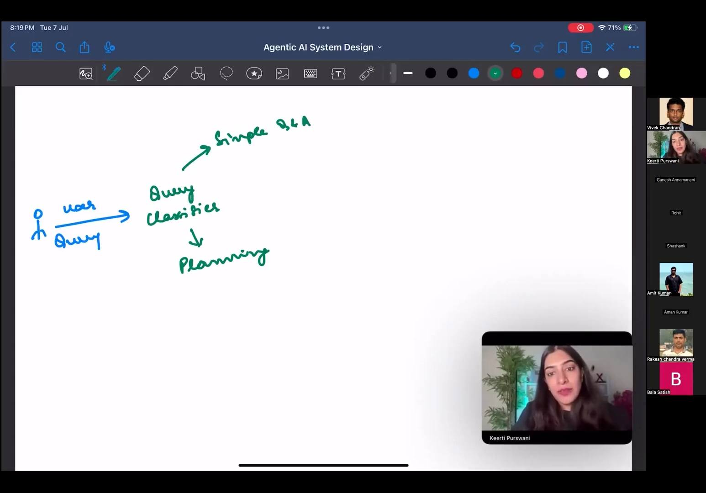
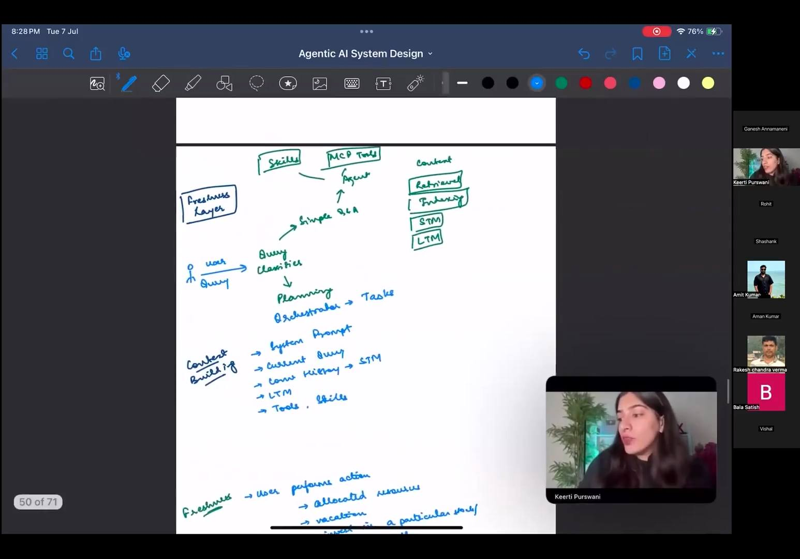
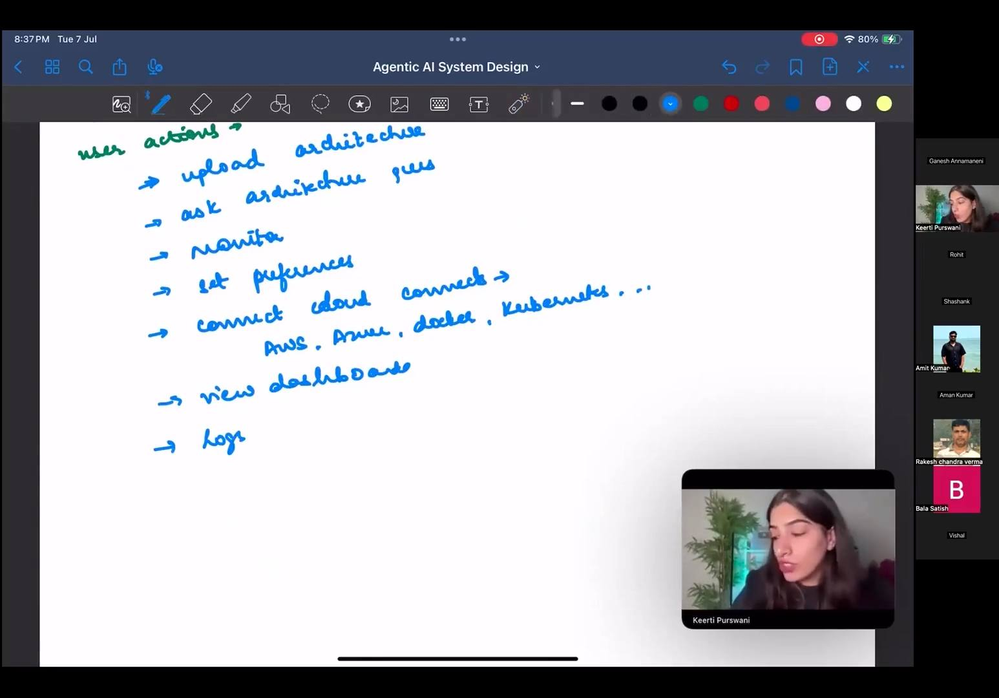
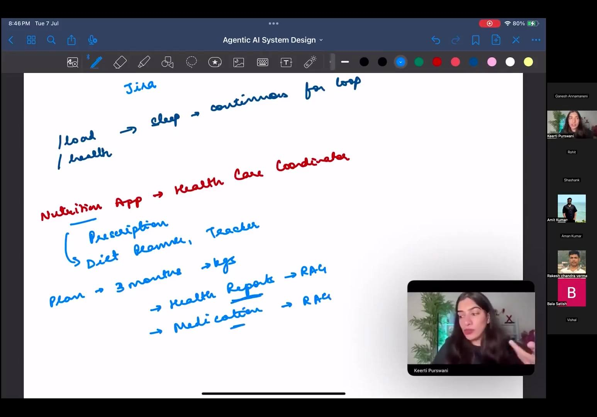
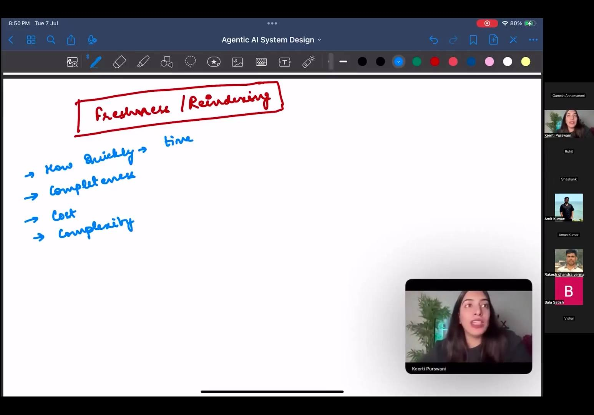
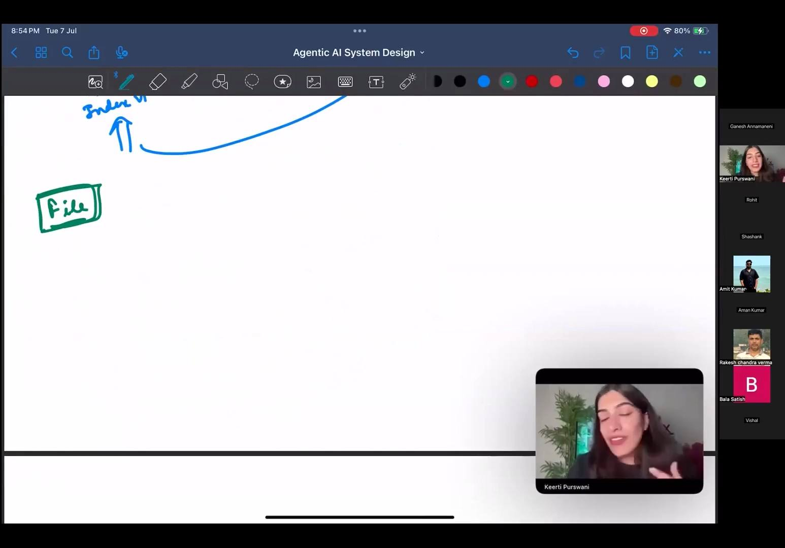

# Agentic AI System Design 第 12 讲：把学过的概念落到两个项目上，以及增量重建索引（Freshness）的完整实现

> 课程：Agentic AI System Design（系统设计 × Agent）｜覆盖 P12
> 读者定位：前端转 AI 应用工程师。本文按「能照着跑起来」的标准写，凡是逐字稿里出现的技术概念、命令、参数、判断，全部保留；课里没讲的，明确标注「课里没讲」。

---

## 1. 这一节做什么

这一讲是整门课的收口课。讲师开场就说，他收到的最有价值的反馈是：**大家能讨论设计、能画架构，但拿到一个全新项目时，不知道该怎么把学过的概念用上去**。所以这一讲做三件事：

1. **把两个课后项目（Trading & Financial Agent、Agent InfraSizer）从头拆一遍**：用户能做什么动作 → 用哪些 RAG / Skills / MCP / Memory / Freshness / 可观测性 / Evals / Guardrails 概念 → 整体架构怎么分层 → 模型怎么按任务选型。目的是让你形成「拿到新项目先问什么」的思维路径。
2. **补上上一讲只讲了概念、没看代码的那块：增量重建索引（incremental re-indexing / freshness）**。讲师现场打开自己的 Claude Code 项目代码，逐段讲 `watcher.py`：文件系统观察者、防抖（debouncing）、单文件重建索引、启动/停止 watcher 的挂载点。
3. **引出 RAG 的规模化话题**：scaling、sharding、multi-tenancy、metadata filtering、分布式架构——这一讲只开了头，明确说「这是接下来要谈的」。

需要提前说清楚：**这一讲没有给出可直接运行的完整工程**。讲师是「走读代码」（他说不打算现场运行，只带大家看主要部分），屏幕上展示的是他自己 Claude Code 项目里的 `index/source/watcher.py` 等文件。因此本文第 4 节给出的代码，是**依据讲师逐字描述的类名、方法名、逻辑结构还原出的可运行实现**，并在每处标注哪些是讲师原话点明的、哪些是为了能跑起来补的。这一点请务必注意，不要误以为逐字稿里有完整源码。


---

## 2. 讲师原话

关于这一讲的目的：

> "我收到的一个反馈我真的很感激：你们都能思考伪代码、思考设计，但拿到一个新项目时，不知道怎么把我们讨论过的一切实现出来。是这样吗？"
> —— p012 [00:00]

> "所以今天我想讲我们布置的两个作业项目，讨论设计，并且谈一谈：如果你在考虑一个全新的 Agentic AI 应用，你怎么把已经学过的概念应用到新应用上，怎么去思考。"
> —— p012 [00:58]

关于项目需求为什么写得模糊：

> "我们之所以把需求写得很模糊，是有原因的，很多面试也会这么做。在 HLD 和 LLD 里，面试官期待你问很多反问，去理解面试官到底要你做什么——重点应该是规划？是简单问答？还是管理可扩展性？面试官到底在找什么。"
> —— p012 [04:46]

关于 RAG 在金融项目里的落点：

> "在给出任何推荐之前，我们的 agent 肯定要去看网上可用的各种文章，也许看有哪些共同基金可选。比如 SEBI 规则、税务规则……或者 RBI 指引。"
> —— p012 [07:27]

> "股票有精确的词，对吧？精确的代码（symbol）。每只股票都有。假设我搜 'limited'，如果我要找 private 还是 public，可能会搜出一堆 'limited'。很多股票名字也很像。所以我确实也需要精确搜索。"
> —— p012 [08:51]

> "当我们从多个数据库、多个索引拿到结果时，我们做什么？重排序（re-ranking），很好。混合搜索里常用的重排序算法是什么？RRF fusion，对，fusion 在这里是准确的词。"
> —— p012 [09:49]

关于金融项目的安全底线：

> "在采取任何行动、投资任何东西之前，你觉得我们的 agent 会直接去投资吗？必须有 human in the loop，非常重要。安全非常重要，human in the loop 和 guardrails 非常重要。"
> —— p012 [24:34]

> "如果你在做一个一年内看到 20% 增长的计划，我必须审阅它。否则 agent 会拿着钱乱来。涉及钱的时候，安全太重要了。Guardrails 应该在输入层和输出层都有。"
> —— p012 [25:03]

关于模型按任务选型：

> "假设我在做简单的查询分类或意图分类，这种情况下我能不能用很小的模型？……假设做组合分析，我能不能用一个真正擅长这个的微调模型？也许是中等规模的微调模型。但当我创建或分析投资报告时，我应该用推理模型。"
> —— p012 [25:57]

> "到处都用推理模型并不合理，但在思考有帮助的地方就可以用。假设我们用短期记忆并且想摘要，摘要用一个便宜的小模型就够了。"
> —— p012 [26:55]

关于第二个项目（Agent InfraSizer）的定位：

> "在我们的 Claude Code 项目里，我们想替代谁？在真实场景里我们在模拟谁？我们在替代开发者。现在如果我们做 agent infrasize，我们在试图替代谁？我们在模拟生产环境的 AI DevOps 工程师。"
> —— p012 [29:39]

关于用免费资源做实验：

> "你可以创建一个简单的 dummy 项目，比如两个 API，一个叫 health API，一个叫 load，在 load 里加一个 sleep，还可以加一点随机化，随机睡多少分钟或多少秒，给一个 timer，或者用一个持续的 for 循环，然后为它创建整套 infra。用免费的就行，用免费的 EC2 实例，让它把 EC2 实例拉起来。"
> —— p012 [38:08]

关于为什么需要 freshness：

> "为什么我需要 freshness？因为数据会过期（stale data）。……也可能是用户的手动触发，也可能是各种不同的触发器。"
> —— p012 [44:29]

关于 freshness 的两个评价维度：

> "第一是时间，也就是你能多快做到，下一次查询时我能不能看到你已经把所有改动都做了。第二是完整性，我做的所有改动是否都反映出来了，而不是有的反映了、有的没反映。但这里我们也要考虑成本和复杂度。"
> —— p012 [45:22]

关于「能做」不等于「该做」：

> "每次你在面试里谈任何方案，请谈 pros and cons。不是因为我们能做缓存，就意味着我们应该做缓存；不是因为我们能做某件事，就意味着我们必须做。你要谈什么时候该做、什么时候不该做。"
> —— p012 [45:51]

关于什么时候该全量重建索引：

> "假设我文档数量很少，比如数据很少，或者只有两三个文件，我需要操心那个吗？……如果只有两三个文件，那我们就直接处理，为什么要过度复杂化？为什么要过度工程？"
> —— p012 [46:51]

> "也许发生了重大变更，比如你在数据库里做了 schema 变更，那很多东西都会变。与其一遍一遍地做，不如直接做一次完整的重建索引。"
> —— p012 [47:49]

关于什么时候不该全量重建：

> "什么时候不该做全量重建？你要想 pros and cons，没有一种方案能解决所有问题。当你有大数据量、大语料库的时候（不该做）。还有什么？频繁变更，很好。还有什么？频繁变更、小改动。还有什么？实时数据，频繁变更发生。"
> —— p012 [48:19]

关于生产环境常用的 shadow collection / 蓝绿策略：

> "生产环境里有时候会发生的是：增量重建索引太复杂了，所以通常的做法是创建一个 shadow collection 作为索引。……一旦这边做完了，我们再把改动反映过去，这样就简单了。这也叫蓝绿策略（blue-green strategy），还有很多其他策略。"
> —— p012 [48:46]

> "是的，这基本上就是原子交换（atomic swap）。"
> —— p012 [50:12]

关于如何判断一个文件是否需要重建索引：

> "我们会存 metadata。用来追踪一个文件是否被重建索引、是否有改动的常用 metadata 是什么？source path。但你怎么知道它最后是什么时候修改的？有两个非常常见的方案。"
> —— p012 [50:36]

> "一个叫 M time。有人知道 M time 是什么吗？你可以搜一下 M time、C time，C time 是创建时间，M time 是修改时间，就是这个文件是什么时候被修改的。另一个方式是，我们对文件做一个 hash，然后看当前的 hash 是否相同。如果有任何改动，hash 就会不同。"
> —— p012 [51:04]

关于触发器：

> "如果 agent 做了任何改动，我们可以告诉 agent：你必须触发这个。但如果用户做了改动，用户不会去做，所以我们必须有一个 watcher，看是不是有变化发生。所以监听文件系统事件也很重要。"
> —— p012 [52:52]

关于防抖：

> "我写代码的时候，应该每毫秒、每纳秒都重建索引吗？不。很好，Nikita，这就叫 debouncing（防抖）。什么是防抖？就是我们会等几秒钟，如果这几秒内文件没有变化发生，我们才做重建索引。"
> —— p012 [54:15]

关于 watcher 挂在哪里：

> "我有一个 start watcher，一个 stop watcher。那我应该在哪里启动 watcher？在我启动 Claude Code 的时候，对吧？所以我在 initialize 里加了 start watcher，它会开始观察我当前运行 Claude Code 的那个仓库。"
> —— p012 [55:37]

关于防抖的具体计时逻辑：

> "假设 debounce 现在是 5 秒。如果我在第 2 秒做了改动，那意味着我会在第 2 加 5，也就是第 7 秒开始重建索引。到第 7 秒之前会发生什么吗？不会，我们会等。但如果第 4 秒又发生了一次改动，那意味着我们必须重置计时器，从第 4 秒重新开始，也就是说我们在第 2 秒启动的计时器要取消，从第 4 秒起启动一个新的。"
> —— p012 [58:28]

关于 run 方法里做了什么：

> "等了这么多秒之后，我们会调用这个 run 方法，run 里做了什么？我保持得很简单：我把整个东西重新索引一遍。所以我是从索引里删除，然后重新索引。对这个特定文件，我重新索引它：我删掉这个文件的 chunks，重新 embedding，再重新索引这个文件。"
> —— p012 [60:21]

关于这段代码什么时候会变成噩梦：

> "什么时候会出问题？文件太大、多个文件同时变更……多个文件变更我们就得改整个东西，我们之前说过，如果有重大变更发生，应该做整体索引，那才合理。很好 Theophilus，多个人可能同时在改。现在我们的 Claude Code 是怎么设计的？我们是在本地跑，所以只有一个人在改。"
> —— p012 [62:15]

> "现在是课程结尾了，所以我们也得考虑 scaling，得谈 multi-tenancy。"
> —— p012 [62:42]

关于多人并发改同一份代码：

> "假设五个人在改同一个东西。你重建索引，同时……就像你用 Git 一样，你得坐下来解决冲突，对吧？重建索引也一样，冲突会出现，你得合并冲突。你可以用 shadow 来处理，也可以用单独的分支。"
> —— p012 [64:08]

关于接下来的话题：

> "说到 RAG 整体，我们还没谈 scaling 和 sharding。所以这里我想谈 scaling、sharding、multi-tenancy 和 metadata filtering。"
> —— p012 [65:07]



---

## 3. 从零复现

这一节分两部分：**A. 两个项目的设计复现路径**（纯设计课，按「需求 → 约束 → 拆解 → 方案 → 取舍」走）；**B. 增量重建索引的可运行复现**（有代码，按环境 → 目录 → 依赖 → 启动命令走）。

### A. 项目一：Trading & Financial Agent（个人财富顾问）

#### A-1 需求（讲师给的原始需求 + 课上补充）

- 角色：一个像**个人财富顾问**的金融助手。
- 输入：自然语言查询，或用户上传的金融数据。
- 用户动作（课上一条条列出来的）：
  1. 上传自己的银行流水（bank statement）、当前组合报告（portfolio report）；
  2. 问简单的投资相关问题、要建议；
  3. 提大目标，比如「给我做一个计划，一年内组合增长 20%」，或退休规划；
  4. 追问（follow-up），比如「再多讲讲这家公司的报告」。
- 需求里给的示例查询：「我有 50,000 卢比，想要五年期低风险回报」——讲师点明这属于**规划类**查询。
- 需求里要求的能力：分析用户财务画像（收入、支出、储蓄率、投资目标等）；推荐共同基金、ETF、长期工具，并且**要带推理和研究依据**。
- 可选项：动态跟踪组合表现、给出建议。

#### A-2 约束

- 涉及真金白银 → **安全是第一约束**，不是性能。
- 数据新鲜度要求分层：SEBI 规则变化很慢，公司报告变化中等，某只股票的市场数据要反复查。
- 查询类型跨度极大：从一句话问答到多步规划。

#### A-3 拆解：概念往哪儿放（这是本讲的核心方法）

**第一步：查询分类（query classification）**。讲师明确说这是「第一件要做的事」：先判断这条 query 是「基于已有数据的简单 Q&A」，还是「需要多步的规划查询」。分类之后走不同分支。

**第二步：RAG 放哪儿**。讲师带着大家逐个想：
- 做任何推荐前，agent 要去看网上文章、看有哪些共同基金；
- SEBI 规则、税务规则（比如给业务省税的税务规则）、RBI 指引；
- 公司报告——「我们怎么决定投哪只股票？就是翻各种公司报告，看现在的市场数据」。

拿到这些数据后，仍然要回答那几个老问题：**怎么解析、怎么切块（chunk）、存哪些 metadata、怎么 embedding 放进向量库、多久更新一次**。讲师特别对比了更新频率：SEBI 规则不会频繁变，公司报告变化频率中等，但某只股票的市场数据要持续查。

**第三步：RAG 的类型选择**。讲师自问自答：能不能只用简单语义 RAG？不能。原因是股票有**精确代码（symbol）**，而且大量股票名字相似（都带 "limited"），纯语义会召回一堆相似项。所以需要**语义 + 词法（lexical）的混合搜索（hybrid search）**。混合之后多路结果要**重排序（re-ranking）**，常用算法是 **RRF fusion**。

**第四步：Skills**。讲师先回顾 Claude Code 里用过的 skills（前端设计、代码审查、系统设计），然后迁移到金融域：
- 组合分析（portfolio analysis）
- 风险分析（risk analysis）
- 组合看板 UI（portfolio dashboard UI）——注意讲师强调「这里的前端是另一种前端」，是报表/看板
- SIP 推荐（SIP recommendation）
- 税务规划（tax planning）
- 课上还提到有人贴了现成的金融 skills 链接

讲师还点了一句方法论：这些能力「需要相同的 system prompt」，所以适合做成 skill 挂上去。

**第五步：MCP 工具**。课上列的：
- **券商 MCP server**：Zerodha、Upstox 等，用来真正下单执行投资；
- **日历 MCP**：按日期、按本周来组织；
- **通知类**：email、Notion、Gmail、Drive。

（讲师还纠正了一位同学：这里不写代码，所以 code review 这个 skill 不适用。）

**第六步：Memory**。短期记忆的必要性来自追问场景（「再多讲讲这家公司的报告」）。长期记忆存什么：用户设过的目标、用户什么时候发工资、用户的交易风格、目标是什么——讲师把这些称为「episodes」。

**第七步：Freshness（新鲜度）**。讲师明确说这里和 Claude Code 不一样：Claude Code 里是代码在变，这里是三类触发器：
1. **用户动作**：入账（credit）、出账（debit）、拿到额外收入、决定多存点钱、决定去度假、决定买/卖某只股票；
2. **市场数据变化** → 需要市场监控（market monitoring）；
3. **只盯自己持有的股票**的 watcher——类比 Claude Code 里「watch 我们的代码」，这里不是 watch 整个市场，而是 watch 已投资的标的。

处理方式沿用老套路：**增量重建索引**，并判断「一次大的市场变化发生时，索引里要更新多少」。

**第八步：调度器（scheduler）**。这是讲师在这一讲新加的一层：除了用户 query，还可以有定时触发。
- 每周五晚上触发一整条规划流程：分析当前持仓表现 → 拉市场数据 → 拉新闻 → 建议该做什么调整（再平衡 rebalancing、该多投还是少投、该停止投某只股票）。
- 也可以是每日收盘后的 daily market debrief / daily portfolio analysis。
- 监控侧还可以设阈值触发：比如某只股票占组合 20% 时，不希望只看 10% 的变动，而要看 1% 的变动。

**第九步：规划的执行**。计划要存下来、拆成多步，用一个 **orchestrator** 管这些 task。task 可以是市场分析、搜新闻，也可以是**浏览器自动化**（讲师提到他演示过的 Playwright，并说「加进项目里非常加分」）。

**第十步：Context engineering**。讲师把上一课的内容原样搬过来：
- 静态 system prompt → 考虑 **prompt caching**（按所用模型决定）；
- 拼上当前 query、对话历史；
- STM / LTM；
- **token budgeting**；
- 把 tools、skills 放进上下文。

**第十一步：可观测性与质量**。讲师一个个点名：**observability / tracing、logging、evals、guardrails**。其中 guardrails 被反复强调：**输入层和输出层都要校验**；任何投资动作前必须 **human in the loop**；任何计划（尤其退休计划、一年 20% 增长计划）必须先经用户审批。

**第十二步：模型选型**（按任务分层，这是讲师特意讲的）：
| 任务 | 模型选择 |
|---|---|
| 查询分类 / 意图分类 | 很小的模型 |
| 组合分析 | 中等规模、针对该任务微调过的模型 |
| 投资报告的分析与生成 | 大推理模型（reasoning model） |
| 短期记忆的摘要 | 便宜的小模型 |

讲师的原话是「到处都用推理模型并不合理，但在思考有帮助的地方就可以用」。

**第十三步：整体形态**。讲师确认：和 Claude Code 一样，这是一个**多智能体（multi-agent）架构**的大系统。

#### A-4 取舍

- 这个项目里**安全 > 一切**，这是它区别于 Claude Code 项目的地方（讲师原话：「这个项目里什么极其重要？安全极其重要」）。
- 混合检索是必须的，不是加分项，因为标的代码是精确匹配需求。
- 调度器是可选增强，但它是把「顾问」变成「持续服务」的关键。



### B. 项目二：Agent InfraSizer（基础设施 SaaS）

#### B-1 需求

- 一个 SaaS 平台：用户/企业用自然语言描述项目需求，agent 设计出最优的基础设施方案。
- 需求里给的示例 query：「我们要为一个每天 10,000 用户的 RAG pipeline 做部署，延迟要求亚 2 秒（sub two seconds latency）」。
- 要求：推荐完整的技术栈、部署、模拟一个监控看板、**分别独立地监控 API tokens 和 LLM tokens**。

#### B-2 定位（讲师的关键一句）

Claude Code 替代的是**开发者**；这个项目模拟的是**生产环境的 AI DevOps 工程师 / SRE**。所以一切从 SRE 的日常工作出发。

#### B-3 用户动作（课上一条条列的）

1. 上传整套架构，让系统去部署；
2. 让系统**设计**架构（讲师说「设计看起来是个大动作、规划类动作」）；
3. 问简单的架构相关问题：「为什么它是这样工作的？」「上周发生了什么，告诉我」「为什么这样跑，可能的原因是什么」；
4. 设置偏好（preferences）；
5. 连接不同的云账号：AWS、Azure，以及 Docker、Kubernetes；
6. 看 dashboard，了解当前运行状况；
7. 查看服务资源的日志和性能；
8. 基于日志查看项目推荐（view recommendations）。

#### B-4 概念落点

- **RAG 检索什么**：日志（很重要）、各家文档（AWS / Azure / Docker / Kubernetes）、**定价文档**，以及通过 web search 拿到的各种架构模式。
- **chunking / metadata 怎么证明更好**：靠 **evals**、靠建 **golden dataset** 去评估，比较两种 chunking 策略、两种 metadata filtering、两个 RAG 方案。
- **检索类型**：搜某个 EC2 实例的文档时，t2.micro 和 large 实例的文档是不一样的，所以需要**词法搜索**，因此这里同样要 **hybrid 或 agentic RAG**，同样要 **re-ranking / fusion**。
- **Terraform 场景**（同学提问引出）：如果架构是用 Terraform 或其他 IaC 代码描述的，那变更时就要去翻 Terraform 文档，也就是要把 Terraform 接进来。
- **Skills**：AWS 专项 skill、Terraform 生成 skill、**架构审查（architecture review，类比代码审查）**、延迟分析、成本分析、日志分析、流量分析、基础设施设计。
- **MCP servers**：Prometheus、Grafana、CloudWatch、Kubernetes，另外还有 GitHub Actions、JIRA。
- **一个具体用例的完整链路**（讲师现场推的）：「两周前发生了一次事故，分析并给我事故报告」→ 需要按**时间**检索那一段日志（时间范围过滤）→ 另一个 agent 做分析 → 一个 skill 生成看板/报告展示到底发生了什么 → 针对具体事故还要**词法搜索**。

#### B-5 怎么练（讲师给的实操建议）

不要纠结「给什么项目做 infra」，自己造一个 dummy 项目：
- 两个 API：一个 `health`，一个 `load`；
- `load` 里加 `sleep`，并加随机化（随机睡若干秒/分钟），或用 timer，或用持续 for 循环制造负载；
- 用**免费额度**：用免费的 EC2 实例，让它把 EC2 拉起来；
- 写 IaC 文件（讲师口述为「创建 ML 文件」，按上下文应指 IaC/terraform 文件，**具体文件名课里没讲清**），让它 spin up EC2；
- 这样就能把整条 pipeline 真的搭出来。

#### B-6 迁移到任意新项目（讲师最后给的通用方法）

讲师让同学现场提新项目，然后逐个套框架：
- **营养 / 健康协调 App**：处方、健康报告（→ RAG）、用药分析、三个月减重 N 公斤的规划（→ planning）、饮食与训练计划、通知系统（→ MCP notifier）、freshness。
- 其他方向：法律、招聘、CRM、类 NotebookLM 的知识库。

结论：**概念是同一套，只是换一个领域去想**。



### C. 增量重建索引（Freshness）的可运行复现

#### C-1 环境与依赖

课里没有给 `requirements.txt`，也没有给 Python 版本。讲师只提到用了「文件系统观察者（file system observer）」，并且 `GetObserver` 会「根据你的操作系统返回对应的 observer」——这正是 `watchdog` 库的 API 形态（`watchdog.observers.Observer`）。所以下面按 `watchdog` 复现，**这是依据讲师描述做的合理还原，不是逐字稿原文**。

```bash
# Python 3.10+（课里没指定版本，3.10 以上均可）
python -m venv .venv
source .venv/bin/activate        # Windows: .venv\Scripts\activate

pip install watchdog
# 向量库与 embedding 课里没指定具体产品，下面用最小编排演示，
# 真实项目请替换成你实际用的向量库 SDK
```

#### C-2 目录结构（按讲师说的路径还原）

讲师明确说了 watcher 文件的位置：`index/source/watcher.py`。据此还原：

```
your-project/
├── index/
│   ├── __init__.py
│   └── source/
│       ├── __init__.py
│       ├── watcher.py          # 讲师现场走读的文件
│       └── indexer.py          # 被 watcher 调用的索引器（课里未展示实现）
├── main.py                     # 对应讲师说的 initialize / 启动入口
└── .index_state.json           # 记录 mtime / hash 的元数据（课里讲了思路，未给文件名）
```

#### C-3 启动方式

讲师说 watcher 在 Claude Code 的 `initialize` 里启动、在关闭时 `stop watcher`。对应到可运行版本：

```bash
python main.py
# 启动后 watcher 在后台线程观察当前仓库；
# 修改任意被索引的文件，等待 debounce 秒数（默认 5 秒）后触发单文件重建索引。
```

#### C-4 关键参数

| 参数 | 值 | 来源 |
|---|---|---|
| `debounce_seconds` | 5（讲师举例用的就是 5 秒） | p012 [58:58] |
| 观察范围 | 当前运行 Claude Code 的那个仓库 | p012 [55:37] |
| 重建粒度 | 单个文件（`index_single_file`） | p012 [61:45] |
| 变更判定 | mtime 或 文件 hash | p012 [51:04] |



---

## 4. 完整代码

> **重要声明**：本节代码是**依据讲师逐字描述的类名、方法名与逻辑还原的可运行实现**。逐字稿里讲师是「走读」自己的代码，没有贴出完整源码，本段 OCR 也没有任何结果。凡讲师明确点名的结构（`start_watcher` / `stop_watcher` / `GetObserver` / `CodeBaseEventHandler` / `schedule` / `run` / `index_single_file` / `initialize`）均原样保留；其余为实现所需的最小补齐，已逐处标注。

### 4.1 `index/source/watcher.py`

```python
"""
文件系统 watcher + 防抖 + 单文件增量重建索引。

讲师在 p012 [55:37]–[61:18] 走读的就是这个文件，明确点到的结构：
  - start_watcher / stop_watcher
  - GetObserver（按操作系统返回 observer）
  - CodeBaseEventHandler
  - schedule（防抖核心）
  - run（真正执行重建索引）
  - index_single_file（只重建单个文件，不是全量）
以下为可运行还原版。
"""

import os
import sys
import threading
import time
import hashlib
import json
from typing import Dict, Optional

from watchdog.observers import Observer
from watchdog.events import FileSystemEventHandler, FileSystemEvent

# ---- 可调参数 ----
# 讲师举例用的就是 5 秒（p012 [58:58]）
DEBOUNCE_SECONDS = 5

# 需要索引的文件后缀，课里没讲具体范围，这里给一个常见默认值
WATCHED_EXTENSIONS = {".py", ".md", ".txt", ".json", ".yaml", ".yml"}

# 元数据落盘位置（课里讲了「存 metadata」，没给文件名，这里是实现选择）
STATE_FILE = ".index_state.json"


def GetObserver():
    """
    讲师原话：'在 GetObserver 里，我只是根据你的操作系统，给我对应的 observer。
    每个操作系统都有文件系统 observer，它只是把它返回回来。'
    watchdog 的 Observer 本身就会按平台选择实现（inotify / FSEvents / ReadDirectoryChangesW），
    所以这里直接返回 Observer 实例。
    """
    return Observer()


def _file_hash(path: str) -> str:
    """按块读文件算 sha256，避免大文件一次性读进内存。"""
    h = hashlib.sha256()
    with open(path, "rb") as f:
        for chunk in iter(lambda: f.read(1024 * 1024), b""):
            h.update(chunk)
    return h.hexdigest()


class IndexState:
    """
    记录每个文件的 mtime 与 hash。
    讲师 p012 [51:04]：'一个叫 M time……另一个方式是，我们对文件做一个 hash，
    然后看当前的 hash 是否相同。如果有任何改动，hash 就会不同。'
    两种策略这里都实现，默认用 hash（更可靠），可切到 mtime。
    """

    def __init__(self, state_file: str = STATE_FILE, strategy: str = "hash"):
        self.state_file = state_file
        self.strategy = strategy  # "hash" | "mtime"
        self._lock = threading.Lock()
        self._data: Dict[str, dict] = {}
        self._load()

    def _load(self):
        if os.path.exists(self.state_file):
            try:
                with open(self.state_file, "r", encoding="utf-8") as f:
                    self._data = json.load(f)
            except (json.JSONDecodeError, OSError):
                self._data = {}

    def _save(self):
        tmp = self.state_file + ".tmp"
        with open(tmp, "w", encoding="utf-8") as f:
            json.dump(self._data, f, ensure_ascii=False, indent=2)
        os.replace(tmp, self.state_file)  # 原子替换，避免写一半崩掉

    def needs_reindex(self, path: str) -> bool:
        """判断这个文件是否需要重建索引。"""
        if not os.path.exists(path):
            return False
        with self._lock:
            prev = self._data.get(path)
        if prev is None:
            return True
        if self.strategy == "mtime":
            return prev.get("mtime") != os.path.getmtime(path)
        return prev.get("hash") != _file_hash(path)

    def mark_indexed(self, path: str):
        with self._lock:
            self._data[path] = {
                "mtime": os.path.getmtime(path),
                "hash": _file_hash(path),
                "indexed_at": time.time(),
            }
            self._save()

    def forget(self, path: str):
        with self._lock:
            self._data.pop(path, None)
            self._save()


class CodeBaseEventHandler(FileSystemEventHandler):
    """
    讲师 p012 [57:33]：'你能看到这个 schedule 吗？这就是我写的防抖的核心部分。'
    逻辑：每次事件到来，如果这个文件已经有计时器，就取消它，然后重新起一个。
    """

    def __init__(self, indexer, debounce_seconds: int = DEBOUNCE_SECONDS):
        super().__init__()
        self.indexer = indexer
        self.debounce_seconds = debounce_seconds
        # path -> threading.Timer
        self._timers: Dict[str, threading.Timer] = {}
        self._lock = threading.Lock()

    # ---- 防抖核心 ----
    def schedule(self, path: str):
        """
        讲师 p012 [58:28] 的原话逻辑：
        '如果我在第 2 秒做了改动，那我会在第 2+5=7 秒开始重建索引。
         但如果第 4 秒又发生了一次改动，那我们必须重置计时器，
         把第 2 秒启动的取消掉，从第 4 秒起启动一个新的。'
        """
        with self._lock:
            existing = self._timers.get(path)
            if existing is not None:
                existing.cancel()  # 取消旧计时器
            timer = threading.Timer(self.debounce_seconds, self.run, args=(path,))
            timer.daemon = True
            self._timers[path] = timer
            timer.start()

    # ---- 防抖窗口结束后真正执行 ----
    def run(self, path: str):
        """
        讲师 p012 [60:21]：'等了这么多秒之后，我们会调用这个 run 方法。
        run 里我保持得很简单：我把整个东西重新索引一遍——
        对这个特定文件，我删掉它的 chunks，重新 embedding，再重新索引。'
        """
        with self._lock:
            self._timers.pop(path, None)

        if not os.path.exists(path):
            # 文件被删了：把它的 chunks 从索引里清掉
            self.indexer.delete_file_chunks(path)
            self.indexer.state.forget(path)
            return

        if not self.indexer.state.needs_reindex(path):
            return  # mtime / hash 没变，跳过

        # 讲师 p012 [61:45]：'我是在重建某一个特定文件，不是整个东西'
        self.indexer.index_single_file(path)

    # ---- watchdog 回调 ----
    def on_modified(self, event: FileSystemEvent):
        if event.is_directory:
            return
        if not self._is_watched(event.src_path):
            return
        self.schedule(event.src_path)

    def on_created(self, event: FileSystemEvent):
        if event.is_directory:
            return
        if not self._is_watched(event.src_path):
            return
        self.schedule(event.src_path)

    def on_deleted(self, event: FileSystemEvent):
        if event.is_directory:
            return
        if not self._is_watched(event.src_path):
            return
        self.schedule(event.src_path)

    def on_moved(self, event: FileSystemEvent):
        if event.is_directory:
            return
        # 旧路径清掉，新路径重建
        self.schedule(event.src_path)
        self.schedule(event.dest_path)

    @staticmethod
    def _is_watched(path: str) -> bool:
        _, ext = os.path.splitext(path)
        return ext.lower() in WATCHED_EXTENSIONS


class Watcher:
    """
    讲师 p012 [55:37]：'我有一个 start watcher，一个 stop watcher。
    我在 initialize 里加了 start watcher，它会开始观察我当前运行 Claude Code 的那个仓库。'
    """

    def __init__(self, repo_path: str, indexer, debounce_seconds: int = DEBOUNCE_SECONDS):
        self.repo_path = os.path.abspath(repo_path)
        self.indexer = indexer
        self.debounce_seconds = debounce_seconds
        self._observer: Optional[Observer] = None
        self._handler: Optional[CodeBaseEventHandler] = None

    def start_watcher(self):
        if self._observer is not None:
            return  # 已经在跑
        self._handler = CodeBaseEventHandler(self.indexer, self.debounce_seconds)
        self._observer = GetObserver()
        # recursive=True：整个仓库递归观察
        self._observer.schedule(self._handler, self.repo_path, recursive=True)
        self._observer.start()  # 讲师：'这在后台线程里，是完全不同的一个后台线程'
        print(f"[watcher] started on {self.repo_path} (debounce={self.debounce_seconds}s)")

    def stop_watcher(self):
        if self._observer is None:
            return
        self._observer.stop()
        self._observer.join(timeout=5)
        self._observer = None
        self._handler = None
        print("[watcher] stopped")
```

### 4.2 `index/source/indexer.py`

> 课里**没有展示**索引器的实现，讲师只说 `run` 里调用了「删掉这个文件的 chunks → 重新 embedding → 重新索引」。下面是满足这个描述的最小实现骨架，向量库部分用内存字典占位，**请替换成你实际使用的向量库**。

```python
"""
索引器骨架。课里未展示实现，此处按讲师描述的最小行为还原：
  - delete_file_chunks(path)
  - index_single_file(path)
  - reindex_all()   # 对应讲师说的「启动时也可以手动全量重建」这个触发器
"""

import os
from typing import Dict, List

from .watcher import IndexState, WATCHED_EXTENSIONS


class SimpleIndexer:
    def __init__(self, repo_path: str, state: IndexState):
        self.repo_path = os.path.abspath(repo_path)
        self.state = state
        # 占位：file_path -> [chunk, ...]
        # 真实项目替换为你的向量库 collection
        self.store: Dict[str, List[str]] = {}

    # ---- 切块 ----
    def chunk(self, text: str, size: int = 800, overlap: int = 100) -> List[str]:
        """课里没讲具体 chunk 参数，这里给常见默认值。"""
        chunks, start = [], 0
        while start < len(text):
            chunks.append(text[start:start + size])
            start += size - overlap
        return chunks

    # ---- embedding ----
    def embed(self, chunks: List[str]) -> List[List[float]]:
        """
        课里没指定 embedding 模型。
        真实项目在这里调用你的 embedding API。
        """
        return [[float(len(c))] for c in chunks]  # 占位向量

    # ---- 单文件重建 ----
    def index_single_file(self, path: str):
        """
        讲师 p012 [60:21]：'我删掉这个文件的 chunks，重新 embedding，再重新索引这个文件。'
        """
        try:
            with open(path, "r", encoding="utf-8", errors="ignore") as f:
                text = f.read()
        except OSError as e:
            print(f"[indexer] read failed {path}: {e}")
            return

        self.delete_file_chunks(path)          # 1. 删旧 chunks
        chunks = self.chunk(text)
        _ = self.embed(chunks)                 # 2. 重新 embedding
        self.store[path] = chunks              # 3. 重新写入索引
        self.state.mark_indexed(path)          # 4. 更新 mtime / hash 元数据
        print(f"[indexer] reindexed {path} ({len(chunks)} chunks)")

    def delete_file_chunks(self, path: str):
        self.store.pop(path, None)

    # ---- 全量重建（讲师说的「启动时手动全量重建」这个触发器）----
    def reindex_all(self):
        """
        讲师 p012 [61:18]：'我还加了不同的触发器，其中一个是在最开始，
        我们可以手动把整个东西重建索引。'
        注意：讲师同时强调全量重建只适合小数据量 / 重大变更场景（p012 [46:51]–[47:49]）。
        """
        for root, _, files in os.walk(self.repo_path):
            for name in files:
                if os.path.splitext(name)[1].lower() not in WATCHED_EXTENSIONS:
                    continue
                path = os.path.join(root, name)
                if self.state.needs_reindex(path):
                    self.index_single_file(path)
```

### 4.3 `main.py`（对应讲师说的 `initialize`）

```python
"""
入口。讲师 p012 [55:37]：
'我在 initialize 里加了 start watcher……在最后我也加了 stop watcher，
这样你关闭的时候可以把它停掉。'
"""

import os
import signal
import sys

from index.source.watcher import Watcher, IndexState, DEBOUNCE_SECONDS
from index.source.indexer import SimpleIndexer


def initialize(repo_path: str = "."):
    state = IndexState(strategy="hash")   # 可切 "mtime"
    indexer = SimpleIndexer(repo_path, state)

    # 触发器之一：启动时手动全量重建（讲师 p012 [61:18]）
    # 数据量大时不要这么做，见 p012 [48:19]
    # indexer.reindex_all()

    watcher = Watcher(repo_path, indexer, debounce_seconds=DEBOUNCE_SECONDS)
    watcher.start_watcher()
    return watcher


def main():
    watcher = initialize(".")

    def _shutdown(signum, frame):
        watcher.stop_watcher()
        sys.exit(0)

    signal.signal(signal.SIGINT, _shutdown)
    signal.signal(signal.SIGTERM, _shutdown)

    print("Watching for changes. Ctrl+C to stop.")
    signal.pause()   # Windows 上请改用 while True: time.sleep(1)


if __name__ == "__main__":
    main()
```

### 4.4 设计产物：两个项目的决策表

> 课里没有代码，以下是依据讲师口述整理的设计决策表。

**Trading & Financial Agent**

| 层 | 决策 | 讲师依据 |
|---|---|---|
| 入口 | 查询分类器（简单 Q&A / 多步规划） | p012 [14:37] |
| 检索 | Hybrid（语义 + 词法）+ RRF fusion 重排序 | p012 [08:51]–[09:49] |
| 知识源 | 文章、共同基金、SEBI 规则、税务规则、RBI 指引、公司报告、市场数据 | p012 [07:27]–[08:22] |
| Skills | 组合分析、风险分析、看板 UI、SIP 推荐、税务规划 | p012 [11:44]–[12:14] |
| MCP | 券商（Zerodha / Upstox）、日历、email / Notion / Gmail / Drive | p012 [13:12]–[13:37] |
| Memory | STM（追问）+ LTM（目标、发薪、交易风格等 episodes） | p012 [16:01]–[16:27] |
| Freshness | 用户动作 / 市场监控 / 持仓 watcher 三类触发器 + 增量重建 | p012 [17:25]–[19:20] |
| 调度 | 每周五晚规划、每日收盘简报、阈值触发 | p012 [19:49]–[21:14] |
| 执行 | orchestrator 拆 task；可接 Playwright 浏览器自动化 | p012 [22:11]–[22:41] |
| 上下文 | 静态 system prompt + prompt caching + token budgeting + tools/skills | p012 [23:07]–[24:04] |
| 质量 | tracing、logging、evals、guardrails（输入+输出） | p012 [24:04]–[25:29] |
| 安全 | 任何投资动作 human in the loop；计划必须审批 | p012 [24:34]–[25:03] |
| 模型 | 分类=小模型；组合分析=中等微调模型；报告=推理模型；摘要=便宜小模型 | p012 [25:57]–[26:55] |

**Agent InfraSizer**

| 层 | 决策 | 讲师依据 |
|---|---|---|
| 定位 | 模拟生产 AI DevOps / SRE | p012 [29:39] |
| 用户动作 | 上传架构 / 设计架构 / 架构问答 / 设偏好 / 连云账号 / 看板 / 看日志与资源性能 / 看推荐 | p012 [30:38]–[33:05] |
| 知识源 | 日志、AWS/Azure/Docker/K8s 文档、定价文档、web search 架构模式、Terraform 文档 | p012 [33:34]–[35:59] |
| 检索 | Hybrid / agentic RAG + re-ranking / fusion（实例规格需精确匹配） | p012 [35:02]–[35:31] |
| Skills | AWS 专项、Terraform 生成、架构审查、延迟分析、成本分析、日志分析、流量分析、infra 设计 | p012 [36:24]–[37:13] |
| MCP | Prometheus、Grafana、CloudWatch、Kubernetes、GitHub Actions、JIRA | p012 [37:13]–[37:39] |
| 评估 | golden dataset + evals 比较 chunking / metadata / RAG 方案 | p012 [34:33] |
| 典型链路 | 时间范围检索日志 → 分析 agent → 报告/看板 skill → 事故词法检索 | p012 [39:27]–[39:56] |



---

## 5. 逐行解释

### 5.1 `watcher.py`

**`GetObserver()`**：讲师说它「根据你的操作系统返回对应的 observer」。在 `watchdog` 里，`Observer` 本身就是平台自适应的（Linux 用 inotify、macOS 用 FSEvents、Windows 用 ReadDirectoryChangesW），所以这个函数体只有一行。如果你要支持跨平台差异化的轮询策略，可以在这里换成 `PollingObserver`。

**`DEBOUNCE_SECONDS = 5`**：讲师举例时用的就是 5 秒（「假设 debounce 现在是 5 秒」）。这个值直接决定「最后一次改动后多久才真正重建索引」。太小 → 频繁重建、浪费 embedding 成本；太大 → 用户改完要等很久才能被检索到，违反讲师说的「时间」维度。

**`IndexState` 里同时存 mtime 和 hash**：讲师把两种方案并列讲了，没说哪个更好。实践上 hash 更可靠（mtime 在 `git checkout`、`rsync -t`、容器挂载等场景下会失真），mtime 更便宜（不用读文件内容）。代码里用 `strategy` 参数切换，默认 `hash`。

**`_save()` 用 `os.replace`**：这是原子替换，防止进程在写元数据时被杀导致 JSON 损坏。对应讲师讲的「shadow / 原子交换」思路在文件层面的最小应用。

**`schedule()` 里的 `existing.cancel()`**：这就是防抖的全部秘密。讲师用第 2 秒、第 4 秒的例子讲得很清楚：**每次新事件都把旧计时器取消，重新起一个**。所以如果文件每秒都在变，计时器会被无限取消重建，永远不会触发 `run`——讲师在 [59:56] 确认了这一点（「如果每秒都有变化，那你会一直取消、一直新建」）。

**`run()` 里先 `pop` 掉 timer**：避免 `run` 执行期间又有新事件进来时，`schedule` 拿到一个已经触发过的 Timer 对象去 `cancel()`（对已触发的 Timer 调 `cancel()` 是无效的，会导致新事件被吞掉）。

**`run()` 里先判断文件是否存在**：文件被删了就不能读，只能清 chunks。这是讲师没讲但必然会遇到的边界。

**`run()` 里调 `needs_reindex`**：防抖只能减少触发次数，不能保证内容真的变了（比如编辑器保存但内容没改、或者 `touch` 了一下）。用 mtime/hash 二次确认，避免无谓的 embedding 开销。

**`index_single_file` 而不是全量**：讲师在 [61:45] 特意澄清了一位同学的误解——「我是在重建某一个特定文件，不是整个东西」。这是这段代码的性能关键：一次改动只付一个文件的 embedding 成本。

**`on_moved` 里对两个路径都 schedule**：重命名 = 旧路径删除 + 新路径创建，两边都要处理，否则旧 chunks 会变成孤儿。

**`_is_watched` 按后缀过滤**：课里没讲要索引哪些文件类型，这是实现选择。真实项目里应该和你的 `.gitignore` / 索引白名单对齐。

**`Watcher.start_watcher()` 里的 `recursive=True`**：讲师说「观察我当前运行 Claude Code 的那个仓库」，是整个仓库，不是单层目录。

**`start_watcher` 的幂等判断**：`if self._observer is not None: return`。防止 `initialize` 被调用两次时起两个 observer（会导致每个事件触发两次重建）。

**`stop_watcher` 里的 `join(timeout=5)`**：`Observer.stop()` 只是发信号，不 join 的话线程可能还在跑，进程退出时会有资源泄漏警告。

### 5.2 `indexer.py`

**`chunk()` 的 size/overlap**：课里没讲具体数值。这里给 800/100 是常见起点。讲师在 InfraSizer 部分强调过：**chunking 策略好不好要靠 evals + golden dataset 证明**（p012 [34:33]），所以这两个数字应该是被评估出来的，不是拍脑袋定的。

**`index_single_file` 的四步顺序**：删旧 → 切块 → embedding → 写索引 → 更新元数据。顺序不能乱：如果先写新再删旧，中间态会出现重复 chunks；如果先更新元数据再写索引，崩在中间会导致「元数据说已索引、实际没索引」，下次永远不会重建。

**`reindex_all()` 默认被注释掉**：讲师说启动时可以手动全量重建，但他同时反复强调全量重建只适合小数据量、重大变更（schema 变更）、或延迟不敏感的场景。默认注释掉是把这个判断留给使用者。

### 5.3 `main.py`

**`initialize()` 里先建 state 再建 indexer 再建 watcher**：依赖顺序。`Watcher` 需要 `indexer`，`indexer` 需要 `state`。

**信号处理**：讲师说「在最后我也加了 stop watcher，这样你关闭的时候可以把它停掉」。对应到 Python 就是捕获 SIGINT/SIGTERM。注意 `signal.pause()` 在 Windows 上不可用，注释里给了替代方案。

### 5.4 关于「多人并发改同一份代码」

讲师在 [64:08] 明确说这是这段代码的噩梦场景之一。他的答案是：**像 Git 一样处理冲突**——要么用 shadow collection，要么用单独的分支。这段代码本身**没有**处理并发写索引的锁（`IndexState` 内部有锁保护元数据，但 `store` 的写入没有跨进程保护）。如果你要上多租户，这是必须补的。讲师在 [62:42] 说「现在是课程结尾了，所以我们也得考虑 scaling，得谈 multi-tenancy」——**具体方案这一讲没展开**。



---

## 6. 复现检查清单

**A. 设计部分（不需要写代码，能口头答出来即算通过）**

- [ ] 能说出 Trading Agent 的 4 类用户动作，并指出哪一类需要 query classification 分流
- [ ] 能解释为什么金融场景必须用 hybrid search 而不是纯语义（关键词：股票 symbol、名字相似、大量 "limited"）
- [ ] 能说出混合检索后用什么重排序（RRF fusion）
- [ ] 能列出至少 5 个金融项目的 skills 和 4 个 MCP server
- [ ] 能说清 STM 和 LTM 各自存什么
- [ ] 能说出金融项目的 3 类 freshness 触发器
- [ ] 能解释为什么 guardrails 要同时做输入和输出校验，以及 human in the loop 卡在哪个环节
- [ ] 能按任务给出 4 档模型选型
- [ ] 能说出 InfraSizer 替代的是哪个角色（生产 AI DevOps / SRE）
- [ ] 能完整推一遍「两周前事故 → 事故报告」的链路
- [ ] 能说出怎么用免费 EC2 + dummy 双 API 项目练手

**B. 代码部分（能跑起来才算通过）**

- [ ] `pip install watchdog` 成功，`python main.py` 打印 `[watcher] started on ...`
- [ ] 修改一个被监听的文件，**等满 5 秒**后看到 `[indexer] reindexed ...`
- [ ] 连续快速改同一个文件 3 次（间隔 < 5 秒），确认**只触发一次**重建（防抖生效）
- [ ] 把 `DEBOUNCE_SECONDS` 改成 10，重复上一步，确认等待时间变长
- [ ] 删除一个已索引文件，确认 chunks 被清掉且 `.index_state.json` 里对应条目消失
- [ ] 重命名文件，确认旧路径条目消失、新路径被索引
- [ ] 把 `IndexState(strategy="mtime")` 切过去，确认仍能正确判断变更
- [ ] 打开 `indexer.reindex_all()` 注释，确认全量重建能跑通（**只在测试用小仓库上做**）
- [ ] Ctrl+C 能干净退出，打印 `[watcher] stopped`

**C. 面试自检**

- [ ] 被问「什么时候该全量重建、什么时候不该」能立刻答出两边各 3 条
- [ ] 被问「怎么判断文件要不要重建索引」能答出 mtime 和 hash 两条路及各自代价
- [ ] 被问「增量重建太复杂怎么办」能答出 shadow collection / 蓝绿 / 原子交换

---

## 7. 课里没讲但你会撞上的

1. **`watchdog` 的具体版本**：课里没提。`Observer` / `FileSystemEventHandler` 的 API 在 2.x–6.x 之间基本稳定，装最新版即可。如果你在 Docker 容器里跑，注意 inotify 有 `max_user_watches` 上限，大仓库会报 `OSError: inotify watch limit reached`——需要调 `sysctl fs.inotify.max_user_watches`。这是课里完全没覆盖的运维细节。

2. **embedding 模型和向量库**：课里全程说「embedding 放进向量库」，但**没有指定任何具体产品**。`indexer.py` 里的 `embed()` 和 `store` 都是占位。真实项目里你要自己选，并且要注意：删 chunks 时向量库的删除 API 和写入 API 往往不是原子的，删完写之前如果崩了，这个文件就处于「索引里没有、元数据说已索引」的状态——下次不会重建。稳妥做法是先写新 chunks 打上版本号，再删旧版本。

3. **`signal.pause()` 在 Windows 上不存在**：`main.py` 注释里给了替代，但没展开。Windows 上还要注意 `watchdog` 的 `on_moved` 行为与 Linux 不同（Windows 的重命名可能只触发 `on_moved`，不触发 `on_created`/`on_deleted`），所以 `on_moved` 里对两个路径都 schedule 是必要的。

4. **多进程 / 多实例并发写同一份索引**：讲师在 [64:08] 承认这是噩梦场景，但给的答案是「像 Git 一样合并冲突」和「shadow / 分支」，**没有给具体实现**。如果你真的要多租户，`IndexState` 的文件锁需要换成分布式锁（Redis / 数据库行锁）。在 Node.js 里对应的是 `proper-lockfile` 或 Redis 的 `SET NX PX`。

5. **`reindex_all()` 的遍历没有排除 `.git`、`node_modules`、`.venv`**：这是实现简化。真实项目必须加排除列表，否则第一次全量重建会索引几万个无关文件。课里没讲这一点。

6. **`WATCHED_EXTENSIONS` 是拍脑袋定的**：课里没讲索引哪些文件类型。你的项目如果是 TS/JS 为主，要改成 `.ts/.tsx/.js/.jsx`。

7. **「创建 ML 文件」这个说法**：讲师在 [38:57] 说「创建 ML 文件，它就会帮你把 EC2 实例拉起来」。从上下文（IaC、spin up EC2）看，这里大概率是语音识别把某个 IaC 文件名（如 Terraform 的 `.tf` 文件，或 CloudFormation 模板）识别成了「ML 文件」。**具体是哪种 IaC 工具，课里没讲清**，请以你实际选用的工具为准。

8. **scaling / sharding / multi-tenancy / metadata filtering**：讲师在 [65:07] 明确说「这些是我们还没谈的」，这一讲只开了个头，**具体方案在后续内容里**。本文不编造。

9. **`evals` 和 `golden dataset` 的具体做法**：讲师说「明天讲 LLM ops 时会讲 evals」，这一讲只给了「用 evals 比较两种 chunking / metadata / RAG 方案」这个方向，**没有给数据集格式、指标、跑法**。

10. **Java 等语言的对应**：本讲代码全是 Python。如果你是从 Java 背景看，`threading.Timer` 对应 `ScheduledExecutorService.schedule()`，`threading.Lock` 对应 `synchronized` / `ReentrantLock`——**知道即可**，不影响你复现。前端背景的话：`threading.Timer` 就是 `setTimeout`，`cancel()` 就是 `clearTimeout`，防抖逻辑和你写搜索框输入防抖**一模一样**，只是这里防抖的副作用是「重建索引」而不是「发请求」。