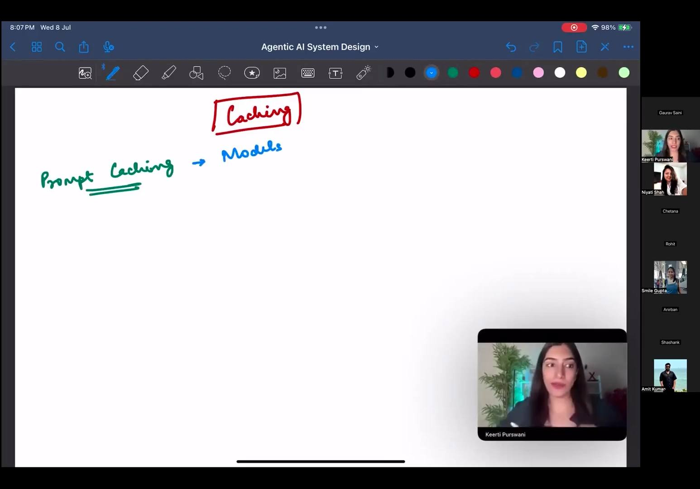
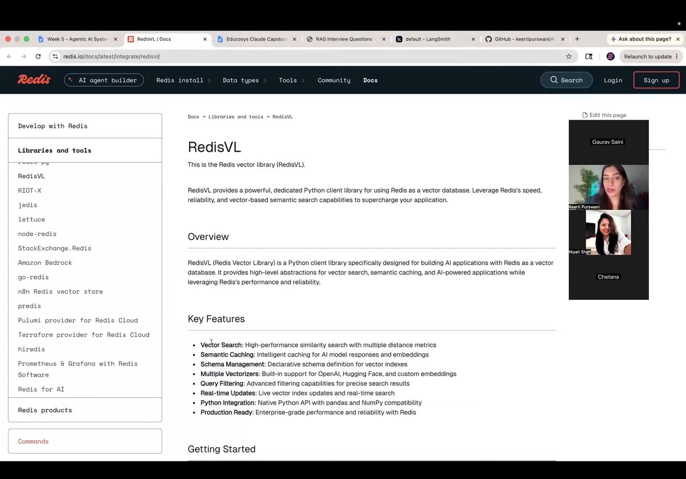
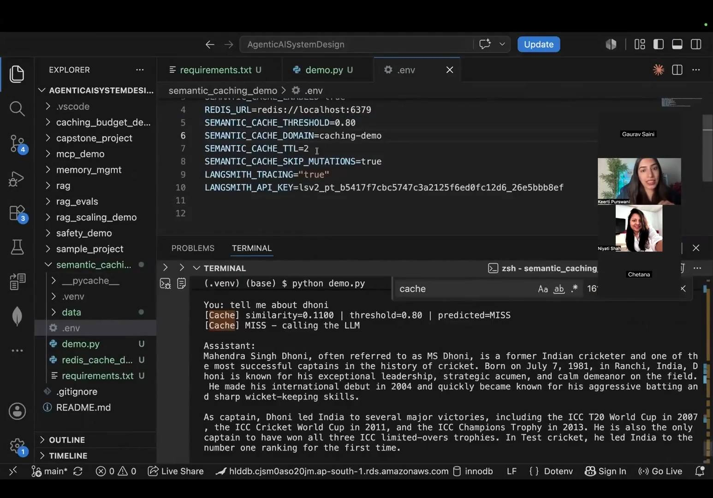
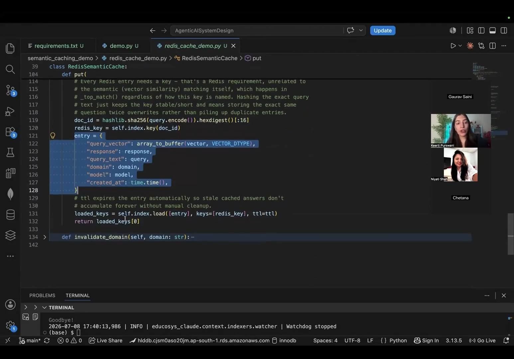
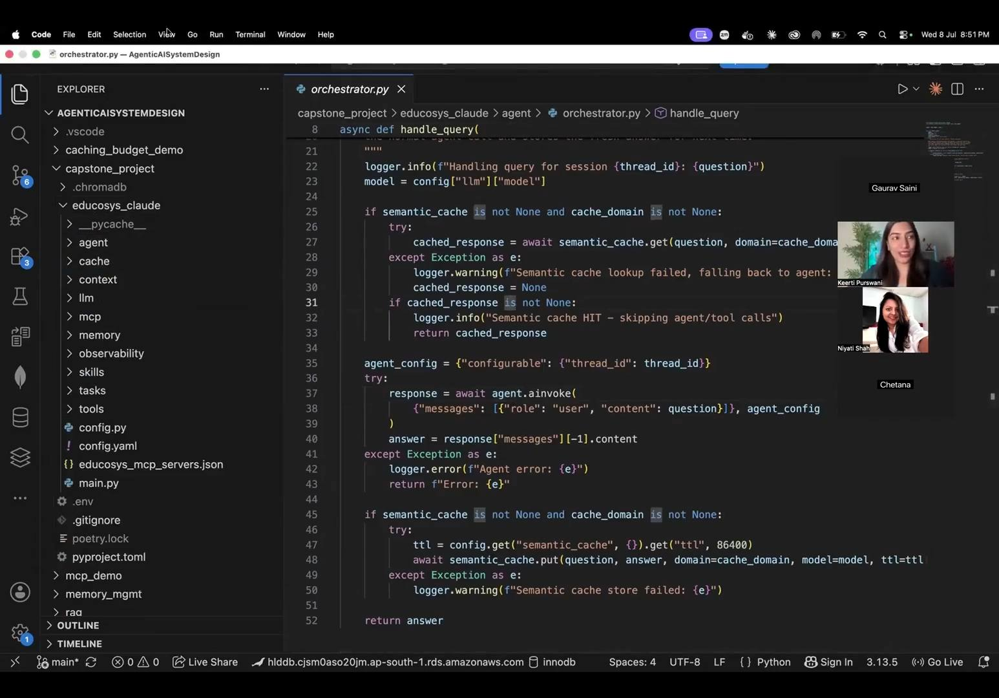
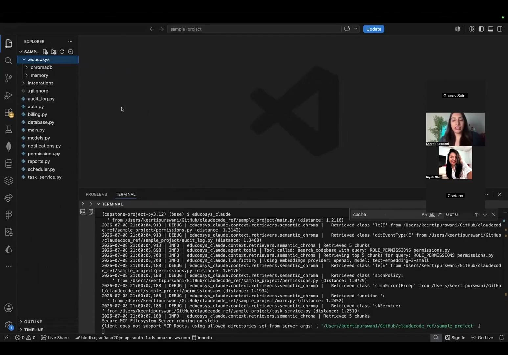
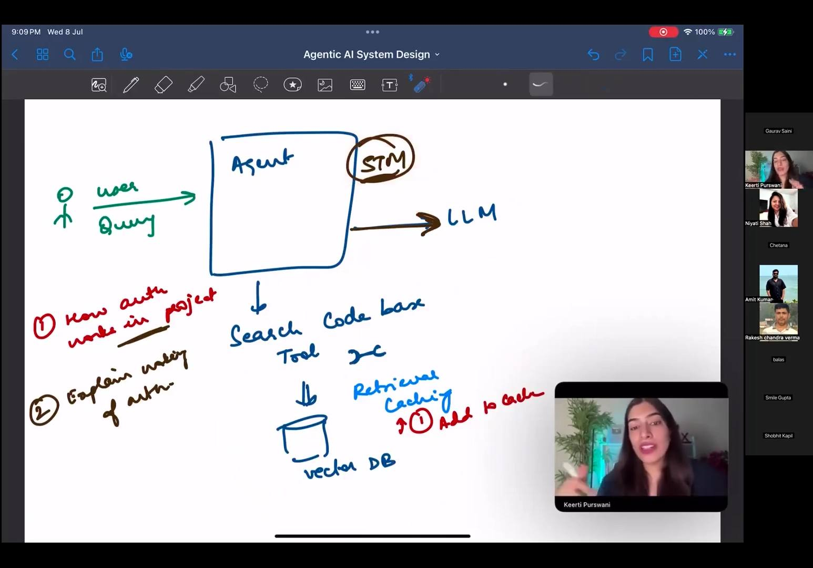

# Agentic AI System Design（P013）：语义缓存（Semantic Caching）从零复现

## 1. 这一节做什么

这一节是 P013，课程已经进入收尾阶段。讲师先用几分钟说明后续安排：本周还剩四节课，下周主要做项目 demo；今天要把零散的小主题收完，明天重点讲 LLM 应用的评估（evals，逐字稿里口音识别成了 “LLM mobs”）。另外他准备了一份按主题分类的面试题清单（RAG 等），每题配解释和“面试时要主动提到的关键点”，清单会发给大家，但课上只挑复杂的题讲，不逐题过。上一节讲到的 RAG scaling / sharding，这一节说会收尾，但逐字稿里没有展开 sharding 的具体内容，**课里没讲**，本文不编。

这一节真正的技术主线只有一个：**把语义缓存（semantic caching）从零做出来，再把它接进 Capstone 项目**。你要跟着做出的东西是：

1. 一个本地 Redis（用 Docker 跑，端口 `6379`），并且必须支持向量检索（RedisVL 依赖 RediSearch 模块）。
2. 一个语义缓存层：建索引 → `get`（找最相似的历史查询）→ `put`（写入查询向量和回答）→ `invalidate`（按 domain 删除/清空）。
3. 一个可交互的 demo：输入一个问题，第一次 miss、调 LLM、写缓存；换一种说法再问，similarity 超过阈值就 hit、直接返回缓存答案、不再调 LLM。
4. 把同一套缓存层接进 Capstone 的 `agent/orchestrator.py`：只对 `ask` 类查询做缓存，`planning` 类不缓存；命中直接返回，未命中才调 agent，然后把结果 `put` 进缓存。
5. 用 Capstone 项目本身跑一次 `poetry run educourses-cloud`，让它解释自己的 `task_planner.py`、生成 README；再在 sample project 上用 “how does auth work” / “explain working of auth” 演示一次真实的 cache hit。

验收现象要记住三个数字：阈值默认 `0.8`；TTL 默认 `86400` 秒；演示时 “what are neural networks” 与 “explain neural networks” 的 similarity 是 `0.82`，命中；“what are neural networks in brain” 是 `0.7979`，差一点点没到 `0.8`，miss。

这一节还有一个比代码更重要的判断，讲师用了很长时间讨论：**不是所有地方都该加缓存**。检索缓存（retrieval cache）如果和短期记忆（short-term memory）叠在一起，第二次相似查询会被短期记忆直接回答，根本不会触发工具调用，也就永远不会命中检索缓存；这种情况下，缓存 LLM 最终回答（也就是本节做的 semantic cache）才有意义。这条判断在第 5、7 节会反复解释。



## 2. 讲师原话

下面按主题引用，全部译成中文，技术产品名保留英文。

关于“为什么要缓存、能不能每层都缓存”：

> "为什么需要缓存？为了省 token，降低延迟，避免一些重复调用，更快拿到数据，省钱，快速响应；否则我们就得一遍又一遍地去取同样的信息。"
> —— p013 [02:25]

> "我应该在每一层都缓存吗？不。如果到处都缓存，会有什么问题？反而会带来更多延迟；会占更多内存；响应时间更长；会有更多 cache miss；而且反复往缓存里写本身就很耗时；缓存管理很麻烦，会出很多问题；还有数据陈旧（stale），过度工程化，验证策略会变得很复杂。"
> —— p013 [03:21]

关于 prompt caching 与语义缓存的区别：

> "Prompt caching 是模型侧负责的，不是我们在应用层做的。如果一段 prompt 里有一部分是静态的、一部分是动态的，模型就不应该反复处理这一部分，所以它会把静态部分缓存起来。但并不是所有模型都会缓存：OpenAI 是隐式做的，Anthropic 需要你显式声明。"
> —— p013 [04:14]

> "静态内容应该放在最前面。一旦你改动了它，就会 cache miss，下一次查询又要重新写进缓存。"
> —— p013 [05:38]

> "Cache write 比普通 write 更贵，但 cache hit 的时候能省很多钱。可是并不总是值得做缓存：如果一直 miss，你就是在浪费钱，因为 cache write 更贵；如果每个请求都能命中，你可以省下 40% 到 50% 的费用。"
> —— p013 [06:36]

> "Semantic caching 是按自然语言查询做缓存，不是按精确 key。智能体应用和普通应用最大的不同，就是我们面对的是自然语言。‘什么是神经网络’和‘解释神经网络’意思一样，但它们是两个不同的查询字符串。"
> —— p013 [09:53]

关于缓存的三个核心问题：

> "谈到缓存，有三件最重要的事：第一，什么时候写；第二，存哪些东西；第三，什么时候失效、什么时候 flush，或者数据什么时候变成 stale。"
> —— p013 [20:04]

> "用户查询来了，第一件事是检查缓存里有没有相似的查询。怎么判断相似？做语义匹配，看两个 embedding 之间的距离：距离很远就不相似，距离很近就相似，然后基于一个阈值判断这是 cache hit 还是 cache miss。"
> —— p013 [21:31]

> "命中就直接把响应返回给用户，不需要再调 LLM；未命中就要调 LLM，并且把结果写进缓存。"
> —— p013 [22:24]

> "Prompt caching 即使命中了，每次仍然会发生 LLM 生成，所以用户拿到的回答会不一样；而语义缓存命中时不再做 LLM 生成，返回的是同一个回答。"
> —— p013 [23:21]

关于三个核心函数和相似度公式：

> "Get 是取最匹配的一条，Put 是写入缓存，Invalidate 是删除。Similarity 其实不是必需的，它和 get 里的逻辑一样，只是 get 返回真正的响应，similarity 只返回相似度数字。"
> —— p013 [28:04]

> "向量库做匹配时返回的是两个向量之间的距离。我用的是 cosine，距离在 0 到 1 之间，所以 similarity 就是 1 减去 distance。距离越大越不相似，距离越小越相似。"
> —— p013 [28:34]

> "Redis 默认要求你给一个 key，所以我做了一个 hash，生成一个唯一 key 再加进去。"
> —— p013 [30:24]

关于阈值和 TTL 怎么定：

> "阈值太低，你会拿到不相关的答案；阈值太高，会有太多 cache miss，缓存基本就没用了。"
> —— p013 [36:06]

> "阈值取决于你用的 embedding 模型、向量、你拿到的查询类型；也取决于数据更新频率：数据更新很快，TTL 就要很低；数据更新很慢，TTL 可以很高，这样你能更多地从缓存里获益。"
> —— p013 [41:09]

关于只缓存 ask、不缓存 planning：

> "我只对 ask 查询做缓存，不对 planning 查询做缓存。因为 planning 通常变化很大，要从零创建、要深入规划；ask 更可能被重复问，所以更适合缓存。"
> —— p013 [45:21]

关于短期记忆与检索缓存的冲突：

> "如果你做的是检索缓存：用户查询来了，你反正要去向量库检索，如果查询相同就拿缓存结果，再发给 LLM，LLM 生成仍然会发生。可是当第二次相似查询进来，短期记忆里已经有上一轮的查询和回答，它根本不会去调工具，也就不会命中检索缓存。所以如果已经有短期记忆，缓存不是加得越多越好；缓存 LLM 的最终回答才更有意义。"
> —— p013 [60:42]

> "短期记忆本身就是一种隐式缓存。"
> —— p013 [66:24]

> "像‘他是谁’和‘他什么时候出生’这种依赖上下文的查询，不应该被缓存。"
> —— p013 [67:18]

## 3. 从零复现

这一节按操作顺序写。命令都在仓库根目录执行，目录结构如下：

```text
semantic-caching-demo/
├── .env
├── requirements.txt
├── redis_cache.py      # 对应讲师 demo 里的 redis_cache_demo.py，语义缓存层
└── demo.py             # 对应讲师 demo 里的 demo.py，交互式主程序
```

Capstone 侧新增/修改的文件（第 4 节给完整代码）：

```text
capstone/
├── config.yaml                  # 新增 semantic_cache / embeddings 配置
├── src/caching/semantic_cache.py # 新增缓存层
└── src/agent/orchestrator.py     # handle_query 里加缓存判断
```

### 3.1 启动 Redis（必须带向量检索能力）

讲师原话是“用 Docker 跑 Redis”，但没有念镜像名。这里注意：**RedisVL 需要 RediSearch 模块**，普通 `redis:latest` 镜像没有 `FT.CREATE`/`FT.SEARCH`，跑起来会报 unknown command。所以用 Redis Stack：

```bash
docker run -d \
  --name semantic-cache-redis \
  -p 6379:6379 \
  redis/redis-stack:latest
```

确认端口：

```bash
docker ps --filter name=semantic-cache-redis
redis-cli -p 6379 ping
```

`redis-cli` 返回 `PONG` 即可。讲师说他的 Redis 一直开着，演示前先清空过一次数据库；你也可以先执行：

```bash
redis-cli -p 6379 FLUSHDB
```

讲师在 demo 里是通过代码执行 flush 的（“running this command to flush the DB，running the execute command”），对应本项目的 `cache.flush_all()`，见第 4 节。

> 在 JS/Node 里对应什么：Node 侧通常用 `ioredis` 连 `6379`。但 RedisVL 官方是 Python 库，Node 没有现成的等价封装；你要在 Node 里做同样的事，得自己发 `FT.CREATE` / `FT.SEARCH` 原生命令，**课里没讲 Node 实现**。

### 3.2 建 Python 环境和依赖

```bash
cd semantic-caching-demo
python3 -m venv .venv
source .venv/bin/activate        # Windows: .venv\Scripts\activate
pip install -r requirements.txt
```

`requirements.txt` 见第 4 节。讲师用的是 `requirements.txt`，Capstone 项目用的是 Poetry（后面 `poetry run educourses-cloud`）。

### 3.3 配环境变量

复制 `.env.example` 为 `.env`，填入 OpenAI key、Redis URL、LangSmith、缓存域、模型名、阈值、TTL。关键点：

- Redis URL 是 `redis://localhost:6379`，端口必须和你 Docker 映射的端口一致。讲师原话：“whatever port your Redis is running in，just add that port in the environment variables”。
- `CACHE_DOMAIN` 用来按业务域隔离缓存。讲师举例：可以按 software development、SRE、DevOps 等不同域分别缓存。
- `CACHE_MODEL_NAME` 用于写入缓存记录时标记是哪个模型生成的回答。
- `CACHE_SIMILARITY_THRESHOLD=0.8`，即 80%。
- `CACHE_TTL_SECONDS=86400`，即 24 小时。
- LangSmith 的三个变量用于观察“什么时候命中了 LLM、什么时候没命中”。讲师演示前特意打开 LangSmith 确认“过去一小时没有 query”，然后第一次提问后刷新，看到一条记录，第二次命中后刷新没有新增记录。

### 3.4 建索引：存什么、用什么算法

讲师把索引结构讲得很明确：存 **query vector（查询向量）、response（回答）、query_text（原始查询文本）、domain（业务域）、model（模型名）、created_at（创建时间）**。向量字段的属性里要写维度（dimensions）、距离算法（cosine）、检索算法（HNSW）。

HNSW 讲师专门提问过：“HNSW 是什么？是 hierarchical，用于更好的语义搜索。为什么比 flat 搜索好？因为当你要在成千上万、甚至几十万个 embedding 里搜索时，它是分层的，所以更快。” 本项目就用 HNSW。



### 3.5 三个核心操作

- `get(query, domain)`：把用户查询 embedding 成向量，去 Redis 里找 top-1 最相似的记录，拿到 `vector_distance`，算 `similarity = 1 - distance`；`similarity >= threshold` 才算 hit，返回缓存里的 `response`；否则返回 `None`。
- `put(query, response, domain, model)`：生成唯一 key（Redis 默认要求 key，所以用 hash），把查询向量、回答、查询文本、domain、model、created_at 一起写进去，并带上 TTL。
- `invalidate(domain)`：删除某个 domain 下的所有缓存条目；`flush_all()` 清空整个库，对应讲师说的 “clear the cache → invalidate → flush it out”。

讲师还写了一个 `similarity()` 方法，逻辑和 `get` 一样，只是返回相似度数字、不返回回答。他说这个函数“不是必需的，是冗余的，但 demo 里加上方便你检查”。


### 3.6 主流程：先查缓存，再决定调不调 LLM

`demo.py` 的逻辑顺序必须是：

1. `load_dotenv()` 读环境变量。
2. 用 `MODEL_NAME` 创建 `ChatOpenAI`。
3. 创建 SQLite checkpointer（`SqliteSaver`），DB 路径来自环境变量；`thread_id` 也属于短期记忆的一部分。讲师原话：“SQLite check pointer 是短期记忆，它会创建 DB path，现在看不到 data，跑起来之后才会创建；thread ID 也是短期记忆用的。”
4. 创建 `SemanticCache` 实例，构造时建索引。
5. 进入 `while` 循环读用户输入：
   - 输入 `clear the cache` → `invalidate`/`flush`，然后 `continue`。
   - 否则先 `cache.get()`：命中就打印 `[CACHE HIT]`、相似度、匹配到的历史查询，直接输出缓存回答，`continue`，**不调 LLM**。
   - 未命中就打印 `[CACHE MISS]`，调 LLM，拿到回答后 `cache.put()`，再输出。

讲师特别强调：命中时“我不需要再走后面的流程，不需要 add to cache，也不需要做别的事，直接进入下一个用户查询”。

### 3.7 用 TTL 和阈值做实验

讲师现场做了三组实验，你复现时照着做一遍就能理解参数：

- **同义改写命中**：先问 `what are neural networks`，miss，调 LLM；再问 `explain neural networks`，similarity `0.82`，threshold `0.8`，hit，速度明显变快，LangSmith 没有新增调用。
- **相似度不够就不命中**：问 `what are the uses of python`，miss，因为之前没有类似记录；它和 neural networks 的 similarity 只有 `0.16`。接着问 `what is python used for`，similarity `0.82`，hit。
- **阈值边界**：问 `what are neural networks in brain`，similarity `0.7979`，差一点点，miss。讲师说“如果阈值设成 0.75，这次就命中了”。
- **TTL 过期**：把 `CACHE_TTL_SECONDS` 从 `86400` 改成 `2`，重启；问 `who is Dhoni`，miss 并写入；等两秒再问 `tell me about Dhoni`，miss，因为条目已过期。再把 TTL 改成 `10`，问 `tell me about Dhoni`，miss 并写入；紧接着再问一次同样的问题，similarity `1.0`，hit。

注意：讲师改 `.env` 后是重新跑程序的，**环境变量改了必须重启进程才生效**。



### 3.8 接进 Capstone：配置 + 缓存层 + orchestrator

讲师在 GitHub 上按主题拆了 commit，能看到三类改动：

1. **config**：新增 `embeddings`（model、dimensions，讲师说 dimensions 本来就有）和 `semantic_cache`（`enabled` 布尔开关、`redis_url`、`threshold`、`ttl`）。
2. **新增 caching 层**：`semantic_cache.py`，和 demo 里
`semantic_cache.py` 同一套代码，只是包进了 Capstone 的目录与配置读取方式：`init`、`build_index`、`top_match`、`get`、`put`、`invalidate` 全都在。
3. **orchestrator**：在 `handle_query` 里加判断——`semantic_cache.enabled` 为真且 `intent == "ask"` 时先查缓存，命中就直接返回；没命中才 `agent.invoke`，拿到回答后 `cache.put` 写回。

讲师在 GitHub 上说明了这几处是分开提交的 commit：“我每次 push 都尽量一个主题一个 commit，所以你能看到 semantic caching 我推了哪些东西：一个 cache 文件、config 改动、main 改动。”

演示 Capstone 的效果是：在 Capstone 仓库里跑 `poetry run educourses-cloud`（讲师在该段的口音把 educourses-cloud 读成 “edu-coses-clod” / “Educosis Cloud”），第一次运行会在项目里生成 `.educourses/` 目录，里面有 ChromaDB（讲师选了 Chroma 作为 vector store），代码被解析、切块、入库，短期记忆也落在该目录；然后问 “how does planning work in the project”，它检索 5 个 chunk 后回答出了 `task_planner.py` 里的真实结构（结构化 Pydantic 模型、project name、goal summary、5 到 20 个 task、snake_case ID、DAG 顺序、3 到 5 条 acceptance criteria、human approval loop、approved plan 持久化到 SQLite 等）。随后让它“create readme.md file of this response”，它真的生成了 `readme.md`。

期间出现一条错误信息：`Client does not support MCP GitHub ...` —— 讲师解释是“我没有给 GitHub MCP server 加权限”。**这段只说明现象，没有给配置方法，课里没讲怎么授权 MCP GitHub server**。

最后在 sample project 上验证缓存：先问 `how does auth work`（miss，embedding 全量写入，稍慢），再问 `explain working of auth`，终端出现 `cache hit`，响应“超级快”。TTL 当时是 `86400`。







## 4. 完整代码

> **重要说明（不编造）**：本段课程**没有提供任何 OCR 截图文本**，讲师是边讲边在编辑器里翻代码、没有把代码贴到屏幕上念。下面所有代码是**按逐字稿口述的结构重建**的（存哪些字段、用什么算法、三个函数、阈值公式、TTL、hash key、SQLite checkpointer、只缓存 ask 等），不是逐字抄录。因此：字段名、函数签名以本文为准可以直接跑；如果你的 `redisvl` 版本 API 与下面不一致，按报错调整，**逻辑不变**。讲师屏幕上的变量名如果有出入，以讲师源码为准。

### 4.1 `requirements.txt`

```text
redisvl==0.3.6
redis==5.0.8
numpy==1.26.4
python-dotenv==1.0.1
langchain==0.3.7
langchain-core==0.3.15
langchain-openai==0.2.5
langgraph==0.2.39
langgraph-checkpoint-sqlite==2.0.1
```

安装时如果 pip 报依赖冲突，优先保证 `redisvl` 和 `langchain-openai` 能装上；其余按 pip 的提示降级。

### 4.2 `.env.example`

```dotenv
# ---- LLM ----
OPENAI_API_KEY=sk-xxxxxxxxxxxxxxxx
MODEL_NAME=gpt-4o-mini

# ---- Embedding（维度必须和索引里的 dims 一致）----
EMBEDDING_MODEL=text-embedding-3-small
EMBEDDING_DIMENSIONS=1536

# ---- Redis（端口要和你 docker -p 映射的一致）----
REDIS_URL=redis://localhost:6379
CACHE_INDEX_NAME=semantic_cache_idx
CACHE_KEY_PREFIX=semcache

# ---- 缓存参数 ----
CACHE_DOMAIN=general
CACHE_MODEL_NAME=gpt-4o-mini
CACHE_SIMILARITY_THRESHOLD=0.8
CACHE_TTL_SECONDS=86400

# ---- 短期记忆 ----
CHECKPOINT_DB=data/checkpoints.sqlite
THREAD_ID=demo-thread-1

# ---- LangSmith（可选，用来观察有没有真的命中）----
LANGCHAIN_TRACING_V2=true
LANGCHAIN_ENDPOINT=https://api.smith.langchain.com
LANGCHAIN_API_KEY=lsv2_xxxxxxxxxxxx
LANGCHAIN_PROJECT=semantic-caching-demo
```

### 4.3 `redis_cache.py`（语义缓存层，对应讲师的 `redis_cache_demo.py`）

```python
"""
语义缓存层。
三个核心操作：get / put / invalidate，外加一个冗余的 similarity() 和 flush_all()。
索引字段：query_vector, response, query_text, domain, model, created_at。
"""
import os
import hashlib
from datetime import datetime, timezone

import numpy as np
import redis
from dotenv import load_dotenv
from langchain_openai import OpenAIEmbeddings
from redisvl.index import SearchIndex
from redisvl.query import VectorQuery

load_dotenv()


def _env(key: str, default: str) -> str:
    return os.getenv(key, default)


class SemanticCache:
    def __init__(
        self,
        redis_url: str | None = None,
        index_name: str | None = None,
        key_prefix: str | None = None,
        threshold: float | None = None,
        ttl_seconds: int | None = None,
        embedding_model: str | None = None,
        dimensions: int | None = None,
        domain: str | None = None,
    ):
        self.redis_url = redis_url or _env("REDIS_URL", "redis://localhost:6379")
        self.index_name = index_name or _env("CACHE_INDEX_NAME", "semantic_cache_idx")
        self.key_prefix = key_prefix or _env("CACHE_KEY_PREFIX", "semcache")
        self.threshold = float(threshold if threshold is not None
                               else _env("CACHE_SIMILARITY_THRESHOLD", "0.8"))
        self.ttl = int(ttl_seconds if ttl_seconds is not None
                       else _env("CACHE_TTL_SECONDS", "86400"))
        self.domain = domain or _env("CACHE_DOMAIN", "general")
        self.dimensions = int(dimensions or _env("EMBEDDING_DIMENSIONS", "1536"))

        self.embedder = OpenAIEmbeddings(
            model=embedding_model or _env("EMBEDDING_MODEL", "text-embedding-3-small"),
            dimensions=self.dimensions,
        )
        self.redis = redis.Redis.from_url(self.redis_url, decode_responses=True)
        self.index = self._build_index()

    # ---------------- 建索引 ----------------
    def _build_index(self) -> SearchIndex:
        schema = {
            "index": {
                "name": self.index_name,
                "prefix": self.key_prefix,
                "storage_type": "hash",
            },
            "fields": [
                {
                    "name": "query_vector",
                    "type": "vector",
                    "attrs": {
                        "dims": self.dimensions,
                        "algorithm": "hnsw",          # 讲师：分层图，比 flat 快
                        "distance_metric": "cosine",  # 距离 0~1，similarity = 1 - distance
                        "datatype": "float32",
                    },
                },
                {"name": "response", "type": "text"},
                {"name": "query_text", "type": "text"},
                {"name": "domain", "type": "tag"},
                {"name": "model", "type": "text"},
                {"name": "created_at", "type": "text"},
            ],
        }
        index = SearchIndex.from_dict(schema, redis_url=self.redis_url)
        index.create(overwrite=False)   # 已存在就不重建
        return index

    # ---------------- 内部工具 ----------------
    def _embed(self, text: str) -> list[float]:
        return self.embedder.embed_query(text)

    def _vector_bytes(self, vec: list[float]) -> bytes:
        return np.array(vec, dtype=np.float32).tobytes()

    def _key(self, query: str, domain: str) -> str:
        # Redis 默认要求 key，用 hash 生成唯一 key
        digest = hashlib.sha256(f"{domain}::{query}".encode("utf-8")).hexdigest()[:24]
        return f"{self.key_prefix}:{domain}:{digest}"

    def _top_match(self, query: str, domain: str) -> dict | None:
        vec = self._embed(query)
        vq = VectorQuery(
            vector=vec,
            vector_field_name="query_vector",
            num_results=1,
            return_fields=["response", "query_text", "model", "created_at",
                           "vector_distance"],
            filter_expression=f"@domain:{{{domain}}}",
        )
        results = self.index.query(vq)
        if not results:
            return None
        r = results[0]
        distance = float(r.get("vector_distance", 1.0))
        similarity = 1.0 - distance          # cosine distance -> similarity
        return {
            "response": r.get("response"),
            "query_text": r.get("query_text"),
            "model": r.get("model"),
            "created_at": r.get("created_at"),
            "distance": distance,
            "similarity": similarity,
        }

    # ---------------- get ----------------
    def get(self, query: str, domain: str | None = None) -> dict:
        domain = domain or self.domain
        match = self._top_match(query, domain)
        if match is None:
            return {"hit": False, "similarity": None, "reason": "no_candidate"}
        if match["similarity"] >= self.threshold:
            return {
                "hit": True,
                "response": match["response"],
                "similarity": match["similarity"],
                "matched_query": match["query_text"],
                "model": match["model"],
                "created_at": match["created_at"],
            }
        return {"hit": False, "similarity": match["similarity"],
                "reason": "below_threshold", "matched_query": match["query_text"]}

    # ---------------- similarity（冗余，只为调试） ----------------
    def similarity(self, query: str, domain: str | None = None) -> float | None:
        match = self._top_match(query, domain or self.domain)
        return None if match is None else match["similarity"]

    # ---------------- put ----------------
    def put(self, query: str, response: str, model: str,
            domain: str | None = None, ttl: int | None = None) -> str:
        domain = domain or self.domain
        ttl = self.ttl if ttl is None else ttl
        key = self._key(query, domain)
        record = {
            "id": key,
            "query_vector": self._vector_bytes(self._embed(query)),
            "response": response,
            "query_text": query,
            "domain": domain,
            "model": model,
            "created_at": datetime.now(timezone.utc).isoformat(),
        }
        self.index.load([record], ttl=ttl, key_field="id")
        return key

    # ---------------- invalidate ----------------
    def invalidate(self, domain: str | None = None) -> int:
        """删除某个 domain 下的所有缓存条目。"""
        domain = domain or self.domain
        pattern = f"{self.key_prefix}:{domain}:*"
        deleted = 0
        for k in self.redis.scan_iter(match=pattern, count=500):
            self.redis.delete(k)
            deleted += 1
        return deleted

    def flush_all(self) -> None:
        """清空整个 Redis DB，对应讲师说的 clear the cache -> flush。"""
        self.redis.flushdb()

    def count(self) -> int:
        return sum(1 for _ in self.redis.scan_iter(match=f"{self.key_prefix}:*", count=500))
```

### 4.4 `demo.py`（交互式主程序）

```python
import os
import sqlite3

from dotenv import load_dotenv
from langchain_core.messages import HumanMessage, SystemMessage
from langchain_openai import ChatOpenAI
from langgraph.checkpoint.sqlite import SqliteSaver
from langgraph.graph import END, START, MessagesState, StateGraph

from redis_cache import SemanticCache

load_dotenv()

MODEL_NAME = os.getenv("MODEL_NAME", "gpt-4o-mini")
CACHE_DOMAIN = os.getenv("CACHE_DOMAIN", "general")
CACHE_MODEL_NAME = os.getenv("CACHE_MODEL_NAME", MODEL_NAME)
CHECKPOINT_DB = os.getenv("CHECKPOINT_DB", "data/checkpoints.sqlite")
THREAD_ID = os.getenv("THREAD_ID", "demo-thread-1")


def build_app(model: ChatOpenAI, checkpointer):
    """最小图：一个 model 节点。checkpointer 负责短期记忆。"""

    def call_model(state: MessagesState):
        msgs = [SystemMessage(content="You are a concise assistant.")] + state["messages"]
        return {"messages": [model.invoke(msgs)]}

    graph = StateGraph(MessagesState)
    graph.add_node("model", call_model)
    graph.add_edge(START, "model")
    graph.add_edge("model", END)
    return graph.compile(checkpointer=checkpointer)


def main():
    os.makedirs(os.path.dirname(CHECKPOINT_DB) or ".", exist_ok=True)

    model = ChatOpenAI(model=MODEL_NAME, temperature=0)

    # 短期记忆：SQLite checkpointer + thread_id
    conn = sqlite3.connect(CHECKPOINT_DB, check_same_thread=False)
    checkpointer = SqliteSaver(conn)

    # 语义缓存：构造时建索引
    cache = SemanticCache(domain=CACHE_DOMAIN)

    app = build_app(model, checkpointer)
    run_config = {"configurable": {"thread_id": THREAD_ID}}

    print("=" * 70)
    print("语义缓存 demo")
    print(f"  redis_url = {cache.redis_url}")
    print(f"  threshold = {cache.threshold}   ttl = {cache.ttl}s   domain = {cache.domain}")
    print("  输入 'clear the cache' 清空缓存；输入 'exit' 退出")
    print("=" * 70)

    while True:
        try:
            query = input("\nYou: ").strip()
        except (EOFError, KeyboardInterrupt):
            break
        if not query:
            continue
        if query.lower() in {"exit", "quit"}:
            break
        if query.lower() in {"clear the cache", "clear cache", "flush"}:
            cache.flush_all()
            print(f"[CACHE] flushed. remaining={cache.count()}")
            continue

        # 1) 先查缓存
        result = cache.get(query, CACHE_DOMAIN)
        if result["hit"]:
            print(f"[CACHE HIT] similarity={result['similarity']:.4f} "
                  f"matched={result['matched_query']!r} model={result['model']}")
            print(f"Assistant (cached): {result['response']}")
            continue

        if result.get("similarity") is None:
            print("[CACHE MISS] reason=no_candidate")
        else:
            print(f"[CACHE MISS] best_similarity={result['similarity']:.4f} "
                  f"(threshold={cache.threshold}) matched={result.get('matched_query')!r}")

        # 2) 未命中 -> 调 LLM
        out = app.invoke({"messages": [HumanMessage(content=query)]}, config=run_config)
        answer = out["messages"][-1].content
        print(f"Assistant: {answer}")

        # 3) 写回缓存
        key = cache.put(query, answer, CACHE_MODEL_NAME, CACHE_DOMAIN)
        print(f"[CACHE PUT] key={key} ttl={cache.ttl}s total={cache.count()}")

    conn.close()


if __name__ == "__main__":
    main()
```

启动：

```bash
python demo.py
```

### 4.5 Capstone `config.yaml` 新增段

```yaml
embeddings:
  model: text-embedding-3-small
  dimensions: 1536

semantic_cache:
  enabled: true                 # 讲师：可以 disable 也可以 enable
  redis_url: redis://localhost:6379
  index_name: semantic_cache_idx
  key_prefix: semcache
  domain: capstone
  threshold: 0.8
  ttl_seconds: 86400
  model_name: gpt-4o-mini
```

### 4.6 Capstone `src/caching/semantic_cache.py`

```python
"""Capstone 的语义缓存层。逻辑与 demo 的 redis_cache.py 完全一致，
只是参数从 config.yaml 读，并且支持 enabled 开关。"""
import hashlib
from datetime import datetime, timezone

import numpy as np
import redis
from langchain_openai import OpenAIEmbeddings
from redisvl.index import SearchIndex
from redisvl.query import VectorQuery


class SemanticCacheLayer:
    def __init__(self, cfg: dict, openai_api_key: str | None = None):
        self.enabled = bool(cfg.get("enabled", False))
        self.redis_url = cfg.get("redis_url", "redis://localhost:6379")
        self.index_name = cfg.get("index_name", "semantic_cache_idx")
        self.key_prefix = cfg.get("key_prefix", "semcache")
        self.domain = cfg.get("domain", "capstone")
        self.threshold = float(cfg.get("threshold", 0.8))
        self.ttl = int(cfg.get("ttl_seconds", 86400))
        self.model_name = cfg.get("model_name", "gpt-4o-mini")

        emb = cfg.get("embeddings", {}) or {}
        self.embedding_model = emb.get("model", "text-embedding-3-small")
        self.dimensions = int(emb.get("dimensions", 1536))

        if not self.enabled:
            self.index = None
            self.redis = None
            self.embedder = None
            return

        self.embedder = OpenAIEmbeddings(
            model=self.embedding_model,
            dimensions=self.dimensions,
            api_key=openai_api_key,
        )
        self.redis = redis.Redis.from_url(self.redis_url, decode_responses=True)
        self.index = self._build_index()

    def _build_index(self) -> SearchIndex:
        schema = {
            "index": {"name": self.index_name, "prefix": self.key_prefix,
                      "storage_type": "hash"},
            "fields": [
                {"name": "query_vector", "type": "vector",
                 "attrs": {"dims": self.dimensions, "algorithm": "hnsw",
                           "distance_metric": "cosine", "datatype": "float32"}},
                {"name": "response", "type": "text"},
                {"name": "query_text", "type": "text"},
                {"name": "domain", "type": "tag"},
                {"name": "model", "type": "text"},
                {"name": "created_at", "type": "text"},
            ],
        }
        index = SearchIndex.from_dict(schema, redis_url=self.redis_url)
        index.create(overwrite=False)
        return index

    def _key(self, query: str) -> str:
        digest = hashlib.sha256(f"{self.domain}::{query}".encode()).hexdigest()[:24]
        return f"{self.key_prefix}:{self.domain}:{digest}"

    def _top_match(self, query: str) -> dict | None:
        vec = self.embedder.embed_query(query)
        vq = VectorQuery(
            vector=vec,
            vector_field_name="query_vector",
            num_results=1,
            return_fields=["response", "query_text", "model", "created_at",
                           "vector_distance"],
            filter_expression=f"@domain:{{{self.domain}}}",
        )
        results = self.index.query(vq)
        if not results:
            return None
        r = results[0]
        distance = float(r.get("vector_distance", 1.0))
        return {"response": r.get("response"), "query_text": r.get("query_text"),
                "model": r.get("model"), "created_at": r.get("created_at"),
                "similarity": 1.0 - distance}

    def get(self, query: str) -> dict:
        if not self.enabled:
            return {"hit": False, "reason": "disabled"}
        match = self._top_match(query)
        if match is None:
            return {"hit": False, "reason": "no_candidate", "similarity": None}
        if match["similarity"] >= self.threshold:
            return {"hit": True, "response": match["response"],
                    "similarity": match["similarity"],
                    "matched_query": match["query_text"]}
        return {"hit": False, "similarity": match["similarity"],
                "reason": "below_threshold"}

    def put(self, query: str, response: str) -> str | None:
        if not self.enabled:
            return None
        key = self._key(query)
        record = {
            "id": key,
            "query_vector": np.array(self.embedder.embed_query(query),
                                     dtype=np.float32).tobytes(),
            "response": response,
            "query_text": query,
            "domain": self.domain,
            "model": self.model_name,
            "created_at": datetime.now(timezone.utc).isoformat(),
        }
        self.index.load([record], ttl=self.ttl, key_field="id")
        return key

    def invalidate(self) -> int:
        if not self.enabled:
            return 0
        deleted = 0
        for k in self.redis.scan_iter(match=f"{self.key_prefix}:{self.domain}:*", count=500):
            self.redis.delete(k)
            deleted += 1
        return deleted

    def flush_all(self) -> None:
        if self.enabled:
            self.redis.flushdb()
```

### 4.7 Capstone `src/agent/orchestrator.py` 的 `handle_query`

下面只给 `handle_query` 这个方法的完整版本。**orchestrator 其余的初始化代码（创建 agent、装工具、读 config）保持你项目里原有的实现不变**，这部分逐字稿没有重放，课里没讲细节。

```python
def handle_query(self, query: str, thread_id: str, intent: str = "ask") -> dict:
    """
    讲师强调的两条规则：
    1) 只对 ask 类查询做缓存；planning 不缓存（planning 变化大，需要从零深入规划）。
    2) 命中缓存直接返回，不进入 agent；未命中才调 agent，然后把结果 put 进缓存。
    """
    use_cache = (
        getattr(self, "semantic_cache", None) is not None
        and self.semantic_cache.enabled
        and intent == "ask"
    )

    if use_cache:
        cached = self.semantic_cache.get(query)
        if cached.get("hit"):
            return {
                "response": cached["response"],
                "cached": True,
                "similarity": cached["similarity"],
                "matched_query": cached.get("matched_query"),
                "thread_id": thread_id,
            }

    # 未命中（或不可缓存）才真正调用 agent
    result = self.agent.invoke(query, thread_id=thread_id)   # 你项目里原有的调用
    answer = result["response"] if isinstance(result, dict) else str(result)

    if use_cache:
        self.semantic_cache.put(query, answer)

    return {"response": answer, "cached": False, "similarity": None,
            "thread_id": thread_id}
```

初始化位置（在你项目的 bootstrap / 依赖装配处，逐字稿只提到“config 里加了 embeddings 和 semantic_cache”，没给装配代码，这段按本项目结构写）：

```python
from src.caching.semantic_cache import SemanticCacheLayer

cache_cfg = dict(config.get("semantic_cache", {}) or {})
cache_cfg.setdefault("embeddings", config.get("embeddings", {}))
self.semantic_cache = SemanticCacheLayer(cache_cfg, openai_api_key=os.getenv("OPENAI_API_KEY"))
```

启动 Capstone：

```bash
cd capstone
poetry install
poetry run educourses-cloud          # 讲师用的就是这个命令
```

首次运行后，项目里会出现 `.educourses/` 目录（内含 ChromaDB 与短期记忆），讲师演示时是先删掉这个目录让它“从零创建”。

## 5. 逐行解释

这一节把第 4 节每个“为什么这么写、不这么写会怎样”讲清楚。

**索引字段为什么是这六个。** `query_vector` 是匹配用的，`response` 是命中后直接返回的内容——这是整个语义缓存的价值所在，命中时不再做 LLM 生成。`query_text` 保留原始查询字符串，是为了在终端里打印 “matched=‘what are neural networks’” 让你肉眼验证命中是否合理；讲师演示时确实打印了匹配到的历史查询。`domain` 用来按业务域隔离，讲师举的例子是 software development / SRE / DevOps 分域缓存，同时也让 `invalidate` 能只清一个域。`model` 记录是哪个模型生成的回答，因为换模型后同一问题的回答风格和事实可能不同，你至少要知道缓存里那一条来自谁。`created_at` 用于排查陈旧数据。

**`distance_metric: cosine` + `similarity = 1 - distance`。** 这是本节唯一的数学。讲师的原话是：“向量库做匹配时返回的是两个向量之间的距离……我用的是 cosine，距离在 0 到 1 之间，所以 similarity 就是 1 减去 distance。距离越小越相似。” 所以代码里必须显式做这个减法，不能直接把 `vector_distance` 当相似度跟阈值比——那会把逻辑整个反过来：distance 小（很像）会被判成 miss，distance 大（很不像）会被判成 hit。这是最容易搞错的一行。

**`algorithm: hnsw`。** 平铺（flat）检索是拿查询向量和库里每一条逐一算距离，条目多了就是线性扫描；HNSW 是分层图，逐层收敛，在成千上万乃至几十万条 embedding 里检索更快。讲师在课上专门提问确认过这一点。代价是 HNSW 是近似最近邻，可能漏掉真正最近的那条，但对缓存场景够用。

**`threshold` 为什么放配置里。** 讲师说得很直接：“这个阈值理想上应该放在 config 里”，demo 里为了省事放在环境变量。阈值太低 → 返回不相关答案；阈值太高 → 命中率极低、缓存形同虚设。而且它**不是你能拍脑袋定的**：它取决于 embedding 模型、取决于你收到的查询类型、取决于数据更新频率。演示里 `0.8` 的时候 “what are neural networks” / “explain neural networks” 是 `0.82` 命中，“what are neural networks in brain” 是 `0.7979` 未命中——同一批查询里，阈值挪 `0.05` 结果就完全不一样。所以它是调参项，不是常量。

**`ttl` 为什么也放配置里。** 讲师的原话：“数据更新很快，TTL 就要很低；数据更新很慢，TTL 可以很高，这样你能更多地从缓存获益。” 默认 `86400`（24 小时）。演示时把它改成 `2` 秒，两秒后同一条缓存就查不到了；改成 `10` 秒，紧接着再问一次 similarity `1.0` 命中。这就是“陈旧数据”问题的最小可复现版本：**缓存命中率越高，你越可能一直在返回旧答案而完全不察觉**。讲师对 Rakesh 的提问“为什么要从缓存里删除”回答的就是这个：数据会变旧。

**为什么用 hash 生成 key。** Redis 是 key-value 存储，写入必须有 key。讲师原话：“Redis 默认要求你给一个 key，所以我做了一个 hash，生成一个唯一 key 再加进去。” 这里用 `sha256(domain::query)` 取前 24 位，好处是同一个 query + domain 反复 put 会落到同一个 key（覆盖而不是堆积），同时 key 里带 domain 前缀，`invalidate(domain)` 直接用 `SCAN MATCH semcache:{domain}:*` 就能清掉——比用 `FT.SEARCH` 查出来再删更稳、更少 API 依赖。

**命中之后为什么是 `continue`。** 讲师强调：“命中我就直接返回，不需要再走后面流程，不需要 add to cache，也不需要做别的事，直接进入下一个用户查询。” 代码里 `continue` 就在做这件事。如果命中后还往下走到 `app.invoke`，你不仅白花一次 LLM 钱，还会把生成的**新**回答 `put` 回去覆盖旧记录——缓存就彻底失效了，而且每次命中都会刷新 TTL，让旧数据永远不过期。

**`if not query` 和 `clear the cache` 的处理顺序。** 必须先判断清空指令，再查缓存。否则输入 “clear the cache” 本身会被当成一个 query 去向量检索，甚至可能被缓存下来。

**SQLite checkpointer 与 `thread_id`。** 讲师说得很明确：`SqliteSaver` 是短期记忆，DB 路径来自环境变量，“现在看不到 data，跑起来之后才会创建”；`thread_id` 也是短期记忆用的。同 `thread_id` 的多轮对话共享上下文，所以“who is Dhoni”之后问“when was he born”，模型能从上下文里答出来——这也是为什么讲师说**这类依赖上下文的查询不应该被缓存**：缓存 key 只看当前 query，看不到上下文，缓存下来就是错的。

**只缓存 `ask`、不缓存 `planning`。** 讲师原话：“planning 通常变化很大，要从零创建、要深入规划；ask 更可能被重复问。” 在 orchestrator 里就是 `intent == "ask"` 这个条件。不给 planning 加缓存还有一个更硬的理由：planning 的输出依赖仓库当前状态（文件改了就过期），而 ask 的回答相对稳定。

**为什么 retrieval cache 在有短期记忆时没意义。** 这是本节最值得反复读的一段推理链：

第一轮用户问 “how does auth work”，agent 把 query 连同上文发给 LLM，LLM 决定调用 `search_code_base` 工具，工具去向量库检索，拿到 chunk，LLM 生成回答。如果把**检索结果**缓存起来，这一轮会 `put` 一条。

第二轮用户问 “explain working of auth”，agent 把 query 发给 LLM，**但这次还带着短期记忆里上一轮的 query 和回答**。LLM 从上下文里已经知道答案了，它根本不会决定去调 `search_code_base`。工具没被调用 → 检索缓存没被查 → 命中也好未命中也好，都不会发生。结论：**短期记忆本身就是一个隐式缓存**（讲师原话），检索层再加一层缓存，收益被短期记忆吃掉了。而缓存**最终回答**不一样：它挡在 agent 之前，命中就直接返回，连 LLM 调用都省了，短期记忆挡不住这一层。

> 在 JS/Node 里对应什么：这里的 “checkpointer / 短期记忆” 对应你在 Node 里维护
的对话历史（LangGraph.js 自带 `MemorySaver` / `SqliteSaver` 等 checkpointer，把 `thread_id` 换成 `configurable.thread_id` 即可）。这只是类比，**课里没讲 Node 实现**；Python 侧用的是 `langgraph-checkpoint-sqlite` 的 `SqliteSaver` + 命名的 `thread_id`。



**embedding 维度必须和索引里的 `dims` 完全一致。** `text-embedding-3-small` 默认 1536 维，索引里写 `dims: 1536`、`OpenAIEmbeddings(dimensions=1536)`，三处必须同源（本文统一从 `EMBEDDING_DIMENSIONS` / config 的 `embeddings.dimensions` 读）。任何一处变了而另两处没变，`FT.CREATE` 能建成功，但写入或检索时会直接报维度不匹配——这个错很隐蔽，因为报错发生在 `put`/`get`，看起来像是“缓存不工作”。改用 `text-embedding-3-large`（3072 维）或换模型时，**旧索引必须先删掉重建**，不能只改配置。讲师在 Capstone config 里特意保留了 `embeddings.dimensions`，说的就是这件事（“如果你要存 dimensions，也可以存”）。

**`domain` 字段为什么是 `tag` 而不是 `text`。** 因为 `filter_expression=f"@domain:{{{domain}}}"` 这种精确等值过滤在 RedisVL 里对应 tag 类型；写成 text 会走全文分词匹配，`general` 和 `generality` 都可能被匹配到，域隔离就漏了。同一条过滤条件同时出现在 `get` 和 `invalidate` 的语义里：前者保证只跟同域的历史比相似度，后者保证只清一个域。

**`index.create(overwrite=False)` 而不是 `True`。** 每次启动都 `overwrite=True` 会清掉已有索引和数据——你的缓存就永远只有本次进程写进去的那几条，重启即空。第一次建、之后复用，才是缓存该有的行为。代价是：如果 schema 改了（加字段、改维度、换算法），旧索引不会自动迁移，这时要手动 `redis-cli FT.DROPINDEX semantic_cache_idx DD` 再启动，或者临时改成 `overwrite=True` 跑一次。

**`index.load([record], ttl=..., key_field="id")` 的 ttl 语义。** TTL 是**写入时**打在 Redis key 上的过期时间，不是“记录里存了一个过期时间戳再由你判断”。所以 TTL 到期后那条记录直接消失，`get` 会因为找不到候选返回 `no_candidate`（而不是返回一条旧记录然后 similarity 突然变低）。演示里 TTL=2 秒时第二次提问打印的是 miss、reason 是“没有候选”，而不是“相似度不够”，就是这个原因。另外，对同一个 key 再 `put` 一次会**刷新** TTL——这也是第 5 节前面说的“命中后不要重复 put”的另一层理由。

**为什么 `.env` 改了必须重启进程。** `load_dotenv()` 在模块导入时执行一次，`SemanticCache.__init__` 里的 `threshold`/`ttl` 在构造时就读进了实例属性。讲师演示 TTL 从 `86400` 改到 `2`、再改到 `10`，每一步都是**重新跑程序**，不是在 REPL 里改。你如果只改 `.env` 不重启，会看到“我明明改了 TTL，怎么还是命中”，然后开始怀疑代码。

**为什么演示前要先 flush。** 讲师开始前先清库，原话是“因为我之前就在用这个 Redis，里面可能已经有东西了，所以我先清掉”。不清的话第一次提问就可能直接命中上次留下的记录，你会误以为缓存逻辑生效了，其实是脏数据。本文的 `demo.py` 提供了 `clear the cache` 指令，等价于讲师的 flush。

**LangSmith 在这个 demo 里的作用不是“可观测性搭架子”，而是“证明命中真的没调 LLM”。** 讲师演示前打开 LangSmith 确认“过去一小时没有 query”，第一次提问后刷新看到记录，第二次命中后再刷新**没有新增记录**。这是唯一能区分“命中缓存”和“程序看起来很快”的硬证据——只看终端输出你没法排除“LLM 本来就快”。

**`similarity()` 为什么是冗余的。** 讲师自己说了两遍：“这个不是必需的，我加上是为了方便你检查”，“这段代码其实是冗余的，但这是 demo 代码”。它和 `get` 共用 `_top_match`，唯一区别是只返回数字、不返回 `response`，也不会因阈值而返回 `None`/dict。它的实际用途是调阈值：你想知道“这两句话到底多像”，用它比反复试 `get` 快。

**为什么删掉 `.educourses/` 再启动 Capstone。** 讲师在 sample project 上说“let it create everything from scratch”，把 `.educourses` 删了。原因是首次运行要做全量解析 + 切块 + 写 ChromaDB，这是“索引构建”路径；如果目录已存在，走的是增量或复用路径，你就看不到解析过程了——而讲师演示的正是“它把我的代码读进去了”这个过程。

**MCP GitHub 那条报错为什么会出现。** 讲师让 CLI 生成 readme 时终端出现 `Client does not support MCP GitHub ...`，他当场解释：“我没有给 GitHub MCP server 加权限。” 这是**权限/配置缺失**，不是代码 bug；而且它不影响本地生成 `readme.md`（文件确实被创建了）。**怎么加这个权限、MCP server 的名字和配置长什么样，逐字稿没讲，课里没讲。**

**还有三件讲师明确点名“留给你自己做”的事**，必须写在这里，否则读者会以为项目已经完整：

1. **检索缓存**：讲师说“你也可以缓存检索返回的结果，代码完全一样，还是用同一个 semantic cache 层，只是‘什么时候缓存、缓存什么’不同”。但他同时论证了在有短期记忆时它的收益会被吃掉（见上文）。这是练习，不是缺失。
2. **re-indexing 只做了 Chroma**：讲师说“现在你看到的 re-indexing 代码，我只在 Chroma 里做了，只加在了 semantic chroma 上；你也可以在 Qdrant 里做”。Capstone 支持多个 vector store，讲师只补了 Chroma 一条路。
3. **human-in-the-loop 与 guardrails 没接进 Capstone**：讲师说“我们讨论得很深入了，但还没有加进 Capstone 项目里，你们自己试试，这不难，就是加 middleware”。demo 里有、Capstone 里没有，这是真实状态。

## 6. 复现检查清单

按顺序打勾。每条都给了“应该看到什么”，对不上就停下排查，别往下走。

**环境**

- [ ] `docker ps` 里看到 `semantic-cache-redis`，端口映射是 `0.0.0.0:6379->6379/tcp`。
- [ ] `redis-cli -p 6379 ping` 返回 `PONG`。
- [ ] `redis-cli -p 6379 MODULE LIST` 的输出里能看到 `search`（RediSearch）。**看不到就说明你用的是普通 `redis` 镜像而不是 `redis/redis-stack`，`FT.CREATE` 一定会失败。**
- [ ] `python -c "import redisvl, langchain_openai, langgraph; print('ok')"` 打印 `ok`。
- [ ] `.env` 里至少这 7 个变量有值：`OPENAI_API_KEY`、`MODEL_NAME`、`EMBEDDING_MODEL`、`EMBEDDING_DIMENSIONS=1536`、`REDIS_URL`、`CACHE_SIMILARITY_THRESHOLD=0.8`、`CACHE_TTL_SECONDS=86400`。
- [ ] 若开了 LangSmith：`LANGCHAIN_TRACING_V2=true` 且 `LANGCHAIN_API_KEY` 有效，否则第一次提问后 LangSmith 里看不到记录，你没法验证命中。

**启动与建索引**

- [ ] `python demo.py` 打印出 `threshold = 0.8`、`ttl = 86400s`、`domain = general`。数字不对就是 `.env` 没被读到（检查运行目录是否是 `.env` 所在目录）。
- [ ] `redis-cli -p 6379 FT._LIST` 能看到 `semantic_cache_idx`。
- [ ] `redis-cli -p 6379 KEYS 'semcache:*'` 启动时为空（`(empty array)`）。

**miss → put**

- [ ] 输入 `what are neural networks`，终端出现 `[CACHE MISS] reason=no_candidate`。
- [ ] 随后有 `Assistant: ...` 的真实回答，以及 `[CACHE PUT] key=semcache:general:... ttl=86400s total=1`。
- [ ] `redis-cli -p 6379 KEYS 'semcache:*'` 现在有 1 个 key。
- [ ] `redis-cli -p 6379 TTL <那个 key>` 返回接近 `86400` 的秒数。
- [ ] LangSmith 里新增 1 条 trace。

**同义改写 → hit**

- [ ] 输入 `explain neural networks`，终端出现 `[CACHE HIT] similarity=0.8xxxx`，`matched='what are neural networks'`。
- [ ] similarity 的数值在 `0.8` 以上、接近 `0.82`（**具体数值会随 embedding 模型版本浮动，不要求精确等于 0.82**；只要 ≥0.8 就是命中，逻辑对）。
- [ ] **没有** `[CACHE PUT]` 行（命中不写缓存）。
- [ ] LangSmith 里**没有**新增 trace。
- [ ] 回答文字与上一次 `[CACHE PUT]` 时保存的完全一致（因为它是从 `response` 字段原样取出的，没有重新生成）。

**阈值边界**

- [ ] 输入 `what are the uses of python`，出现 `[CACHE MISS] reason=no_candidate`（此前无相近记录）。若此时终端打印了 `best_similarity=0.16...`，说明有候选但低于阈值——两种都是正常 miss，取决于你库里当时有什么。
- [ ] 再输入 `what is python used for`，出现 `[CACHE HIT]`，similarity ≥0.8。
- [ ] 输入 `what are neural networks in brain`，出现 `[CACHE MISS] best_similarity=0.79xx (threshold=0.8)`。这一步是本节最关键的验证：**数值略低于阈值时必须是 miss**。如果你在这里看到 hit，几乎一定是 `similarity = 1 - distance` 写反了或漏了。
- [ ] 把 `CACHE_SIMILARITY_THRESHOLD` 改成 `0.75`，重启，重复上一问，这次应该 hit。

**TTL**

- [ ] `CACHE_TTL_SECONDS=2`，重启，问 `who is Dhoni`（miss + put），等 3 秒，问 `tell me about Dhoni`，出现 `[CACHE MISS] reason=no_candidate`（记录已过期消失，不是“相似度不够”）。
- [ ] `CACHE_TTL_SECONDS=10`，重启，问 `tell me about Dhoni`（miss + put），**立刻**再问一遍同样的问题，出现 `[CACHE HIT] similarity=1.0`。
- [ ] 立刻再问一遍，仍然 `similarity=1.0`。此时注意：每次 hit 都**没有**刷新 TTL（因为没 put），所以从第一次 put 算起 10 秒后整条记录会过期。

**清空**

- [ ] 输入 `clear the cache`，打印 `[CACHE] flushed. remaining=0`，`redis-cli KEYS 'semcache:*'` 为空。
- [ ] 清空后立刻问之前命中过的 `explain neural networks`，应该回到 `[CACHE MISS] reason=no_candidate`。

**Capstone 侧**

- [ ] `config.yaml` 里 `semantic_cache.enabled: true`（讲师演示前特意确认过这一行“我确认 caching 是 true”）。
- [ ] `poetry run educourses-cloud` 能启动；首次运行生成 `.educourses/` 目录。
- [ ] 问 `how does planning work in the project`，能看到检索（讲师这次检索到了 5 个 chunk），回答里提到 `task_planner.py`、结构化 Pydantic 模型、plan 的字段（project name / goal summary 等）、task 数量 5–20、snake_case ID、DAG 顺序、acceptance criteria、human approval loop、approved plan 持久化到 SQLite 等内容。
- [ ] 在 sample project 上先问 `how does auth work`（miss），再问 `explain working of auth`，终端出现 `cache hit` 且响应明显更快。
- [ ] 把 `semantic_cache.enabled` 改成 `false` 重启，同样的两问应该都是 miss（验证开关真的生效，而不是“开关写了但没读”）。
- [ ] 用 `plan` 类命令跑一次，确认**没有**写缓存（`redis-cli KEYS 'semcache:capstone:*'` 数量不增加）。

**如果全过了但回答质量很差**：那不是缓存的问题，是 Capstone 的检索质量 / chunk 大小 / embedding 的问题。缓存只会把“第一次的回答”原样复用，不会让答案变好。

## 7. 课里没讲但你会撞上的

**1）`redis:latest` 会直接失败。** 讲师只说“用 Docker 跑 Redis”“端口 6379”，没念镜像名。普通 Redis 镜像没有 RediSearch，`redisvl` 建索引时会在 `FT.CREATE` 上报 unknown command。必须用 `redis/redis-stack`（或 `redis/redis-stack-server`）。这是本节最高频的翻车点。

**2）`redisvl` 的 API 在版本之间会变。** 本文的 `SearchIndex.from_dict(schema, redis_url=...)`、`index.query(VectorQuery(...))`、`index.load([record], ttl=..., key_field="id")` 是较新的写法；老版本是 `Index(...)` + `index.search(...)` + `index.load(..., ttl=...)` 签名差异。`VectorQuery` 返回的距离字段名在不同版本里可能是 `vector_distance` 也可能是别的别名——**这个字段名请以你实际 `print(results[0])` 的输出为准**，不要去猜。逻辑是不变的：拿距离、`1 - distance`、比阈值。

**3）维度不匹配的报错和缓存不工作的报错长得一模一样。** 前面提过，这里再强调一次：换 embedding 模型后旧索引必须 drop。

**4）`cosine distance` 的取值范围会被“距离”这个词误导。** 讲师说“distance 在 0 到 1 之间”，cosine **距离**的理论范围其实是 0 到 2，而 cosine **相似度**是 -1 到 1。对 `text-embedding-3-*` 这种输出基本落在正象限的模型，实测基本落在 0~1，所以讲师的经验值成立；但如果你换成某些会产生对立方向的 embedding，`1 - distance` 可能变成负数，那时 `>= 0.8` 永远不会命中。**先用 `similarity()` 打几条真实数字再定阈值**，不要照抄 0.8。

**5）缓存是跨会话、跨用户的，讲师明确把这块推后了。** 演示中有同学问“这个缓存是跨 session 的吗”，讲师说“你们在想 session 和短期记忆，很好，我们会讲 session 的，session 会让事情变得更复杂”，然后就去讲代码了。**缓存作用域这一节最后没有给出方案，课里没讲。** 后果你要自己承担：本文的 key 是 `semcache:{domain}:{hash(query)}`，不带 user id、不带 thread id，所以 A 用户问过的问题，B 用户问到相似的一定会命中并拿到同一段回答。如果你的应用涉及权限差异（比如“我的订单状态”），这类查询要么别进缓存，要么把权限上下文拼进 `domain` 做隔离（比如 `domain=f"orders:{tenant_id}"`）。

**6）长问题：有了长期记忆还需要缓存吗？** 讲师回答过这个问题：“取决于你的长期记忆怎么做的。如果长期记忆里有现成的 summary，那么缓存可能就不需要了；但如果你只存 episode、不存详细摘要，那就还是需要。” 这句话里的 “then not required” 在逐字稿里是接着上一个分句说的，**具体哪种情况对应哪个结论，措辞上存在歧义，建议按你自己系统的实际数据判断**，不要把它当定论抄进设计文档。（引用格式按本节要求补全：）

> "这取决于你的长期记忆是怎么工作的。如果你有现成的 summary，那么缓存可能就不需要了；但如果你只存 episode、不存详细摘要，那就还是需要。"
> —— p013 [66:51]

**7）上下文相关的查询绝不能进缓存。** 讲师举的例子是 “who is Tony” 后面跟着 “when was he born”：“这类依赖上下文的查询不应该被缓存。” 本文的实现里 `get(query)` 只吃当前 query 字符串，完全看不到对话历史，所以如果用户真的问 “when was he born”，它的 embedding 和历史里任何一条都不同，大概率 miss → 调 LLM（此时短期记忆会救它）→ 然后把这条**依赖上下文的问答**写进缓存。下一次任何人在任何上下文里问 “when was he born”，都可能命中一条毫无意义的答案。这就是缓存与多轮对话结合的坑，**讲师的课里没有给防护方案**。你要加的话，最省事的做法是：命中之后不 put 那些“代词开头 / 明显指代”的查询，或者干脆只在单轮问答（chat 之外）的入口开缓存。

**8）`SqliteSaver` 的 SQLite 连接不能跨线程随便共享。** 本文用 `check_same_thread=False` 兜了一下，但 `SqliteSaver` 在并发请求下会有写锁竞争。**课里没讲并发场景**，讲师是按单用户 CLI 演示的。你如果把它搬到 Web 服务里，SQLite 是第一个瓶颈，要换 Postgres checkpointer。

> 在 JS/Node 里对应什么：SQLite 的写锁 + `check_same_thread` 这个组合，在 Node 里对应 `better-sqlite3` 的同步 API 和单线程事件循环——单进程内不会有多线程锁问题，但多进程（cluster / PM2）部署时会撞到同一个文件锁。这也是为什么生产上短期记忆一般放 Redis 或 Postgres，而不是本地 SQLite 文件。

**9）`total=` 这个计数在演示里会越滚越大，但你不该依赖它。** 本文的 `cache.count()` 用 `SCAN MATCH semcache:*` 遍历，条目多了会慢（SCAN 不会阻塞 Redis，但遍历成本随 key 数线性增长）。生产上直接 `FT.INFO` 或者不做计数。课里没讨论规模问题。

**10）Capstone 的 `agent.invoke(query, thread_id=...)` 签名是我按你项目结构写的占位。** 逐字稿里讲师没有重放 orchestrator 的完整代码，只说“在 agent orchestrator 里 handle query 的时候先查缓存、命中就 return、没命中就 invoke agent 然后 put”。**你项目里 `self.agent` 的真实方法名和参数可能不是 `invoke(query, thread_id=...)`**，按你仓库里的实际调用改。这一段是本节唯一需要你“对一下自己代码”的地方。

**11）RAG scaling / sharding 的收尾没有内容。** 讲师在开头说“上一节讲的 RAG scaling、sharding，我们今天收个尾”，但整段 67 分钟里没有回到 sharding，直接进了 caching。**课里没讲，本节无法补。** 同样被点名但没展开的还有：面试题清单的具体题目（讲师只展示了清单存在，没有逐题念）、eval 主题（说明天讲）。

**12）成本对比的具体数字没有重跑。** 讲师提到之前做过一个 `caching-budget-demo` 的对账 demo，“cache write 比普通 write 贵，但命中能省 40% 到 50%”，但他这里只是回顾，没有给本轮的具体单价和账目。**要做成本建模，需要自己按当前模型定价复算**；课里只有那个 40%–50% 的区间结论。

**13）阈值不是一个能“调优一次就固定”的参数。** 讲师的原话已经说尽了：它取决于 embedding 模型、取决于你收到的查询分布、取决于数据更新频率。这意味着你上线后必须持续采样 `[CACHE MISS] best_similarity=...` 这一行，看它和你阈值的距离分布；如果大量 `0.75~0.79` 的 miss，说明阈值偏高在浪费钱；如果大量 `0.8x` 的 hit 但用户在骂答案答非所问，说明阈值偏低在制造错误答案。**这个监控面板课里没讲，本文的 demo 只把它打印到终端。**

补一句最容易忽略的取舍：讲师反复强调“不应该在每一层都缓存”——反而会带来更多延迟、更多内存、更多 miss、写缓存本身耗时、管理复杂、数据陈旧、过度工程、验证策略变复杂。这句话不是“缓存不好”，而是“**缓存的位置和数量本身是一个设计决策，要有理由**”。本节的理由很清晰：在 agent 之前挡一层最终回答的语义缓存，命中的收益是“省掉一次完整的 agent + LLM 调用”；而在检索层再挡一层，收益会被短期记忆吃掉。照着这个判据去决定你项目里加不加、加在哪一层，比记住 `0.8` 和 `86400` 这两个数字重要得多。