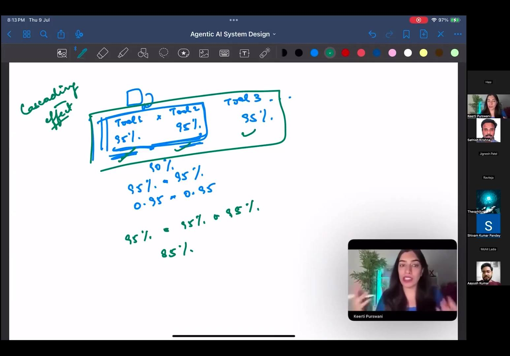
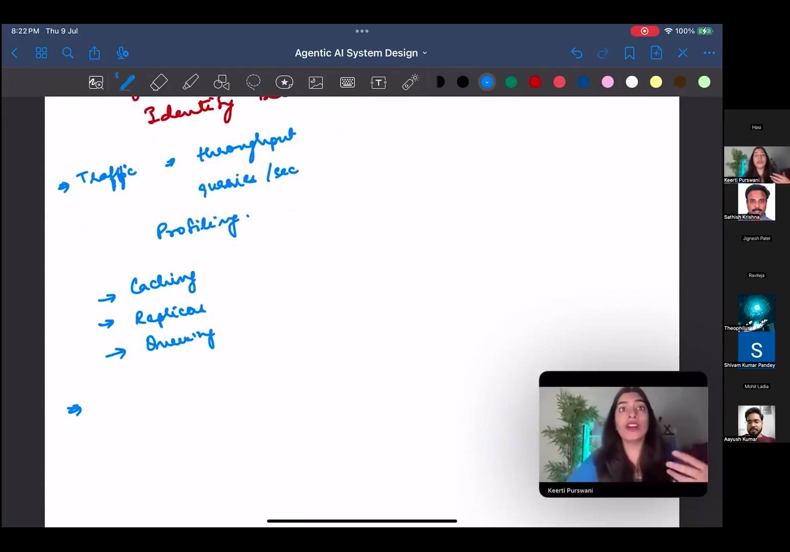
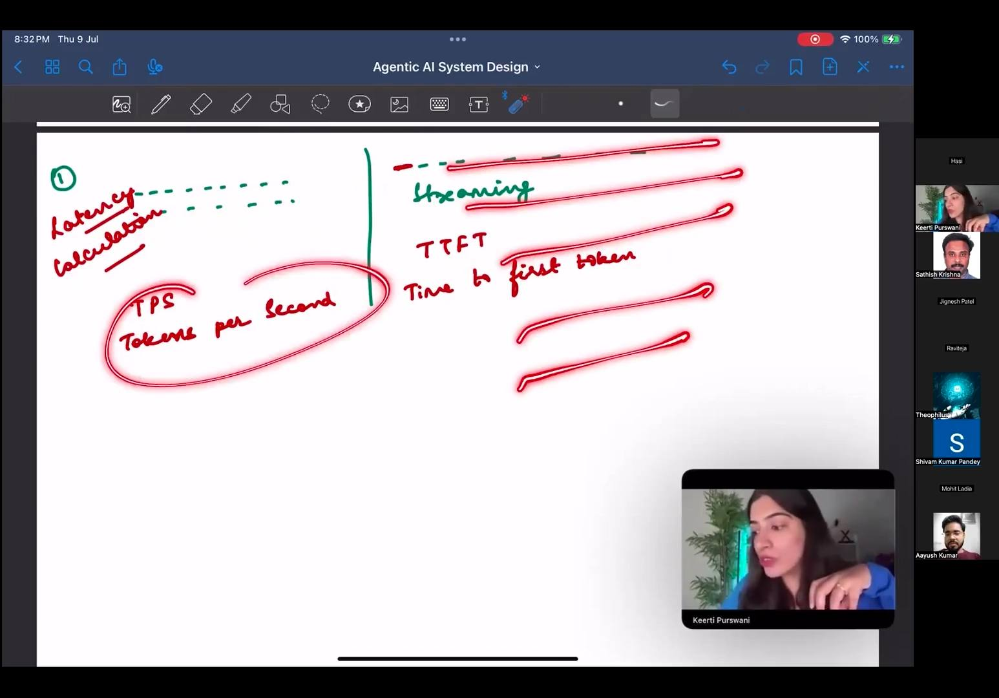
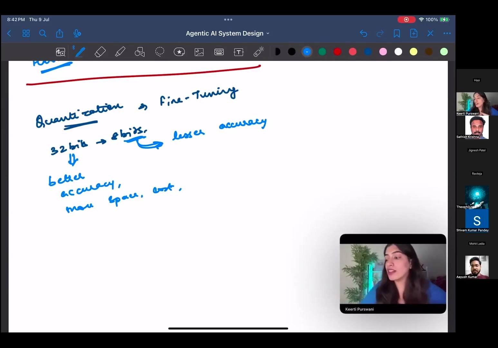
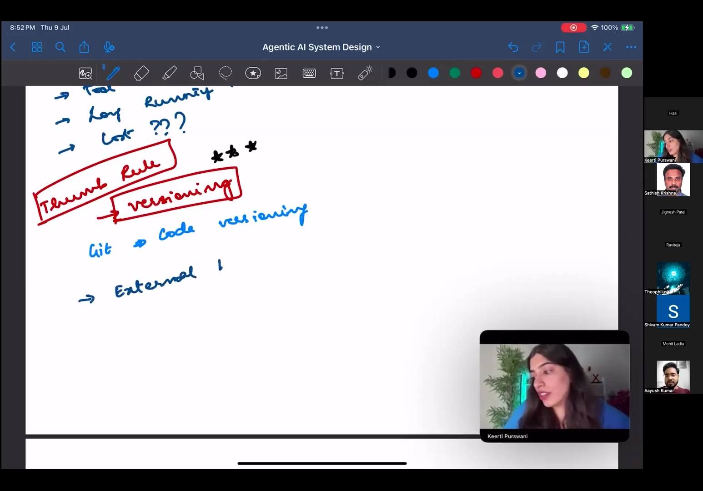
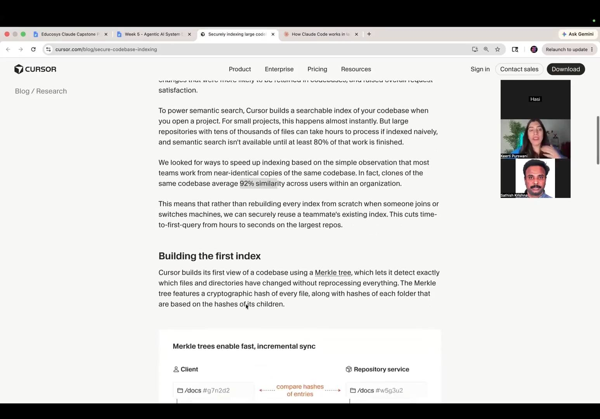
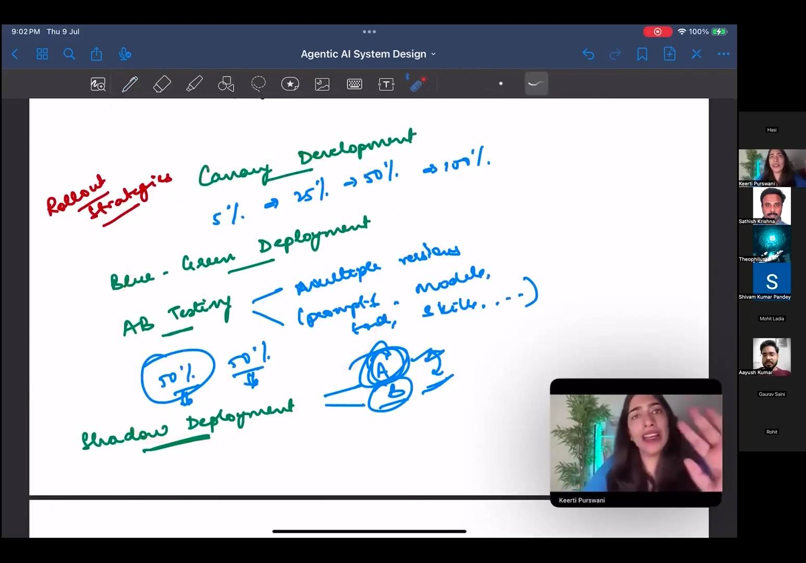
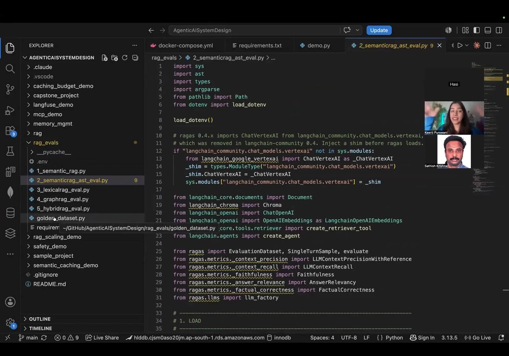

# Agentic AI 系统设计 · P014 收尾课
## 错误级联、检索调优、LLM Ops 与上线流水线（可照做复现文档）

> 适用课程：`BV1ntMt6TEe4` · 第 14 讲（P014，0:00–80:55）
> 本节性质：**系统设计 × 面试复盘课**。逐字稿里没有任何多文件工程，几乎所有内容都是「讲师抛出问题 → 学员给答案 → 讲师补判断」。所以本文档按「纯讲解课」的结构来写：第 3 节复现推导链，第 4 节把讲师的判断落成可直接抄用的设计决策表 + Schema + 估算算式，示意代码明确标注「课里没代码」。
> 读者假设：前端转 AI 应用工程师，不熟后端，遇到并发/中间件会顺带对到 JS/Node 语境。

---

## 1. 这一节做什么

这一讲是整门课的「收口课」。讲师前半段不再写新代码，而是拿一串**面试式追问**把前面十三讲的技术点串起来，后半段引出 **LLM Ops** 与 **CI/CD + 发布策略**，最后用两家真实产品的架构文档（Cursor 的索引设计 vs Claude Code 的「不建索引」设计）说明一个核心判断：**系统设计没有唯一正确答案，只有显式写出来的取舍**。

这一节你能带走的东西是四类：

1. **一套错误处理决策链**：工具调用成功率为什么会级联放大、错误怎么分成可重试/不可重试、两类错误分别怎么处理、备胎工具可以用哪几种方式实现。
2. **一套「系统变慢怎么查」的排查顺序**：先分清「流量变大」还是「单请求变慢」，再针对性做 profiling 与缓存/分片/排队。
3. **一套 RAG 质量与延迟的度量口径**：冲突文档怎么用 metadata filtering 消解、precision 与 recall 的取舍、融合 vs 重排的区别、TTFT 与 TPS 的区别、为什么 chat 应用优先流式。
4. **一套 LLM Ops 上线流水线**：什么必须打版本、离线 eval 与在线 eval 各在哪一步、canary / blue-green / A/B / shadow 四种发布策略在 agent 场景里怎么摆，以及 RAGAS 与 DeepEval 各自适合什么规模。

这一节**没有新建项目**。讲师唯一展示的代码回顾是第一周写过的 `rag evals`，本次只是打开它做回放，不新增文件。所以第 4 节我会把所有可复用的产物（决策表、Schema、估算表、流水线）落成文件的形式，方便你直接放进自己的仓库。

---

## 2. 讲师原话

下面按主题把讲师这一节最关键的原话摘出来（全部翻译成中文，产品名保留英文）。

**关于 Agent 的本质与级联成功率**

> "到目前为止，请记住，第一天我们开始聊什么是智能体——智能体就是 LLM 加工具，对吧？所以有各种各样的工具。"
> —— p014 [02:21]

> "我们现在处在一个 ReAct 循环里，会发生什么？会有多个工具被调用。假设工具 1 被调用、工具 2 被调用、工具 3 被调用，依此类推。假设每一次工具调用都有 95% 的成功率。那我问你，把这两个工具合在一起算，这个工作流的成功率是多少？是 95% 乘 95%，对吧？0.95 乘 0.95 还等于 95% 吗？"
> —— p014 [03:37]

> "如果用三个工具，成功率是 95%、95%、95%，那三个工具组合起来是多少？大概就是 85%。你们明白这里有一个级联效应了吗？只要某一步出了错，哪怕是一个非常小的错误，哪怕只是某一个工具需要重试一次——因为 agentic 应用里有这么多步骤、这么多变量——最终就会变成非常糟糕的用户体验。误差是在被放大的。"
> —— p014 [04:35]

**关于错误的分类与处理**

> "错误可以分为两类：一类是可重试错误（retriable errors），另一类是不可重试错误（non-retriable errors）。"
> —— p014 [06:29]

> "如果是可重试的，通常的做法是什么？HLD 里通常怎么做？带退避的重试（retry with backoff），非常好。也就是你先等 1 秒，再等 2 秒，再等 3 秒，这是一种指数退避；你会先等几秒、再等更久一点、再久一点，因为重试确实有意义——也许只是请求太多，过几秒就清空了。但仍然要有一个最大重试次数。"
> —— p014 [07:51]

> "那不可重试的情况呢？可不可以用备用工具（fallback tools）？或者也可以优雅地失败，直接返回一个错误。"
> —— p014 [08:50]

> "备用工具有很多种实现方式。第一种是工具调用的中间件——比如工具输出中间件，这是一种方式。另一种是我可以在备用工具的 docstring 里写：仅当另一个工具失败时才使用我；或者反过来，在主工具的 docstring 里写清楚。还有第三种，直接在 prompt 里写：在这些情况下用这个工具。你也可以告诉它工具的优先级。"
> —— p014 [09:46]

**关于系统变慢的排查**

> "假设我说你的系统变慢了，你要定位瓶颈。你会直接说『加缓存』吗？不会。我们会一步一步来。首先有两种主要情况：要么是数据太多，要么是请求太多。"
> —— p014 [12:54]

> "如果某个分片（shard）收到了过多的请求，如果出现了热分片，我们可以加副本（replicas）；还能做什么？可以加排队（queuing），把请求一个一个处理。"
> —— p014 [14:20]

> "另一种情况是：每一个请求本身就耗时太久。你的数据量变大了，或者上下文窗口太大，或者因为文档太多导致检索太慢；又或者工具调用次数太多、模型调用次数太多，你根本没有对它们设上限。你在一个循环里打转。"
> —— p014 [14:48]

**关于冲突文档、精确率与召回率**

> "如果 RAG 里有互相冲突的文档——一份文档说这是我们的退货政策，另一份说这是我们的退货政策——你怎么办？维护版本化，并处理好新鲜度。……这里应该用的词是 metadata filtering（元数据过滤）。你的 metadata 可以是 version，可以是 timestamp（取更近的）、source（谁更新的）、authority level（权威等级）。也不一定总是取最新的——一份是开发者写的，一份是法务文件，哪个权威更高是另一个维度。所以还是取决于用例。"
> —— p014 [17:11]

> "精确率（precision）关注的是准确度：在所有检索回来的文档里，有多少是真正相关的。召回率（recall）关注的是完整性：在所有真正相关的文档里，我们检索回了多少。……通常的生产实践是：先做到高召回——凡是相关的都先捞回来；然后不要把所有东西都塞给 LLM，先做重排（reranking），再追求高精确率，最后才送进 LLM。"
> —— p014 [19:30]

> "融合（fusion）和重排（re-ranking）的区别是什么？融合是合并，是数学层面的合并，融合里要不要调用 LLM？不调。重排里要不要调用 LLM？要。"
> —— p014 [21:21]

**关于延迟与流式**

> "在延迟计算里，有两个非常重要的术语。一个叫 TTFT（time to first token，首 Token 延迟），其实很简单，就是第一个 token 到达时，用户等了多久。另一个叫 TPS（tokens per second，每秒 token 数）。"
> —— p014 [23:40]

> "通常来说，在面向人类行为的聊天应用里，哪种更重要？流式（streaming），把 TTFT 处理好。"
> —— p014 [25:06]

**关于多智能体与 Harness**

> "智能体是什么？LLM 加工具。我能不能给不同的任务用不同的 LLM？能不能给不同任务用不同的工具？当然可以。小模型用在哪？分类器、查询分类、LLM-as-judge、摘要这类简单任务。大模型或推理模型用在哪？规划、复杂任务、需要推理的地方、生成高质量代码。也可以用微调过的模型。所以被问『更大的模型总是更好吗？』，答案是不是。"
> —— p014 [26:32]

> "有一个术语我们课上其实没真正说过，但我相信大家其实都已经知道了——我们一直在说工具调用、一直在说围绕 LLM 的一切。围绕 LLM 的一切，现在叫什么？Harness。……system prompts、工具、skills、MCP、基础设施、文件系统、sandbox、browser、编排逻辑，这些都属于 harness。你的中间件、hooks，全都是。"
> —— p014 [29:18]

**关于量化**

> "那些了解 LLM 内部原理的人……有一个东西叫量化（quantization）。模型内部其实是什么？就是数学，全是数字；embedding 也是数字，就是权重、偏差，全是数字。数字可以存成 32 位，也可以存成 8 位。全部存成 32 位，精度更好，但占用的空间更大、成本更高。8 位精度差一点，但已经做了大量测试，也有很多量化方法能把精度损失压得很小，而你可以省下成本、空间和算力，非常有用。"
> —— p014 [33:08]

**关于 LLM Ops 与版本**

> "如果你改了一个组件、终端用户看到的行为就会变，那就给它加一个版本号。版本控制在 LLM Ops 里极其、极其重要。prompt 要有版本，model 要有版本，知识库要改也得有版本，工具定义如果改了也要有版本。"
> —— p014 [43:29]

> "代码版本大多能交给 git，但并不是所有东西 git 都能管。比如外部知识库——如果 DB 的 schema 变了，git 会知道吗？不会。所以每次上线一个新系统，你都要把每一样东西的版本都跟踪起来。"
> —— p014 [44:48]

**关于评估与上线流水线**

> "每次部署前，应该看什么？要跑 eval。那是在部署前还是部署后？非常好，Bhaskar——答案是两者都要。……eval 有两种：一种是离线 eval（offline），部署前测；另一种是在线 eval（online），部署之后测。"
> —— p014 [47:05]

> "eval 对应传统系统里的什么？对应单元测试（unit tests）。所以离线 eval 就是你的单元测试。只有它通过了，才推到 git，然后才进 staging。"
> —— p014 [48:52]

> "先逐步放给比如 5% 的客户，观察；发现一切正常，再放到 25%；再正常，放到 50%；再正常，放到 100%。这就是 canary 发布，传统系统里也是这么干的，在 agentic 应用里也一样——只是前面要先跑离线 eval，随着放量越来越大，持续跟踪在线 eval。"
> —— p014 [50:19]

> "影子部署是什么？每一个请求都同时发给系统的两个版本。用户只看到其中一个版本的响应，但你在后台两个版本都在跑，然后对比两个版本的结果。"
> —— p014 [53:35]

**关于 RAGAS 与 DeepEval**

> "RAGAS 是『RAG assessment』的缩写。在 agentic 应用里，RAGAS 更多是用在检索或 RAG 流程的评估；但如果是一个真正的、规模很大的智能体系统，通常用的是 DeepEval。"
> —— p014 [57:38]

> "如果你要上生产、要管理 AI agent、需要自动化回归测试，那请直接用 DeepEval。如果你只是做 RAG 原型之类，就用 RAGAS。在大多数生产系统里，两者会一起用：RAGAS 用来评估检索这部分，DeepEval 用来评估端到端。"
> —— p014 [71:48]

> "DeepEval 是什么？它是用于 LLM 应用的开源 LLM 评估框架。就像我们用 LangChain 那样，它是一个框架——这里是评估框架。"
> —— p014 [72:14]

**关于两个真实产品的架构抉择**

> "Cursor 说：我们基于一个简单观察去寻找加速索引的方法——大多数团队都在几乎相同的代码库副本上工作。事实上，同一组织内克隆出来的代码库平均相似度高达 92%。……与其为每一个新加入或换机器的工程师从零重建索引，我们可以安全地复用队友已有的索引。这把首次查询时间从数小时缩短到数秒。"
> —— p014 [61:31]

> "Claude Code 则说：RAG 驱动的 AI 编码工具，是把整个代码库做 embedding，每次检索相关 chunk——这正是我们一直做的事。但在大团队规模下，这套系统会失效，因为 embedding 流水线跟不上活跃工程团队的变化。……他们怎么做的？不保留 embedding 流水线、没有集中式索引，每个开发者实例都直接工作在实时代码库上。"
> —— p014 [66:37]

> "Claude Code 是像软件工程师那样去浏览代码库：它遍历文件系统、读取文件、用 grep 精确找到它需要的东西。所以它没有索引。我们前面折腾了那么多 indexing、retrieval、RAG 的东西，Claude Code 根本不做，因为它只在本地做简单的查找。……但如果你做的是 GitHub Copilot 这种在线方案、多人同时用，那索引就不可避免。"
> —— p014 [68:59]

那你可以看出来了：这一节的核心不是「讲知识点」，而是**把每一个判断都用「为什么这样选 / 换一种情况会怎样」拆开**。后面的章节就按这个逻辑往下写。

---

## 3. 从零复现（讲师的推导链）

讲师的推导方式高度模板化：**先给需求 → 再给约束（哪些前提可能变）→ 做估算/分类 → 给方案 → 点出取舍**。下面把这一节出现的八条推导链逐条复现。会涉及并发/中间件的地方，我会顺手对到 JS/Node 语境。

### 链 A：工具调用错误的级联与分流

**需求**：Agent 是「LLM + 工具」，而且在一个 ReAct 循环里会连续调用多个工具。任何一步失败，整条链路都失败。

**约束**：每一次工具调用都只是一次 API 请求，本身就不可能 100% 成功；而且错误种类多，不能一律重试。

**估算**（讲师当场算的两步）：
- 单工具：`0.95`
- 两个工具串行：`0.95 × 0.95 = 0.9025`，约 90%
- 三个工具串行：`0.95 × 0.95 × 0.95 = 0.857375`，约 85%（讲师口述「大概 85%」）

这条链的关键结论是：**误差不是相加，是相乘；链路越长，整体成功率指数级衰减**。所以「重试一次」这种听起来很小的事情，会直接体现为用户感知到的失败。

**方案**（两条分支）：
1. **可重试错误**（429 限流、网络抖动这类）→ **带退避的重试**（retry with backoff）。退避节奏按讲师的描述是 1s → 2s → 3s 这类逐步拉长的等待。**必须设最大重试次数**，否则在限流场景下会把下游越压越死。
2. **不可重试错误**（401/403 鉴权、400 请求头或 body 本身就错的 4xx）→ 重试没有任何意义。处理方式是：**fallback 到备用工具**，或者**优雅失败、把错误原样返回**。

**备用工具的实现方式（讲师当场列了三种，且明确说「不止一种」）**：
- **工具调用中间件**：讲师说到「tool output middleware」，即包在工具输出外面的一层中间件，工具失败时由中间件接管去调备胎。**对应 JS/Node 就是 Express/Koa 的 middleware 概念——一个函数包住原函数，失败时决定是重抛、降级还是换实现**。
- **在工具的 docstring 里声明**：在备胎工具的 docstring 里写「仅当主工具失败时使用我」，或者在主工具的 docstring 里写清楚「我失败时改用 X」。这里讲师还特意追问了「什么是 docstring」——因为它就是发给 LLM 的那段「这个工具做什么」的自然语言描述。
- **在 prompt 里声明工具优先级**：把「在这些情况下用 X」写进系统 prompt，用自然语言告诉模型哪个工具优先。

**取舍**：重试会放大延迟（本来一次请求要变成多次），备胎工具会增加工具数量和选择复杂度，而且 LLM 面对更多工具时选错的概率也会上升。

> 

### 链 B：LLM 到底收到什么（工具调用的最小结构）

**需求**：要判断「怎么告诉 LLM 用哪个工具」，先得知道 LLM 实际收到了什么。

**约束**：LLM 不发 HTTP 请求，它只消费文本。

**方案**：讲师给出的判断是——**发给 LLM 的是 query 加工具列表**，而工具本身被序列化成 **name + description + arguments + metadata** 四样东西。**description 就是那段决定 LLM 什么时候选它的自然语言字符串**。

**取舍**：这个结构意味着「让 LLM 知道该用备胎工具」的所有自然语言手段（docstring、prompt 优先级说明）**最终都要落回这四样字段里**。metadata 是最容易被忽视的那个——它既能承载版本，也能承载降级策略。

### 链 C：系统变慢怎么查

**需求**：面试高频题「系统变慢了，怎么定位瓶颈」。禁止一上来就答「加缓存」。

**约束**：慢的原因可能完全不同，不能一个方案打天下。

**分类**（讲师要求先分成两类）：
1. **流量型慢**：请求变多、QPS 上去。面试官可能会把它包装成「流量涨了 100 倍、1000 倍」，但本质只是吞吐上去了。
2. **请求型慢**：单条请求本身耗时太久。

**方案（分流）**：
- 流量型：先做 **profiling**，看时间花在 embedding、retrieval 还是 LLM generation，然后决定在哪一层加缓存。如果出现**热分片**，就加 **replicas** 分担；再不行就加 **queuing**，把请求排队一个个处理。
- 请求型：同样先 profiling。重点看三处——**文档太多导致检索太慢、上下文窗口太大、工具调用次数或模型调用次数没有上限**。最后一条对应的是 ReAct 循环里的死循环/过度调用风险。

**取舍**：加副本 = 用钱换延迟；加排队 = 用延迟换稳定（用户会等更久）；对工具调用设上限 = 用功能覆盖面换成本与稳定性。

> 

### 链 D：冲突文档、精准度与检索质量三连

**需求**：RAG 里出现互相矛盾的文档（两份都声称是「退货政策」）时怎么办。

**约束**：冲突消解不能只看时间戳——有时法务文档比开发人员文档权威，哪怕它更旧。

**方案**：使用 **metadata filtering（元数据过滤）**，metadata 字段至少要覆盖：
- `version`（版本号）
- `timestamp`（时间戳，对应 freshness）
- `source`（来源/谁更新）
- `authority_level`（权威等级）

**进一步估算（precision vs recall）**：
- **Precision（精确率）**：`检索到的相关文档数 / 检索到的总文档数`，关注「准确度」。
- **Recall（召回率）**：`检索到的相关文档数 / 所有真正相关的文档数`，关注「完整性」。
- 这两者天然互相拉扯：**提高一个通常就要牺牲另一个**。
- **生产实践的标准链路**：**先高召回 → 再重排（reranking） → 再高精确率 → 送进 LLM**。这样既不会漏召回，也不会把一堆噪声塞给 LLM。

**顺手澄清的概念对**：**fusion（融合）是数学合并，不做 LLM 调用；re-ranking 是重排序，要做 LLM 调用。** 讲师在这一步明确让学员抢答，因为两者在面试里常被混着问。

> 

### 链 E：延迟体验——TTFT 与 TPS

**需求**：聊天类应用、Claude Code 这类「本来就要跑几分钟」的应用，怎么让用户体验不那么糟。

**约束**：用户对「空等」和「有反馈地等」的感受完全不同。

**方案**：
- **TTFT（time to first token，首 Token 延迟）**：第一个 token 什么时候到。
- **TPS（tokens per second，每秒 token 数）**：后续生成速度。
- 两个加一起才组成用户体感。**chat 应用里优先优化 TTFT，方式就是流式（streaming）**——因为一旦有字先出来，用户对总等待时间的容忍度会显著提升。

**取舍**：流式不是银弹。技术上讲，**流式通常意味着连接要保持、错误处理变得更复杂、重试也更麻烦**——这一句是我按常识补的，**课里没讲**，你如果写进面试答案要注意别把功劳归给讲师。

### 链 F：多智能体为什么要拆

**需求**：为什么很多 agent 系统要拆成多个 agent 而不是一个大 loop。

**约束**：不同任务的难度、成本、需要的能力截然不同。

**方案**：
- **不同 LLM 服务不同任务**：分类器、query classification、LLM-as-judge、摘要 → 小模型；规划、复杂推理、高质量代码生成 → 大模型或推理模型；重复性强的领域任务还可以用**微调模型**。
- **不同工具服务不同任务**：每个子 agent 只需拿到自己的工具集，工具少 → 选择更准、prompt 更短。
- 结论：**更大的模型不总是更好**。

**取舍**：多个 agent 之间的编排与通信成本会上升，这一节讲师没有展开细讲 agent 间协议，**课里没讲**。

### 链 G：Harness——把「围绕 LLM 的一切」命名

**需求**：给「LLM 之外的所有工程部分」一个名字，方便面试时用。

**约束**：讲师自己承认这是「给一个概念起了个时髦名字」。

**方案（讲师原话列举）**：**system prompts、工具、skills、MCP、基础设施、文件系统、sandbox、browser、编排逻辑、中间件、hooks**——这些统统属于 harness。并且讲师给出了一个很好记的一句话：**「如果你不是模型，那你就是 harness。」**（讲师引用的是他当场搜到的一篇博客里的表述。）

同时把演进路径也点出来：**prompt engineering（怎么说 prompt）→ context engineering（memory、工具定义、短期/长期记忆、所有进 context 的东西）→ harness engineering（围绕 LLM 的整个工程体系）**。

**取舍**：讲师强调这只是术语包装，不改变工程实质；但**面试时用术语能显得更专业**。

### 链 H：量化（Quantization）

**需求**：模型权重本质是一堆数字，怎么在可接受精度下省成本、省空间、省算力。

**估算**：
- 32 bit 存一个数：精度更高、占空间更大、成本更高。
- 8 bit 存一个数：精度下降，但已有大量量化方法可以把精度损失压低，同时**节省空间、降低成本、减少计算量**。
- 讲师明确说这也是**微调**相关的问题，并特别提醒：「**fine-tuning vs RAG**」和「**quantization**」这两个是很可能被 AI Engineer 岗位问到的、**不属于 agentic AI 核心但必须知道**的话题。

> 

### 链 I：LLM Ops——版本、评估与发布

这是整节课后半段的主线，也是干货最密集的地方，我把它拆成四个小步。

**需求**：传统 DevOps 那套流程在 agent 场景里不够用了。

**约束与对比**：

| 维度 | DevOps（传统系统） | LLM Ops（agentic 系统） |
|---|---|---|
| 系统性质 | 确定性：同样输入 → 确定输出 | 非确定性 / 概率性 |
| 主要抓手 | scaling、sharding、Docker/Kubernetes、rollback、downtime | 上面这些 + prompt、模型选型、context、tools、
| 维度 | DevOps（传统系统） | LLM Ops（agentic 系统） |
|---|---|---|
| 系统性质 | 确定性：同样输入 → 确定输出 | 非确定性 / 概率性 |
| 主要抓手 | scaling、sharding、Docker/Kubernetes、rollback、downtime | 上面这些 + prompt、模型选型、context、tools、知识库 |
| 质量门禁 | 单元测试（unit tests） | 离线 eval（对应单元测试）+ 在线 eval（对应线上监控） |
| 变更的放大效应 | 改一行代码只影响那一行逻辑 | 改一个词，整个项目行为都变 |
| 需要跟踪版本的对象 | 代码（git 基本够用） | prompt / model / 知识库 / 工具定义 / agent workflow / skills |

**讲师在这一步举的两个「一个词改变一切」的例子**（这两个例子是整节的记忆锚点，面试可以直接复用）：

- **prompt 层面**：把系统提示从 `你是一个助手` 改成 `你是一个软件架构师`，只差几个字，但整个项目的行为会跟着变。讲师还补了一句半开玩笑的：如果在「助手」前面加个 `粗心的`，也一样有效。学员 Ashish 当场接了这个梗。
- **模型层面**：从 `4.0` 换到 `5.5`，讲师说这一门课里**做 todo app 的时候就亲眼见过差异**——生成出来的 UI 不一样，推理能力也不一样。

**LLM Ops 的挑战清单**（讲师让学员一条条抢答出来的，顺序就是讲师念的顺序）：
1. 非确定性 / 概率性
2. 对 prompt 敏感
3. 对模型版本变化敏感
4. 工具和编排逻辑持续变化
5. 可能是长时任务（long-running tasks）
6. 成本是巨大关注点

**核心规则（讲师原话，我原样保留成一句可背诵的话）**：

> "如果你改了一个组件、终端用户看到的行为就会变，那就给它加一个版本号。"
> —— p014 [43:29]

> 

**git 的边界（这是讲师本节最实用的一条判断）**：
- **git 管得住**：代码；以及放在代码仓库里的**系统提示（system prompt）**——讲师被学员 Shivam 追问时明确说：「我指的是系统 prompt，它是会放在你的 git 里的，放在你的代码仓库里的。」
- **git 管不住**：**外部知识库**（第三方 DB 的 schema 变了、数据变了，git 完全不知道）；**skills**（讲师明确说 skills 不会在你的 git 仓库里）。
- 结论：**凡是不在 git 仓库里的东西，你必须自己另外做版本跟踪**，每次部署都要能把「这次上线到底用的是哪一版知识库、哪一版工具定义」说清楚。

**评估的门禁位置**：讲师把 eval 和传统系统的单元测试做了严格类比——「**离线 eval 就是你的单元测试**」。所以流程不是「先推代码再测」，而是「**先跑离线 eval，通过阈值才 push**」。在线 eval 则是部署之后、随着放量持续看的指标。

**发布策略（讲师明确说「概念和传统系统完全一样」，差别只在 eval 的位置）**：
- **Canary（金丝雀）**：5% → 25% → 50% → 100%，每放一档都看在线 eval，正常才继续放。
- **Blue-green（蓝绿）**：讲师在这里只是被学员 Theophilus 提及后确认「那是另一种可能」，并提到之前在**重索引（re-indexing）**那部分讲过。**具体切换细节本节课没展开，课里没讲。**
- **A/B 测试**：讲师用 YouTube 缩略图 A/B 举例——同一个视频挂两个缩略图，看哪个点击更高。在 agent 场景里，**A/B 的对象可以是 prompt 的两个版本、模型的两个版本、工具描述的两个版本、甚至 skills 的多个版本**，不限于两个。流量切分例如 50% / 50%，**同一个客户不会同时看到两个版本**，看的是哪一组用户的反馈和在线 eval 更好。
- **Shadow（影子部署）**：**每个请求同时发给两个版本**，用户只看到其中一个版本的响应，后台两个都跑，然后对比。讲师确认了学员的说法「有点像并行跑」。

**取舍**：canary 慢但安全；A/B 能得出「哪个更好」的因果结论但需要足够样本；shadow 拿到的是最全的对比数据，但**成本直接翻倍**。

### 链 J：Cursor vs Claude Code——同一问题的两种正确答案

**需求**：AI 编码工具要「理解代码库」，怎么理解。

**约束**：代码库规模、团队规模、是本地还是在线、变更频率——这四个变量一变，最优解就变。

**方案 A（Cursor 路线：建索引 + 复用索引）**：
- 观察：同一组织内，克隆出来的代码库副本**平均相似度 92%**。
- 决策：**不从零重建索引**，而是安全地**复用队友已经建好的索引**。
- 效果：**首次查询时间从数小时降到数秒**。
- 增量更新：自建索引树叫 **Mercury**，讲师说它**类似课程里我们自己搭的 hash tree**——本质是构造一棵代码树，用**哈希**精确检测哪些文件和目录变了，从而「不重新处理全部内容」。
- 除哈希外的另一种失效检测手段：**mtime（文件修改时间）**；讲师还提到可以加一个 **watcher（文件监听）**。

**方案 B（Claude Code 路线：不建索引）**：
- 观察：RAG 式 AI 编码工具把整个代码库做 embedding、每次检索 chunk，**但在大团队规模下会失效，因为 embedding 流水线跟不上活跃工程团队的变化**——「等开发者查询索引时，索引反映的是几周、几天或几小时之前的代码库」，于是会检索出一个团队两周前就改名的函数。**这就是 freshness（新鲜度）问题。**
- 决策：**不保留 embedding 流水线、没有集中式索引**，每个开发者实例直接工作在**实时代码库**上。
- 机制：**像软件工程师那样浏览代码库——遍历文件系统、读文件、用 `grep` 精确找它需要的东西**。
- 代价（讲师特别强调「他们自己也把取舍写出来了」）：**代码库组织得好不好直接决定它的导航质量**（分层文本、`cloud.md` 这类文件、skills 都会影响效果）；如果要求在**十亿行**代码库里找出某个模糊模式的所有实例，**在开始干活之前就会撞上上下文窗口上限**；**多跳（multi-hop）查询**表现也可能不好。

**关键的边界判断（讲师自己补的一句）**：**如果是 GitHub Copilot 这种在线、多人同时使用的方案，grep 就行不通了，索引不可避免。**

**结论**：讲师反复说「**没有唯一正确的设计方案**」，大公司自己的博客里也在写自己的问题、自己的 pros/cons。面试时把两家方案摆出来做对比，比给一个「标准答案」加分得多。

> 

### 链 K：RAGAS 与 DeepEval——评估为什么不能一套打通

**需求**：给 agent 系统做上线前的质量门禁。

**约束**：RAG 的评估对象是「检索结果」，可以直接和期望结果做对比；但**整个多 agent 工作流没有唯一「标准输出」可以逐字比对**——规划对不对、query 分类对不对、工具选得对不对，都是不同维度。

**RAGAS 的复现路径（讲师把第一周的代码重新打开回顾了一遍）**：
1. 准备**基准数据集（golden dataset）**——这是 source of truth。
2. golden dataset 的三个来源：**合成（synthetic）生成、人工编写、从生产日志里捞**。讲师特别强调：**如果本地表现好但线上出问题，就去读日志，把那些 case 补进 golden dataset。**
3. 数据集每条记录的结构：**question + reference（参考答案）**。
4. 导入 test cases → **设置 metrics** → **调用 evaluate 在数据集上跑**。

**RAGAS 的天花板在哪**：讲师指出 RAG 场景下「检索出来的」和「应该检索出来的」可以**直接对比**；但端到端 agent 系统没法这么比，所以必须**按组件拆开写不同的测试用例**——查询分类一个、RAG 一个、端到端一个、多 agent 一个。

**DeepEval 能覆盖的 eval 类型（讲师照着文档逐条念的，我原样保留）**：
- **端到端 eval**：RAG 就是「输入 question → 输出 answer」，这个用 RAGAS 也做过。
- **文档摘要 eval**：讲师说这条还**可以用来测短期记忆**。
- **分类器 eval**：agent 流水线的第一步是 query classifier，可以单独测它。
- **把「用工具的 agent」当黑盒测**：**输入是用户任务，输出是最终答案 + 被调用到的工具**——这样就能验证「该调的工具调了没有」。
- **agentic 专用指标**：**task completion（任务完成度）、step efficiency（步骤效率）、argument correctness（参数正确性）、tool correctness（工具正确性）、plan adherence（计划遵循度）、plan quality（计划质量）**。
- **multi-turn evals**（多轮）、**MCP evals**、**exact match / pattern match / JSON correctness**、**图像类 eval**、**prompt optimization**、以及自带 **golden synthesizer**（可以直接生成数据集/文档）。

**DeepEval 的落地方式（讲师现场演示的流程）**：
1. `pip install` 安装；
2. 登录；
3. **创建测试（create tests）**；
4. **运行测试（run tests）**；
5. 如果你是「vibe coder」，它**提供了一个 skill**——把这个 skill 加上，就可以**直接让 Claude Code 帮你生成测试**；
6. 讲师明确说：**这一节他想让我们聚焦的是「CI/CD 里的单元测试」**这部分。

**分工结论**：**RAGAS 管检索/RAG 流程，DeepEval 管端到端与 agent 组件；生产系统里两者常常同时用。**

> 

> 

---

## 4. 完整代码

> **重要前提**：本讲**没有任何新建工程、没有讲师当场敲的代码**，也没有 OCR 到屏幕上的命令或配置。第一周写过的 `rag evals` 只是被打开回放，本节不新增文件。
> 因此下面第 4 节是**把讲师的判断落成可以直接放进你仓库的产物**：决策表、Schema、估算脚本、流水线骨架。
> 凡是我补的实现代码，都是**「课里没有代码，以下为示意」**，我会逐块标注；涉及 DeepEval 具体 API 的地方，**课里没讲**，我只给结构骨架，不编造函数签名。

### 4.0 目录结构（把本节产物放进你现有 agent 项目）

```text
your-agent-project/
├── docs/
│   ├── error-handling-decision-table.md      # 4.1
│   ├── version-matrix.md                     # 4.2
│   └── deployment-strategies.md              # 4.7
├── schemas/
│   ├── tool-definition.schema.json           # 4.3
│   └── document-metadata.schema.json         # 4.4
├── scripts/
│   ├── cascade-success.mjs                   # 4.5  （零依赖，node 直接跑）
│   ├── retry-backoff.mjs                     # 4.5  （零依赖，node 直接跑）
│   └── metadata-filter.mjs                   # 4.5  （零依赖，node 直接跑）
├── evals/
│   ├── golden-dataset.jsonl                  # 4.6
│   └── README.md                             # 4.6  指标清单
└── .github/
    └── workflows/
        └── offline-eval-gate.yml             # 4.7 （示意）
```

### 4.1 错误处理决策表（`docs/error-handling-decision-table.md`）

```markdown
# 工具调用错误处理决策表

## 第一步：先判类型
| 类别 | 典型信号 | 处理动作 | 禁止动作 |
|---|---|---|---|
| 可重试（retriable） | 429 限流 / 网络抖动 | 指数退避重试，1s→2s→3s…，设 max_retries | 无上限重试 |
| 不可重试（non-retriable） | 401 / 403 鉴权失败；4xx 请求本身错（headers/body 错） | 走 fallback 工具，或优雅失败并返回原始错误 | 死循环重试同一个工具 |

## 第二步：若走 fallback，三种实现方式（可叠加）
| 方式 | 落在哪 | 说明 |
|---|---|---|
| tool output middleware | 代码层 | 包住工具输出，失败时接管去调备胎（Node 里等价于 Express/Koa middleware） |
| docstring 声明 | 工具定义 | 备胎工具写明"仅当 X 失败时使用我"；或主工具写明"失败时改用 Y" |
| prompt 优先级 | system prompt | 用自然语言写"在这些情况下用 X"，并显式给出工具优先级 |

## 第三步：检查 LLM 实际收到什么
query + 工具列表，每个工具 = name + description + arguments + metadata
→ 所有降级信息最终必须落回这四个字段之一。

## 下限要求
- 必须设 max_retries
- 必须设单次任务的最大工具调用数 / 最大模型调用数（防 ReAct 循环打转）
```

### 4.2 版本矩阵（`docs/version-matrix.md`）

```markdown
# 上线版本矩阵（每次部署必须填满一行）

| 字段 | 是否 git 管得住 | 示例值 | 备注 |
|---|---|---|---|
| code_commit | ✅ | a3f9c21 | |
| system_prompt_version | ✅（在代码仓库里） | prompts/system.v7.txt | 讲师确认系统 prompt 是进 git 的 |
| model_id | ⚠️ 在 config 里 | 例如模型供应商给的精确版本串 | 换版本 = 行为变，必须记 |
| knowledge_base_version | ❌ 外部依赖 | kb-2024-11-02 | 第三方 DB schema/数据变了 git 不知道 |
| tool_definitions_version | ⚠️ 看实现 | tools.v4 | 改描述也算变更 |
| agent_workflow_version | ✅ | workflow.v3 | 编排逻辑变了要记 |
| skills_version | ❌（不在 git 仓库） | skills.v2 | 讲师明确说 skills 不在 git 里 |

## 规则
改任何一个字段 → 终端用户行为可能变 → 该字段必须有版本号，
且本次部署必须能回答"用的是哪一版"。
```

### 4.3 工具定义 Schema（`schemas/tool-definition.schema.json`）

> 说明：字段集合来自讲师口述的 **name + description + arguments + metadata**。`fallback`/`priority` 是讲师讲备用工具实现方式时提到的语义，我用字段把它们显式化了——**课里没有给过这个 JSON 结构，以下为示意**。

```json
{
  "$schema": "https://json-schema.org/draft/2020-12/schema",
  "title": "ToolDefinition",
  "type": "object",
  "required": ["name", "description", "arguments", "metadata"],
  "properties": {
    "name": {
      "type": "string",
      "description": "工具名，LLM 调用时使用的标识"
    },
    "description": {
      "type": "string",
      "description": "自然语言描述，决定 LLM 什么时候选这个工具（讲师强调这就是 docstring 的作用）"
    },
    "arguments": {
      "type": "object",
      "description": "参数 schema，供 LLM 生成调用参数"
    },
    "metadata": {
      "type": "object",
      "properties": {
        "version": { "type": "string" },
        "priority": { "type": "integer", "description": "数值越小优先级越高" },
        "retriable": { "type": "boolean" },
        "fallback_tool": { "type": "string", "description": "本工具失败时可改用的工具名" },
        "only_when_failed": { "type": "string", "description": "仅当该工具失败时才使用本工具，对应 docstring 声明方式" }
      },
      "required": ["version"]
    }
  }
}
```

### 4.4 文档元数据 Schema（`schemas/document-metadata.schema.json`）

> 字段来源：讲师在冲突文档那段明确点出的 `version` / `timestamp` / `source` / `authority_level`。**结构本身是示意。**

```json
{
  "$schema": "https://json-schema.org/draft/2020-12/schema",
  "title": "DocumentMetadata",
  "type": "object",
  "required": ["doc_id", "version", "timestamp", "source", "authority_level"],
  "properties": {
    "doc_id": { "type": "string" },
    "version": { "type": "string" },
    "timestamp": { "type": "string", "format": "date-time", "description": "freshness 依据" },
    "source": { "type": "string", "description": "谁更新的/来自哪个系统" },
    "authority_level": {
      "type": "integer",
      "description": "权威等级；法务文档可高于开发文档，不必然按时间取胜"
    }
  }
}
```

### 4.5 三个可直接运行的脚本（零依赖）

> **课里没有代码，以下为示意**，但都是完整文件，`node` 直接跑。

**（1）`scripts/cascade-success.mjs`——算级联成功率**

```javascript
// scripts/cascade-success.mjs
// 用法: node scripts/cascade-success.mjs
// 目的: 验证讲师课上算的 0.95 × 0.95 ≈ 90%、三个工具 ≈ 85%

const perTool = 0.95;

function cascade(n, p = perTool) {
  return Math.pow(p, n);
}

console.log(`单工具成功率: ${(perTool * 100).toFixed(2)}%`);

for (const n of [2, 3, 5, 8, 10]) {
  const s = cascade(n);
  console.log(`连续 ${n} 个工具 → ${(s * 100).toFixed(2)}%`);
}

// 反推: 若要求整条链路 >= 90%，单个工具至少要多可靠?
for (const n of [3, 5, 10]) {
  const need = Math.pow(0.9, 1 / n);
  console.log(`链路 ${n} 步要保 90% → 单步至少 ${(need * 100).toFixed(2)}%`);
}

// 加一次重试后的单工具成功率（重试成功即算成功）
function withRetry(p, retries = 1) {
  return 1 - Math.pow(1 - p, retries + 1);
}
const p2 = withRetry(perTool, 1);
console.log(`单工具 95% + 1 次重试 → ${(p2 * 100).toFixed(2)}%`);
console.log(`三步链路带 1 次重试 → ${(Math.pow(p2, 3) * 100).toFixed(2)}%`);
```

**（2）`scripts/retry-backoff.mjs`——可重试/不可重试分流 + 退避**

```javascript
// scripts/retry-backoff.mjs
// 用法: node scripts/retry-backoff.mjs
// 对应讲师的两条分支: retriable → retry with backoff (max retries)
//                     non-retriable → fallback tool 或 优雅失败

class RetriableError extends Error {}
class NonRetriableError extends Error {}

// 按 HTTP 状态码判类型（讲师课上点到的: 429 可重试; 401/403/400 不可重试）
export function classify(status) {
  if (status === 429) return 'retriable';
  if (status >= 500) return 'retriable';   // 5xx 讲师没有逐条点，此处按通用实践处理
  if (status === 401 || status === 403) return 'non-retriable';
  if (status === 400 || status === 404) return 'non-retriable';
  return 'non-retriable';
}

const sleep = (ms) => new Promise((r) => setTimeout(r, ms));

// 退避序列: 1s -> 2s -> 3s ...（讲师口述节奏），并设最大值
export async function withBackoff(fn, { maxRetries = 3, baseMs = 1000 } = {}) {
  let lastErr;
  for (let attempt = 0; attempt <= maxRetries; attempt++) {
    try {
      return await fn();
    } catch (err) {
      lastErr = err;
      if (err instanceof NonRetriableError) throw err;
      if (attempt === maxRetries) break;
      const wait = baseMs * (attempt + 1); // 1s, 2s, 3s ...
      console.log(`  第 ${attempt + 1} 次失败，等待 ${wait}ms 后重试`);
      await sleep(wait);
    }
  }
  throw lastErr;
}

// 备胎工具: 主工具不可重试失败时切过去（对应讲师说的 fallback tools）
export async function withFallback(primary, fallback) {
  try {
    return await withBackoff(primary);
  } catch (err) {
    if (fallback) {
      console.log('  主工具失败，切换备胎工具');
      return await fallback();
    }
    console.log('  无备胎，优雅失败并返回原始错误');
    throw err;
  }
}

// ---- 自测 ----
if (import.meta.url === `file://${process.argv[1]}`) {
  const flaky = (() => {
    let n = 0;
    return async () => {
      n++;
      if (n < 3) throw new RetriableError('429 too many requests');
      return `成功（第 ${n} 次尝试）`;
    };
  })();

  const authFail = async () => {
    throw new NonRetriableError('403 forbidden');
  };

  const backup = async () => '备胎工具返回结果';

  await withFallback(flaky).then(console.log);
  await withFallback(authFail, backup).then(console.log);
}
```

**（3）`scripts/metadata-filter.mjs`——冲突文档消解 + pre-filter**

```javascript
// scripts/metadata-filter.mjs
// 用法: node scripts/metadata-filter.mjs
// 对应讲师: metadata filtering 用 version / timestamp / source / authority_level
// 注意: 讲师强调"不总是取最新的"，所以 authority 可以压过 recency

export function pickAuthoritative(docs, { prefer = 'authority' } = {}) {
  if (docs.length === 0) return null;
  const sorted = [...docs].sort((a, b) => {
    if (prefer === 'authority') {
      if (b.authority_level !== a.authority_level) {
        return b.authority_level - a.authority_level; // 权威高者优先
      }
      return new Date(b.timestamp) - new Date(a.timestamp); // 同权威再看新鲜度
    }
    return new Date(b.timestamp) - new Date(a.timestamp); // 纯 freshness
  });
  return sorted[0];
}

export function preFilter(docs, filters = {}) {
  return docs.filter((d) => {
    if (filters.version && d.version !== filters.version) return false;
    if (filters.source && d.source !== filters.source) return false;
    if (filters.minAuthority && d.authority_level < filters.minAuthority) return false;
    if (filters.notOlderThan) {
      if (new Date(d.timestamp) < new Date(filters.notOlderThan)) return false;
    }
    return true;
  });
}

// ---- 自测 ----
if (import.meta.url === `file://${process.argv[1]}`) {
  const docs = [
    { doc_id: 'd1', version: 'v1', timestamp: '2024-11-01T00:00:00Z', source: 'dev', authority_level: 2, text: '退货政策: 30 天' },
    { doc_id: 'd2', version: 'v2', timestamp: '2024-06-01T00:00:00Z', source: 'legal', authority_level: 5, text: '退货政策: 14 天' }
  ];

  console.log('权威优先 →', pickAuthoritative(docs, { prefer: 'authority' }).doc_id);
  console.log('新鲜优先 →', pickAuthoritative(docs, { prefer: 'freshness' }).doc_id);
  console.log('pre-filter(minAuthority=3) →', preFilter(docs, { minAuthority: 3 }).map((d) => d.doc_id));
}
```

### 4.6 golden dataset 与评估指标清单（`evals/`）

**`evals/golden-dataset.jsonl`**（讲师回顾的结构：question + reference；**JSONL 格式为示意**）

```jsonl
{"id":"q001","question":"退货期限是多久？","reference":"以法务版政策为准，14 天。","expected_tools":["search_policy"],"component":"rag"}
{"id":"q002","question":"帮我查一下订单 A123 的状态","reference":"调用订单查询工具并返回状态。","expected_tools":["get_order_status"],"component":"tool_use"}
{"id":"q003","question":"你是哪类问题：退款、物流还是账号？","reference":"退款","expected_tools":[],"component":"classifier"}
{"id":"q004","question":"先查订单再按政策判断能不能退","reference":"先 get_order_status，再 search_policy，最后给出结论。","expected_tools":["get_order_status","search_policy"],"component":"end_to_end"}
```

**`evals/README.md`**（指标来源：讲师照着 DeepEval 文档念的那一串）

```markdown
# 评估指标清单

## 数据集来源（三者都要）
- 合成（synthetic）生成
- 人工编写
- 生产日志补充：本地好、线上出问题时，读日志，把 case 补进来

## 按组件拆分（关键：端到端无法直接对比，必须拆）
| 组件 | 输入 | 输出 | 关注指标 |
|---|---|---|---|
| query classifier | 用户 query | 类别 | 分类准确率 |
| RAG 检索 | question | 检索到的 chunk | 与 reference 直接对比（RAGAS） |
| 端到端 RAG | question | answer | 答案质量（RAGAS / DeepEval 端到端） |
| 用工具的 agent（黑盒） | 用户任务 | 最终答案 + 被调用工具 | tool correctness、argument correctness |
| 多步规划 | 任务 | 计划 + 执行 | plan quality、plan adherence、step efficiency、task completion |
| 文档摘要 | 长文档 | 摘要 | 摘要质量（同时可测短期记忆） |

## DeepEval 文档中出现的其它 eval 能力（讲师逐条念过）
multi-turn evals / MCP evals / exact match / pattern match / JSON correctness /
图像类 eval / prompt optimization / golden synthesizer（可生成数据集）

## 工具分工
- RAGAS：检索与 RAG 流程（"RAG assessment"）
- DeepEval：端到端 + agent 组件 + CI/CD 回归
- 生产系统里两者同时用
```

**DeepEval 测试文件骨架（Python，`evals/test_agent_e2e.py`）**

> **课里没讲具体 API**。讲师只讲了 `pip install` → 登录 → 创建测试 → 运行测试，以及「可以加 skill 让 Claude Code 帮你生成测试」。下面只保留**结构**，函数名/断言写法请以官方文档为准，我不在这里编造。

```python
# evals/test_agent_e2e.py
# 课里没讲具体 API，以下仅为结构骨架（示意）
#
# 安装: pip install deepeval
# 登录: 按官方文档完成（课里没讲具体命令）
# 运行: 按官方文档执行测试；讲师强调这一节聚焦 "CI/CD 里的单元测试"

# 1) 加载 golden dataset（可以是 CSV / JSON / JSONL，讲师说"可以是任何格式"）
# 2) 对每个组件分别写测试用例：classifier / rag / tool_use / end_to_end / multi_agent
# 3) 断言用的是 task completion、step efficiency、argument correctness、
#    tool correctness、plan adherence、plan quality 这类 agentic 指标
#
# TODO(你): 用 DeepEval 官方 API 填充上述三步
```

### 4.7 上线流水线与发布策略

**`docs/deployment-strategies.md`**

```markdown
# 四种发布策略（agent 场景沿用传统系统，差别在 eval 位置）

| 策略 | 流量怎么分 | 用户看到几个版本 | 主要用途 | 成本 |
|---|---|---|---|---|
| Canary | 5% → 25% → 50% → 100%，逐档观察 | 1 个 | 安全放量 | 低 |
| Blue-green | 两套环境整体切换 | 1 个 | 快速回滚 | 中（双份环境） |
| A/B | 如 50% / 50%，按用户分组 | 1 个（不同用户不同版） | 比较"哪个更好" | 中 |
| Shadow | 100% 请求同时打两份 | 1 个（后台跑两份） | 拿到最全对比数据 | 高（双倍算力） |

## A/B 的对象不限于两版、也不限于 prompt
prompt / model / tool description / skills / 代码版本 —— 任何多版本都可比。

## 通用流程
dev 改动 → 离线 eval（= 单元测试）→ 达阈值 → push GitHub → 部署 staging
→ canary 放量，每档跟在线 eval → 全量
```

**`.github/workflows/offline-eval-gate.yml`（示意，课里没讲 GitHub Actions 语法）**

```yaml
name: offline-eval-gate
on:
  pull_request:
  push:
    branches: [main]

jobs:
  offline-eval:
    runs-on: ubuntu-latest
    steps:
      - uses: actions/checkout@v4
      - uses: actions/setup-python@v5
        with:
          python-version: '3.11'
      - name: install
        run: pip install deepeval   # 讲师讲过的安装方式
      - name: run-evals
        run: |
          # 课里没讲具体运行命令，按 DeepEval 官方文档执行
          echo "在此运行 offline evals"
      - name: threshold-gate
        run: |
          # 讲师强调: eval 必须过阈值才允许 push/部署
          echo "在此校验阈值，未达标则 exit 1"
```

---

## 5. 逐行解释

**为什么成功率用乘法而不是加法？**
因为多个工具是**串行依赖**的：前一个工具的输出是后一个的输入，只要前一环断了，后面根本不会发生。串行依赖的概率就是乘积。

**为什么「加一次重试」的收益比想象中大？**（对应 `withRetry`）
单次 95% 的工具，重试 1 次后失败概率从 5% 变成 `0.05 × 0.05 = 0.25%`，成功率约 99.75%。这就是为什么 `cascade-success.mjs` 里我算了「三步链路带 1 次重试」——它把 85% 拉回到约 99%。但这**只对可重试错误有效**，对 403 重试一万次也还是 403。

**`classify()` 里为什么把 5xx 归到 retriable？**
讲师课上只明确点了 **429 可重试**、**401/403/400 不可重试**。5xx 属于我按通用实践补的，**课里没讲**，所以代码里我写了注释标明来源，你写进面试答案时也要说清楚这是通用实践而非课上结论。

**`withBackoff` 里为什么要 `maxRetries`？**
讲师原话是「仍然要有一个最大重试次数」。在限流场景下，无上限重试会让请求量随重试次数成倍增长，把下游压死。

**退避为什么是 `baseMs * (attempt + 1)`？**
讲师描述的是「等 1 秒、再等 2 秒、再等 3 秒」，是线性递增的等待。真正的生产实践常加随机抖动（jitter）避免重试风暴同步——**课里没讲 jitter**，见第 7 节。

**`withFallback` 为什么放在 `withBackoff` 外层？**
顺序很重要：**先尝试「重试」（只对可重试有效），重试耗尽或遇到不可重试错误，才切备胎**。反过来先切备胎，会把一次本可以靠重试解决的限流，变成一次无谓的工具切换。

**Node 对应物说明（给前端读者）**：`withFallback` 这个「包一层函数、失败时决定怎么办」的模式，就是 Express/Koa 里 middleware 的同一件事，只不过 middleware 包的是 `req/res`，这里包的是一个 async 函数。`sleep` 用 `setTimeout` 包 Promise，等价于浏览器里的 `await new Promise(r => setTimeout(r, ms))`。`withBackoff` 的 `for` 循环是串行等待，**不要**写成 `Promise.all` —— 重试必须按序退避，不是并发发起。

**`pickAuthoritative` 为什么把 authority 排在 timestamp 前面？**
因为讲师明确说了「不总是取最新的」——法务文档的 `authority_level = 5` 应该压过开发文档的 `authority_level = 2`，哪怕后者更新。所以代码里先比 authority，**相等才**退回比 timestamp。这就是「层层降级」的写法。

**`preFilter` 为什么在检索之前做？**
讲师在讲延迟时专门回答过：**metadata filtering 先做，检索空间已经被大幅缩小，搜索自然更快**。成本上也是先过滤后算向量距离，永远比先算完再过滤便宜。

**工具 Schema 里为什么要有 `only_when_failed` 和 `fallback_tool`？**
因为讲师给的三种备胎实现方式里，有两种本质上是「用自然语言告诉 LLM 降级关系」。把这种关系**显式化成字段**，你就能在生成工具列表时自动把它拼进 description，而不靠手写 prompt 记住。

**版本矩阵里为什么单独列 `knowledge_base_version` 和 `skills_version`？**
讲师的原话逻辑是：git 只覆盖代码仓库里的东西；**外部知识库和 skills 不在仓库里**，所以必须人工跟踪。`model_id` 也要记，因为它通常在 config 里而不在代码逻辑里，改 config 很容易被 code review 漏掉。

**流水线为什么把 offline eval 放在 push 之前？**
讲师把 eval 类比成单元测试，并举了反问：「你会先 push 到 git 再做单元测试吗？」——不会，先跑，通过才 push。所以这条门禁的位置本身就是答案。

**canary 为什么从一个很小的百分比开始？**
因为 agent 是概率系统，离线 eval 只能覆盖 golden dataset 里有的情况。**5% 是让「未知的失败模式」以最小代价暴露出来**，同时用在线 eval 观察，正常才继续放量。

**A/B 为什么同一用户不能同时看到两个版本？**
因为要比较的是「这一组用户的整体表现（含反馈和在线 eval）」，如果一个用户同时看到两个版本，他的体验和反馈就没法归因到某一版。讲师明确说过「每个客户不会同时看到两个版本」。

**shadow 为什么成本翻倍还是有人用？**
因为它能拿到**同一批请求在两个版本下的完整对比**，这是 A/B 拿不到的（A/B 里两版面对的是不同用户）。

---

## 6. 复现检查清单

**错误处理**
- [ ] 能当场用口算或笔记算出：`0.95²≈90%`、`0.95³≈85%`，并解释「误差是放大不是相加」
- [ ] 能说出错误分几类、各举一个状态码（429 vs 401/403/400）
- [ ] 可重试 → 带退避的重试 + 最大重试次数；不可重试 → fallback 或优雅失败
- [ ] 能说出备胎工具的**三种**实现方式：中间件 / docstring / prompt 优先级
- [ ] 能说出 LLM 收到的工具结构：name + description + arguments + metadata
- [ ] 跑通 `node scripts/retry-backoff.mjs`，看到「切换备胎工具」和「优雅失败」两条输出

**排查与延迟**
- [ ] 系统变慢时能先分「流量型 / 请求型」两类再答
- [ ] 流量型：profiling（embedding / retrieval / generation）→ 缓存 → 热分片加副本 → 加排队
- [ ] 请求型：profiling → 文档太多 / 上下文过大 / 工具与模型调用无上限
- [ ] 能区分 TTFT 与 TPS，并说出 chat 应用优先优化 TTFT、手段是 streaming

**RAG 质量**
- [ ] 冲突文档用 metadata filtering，字段含 version / timestamp / source / authority_level
- [ ] 能说出「不一定取最新」的反例（法务 vs 开发）
- [ ] 能写出 precision 与 recall 的定义，并复述生产链路：高召回 → rerank → 高精确 → 送 LLM
- [ ] 能说清 fusion（数学合并，不调 LLM）与 re-ranking（调 LLM）的区别
- [ ] 跑通 `node scripts/metadata-filter.mjs`，看到「权威优先」和「新鲜优先」选出不同 doc_id

**LLM Ops**
- [ ] 能背出核心规则：改组件→终端行为变→打版本
- [ ] 能列出 git 管不住的东西：外部知识库、第三方 DB schema、skills
- [ ] 能说出 prompt 从「助手」改「软件架构师」、模型从 4.0 换 5.5 都会改变行为
- [ ] 离线 eval = 单元测试，位置在 push 之前；在线 eval 在部署之后
- [ ] 四种发布策略能各自说出流量分法和代价
- [ ] RAGAS 用于检索/RAG，DeepEval 用于端到端与 agent 组件，生产里同时用

**评估工程**
- [ ] golden dataset 三种来源都说得出（合成 / 人工 / 生产日志）
- [ ] 能说出为什么端到端不能直接对比、必须按组件拆测试
- [ ] 能念出 agentic 指标至少 4 个：task completion、step efficiency、argument correctness、tool correctness、plan adherence、plan quality
- [ ] 知道 DeepEval 的落地路径：`pip install` → 登录 → 创建测试 → 运行测试，且可用 skill 让 Claude Code 生成测试

**架构判断**
- [ ] 能复述 Cursor 的做法：92% 相似度 → 复用队友索引 → 首次查询从小时级降到秒级；Mercury 代码树 + hash + mtime + watcher 做增量
- [ ] 能复述 Claude Code 的做法：不建索引、不做 embedding、遍历文件系统 + grep；代价是依赖代码库组织质量、模糊模式检索会撞上下文窗口、多跳查询弱
- [ ] 能说出边界：在线多人场景（如 GitHub Copilot）索引不可避免
- [ ] 面试时能主动讲「没有唯一正确答案，只有取舍」

---

## 7. 课里没讲但你会撞上的

这一节全部是**课上没有覆盖、但你照着做就会踩到**的东西。我全部明确标注，**不要当成讲师的原话**。

1. **重试必须配幂等性**。课里讲了重试，但没讲：如果工具是「下单」「发消息」「扣款」这类有副作用的操作，重试等于重复执行。你需要给每次调用带一个幂等键，或者只对只读工具做自动重试。在 Node 里通常是在调用前生成一个 `requestId` 放进参数或 header。**课里没讲。**

2. **退避要加抖动（jitter）**。讲师描述的 1s→2s→3s 是确定性的。如果几十个请求同时失败，它们会在同一时刻一起重试，形成「重试风暴」。生产上通常加随机偏移。**课里没讲。**

3. **429 常常带 `Retry-After` 头**。最稳的做法是优先遵守服务端给的等待时间，而不是自己拍一个退避序列。这个头名不在逐字稿里，**课里没讲**，你实现时要先确认你用的供应商是否返回它。

4. **流式的工程代价**。讲师推荐了 streaming 优化 TTFT，但没讲：流式下连接要保持、要处理中途断流、要处理「已经吐出半句话之后再失败」的展示问题、以及断线重连。**课里没讲。**

5. **Shadow deployment 对写操作是危险的**。课里说「每个请求同时发给两个版本」，但没区分读写。如果请求会写数据库或发消息，影子版本会**真的写一遍**。生产上影子流量通常需要强制只读、或指向隔离的数据库。**课里没讲，但这一条踩了会很惨。**

6. **canary 的样本量问题**。5% 流量放出去，如果一天只有 20 个请求，你根本统计不出差异。canary 需要配合「最小观察样本量」或「最小观察时长」才有意义。**课里没讲。**

7. **golden dataset 会泄漏/过时**。讲师强调用生产日志补 case，但没讲：补进去的 case 如果和线上模型训练数据有重叠会虚高；知识库更新后旧 reference 会失效，需要给 golden dataset 本身也打版本（正好呼应讲师说的「知识库要有版本」）。**课里没讲。**

8. **prompt 在 git 里 ≠ prompt 有版本**。讲师确认系统 prompt 在代码仓库里，但没说：如果 prompt 是放在配置中心/数据库里热更新的，git 就管不到了，这时需要单独做版本表。**课里没讲。**

9. **A/B 需要提前定好「成功指标」**。课里说「看哪组用户反馈更好」，但没定义指标是点赞率、任务完成率还是在线 eval 分数。指标不定死，A/B 结论就是主观的。**课