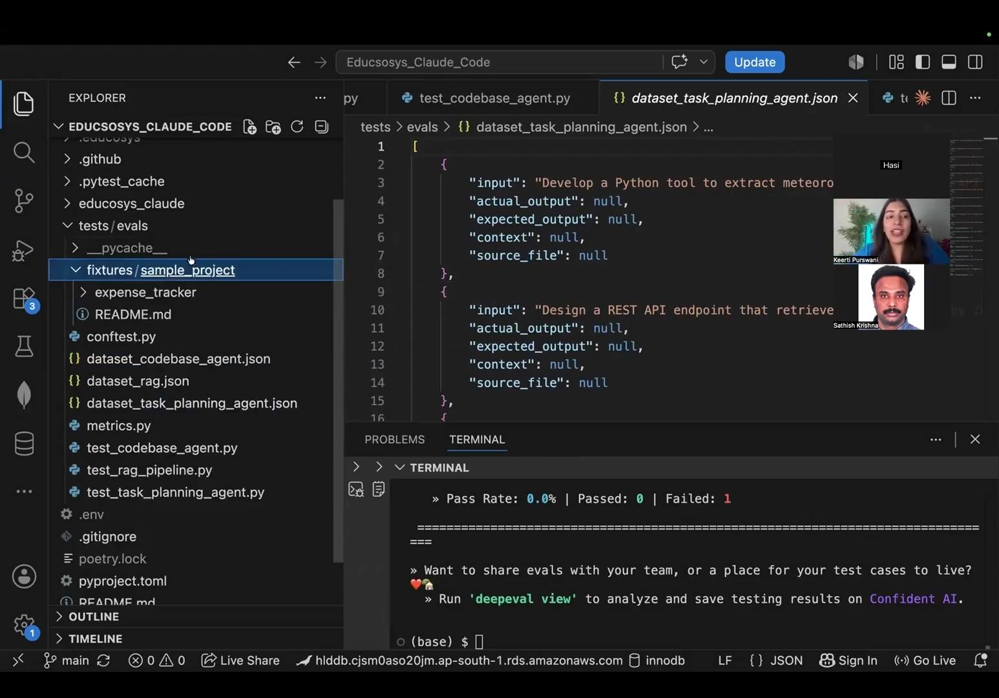
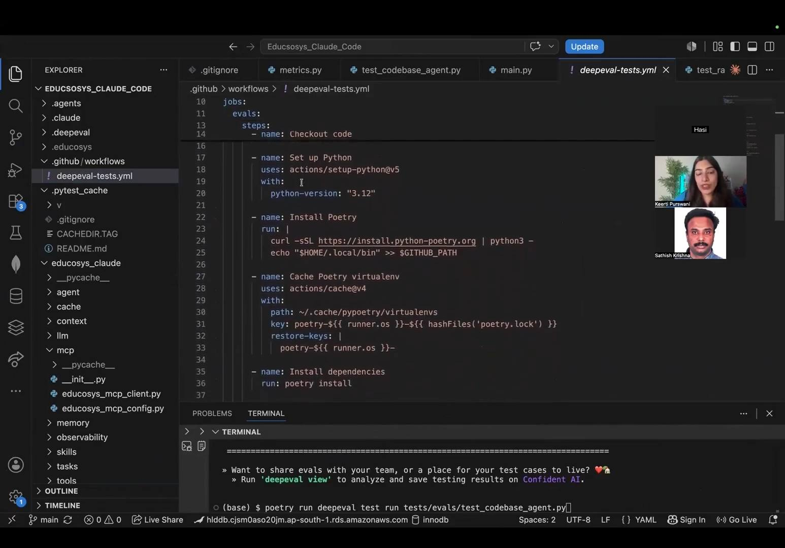
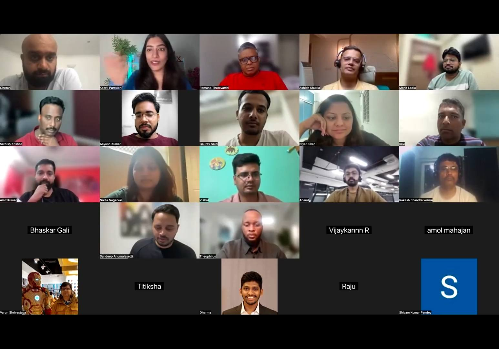
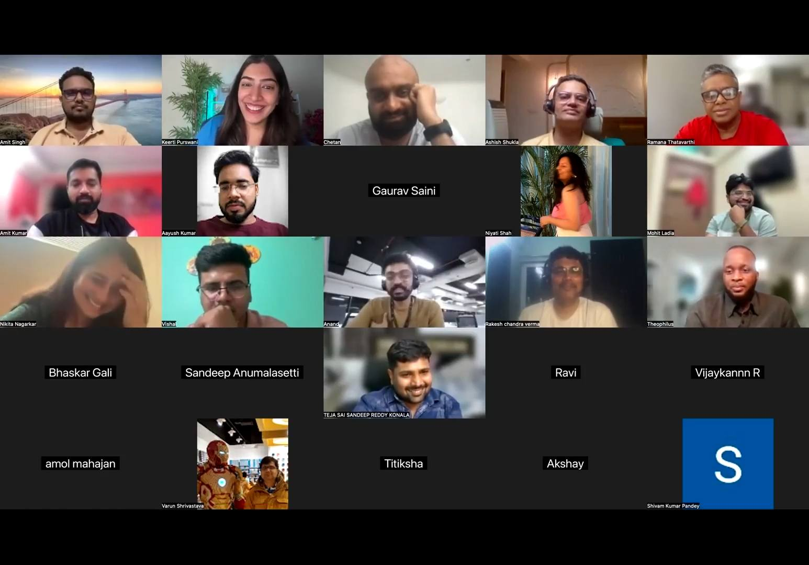
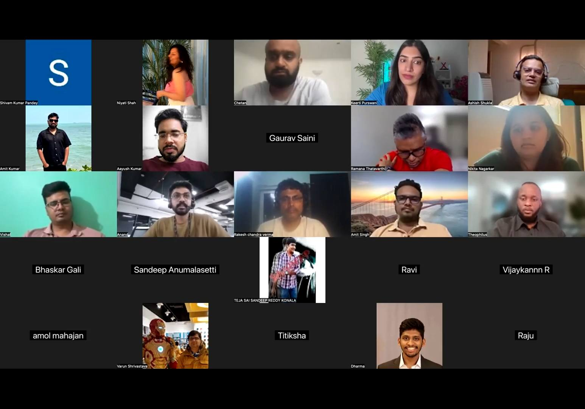
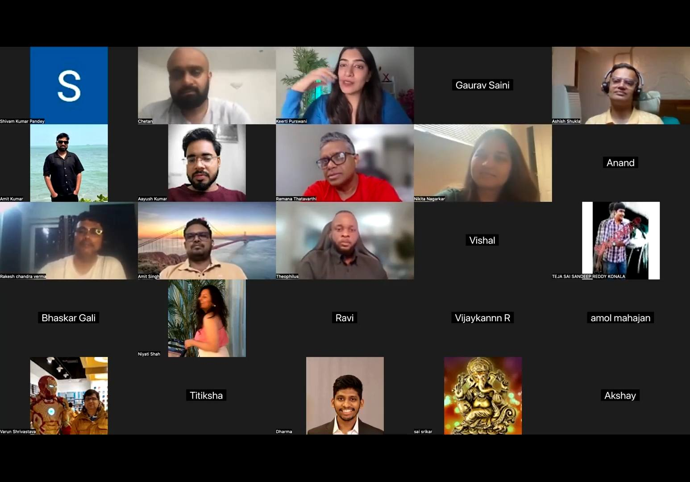
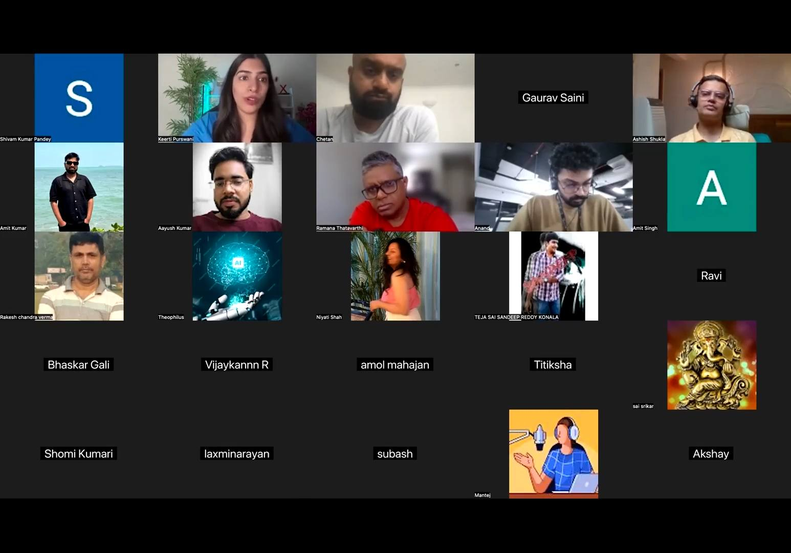

# Agentic AI System Design（P14）课程文档：用 DeepEval + GitHub Actions 给 Agent 搭一条端到端评测流水线

> 说明：本段 P14（81:24–148:43）是整门课的收尾段。前半段（约 81:24–96:29）讲师完整演示了「数据集 → 测试用例 → GitHub Actions 触发 → LLM Judge 打分」的评测闭环，这是本段唯一有可复现产物的部分；后半段（96:56 之后）是学员连麦、面试经验分享、职业路径答疑，属于纯讨论，没有代码。本文档把前半段按「能照着跑起来」的标准写全，后半段的讨论内容按「课里没讲但你会撞上的」章节收录，不编造任何讲师没讲过的实现。

---

## 1. 这一节做什么

这一节要交付的东西只有一件：**一条在 GitHub 上自动跑的 Agent 评测流水线**。具体拆成四步：

1. 在仓库里建 `test/evals/` 目录，按能力维度（planning、rag、codebase、skills）分别放数据集；
2. 为 Claude Code 这类「要在独立项目里跑」的特殊场景，单独建一个 sample project，并为这个 sample project 写 golden dataset（输入 query + 期望产物）；
3. 用 Python 文件把数据集加载进来、注册成测试用例；
4. 写一个 `.github/workflows/*.yaml`，让「push 到分支」这个动作触发全部测试，测试里用 OpenAI API Key 做 LLM Judge，Key 存在 GitHub 仓库的 Secrets 里。

讲师在课上实际跑通的命令是：

```bash
poetry run deepeval test run
```

（逐字稿里语音识别成 "dpval test run"，实际是 DeepEval 的 CLI，下面第 3 节会说明这个对应关系。）

---

## 2. 讲师原话

> "我新建了一个 GitHub 仓库，这样我就能把整个 action workflow、端到端的东西演示给你们看。"
> —— p014 [81:53]

> "你们看，我这里有不同的数据集，分别对应 planning、rag、codebase。看到了吗？对，我们也可以测试 skills。"
> —— p014 [82:22]

> "有一点大家要注意，Claude Code 是一个特殊用例。因为我们跑 Claude Code 的时候，是不是就直接那样跑？不是的，我们是在另一个项目里跑它，在一个 sample project、一个新的项目、一个不同的仓库里跑 Claude Code，它是特殊用例，对吧？那我们要怎么处理它？"
> —— p014 [82:50]

> "所以我做的就是——你们也可以这么做——你可以加不同的项目、不同的 sample project，然后为这些项目加测试用例。还记得我们在 RAG 的 golden dataset 里怎么做的吗？我们说：这是针对这个 sample project 的问题，这是我们期望拿到的回答。我们就是这么做的。"
> —— p014 [83:20]

> "现在到了 Claude Code 这里，我做的就是：建一个 sample project，然后为这些 sample project 写数据集。"
> —— p014 [83:47]

> "当你真正做大规模测试的时候，你会怎么做？你会加各种各样的项目，也许是新项目、不同种类的 query——设计这个、开发这个、加这个功能、调试这个——然后你会建自己的数据集。要理解：你的 golden dataset 越好，测试效果就越好，你对系统的理解也越深。"
> —— p014 [83:47]

> "所以我建了一个 sample project，并为这个项目建了数据集。这里我加了一个记账应用（expense tracker），有预算、CLI、模型、报表，我为它准备了数据集：这是期望输出，这是源文件，因此对应这条 query。明白吗？"
> —— p014 [84:16]

> "我希望你们还记得我们之前讨论过：不是所有评测都需要这些东西，对吧？不是所有评测都需要 golden dataset。"
> —— p014 [84:46]

> "（学员问 golden dataset 长什么样）对 Amazon 来说，假设 query 是「退货政策是什么」，这个会出现在你的数据集里；「我怎么追踪物流」「我怎么下单」，这些都应该在你的数据集里。而且数据集要分种类：一类面向客户，一类是订单相关 query，一类是商品相关 query，一类是筛选类 query——不同种类的 query。"
> —— p014 [85:12]

> "RAG 这部分清楚了吧？另一部分也一样。比如我们说「在这个项目里实现这个功能」，我们可以说它应该创建了这些文件，或者应该创建了这么多文件，类似这样。对，我们只需要看它有没有在执行任务。你的数据集就得是这样。"
> —— p014 [85:39]

> "在 planning agent 里我加了什么？比如「设计一个 Python 工具」「设计一个 REST API」「设计一个 CLI 工具」，这些是可能的输入。我还没加实际内容，我会加上然后推到 GitHub，你们能看到很多例子。比如这里可以说「设计一个 LMS」，是什么样的 LMS 呢？然后你可以为不同种类的数据集设不同的阈值。"
> —— p014 [86:08]

> "比如 planning，它不需要精确匹配；但对 RAG 来说，它必须是更好的匹配。明白吗？对 planning，你可以要求「它应该做了这件事」，你可以用 LLM judge，看它有没有完成这些任务。"
> —— p014 [86:32]

> "好，第一件事是你得有一个好的数据集，然后你加测试用例。之后呢——我也可以在本地跑测试用例，我也可以这么做。你们看我最后跑的那条命令，看到了吗？因为它要花一些时间，所以我才这么干。"
> —— p014 [87:31]

> "我刚刚跑的是 `poetry run deepeval test run`，我跑了测试。文档里给的也是同样的东西——`deepeval test run` 就是我正在做的事，只是我用 poetry 来跑，文档里也写了怎么用 poetry 跑。所以你本地也能跑。但我能不能给你们演示一下整个 GitHub 触发是怎么做的？"
> —— p014 [87:59]

> "他们给的做法是：你需要一个 CI/CD 流水线的 YAML 文件，这个文件会把所有东西都写进去。你也可以用 poetry，你需要把 OpenAI 配成 LLM judge，诸如此类。你会说触发条件是 push 到分支——你一 push 到分支，所有测试就应该跑起来。"
> —— p014 [88:26]

> "它会发生在你的 GitHub 上，你就能看到，你就能用你的 OpenAI API key。我能不能跑一下，给你们看这有多简单？"
> —— p014 [88:56]

> "我在上课前刚换了 OpenAI API key，给我一秒钟。"
> —— p014 [88:56]

> "我新建了一个仓库，给你们看一下。这是我的新仓库，这是 edu courses 的 Claude 相关的东西，这些都是自动生成的，不过没关系。我要做的是进 Settings。"
> —— p014 [89:23]

> "在 Settings 里，你们看到 Secrets and variables 了吗？看到这个 OpenAI API key 了吗？我要新建一个。"
> —— p014 [89:52]

> "好，我把 API key 更新到这里了。大家都明白可以这样加自己的 API key 了吧？"
> —— p014 [91:16]

> "我有一个 GitHub 仓库，我现在要做的是改一点代码，这样我就能 push 并触发整个流程。顺便问一下，你们能看到 `.github` 里我建的这个 yaml 吗？这就是它在做的事——它会触发整个流程。所以就是这样：在 `.github` 里我有这个 yaml 文件，它会触发整个 workflow。"
> —— p014 [91:42]

> "我们随便改点东西。进到 edu courses Claude，加个简单注释之类的，然后 push 到 GitHub。"
> —— p014 [92:11]

> "我提交、push。一 push 上去，我们就应该能看到一个 action。"
> —— p014 [92:40]

> "你们看到了吗？这个 class demo，正在进行中。看到了吗？点进去看它到底在干什么——它在跑测试用例，它在装依赖。"
> —— p014 [93:10]

> "所有测试用例，大家在测试的时候要小心，因为会发生什么？你每一条测试用例，它都会调用一次你的代码，然后还会用 LLM judge。所以你会花掉很多美元，对吧？成本——这就是我中途停下来的全部原因。我还想再停一次。但你懂这个意思了：一切都在跑。"
> —— p014 [93:39]

> "如果我们看这个 YAML，它其实说得很清楚。它说的是：on push 的时候我们要做什么——我们要跑测试用例。所以先装 poetry，然后装依赖，`poetry install`，然后跑 rag retrieval evals，跑 codebase agent evals，我们用这个 OpenAI API key 来做 LLM judge。"
> —— p014 [94:08]

> "而且就在这个文件里，如果我要推到 EC2 实例，我只要在 YAML 里这后面加上：成功后推到 EC2 实例、推到 Kubernetes。就这么简单。"
> —— p014 [94:33]

> "快速回顾一下 DeepEval 的实现：第一件事是建数据集，这是最重要的。建完所有数据集之后，你显然要在某处加载它，所以我加载数据集，然后说「我要创建测试用例」，我就这么写了——这是我的测试用例，就这样。"
> —— p014 [95:03]

> "那什么时候触发这些测试用例？你可以有不同的触发点。我演示的是：在我的 yaml 文件里有一个 trigger，只要我 push 到 GitHub、有任何改动，它就会触发我所有的测试用例。"
> —— p014 [95:31]

> "回到 yaml，你能看到它在跑 rag retrieval、跑 test rag pipeline、跑 test codebase agent。在那个 Python 文件里，它就是跑所有测试，就这样。如果通过了，我们可以设一个阈值，然后推到 EC2 实例。所以步骤是什么？写代码和数据集、写测试用例并加载进 Python 文件、用 YAML 建触发器——那可能是 GitHub——push，你的测试用例就会被触发。"
> —— p014 [96:00]

> "这正式把我带到了课程的结尾。"
> —— p014 [96:29]

---

## 3. 从零复现

### 3.0 前置条件

- Python 3.10+（DeepEval 要求，课里没讲具体版本，按官方要求即可）
- Poetry（讲师全程用 `poetry run` 执行命令）
- 一个 GitHub 仓库
- 一个 OpenAI API Key（用于 LLM Judge）
- 一个 Claude Code 可运行的 sample project（可选，但这是本段的核心演示对象）

### 3.1 建目录结构

讲师在课上展示的目录形态是：仓库根目录下有一个 `test` 文件夹，里面是 `evals`，`evals` 下按能力维度分数据集文件；`.github` 下放 workflow yaml。

```
your-repo/
├── .github/
│   └── workflows/
│       └── evals.yaml
├── test/
│   └── evals/
│       ├── datasets/
│       │   ├── planning.json
│       │   ├── rag.json
│       │   ├── codebase.json
│       │   └── skills.json
│       ├── test_planning.py
│       ├── test_rag_pipeline.py
│       └── test_codebase_agent.py
├── sample_projects/
│   └── expense_tracker/
│       ├── budgets.py
│       ├── cli.py
│       ├── models.py
│       └── reports.py
├── pyproject.toml
└── README.md
```

> 说明：`sample_projects/expense_tracker/` 下的文件名（budgets、cli、models、reports）来自讲师口述「我加了一个记账应用，有预算、CLI、模型、报表」。具体文件内容课里没讲，你需要自己写一个能跑的最小记账 CLI，或者用你手上任意一个真实小项目替代——评测逻辑不依赖它的具体实现。

### 3.2 建数据集（第一步，讲师强调这是最重要的一步）

按讲师的说法，数据集要按「能力维度」分文件，每个维度内部的样本形态不一样：

- **planning**：输入是「设计一个 Python 工具 / 设计一个 REST API / 设计一个 CLI 工具 / 设计一个 LMS」这类开放式任务。期望输出不是精确字符串，而是「它应该做了这几件事」的清单。讲师明确说 planning 不需要精确匹配，用 LLM judge 判断「有没有完成这些任务」。
- **rag**：输入是问题，期望输出是标准答案。讲师明确说 RAG 的匹配要求要更严。
- **codebase**：输入是「在这个项目里实现这个功能」这类任务，期望输出是「应该创建了这些文件 / 这么多文件」。
- **skills**：讲师只说「我们也可以测试 skills」，没有展开样本形态，课里没讲。

数据集文件格式（JSON，课里没给具体 schema，下面是按讲师描述落成的最小可用结构，字段名可自行调整，只要 Python 加载端对得上）：

```json
[
  {
    "input": "设计一个 Python CLI 工具，用来管理个人预算",
    "expected_outcomes": [
      "给出目录结构",
      "给出 CLI 子命令列表",
      "说明数据持久化方式"
    ]
  },
  {
    "input": "设计一个 REST API，支持用户注册登录",
    "expected_outcomes": [
      "给出资源与路由设计",
      "说明鉴权方案",
      "说明错误码约定"
    ]
  }
]
```

`rag.json`：

```json
[
  {
    "input": "退货政策是什么？",
    "expected_output": "自签收之日起 30 天内可无理由退货，商品需保持完好。"
  },
  {
    "input": "我怎么追踪物流？",
    "expected_output": "登录后在「我的订单」页面点击对应订单即可查看物流轨迹。"
  }
]
```

`codebase.json`：

```json
[
  {
    "input": "在 expense_tracker 项目里新增一个「按月份汇总支出」的功能",
    "expected_files": [
      "reports.py",
      "cli.py"
    ]
  }
]
```

> 讲师原话里的 Amazon 例子（退货政策、追踪物流、下单、筛选类 query）就是上面 `rag.json` 的取材来源，他明确说数据集要分「面向客户 / 订单相关 / 商品相关 / 筛选类」几种。

### 3.3 写测试用例 Python 文件

讲师的原话是「我加载数据集，然后说我要创建测试用例，就这么写了」。三个测试文件分别对应 yaml 里跑的三件事：`test_rag_pipeline`、`test_codebase_agent`，以及 planning 的评测。

`test/evals/test_planning.py`：

```python
import json
from pathlib import Path

import pytest
from deepeval import assert_test
from deepeval.metrics import GEval
from deepeval.test_case import LLMTestCase, LLMTestCaseParams

DATASET = Path(__file__).parent / "datasets" / "planning.json"


def load_dataset():
    with open(DATASET, encoding="utf-8") as f:
        return json.load(f)


def run_planning_agent(user_input: str) -> str:
    # 这里接你自己的 planning agent。
    # 课里没有给出 agent 的实现代码，只演示了评测侧。
    raise NotImplementedError("替换成你的 planning agent 调用")


@pytest.mark.parametrize("case", load_dataset())
def test_planning(case):
    actual = run_planning_agent(case["input"])

    metric = GEval(
        name="PlanningCompleteness",
        criteria=(
            "判断实际输出是否覆盖了期望产出清单中的每一项。"
            "planning 任务不要求措辞一致，只要求要点齐全。"
        ),
        evaluation_params=[
            LLMTestCaseParams.INPUT,
            LLMTestCaseParams.ACTUAL_OUTPUT,
            LLMTestCaseParams.EXPECTED_OUTPUT,
        ],
        threshold=0.5,
    )

    test_case = LLMTestCase(
        input=case["input"],
        actual_output=actual,
        expected_output="\n".join(case["expected_outcomes"]),
    )
    assert_test(test_case, [metric])
```

`test/evals/test_rag_pipeline.py`：

```python
import json
from pathlib import Path

import pytest
from deepeval import assert_test
from deepeval.metrics import AnswerRelevancyMetric
from deepeval.test_case import LLMTestCase

DATASET = Path(__file__).parent / "datasets" / "rag.json"


def load_dataset():
    with open(DATASET, encoding="utf-8") as f:
        return json.load(f)


def run_rag_pipeline(question: str) -> str:
    # 接你自己的 RAG 检索 + 生成链路。
    raise NotImplementedError("替换成你的 RAG pipeline 调用")


@pytest.mark.parametrize("case", load_dataset())
def test_rag(case):
    actual = run_rag_pipeline(case["input"])

    metric = AnswerRelevancyMetric(threshold=0.7)

    test_case = LLMTestCase(
        input=case["input"],
        actual_output=actual,
        expected_output=case["expected_output"],
    )
    assert_test(test_case, [metric])
```

`test/evals/test_codebase_agent.py`：

```python
import json
from pathlib import Path

import pytest
from deepeval import assert_test
from deepeval.metrics import GEval
from deepeval.test_case import LLMTestCase, LLMTestCaseParams

DATASET = Path(__file__).parent / "datasets" / "codebase.json"


def load_dataset():
    with open(DATASET, encoding="utf-8") as f:
        return json.load(f)


def run_codebase_agent(task: str) -> str:
    # 这里接 Claude Code 之类的 codebase agent。
    # 讲师强调：Claude Code 要在独立的 sample project 里跑，
    # 所以这个函数内部应该切到 sample_projects/expense_tracker 目录去执行。
    raise NotImplementedError("替换成你的 codebase agent 调用")


@pytest.mark.parametrize("case", load_dataset())
def test_codebase(case):
    actual = run_codebase_agent(case["input"])

    metric = GEval(
        name="TaskExecution",
        criteria=(
            "判断实际输出是否完成了任务，并检查期望创建的文件是否被创建或提及。"
            "不要求实现细节完全一致，只要求任务被执行。"
        ),
        evaluation_params=[
            LLMTestCaseParams.INPUT,
            LLMTestCaseParams.ACTUAL_OUTPUT,
            LLMTestCaseParams.EXPECTED_OUTPUT,
        ],
        threshold=0.5,
    )

    test_case = LLMTestCase(
        input=case["input"],
        actual_output=actual,
        expected_output="应创建或修改以下文件：" + "、".join(case["expected_files"]),
    )
    assert_test(test_case, [metric])
```

> 三个文件里 `run_*` 函数体是 `NotImplementedError`，因为**课里没有给出 agent 本身的实现代码**，讲师只演示了评测侧。你复现时把这三个函数换成你自己的 agent 调用即可，其余部分可以原样保留。

### 3.4 配 GitHub Secrets

讲师在课上完整走了一遍：

1. 进仓库 → **Settings**
2. 左侧找 **Secrets and variables**
3. 新建一个 secret，名字用 `OPENAI_API_KEY`（讲师屏幕上就是这个名字，逐字稿里念作 "Open API key"）
4. 值填你的 OpenAI API Key，保存

讲师特别说明他上课前刚换了 key，所以现场是「更新已有 secret 的值」这个动作。

### 3.5 写 workflow YAML

讲师描述的内容逐条对应到 YAML：

- 触发条件：`on: push`
- 先装 poetry
- 再 `poetry install` 装依赖
- 跑 rag retrieval evals
- 跑 codebase agent evals
- 用 `OPENAI_API_KEY` 做 LLM judge

`.github/workflows/evals.yaml`：

```yaml
name: evals

on:
  push:
    branches:
      - main

jobs:
  run-evals:
    runs-on: ubuntu-latest

    steps:
      - name: Checkout
        uses: actions/checkout@v4

      - name: Set up Python
        uses: actions/setup-python@v5
        with:
          python-version: "3.11"

      - name: Install poetry
        run: pipx install poetry

      - name: Install dependencies
        run: poetry install

      - name: Run RAG retrieval evals
        env:
          OPENAI_API_KEY: ${{ secrets.OPENAI_API_KEY }}
        run: poetry run deepeval test run test/evals/test_rag_pipeline.py

      - name: Run codebase agent evals
        env:
          OPENAI_API_KEY: ${{ secrets.OPENAI_API_KEY }}
        run: poetry run deepeval test run test/evals/test_codebase_agent.py

      - name: Run planning evals
        env:
          OPENAI_API_KEY: ${{ secrets.OPENAI_API_KEY }}
        run: poetry run deepeval test run test/evals/test_planning.py
```

> 讲师在课上明确说：「如果我要推到 EC2 实例，我只要在 YAML 里这后面加上：成功后推到 EC2 实例、推到 Kubernetes。」所以上面三个 step 之后，你可以继续追加部署 step——课里没给具体部署命令，这里不编造。

### 3.6 本地先跑一遍

讲师说「我也可以在本地跑测试用例」，命令是：

```bash
poetry run deepeval test run
```

不带路径就跑全部；带路径就跑单个文件（上面 yaml 里就是这么拆的）。

### 3.7 触发

改一行代码（讲师现场是加了一句注释）→ commit → push → 打开仓库的 **Actions** 页 → 看到名为 `evals` 的 workflow 在跑 → 点进去看每个 step 的日志。

讲师现场看到的 workflow 名字是 `class demo`（他仓库里那个 yaml 的 `name` 字段），状态是「in progress」。

### 3.8 成本控制

讲师两次强调这件事，并且现场两次中断了正在跑的评测：

> "你每一条测试用例，它都会调用一次你的代码，然后还会用 LLM judge。所以你会花掉很多美元。"

复现时建议：先在本地只跑一个文件、只留一两条样本，确认链路通了再全量跑；CI 上可以只对 `main` 分支触发，避免每个 PR 都烧钱。

---

## 4. 完整代码

### 4.1 `pyproject.toml`

```toml
[tool.poetry]
name = "agentic-evals"
version = "0.1.0"
description = "Agent evaluation pipeline with DeepEval + GitHub Actions"
authors = ["you <you@example.com>"]
packages = [{ include = "test" }]

[tool.poetry.dependencies]
python = "^3.11"
deepeval = "*"
pytest = "*"
openai = "*"

[build-system]
requires = ["poetry-core"]
build-backend = "poetry.core.masonry.api"
```

> 版本号课里没讲，用 `*` 让 poetry 解析最新兼容版本；如果你要锁版本，跑一次 `poetry lock` 后把 `poetry.lock` 一起提交。

### 4.2 `.github/workflows/evals.yaml`

见 3.5，完整内容如下（重复一遍方便直接复制）：

```yaml
name: evals

on:
  push:
    branches:
      - main

jobs:
  run-evals:
    runs-on: ubuntu-latest

    steps:
      - name: Checkout
        uses: actions/checkout@v4

      - name: Set up Python
        uses: actions/setup-python@v5
        with:
          python-version: "3.11"

      - name: Install poetry
        run: pipx install poetry

      - name: Install dependencies
        run: poetry install

      - name: Run RAG retrieval evals
        env:
          OPENAI_API_KEY: ${{ secrets.OPENAI_API_KEY }}
        run: poetry run deepeval test run test/evals/test_rag_pipeline.py

      - name: Run codebase agent evals
        env:
          OPENAI_API_KEY: ${{ secrets.OPENAI_API_KEY }}
        run: poetry run deepeval test run test/evals/test_codebase_agent.py

      - name: Run planning evals
        env:
          OPENAI_API_KEY: ${{ secrets.OPENAI_API_KEY }}
        run: poetry run deepeval test run test/evals/test_planning.py
```

### 4.3 数据集

`test/evals/datasets/planning.json`：

```json
[
  {
    "input": "设计一个 Python CLI 工具，用来管理个人预算",
    "expected_outcomes": [
      "给出目录结构",
      "给出 CLI 子命令列表",
      "说明数据持久化方式"
    ]
  },
  {
    "input": "设计一个 REST API，支持用户注册登录",
    "expected_outcomes": [
      "给出资源与路由设计",
      "说明鉴权方案",
      "说明错误码约定"
    ]
  },
  {
    "input": "设计一个 LMS",
    "expected_outcomes": [
      "说明 LMS 的类型与目标用户",
      "给出核心模块划分",
      "给出主要数据模型"
    ]
  }
]
```

`test/evals/datasets/rag.json`：

```json
[
  {
    "input": "退货政策是什么？",
    "expected_output": "自签收之日起 30 天内可无理由退货，商品需保持完好。"
  },
  {
    "input": "我怎么追踪物流？",
    "expected_output": "登录后在「我的订单」页面点击对应订单即可查看物流轨迹。"
  },
  {
    "input": "我怎么下单？",
    "expected_output": "将商品加入购物车后进入结算页，填写收货地址并完成支付即可下单。"
  }
]
```

`test/evals/datasets/codebase.json`：

```json
[
  {
    "input": "在 expense_tracker 项目里新增一个「按月份汇总支出」的功能",
    "expected_files": [
      "reports.py",
      "cli.py"
    ]
  }
]
```

`test/evals/datasets/skills.json`：

```json
[]
```

> `skills.json` 是空数组，因为讲师只说了「我们也可以测试 skills」，**没有展开样本形态，课里没讲**。留空占位，等你按自己的 skill 定义补。

### 4.4 三个测试文件

`test/evals/test_planning.py`、`test/evals/test_rag_pipeline.py`、`test/evals/test_codebase_agent.py` 的完整内容见 3.3，原样保存即可。

### 4.5 sample project（占位）

`sample_projects/expense_tracker/` 下需要至少四个文件（讲师口述提到 budgets、CLI、models、reports）。**课里没有给出这四个文件的内容**，你需要自己写一个最小可跑的记账 CLI，例如：

```python
# sample_projects/expense_tracker/models.py
from dataclasses import dataclass


@dataclass
class Expense:
    amount: float
    category: str
    month: str
```

```python
# sample_projects/expense_tracker/budgets.py
BUDGETS = {
    "food": 500.0,
    "transport": 200.0,
}


def remaining(category: str, spent: float) -> float:
    return BUDGETS.get(category, 0.0) - spent
```

```python
# sample_projects/expense_tracker/reports.py
from collections import defaultdict

from models import Expense


def monthly_summary(expenses: list[Expense]) -> dict[str, float]:
    summary = defaultdict(float)
    for e in expenses:
        summary[e.month] += e.amount
    return dict(summary)
```

```python
# sample_projects/expense_tracker/cli.py
import argparse

from budgets import remaining
from models import Expense
from reports import monthly_summary

EXPENSES: list[Expense] = []


def main():
    parser = argparse.ArgumentParser()
    sub = parser.add_subparsers(dest="cmd", required=True)

    add = sub.add_parser("add")
    add.add_argument("amount", type=float)
    add.add_argument("category")
    add.add_argument("month")

    sub.add_parser("report")

    args = parser.parse_args()

    if args.cmd == "add":
        EXPENSES.append(Expense(args.amount, args.category, args.month))
        print(f"added, remaining in {args.category}: {remaining(args.category, args.amount)}")
    elif args.cmd == "report":
        print(monthly_summary(EXPENSES))


if __name__ == "__main__":
    main()
```

> 上面这段是**示意代码，课里没有代码**。它的唯一作用是让 `test_codebase_agent.py` 有一个真实的 sample project 可以指向，从而复现「Claude Code 在独立项目里跑」这个场景。

---

## 5. 逐行解释

### 5.1 为什么数据集要按维度拆文件

讲师的原话是「我这里有不同的数据集，分别对应 planning、rag、codebase」。拆开的直接好处是：**每个维度的阈值可以不一样**。讲师明确说「planning 不需要精确匹配，但对 RAG 来说必须是更好的匹配」。如果混在一个文件里，你就只能用一套阈值，要么 planning 被误杀，要么 RAG 放水。

对应到代码里就是：`test_planning.py` 用 `GEval` + `threshold=0.5`，`test_rag_pipeline.py` 用 `AnswerRelevancyMetric` + `threshold=0.7`。阈值数字是示意，课里没给具体数值，你按自己数据集的松紧调。

### 5.2 为什么 Claude Code 要单独建 sample project

讲师花了整整一分钟解释这件事，这是本段最容易被忽略的设计点：

> "我们是在另一个项目里跑它，在一个 sample project、一个新的项目、一个不同的仓库里跑 Claude Code，它是特殊用例。"

原因不难推：Claude Code 这类 codebase agent 的产出是**文件改动**，不是一段文本。你要评它，就必须有一个真实仓库让它改，改完再检查文件。所以数据集里的 `expected_files` 字段不是「期望回答里提到这些文件名」，而是「期望这些文件被创建或修改」。

对应到 `test_codebase_agent.py` 里，`run_codebase_agent` 函数内部应该 `cd` 到 `sample_projects/expense_tracker` 再执行——课里没给具体实现，但这是讲师描述的场景所要求的。

### 5.3 为什么 golden dataset 要「分种类」

学员 Ashish 问「golden dataset 对整体应用长什么样」，讲师用 Amazon 举例，给了四类：

- 面向客户的 query
- 订单相关 query
- 商品相关 query
- 筛选类 query

这个分类法的意义是：**评测覆盖率**。如果你的数据集全是「退货政策」这类 FAQ，你的 RAG 在 FAQ 上分数很高，但「我怎么下单」这种多步流程 query 一条都没测过，上线就翻车。讲师的原话是「你的 golden dataset 越好，测试效果就越好，你对系统的理解也越深」——数据集本身就是你对系统理解的外化。

### 5.4 为什么用 LLM Judge 而不是字符串匹配

讲师对 planning 和 codebase 这两类任务都明确说「用 LLM judge，看它有没有完成这些任务」。原因是这两类任务的输出是开放式的：planning 输出一段设计方案，codebase 输出一堆文件改动，你没法用 `==` 比。`GEval` 就是 DeepEval 里做这件事的 metric——你给它一段 `criteria`（判断标准），它让 LLM 按这个标准打分。

RAG 那边讲师说「必须是更好的匹配」，所以用 `AnswerRelevancyMetric` 这种偏语义相似度的 metric，阈值也更高。

### 5.5 为什么 Key 放 GitHub Secrets

讲师现场走了一遍 Settings → Secrets and variables → 新建。这一步没有技术含量，但**漏了整条流水线就跑不起来**，因为 yaml 里 `env: OPENAI_API_KEY: ${{ secrets.OPENAI_API_KEY }}` 引用的就是这个 secret 名。名字对不上，CI 里 LLM judge 会直接报鉴权失败。

### 5.6 为什么 `on: push` 就够了

讲师的原话是「只要我 push 到 GitHub、有任何改动，它就会触发我所有的测试用例」。这是最简单的触发器，适合演示。生产里你可能会想改成 `on: pull_request` 或者加 `paths` 过滤，但**课里没讲这些**，这里不展开。

### 5.7 为什么讲师两次中断评测

> "你每一条测试用例，它都会调用一次你的代码，然后还会用 LLM judge。所以你会花掉很多美元。"

一次评测的成本 = 样本数 × (agent 调用成本 + judge 调用成本)。样本上百条、agent 又是 Claude Code 这种重调用，一次全量跑就是几十美元级别。这就是为什么讲师说「成本，这就是我中途停下来的全部原因」。复现时务必先小样本验证。

### 5.8 为什么 yaml 里三个 step 分开写

讲师描述 yaml 时是逐条念的：「跑 rag retrieval evals、跑 codebase agent evals」。分开写的好处是 Actions 页面上能一眼看出**哪个维度挂了**——如果合成一个 `poetry run deepeval test run`，日志混在一起，排查要翻半天。

### 5.9 部署 step 为什么留空

讲师说「如果我要推到 EC2 实例，我只要在 YAML 里这后面加上」，但他**没有现场写这段**。所以本文档在 3.5 末尾只写了「你可以继续追加部署 step」，没有编造 `aws ec2` 之类的命令。

---

## 6. 复现检查清单

按顺序打勾，任何一项没过就别往下走：

- [ ] 仓库根目录有 `.github/workflows/evals.yaml`，`name` 字段是你认得的名（讲师现场叫 `class demo`）
- [ ] `test/evals/datasets/` 下至少有 `planning.json`、`rag.json`、`codebase.json` 三个文件，且都是合法 JSON
- [ ] `test/evals/` 下有三个 `test_*.py`，每个都能被 pytest 收集到（`poetry run pytest --collect-only` 能看到用例数）
- [ ] 三个 `run_*` 函数已经替换成你自己的 agent 调用，不再是 `NotImplementedError`
- [ ] `sample_projects/expense_tracker/` 存在且能 `python cli.py add 10 food 2024-01` 跑通
- [ ] GitHub 仓库 Settings → Secrets and variables 里有名为 `OPENAI_API_KEY` 的 secret
- [ ] 本地 `poetry run deepeval test run test/evals/test_rag_pipeline.py` 能跑通至少一条样本
- [ ] push 一次后，Actions 页面出现 workflow run，状态从 in progress 变成成功/失败
- [ ] 点进 run 能看到三个 step 分别执行，日志里能看到 LLM judge 的调用
- [ ] 你清楚一次全量评测大概花多少钱，并且已经用小样本验证过

---

## 7. 课里没讲但你会撞上的

### 7.1 DeepEval 的安装与 CLI 名

逐字稿里语音识别成 "dpval"，讲师屏幕上和文档里是 `deepeval`。安装是 `pip install deepeval`（poetry 里就是 `deepeval = "*"`），CLI 是 `deepeval test run`。**课里没讲安装命令**，这是按工具官方用法补的。

### 7.2 `GEval` / `AnswerRelevancyMetric` 的具体参数

课里只说了「用 LLM judge」「RAG 要更严」，**没讲具体用哪个 metric 类、参数怎么填**。上面代码里的 `GEval(criteria=..., evaluation_params=..., threshold=...)` 和 `AnswerRelevancyMetric(threshold=...)` 是按 DeepEval 公开 API 写的示意，你复现时以你装的版本的文档为准。

### 7.3 数据集 JSON 的 schema

课里展示了数据集「长什么样」的语义（输入 + 期望输出 / 期望文件），但**没有给字段名**。上面用的 `input` / `expected_output` / `expected_outcomes` / `expected_files` 是本文档自定的，只要加载端对得上就行。

### 7.4 Claude Code 在 CI 里怎么跑

这是最大的坑。讲师说「Claude Code 在独立项目里跑」，但**课里没讲 CI 环境里怎么调 Claude Code**——它需要鉴权、需要能写文件、可能需要交互式终端。你复现时大概率要把 `run_codebase_agent` 换成一个非交互的调用方式，或者干脆在 CI 里跳过 codebase 这一类、只在本地跑。

### 7.5 成本估算

课里没给具体数字，只反复说「会花很多美元」。你可以按「样本数 × 2 次 LLM 调用 × 单次均价」粗算，跑之前先跑一条样本看账单。

### 7.6 后半段讨论里提到的、但课里没展开的技术名词

P14 从 96:56 开始是学员连麦，提到了不少东西，但**都没有代码、没有实现细节**，这里只做记录，不当作可复现内容：

- 有学员提到公司用 **MCP**（Confidence MCP、G-RAMCP）把「JIRA story → 写代码 → 写测试」整条开发生命周期自动化，遇到的问题是「不能给 LLM 太多上下文，因为上下文有限，需要人工介入」；
- 有学员提到模型选择会影响效果（举例 Claude Opus 与 GPT 某版本对比）；
- 讲师建议在这个方向上补「human in the loop、长期记忆、guardrails」；
- 面试高频题被学员总结为三类：**微调/量化**、**海量数据下的延迟与删除（分片、缓存）**、**可观测性（某个 agent 表现不好怎么定位）**；
- 讲师对「要不要为了 AI 放弃 DSA」的回答是：大厂流程仍是 DSA + LLD + HLD，但已有公司允许面试中用 AI 工具，趋势在变；
- 讲师对「iOS 转 AI 要不要补后端」的回答是：要，建议再花六周补后端和 HLD，10 年经验会被要求端到端设计；
- 讲师对「简历优化」的建议是：现在人人用 Claude 优化 ATS，差异化已经不在 ATS 上了，要把自己做过的项目放到 GitHub / LinkedIn 上，让 HR 能看到「可信度」。

这些内容对职业规划有用，但**不构成本节的可复现产物**，所以放在这里而不是塞进第 3、4 节。

### 7.7 前端视角补充

你是前端转 AI 应用工程师，这条流水线里唯一和「后端概念」沾边的是 GitHub Actions 的 job/step 模型——可以类比成 npm scripts 的串联，只是跑在 GitHub 的机器上。`secrets.OPENAI_API_KEY` 相当于 CI 环境里的环境变量注入，和你在 Vite 里用 `import.meta.env` 是同一类东西，区别是 secret 不会被打进产物。DeepEval 的 `assert_test` 就是断言，和 Jest 的 `expect` 一个角色，只是断言的内容是「LLM 给这段输出打了几分」。

---

## 附：本节截图













