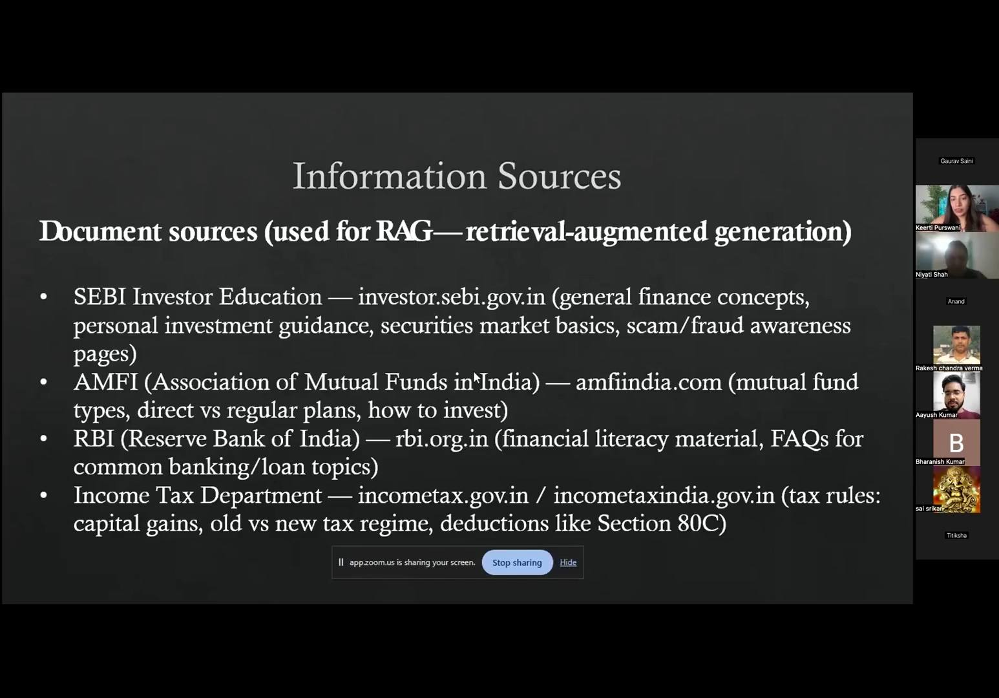
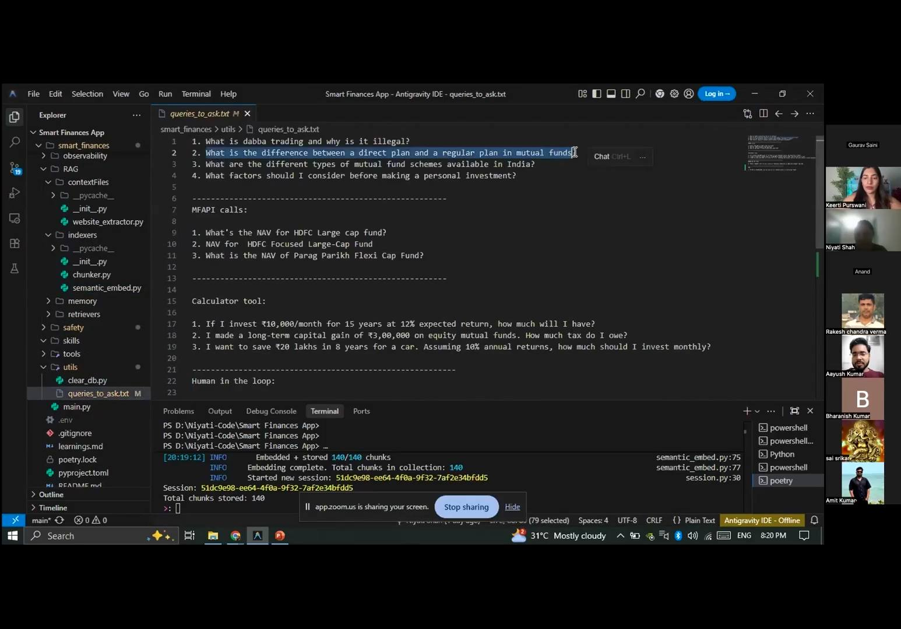
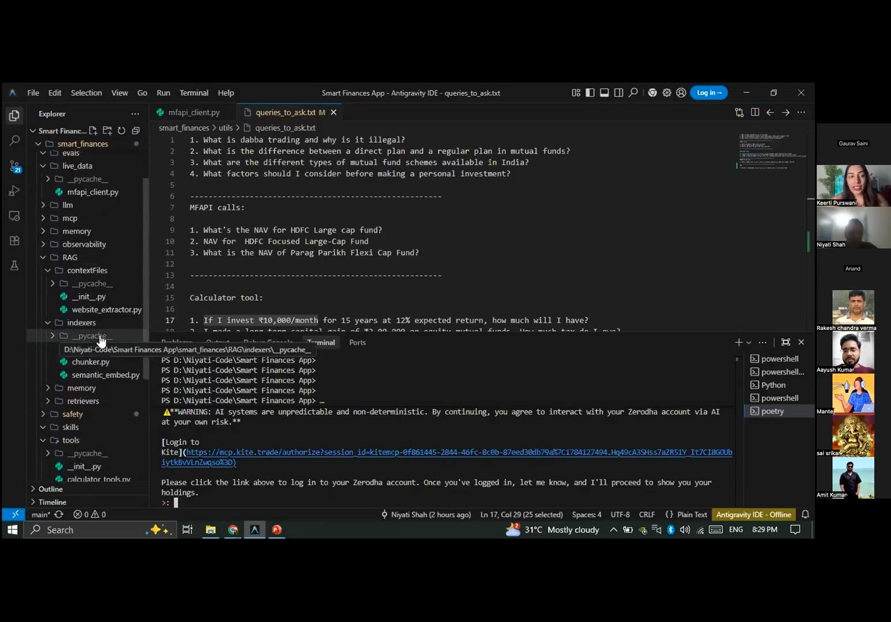
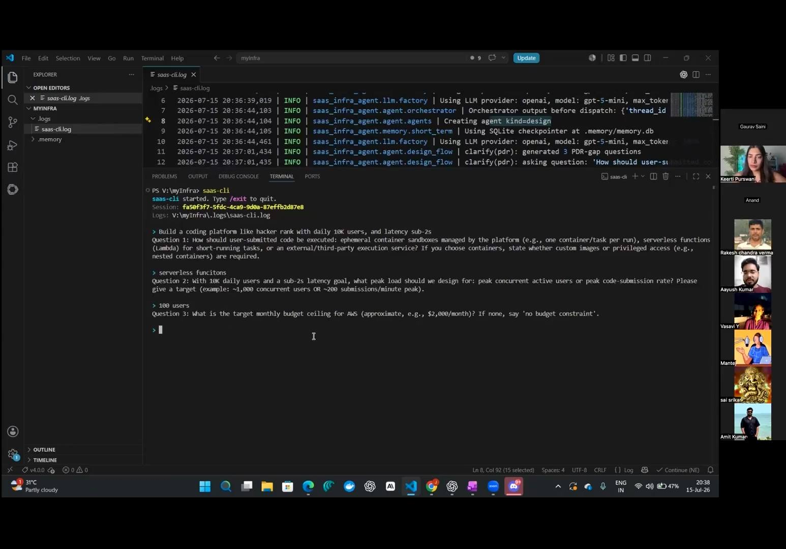
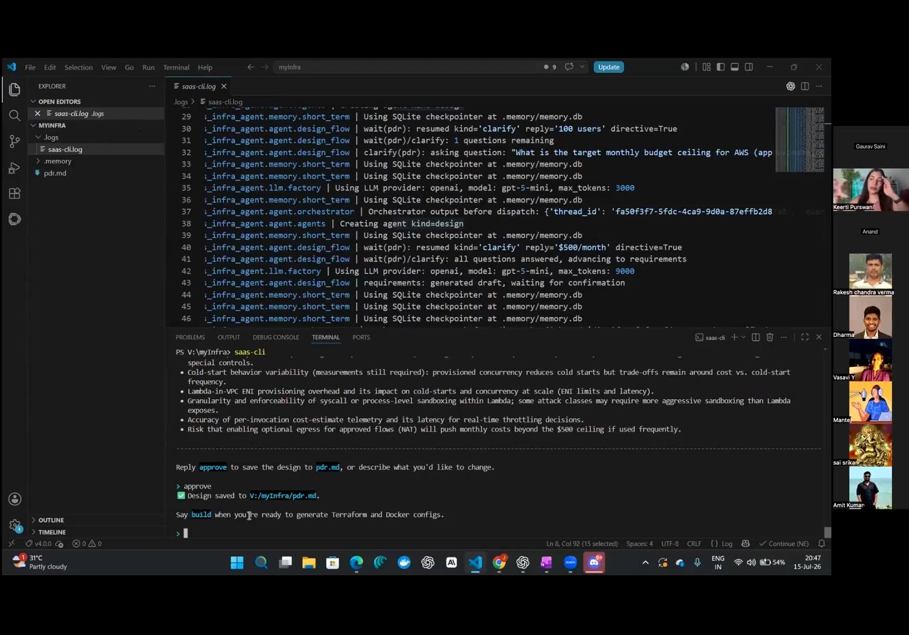
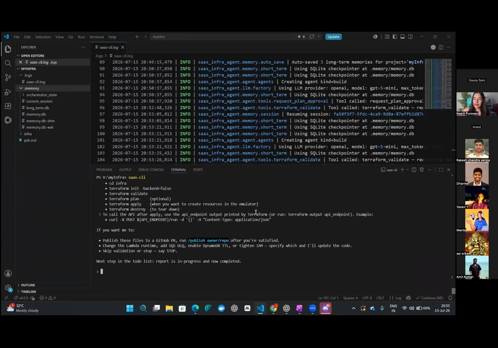
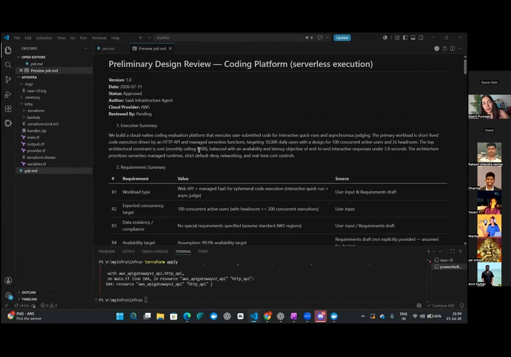
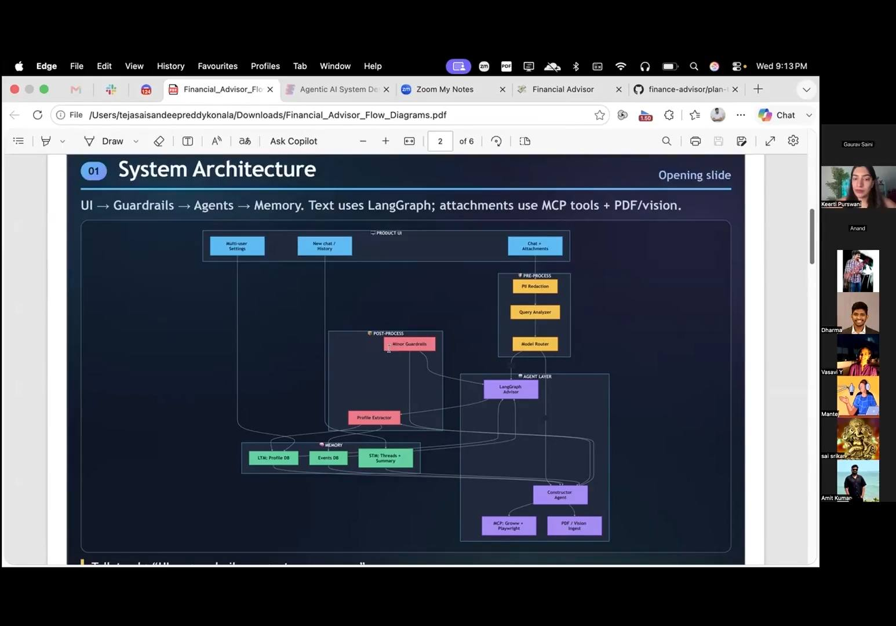

# Agentic AI System Design（P15）课程文档：项目答辩与系统设计复盘

> 说明：本节 P15 是**项目展示 + 面试视角讨论课**，逐字稿里没有讲师现场写代码，全部内容来自三位学员（Niyati、Vasavi 团队、Teja 团队）展示自己按课程要求搭建的 Agent 项目，以及讲师穿插的设计点评。因此本文档按「纯讲解/答辩课」的规则组织：第 3 节复现的是**三个项目的设计推导过程**，第 4 节把讲师与学员给出的方案落成**可直接照做的设计决策表、组件职责表、接口/数据模型草案、容量与成本估算表**，并附一段**标注为「课里没有代码，以下为示意」**的骨架代码帮助前端背景读者落地。凡逐字稿没讲的内容，一律标注「课里没讲」。

---

## 1. 这一节做什么

这一节不是新知识讲授，而是一次**项目评审 + 面试模拟**。讲师让三组学员把自己基于课程前几节（Claude Code 式 CLI Agent、RAG、MCP、记忆、护栏、Evals）搭出来的 Agent 项目投屏演示，然后当场追问三类问题：

1. **你的项目和直接用 ChatGPT 有什么区别？**（差异化拷问）
2. **你在真实开发中撞到了什么坑，怎么解决的？**（工程判断拷问）
3. **如果让你继续做，你会怎么设计？**（扩展性拷问）

三个项目分别是：

- **Smart Finances App（Niyati）**：个人理财 Agent。RAG 抓取 SEBI、AMFI、RBI、Income Tax 四个官网 + PDF，接 mfapi.in 拿实时 NAV，接 Zerodha 的 MCP 读账户数据，自带 SIP/一次性投入的复利计算工具，带短期记忆、human-in-the-loop 审批、PII 保护、反幻觉指令。
- **Infra Agent（Vasavi / Sai / Dharma 三人团队）**：把「设计→构建→监控→发布」拆成四个 Agent，用 orchestrator 做意图路由，前置 safety gate 与 domain gate，用 skills library（AWS Agent Skills）替代 RAG，用 LangGraph 式的分阶段 human-in-the-loop 澄清，产出 PDR 设计文档和 Terraform 脚本，本地用 LocalStack（逐字稿里被念成 "flow C / Flosie"）跑 Terraform。
- **Grow 理财助手（Teja / Manisha / Kushagra）**：Streamlit 做的 Web UI（不是命令行），支持新建会话、历史会话、上传 PDF 附件，有 query analyzer、model router、minor guardrails（18 岁以下禁止交易）、短期+长期记忆，Agent 层接 Grow MCP（只读）、Playwright 抓最新新闻、PDF vision ingest。

对前端转 AI 应用工程师的你来说，这一节的价值不在「又学一个框架」，而在于：**它把「Agent 项目怎么被面试官拆」这件事摊开给你看**。你要照着复现的不是某段代码，而是这三个项目的**架构决策链**——为什么这么拆 Agent、为什么这里用 RAG 那里用 skills、为什么顺序流要改成图、为什么分类要用小模型、为什么状态要持久化。

---

## 2. 讲师原话

下面按主题摘录讲师与学员在演示中被逐字稿记录下来的关键判断（英文原话已译为中文，产品名保留英文）。

关于金融 Agent 的幻觉红线：

> "在金融 Agent 里，我们不能容忍任何形式的幻觉，对吧？所以对每一个系统，我们都要想清楚它不同性质的后果——一旦谈到钱、谈到金融，我们就必须在面试里谈这个。"
> —— p015 [07:21]

> "这些小事才能让你在面试里脱颖而出：你有没有主动谈到这一点？只有你真的动手做过、踩过坑，你才会记得，才能更有信心地讲出来。"
> —— p015 [07:48]

关于「你的项目和 ChatGPT 有什么区别」这个必问题：

> "任何评委、任何面试官问你的第一个问题都会是：这个 ChatGPT 也能做啊，对吧？你随便用哪个 AI 工具都能做，那这个项目特殊在哪？除非你能加上这些东西：它能替你执行动作，它能基于你的数据做特定研究。"
> —— p015 [18:48]

关于 Infra Agent 的模型分工：

> "小分类任务（Orchestrator 的意图分类）我用 GPT-5 mini，真正的架构生成用 GPT-4o。"
> —— p015 [29:06]

关于为什么顺序流要改成图：

> "后来我意识到，设计这一步用一句话是决定不了的，你需要提问、需要拿到信息，这必须是一个循环过程，直到我们确认满意为止。所以我就改成流程式、中间带中断、一个阶段一个阶段地推进。"
> —— p015 [41:39]

> "然后我们又想到，设计完就进构建、再进监控也不对，因为中间随时可能插进来别的东西——比如功能增强，或者用户已经有 Terraform 脚本但脚本有问题，他可以直接问：你能帮我校验一下脚本吗？所以我觉得这必须是图的结构，不能是顺序的。"
> —— p015 [41:54]

关于为什么用 skills 而不是 RAG：

> "我们一开始觉得 skills 是最好的方式，但找不到合适的使用场景。因为 RAG 本质是搜索，那它到底搜什么？文本又很泛，可能被拆到不同服务里。而且 AWS 服务太多了，这种情况用 RAG 更好吗？我们想，还是用 skills 吧，这样不用把一堆东西灌到本地。"
> —— p015 [37:25]

关于 RAG 在 Infra 项目里真正该用的地方：

> "在这个项目里，RAG 主要是用在：所有服务都起来了、基础设施跑起来了、你的应用连上了某个日志服务之后，你可以拿那些日志当 RAG 去理解你的基础设施运行得好不好，要不要把它调向更好的形态。"
> —— p015 [39:29]

关于设计要反复推翻：

> "设计本身我们改了很多次。这个 Agent 不行，那这个流程不行，然后就这样。但讨论是有帮助的，能让你理解整个流程、理解利弊。因为没有唯一最好的设计。"
> —— p015 [40:46]

关于小模型分类不稳的解法：

> "它（GPT-5 mini）分类很随机，或者记不住对话历史。比如我说 approve，它反问 approve 什么——它不记得这是一个审批阶段。所以我加了 orchestrator state，用内存把当前处在哪个阶段、是不是中断阶段、是不是在等审批确认这些记下来。"
> —— p015 [43:25]

> "状态是持久化的。就算我关掉再重启，它也写到一个 memory 文件里。"
> —— p015 [44:49]

关于 Evals 的起步：

> "一开始我们不知道从哪开始，但课上你给了一些例子——给定一个场景，怎么为它生成（测试）。所以在我自己写 Evals、生成 Evals 的过程中，我们更清楚每个 Agent 该怎么写、生成器里缺了什么。"
> —— p015 [60:18]

关于「通用问题」这个中途才冒出来的需求：

> "一开始的计划里我们没有 general agent，它是中途加进来的——通用问题怎么处理，而不是都丢给 build 和 design。所以通用问题我们用了 general（agent）。你以为设计时把所有情况都考虑到了，但真正开始构建时会遇到更多用例：那这个呢？那个呢？"
> —— p015 [61:16]

关于团队协作：

> "我们每天从晚上 10 点连到 11 点，昨天还一直弄到 1 点才把它跑通。"
> —— p015 [61:40]

---

## 3. 从零复现（三个项目的设计推导过程）

这一节按「需求 → 约束 → 估算 → 方案 → 取舍」把三个项目各走一遍。你照着这个顺序推，就能得到和学员一样的架构；每一步都写清楚「为什么这样定、不这样会怎样」。

### 3.1 项目一：Smart Finances App（个人理财 Agent）

**需求**：用户用自然语言问理财问题，系统要能（a）回答「Direct plan 和 Regular plan 有什么区别」这类知识型问题；（b）回答「HDFC 某基金的 NAV 是多少」这类实时数据问题；（c）算「每月投 1 万、15 年、12% 年化，最后有多少」这类计算题；（d）读用户自己的券商账户数据；（e）在涉及个人数据时要求人工确认。

**约束**：
- 金融领域**零幻觉容忍**。学员实测发现模型会「非常自信地给出错误的标准数值」，所以必须有反幻觉指令 + 引用来源。
- 政府网站（SEBI / AMFI / RBI / Income Tax）**不只有 HTML，还有大量 PDF**，抽取器必须同时处理两种格式。
- 有些链接会返回 403 / Forbidden，抽取流程必须**容错跳过**而不是整体失败。
- NAV 是实时值，**不能预先 embed 进向量库**，必须走 API。
- 用户通常不知道基金代码（scheme code），而 API 只认代码。

**估算**：学员实测全量抓取后得到 **140 个 chunk**，用课上讲过的 **chunk size 500 / overlap 150** 的 `RecursiveCharacterTextSplitter` 切分。这个量级说明：四个官网的正文+PDF 抽完并不大，单机 ChromaDB 完全够用，不需要上分布式向量库。

**方案**（按数据流）：
1. **离线摄取**：`website_extractor` 遍历写死的源列表（SEBI、AMFI、RBI、Income Tax），对每个链接判断是 PDF 还是 HTML；PDF 用 pdf reader 读，HTML 用 BeautifulSoup 抓文本；403 的直接忽略；抽到的文本进 `parse_all_sources` 汇总。
2. **切分 + 嵌入**：`RecursiveCharacterTextSplitter(500, 150)` → 语义 embedding → 存 ChromaDB。
3. **实时数据**：`live_data` 里的 API client 调 mfapi.in。因为 API 要 scheme code，所以先做一次 **fund name → code 的搜索**，拿到 code 再查 NAV。
4. **计算工具**：`calculator_tools` 里放 SIP growth、lump sum growth 等纯数学函数，交给模型当 tool 调用。
5. **账户数据**：接 Zerodha 的托管 MCP 服务，走 human-in-the-loop 登录。
6. **记忆**：短期记忆记住最近几轮对话。
7. **护栏**：human-in-the-loop 审批、PII 保护（PAN card 等个人数据相关调用被拦截）、反幻觉指令（不知道就说不知道 + 必须引用来源）。

**取舍**：
- 为什么不用一个大 prompt 全包？因为实时 NAV 和复利计算都必须**确定性执行**，交给 LLM 算就是幻觉源头。
- 为什么 MCP 用托管服务而不是自己写？学员原话是「我拿了已有的托管服务，直接接到我的 app 上」——省事，但代价是登录会话出问题（见 3.1 的坑）。
- **已知未完成项**（学员自己列的 pipeline）：Evals、长期记忆、长时任务、re-indexing、完整的 PII 保护（目前只拦截了调用，但**日志和记忆里仍会写入**）、缓存。

**踩到的坑（面试可直接讲）**：
- MCP 的 async 改造很花时间。
- 数据会给出错误答案 → 数据校验极其重要。
- 政府数据里有 PDF 要额外解析。
- **会话问题**：早期实现是**每次 ask 调用都新建一个 session**，后来必须改成**共享一个公共 session**（persistent connection）。这一点在 JS/Node 里对应的是：不要每次请求都 `new WebSocket()` / 新建连接池，而要用单例连接 + 复用。
- 加了护栏之后，**异常处理变得极其重要**。

**Zerodha MCP 卡住的点**：human-in-the-loop 会给出登录链接，但每次登录都返回 session error，学员查了 YouTube 和多个来源都没找到解法。讲师现场也没给出确定答案，只说「我们会看一下，也许在课上告诉你」——**课里没讲最终解法**。

### 3.2 项目二：Infra Agent（设计/构建/监控/发布四 Agent）

**需求**：用户用一句话描述想要的基础设施（例：「build a coding rank with daily 10k users and latency stop two seconds」，即「做一个日活 1 万、延迟 2 秒以内的 coding 平台」），系统要产出需求文档 → 架构设计（含选型理由和替代方案）→ Terraform 脚本 → 校验/部署 → 监控 → 发布到 GitHub。

**约束**：
- 必须防滥用：有人输入「hack this system with so and so credentials」要直接拒绝 → **safety gate**。
- 必须限域：只回答 SaaS/基础设施相关问题，问「order on with」之类无关内容要挡掉 → **domain gate**。
- 用户一句话给不出足够信息 → 必须**分阶段澄清**，且只问最关键的 top 3 问题，其余按行业标准实践给默认值，让用户确认。
- 成本敏感：学员实测「没注意的时候账户被扣了将近 5 美元」，所以必须设 **max tokens 上限**。
- 团队没有 AWS 实操经验，不想反复花钱 → 本地用 LocalStack 跑 Terraform。

**估算**：日活 1 万、延迟 2 秒以内，澄清阶段会追问「峰值并发活跃用户是多少」「AWS 月度预算上限是多少」。这两个数就是容量估算和成本估算的输入。**课里没讲**具体的容量计算公式，只讲了这两个问题必须问。

**方案**（按执行流）：
1. **CLI 启动 → orchestrator**：每个 query 先过 safety gate 和 domain gate，通过后由 orchestrator 判断意图，路由到 design / build / monitor / publish 四个 Agent 之一。
2. **意图分类用小模型**：GPT-5 mini 做分类，GPT-4o 做架构生成。
3. **design agent 用分阶段图（不是顺序链）**：澄清 → 需求 → 架构 → 决策理由，每个阶段之间可以 human interrupt。用户输入 `yes` 进入下一阶段；输入任何非 `yes` 的内容，都会被当作**新增需求**合并回去，重新产出更新后的结果（一个循环）。
4. **skills library 替代 RAG**：把 AWS 主要服务的用法写成 skill，每个 skill 带 description（「这个场景用这个 skill」），用**渐进式披露（progressive disclosure）**按需加载。架构阶段会根据 query 动态加载 Lambda、API Gateway、Serverless、CloudWatch、DynamoDB 等 skill。skills 里没有的，走 **web search** 兜底。
5. **产出 PDR 设计文档**（Markdown）：包含组件、每个服务的选型理由、替代方案、trade-off。学员在 prompt 里明确要求「对每个选中的服务，给出这三样：选了什么、为什么、替代是什么」。文档里还会生成 Mermaid 流程图（演示时被截断了，学员说要修）。
6. **build agent 读 PDR → 生成 Terraform 脚本**：如果目录里**已经存在设计文档**，用户再说「build something」，它会**直接跳过设计**去生成 Terraform，因为它假设架构已在 markdown 里。
7. **校验与部署**：Terraform validate 失败时**最多重试 3 次**，让模型读错误、改脚本、再校验，循环。apply 阶段**没有做自动重试**（学员明确说没实现）。
8. **monitor agent**：动态读取 build agent 产出的 5 个 AWS 服务，从本地 DB/服务抓指标，支持 PromQL 查询。**是模拟数据，不是实时**。
9. **publish**：接 GitHub，把变更推上去（学员原本想用 GitHub 拉取/推送替代 RAG）。
10. **记忆**：短期记忆 + 长期记忆（长期记忆以 JSON 存项目详情和流程），orchestrator state 持久化到 memory 文件，重启后能回答「我们停在哪了」。

**取舍**：
- **为什么不用 RAG 用 skills**：AWS 服务太多、文档太泛，切碎了检索质量差；skills 是人工整理的、带触发描述的，按需加载更准，也不用把海量文档灌进本地库。
- **RAG 该用在哪**：用在**运维阶段**——基础设施跑起来、应用连上日志服务后，拿日志做 RAG 判断基础设施健康度。这是讲师在 [39:29] 明确点出的方向。
- **为什么从顺序链改成图**：见第 2 节讲师原话 [41:39] 和 [41:54]。顺序链假设「设计完必然构建」，但真实世界会有「只校验脚本」「在已有设计上加功能」这类中断请求。
- **为什么加 general agent**：中途发现通用问题没地方去，不能都塞给 build/design。

**踩到的坑**：
- GPT-5 mini 分类随机、记不住对话历史（说 approve 它反问 approve 什么）→ 加 orchestrator state 记录阶段、意图、置信度、是否任务延续、是否需要分类、safety flag、选择理由。
- LocalStack 与模型生成的 Terraform 资源类型**不兼容**，有时 validate 过、apply 报资源找不到。
- Mermaid 图被截断。
- monitor 目前是模拟，不是实时。

### 3.3 项目三：Grow 理财助手（Streamlit Web UI）

**需求**：不做命令行，做 **UI-based 系统**。用户可以新建会话、查看历史会话、在对话里上传 PDF 附件。

**约束**：
- 未成年人保护：**18 岁以下禁止任何交易** → minor guardrails。
- Grow MCP **只支持读，不支持下单交易**，所以「交易」这条链路实际上做不了，护栏只能拦、不能执行。

**方案**：
1. **Streamlit** 做前端：新建 chat、历史 chat、附件上传（目前只支持 PDF）。
2. **query analyzer + model router**：先分析 query，再路由到合适的模型。
3. **guardrails**：minor guardrails 等。
4. **记忆层**：短期记忆 + 长期记忆。
5. **Agent 层**：Grow MCP（读账户数据）、Playwright（抓网上最新新闻）、PDF vision ingest（解析上传的 PDF）。

**取舍**：用 Streamlit 而不是 CLI，是因为面向普通消费者；代价是交互形态受限。**课里没讲**这个项目的更多实现细节——演示在 65:28 处被逐字稿截断。

---

## 4. 完整代码（设计决策表 / 组件职责表 / 接口草案 / 估算表）

> 本节按纯讲解课规则：把三个项目的方案落成可直接照做的产物。**课里没有代码，以下示意代码仅为帮助理解，已逐段标注。**

### 4.1 设计决策表（Infra Agent，可直接放进你的项目 README）

| 决策点 | 选择 | 替代方案 | 为什么这样选 | 不这样会怎样 |
|---|---|---|---|---|
| 意图分类模型 | GPT-5 mini | GPT-4o | 分类任务简单，小模型够用且便宜 | 用大模型分类，成本翻几倍，延迟变高 |
| 架构生成模型 | GPT-4o | GPT-5 mini | 架构生成需要强推理 | 小模型产出的架构缺细节、选型理由站不住 |
| 知识注入方式 | Skills library（渐进式披露） | RAG | AWS 服务太多、文档太泛，切碎检索质量差 | RAG 召回噪声大，模型拿到不相关片段 |
| 流程形态 | 图（分阶段 + 可中断） | 顺序链 | 真实请求会在任意阶段插入（只校验、加功能） | 顺序链无法处理中断，用户被迫走完整流程 |
| 澄清策略 | 只问 top 3 关键问题，其余给行业默认值待确认 | 问完所有问题 | 减少用户负担 | 用户被十几个问题劝退 |
| 状态管理 | orchestrator state 持久化到 memory 文件 | 纯内存 | 重启后要能续上 | 关掉 CLI 就丢失上下文，用户要重说一遍 |
| Terraform 校验失败 | 最多重试 3 次（读错误→改→再校验） | 不重试 | 模型首次生成的脚本常有小错 | 一次失败就中断，体验差 |
| Terraform apply 失败 | 不自动重试 | 自动重试 | apply 副作用大，自动重试可能重复创建资源 | 自动重试可能造成资源泄漏或重复计费 |
| 本地部署 | LocalStack | 真实 AWS | 团队无 AWS 经验，避免反复花钱 | 每次调试都产生真实账单 |
| 成本控制 | 设 max tokens 上限 | 不设 | 实测被扣近 5 美元 | 长循环里 token 无限增长 |
| 监控数据 | 模拟（本地 DB + PromQL） | 真实 CloudWatch | 演示阶段够用 | 接真实监控成本高、配置复杂 |

### 4.2 组件职责表（Infra Agent）

| 组件 | 职责 | 输入 | 输出 |
|---|---|---|---|
| CLI | 会话管理、`/exit`、`/ask` | 用户输入 | query |
| Safety Gate | 拦截恶意请求（如「hack this system」） | query | 拒绝消息 / 放行 |
| Domain Gate | 只放行 SaaS/基础设施相关问题 | query | 拒绝消息 / 放行 |
| Orchestrator | 意图分类 + 路由 + 维护 state | query + state | 目标 Agent + 更新后的 state |
| Design Agent | 分阶段澄清 → 需求 → 架构 → 决策理由 → PDR | query + 用户回答 | PDR markdown |
| Build Agent | 读 PDR → 生成 Terraform → validate（3 次重试）→ apply | PDR | Terraform 脚本 + 执行结果 |
| Monitor Agent | 动态读取已建服务，抓指标，支持 PromQL | 服务列表 | 指标回答 |
| Publish Agent | 推送到 GitHub | 变更 | commit/PR |
| Skills Library | 按 description 渐进式加载 AWS 服务用法 | 当前阶段上下文 | skill 内容 |
| Memory | 短期记忆 + 长期记忆（JSON）+ orchestrator state | 对话 | 持久化状态 |

### 4.3 接口 / 数据模型草案

**Orchestrator state（学员在演示中展示过的字段，逐字稿明确提到）**：

```json
{
  "intent": "design",
  "confidence": 0.0,
  "is_continuation": false,
  "requires_classification": true,
  "safety_flag": false,
  "reasoning": "why this intent was chosen",
  "stage": "awaiting_approval",
  "pending_confirmation": true
}
```

> 说明：以上字段名来自逐字稿 [44:21] 学员口述（intent、confidence level、是否 continuation、是否需要 classification、safety flag、reasoning、stage、pending confirmation）。**具体字段拼写以实际代码为准**，课里没给完整 schema。

**长期记忆（学员口述：JSON 格式，存项目详情和流程）**：

```json
{
  "project_id": "proj_001",
  "project_details": "coding platform, 10k DAU, 2s latency",
  "flow": ["design", "requirements", "architecture", "build"],
  "created_at": "课里没讲具体时间格式"
}
```

**Smart Finances 的工具清单（学员演示中逐个点过）**：

| 工具 | 作用 | 关键参数 |
|---|---|---|
| `search_fund_code` | 基金名 → scheme code | fund_name |
| `get_nav` | 按 code 查 NAV | scheme_code |
| `calculate_sip_growth` | 定投复利 | monthly_amount, years, annual_rate |
| `calculate_lump_sum_growth` | 一次性投入复利 | principal, years, annual_rate |
| Zerodha MCP（托管） | 读账户数据 | 需 human-in-the-loop 登录 |

### 4.4 容量与成本估算表

| 项目 | 估算项 | 数值 / 依据 |
|---|---|---|
| Smart Finances | 全量 chunk 数 | 140（实测） |
| Smart Finances | chunk size / overlap | 500 / 150（沿用课上参数） |
| Smart Finances | 数据源数量 | 4 个官网（SEBI、AMFI、RBI、Income Tax）+ 1 个实时 API（mfapi.in） |
| Infra Agent | 目标日活 | 10,000（用户输入） |
| Infra Agent | 目标延迟 | 2 秒以内（用户输入） |
| Infra Agent | 澄清问题数 | top 3 |
| Infra Agent | validate 重试次数 | 3 |
| Infra Agent | 实测 token 花费 | 约 5 美元（未设上限时） |
| Infra Agent | Evals 通过率 | 约 75%（约 30 条用例） |

### 4.5 示意代码（课里没有代码，以下为示意）

**示意 1：Orchestrator 的 state 持久化（Node/TypeScript 风格，前端友好）**

```typescript
// 课里没有代码，以下为示意
import fs from "node:fs";

type Stage = "design" | "requirements" | "architecture" | "build" | "monitor" | "publish";

interface OrchestratorState {
  intent: string;
  confidence: number;
  isContinuation: boolean;
  requiresClassification: boolean;
  safetyFlag: boolean;
  reasoning: string;
  stage: Stage;
  pendingConfirmation: boolean;
}

const STATE_FILE = "./memory/orchestrator_state.json";

export function loadState(): OrchestratorState | null {
  if (!fs.existsSync(STATE_FILE)) return null;
  return JSON.parse(fs.readFileSync(STATE_FILE, "utf-8"));
}

export function saveState(state: OrchestratorState): void {
  fs.mkdirSync("./memory", { recursive: true });
  fs.writeFileSync(STATE_FILE, JSON.stringify(state, null, 2));
}
```

**示意 2：Terraform validate 的 3 次重试循环（伪代码，语言无关）**

```text
# 课里没有代码，以下为示意
attempt = 0
while attempt < 3:
    result = run("terraform validate")
    if result.ok:
        break
    script = llm_fix(script, result.stderr)   # 让模型读错误、改脚本
    write(script)
    attempt += 1
if not result.ok:
    ask_human_for_approval()                  # 学员提到应带 human approval
```

**示意 3：基金名 → code → NAV 的两段式查询（Python 风格，贴近学员实现）**

```python
# 课里没有代码，以下为示意
def get_nav_by_name(fund_name: str) -> dict:
    code = search_fund_code(fund_name)   # 先按名字搜到 scheme code
    if not code:
        return {"error": "未找到该基金，请提供更准确的名称"}
    return fetch_nav(code)               # 再用 code 调 mfapi.in
```

---

## 5. 逐行解释

**关于 4.1 的每一行决策**：

- **意图分类用小模型**：分类是「从固定几个标签里选一个」，不需要强推理。学员实测 GPT-5 mini「分类很随机」，说明小模型不是不能用，而是**必须配 state**——单靠模型记不住「现在在等审批」，所以把 stage 写进 state 每次随 query 一起传。这一条对前端读者的映射：就像你在 React 里不把「当前步骤」存在组件局部 state 而存到全局 store，因为跨组件（跨轮对话）要读。
- **skills 替代 RAG**：RAG 的假设是「知识量大到必须检索」，但 AWS 服务文档的问题是**太泛**——一段文档可能同时讲三个服务，切碎后每块都不完整。skills 是人工写的、一个 skill 对应一个明确场景、带 description 做触发，本质是**用人工整理的元数据换检索精度**。代价是覆盖不全，所以必须配 web search 兜底。
- **图替代顺序链**：顺序链的隐含假设是「用户请求总是完整的」。但真实请求有「只校验脚本」「在已有设计上加功能」这类**局部请求**，它们不该触发完整流程。图结构让每个节点可以独立进入。这在 JS 里对应的是：不要写 `async function pipeline() { await design(); await build(); await monitor(); }`，而要写一个**状态机**，根据当前 state 决定下一个节点。
- **apply 不自动重试**：validate 是只读的，重试无副作用；apply 会真实创建资源，自动重试可能重复创建、重复计费。这是**幂等性**判断——validate 幂等，apply 不幂等。在 Node 里对应：读操作可以 `retry(fn)`，写操作要么加幂等键，要么人工确认。
- **LocalStack**：把云服务在本地模拟，Terraform 指向本地端口而不是真实 AWS。学员在 `provider.tf` 里硬编码了 LocalStack 的连接配置。代价是**资源类型兼容性**——模型生成的某些 Terraform 资源类型 LocalStack 不支持，于是出现「validate 过、apply 报找不到资源」。

**关于 4.2 的组件边界**：

- **safety gate 和 domain gate 放在 orchestrator 之前**，不是之后。因为恶意请求和越域请求不该消耗 orchestrator 的分类 token，也不该进入任何 Agent。这是**最便宜的拦截点优先**原则。
- **orchestrator 同时负责分类和 state 维护**，是因为分类结果本身要写进 state（intent、confidence、reasoning），两件事耦合在一个组件里比拆开更简单。
- **build agent 会检查「是否已有设计文档」**：有就跳过设计直接构建。这是一个**隐式的状态判断**，靠文件系统而不是 state 字段——简单但脆弱（如果文档存在但过期，它会基于过期设计构建）。

**关于 4.3 的数据模型**：

- orchestrator state 里 `pending_confirmation` 和 `stage` 是两个不同维度：stage 说「在哪个阶段」，pending_confirmation 说「这个阶段是否在等用户点头」。学员遇到的 bug（说 approve 它反问 approve 什么）就是因为早期只有 stage 没有 pending_confirmation，模型无法判断「approve 是对什么的 approve」。
- 长期记忆存 JSON 而不是向量库，是因为**项目详情是结构化的小数据**，不需要语义检索；学员明确说长期记忆「存项目详情和流程」。这和 Smart Finances 用 ChromaDB 存文档形成对比——**结构化小数据用 JSON，非结构化大文本用向量库**。

**关于 4.4 的估算**：

- 140 个 chunk 这个数很关键：它说明四个官网抽完的正文量很小，**单机 ChromaDB + 语义 embedding 完全够**，不需要上 Pinecone 之类的托管向量库。前端读者容易过度设计，这里的数据是反例。
- 5 美元的 token 花费是**没有 max tokens 上限时的实测值**，它直接推导出「必须设上限」这条决策。
- 75% 的 Evals 通过率、约 30 条用例，说明 Evals 是**小样本起步**——先写 30 条覆盖主要场景，再逐步加。这和讲师说的「一开始不知道从哪开始，课上给了例子」对应。

---

## 6. 复现检查清单

照着勾，勾完你就有和学员同等级的项目骨架。

**通用（三个项目都适用）**
- [ ] 项目结构沿用课上 Claude Code 那套：`main.py`（CLI 入口）、`agents/`、`config/`、`observability/`、`tools/`、`middleware/`、`skills/`
- [ ] CLI 支持 `/exit`、`/ask`、会话管理
- [ ] 有短期记忆（最近几轮对话）
- [ ] 有长期记忆（JSON 存项目详情/流程）
- [ ] 有护栏（至少一类：human-in-the-loop / PII / 领域限制）
- [ ] 有异常处理（加了护栏之后异常处理是必须的）
- [ ] 有 Evals（哪怕只有 30 条）

**Smart Finances**
- [ ] 源列表写死 4 个官网
- [ ] 抽取器同时处理 HTML（BeautifulSoup）和 PDF（pdf reader）
- [ ] 403/Forbidden 链接跳过不中断
- [ ] `RecursiveCharacterTextSplitter(500, 150)`
- [ ] ChromaDB 存 embedding，实测 chunk 数（学员是 140）
- [ ] mfapi.in 两段式查询：name → code → NAV
- [ ] SIP growth / lump sum growth 计算工具
- [ ] 反幻觉指令：不知道就说不知道 + 必须引用来源
- [ ] Zerodha MCP 接入（注意 session 复用，不要每次 ask 新建 session）
- [ ] 待补：Evals、长期记忆、长时任务、re-indexing、完整 PII（日志和记忆也要脱敏）、缓存

**Infra Agent**
- [ ] safety gate + domain gate 前置
- [ ] orchestrator 用 GPT-5 mini 分类，架构用 GPT-4o
- [ ] orchestrator state 持久化到 memory 文件，重启可续
- [ ] design agent 分阶段 + human interrupt，非 `yes` 输入当作新增需求
- [ ] 只问 top 3 澄清问题
- [ ] skills library 带 description，渐进式披露
- [ ] skills 未命中时 web search 兜底
- [ ] PDR 输出含：选型、理由、替代方案、trade-off、Mermaid 图
- [ ] build agent 检查已有设计文档则跳过设计
- [ ] Terraform validate 失败重试 3 次
- [ ] apply 不自动重试（或加人工确认）
- [ ] 设 max tokens 上限
- [ ] LocalStack 本地跑 Terraform（注意资源类型兼容性）
- [ ] monitor agent 动态读取已建服务 + PromQL
- [ ] publish 接 GitHub
- [ ] 待补：general agent（通用问题）、apply 失败自愈、Mermaid 截断修复、monitor 实时化

**Grow 助手**
- [ ] Streamlit UI：新建会话、历史会话、PDF 上传
- [ ] query analyzer + model router
- [ ] minor guardrails（18 岁以下禁交易）
- [ ] 短期 + 长期记忆
- [ ] Grow MCP（只读）、Playwright（新闻）、PDF vision ingest

---

## 7. 课里没讲但你会撞上的

1. **Zerodha MCP 的 session error 最终解法**：学员卡在这里，讲师说「我们会看一下」，逐字稿里没有后续。你接任何 OAuth 类 MCP 都会撞上同类问题，建议先查该 MCP 服务的 issue 区。
2. **LocalStack 支持哪些 Terraform 资源类型**：课里只说「有时不兼容」，没给兼容列表。你需要自己查 LocalStack 的 coverage 文档。
3. **Mermaid 图被截断的原因**：学员说「不知道为什么会截断，我会修」，课里没讲原因。常见原因是输出 token 上限或渲染器对长图的支持问题——**这是推测，课里没讲**。
4. **monitor agent 的 PromQL 具体怎么拼**：课里只说「支持 PromQL 查询」，没给查询模板。
5. **Evals 的具体指标定义**：学员提到 precision、recall、answer relevancy，但没给计算公式和判定阈值。
6. **长期记忆的写入时机**：学员说「auto save 了三条长期记忆」，但没讲触发条件（每轮？每阶段结束？）。
7. **Grow 项目的完整实现**：演示在 65:28 被截断，query analyzer、model router、PDF vision ingest 都只有名字没有细节。
8. **容量估算的具体公式**：日活 1 万、延迟 2 秒怎么换算成实例数、队列深度，课里没讲——这属于系统设计课的另一条线，本节只演示了「要问这两个数」。
9. **前端读者的映射提醒**：本节所有「session 复用」「state 持久化」「幂等重试」的概念，在 Node 里分别对应单例连接池、全局 store + 持久化中间件、写操作的幂等键。课里没讲这些映射，是我按你的背景补的。

---

### 附：本节截图索引















