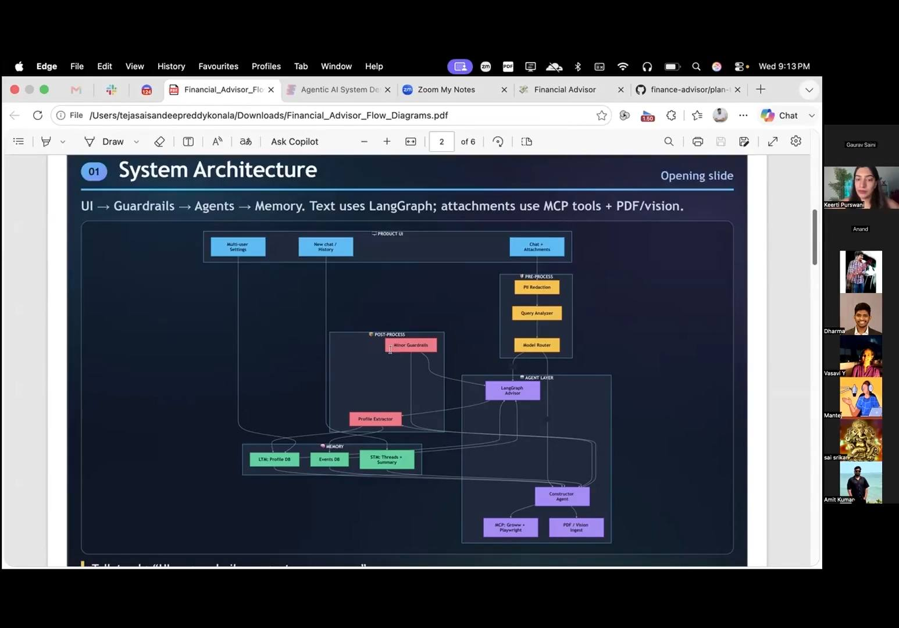
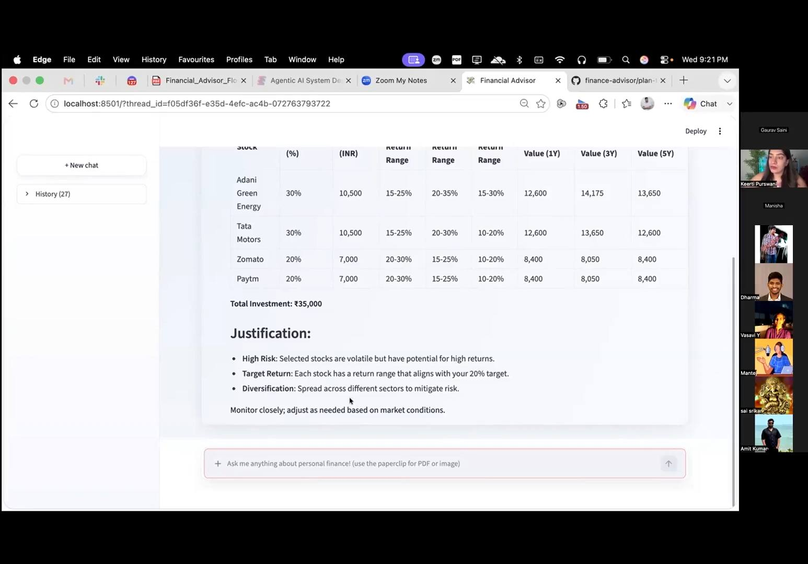
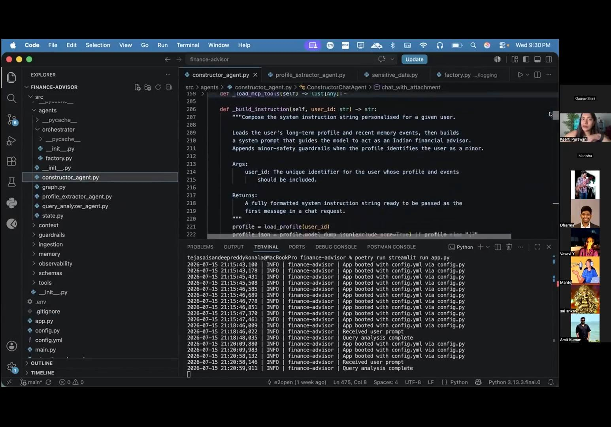
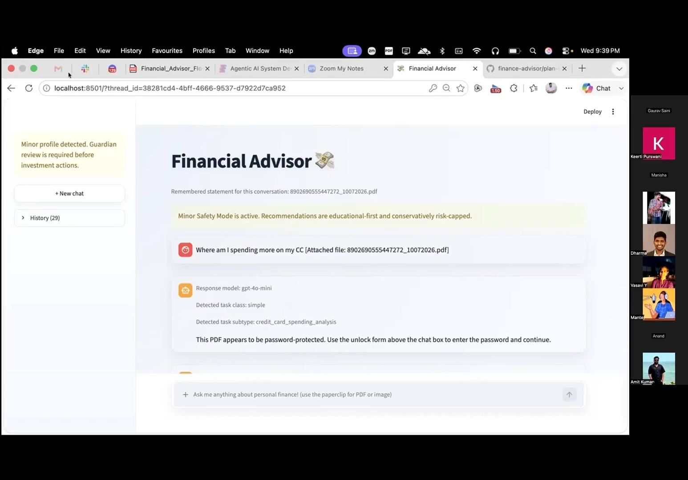
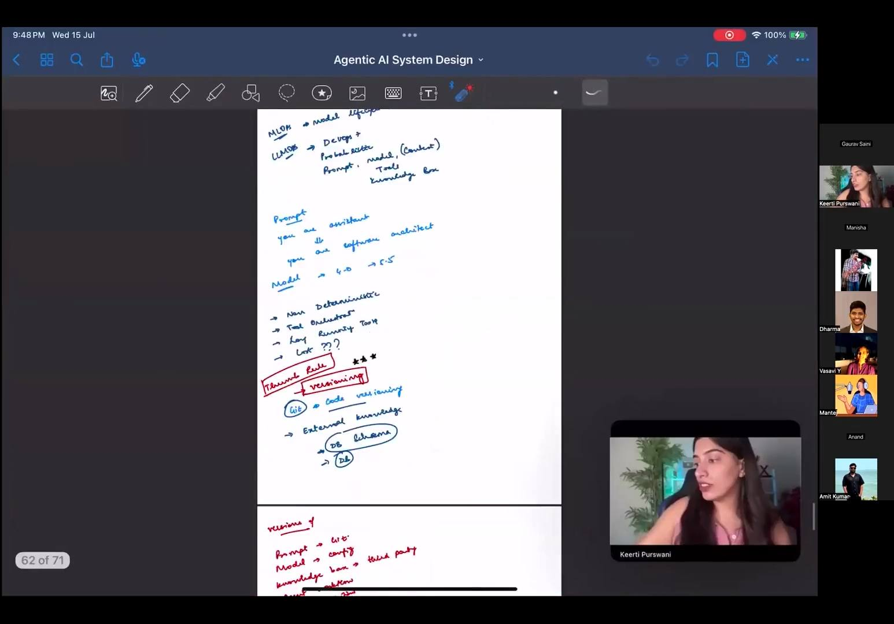
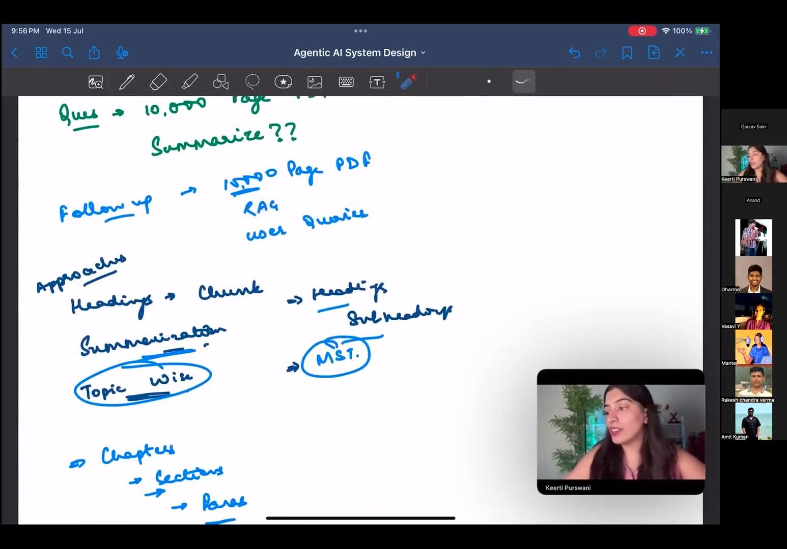
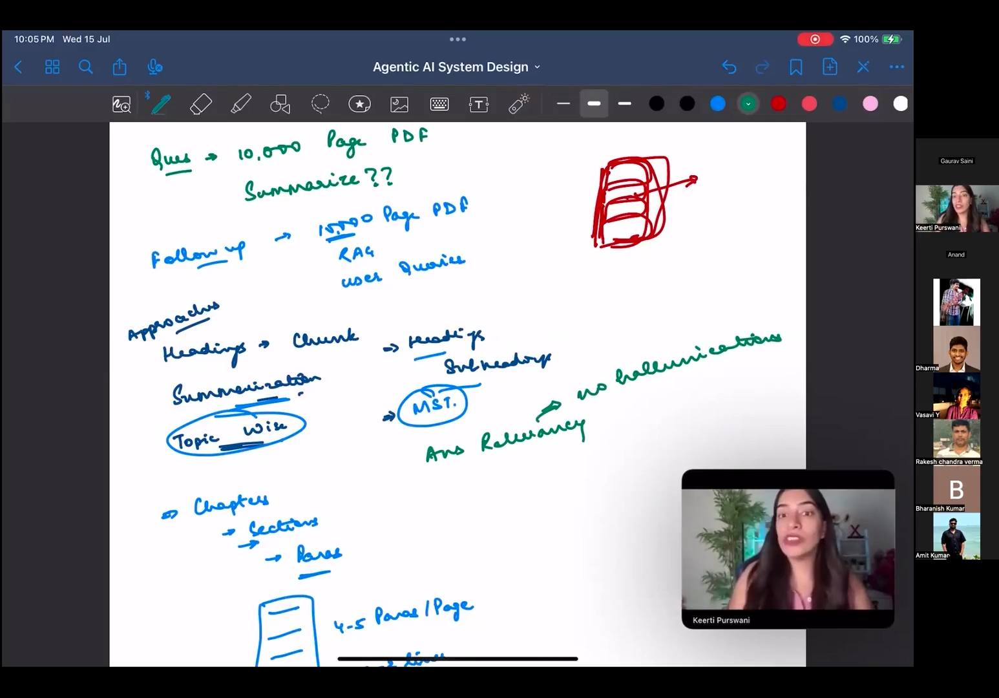
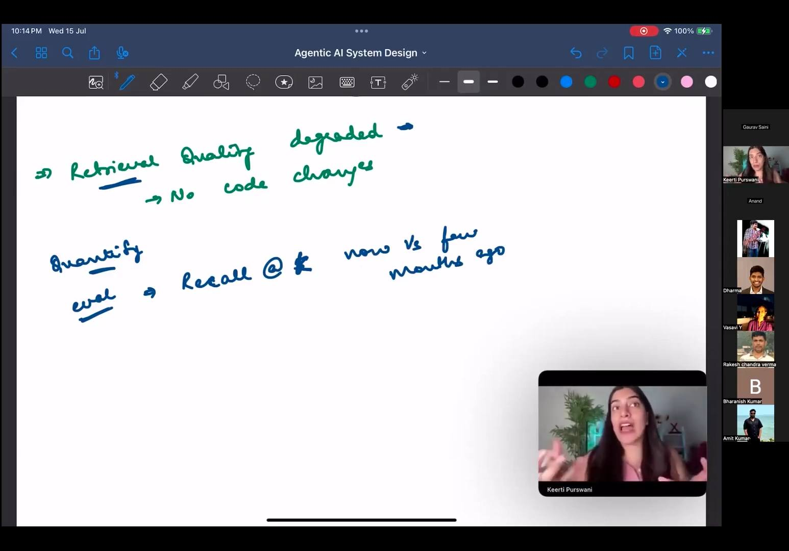

# Agentic AI System Design 第 15 课复现文档

> 课程：Agentic AI System Design（系统设计 × Agent），BV1ntMt6TEe4
> 覆盖：P15 第 2/2 段，65:56–130:36
> 说明：本段没有 OCR 结果，截图清单共 8 张，本文全部使用。课里没有给出可直接运行的完整源码，学员在 demo 中也明确说部分代码由 AI 辅助生成、当场无法逐行解释。因此第 4 节按任务要求改为「课里出现过的模块清单 + 设计决策表 + 数据模型草案 + 容量估算表 + 标注为示意的骨架代码」，凡是示意内容都单独标注，不冒充讲师原实现。

---

## 1. 这一节做什么

这一段不是新知识讲授，而是三件事叠在一起：

1. **学员项目 end-to-end demo**：一个「个人财务顾问 Agent」。它能做多 profile 隔离、长期记忆、PDF 账单解析、通过 Groww MCP 拉市场数据、按风险画像给出资产配置建议，并用结构化表格输出一年/三年/五年的回报（百分比和数值都给）。
2. **讲师现场 code review 与架构评审**：讲师逐段追问「为什么只选这四只股票」「理由为什么这么泛」「长期记忆什么时候更新」「多用户怎么隔离」，并给出下一步清单：scheduler、SMTP 邮件、custom MCP 下单、evals、cache、PII 脱敏、skills。
3. **三个真实面试题收尾**：10,000 页 PDF 怎么做摘要、输出 token 为什么比输入 token 贵、生产环境 RAG 检索质量几个月内下降且代码没改怎么 debug。

读者照着这份文档能复现的是：**这套财务 Agent 的架构骨架、每个模块的职责边界、长期记忆与多租户的存储决策**，以及**讲师对三个系统设计面试题的标准答题结构**。课里没有给出完整可运行源码，所以第 4 节给的是「按课里出现过的模块名和职责还原出的工程骨架」，每一处都标了来源和示意边界。

---

## 2. 讲师原话

以下引用全部译自本段逐字稿，技术产品名保留英文。

**关于用户隔离与 profile 设计：**

> "我们不想混合用户记忆。比如我说没有登录，但如果你说这是我妻子的账单……我们想把它隔离开。这有点像我们做的 profile 管理。在同一个登录下，因为我们做不了多登录，所以保留一个登录、可以创建不同 profile、不同角色，这些是分开的。"
> —— p015 [65:56]



**关于复用课上的架构：**

> "我们基本沿用了课上做的 Claude Code 项目相同的架构。"
> —— p015 [66:54]

**关于为什么要加结构化输出：**

> "最初我们发现，如果你说这是我的年龄画像，我们问它每月想投 8000，该怎么投，它会把钱分成两份，没有百分比，只是简单告诉你这些基金可以投，然后说选 debt fund。所以我们觉得这对用户来说不够好，于是加了这些指令，说明能拿到多少回报，做成表格结构，让数值对用户来说足够醒目……我们还要求它明确指定具体哪只基金，因为最初它只分享 debt fund，你没法判断是哪一类 debt fund。"
> —— p015 [68:35]

**关于长期记忆存什么：**

> "基本上我们拿这些事件、流程，做成一个 context 存起来，是以 key-value 形式存的，但 LTM 会计算他或她所说的风险百分比……年龄、工资、EMI 这些。甚至如果我曾说过『我两年后计划去欧洲旅行，想存这么多钱』，两天后问我『你还记得我在计划哪个旅行吗』，它会说你在计划欧洲旅行，预算是这个。"
> —— p015 [73:15]

**关于长期记忆什么时候更新（讲师给的判断）：**

> "不是每段对话，而是每个 thread 结束、关闭的时候（更新）。因为每次更新长期记忆都要花额外的延迟、成本、算力，所以更好的做法是：短期记忆本来就该被赋予更高权重，等真正需要的时候——比如切换 session 时——再更新长期记忆。"
> —— p015 [75:13]



**讲师对「为什么只选这四只股票」的追问：**

> "它给了你 Adani、Tata、Zomato、Petium 四个值，对吧？它怎么做到只给出这四只股票而不是别的？NSE 上有 2700 家公司。它怎么理解『我应该给这四家公司』？我就想从它获取推理的来源。"
> —— p015 [77:26]

**对 justification 的批评：**

> "你在理由里写『选中的股票波动大但有高回报潜力』，这是非常泛的理由。"
> —— p015 [78:26]

**关于 Query Analyzer 与模型分层：**

> "首先我们分析 query 是什么类型。如果是短期的、比如是 planning 类的事，我们交给更大的模型；如果只是简单问题，就交给 4o-mini。"
> —— p015 [80:14]

**关于 app.py 的分流：**

> "在 app.py 里拿到 query 类型，有两种情况：一是 PDF 被上传，二是用户在 questions 里提问——小问题、大问题、planning 类问题。基于这些，有两个东西：constructor agent 和 graph.py。constructor agent 处理 PDF 相关的事。"
> —— p015 [82:11]



**讲师描述项目的真正愿景：**

> "即使你没有市场或组合的 MCP，没有 Zerodha 之类能做交易的通道，哪怕你只是把银行账单、或者下载下来的组合交给 agent，它也应该能看这些，然后结合市场状况、新闻、实时行情，给你建议：这笔钱投这只股票，那笔钱投那只基金。而且每天早上 8 点，它再检查一遍你的组合和市场，告诉你『昨天我们说的，现在该这样调整』，让它始终朝着目标受控前进。这是这个项目的主旨。"
> —— p015 [89:11]

**讲师把每日流程具体化：**

> "你调用一个 API 下载银行账单，或者就算不能下载，你把账单放在某个固定位置，agent 起来读账单、读你现有的组合（组合可能来自 ICICI 或 Zerodha，你下载下来给它）。现在 agent 要分析一切。它知道你的目标，因为启动时你已经给它了。然后它出去查市场状况。假设你 25% 的股票在 SBI、30% 在 Reliance，它就查今天 Reliance 的新闻、今天 SBI 的新闻，判断是好还是该调整组合以达成你告诉它的目标。"
> —— p015 [91:27]



**关于 multi-tenancy 与存储：**

> "在记录本身，我们会加上 user ID 或 profile，作为 metadata……切换 profile 时，右上角会让那个用户变成 active，进入那个模式后它就知道这个用户是 active 的。内部查询进来时……短期记忆是 SQLite checkpointer。"
> —— p015 [96:03]

**讲师对 session 归属的强调：**

> "你要理解每个 session 只能属于一个用户。一旦切换 session，你必须保证短期记忆、长期记忆，所有东西都属于同一个用户。"
> —— p015 [97:31]

**面试题开场：**

> "问题是：如果你有一个 10,000 页的 PDF，你打算怎么用 AI 做摘要？"
> —— p015 [99:47]



**讲师对答题方式的要求：**

> "面试里被问到这种题，不要一上来就按主题、按标题子标题讲。永远先问澄清问题，至少把你的假设说出来。"
> —— p015 [103:05]

**容量估算：**

> "如果我有 10,000 页，每页 4 到 5 段，那总共就是 40k 到 50k 段，这意味着我可以有 40k 到 50k 个 chunk，这在生产里是可做的，看起来是 OK 的情况。但假设每页 20 段，那就不合理了，chunk 会太多。所以你必须把这一点讲出来。"
> —— p015 [106:19]

**分层摘要：**

> "我们先摘要 chunk，然后摘要 section——几个段落组成 section；然后如果有 chapter，就摘要 chapter；最后是整篇文档摘要。"
> —— p015 [107:17]



**并行摘要：**

> "并行 chunk 摘要是可行的吧？……我们在 Claude Code 里哪里做了并行？我们有 planning、有 subtasks，挑出 ready 的任务并行跑，我们用了那个 gather API。"
> —— p015 [109:38]

**元数据过滤：**

> "每个 chunk 能存哪些 metadata？……章节名、编号、标题；section 是什么，3.1、3.2、subsection；页码——这个 chunk 属于哪一页。这样如果某个 chunk 里出现『参见第几章第几节』这样的引用，你就能处理；或者你想取某一页的全部内容，也可以。还有 citations。"
> —— p015 [112:29]

**Guardrails：**

> "这个 PDF 是财务数据，我们不希望 LLM 产生幻觉，我们要确保回答来自 PDF。你可以在 prompt 里写明不许假设，答案必须来自这个 chunk；检索时把精确的 chunk 给它，说『不要做任何假设，只根据这个回答』。"
> —— p015 [116:13]

**Answer relevancy：**

> "什么叫 answer relevancy？就是答案来自 PDF 本身，没有幻觉。"
> —— p015 [117:08]



**定位 retrieval 还是 generation：**

> "我会把它结构化、拆开看：问题出在 retrieval 还是 generation？如果 retrieval 是对的、chunk 找得准，那说明是 relevancy 的问题——检索到的东西和答案不相关。但如果检索到的 chunk 本身不好，那我的 retrieval eval 应该能告诉我，说明 chunking 不好，我需要改 chunking。"
> —— p015 [117:34]

**输出 token 为什么贵：**

> "输出 token 是顺序生成的，用完整上下文……生成一个词之后，它变成下一轮的输入，再生成下一个词。自回归模型就是这样工作的。"
> —— p015 [119:30]

**TTFT：**

> "延迟永远是用 time to first token 来衡量的……输入大，TTFT 就会更大，因为处理要花更多时间。反过来，输入小、输出很大，TTFT 小，但 tokens per second 最终会更大，因为要生成大量文本。"
> —— p015 [121:54]

**检索质量下降怎么查：**

> "首先，如果要量化、真正理解它下降了多少，第一件事是什么？跑我们的 eval set，和生产对比。如果有差异，就说明我们需要更新 eval、需要用生产日志更新数据集。"
> —— p015 [124:43]



**版本检查：**

> "即使代码没变，配置有没有变？embedding model 版本变了吗？生成模型变了吗？DB 版本、检索方式变了吗？以前检索 K 个 chunk，现在还是 K 个吗？"
> —— p015 [126:35]

**Dynamic tooling 预告：**

> "这是个小主题：动态选择你想用的工具集。思路层面你应该能理解 LangChain / LangGraph 里大概在做什么。下次见面我们只聊这个。"
> —— p015 [128:26]

---

## 3. 从零复现

这一节按「需求 → 约束 → 估算 → 方案 → 取舍」的顺序，把这个财务 Agent 和三个面试题的推导过程复现一遍。

### 3.1 需求：这个 Agent 到底要解决什么

把学员 demo 和讲师追问里出现的用户故事归拢，一共五条：

1. **家庭多成员、无正式登录**。用户说：「这是我妻子的账单」，系统不能把妻子的财务数据和本人的混在一起。课里没有做多登录，而是做一个登录下的多个 profile，每个 profile 有独立的聊天记录和记忆。讲师把这称为 multi-tenancy。
2. **具体到「买哪只」的投资建议**。用户给年龄、每月可投金额（例：8000）、风险偏好，系统要给出资产配置比例、具体基金/股票名称、预期一年/三年/五年回报，且百分比和数值都要，用表格呈现。
3. **账单 PDF 解析**。用户上传信用卡账单（有密码），问「我在哪花得最多」，系统要能解出 top 3 支出。课里还提到银行账单、对账单。
4. **跨会话的长期记忆**。用户两天前说「我计划两年后去欧洲旅行，预算这么多」，两天后问「你还记得我在计划哪个旅行吗」，系统要答出欧洲旅行和预算。
5. **每日自动跟踪**（讲师补充的愿景，学员尚未完成）。每天早上 8 点，Agent 读取组合、查当天新闻、对照目标，给出「今天该调什么」的建议，并通过 SMTP 发邮件。

### 3.2 约束

- 前端是 Streamlit，入口在 `app.py`。
- 编排层沿用课上 Claude Code 项目的架构：orchestrator + graph + agents。
- 模型要分层：简单问题走 4o-mini，planning 类问题走更大的模型。分类由 Query Analyzer 完成。
- 市场数据通过 MCP 拿。学员用的是 Groww MCP，首次运行要登录并填凭证；也考虑过 Zerodha 的 Kite MCP，但账号被禁用。
- 短期记忆用 SQLite checkpointer。
- 长期记忆用 key-value 存储，存事件、流程、风险画像。
- 向量库用 ChromaDB（学员在讲 semantic chunking 时提到）。
- 课里明确说：evals 还没做、cache 还没做、PII 脱敏（密码、卡号）在传给 LLM 前没完全做到。
- 课里没有给出依赖版本、环境变量名、启动命令，这些在第 7 节统一标注为「课里没讲」。

### 3.3 估算

**估算一：10,000 页 PDF 的 chunk 数量与摘要调用次数**

讲师在面试题里现场做的估算：

- 假设每页 4–5 段 → 10,000 × 4~5 = **40,000–50,000 个 chunk**。讲师判断这个量级「在生产里可做」。
- 反例：假设每页 20 段 → 10,000 × 20 = **200,000 个 chunk**。讲师判断「chunk 太多，不合理」，需要改切分策略（比如先按 section 合并再切）。
- 分层摘要的调用次数（以下层级假设为示意，课里只给了「4–5 段/页」和「40k–50k chunks」）：
  - chunk 摘要：40k–50k 次
  - section 摘要：假设 10 个 chunk 组成一个 section → 4k–5k 次
  - chapter 摘要：假设 10 个 section 组成一个 chapter → 400–500 次
  - 整篇文档摘要：1 次
- 时间成本（示意假设）：单次摘要 2 秒，串行 40k 次约 22 小时；20 路并发约 1.1 小时。这就是讲师强调「并行 chunking」的实际意义——不是为了炫技，是因为串行根本跑不完。
- 存储（示意假设）：40k chunk × 1KB 文本 ≈ 40MB 原始文本；若 embedding 为 1536 维 float32，约 6KB/chunk，向量总量约 240MB。课里没有给维度和存储数字。

**估算二：每日组合检查的调用量**

课里的例子是持仓 2 只（SBI 25%、Reliance 30%）。每日流程的调用量约为：

- 1 次组合读取（Groww 或用户上传的账单）
- N 次新闻查询（N = 持仓数，例子里 N=2）
- 1 次 LLM 建议生成
- 1 次 SMTP 发送

这个量级很小，真正的瓶颈不在调用次数，而在「新闻数据源是否稳定」和「建议是否可解释」。

### 3.4 方案

**分层架构（按课里出现过的模块名组织）：**

```
┌─────────────────────────────────────────────┐
│ Streamlit UI（app.py）                       │
│  - 侧边栏：profile 选择、New Chat、PDF 上传   │
│  - 主区：聊天、历史记录                       │
└──────────────────┬──────────────────────────┘
                   │ query + active_profile
┌──────────────────▼──────────────────────────┐
│ Orchestrator（app.py 里创建，传 directories、 │
│ log levels 等配置）                          │
└──────────────────┬──────────────────────────┘
                   │
┌──────────────────▼──────────────────────────┐
│ Query Analyzer（factory 里的 analyze query） │
│  - 输出：simple / planning / pdf             │
│  - simple → 4o-mini；planning → 更大模型      │
└───────┬──────────────────────────┬──────────┘
        │ PDF 路径                  │ 问答路径
┌───────▼────────────┐   ┌────────
```
───────────────────▼───────┐
│ constructor agent          │   │ graph.py（问答编排图）    │
│  - PDF 解析 / 切分 / 摘要    │   │  - 载入短期记忆           │
│  - 写入 ChromaDB            │   │  - 载入长期记忆 context   │
└────────────────────────────┘   │  - 调 MCP 工具（市场数据） │
                                 │  - 调 PDF 检索工具        │
                                 └──────────────────────────┘
        │                                    │
┌───────▼────────────────────────────────────▼──────────┐
│ 存储层                                                │
│  - SQLite checkpointer（短期记忆，按 thread/session）  │
│  - LTM key-value（长期记忆：事件、流程、风险画像）      │
│  - ChromaDB（PDF chunk + summary + metadata）          │
│  - 每条记录都带 profile_id（课里说的 multi-tenancy）    │
└───────────────────────────────────────────────────────┘
```

**长期记忆的写入时机（课里给了两个版本）：**

- 学员当前实现：**每条消息之后**都检查长期记忆里有没有这条信息，有就更新。
- 讲师建议：**不要每条消息都更新**，而是「每个 thread 关闭 / 切换 session 时」再更新一次，因为每次更新都要付延迟 + 算力 + 成本，而短期记忆本来就该被赋予更高权重。

复现时我按讲师建议做默认，同时保留一个开关，方便你对照两种行为的差异（见 4.5 的 `LTM_UPDATE_MODE`）。

### 3.5 取舍

| 决策点 | 课里的选择 | 放弃了什么 | 如果不这样会怎样 |
|---|---|---|---|
| 身份体系 | 一个登录 + 多个 profile（无正式登录） | 真正的账号体系、鉴权、密码找回 | 家庭共享场景够用；但一旦上线，任何人都能切到别人的 profile |
| 短期记忆隔离 | 目前只做到**前端**按 profile 切换；SQLite checkpointer 按 user 分片「准备做」 | 后端强隔离 | 后端一旦多用户并发，短期记忆会串（课里明确承认这块还没做） |
| 长期记忆写入 | 学员：每条消息；讲师建议：thread 关闭时 | 每条消息方案更「实时」，但更贵 | 每条消息都写 = 每轮多一次 LLM 抽取 + 一次 DB 写，延迟和成本都涨 |
| 建议粒度 | 从「只给 debt fund 类别」升级到「指定具体基金 + 表格 + 一年/三年/五年百分比和数值」 | prompt 变长、输出 token 变多 | 用户没法执行，只能拿到一堆泛泛的类别 |
| 市场数据来源 | MCP 拉最新 web/市场数据，再结合 prompt 里的风险画像 | 依赖外部 MCP 可用性与账号（Zerodha 账号被禁用就断了） | 不接 MCP 就只能靠模型内部知识，数据会过期 |
| 摘要执行方式 | 并行 chunk 摘要（对应 Claude Code 里的 subtasks + gather） | 并发上限、限流、成本峰值 | 40k–50k chunk 串行摘要根本跑不完（见 3.3 估算） |
| 交易闭环 | 课里没做。学员的方案是买 Groww API → 自己造带工具的 custom MCP → 和 Groww MCP 一起挂上去 | 合规、风控、资金安全 | 只做建议、不做下单，项目就停在「顾问」层，面试容易被追问「然后呢」 |

---

## 4. 完整代码

> **重要说明**：本段逐字稿里没有出现任何完整源码，截图 OCR 也为空。学员在 demo 中说「有些部分我们用了 AI 帮忙，所以有些代码我们答不上来」，讲师也要求他们之后要能答上。所以下面第 4.1–4.4 是**按课里出现过的模块名、职责、字段与判断还原出的设计产物**；4.5 的代码是**示意实现**，文件结构、函数名、数据模型都对齐课里的说法，但不是讲师原代码，跑之前请按你自己的环境校对。凡课里没讲的（依赖版本号、模型型号、MCP 具体工具名），都在代码注释里标了「课里没讲」。

### 4.1 模块职责表（模块名均来自课里）

| 文件 / 模块 | 课里怎么说的 | 职责 |
|---|---|---|
| `app.py` | 「首先是 app.py，我们先创建 orchestrator，给一些 config，比如 directories 和 log levels」；「在 app.py 里拿到 query 类型」 | Streamlit 入口；创建 orchestrator；持有当前 active profile；根据 query 类型分流到 constructor agent 或 graph |
| `factory`（Query Analyzer） | 「这段代码在 factory 里……搜 analyze query」 | 判断 query 是简单问题、planning 类大任务，还是 PDF 相关 |
| `constructor agent` | 「constructor agent 处理 PDF 那部分」 | PDF 上传、解密、切分、摘要、入向量库 |
| `graph.py` | 「rest of the architecture is same」 | 问答编排图：载入记忆、调工具、生成回答 |
| MCP 层 | 「我们也在某处把 MCP 传进去了」；「第一次运行它要 Teja 的登录和凭证」 | 拉最新市场数据 / 新闻；Groww MCP |
| 短期记忆 | 「短期记忆是 SQLite checkpointer」 | 按 thread 保存对话状态 |
| 长期记忆（LTM） | 「以 key-value 形式存」「LTM 会算风险百分比」 | 存事件、流程、画像；跨 session 召回 |
| profile 菜单 | 「我们做了一个 profile 菜单，可以加不同 profile」 | 前端多租户切换 |
| skills（未做） | 「可以加一些 skills，像 tax saving 那种，skills 就是一组指令」 | 按画像给节税 / 省钱 / 走出债务的固定套路 |
| scheduler（未做） | 「我会挂一个 scheduler，把每日/每月收益写进 Excel」 | 每日 8 点检查组合并推邮件 |

### 4.2 设计决策表

| # | 决策 | 课里的依据 | 复现时怎么落地 |
|---|---|---|---|
| D1 | 所有记忆记录带 `profile_id` | 「在记录本身加上 user ID 或 profile，作为 metadata」 | 每张表/每个向量 metadata 都有 `profile_id`，查询必须带它 |
| D2 | 每个 session 只属于一个用户 | 「一旦切换 session，短期、长期记忆都得属于同一个用户」 | session 创建时绑定 `profile_id`，之后不可改 |
| D3 | 模型分层 | 「planning 类给更大模型，简单问题给 4o-mini」 | Query Analyzer 输出类型 → 选模型 |
| D4 | 结构化输出 | 「我们加了 structured output」；要求表格 + 百分比 + 数值 + 具体基金名 | 用 JSON schema 约束字段，再渲染成表 |
| D5 | 分层摘要 | chunk → section → chapter → doc | 每层单独一张表/一个 summary 字段 |
| D6 | 并行 chunk 摘要 | 「并行 chunking 是可行的」「我们用了 gather API」 | `ThreadPoolExecutor`，并发数可配 |
| D7 | chunk 元数据 | 章节名、编号、标题、section 3.1/3.2、subsection、页码、citations | 存进向量库 metadata，检索时可过滤 |
| D8 | 反幻觉 prompt | 「不许假设，答案必须来自这个 chunk」 | system prompt 硬约束 + 只喂检索片段 |
| D9 | 分层评估 | 「先确认是 retrieval 还是 generation 的问题」 | 两套 eval：recall@k（检索）+ answer relevancy（生成） |
| D10 | 长期记忆延迟写 | 「thread 关闭时更新，别每条消息都写」 | `LTM_UPDATE_MODE=thread_close` |

### 4.3 数据模型草案

**LTM（长期记忆）记录** —— 学员说的「以 key-value 形式存事件、流程」：

```json
{
  "profile_id": "amit",
  "key": "trip.europe",
  "value": { "trip": "Europe", "horizon_years": 2, "budget": 300000 },
  "kind": "event",
  "source_thread_id": "thread-2024-11-02-01",
  "updated_at": "2024-11-04T09:12:00+05:30"
}
```

**风险画像（LTM 计算出来的）** —— 学员列的字段：年龄、工资、EMI、家庭支出、风险百分比：

```json
{
  "profile_id": "amit",
  "age": 31,
  "monthly_salary": 120000,
  "monthly_expenses": 45000,
  "emi": 22000,
  "dependents": 3,
  "risk_percent": 65,
  "updated_at": "2024-11-04T09:12:00+05:30"
}
```

> 注意：`risk_percent` 是学员说「LTM 会算风险百分比」的那个值；具体的计算规则（公式、权重）**课里没讲**，只说了输入项是年龄、工资、EMI 这些。上面 65 只是示例数值。

**PDF chunk 元数据** —— 完全对齐讲师列的清单：

```json
{
  "doc_id": "hdfc-statement-2024-10",
  "profile_id": "amit",
  "page": 7,
  "chapter_no": 3,
  "chapter_title": "投资组合建议",
  "section_no": "3.1",
  "section_title": "风险资产配置",
  "subsection_no": "3.1.2",
  "para_no": 4,
  "chunk_index": 1287,
  "text": "...",
  "summary": "...",
  "citation": "p.7 §3.1.2"
}
```

**短期记忆** —— LangGraph 的 SQLite checkpointer 自带 `thread_id`；复现时在 thread 元数据里额外绑定 `profile_id`（因为课里说这块「还没做，准备做」）。

### 4.4 容量估算表（10,000 页 PDF 摘要）

| 项 | 数值 | 来源 |
|---|---|---|
| 页数 | 10,000 | 题目给定 |
| 段/页（假设 A） | 4–5 | 讲师假设 |
| chunk 数（假设 A） | 40,000–50,000 | 讲师算式 10,000 × 4~5 |
| 可行性判断（假设 A） | 生产可做 | 讲师原话 |
| 段/页（假设 B，反例） | 20 | 讲师反问 |
| chunk 数（假设 B） | 200,000 | 讲师算式，判断「太多、不合理」 |
| 串行摘要耗时（示意） | 40k × 2s ≈ 22 小时 | 课里没讲单次耗时，此处为示意 |
| 20 路并发耗时（示意） | ≈ 1.1 小时 | 同上 |
| 向量存储（示意） | 40k × 6KB ≈ 240MB | 课里没讲维度，此处为示意 |

### 4.5 示意代码

> 以下**课里没有代码，为示意实现**，用于把 4.1–4.3 的决策跑起来。文件路径是本文约定的目录结构。

**目录结构**

```
financial-advisor-agent/
├── app.py
├── config.py
├── memory.py
├── query_analyzer.py
├── pdf_ingest.py
├── rag.py
├── mcp_tools.py
├── scheduler.py
├── evals/
│   └── retrieval_eval.py
├── data/                 # 运行时自动创建
│   ├── uploads/
│   ├── chroma/
│   └── checkpoints.sqlite
├── requirements.txt
└── .env.example
```

**`requirements.txt`**

```text
# 版本号课里没讲。下面是按课里出现过的组件列的包名，
# 请用 pip freeze 锁死你自己验证过的版本后再提交。
streamlit
langgraph
langchain-openai
chromadb
pypdf
python-dotenv
apscheduler
mcp
```

**`.env.example`**

```bash
# 课里只说了"简单问题给 4o-mini"，其余模型型号课里没讲
SMALL_MODEL=gpt-4o-mini
BIG_MODEL=

OPENAI_API_KEY=

# Groww MCP：课里说第一次运行要填登录和凭证，具体变量名课里没讲
GROWW_MCP_COMMAND=
GROWW_API_KEY=

# 长期记忆写入时机：thread_close（讲师建议）| per_message（学员当前做法）
LTM_UPDATE_MODE=thread_close

# 并行摘要并发数（课里只说"并行 chunking 可行"，没说具体并发数）
SUMMARIZE_CONCURRENCY=16

# 检索参数（课里提到 recall@5 / recall@K，K 的具体值没讲）
RETRIEVAL_K=5

# 每日组合检查 + 邮件（课里说的是设想，参数未讲）
DAILY_JOB_HOUR=8
SMTP_HOST=
SMTP_PORT=587
SMTP_USER=
SMTP_PASSWORD=
ALERT_EMAIL_TO=
```

**`config.py`**

```python
import os
from pathlib import Path
from dotenv import load_dotenv

load_dotenv()

BASE_DIR = Path(__file__).resolve().parent
DATA_DIR = BASE_DIR / "data"
UPLOAD_DIR = DATA_DIR / "uploads"
CHROMA_DIR = DATA_DIR / "chroma"
SQLITE_PATH = DATA_DIR / "checkpoints.sqlite"

for _p in (DATA_DIR, UPLOAD_DIR, CHROMA_DIR):
    _p.mkdir(parents=True, exist_ok=True)

SMALL_MODEL = os.getenv("SMALL_MODEL", "gpt-4o-mini")
BIG_MODEL = os.getenv("BIG_MODEL", "")          # 课里没讲具体型号
LTM_UPDATE_MODE = os.getenv("LTM_UPDATE_MODE", "thread_close")
SUMMARIZE_CONCURRENCY = int(os.getenv("SUMMARIZE_CONCURRENCY", "16"))
RETRIEVAL_K = int(os.getenv("RETRIEVAL_K", "5"))
DAILY_JOB_HOUR = int(os.getenv("DAILY_JOB_HOUR", "8"))


def model_for(query_type: str) -> str:
    """课里：planning 类给更大的模型，简单问题给 4o-mini。"""
    if query_type == "planning" and BIG_MODEL:
        return BIG_MODEL
    return SMALL_MODEL
```

**`query_analyzer.py`**

```python
import json
from enum import Enum

from langchain_openai import ChatOpenAI

from config import SMALL_MODEL


class QueryType(str, Enum):
    SIMPLE = "simple"
    PLANNING = "planning"
    PDF = "pdf"


_ANALYZE_PROMPT = """你是查询分类器。只输出 JSON：{{"type": "simple|planning|pdf"}}
- simple：单个事实、单次计算、一句闲聊
- planning：需要多步规划、长期目标、资产配置、多年回报测算
- pdf：需要从已上传的 PDF 里找答案
用户问题：{question}
"""


def analyze_query(question: str, has_pdf: bool = False) -> QueryType:
    """课里 factory 里的 analyze query：判断是短期/planning/simple。"""
    if has_pdf and _looks_like_pdf_question(question):
        return QueryType.PDF
    llm = ChatOpenAI(model=SMALL_MODEL, temperature=0)
    raw = llm.invoke(_ANALYZE_PROMPT.format(question=question)).content
    try:
        t = json.loads(raw).get("type", "simple")
    except json.JSONDecodeError:
        t = "simple"
    return QueryType(t) if t in QueryType._value2member_map_ else QueryType.SIMPLE


def _looks_like_pdf_question(q: str) -> bool:
    """课里说两种情况：PDF 被上传、或用户在 questions 里提问。"""
    keys = ("这份", "pdf", "账单", "对账单", "报告", "第几页", "哪一章")
    return any(k in q.lower() for k in keys)
```

**`memory.py`**

```python
import json
import sqlite3
from contextlib import contextmanager

from langgraph.checkpoint.sqlite import SqliteSaver

from config import SQLITE_PATH, LTM_UPDATE_MODE


# ---------- 短期记忆：课里说的 SQLite checkpointer ----------
@contextmanager
def short_term_checkpointer():
    conn = sqlite3.connect(str(SQLITE_PATH), check_same_thread=False)
    try:
        yield SqliteSaver(conn)
    finally:
        conn.close()


# ---------- 长期记忆：课里说的 key-value ----------
_LTM_DDL = """
CREATE TABLE IF NOT EXISTS ltm (
    profile_id TEXT NOT NULL,
    key        TEXT NOT NULL,
    value      TEXT NOT NULL,
    kind       TEXT NOT NULL DEFAULT 'event',
    source_thread_id TEXT,
    updated_at TEXT NOT NULL,
    PRIMARY KEY (profile_id, key)
);
CREATE TABLE IF NOT EXISTS profile (
    profile_id       TEXT PRIMARY KEY,
    age              INTEGER,
    monthly_salary   INTEGER,
    monthly_expenses INTEGER,
    emi              INTEGER,
    dependents       INTEGER,
    risk_percent     INTEGER,
    updated_at       TEXT
);
"""


def _conn():
    c = sqlite3.connect(str(SQLITE_PATH))
    c.executescript(_LTM_DDL)
    return c


def ltm_upsert(profile_id: str, key: str, value: dict,
               kind: str = "event", source_thread_id: str | None = None) -> None:
    import datetime as _dt
    now = _dt.datetime.now().astimezone().isoformat()
    with _conn() as c:
        c.execute(
            "INSERT INTO ltm(profile_id,key,value,kind,source_thread_id,updated_at) "
            "VALUES(?,?,?,?,?,?) "
            "ON CONFLICT(profile_id,key) DO UPDATE SET "
            "value=excluded.value, kind=excluded.kind, "
            "source_thread_id=excluded.source_thread_id, updated_at=excluded.updated_at",
            (profile_id, key, json.dumps(value, ensure_ascii=False),
             kind, source_thread_id, now),
        )


def ltm_context(profile_id: str, limit: int = 20) -> str:
    """把长期记忆压成一段 context 塞给模型（课里说的"做成一个 context"）。"""
    with _conn() as c:
        rows = c.execute(
            "SELECT key, value, kind FROM ltm WHERE profile_id=? "
            "ORDER BY updated_at DESC LIMIT ?",
            (profile_id, limit),
        ).fetchall()
        prof = c.execute(
            "SELECT age,monthly_salary,monthly_expenses,emi,dependents,risk_percent "
            "FROM profile WHERE profile_id=?", (profile_id,)
        ).fetchone()

    lines = [f"- [{k}] {v}" for k, v, _kind in rows]
    if prof:
        age, salary, exp, emi, dep, risk = prof
        lines.insert(0, f"- 画像：年龄={age} 月薪={salary} 月支出={exp} "
                        f"EMI={emi} 家庭人数={dep} 风险百分比={risk}")
    return "\n".join(lines) if lines else "（暂无长期记忆）"


def maybe_update_ltm(profile_id: str, thread_id: str, messages: list[dict]) -> None:
    """
    课里两个版本：
      - per_message：每条消息后都检查并更新（学员当前做法）
      - thread_close：thread 关闭时才更新（讲师建议，省延迟/成本）
    抽取规则课里没讲，这里用一次 LLM 抽取作为示意。
    """
    if LTM_UPDATE_MODE == "per_message":
        _extract_and_write(profile_id, thread_id, messages[-1:])
    # thread_close 模式由调用方在关闭 thread 时显式调用 flush_ltm()


def flush_ltm(profile_id: str, thread_id: str, messages: list[dict]) -> None:
    _extract_and_write(profile_id, thread_id, messages)


def _extract_and_write(profile_id: str, thread_id: str, messages: list[dict]) -> None:
    """从对话里抽 key-value；课里只说了"事件、流程"，抽取 schema 课里没讲。"""
    from langchain_openai import ChatOpenAI
    from config import SMALL_MODEL
    llm = ChatOpenAI(model=SMALL_MODEL, temperature=0)
    prompt = (
        "从下面的对话中抽取需要长期记住的事实，只输出 JSON 对象，"
        '形如 {"trip.europe": {"trip":"Europe","horizon_years":2,"budget":300000}}。'
        "没有可记的就输出 {}。\n\n对话：\n"
        + json.dumps(messages, ensure_ascii=False)
    )
    raw = llm.invoke(prompt).content
    try:
        data = json.loads(raw)
    except json.JSONDecodeError:
        return
    for k, v in data.items():
        if isinstance(v, dict):
            ltm_upsert(profile_id, k, v, kind="event", source_thread_id=thread_id)
```

**`pdf_ingest.py`**

```python
import re
from concurrent.futures import ThreadPoolExecutor
from pathlib import Path

import chromadb
from langchain_openai import ChatOpenAI
from pypdf import PdfReader

from config import CHROMA_DIR, SMALL_MODEL, SUMMARIZE_CONCURRENCY

CHAPTER_RE = re.compile(r"^\s*(?:第\s*)?(\d+)\s*章\s*(.*)$")
SECTION_RE = re.compile(r"^\s*(\d+\.\d+(?:\.\d+)?)\s+(.*)$")


def read_pdf_pages(path: str | Path, password: str | None = None) -> list[str]:
    reader = PdfReader(str(path))
    if reader.is_encrypted:
        if not password:
            raise ValueError("PDF 已加密，需要密码")   # 课里 demo 出现过"上传信用卡账单后要求密码"
        reader.decrypt(password)
    return [p.extract_text() or "" for p in reader.pages]


def split_paragraphs(page_text: str) -> list[str]:
    """课里说：用简单 regex 判断"新段落开始了"。"""
    paras = re.split(r"\n\s*\n", page_text)
    return [p.strip() for p in paras if p.strip()]


def build_chunks(pages: list[str], profile_id: str, doc_id: str) -> list[dict]:
    chunks: list[dict] = []
    chapter_no, chapter_title = None, ""
    section_no, section_title = None, ""
    idx = 0
    for page_i, page_text in enumerate(pages, start=1):
        for para_i, para in enumerate(split_paragraphs(page_text), start=1):
            m = CHAPTER_RE.match(para)
            if m:
                chapter_no, chapter_title = m.group(1), m.group(2).strip()
                continue
            m = SECTION_RE.match(para)
            if m:
                section_no, section_title = m.group(1), m.group(2).strip()
                continue
            chunks.append({
                "text": para,
                "metadata": {
                    "doc_id": doc_id,
                    "profile_id": profile_id,
                    "page": page_i,
                    "chapter_no": chapter_no,
                    "chapter_title": chapter_title,
                    "section_no": section_no,
                    "section_title": section_title,
                    "para_no": para_i,
                    "chunk_index": idx,
                    "citation": f"p.{page_i} §{section_no or '-'}",
                },
            })
            idx += 1
    return chunks


def _summarize(text: str) -> str:
    llm = ChatOpenAI(model=SMALL_MODEL, temperature=0)
    return llm.invoke("用不超过 80 字概括以下段落，只保留事实：\n\n" + text).content


def summarize_chunks_parallel(chunks: list[dict]) -> list[dict]:
    """课里的"并行 chunking"：一次提交多个 chunk，gather 回来。"""
    with ThreadPoolExecutor(max_workers=SUMMARIZE_CONCURRENCY) as pool:
        summaries = list(pool.map(lambda c: _summarize(c["text"]), chunks))
    for c, s in zip(chunks, summaries):
        c["metadata"]["summary"] = s
    return chunks


def hierarchical_summary(chunks: list[dict]) -> dict:
    """课里：chunk → section → chapter → 整篇。"""
    llm = ChatOpenAI(model=SMALL_MODEL, temperature=0)
    by_section: dict[str, list[str]] = {}
    for c in chunks:
        by_section.setdefault(c["metadata"]["section_no"] or "未分节", []).append(
            c["metadata"]["summary"])
    section_summaries = {
        k: llm.invoke("把以下段落摘要合并成一段本节摘要：\n" + "\n".join(v)).content
        for k, v in by_section.items()
    }
    doc_summary = llm.invoke(
        "把以下各节摘要合并成整篇摘要，不超过 500 字：\n"
        + "\n".join(f"[{k}] {v}" for k, v in section_summaries.items())
    ).content
    return {"sections": section_summaries, "doc": doc_summary}


def index_chunks(chunks: list[dict]) -> None:
    client = chromadb.PersistentClient(path=str(CHROMA_DIR))
    col = client.get_or_create_collection("pdf_chunks")
    col.add(
        ids=[f'{c["metadata"]["doc_id"]}-{c["metadata"]["chunk_index"]}' for c in chunks],
        documents=[c["text"] for c in chunks],
        metadatas=[c["metadata"] for c in chunks],
    )
```

**`rag.py`**

```python
import chromadb
from langchain_openai import ChatOpenAI

from config import CHROMA_DIR, RETRIEVAL_K, model_for

GUARDRAIL = (
    "只允许使用 <context> 里的内容回答。不要做任何假设，不要引入外部知识。"
    "如果 <context> 里没有答案，直接回答：文档中没有找到。"
    "回答末尾给出引用的 citation（形如 p.7 §3.1.2）。"
)


def retrieve(query: str, profile_id: str, doc_id: str | None = None,
             k: int = RETRIEVAL_K) -> list[dict]:
    client = chromadb.PersistentClient(path=str(CHROMA_DIR))
    col = client.get_or_create_collection("pdf_chunks")
    where: dict = {"profile_id": profile_id}
    if doc_id:
        where = {"$and": [{"profile_id": profile_id}, {"doc_id": doc_id}]}
    res = col.query(query_texts=[query], n_results=k, where=where)
    out = []
    for doc, meta, dist in zip(res["documents"][0], res["metadatas"][0], res["distances"][0]):
        out.append({"text": doc, "metadata": meta, "distance": dist})
    return out


def answer(query: str, profile_id: str, ltm_context: str,
           query_type: str = "pdf") -> dict:
    hits = retrieve(query, profile_id)
    context = "\n\n".join(f'<chunk citation="{h["metadata"]["citation"]}">'
                          f'{h["text"]}</chunk>' for h in hits)
    llm = ChatOpenAI(model=model_for(query_type), temperature=0)
    msg = (
        f"{GUARDRAIL}\n\n<long_term_memory>\n{ltm_context}\n</long_term_memory>\n\n"
        f"<context>\n{context}\n</context>\n\n问题：{query}"
    )
    return {"answer": llm.invoke(msg).content, "hits": hits}
```

**`mcp_tools.py`**

```python
"""
课里：市场数据/新闻通过 MCP 拉（学员用的是 Groww MCP，首次运行要登录填凭证）。
课里没有给出具体的 MCP server 启动命令、工具名（只说"有 get news 这类函数"），
下面的 command / 工具名都是占位，必须按你的 MCP server 实际暴露的名字改。
"""
import json
import os
from contextlib import asynccontextmanager

from mcp import ClientSession, StdioServerParameters
from mcp.client.stdio import stdio_client

SERVER = StdioServerParameters(
    command=os.getenv("GROWW_MCP_COMMAND", ""),
    args=[],
    env={**os.environ},
)


@asynccontextmanager
async def mcp_session():
    async with stdio_client(SERVER) as (read, write):
        async with ClientSession(read, write) as session:
            await session.initialize()
            yield session


async def get_market_data(symbols: list[str]) -> dict:
    async with mcp_session() as s:
        tools = await s.list_tools()
        # 课里提到有 get_news 之类的函数；真实名字请以 list_tools 输出为准
        news_tool = next((t.name for t in tools.tools if "news" in t.name.lower()), None)
        if not news_tool:
            return {"error": "MCP server 未暴露 news 工具，请以 list_tools 输出为准"}
        res = await s.call_tool(news_tool, {"symbols": symbols})
        return json.loads(res.content[0].text)
```

**`app.py`**

```python
import streamlit as st

from config import ltm_context_placeholder if False else None  # noqa: F401
from config import model_for
from memory import ltm_context, maybe_update_ltm, flush_ltm, ltm_upsert
from query_analyzer import analyze_query, QueryType
from rag import answer as rag_answer
from pdf_ingest import (read_pdf_pages, build_chunks, summarize_chunks_parallel,
                        hierarchical_summary, index_chunks)

st.set_page_config(page_title="Financial Advisor Agent", layout="wide")

# ---------- 侧边栏：profile + New Chat + PDF 上传（课里 demo 的布局）----------
with st.sidebar:
    st.subheader("Profile")
    profiles = st.session_state.setdefault("profiles", ["amit"])
    active = st.selectbox("当前 profile", profiles, index=0)
    st.session_state["active_profile"] = active

    new_name = st.text_input("新建 profile")
    if st.button("创建") and new_name and new_name not in profiles:
        profiles.append(new_name)
        st.session_state["profiles"] = profiles
        st.rerun()

    if st.button("New Chat"):
        # 切换 session 前，按讲师建议把长期记忆刷一次
        flush_ltm(active, st.session_state.get("thread_id", "t0"),
                  st.session_state.get("messages", []))
        st.session_state["thread_id"] = f"thread-{active}-{len(profiles)}-{st.time.time()}"
        st.session_state["messages"] = []

    st.divider()
    up = st.file_uploader("上传 PDF（账单 / 报告）", type=["pdf"])
    pwd = st.text_input("PDF 密码（如需要）", type="password")
    if up and st.button("解析并入库"):
        path = f"data/uploads/{active}-{up.name}"
        with open(path, "wb") as f:
            f.write(up.getbuffer())
        pages = read_pdf_pages(path, pwd or None)
        chunks = build_chunks(pages, profile_id=active, doc_id=up.name)
        chunks = summarize_chunks_parallel(chunks)
        index_chunks(chunks)
        summary = hierarchical_summary(chunks)
        st.success(f"切出 {len(chunks)} 个 chunk，已入库")
        st.write(summary["doc"])

    st.divider()
    st.caption("历史记录")
    for m in st.session_state.get("messages", []):
        st.caption(f'{m["role"]}: {m["content"][:60]}')

# ---------- 主区：聊天 ----------
st.title("Financial Advisor")
question = st.chat_input("问我：每月投 8000 该怎么配置？")
if question:
    profile_id = st.session_state["active_profile"]
    thread_id = st.session_state.setdefault("thread_id", f"thread-{profile_id}-1")
    msgs = st.session_state.setdefault("messages", [])

    qtype = analyze_query(question, has_pdf=bool(st.session_state.get("last_pdf")))
    ctx = ltm_context(profile_id)
    result = rag_answer(question, profile_id, ctx, query_type=qtype.value)

    msgs.append({"role": "user", "content": question})
    msgs.append({"role": "assistant", "content": result["answer"]})
    st.session_state["messages"] = msgs

    if qtype == QueryType.PDF:
        for h in result["hits"]:
            st.caption(f'来源 {h["metadata"]["citation"]}')
    st.write(result["answer"])

    maybe_update_ltm(profile_id, thread_id, msgs)
```

**`scheduler.py`**（课里说的「每日 8 点检查组合 + 邮件」，属未完成设想）

```python
import smtplib
from email.mime.text import MIMEText

from apscheduler.schedulers.blocking import BlockingScheduler

from config import DAILY_JOB_HOUR
from memory import ltm_context

# 课里说的每日流程：读组合 → 查当天新闻 → 对照目标 → 给调整建议 → 邮件
# 组合读取接口、新闻工具名课里都没给，以下为示意。


def daily_portfolio_check(profile_id: str, holdings: dict[str, float]) -> str:
    import asyncio
    from mcp_tools import get_market_data
    from langchain_openai import ChatOpenAI
    from config import model_for

    news = asyncio.run(get_market_data(list(holdings.keys())))
    prompt = (
        "你是持仓复盘助手。已知用户目标与画像：\n"
        f"{ltm_context(profile_id)}\n\n"
        f"当前持仓权重：{holdings}\n今日新闻：{news}\n\n"
        "逐只判断新闻对达成目标的影响，给出今天要不要调仓、调到多少。"
        "只基于给定信息，不要编造新闻。"
    )
    return ChatOpenAI(model=model_for("planning"), temperature=0).invoke(prompt).content


def send_email(subject: str, body: str) -> None:
    import os
    msg = MIMEText(body, "plain", "utf-8")
    msg["Subject"] = subject
    msg["From"] = os.getenv("SMTP_USER", "")
    msg["To"] = os.getenv("ALERT_EMAIL_TO", "")
    with smtplib.SMTP(os.getenv("SMTP_HOST", ""), int(os.getenv("SMTP_PORT", "587"))) as s:
        s.starttls()
        s.login(os.getenv("SMTP_USER", ""), os.getenv("SMTP_PASSWORD", ""))
        s.send_message(msg)


def main() -> None:
    sched = BlockingScheduler(timezone="Asia/Kolkata")   # 时区课里没讲
    sched.add_job(
        lambda: send_email("今日持仓建议",
                           daily_portfolio_check("amit", {"SBI": 0.25, "RELIANCE": 0.30})),
        "cron", hour=DAILY_JOB_HOUR, minute=0,
    )
    sched.start()


if __name__ == "__main__":
    main()
```

**`evals/retrieval_eval.py`**

```python
"""
课里讲的两个评估层：
  1) retrieval：recall@K（讲师原话 "recall at 5 / recall at K"）
  2) generation：answer relevancy（答案是否来自 PDF，有没有幻觉）
"""
import json
import sys
from pathlib import Path

sys.path.insert(0, str(Path(__file__).resolve().parents[1]))

from rag import retrieve                      # noqa: E402
from langchain_openai import ChatOpenAI       # noqa: E402
from config import RETRIEVAL_K, SMALL_MODEL   # noqa: E402


def recall_at_k(cases: list[dict], k: int = RETRIEVAL_K) -> float:
    """cases: [{"query":..., "profile_id":..., "gold_chunk_ids":[...]}]"""
    hit, total = 0, 0
    for c in cases:
        ids = {h["metadata"]["chunk_index"] for h in retrieve(c["query"], c["profile_id"], k=k)}
        total += 1
        if set(c["gold_chunk_ids"]) & ids:
            hit += 1
    return hit / total if total else 0.0


def answer_relevancy(hits: list[dict], answer: str) -> bool:
    """课里：answer relevancy = 答案来自 PDF 本身、没有幻觉。"""
    ctx = "\n".join(h["text"] for h in hits)
    llm = ChatOpenAI(model=SMALL_MODEL, temperature=0)
    verdict = llm.invoke(
        "判断回答是否完全来自给定片段。只输出 yes 或 no。\n"
        f"片段：\n{ctx}\n\n回答：\n{answer}"
    ).content.strip().lower()
    return verdict.startswith("yes")


if __name__ == "__main__":
    cases = json.loads(Path("evals/cases.json").read_text(encoding="utf-8"))
    print("recall@K =", recall_at_k(cases))
```

**启动命令**

```bash
python -m venv .venv && source .venv/bin/activate
pip install -r requirements.txt
cp .env.example .env      # 填