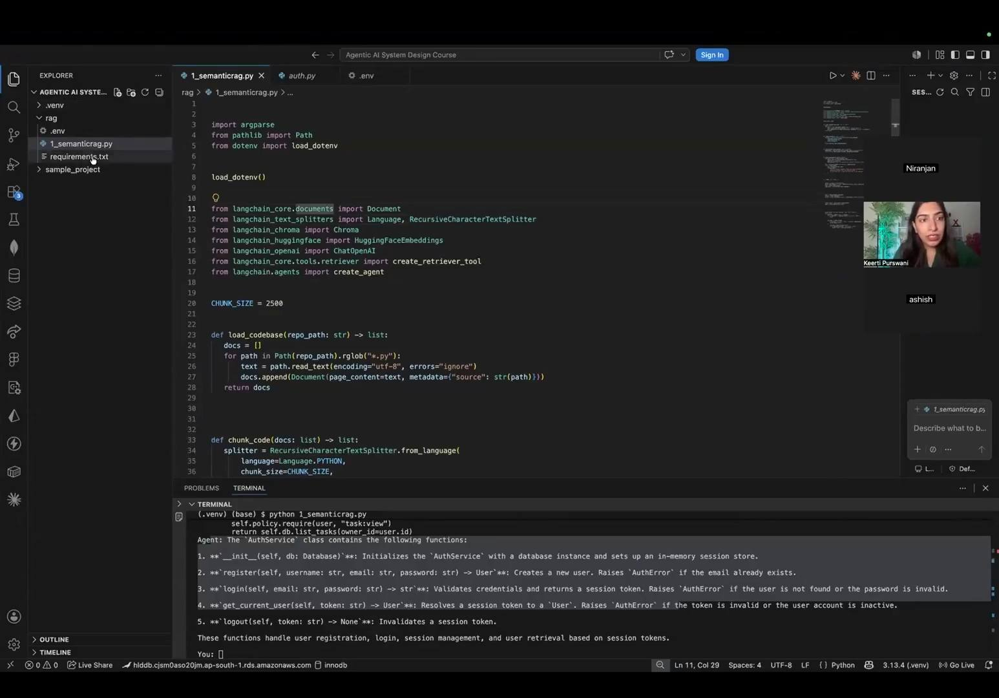
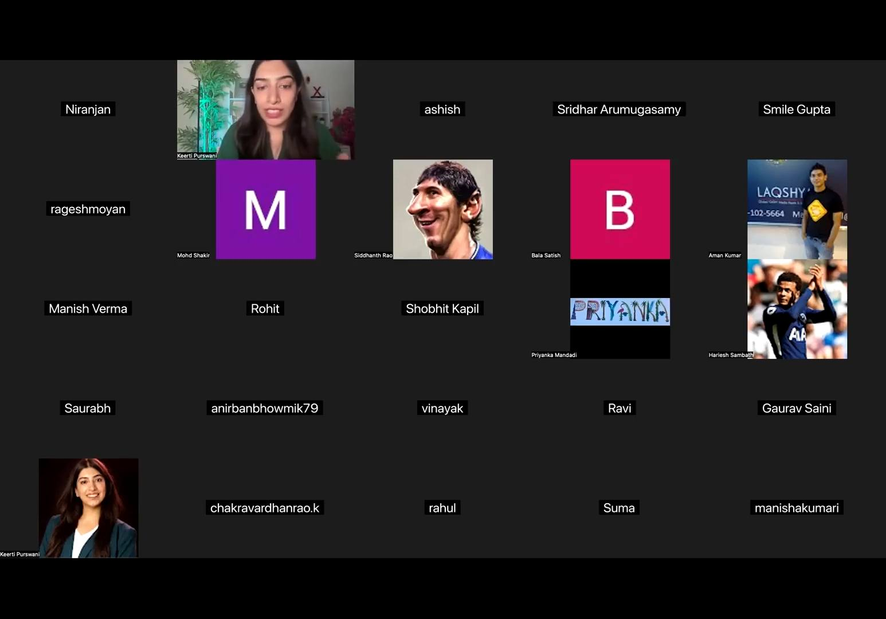
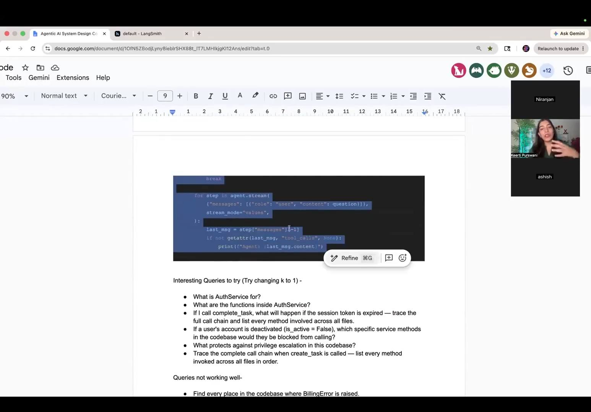
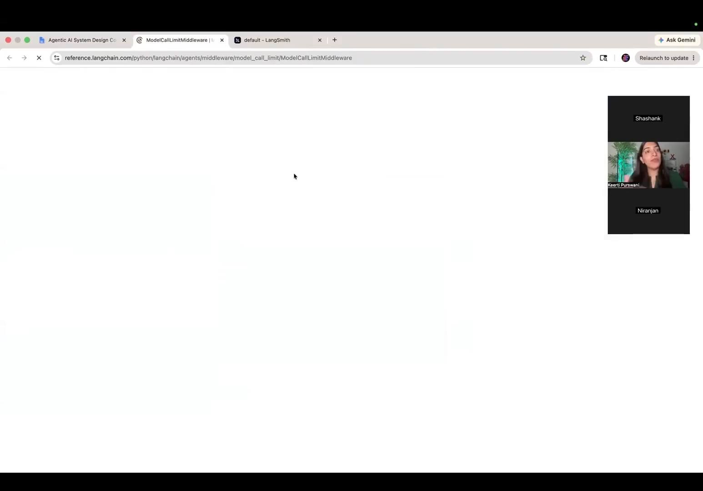
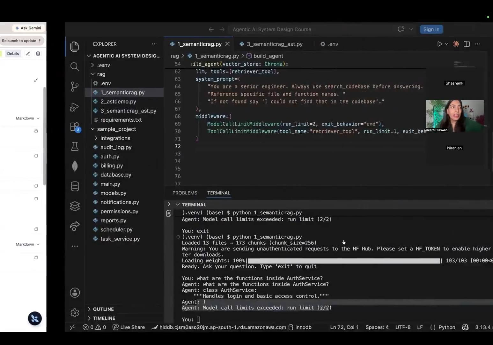
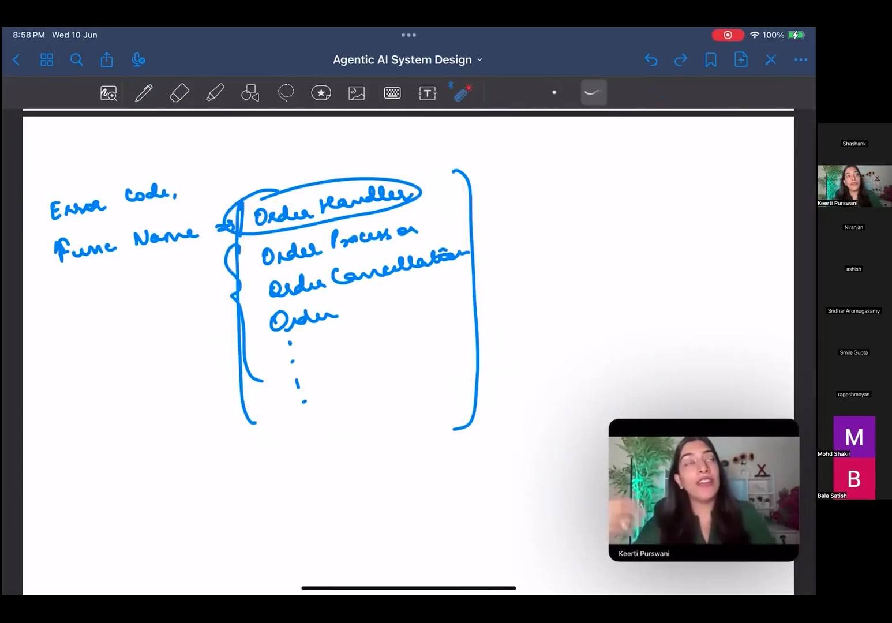
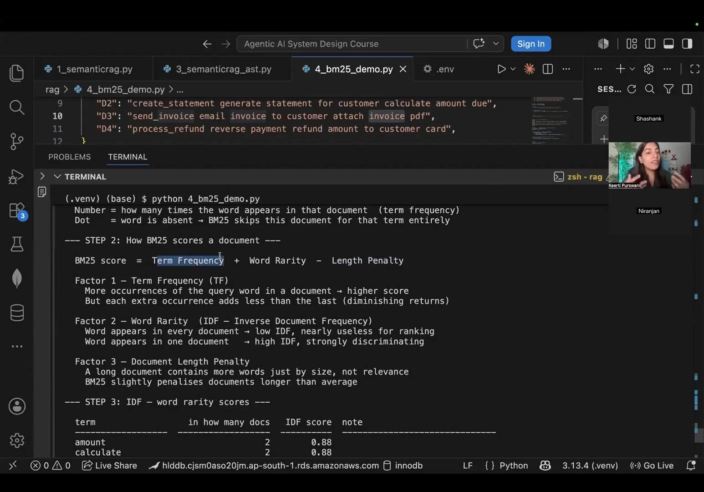

# Agentic AI System Design（系统设计 × Agent）— P002 课程复现文档

> 本文档对应课程 BV1ntMt6TEe4 的 P002（0:00–71:25）。这一节的核心是：**在同一个 RAG 项目上，一步步替换/增强检索策略，并亲眼看到每种策略对结果的影响**。读者照着本文档，可以从零把「基础语义 RAG → 改 chunk size → AST 代码分块 → 限制模型/工具调用次数 → 词法检索（倒排索引 + BM25）」这条演进链完整跑起来。

---

## 1. 这一节做什么

这一节不是讲概念，而是**在一份已经能跑通的语义 RAG 代码上做实验**，每次只改一个变量，然后对比输出。讲师反复强调的立场是：

- 影响 RAG 效果的因素非常多：数据本身、怎么存、怎么分块、怎么 embedding、用哪个 DB、用哪个模型、模型的参数设置、query 写得好不好——**没有任何单一因素是决定性的**。
- 所以这一节做的事情是：**固定其他变量，一次只动一个**，让你亲眼看到「动了这个，结果变成什么样」。

具体到本节，讲师带着做了五件事（讲师自己在 [52:09] 之后也做了口头复盘）：

1. **基础语义 RAG**：用递归字符分块（recursive text splitter）+ 向量库。
2. **调大 chunk size**：从 256 调到 2500，观察「AuthService 里有哪些函数」这类问题从答不出变成答得出。
3. **改分块策略为 AST**：不再按字符/文本模式切，而是把代码解析成抽象语法树，按 class / function 切块，再 embedding 入库。
4. **给 Agent 加调用次数上限**：限制模型调用次数（model call limit）和工具调用次数（tool call limit），解决「一个 query 反复重试 5 次、烧 1.8K token、耗时 12 秒」的问题。
5. **引入词法检索（lexical / exact matching）**：讲倒排索引（inverted index）和 BM25，说明为什么「精确匹配错误码、类名、函数名」不该只靠语义检索。

最后还演示了 **AST 也救不了的 query**（例如「找出代码库里所有抛出 billing error 的地方」，但只检索 1 个文档时必然答不出），以此说明「没有一种策略永远正确」。

> 注意：本节是**纯讲解 + 现场演示**型课程，逐字稿里没有出现完整可复制的源码文件，OCR 也没有给出代码。因此第 4 节「完整代码」中，凡是讲师屏幕上演示过、但逐字稿未逐行念出的实现，我会明确标注「课里没有给出完整源码，以下为按讲师演示逻辑整理的复现骨架，需按你的项目实际接口对齐」。这不是编造，而是把讲师演示的**行为**落成可执行骨架。

---

## 2. 讲师原话

> "系统设计这块，我完全可以在半小时内把各种 flag（策略类型）讲完，那也行，一小时顶天了。但那样就只是理论。我想让你看到不同策略、每改一个很小的点，代码会发生什么、结果会发生什么。"
> —— p002 [01:23]

> "当我们把 chunk 调大之后，对于『AuthService 里有多少个函数』这个问题，大家都能拿到更好的回答。"
> —— p002 [04:10]

> "我把 chunk size 改成 256 再跑一次，还能拿到所有函数吗？不能。"
> —— p002 [04:40]

> "现在我的 k 是 4，在 auth service 里，我给每个函数都写上『这个函数在 AuthService 内部处理什么』。你觉得现在性能会变好吗？"
> —— p002 [07:23]

> "LLM 怎么知道一个函数、一个工具到底做什么？因为 description 告诉它这个工具在做什么、这个函数在做什么，那就是 docstring，是它在解释。我们只是在提供更好的可读性，而 LLM 只处理自然语言，它只能读。"
> —— p002 [08:47]

> "所以这不只是 chunk size 的问题，还关于你手上的数据、关于 chunking、关于 embedding、关于模型——是很多因素共同作用。"
> —— p002 [09:44]

> "如果是一份普通英文文档，我会用固定 chunk size 切。你觉得这样切好吗？不好，因为 chunk 之间没有重叠。假设一门课是五周，『五』落在前一个 chunk，『周』落在后一个 chunk，那这两个 chunk 谁都不知道我们在说五周。"
> —— p002 [10:42]

> "那 chunk size 该多大、overlap 该多大？有唯一固定答案吗？没有。因为如果你的数据本身句子很短，小的 overlap 就够；句子很长，可能就需要更大的 overlap。"
> —— p002 [12:09]

> "编译器、linter、IDE 里的自动补全，它们都会构建一个叫 AST 的东西，也就是抽象语法树（abstract syntax tree）。"
> —— p002 [14:25]

> "递归字符分块本质上还是在按文本模式切：找 class 在哪、def 在哪、换行在哪，然后在那儿切。它匹配的是 token、是文本模式。"
> —— p002 [16:19]

> "AST 分块会先把代码解析成语法树再分块，所以它能理解类、函数、方法以及它们之间的关系。"
> —— p002 [23:47]

> "AST 可能比文本分块占更多内存，你说得完全对。所以我没有把整棵树原样存下来：我用源码建 AST，拿到函数和类，最后把代码抽出来、切成 chunk、embedding、存进向量库。AST 只是替换了递归分块那一步。"
> —— p002 [21:24]

> "语义 RAG 和带 AST 的语义 RAG，唯一的区别就是分块逻辑。其他全都一样。"
> —— p002 [28:53]

> "我们用的是 LangChain 框架，但也可以直接调 OpenAI、直接调 Anthropic。如果直接调，你就得自己在 for 循环里写 max iteration，规定最多调多少次工具、最多调多少次模型。这类配置 LangChain 里已经有了，这就是用框架的好处。"
> —— p002 [33:58]

> "你看，它给我浪费了 1.8K token，OpenAI 被调了 1、2、3、4、5 次，工具也被调了 5 次。我在浪费大量 token，我要控制它。"
> —— p002 [34:55]

> "为什么要控制？成本、时间、延迟。调用次数越多，延迟到了 12 秒。12 秒好吗？12 秒是很长的时间。"
> —— p002 [35:21]

> "限制它会影响准确率吗？准确率不是靠一遍遍调模型、一遍遍调工具就能拿到的。它可能反复给你同样的工具调用、同样的模型调用，变成一个循环：模型说调工具，工具返回同样结果，再调工具……你就在循环里。与其这样，不如去改进分块、改进别的东西。"
> —— p002 [36:16]

> "所以准确率、延迟、成本之间的最佳平衡，就是 agentic system design。"
> —— p002 [36:45]

> "每次模型调用之后都有一个 middleware 在检查我们调了多少次。你看只调了两次就结束了。响应可能差不多，但我这次是 3.42 秒，而不是 12 秒。"
> —— p002 [39:12]

> "要不要重试，这个判断非常主观，取决于响应。谁有智能来做这个决定？是 LLM。你可以在 LangGraph 里控制最大调用次数，但『这次要不要重试』的决策永远在 LLM 那边。"
> —— p002 [40:10]

> "你也可以控制退出行为（exit behavior）：你想结束？想继续做别的事？还是抛异常？查文档的话，这里也可以抛异常。所以其实你有很多控制权。"
> —— p002 [41:38]

> "能不能通过 prompt 控制循环？那你得控制很多东西。因为 LLM 是无状态的，你得让它给你计数，下一次输入再把增加的计数传回去，因为每条消息都是独立的。这是额外的复杂度，而且你不能依赖 LLM，因为它不可预测。"
> —— p002 [42:07]

> "工具调用上限是**按工具名**的。我一开始写的是 retriever tool，但这里工具名是 search code base，名字对不上，所以没生效。"
> —— p002 [44:53]

> "AST 分块更适合代码库。那如果数据是混合的，比如 Google Doc 里既有代码又有文本呢？好问题，我们后面会讲。"
> —— p002 [46:20]

> "并不是说对某些 query 你就能百分百确定 AST 更好。只是 AST 真的很擅长理解代码。如果你有大量代码，转成 AST 再 embedding，对大多数 query 会更好。AST 主要用于代码。"
> —— p002 [46:48]

> "我这个示例项目现在还不够大，而我们要做的是能处理成百上千个文件的项目。所以我把检索设成 k=1，设置尽量保守，因为对 10~15 个文件来说还比较好处理。"
> —— p002 [48:46]

> "它试了 22 秒，中间有很长的停顿，你能看到它搜了、返回了、又不停地调，因为没有限制，最后说找不到。22 秒、2.8K token，这很多。"
> —— p002 [50:41]

> "如果我要找的是精确的错误码、精确的类名、精确的函数名，语义检索还合适吗？语义很棒，它帮我们理解自然语言、相似词，但它永远是最优解吗？不。我要精确匹配。"
> —— p002 [54:54]

> "在 10,000 个文件上做 grep，你觉得是个好办法吗？不。有多少人用过 Elasticsearch？"
> —— p002 [55:23]

> "倒排索引（inverted index）是什么？假设有一句话，比如『Kirti 在教两门课』，有五句这样的话。它会建一个索引：Kirti 出现在哪些文档、出现几次；edu、courses 出现在哪些文档、频率多少。"
> —— p002 [56:22]

> "词法索引最有名的方案是 BM25。BM25 代表什么？Best Matching 25。他们试了很多算法，发现这个能用，就这样了。"
> —— p002 [57:16]

> "倒排索引就像一张 map、一个 hash map：你说这个词出现在这些文档里。那我搜某个词是不是非常快？对，DSA 里用 hash map 查找是 O(1)，这就是这里的思路。"
> —— p002 [60:55]

> "BM25 不只是倒排索引。它背后有一个算法，好到它是 Elasticsearch 这类系统的默认方案。它考虑三件事：词频（term frequency）、词稀有度（word rarity）、长度惩罚（length penalty）。"
> —— p002 [63:45]

> "一个词出现 100 次很重要，出现 200 次是不是就重要两倍？不一定。随着次数增加是**递减收益**：从 1 到 2 重要度涨得多，但不是两倍。"
> —— p002 [64:44]

> "如果一个词在每篇文档里都出现，比如 agent 在每篇都有，那它重要吗？如果我搜『rag agent』，agent 每篇都有，rag 不是每篇都有，那 rag 才是更重要的词。这就是逆文档频率（inverse document frequency）。"
> —— p002 [66:12]

> "长度惩罚：同一个词出现在两篇文档里，一篇 10 个词，一篇 100 个词，这个词在哪篇更重要？10 个词那篇。大文档里一个小词可能没那么重要。"
> —— p002 [67:10]

> "BM25 其实做两件事：一是倒排索引，二是不只是倒排索引，还有重排序（re-ranking），而且重排序做得非常好。"
> —— p002 [67:39]

> "目标是：用户搜一个错误码、一个类名，这个名字可能出现在很多注释、很多使用位置，但我们想看到它**最重要**的地方。如果这个错误码出现在 10,000 个地方，你怎么决定返回 top 5？如果类名出现在 100 条注释里，你要返回 top 5 使用位置。所以排序极其重要。"
> —— p002 [70:02]

---

## 3. 从零复现

下面按「一次只改一个变量」的顺序，把这一节的实验链复现出来。每一步都写清楚：**改什么、为什么改、预期看到什么**。

### 3.0 环境与依赖

课里没有给出 `requirements.txt`，也没有念版本号。以下是按讲师演示中用到的库整理的**最小依赖清单**（版本请以你本地实际安装为准，课里没讲具体版本）：

```bash
# 建议 Python 3.10+
pip install langchain langchain-openai langchain-community langchain-text-splitters
pip install langgraph
pip install chromadb            # 或你项目里已有的向量库
pip install langsmith           # 用于 trace（讲师全程用 LangSmith 追踪）
pip install rank-bm25           # BM25 演示用
```

环境变量（讲师在 [05:32] 提到「我换了 API key」，说明 key 是通过环境变量注入的；具体变量名课里没念，按你项目实际为准）：

```bash
export OPENAI_API_KEY="sk-..."
export LANGCHAIN_TRACING_V2="true"
export LANGCHAIN_API_KEY="ls_..."
export LANGCHAIN_PROJECT="agentic-system-design"
```

> 课里没讲：向量库具体是 Chroma 还是别的、embedding 模型具体是哪个。讲师只说「向量库」「embedding」，没有点名。请沿用你 P001 已经跑通的那套。

### 3.1 第一步：基础语义 RAG（recursive text splitter）

**做什么**：加载示例代码库 → 用 `RecursiveCharacterTextSplitter` 按字符切块 → embedding → 存向量库 → 建 retriever → 接一个 Agent（带 retriever 工具）→ 提问。

**关键参数**（讲师在 [04:40]–[05:06] 现场改过）：
- `chunk_size`：先设 **256**，再改成 **2500**。
- `chunk_overlap`：讲师在 [11:40] 讲「每个 chunk 之间要有重叠」，但演示里没有念具体数值。课里没讲具体 overlap 值。
- `k`（检索文档数）：先 **4**，后面为了公平对比改成 **1**。

**预期结果**：
- `chunk_size=256` 时，问「AuthService 里有哪些函数？」→ 回答「我在代码库里找不到」。
- `chunk_size=2500` 时，同一个问题 → 能答出函数列表。

**为什么**：chunk 太小，一个函数被切碎，检索到的片段里没有完整函数信息；chunk 变大后，一个 chunk 能覆盖整个类/多个函数，LLM 才有足够上下文。

### 3.2 第二步：给函数加 docstring（不改分块，只改数据）

**做什么**：在 `auth_service` 里，给每个函数加一句「这个函数在 AuthService 内部处理什么」的注释/docstring。

**预期结果**：同一个问题回答变好。

**为什么**（讲师原话 [08:47]）：LLM 靠 description / docstring 理解一个函数做什么；它只处理自然语言，只能读。你给它更好的可读性，它就能读懂。

> 讲师在 [29:21] 特别提醒：演示 AST 时**要把「这个函数属于 auth」这类注释删掉**，否则算作弊——因为那等于把答案直接写进数据里。

### 3.3 第三步：改分块策略为 AST

**做什么**：新建一个文件（讲师叫 `semantic_rag_with_ast`），**只改分块逻辑**，其余（加载、向量库、retriever、Agent）全部不变。

**AST 分块流程**（讲师在 [28:01]–[28:28] 口述）：
1. 加载源码。
2. `ast.parse(source)` 建树。
3. `ast.walk(tree)` 遍历子节点/父节点。
4. 遇到 `ClassDef` / `FunctionDef`，把该节点的源码段抽出来作为一个 chunk。
5. 每个 chunk 直接 embedding 入库。

**与递归分块的区别**（讲师 [23:47] 明确对比）：
- 递归字符分块：按文本模式（class、def、换行）切，不理解代码结构关系。
- AST 分块：先解析成语法树，理解类、函数、方法及其关系，再切。

**预期结果**：问「AuthService 里有哪些函数？」→ 拿到 4 个输出，第一个文档里就包含 login、current user、logout 等全部函数（讲师 [27:32] 在 LangSmith 里看到）。

**注意**：AST 树本身更占内存（讲师 [21:24] 承认），所以**不要把树存下来**，只把抽出的代码段存向量库。

### 3.4 第四步：限制模型调用与工具调用次数

**问题现象**（讲师 [34:55] 在 LangSmith 里看到）：一个 query 让 OpenAI 被调 5 次、工具被调 5 次，浪费 1.8K token，延迟 12 秒。

**做什么**：在 Agent 里加 middleware：
- `model call limit = 2`
- `tool call limit = 1`（**按工具名**，工具名必须和注册时一致）

**预期结果**：
- 加 model limit 后：模型只调 2 次，延迟从 12 秒降到 **3.42 秒**（讲师 [39:12]）。
- 加 tool limit 后：工具只调 1 次；如果工具名写错（写成 `retriever tool` 而实际是 `search code base`），限制不生效——讲师 [44:53] 踩过这个坑，改名后生效。

**退出行为**（讲师 [41:38]）：可以配置 exit behavior——结束、继续做别的、或抛异常。课里没讲具体枚举值，查 LangGraph 文档。

### 3.5 第五步：词法检索（倒排索引 + BM25）

**做什么**：写一个 BM25 演示脚本：
1. 准备 5 条示例文档（讲师 [59:34] 用的：create invoice、create payment、create statements、invoice process refund 等）。
2. 定义 stop words（the、a、in、on、for 这类无意义高频词），建索引前先去掉。
3. 分词（tokenize）。
4. 建倒排索引：`{词: {文档ID: 频次}}`。
5. 用 BM25 对 query 打分并重排序。

**预期结果**：能打印出倒排索引结构，看到「invoice 在 D0 出现 2 次、在 D3 出现 3 次」这类信息；BM25 对 query 返回按相关性排序的文档。

**为什么需要**（讲师 [54:54]）：精确匹配错误码、类名、函数名时，语义检索是浪费——它做的是全量语义搜索；而倒排索引是 hash map 查找，O(1)，快得多。代价是存储更重（讲师 [62:51] 承认），但延迟和计算量远低。

### 3.6 第六步：验证「AST 也救不了」的 query

**做什么**：把 AST RAG 的 `k` 改成 **1**，问：
- 「找出代码库里所有抛出 billing error 的地方」→ 只检索 1 个文档，必然答不出「所有地方」。
- 讲师 [50:41] 观察到：Agent 试了 **22 秒**、烧 **2.8K token**，因为没有调用次数限制，反复重试，最后说找不到。

**结论**：没有一种策略永远正确；k 太小 + query 需要全局扫描 → 必失败。这也是为什么后面要加调用上限、要引入词法检索、要讨论混合数据。

---

## 4. 完整代码

> **重要说明**：本节逐字稿是讲师现场演示，**没有逐行念出源码，OCR 也没有提供代码**。以下代码是**按讲师演示的行为和口述流程整理的复现骨架**，文件路径、函数名、参数值均来自逐字稿中讲师明确说过的内容；讲师没说的部分（如具体 import 路径、向量库客户端初始化）标注为「课里没讲，按你项目实际对齐」。**不要把它当成讲师原版源码**。

### 4.1 目录结构（按讲师演示推断）

```
project/
├── sample_codebase/          # 被检索的示例代码库（讲师用 auth_service 等）
│   └── auth_service.py
├── semantic_rag.py           # 第一步：基础语义 RAG（recursive splitter）
├── semantic_rag_with_ast.py  # 第三步：AST 分块版
├── ast_demo.py               # AST 可视化 demo（可选）
└── bm25_demo.py              # BM25 / 倒排索引 demo（可选）
```

### 4.2 `semantic_rag.py`（基础语义 RAG + 调用上限）

```python
# semantic_rag.py
# 课里没有给出完整源码，以下为按讲师演示逻辑整理的复现骨架
import os
from langchain_community.document_loaders import DirectoryLoader, TextLoader
from langchain_text_splitters import RecursiveCharacterTextSplitter
from langchain_openai import OpenAIEmbeddings, ChatOpenAI
from langchain_community.vectorstores import Chroma
from langchain.tools import tool
from langgraph.prebuilt import create_react_agent
# 调用上限 middleware：课里只说了「import middleware、add middleware」，
# 具体 import 路径课里没念，按你安装的 langgraph 版本对齐
from langgraph.middleware import ModelCallLimitMiddleware, ToolCallLimitMiddleware

# ---- 1. 加载代码库 ----
loader = DirectoryLoader(
    "sample_codebase",
    glob="**/*.py",
    loader_cls=TextLoader,
)
docs = loader.load()

# ---- 2. 分块：先 256，再改 2500（讲师现场改过这两个值）----
splitter = RecursiveCharacterTextSplitter(
    chunk_size=2500,      # 讲师先 256，后改 2500
    chunk_overlap=200,    # 课里没讲具体 overlap 值，此处为占位，按需调整
)
chunks = splitter.split_documents(docs)

# ---- 3. 向量库 ----
# 课里没讲具体向量库/embedding 模型，沿用你 P001 跑通的那套
vectorstore = Chroma.from_documents(chunks, OpenAIEmbeddings())
retriever = vectorstore.as_retriever(search_kwargs={"k": 1})  # 讲师后改为 k=1

# ---- 4. 工具：名字必须是 "search_code_base"（讲师踩过名字不匹配的坑）----
@tool
def search_code_base(query: str) -> str:
    """在代码库中检索相关代码片段。"""
    results = retriever.invoke(query)
    return "\n\n".join(d.page_content for d in results)

# ---- 5. Agent + 调用上限 ----
llm = ChatOpenAI(model="gpt-4o-mini")  # 课里没讲具体模型名
agent = create_react_agent(
    model=llm,
    tools=[search_code_base],
    middleware=[
        ModelCallLimitMiddleware(run_limit=2),   # 模型最多调 2 次
        ToolCallLimitMiddleware(
            tool_name="search_code_base",        # 必须与 @tool 函数名一致
            run_limit=1,                         # 该工具最多调 1 次
        ),
    ],
)

# ---- 6. 提问 ----
if __name__ == "__main__":
    q = "What are the functions present in Auth service?"
    for event in agent.stream({"messages": [("user", q)]}):
        print(event)
```

### 4.3 `semantic_rag_with_ast.py`（AST 分块版，只改分块逻辑）

```python
# semantic_rag_with_ast.py
# 课里没有给出完整源码，以下为按讲师 [28:01]-[28:28] 口述流程整理的复现骨架
import ast
from langchain_core.documents import Document
from langchain_openai import OpenAIEmbeddings
from langchain_community.vectorstores import Chroma
from langchain.tools import tool
from langgraph.prebuilt import create_react_agent
from langchain_openai import ChatOpenAI

def ast_chunk_python(source_code: str, file_path: str):
    """把 Python 源码解析成 AST，按 ClassDef / FunctionDef 抽成 chunk。"""
    tree = ast.parse(source_code)
    chunks = []
    for node in ast.walk(tree):
        if isinstance(node, (ast.ClassDef, ast.FunctionDef, ast.AsyncFunctionDef)):
            # ast.get_source_segment 取出该节点对应的原始代码段
            seg = ast.get_source_segment(source_code, node)
            if seg:
                chunks.append(Document(
                    page_content=seg,
                    metadata={"file": file_path, "name": node.name, "type": type(node).__name__},
                ))
    return chunks

# ---- 加载 + AST 分块（其余与 semantic_rag.py 完全一致）----
all_chunks = []
for path in ["sample_codebase/auth_service.py"]:  # 实际可遍历整个目录
    with open(path, "r", encoding="utf-8") as f:
        src = f.read()
    all_chunks.extend(ast_chunk_python(src, path))

vectorstore = Chroma.from_documents(all_chunks, OpenAIEmbeddings())
retriever = vectorstore.as_retriever(search_kwargs={"k": 1})

@tool
def search_code_base(query: str) -> str:
    """在代码库中检索相关代码片段。"""
    results = retriever.invoke(query)
    return "\n\n".join(d.page_content for d in results)

llm = ChatOpenAI(model="gpt-4o-mini")
agent = create_react_agent(model=llm, tools=[search_code_base])

if __name__ == "__main__":
    q = "What are the functions present in Auth service?"
    for event in agent.stream({"messages": [("user", q)]}):
        print(event)
```

### 4.4 `ast_demo.py`（AST 可视化，可选）

```python
# ast_demo.py
# 讲师 [17:45] 演示的 AST 可视化 demo，课里没有给出完整源码
import ast

code = """
x = 1 + 2

def greet(name):
    return "hello" + name

class AuthService:
    def login(self):
        pass
    def logout(self):
        pass
"""

tree = ast.parse(code)
print(ast.dump(tree, indent=2))   # dump：把树打印出来
# walk：遍历子节点（讲师 [20:27] 提到的 API）
for node in ast.walk(tree):
    print(type(node).__name__)
```

讲师在 [20:27] 列出的常用 AST API：
- `ast.parse`：建树。
- `ast.dump`：可视化/打印树。
- `ast.walk`：遍历子节点、返回节点。
- `ast.get_source_segment`：指向代码里确切的那一段（讲师原话「point to the segment，the exact code」）。

### 4.5 `bm25_demo.py`（倒排索引 + BM25，可选）

```python
# bm25_demo.py
# 讲师 [59:34] 演示的 BM25 demo，课里没有给出完整源码
from rank_bm25 import BM25Okapi

docs = [
    "create invoice generate invoice for order calculate invoice total",
    "create payment process payment refund",
    "create statements send statement email",
    "invoice process refund send invoice email invoice",
    "agent rag agent graph agent",
]

stop_words = {"the", "a", "an", "in", "on", "for", "is", "are", "to", "of"}

def tokenize(text: str):
    return [w for w in text.lower().split() if w not in stop_words]

# ---- 倒排索引：{词: {文档ID: 频次}} ----
inverted = {}
for i, d in enumerate(docs):
    for w in tokenize(d):
        inverted.setdefault(w, {}).setdefault(i, 0)
        inverted[w][i] += 1

print("倒排索引:", inverted)

# ---- BM25 打分 + 重排序 ----
corpus = [tokenize(d) for d in docs]
bm25 = BM25Okapi(corpus)
query = tokenize("invoice refund")
scores = bm25.get_scores(query)
ranked = sorted(range(len(docs)), key=lambda i: scores[i], reverse=True)
print("BM25 排序:", [(i, scores[i]) for i in ranked])
```

> 注意：`rank_bm25` 的 `BM25Okapi` 内部已经实现了词频、逆文档频率、长度惩罚三件事（对应讲师 [63:45] 讲的三要素）。课里没有念出 BM25 公式，讲师明确说「我的重点不是公式，是背后的思路」。

---

## 5. 逐行解释

### 5.1 `semantic_rag.py`

- `DirectoryLoader(..., glob="**/*.py")`：递归加载整个代码库的 `.py` 文件。讲师 [10:13] 说「我们在处理示例代码库」，加载方式与 P001 一致。
- `chunk_size=2500`：讲师 [04:40] 现场从 256 改成 2500，因为 256 时「AuthService 里有哪些函数」答不出。**这是本节第一个被验证的变量**。
- `chunk_overlap=200`：**课里没讲具体值**。讲师只在 [11:40] 讲「每个 chunk 要有重叠」，并用「五周课程」举例说明不重叠会把「五」和「周」切到两个 chunk 里，语义断裂。具体 overlap 取多少，讲师 [12:09] 明确说「没有唯一固定答案，取决于你的数据句子长短」。
- `retriever(search_kwargs={"k": 1})`：讲师 [32:06] 为了公平对比 AST 和语义，把 k 从 4 改成 1；[48:46] 又解释「示例项目不够大，设 k=1 保守一点，真实项目是成百上千文件」。
- `@tool def search_code_base`：**工具名必须是 `search_code_base`**。讲师 [44:53] 踩坑：middleware 里写 `retriever tool`，但实际工具名是 `search code base`，名字不匹配 → 限制不生效。改名后生效。
- `ModelCallLimitMiddleware(run_limit=2)`：讲师 [37:44] 说「加 middleware，model 限制 2 次」。效果：模型只调 2 次，延迟从 12 秒降到 3.42 秒（[39:12]）。
- `ToolCallLimitMiddleware(tool_name="search_code_base", run_limit=1)`：讲师 [41:08] 说「加 tool call limit，设 1」。**按工具名**限制（[45:22] 明确「it is per tool name」）。
- 退出行为：讲师 [41:38] 说可以配置 exit behavior——结束、继续、抛异常。课里没讲具体参数名，查 LangGraph 文档。

### 5.2 `semantic_rag_with_ast.py`

- `ast.parse(source_code)`：建 AST。讲师 [20:27] 列为第一个常用 API。
- `ast.walk(tree)`：遍历所有节点。讲师 [20:27] 说「walk 是遍历树的子节点、返回节点」。
- `isinstance(node, (ast.ClassDef, ast.FunctionDef, ast.AsyncFunctionDef))`：只抽类、函数、异步函数。讲师 [15:52] 描述递归分块时说的是「找 class 在哪、def 在哪」，AST 版则直接按节点类型抽。
- `ast.get_source_segment(source_code, node)`：取出该节点对应的原始代码段。讲师 [20:27] 说这是「point to the segment，the exact code」。
- **没有 chunk_size / chunk_overlap**：讲师 [28:28] 明确「这里没有 chunk overlap、chunk size，我们按 AST 的类、函数来」。
- **不存树**：讲师 [21:24] 说「AST 可能更占内存，所以我没有把树原样存下来，只把抽出的代码段 embedding 存向量库」。
- 其余与 `semantic_rag.py` 完全一致：讲师 [28:53] 强调「唯一区别就是分块逻辑」。

### 5.3 `ast_demo.py`

- `ast.dump(tree, indent=2)`：把树打印成可读结构。讲师 [18:14] 演示 `x = 1 + 2` 时，树是「X 是 target，右边是二元加法，左 1 右 2」。
- 讲师 [19:08] 还演示了函数：`FunctionDef` → 参数 `name` → 返回 `"hello" + 某物` 的二元操作；类：`ClassDef` → body 里两个 `FunctionDef`。
- 讲师 [19:34] 说「想看可视化可以搜 AST diagrams」。

### 5.4 `bm25_demo.py`

- `stop_words`：讲师 [60:01] 说「这些是常见词，不值得索引，比如 the、a、in、on、for，建索引前去掉」。
- `inverted` 字典：讲师 [60:28] 说「倒排索引就是：每个词出现在哪些文档、频次多少」。讲师 [60:55] 比喻「像 hash map，查一个词非常快，O(1)」。
- `BM25Okapi`：讲师 [63:45] 说 BM25 考虑三件事——词频、词稀有度、长度惩罚。讲师 [64:44] 解释词频是**递减收益**：100 次很重要，200 次不是重要两倍；[66:12] 解释词稀有度是**逆文档频率**：agent 每篇都有就不重要，rag 不是每篇都有就更重要；[67:10] 解释长度惩罚：同一个词在 10 词文档里比在 100 词文档里更重要。
- `get_scores` + 排序：对应讲师 [67:39] 说的「BM25 不只是倒排索引，还有 re-ranking」。讲师 [70:02] 解释排序的目的：错误码出现在 10,000 个地方，要选 top 5 最重要的位置。

### 5.5 前端/Node 视角补充

- **middleware 限制调用次数**：在 JS/Node 里对应「在 `for` 循环里写 `maxIterations` 计数器」——讲师 [33:58] 原话就是「如果直接调 OpenAI，你会在 for 循环里写 max iteration」。LangGraph 的 middleware 只是把这个计数器封装好了。
- **倒排索引**：在 JS 里就是一个 `Map<string, Map<docId, count>>`，查找 O(1)，和 Python dict 同理。
- **AST**：JS 生态对应 `@babel/parser` + `@babel/traverse`，概念完全一样（parse → walk → 取节点源码）。

---

## 6. 复现检查清单

按顺序打勾，每步都要看到预期现象再进下一步：

- [ ] 环境变量 `OPENAI_API_KEY`、`LANGCHAIN_TRACING_V2`、`LANGCHAIN_API_KEY`、`LANGCHAIN_PROJECT` 已设置。
- [ ] `sample_codebase/` 里有至少一个 `auth_service.py`，包含 login / current_user / logout 等函数。
- [ ] **实验 1**：`chunk_size=256` 跑「AuthService 里有哪些函数」→ 回答「找不到」。
- [ ] **实验 2**：`chunk_size=2500` 跑同一问题 → 能答出函数列表。
- [ ] **实验 3**：给函数加 docstring 后再跑 → 回答更好（讲师 [09:14] 验证过）。
- [ ] **实验 4**：`semantic_rag_with_ast.py` 跑同一问题 → LangSmith 里看到 4 个输出，第一个文档含全部函数（讲师 [27:32]）。
- [ ] **实验 5**：把 k 改成 1，AST 版跑「找出所有 billing error 抛出点」→ 答不出，LangSmith 显示 ~22 秒、~2.8K token（讲师 [50:41]）。
- [ ] **实验 6**：加 `ModelCallLimitMiddleware(run_limit=2)` → 模型只调 2 次，延迟从 12 秒降到 ~3.42 秒（讲师 [39:12]）。
- [ ] **实验 7**：加 `ToolCallLimitMiddleware(tool_name="search_code_base", run_limit=1)` → 工具只调 1 次。**先故意写错工具名验证不生效，再改对验证生效**（讲师 [44:53] 的坑）。
- [ ] **实验 8**：`bm25_demo.py` 打印出倒排索引，能看到「invoice 在 D0 出现 2 次、在 D3 出现 3 次」这类信息。
- [ ] **实验 9**：BM25 对 query「invoice refund」返回排序结果，且排序合理。

---

## 7. 课里没讲但你会撞上的

1. **具体依赖版本**：讲师没念 `requirements.txt`，也没说 Python 版本。LangGraph 的 middleware import 路径随版本变化很大，装错版本会 `ImportError`。建议先 `pip show langgraph` 看版本，再对照官方文档找 middleware 路径。
2. **向量库和 embedding 模型**：讲师全程只说「向量库」「embedding」，没点名 Chroma / FAISS / Pinecone，也没说 `text-embedding-3-small` 还是别的。沿用你 P001 跑通的那套即可。
3. **`chunk_overlap` 具体值**：讲师只讲「要有 overlap」和「没有唯一答案」，没给数值。本文档用 200 是占位，你需要按数据句子长度调。
4. **middleware 的 exit behavior 枚举值**：讲师 [41:38] 说「可以结束、继续、抛异常」，但没念参数名和枚举值。查 LangGraph 文档。
5. **`ast.get_source_segment` 对装饰器/嵌套函数的处理**：讲师没讲。实际用时会发现装饰器可能不被包含在 segment 里，需要自己扩边界。
6. **混合数据（代码 + 文本）怎么分块**：讲师 [46:20] 明确说「好问题，我们后面会讲」，本节没讲。你如果现在就要做，得自己决定按文件类型分流。
7. **BM25 的完整公式**：讲师 [64:14] 明确说「重点不是公式，是思路」，没念公式。需要精确实现时查 `rank_bm25` 源码或 Elasticsearch 文档。
8. **`k` 该设多少**：讲师只演示了 4 和 1，并说「真实项目是成百上千文件，这里保守设 1」。没有给通用公式。
9. **LangSmith 的具体配置**：讲师全程用 LangSmith trace，但没念 `LANGCHAIN_*` 环境变量的确切名字（本文档按官方惯例写的，以你实际为准）。
10. **工具名不匹配的静默失败**：这是本节最值得记住的坑——`ToolCallLimitMiddleware` 的 `tool_name` 和 `@tool` 函数名不一致时，**不报错、只是不生效**。讲师 [44:53] 自己踩了，你复现时务必先验证「限制到底有没有生效」。

---

### 附：本节截图索引（按论述位置插入）













