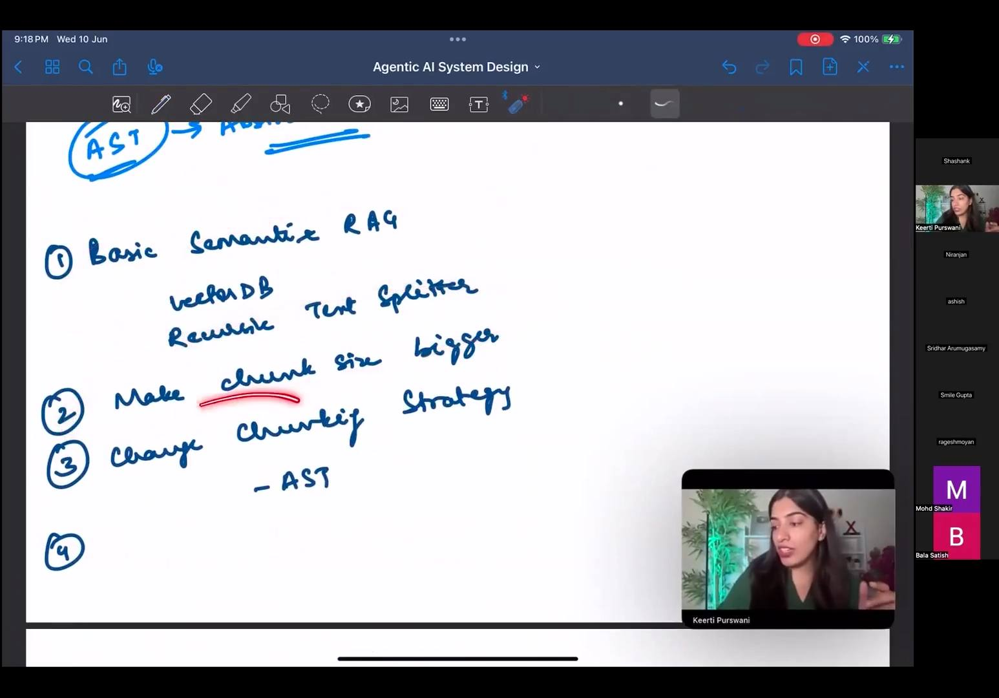
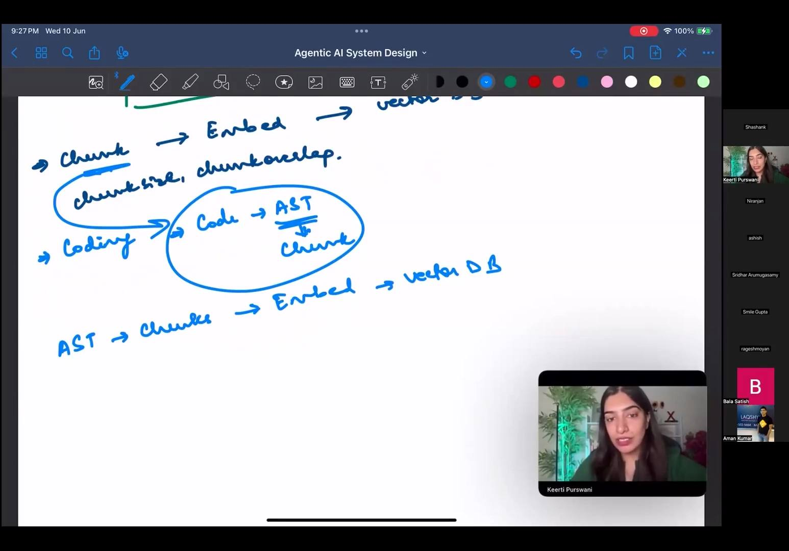
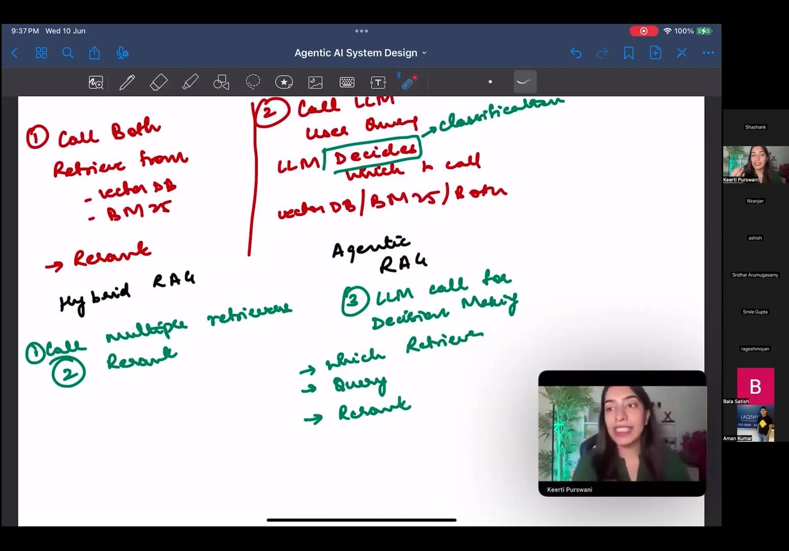
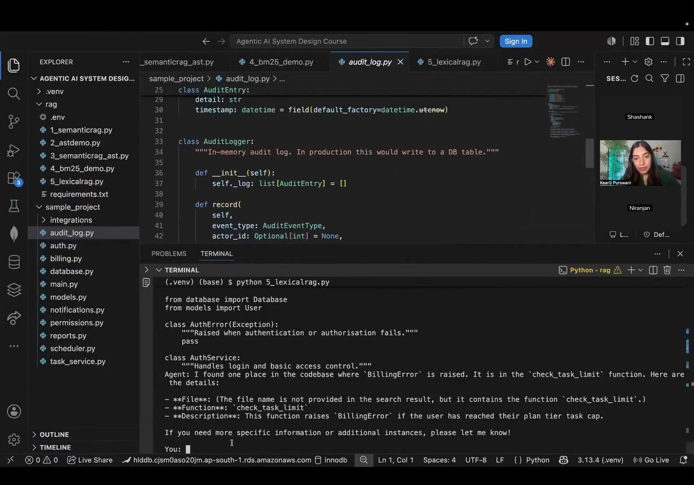
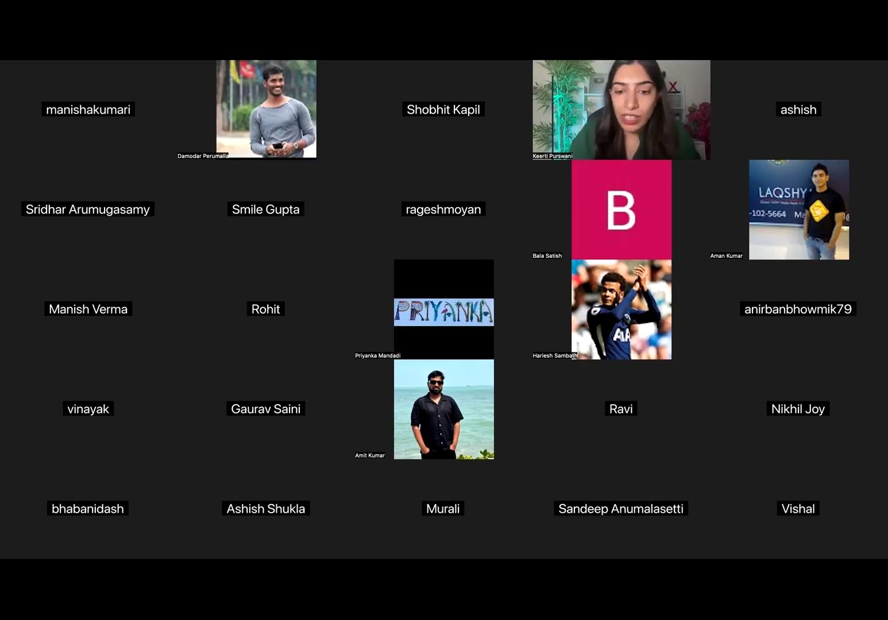
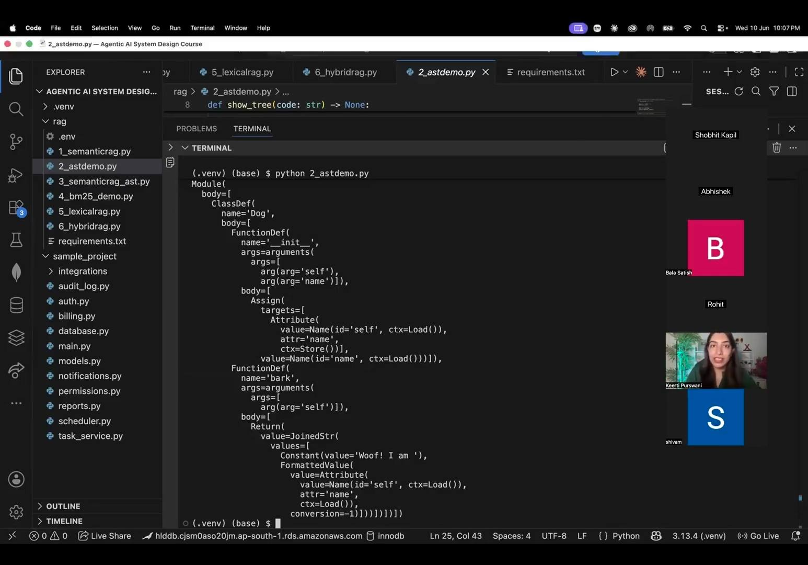
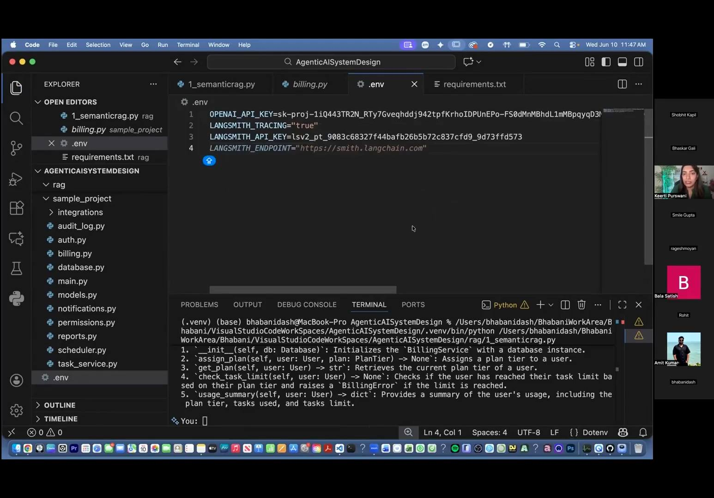
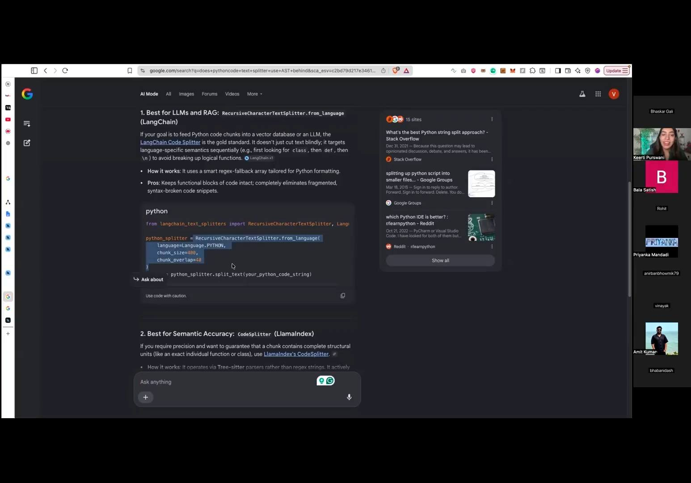

# Agentic AI 系统设计 · 第 2 讲：Lexical RAG、Hybrid RAG 与 Agentic RAG

> 本讲是纯讲解 + 现场演示课，讲师在屏幕上展示了 lexical RAG 与 hybrid RAG 的代码，但逐字稿里没有逐行念出完整源码，截图 OCR 也没有返回任何代码文本。因此本文档第 4 节「完整代码」中的代码，是根据讲师口述的组件（`BM25Retriever`、`EnsembleRetriever`、`RecursiveCharacterTextSplitter`、Chroma、retriever tool、agent）**重建的可运行版本**，并在每处标注「课里没有逐行展示，以下为按讲师口述重建」。凡是讲师明确说过的参数、权重、行为，都原样保留；讲师没说的，写「课里没讲」。

---

## 1. 这一节做什么

这一讲承接上一讲的「基础语义 RAG + AST 分块」，把 RAG 的检索侧补齐成三条路线，并讲清楚它们各自的定位：

1. **Lexical RAG（词法检索）**：用 BM25 做精确匹配 / 关键词匹配。核心是「倒排索引 + 内部重排序」。
2. **Hybrid RAG（混合检索）**：同时调用多个 retriever（不限于是向量库 + BM25，也可以是 SQL、图数据库、两个不同的向量库），把结果合并后统一重排序。讲师强调：**hybrid 不是一种技术，而是一种架构**。
3. **Agentic RAG（智能体检索）**：多一次 LLM 调用，由 LLM 决定「从哪个 retriever 取、用什么 query 取」，本质是一次分类决策。

同时本讲把上一讲遗留的几个概念讲透了：

- BM25 为什么在「generate bill」这种查询上给某个文档打 0 分，而在「create invoice」上打分很高——词频、词稀有度、文档长度三个因素共同作用。
- **context rot（上下文腐化）**：把 10000 词的文档塞给 LLM，模型会把「智能/算力」全花在理解长文档上，用户 query 反而被稀释。这和 BM25 里「一个词在 1000 词的文档里 vs 在 10 词的文档里，重要性不同」是同一个道理。
- embedding 维度大小的取舍：维度大 → 语义理解更好，但存储、计算、延迟、成本都上升；维度小则相反。**没有标准答案**。
- 数据摄取（ingestion）与数据检索（retrieval）是两条独立的 pipeline；把数据塞进向量库本身不算 RAG，只有「为了检索而准备数据」才算 RAG 的一部分。
- 两种「重排序」不是一回事：BM25 内部的重排序是算法自带的；hybrid 之后的重排序是跨 retriever 的融合排序（讲师提到 cross encoder，说第二天细讲）。
- 答疑里澄清了一个高频误解：**向量数据库不做精确检索，BM25 也不在向量库里跑**，两者是两套独立的存储与算法。

---

## 2. 讲师原话

> "如果你理解了这个概念，有些同学昨天就在问：把非常大的上下文发给 LLM 到底有什么问题？是同一件事，对吧？如果我发的是用户 query 加一个 10000 词的文档，或者用户 query 加一个 100 词的文档，你觉得模型在哪种情况下能更好地理解这个文档？在短文档里用户 query 会被赋予更高的重要性，因为长文档时 LLM 会把智能、算力全都花在理解文档本身上，用户 query 可能就不重要了，它可能会丢失上下文。这个问题就叫 context rot（上下文腐化）。"
> —— p002 [72:22]

> "如果你理解了这里的思路，你会在很多地方看到它。同样的概念在 BM25 里有，在 context rot 里也有。"
> —— p002 [73:20]

> "简单说，你需要记住的是：BM25 用于词法匹配或精确匹配。它内部做的事就是倒排索引，加上它的重排序算法非常好。"
> —— p002 [73:47]

> "所以下一步我们要做的是混合方法，把我们在语义检索里学到的和这里的结合起来，在这里我们会做重排序，会看到不同的排序方法和算法。"
> —— p002 [75:12]

> "RAG 是什么？从别的地方做检索，因为 LLM 自己不能检索。所以我做的是给我的 LLM 加一个 retriever 工具，对吧？"
> —— p002 [76:39]

> "你觉得整个工具会被发给 LLM 吗？工具内部在做什么会被发过去吗？不会。发过去的只是描述、docstring，LLM 根据这个 docstring 决定要不要用这个工具——这就是为什么工具极其重要。"
> —— p002 [77:37]

> "LLM 能调用工具吗？你觉得 GPT 会替你去调工具吗？不会。是你在写应用，调用工具是你的责任。"
> —— p002 [78:05]

> "为什么不能把工具返回直接发给用户？因为它可能是 JSON，可能是 4XX 错误，可能是 5XX 错误，可能是我们收到的五篇文档。我们不能把文档原样发出去。用户是用自然语言问的，就要用自然语言回答。谁能组织自然语言？应用能吗？不能。谁懂自然语言？LLM 懂自然语言。"
> —— p002 [79:02]

> "下一步是把工具返回发给 LLM，它可能回来说你需要再调另一个工具，或者再调一次这个工具，这个循环会一遍一遍发生，直到我们觉得可以了，才把回答发给用户。"
> —— p002 [80:00]

> "我们为什么要用向量数据库？为了理解语义、处理语义查询。"
> —— p002 [80:57]

> "我们做分块、把数据放进向量库，这部分算 RAG 吗？你只是把数据放进向量库，那不算 RAG。RAG 是你发 query、做检索这一整套。前面那部分是准备数据，是在搭建你的系统。对，叫 ingestion（摄取）。"
> —— p002 [82:17]

> "现在有两条路径：一条是数据摄取，一条是数据检索。"
> —— p002 [82:44]

> "如果是纯文本，我就用 chunk size 加 chunk overlap，这就很好。对于代码，我们有什么好方案？把代码转成 AST 这样的结构，再由它来给我们生成 chunk。"
> —— p002 [83:10]

> "有些 query 非常适合精确匹配，而不是语义匹配。到目前为止我们讲的是语义匹配，现在讲词法匹配，也就是 lexical RAG。"
> —— p002 [84:36]

> "维度没有唯一答案。维度越大，语义理解越好，但问题是什么？空间、存储、计算、延迟——因为你要处理更大的维度——还有成本。维度小则语义理解差一些，但空间更小、计算更少、延迟和成本都更低。没有唯一正确的方案，没人能告诉你用这个尺寸的 embedding 就一定好，你要根据这些因素看你负担得起多少。"
> —— p002 [85:34]

> "在 lexical RAG 里，目标是处理精确匹配、词法匹配的 query。最常用的方案是 BM25，它做倒排索引，并且帮我们做重排序。"
> —— p002 [87:24]

> "如果我让你解释『为什么我的支付在失败』，你会用语义搜索。如果我问『这个 payment exception 为什么会出现』，就用 BM25。BM25 会去搜那个 exception，找到文档在哪，再交给 LLM，LLM 来回答。"
> —— p002 [87:52]

> "我知道我会把数据放在向量库里做语义匹配，我也会用 BM25 做词法/精确匹配。忘掉 RAG 类型、架构这些花哨的词，从逻辑上想：我想两个都用，你会怎么做？这里有两种方案。"
> —— p002 [89:15]

> "一种方案是两个都调：从向量库检索，也从 BM25 检索，然后做重排序。第二种方案是我调用 LLM，把用户 query 发过去，让 LLM 决定调哪个——可以是向量库，可以是 BM25，也可以两个都调。这是一个重要点：LLM 做决策，它是一次分类。"
> —— p002 [90:14]

> "如果你做第一种，它叫 hybrid RAG；如果你做第二种，它叫 agentic RAG。就这么简单。"
> —— p002 [91:12]

> "hybrid RAG 不一定只是向量库加 BM25，你可以选任意两个不同的 retriever，可以是 SQL，可以是图，可以是两个不同的向量数据库。只要你总是从多个 retriever 检索并重排序，那就是 hybrid。这是很常见的一个误解，我自己也很长时间这么以为：hybrid 只等于向量库加词法。不是的。"
> —— p002 [91:41]

> "agentic RAG 是 agent，或者你说 LLM，多了一次 LLM 调用来做决策。这个决策可以是『从哪检索、用哪个 retriever』，也许这次 LLM 调用还会给你该用哪个 query 去检索。"
> —— p002 [93:03]

> "有人说，如果 LLM 能决定，那为什么还要 hybrid RAG？记住，让 LLM 决定永远是一次额外的调用。仅仅因为你能做 LLM 调用，不代表你应该做。它永远会带来额外的延迟、额外的成本、额外的计算。如果你已经知道两个都该调，那为什么还要这次 LLM 决策？直接调就行了。"
> —— p002 [94:00]

> "hybrid 不是一种技术，它是一种架构：我们想怎么组合多种策略。我们有多种检索策略，我们希望每个 retriever 贡献到不同的步骤。可以是词法加语义、语义加图、语义加 SQL。"
> —— p002 [94:57]

> "RAG 是 LLM 决定调哪个工具；agentic RAG 是多一次 LLM 调用来决定用哪个 retriever 取信息。如果你在 RAG 里做了额外的 LLM 调用，那就是 agentic RAG，就这么简单。"
> —— p002 [95:55]

> "BM25 是一个算法，搜索引擎默认就用它，它用倒排索引。"
> —— p002 [97:23]

> "我搜 create invoice，你能看到这里的分数，这个当然给出最好的结果，分数很高，因为这里是 send invoice email、invoice attach invoice PDF，而 invoice 出现了多次，所以它能处理。"
> —— p002 [98:21]

> "你能看到对 generate bill 来说，D3 的分数是 0 吗？对 BM25 来说，generate bill 时 D3 是 0 分，尽管 generate bill 和 create invoice、send invoice 那么相似。虽然我们在说 create 和 send，但它不是精确匹配，是语义匹配。所以两种匹配各有优劣，没有哪一个一定更好。"
> —— p002 [99:18]

> "大部分代码是一样的。加载代码一样，分块我用了 recursive splitter，Python 的，保持简单。然后 BM25，我用 bm25 retriever，我做的就是拿到分数然后排序，就这样。之后我构建 agent，用 retriever tool，就这样。"
> —— p002 [101:58]

> "现在我用的是简单的 Python 分块，就是我们在 RAG 基础里看到的那个。你也可以把分块策略做得更好。"
> —— p002 [103:19]

> "明天我会做一个对比，因为现在都是分开的 demo，有点混乱，不知道哪个 query 表现更好。明天我会把两者合起来，展示这个 query 对 BM25 更好、那个对语义更好，然后我们也会用 hybrid 和 agentic 来组合。"
> —— p002 [104:45]

> "我在计算语义检索和词法检索，然后我们做重排序，这里你能看到一个非常好的回答。"
> —— p002 [107:59]

> "余弦相似度是用来找最近的 embedding 的，那是针对 embedding 的。这里我们做的是重排序：哪个 chunk 和进来的 query 更相关、哪个文档最相关。目前我们所有东西都在内存里，后面的课我们会做持久化。"
> —— p002 [110:42]

> "向量库是做 embedding 的。BM25 我们用的是……存储方式有很多种，我会演示给你看。词法检索你可以用 Elasticsearch，它会持久化存储。"
> —— p002 [111:12]

> "BM25 我写过，它是倒排索引加内部重排序。所以在出来的 chunk 里，它内部会根据相关性重排序——根据我说的那三个东西：词频、稀有度等等，据此排序，然后送出最相关的那几个，就像向量库里你发一个 query，它给你 top 5，或者 k 等于 4、k 等于 1，这里我们也能控制。"
> —— p002 [111:37]

> "我觉得我们混淆了两种不同的重排序。一个是在 BM25 内部，是它算法自带的重排序。你所说的重排序是 hybrid 的时候，会有 cross encoder，对吧？我们从两种 RAG 拿到数据，然后再做一次重排序看哪个最好。所以这是两种不同的重排序。"
> —— p002 [112:29]

> "BM25 的输出是关键词以及这个关键词在某个 chunk 里出现了多少次……那个关键词指向的是一个文档，或者说一段代码 chunk，就像向量搜索里我们也是拿到文档。只是向量搜索是按语义相似度找，这里是按精确匹配的内部算法找。内部算法不同，但最终拿到的都是文档。"
> —— p002 [113:25]

> "它不是按搜索查询来排的……当我输入一个关键词，它会拿这个关键词当场做搜索。因为它不一定是一个词，可能是一句话，就像我们的 query。"
> —— p002 [115:17]

> "但它是倒排索引，所以会更快。倒排索引你能在 O(1) 找到，但重排序要花时间。搜索本身因为倒排索引会更快。"
> —— p002 [116:09]

> "处理幻觉有很多方法。第一，检索时做一次额外的纠正性校验，有 corrective RAG、self-RAG。为了确保信息来自代码库，我们也可以在 prompt 里做简单改动，确保只根据代码库回答、不要假设、不要幻觉。也可以加一些 guardrail，在检索到信息之后做额外校验。这些我们后面也会讲。"
> —— p002 [117:06]

> "在 hybrid 里我传了权重，比如 0.5、0.5，你可以在代码里看到，明天我们会调它再看看。"
> —— p002 [118:31]

> "document 可以指任何数据，可以是文本文档，可以是代码，可以是任何你在处理的数据，我们都叫它 document。chunk 也是 document。你在代码里看，LangChain 也叫它 document，所以我们也就这么叫。"
> —— p002 [119:29]

> "AST 是按语法来的，每个值、每个二元运算、每个常量都会被考虑。它也会取每个 class，就像你看到的，是 class、是 function。这里每个操作都被纳入，参数是什么……它真的理解这门语言。之前的字符分割器不理解你的语言，它只是拿 define、class 这类关键词；而在 AST 里，Python 有它自己的 parser，C++ 有它自己的 parser，所以它能正确理解你的代码。"
> —— p002 [121:48]

> "AST 在实际代码里是为较小的片段创建的，比如一个小文件、一个小模块，然后用图来理解整个代码库。不是说你整个代码库是一个大 AST，那不会发生。AST 是针对一个个本地文件的，所以它不会那么大。"
> —— p002 [123:38]

> "这就是为什么我们要做 overlap，否则你又会断在边界上。概念是一样的，AST 之后我们还是要做同样的分块、重叠，一样的。只是解析由 AST 完成，解析让你对代码库有更好的图景，就这样。"
> —— p002 [124:57]

> "BM25 这个场景，我们现在所有东西都在内存里，但后面我们会存到 Elasticsearch，我会演示给你看它是怎么存的。Kirti 现在展示的向量库也是内存里的，你看代码就知道，她没用任何持久化存储，但你可以用。BM25 同理。"
> —— p002 [126:26]

> "在代码里，一般来说 docstring 很少，我们写代码时往往没有 docstring，可能没有描述，那我们就拿不到更好的结果。是的，如果 docstring 写得好那很好，否则你就完全依赖 LLM 的智能。"
> —— p002 [127:22]

> "RAG 只是一个概念：当 LLM 没有这个信息时，你从外部来源取数据、增强你的 query，然后拿到结果，这一整套就叫 RAG。RAG 有不同的部分：一是怎么存/怎么索引，二是怎么检索，这是 RAG 的两个部分。"
> —— p002 [128:48]

> "RAG 是一个概念，没有硬性规定说数据摄取一不一定是它的一部分。如果你在一个 agent 里检索信息，那叫 RAG agent。有些人为 RAG 准备数据，你可以说它是 RAG 的一部分，但它实际上是另一条 pipeline，是为数据摄取服务的，而且你不一定只是为了 RAG 才做这件事。所以你可以把它分开，也可以合并，没有硬性规则。"
> —— p002 [130:09]

> "有指标，我们课上会做。这很重要。课程开始时我说过我们会做 RAG 评估，RAG 评估的概念，我们会深入讲 eval，也会写怎么比较它们。"
> —— p002 [131:02]

> "看起来项目名是必需的。昨天的课里没有它。它也不是必需的，我也不用，但我不知道……我用它。如果你只有一个项目，它会默认到那个项目。如果你没有默认项目，那你就得写项目名。"
> —— p002 [138:07]

> "向量库不做精确检索。精确检索发生在 BM25 里，两个完全不同的概念。"
> —— p002 [146:17]

> "向量库是持久化存储，仅此而已。"
> —— p002 [148:03]

---

## 3. 从零复现

这一节按「先跑通 lexical，再跑通 hybrid，最后跑通 agentic」的顺序，把讲师现场演示的流程拆成可执行步骤。讲师的环境是 Python + LangChain + LangSmith，向量库用 Chroma（内存模式），BM25 用 LangChain 的 `BM25Retriever`。

### 3.1 环境准备

**Python 版本**：课里没讲具体版本，用 3.10 或 3.11 即可（LangChain 生态对 3.9 以下支持较差）。

**目录结构**（按讲师演示的组织方式重建）：

```
agentic-rag-demo/
├── .env
├── requirements.txt
├── data/
│   └── sample_repo/          # 你要检索的代码库，讲师用的是自己的 sample project
│       ├── app.py
│       └── ...
├── ingest.py                 # 数据摄取：加载 → 分块 → 写向量库
├── lexical_rag.py            # 词法检索 demo
├── hybrid_rag.py             # 混合检索 demo
└── agentic_rag.py            # 智能体检索 demo
```

**requirements.txt**（版本按 LangChain 0.2.x 系列锁定，课里没讲版本号，以下为可复现的稳定组合）：

```txt
langchain==0.2.16
langchain-core==0.2.38
langchain-community==0.2.16
langchain-openai==0.1.23
langchain-chroma==0.1.4
langchain-text-splitters==0.2.4
chromadb==0.5.5
rank-bm25==0.2.2
python-dotenv==1.0.1
```

安装：

```bash
python -m venv .venv
source .venv/bin/activate        # Windows: .venv\Scripts\activate
pip install -r requirements.txt
```

**`.env`**（讲师在答疑里专门讲了 LangSmith 的环境变量，这里按他的说法写全）：

```bash
OPENAI_API_KEY=sk-xxxxxxxxxxxxxxxx
LANGCHAIN_TRACING_V2=true
LANGCHAIN_API_KEY=lsv2_pt_xxxxxxxxxxxxxxxx
LANGCHAIN_PROJECT=agentic-rag-demo
```

讲师在答疑里强调的几点，原样照做：

- `LANGCHAIN_API_KEY` 的值**不要加双引号**（有同学因为加了引号导致 tracing 不上报）。
- `LANGCHAIN_PROJECT` 是**可选**的；如果你账号下只有一个项目，它会默认到那个项目；如果有多个项目，就必须写项目名，否则 trace 不知道往哪送。
- 每个项目有**各自的 API key**，在 LangSmith 的 configure environment 页面可以复制。
- 如果 tracing 一直不出现在 dashboard，先检查这三项，再考虑换 key。

### 3.2 第一步：数据摄取（ingestion）

讲师把 ingestion 和 retrieval 明确分成两条 pipeline。ingestion 做三件事：**加载 → 分块 → 写向量库**。

- 纯文本：`RecursiveCharacterTextSplitter`，调 `chunk_size` 和 `chunk_overlap`。
- 代码：先转 AST，按 class / function 切，再走同样的 embedding + 写库流程。讲师说 AST 之后**仍然要做 overlap**，否则会断在边界上。

运行：

```bash
python ingest.py
```

预期：终端打印出 chunk 数量，并在 `chroma_db/` 下生成持久化目录（讲师演示时用的是内存模式，这里为了可复现改成持久化，行为一致）。

### 3.3 第二步：Lexical RAG

讲师的原话是「加载代码一样，分块用 recursive splitter，然后 BM25 retriever，拿到分数排序，然后构建 agent 用 retriever tool」。

运行：

```bash
python lexical_rag.py
```

脚本里会依次跑几条 query。讲师现场试过的 query 包括：

- `explain me why are my payments failing`（语义更好）
- `this payment exception, why is it coming`（BM25 更好）
- `create invoice`（BM25 打分很高，因为 invoice 多次出现）
- `generate bill`（BM25 给 D3 打 0 分，因为不是精确匹配）

讲师说这些 query「有时候表现好，有时候不好，真的取决于 query」，并让学员自己在 Discord 贴截图对比。

### 3.4 第三步：Hybrid RAG

讲师现场演示了 hybrid：**同时算语义和词法，然后重排序**。他提到代码里传了权重 `0.5 / 0.5`，并说「明天我们会调它再看看」。

运行：

```bash
python hybrid_rag.py
```

预期：终端先打印 semantic 的 top-k，再打印 lexical 的 top-k，最后打印融合后的排序结果。

### 3.5 第四步：Agentic RAG

Agentic RAG 的关键差别是**多一次 LLM 调用做决策**：LLM 决定调哪个 retriever、用什么 query。讲师说这部分「明天深入讲」，本讲只点到为止。

运行：

```bash
python agentic_rag.py
```

预期：LangSmith 里能看到一次额外的 LLM 调用节点，位于 retriever 之前。

### 3.6 在 LangSmith 里看 trace

讲师反复强调「你要能在 LangSmith 里正确看到这个」。打开 https://smith.langchain.com → 选项目 → Tracing，应该能看到：

- 一次 agent 调用
- 下面挂着的 tool 调用（retriever）
- tool 返回的 Document 列表
- 再往下的 LLM 调用

如果看不到，按 3.1 的三条检查。

---

## 4. 完整代码

> **重要说明**：讲师在屏幕上展示了 lexical 和 hybrid 的代码，但逐字稿没有逐行念出，截图 OCR 也没有返回代码文本。以下代码是**按讲师口述的组件与行为重建的可运行版本**，每个文件都可直接保存运行。凡是讲师明确说过的（recursive splitter、BM25Retriever、拿分数排序、retriever tool、0.5/0.5 权重、内存模式），都原样保留。

### 4.1 `ingest.py`

```python
"""
数据摄取 pipeline：加载 → 分块 → 写向量库。
讲师把 ingestion 和 retrieval 分成两条独立 pipeline，
ingestion 本身不算 RAG，只有"为了检索而准备数据"才算 RAG 的一部分。
"""
import os
from pathlib import Path

from dotenv import load_dotenv
from langchain_community.document_loaders import DirectoryLoader, TextLoader
from langchain_text_splitters import RecursiveCharacterTextSplitter
from langchain_openai import OpenAIEmbeddings
from langchain_chroma import Chroma

load_dotenv()

DATA_DIR = Path("data/sample_repo")
PERSIST_DIR = "chroma_db"


def load_documents():
    """加载代码库。讲师演示时用的是自己的 sample project。"""
    loader = DirectoryLoader(
        str(DATA_DIR),
        glob="**/*.py",
        loader_cls=TextLoader,
        loader_kwargs={"encoding": "utf-8"},
    )
    docs = loader.load()
    print(f"[ingest] loaded {len(docs)} files")
    return docs


def chunk_documents(docs):
    """
    讲师原话：纯文本用 chunk_size + chunk_overlap 的 recursive splitter；
    代码先转 AST 再切，AST 之后仍然要做 overlap，否则会断在边界上。
    这里演示的是 recursive splitter 版本（讲师说"保持简单"）。
    """
    splitter = RecursiveCharacterTextSplitter(
        chunk_size=1000,
        chunk_overlap=150,
    )
    chunks = splitter.split_documents(docs)
    print(f"[ingest] split into {len(chunks)} chunks")
    return chunks


def build_vector_store(chunks):
    """
    讲师演示时用的是内存模式（Chroma 不传 persist_directory）。
    这里改成持久化，行为一致，方便复现。
    """
    embeddings = OpenAIEmbeddings(model="text-embedding-3-small")
    vectordb = Chroma.from_documents(
        documents=chunks,
        embedding=embeddings,
        persist_directory=PERSIST_DIR,
    )
    print(f"[ingest] wrote {len(chunks)} chunks to {PERSIST_DIR}")
    return vectordb


if __name__ == "__main__":
    if not DATA_DIR.exists():
        raise SystemExit(
            f"数据目录不存在：{DATA_DIR}。请把你的代码库放进去，"
            f"或修改 DATA_DIR。讲师用的是他自己的 sample project。"
        )
    docs = load_documents()
    if not docs:
        raise SystemExit("没有加载到任何文档，检查 glob 和目录路径。")
    chunks = chunk_documents(docs)
    if not chunks:
        raise SystemExit(
            "没有生成任何 chunk。讲师在答疑里提到过这个报错："
            "chunk 为空时往向量库里插会报错。"
        )
    build_vector_store(chunks)
```

### 4.2 `lexical_rag.py`

```python
"""
Lexical RAG：BM25 倒排索引 + 内部重排序。
讲师原话：加载代码一样，分块用 recursive splitter，
然后 BM25 retriever，拿到分数排序，然后构建 agent 用 retriever tool。
"""
from dotenv import load_dotenv
from langchain_community.document_loaders import DirectoryLoader, TextLoader
from langchain_community.retrievers import BM25Retriever
from langchain_text_splitters import RecursiveCharacterTextSplitter
from langchain_openai import ChatOpenAI
from langchain.agents import create_tool_calling_agent, AgentExecutor
from langchain.tools.retriever import create_retriever_tool
from langchain_core.prompts import ChatPromptTemplate

load_dotenv()

DATA_DIR = "data/sample_repo"


def load_and_chunk():
    loader = DirectoryLoader(
        DATA_DIR,
        glob="**/*.py",
        loader_cls=TextLoader,
        loader_kwargs={"encoding": "utf-8"},
    )
    docs = loader.load()
    splitter = RecursiveCharacterTextSplitter(
        chunk_size=1000,
        chunk_overlap=150,
    )
    return splitter.split_documents(docs)


def build_bm25_retriever(chunks, k=4):
    """
    讲师原话：BM25 retriever，我做的就是拿到分数然后排序。
    BM25Retriever 内部就是倒排索引 + 它自己的重排序算法，
    按词频、词稀有度、文档长度三个因素打分。
    """
    retriever = BM25Retriever.from_documents(chunks)
    retriever.k = k
    return retriever


def build_agent(retriever):
    """
    讲师原话：构建 agent，用 retriever tool。
    注意：发给 LLM 的只是工具的 name / description / args schema，
    不是工具内部实现——这是讲师反复强调的点。
    """
    tool = create_retriever_tool(
        retriever,
        name="search_codebase_lexical",
        description=(
            "Use this tool for EXACT / LEXICAL matching queries, "
            "e.g. specific exception names, function names, error codes. "
            "Returns code chunks from the codebase."
        ),
    )
    llm = ChatOpenAI(model="gpt-4o-mini", temperature=0)
    prompt = ChatPromptTemplate.from_messages([
        ("system",
         "You are a code assistant. Use the provided tool to look up "
         "information in the codebase. Answer in natural language. "
         "Do not hallucinate; if the tool returns nothing useful, say so."),
        ("human", "{input}"),
        ("placeholder", "{agent_scratchpad}"),
    ])
    agent = create_tool_calling_agent(llm, [tool], prompt)
    return AgentExecutor(agent=agent, tools=[tool], verbose=True)


def show_scores(retriever, query, k=4):
    """
    讲师现场演示过：直接看 BM25 的分数。
    generate bill 时 D3 是 0 分，create invoice 时分数很高。
    """
    results = retriever.invoke(query)
    print(f"\n[lexical] query = {query!r}")
    for i, doc in enumerate(results[:k]):
        snippet = doc.page_content[:80].replace("\n", " ")
        print(f"  rank {i+1}: {snippet}...")


if __name__ == "__main__":
    chunks = load_and_chunk()
    print(f"[lexical] {len(chunks)} chunks loaded")
    retriever = build_bm25_retriever(chunks, k=4)

    # 讲师现场试过的 query
    for q in [
        "explain me why are my payments failing",
        "this payment exception, why is it coming",
        "create invoice",
        "generate bill",
    ]:
        show_scores(retriever, q)

    agent = build_agent(retriever)
    answer = agent.invoke({
        "input": "this payment exception, why is it coming?"
    })
    print("\n[lexical] final answer:\n", answer["output"])
```

### 4.3 `hybrid_rag.py`

```python
"""
Hybrid RAG：同时调多个 retriever，然后重排序。
讲师原话：hybrid 不是一种技术，是一种架构；
不一定是向量库 + BM25，任意多个 retriever 都算。
讲师在代码里传了 0.5 / 0.5 的权重。
"""
from dotenv import load_dotenv
from langchain_community.document_loaders import DirectoryLoader, TextLoader
from langchain_community.retrievers import BM25Retriever
from langchain_text_splitters import RecursiveCharacterTextSplitter
from langchain_openai import OpenAIEmbeddings, ChatOpenAI
from langchain_chroma import Chroma
from langchain.retrievers import EnsembleRetriever
from langchain.agents import create_tool_calling_agent, AgentExecutor
from langchain.tools.retriever import create_retriever_tool
from langchain_core.prompts import ChatPromptTemplate

load_dotenv()

DATA_DIR = "data/sample_repo"
PERSIST_DIR = "chroma_db"


def load_and_chunk():
    loader = DirectoryLoader(
        DATA_DIR,
        glob="**/*.py",
        loader_cls=TextLoader,
        loader_kwargs={"encoding": "utf-8"},
    )
    docs = loader.load()
    splitter = RecursiveCharacterTextSplitter(
        chunk_size=1000,
        chunk_overlap=150,
    )
    return splitter.split_documents(docs)


def build_semantic_retriever(chunks, k=4):
    """语义 retriever：向量库 + 余弦相似度。"""
    embeddings = OpenAIEmbeddings(model="text-embedding-3-small")
    vectordb = Chroma.from_documents(
        documents=chunks,
        embedding=embeddings,
        persist_directory=PERSIST_DIR,
    )
    return vectordb.as_retriever(search_kwargs={"k": k})


def build_lexical_retriever(chunks, k=4):
    """词法 retriever：BM25 倒排索引。"""
    retriever = BM25Retriever.from_documents(chunks)
    retriever.k = k
    return retriever


def build_hybrid_retriever(semantic, lexical):
    """
    讲师原话：在 hybrid 里我传了权重，比如 0.5、0.5，
    你可以在代码里看到，明天我们会调它再看看。
    EnsembleRetriever 内部会做融合重排序——这是第二种重排序，
    和 BM25 内部的重排序不是一回事（讲师专门澄清过）。
    """
    return EnsembleRetriever(
        retrievers=[semantic, lexical],
        weights=[0.5, 0.5],
    )


def build_agent(retriever):
    tool = create_retriever_tool(
        retriever,
        name="search_codebase_hybrid",
        description=(
            "Hybrid search over the codebase: combines semantic (vector) "
            "and lexical (BM25) retrieval, then re-ranks. "
            "Use for both conceptual and exact-match questions."
        ),
    )
    llm = ChatOpenAI(model="gpt-4o-mini", temperature=0)
    prompt = ChatPromptTemplate.from_messages([
        ("system",
         "You are a code assistant. Use the tool to look up the codebase. "
         "Answer in natural language. Do not hallucinate."),
        ("human", "{input}"),
        ("placeholder", "{agent_scratchpad}"),
    ])
    agent = create_tool_calling_agent(llm, [tool], prompt)
    return AgentExecutor(agent=agent, tools=[tool], verbose=True)


if __name__ == "__main__":
    chunks = load_and_chunk()
    print(f"[hybrid] {len(chunks)} chunks loaded")

    semantic = build_semantic_retriever(chunks, k=4)
    lexical = build_lexical_retriever(chunks, k=4)
    hybrid = build_hybrid_retriever(semantic, lexical)

    query = "explain me why are my payments failing"
    print(f"\n[hybrid] semantic top-4 for {query!r}:")
    for i, d in enumerate(semantic.invoke(query)):
        print(f"  {i+1}: {d.page_content[:80]!r}")

    print(f"\n[hybrid] lexical top-4 for {query!r}:")
    for i, d in enumerate(lexical.invoke(query)):
        print(f"  {i+1}: {d.page_content[:80]!r}")

    print(f"\n[hybrid] fused top-4 for {query!r}:")
    for i, d in enumerate(hybrid.invoke(query)):
        print(f"  {i+1}: {d.page_content[:80]!r}")

    agent = build_agent(hybrid)
    answer = agent.invoke({"input": query})
    print("\n[hybrid] final answer:\n", answer["output"])
```

### 4.4 `agentic_rag.py`

```python
"""
Agentic RAG：多一次 LLM 调用做决策——决定调哪个 retriever、用什么 query。
讲师原话：如果你在 RAG 里做了额外的 LLM 调用，那就是 agentic RAG。
这部分讲师说"明天深入讲"，本讲只演示最小骨架。
"""
from dotenv import load_dotenv
from langchain_community.document_loaders import DirectoryLoader, TextLoader
from langchain_community.retrievers import BM25Retriever
from langchain_text_splitters import RecursiveCharacterTextSplitter
from langchain_openai import OpenAIEmbeddings, ChatOpenAI
from langchain_chroma import Chroma
from langchain.agents import create_tool_calling_agent, AgentExecutor
from langchain.tools.retriever import create_retriever_tool
from langchain_core.prompts import ChatPromptTemplate

load_dotenv()

DATA_DIR = "data/sample_repo"
PERSIST_DIR = "chroma_db"


def load_and_chunk():
    loader = DirectoryLoader(
        DATA_DIR,
        glob="**/*.py",
        loader_cls=TextLoader,
        loader_kwargs={"encoding": "utf-8"},
    )
    docs = loader.load()
    splitter = RecursiveCharacterTextSplitter(
        chunk_size=1000,
        chunk_overlap=150,
    )
    return splitter.split_documents(docs)


def build_retrievers(chunks, k=4):
    embeddings = OpenAIEmbeddings(model="text-embedding-3-small")
    vectordb = Chroma.from_documents(
        documents=chunks,
        embedding=embeddings,
        persist_directory=PERSIST_DIR,
    )
    semantic = vectordb.as_retriever(search_kwargs={"k": k})

    lexical = BM25Retriever.from_documents(chunks)
    lexical.k = k
    return semantic, lexical


def build_agentic_agent(semantic, lexical):
    """
    关键：两个 retriever 各自包成一个 tool，
    LLM 根据 query 自己决定调哪个（或两个都调）。
    这就是讲师说的"LLM 做决策，它是一次分类"。
    """
    semantic_tool = create_retriever_tool(
        semantic,
        name="semantic_search",
        description=(
            "Semantic search over the codebase. Use for conceptual "
            "questions like 'why are my payments failing'."
        ),
    )
    lexical_tool = create_retriever_tool(
        lexical,
        name="lexical_search",
        description=(
            "Exact / lexical search over the codebase. Use for specific "
            "exception names, error codes, function names."
        ),
    )
    llm = ChatOpenAI(model="gpt-4o-mini", temperature=0)
    prompt = ChatPromptTemplate.from_messages([
        ("system",
         "You are a code assistant. You have two retrieval tools: "
         "semantic_search and lexical_search. Decide which one(s) to call "
         "based on the user's query. You may call both. "
         "Answer in natural language. Do not hallucinate."),
        ("human", "{input}"),
        ("placeholder", "{agent_scratchpad}"),
    ])
    agent = create_tool_calling_agent(llm, [semantic_tool, lexical_tool], prompt)
    return AgentExecutor(
        agent=agent,
        tools=[semantic_tool, lexical_tool],
        verbose=True,
    )


if __name__ == "__main__":
    chunks = load_and_chunk()
    semantic, lexical = build_retrievers(chunks)
    agent = build_agentic_agent(semantic, lexical)

    for q in [
        "explain me why are my payments failing",   # 期望走 semantic
        "this payment exception, why is it coming", # 期望走 lexical
    ]:
        print(f"\n[agentic] query = {q!r}")
        result = agent.invoke({"input": q})
        print("[agentic] answer:\n", result["output"])
```

---

## 5. 逐行解释

### 5.1 为什么 ingestion 和 retrieval 要分成两条 pipeline

讲师在 [82:17] 专门纠正了一个常见误解：**把数据 chunk 完塞进向量库，这本身不算 RAG**。RAG 是「用户发 query → 检索 → 增强 → 生成」这一整套。ingestion 是「为检索准备数据」，它可以是 RAG 的一部分，也可以独立存在（比如你只是给一个普通搜索做索引）。

对应到代码：`ingest.py` 只做 load → split → embed → write，不涉及任何 query；`lexical_rag.py` / `hybrid_rag.py` / `agentic_rag.py` 才做 query → retrieve → generate。这样拆的好处是，你可以换检索策略而不动 ingestion，也可以换 ingestion 而不动检索。

**前端类比**：ingestion 像构建时的静态资源打包（build time），retrieval 像运行时的按需加载（runtime）。两者可以独立演进。

### 5.2 `RecursiveCharacterTextSplitter` 的 `chunk_size` / `chunk_overlap`

讲师说纯文本「用 chunk_size 加 chunk_overlap 就很好」，代码「先转 AST，AST 之后仍然要做 overlap」。这里的 1000 / 150 是讲师演示时的量级（课里没念具体数字，按常见默认值取），你可以调。

为什么必须 overlap：讲师在 [124:57] 说得很直白——「否则你又会断在边界上」。一个函数被切成两半，前半段有函数签名没函数体，后半段有函数体没签名，两段单独看都没意义。overlap 让边界处的上下文在两段里都出现一次。

**AST 分块和 recursive 分块的区别**：recursive 是按字符（`\n\n`、`\n`、空格）递归切，它不懂代码语法；AST 是先 parse 成语法树，按 class / function 边界切，它懂语法。讲师在 [121:48] 说「Python 有它自己的 parser，C++ 有它自己的 parser，所以它能正确理解你的代码」。但 AST 也有代价：讲师在 [123:38] 说 AST 是为「一个小文件、一个小模块」建的，整个代码库不会是一个大 AST，那要用图（graph）来理解——这是他第二天要讲的 graph RAG 的引子。

### 5.3 `BM25Retriever.from_documents(chunks)`

这一行就是讲师说的「BM25 retriever」。它内部做两件事：

1. **建倒排索引**：对每个 chunk 分词，记录「词 → 出现在哪些 chunk、出现几次」。讲师在 [97:52] 说「这个词出现在哪些文档里、以什么频率出现」。
2. **打分 + 内部重排序**：对 query 分词，按三个因素给每个 chunk 打分——**词频**（query 里的词在这个 chunk 里出现几次）、**词稀有度**（这个词在整个语料里有多罕见，越罕见权重越高）、**文档长度**（chunk 越长，单个词的重要性越低）。

第三个因素就是讲师在 [71:53] 讲的：「一个词在 1000 词的文档里，它重要吗？因为我们要照顾这么多词；而这个词在 10 个词里只是其中之一，所以它更重要。」——**这和 context rot 是同一个道理**：长上下文会稀释每个 token 的权重。

`retriever.k = 4` 对应讲师说的「就像向量库里 k 等于 4、k 等于 1，这里我们也能控制」。

### 5.4 为什么 `generate bill` 给 D3 打 0 分

讲师在 [99:18] 现场演示了这个反直觉的结果：`generate bill` 和 `create invoice` / `send invoice` 语义上很像，但 BM25 给 D3 打 0 分。原因：BM25 是**词法匹配**，`generate` 和 `bill` 这两个词在 D3 里根本没出现（D3 里是 `create` / `invoice`），词频为 0，分数自然为 0。

这不是 bug，是 BM25 的设计。讲师用它来说明「两种匹配各有优劣，没有哪一个一定更好」。反过来，`create invoice` 时 BM25 打分很高，因为 `invoice` 在那些 chunk 里出现了多次。

**这就是为什么需要 hybrid**：语义检索能处理 `generate bill → create invoice` 这种同义改写，词法检索能处理 `payment exception` 这种精确错误码。单用任何一个都有盲区。

### 5.5 `create_retriever_tool` 到底把什么发给了 LLM

讲师在 [77:37] 反复强调：「发过去的只是描述、docstring，LLM 根据这个 docstring 决定要不要用这个工具。」在 [79:02] 有同学补充「还有工具名、参数、返回值」，讲师确认「所有这些都会发，你可以在 LangSmith 里 trace 看到」。

对应到代码：`create_retriever_tool(retriever, name=..., description=...)` 里的 `name` 和 `description` 就是发给 LLM 的全部内容。`retriever` 对象本身（BM25 索引、向量库连接）**不会**被序列化发过去。

**这解释了为什么 description 极其重要**：LLM 只能根据 description 判断该不该调这个工具。如果你写「search the codebase」，LLM 不知道它适合精确匹配还是语义匹配；如果你写「use for exact exception names and error codes」，LLM 就知道什么时候该调它。讲师在 [127:22] 还提到代码场景的特殊问题：代码里往往没有 docstring，那 LLM 就「完全依赖自己的智能」来判断，效果会差。

### 5.6 为什么工具返回不能直接给用户

讲师在 [79:02] 讲得很清楚：工具返回可能是 JSON、4XX、5XX、五篇文档。「用户是用自然语言问的，就要用自然语言回答。谁能组织自然语言？应用能吗？不能。谁懂自然语言？LLM 懂。」

对应到代码：`agent.invoke()` 内部是「LLM 决定调工具 → 应用执行工具 → 工具结果回给 LLM → LLM 组织自然语言回答」的循环。讲师在 [80:00] 说这个循环「会一遍一遍发生」，直到 LLM 觉得可以了才输出最终答案。

**注意**：LLM 自己不调工具，是**你的应用**调。讲师在 [78:05] 说「GPT 会替你去调工具吗？不会。是你在写应用，调用工具是你的责任。」LangChain 的 `AgentExecutor` 就是替你干这件事的循环器。

### 5.7 `EnsembleRetriever` 的 0.5 / 0.5 权重

讲师在 [118:31] 说「在 hybrid 里我传了权重，比如 0.5、0.5，你可以在代码里看到，明天我们会调它再看看」。`EnsembleRetriever(weights=[0.5, 0.5])` 就是这一行。

它内部做的是**融合重排序**：把两个 retriever 各自返回的 top-k 按权重加权合并，再排序。讲师在 [112:29] 专门澄清：**这和 BM25 内部的重排序不是一回事**。BM25 内部的重排序是算法自带的（按词频/稀有度/长度），hybrid 的重排序是跨 retriever 的融合（讲师提到 cross encoder，说第二天细讲）。

权重怎么调：如果 query 偏精确匹配（错误码、函数名），把 lexical 权重调高；如果偏概念（「为什么支付失败」），把 semantic 权重调高。讲师说「明天我们会调它再看看」，本讲没给具体调法。

### 5.8 Hybrid 不等于「向量库 + BM25」

讲师在 [91:41] 专门纠正了这个误解：「hybrid 不一定只是向量库加 BM25，你可以选任意两个不同的 retriever，可以是 SQL，可以是图，可以是两个不同的向量数据库。只要你总是从多个 retriever 检索并重排序，那就是 hybrid。」

对应到代码：`EnsembleRetriever` 的 `retrievers` 参数是任意长度的列表，不限于 2 个。讲师在 [93:03] 说「不是两个，是任意多个，3 个也行」。

**为什么这个区分重要**：如果你以为 hybrid 只能是向量 + BM25，你就不会想到「SQL 查结构化数据 + 向量查非结构化文档」也是一种 hybrid，而这在实际系统里非常常见。

### 5.9 Agentic RAG 的「多一次 LLM 调用」

讲师在 [90:42] 说 agentic RAG 的本质是「LLM 做决策，它是一次分类」：LLM 看 query，决定调 semantic、调 lexical、还是两个都调。在 [93:31] 补充「这次 LLM 调用也许还会给你该用哪个 query 去检索」。

对应到代码：`agentic_rag.py` 里两个 retriever 各自包成一个 tool，LLM 根据两个 tool 的 description 决定调哪个。和 hybrid 的区别是：hybrid 是**代码里写死**两个都调，agentic 是**LLM 运行时决定**调哪个。

**代价**：讲师在 [94:00] 强调「让 LLM 决定永远是一次额外的调用……额外的延迟、额外的成本、额外的计算。仅仅因为你能做 LLM 调用，不代表你应该做。」如果你已经知道两个都该调，直接调（hybrid）比让 LLM 决策（agentic）更划算。

**什么时候用 agentic**：query 类型不确定、需要动态选择 retriever、或者需要 LLM 改写 query 的场景。讲师说「这真的取决于 use case」。

### 5.10 两种「重排序」不要混淆

讲师在 [112:29] 专门澄清了这个高频混淆：

| | BM25 内部重排序 | Hybrid 融合重排序 |
|---|---|---|
| 触发时机 | 每次 BM25 检索时 | 多个 retriever 返回后 |
| 排序对象 | 单个 retriever 内的 chunk | 跨 retriever 的 chunk |
| 依据 | 词频、词稀有度、文档长度 | 各 retriever 的分数 + 权重（讲师提到 cross encoder） |
| 代码位置 | `BM25Retriever` 内部 | `EnsembleRetriever` 内部 |

讲师说 cross encoder 的部分「明天细讲」，本讲没展开。

### 5.11 向量库不做精确检索

答疑最后（[146:17]）有同学问「向量库是不是也支持 BM25 精确检索」，讲师明确否认：「向量库不做精确检索。精确检索发生在 BM25 里，两个完全不同的概念。」在 [147:15] 补充：「向量库是不同的一套，词法检索我们把数据存在别的地方，比如 Elasticsearch，用 BM25 算法搜索。」

对应到代码：`hybrid_rag.py` 里 semantic 和 lexical 是**两个独立的 retriever**，各自有自己的数据副本（semantic 在 Chroma 里，lexical 在内存的 BM25 索引里）。讲师在 [147:37] 说「我用的 BM25 retriever 是存在内存里的，Chroma 也是内存里的，但它们是分开的，不是同一个 DB」。

**生产环境**：讲师在 [111:12] 说词法检索「可以用 Elasticsearch，它会持久化存储」，并说「我会演示给你看」——本讲没演示，是后续内容。

### 5.12 前端类比：这套东西在 JS/Node 里对应什么

- **BM25 倒排索引** ≈ 一个 `Map<token, Array<{docId, freq}>>`。你在前端做过的「搜索建议」「关键词高亮」背后就是类似的倒排结构。
- **向量检索** ≈ 一个 `Array<{id, embedding}>`，查询时算余弦相似度排序。JS 里可以用 `hnswlib-node` 或调外部向量库 API。
- **Agent 循环** ≈ 一个 `while (true) { const action = await llm.decide(); if (action.type === 'final') break; const result = await tools[action.name](action.args); history.push(result); }`。LangChain 的 `AgentExecutor` 就是这个循环的 Python 实现。
- **Hybrid 融合** ≈ `mergeResults(semanticResults, lexicalResults, weights)`，本质是两个有序列表的加权合并。
- **并发/锁**：本讲没涉及并发控制。如果多请求共享 BM25 索引，在 Node 里是单线程事件循环天然安全；Python 里要注意多进程时索引不共享（每个进程一份内存副本）。

---

## 6. 复现检查清单

按顺序打勾，任何一项不过就别往下走：

- [ ] `python -m venv .venv && source .venv/bin/activate` 成功
- [ ] `pip install -r requirements.txt` 无报错
- [ ] `.env` 里 `OPENAI_API_KEY`、`LANGCHAIN_TRACING_V2=true`、`LANGCHAIN_API_KEY`、`LANGCHAIN_PROJECT` 四项都填了
- [ ] `LANGCHAIN_API_KEY` 的值**没有**双引号（讲师答疑里专门说的坑）
- [ ] `data/sample_repo/` 下至少有一个 `.py` 文件（讲师用的是自己的 sample project，你可以放任意代码库）
- [ ] `python ingest.py` 打印出 `loaded N files` 和 `split into M chunks`，且 M > 0
- [ ] 如果 M = 0，检查 `glob` 和目录路径——讲师在答疑里提到过「chunk 为空时往向量库插会报错」
- [ ] `chroma_db/` 目录生成
- [ ] `python lexical_rag.py` 能打印出 4 条 query 的 top-4 结果
- [ ] `create invoice` 的 top-1 分数明显高于 `generate bill` 的 top-1（验证 BM25 行为符合讲师演示）
- [ ] `python hybrid_rag.py` 能分别打印 semantic / lexical / fused 三组 top-4
- [ ] `python agentic_rag.py` 能跑通，且 LangSmith 里能看到**两次** LLM 调用（一次决策、一次生成）
- [ ] 打开 https://smith.langchain.com → 你的项目 → Tracing，能看到 trace
- [ ] 如果 trace 不出现：先检查 `LANGCHAIN_TRACING_V2` 是否为 `true`（不是 `True`、不是 `"true"`），再检查 `LANGCHAIN_PROJECT` 是否匹配，最后考虑换 key
- [ ] 在 LangSmith 里点开一次 agent trace，确认能看到 tool 调用的 name / description / 返回的 Document 列表

---

## 7. 课里没讲但你会撞上的

**1. `BM25Retriever` 的分词器默认是英文的。**
课里没讲分词器配置。LangChain 的 `BM25Retriever` 默认按空格切词，中文 query 会整句当一个 token，效果极差。如果你要检索中文代码注释或中文文档，需要自己传 `preprocess_func`（比如接 `jieba`）。讲师演示的全是英文 query，没碰到这个问题。

**2. `EnsembleRetriever` 的融合算法细节课里没讲。**
讲师只说了「传 0.5 / 0.5 权重」「明天调它再看看」，没讲它内部是 RRF（Reciprocal Rank Fusion）还是加权分数合并。实际 LangChain 的实现是加权 RRF 变体，具体以你安装的版本源码为准。如果你要精确控制融合逻辑，得自己写。

**3. 内存模式的 Chroma 每次重启都丢数据。**
讲师演示时用的是内存模式（`Chroma.from_documents` 不传 `persist_directory`），进程结束数据就没了。本文档的 `ingest.py` 改成了持久化（传了 `persist_directory="chroma_db"`），但 `hybrid_rag.py` 和 `agentic_rag.py` 里又调了一次 `Chroma.from_documents`——这会**重复写入**。生产环境应该用 `Chroma(persist_directory=..., embedding_function=...)` 加载已有库，而不是每次 `from_documents`。课里没讲这个区别，但你会撞上。

**4. LangSmith 的 `LANGCHAIN_PROJECT` 多项目场景。**
讲师在答疑里说「如果你只有一个项目，它会默认到那个项目；如果有多个，就必须写项目名」。他还提到「每个项目有各自的 API key」。课里没讲怎么在代码里动态切项目（可以用 `RunnableConfig` 的 `metadata` 或环境变量），多项目时你会需要。

**5. AST 分块的 Python 实现课里没给完整代码。**
讲师展示了 AST 的可视化（class / function 树），说「Python 有它自己的 parser」，但没给完整的 AST chunking 代码。如果你要复现，用 Python 标准库 `ast` 模块 + `ast.walk` 遍历 `ClassDef` / `FunctionDef` 节点，按节点起止行号切。讲师说 AST 之后**仍然要做 overlap**，这一步课里也没给代码。

**6. 代码场景的 docstring 缺失问题。**
讲师在 [127:22] 提到「代码里 docstring 很少，没有描述就拿不到更好结果，完全依赖 LLM 智能」。课里没给解决方案。实际工程里可以：用 LLM 给每个函数生成摘要再入库、或者用 AST 提取函数签名 + 调用关系作为补充上下文。

**7. 幻觉的 guardrail 课里只点了名。**
讲师在 [117:06] 提到 corrective RAG、self-RAG、prompt 里加约束、检索后额外校验，但说「后面会讲」。本讲没给实现。如果你现在就要防幻觉，最小方案是在 system prompt 里加「只根据工具返回的内容回答，工具没返回就说不知道」，并在代码里检查 `agent.invoke()` 的 intermediate_steps 是否为空。

**8. Elasticsearch 持久化 BM25 课里没演示。**
讲师在 [111:12] 和 [126:26] 两次说「后面会存到 Elasticsearch，我会演示给你看」，但本讲没演示。如果你现在就要持久化 BM25，可以用 `rank_bm25` 的 `BM25Okapi` + `pickle` 存索引，或者上 Elasticsearch 的 `match` query（它内部就是 BM25）。

**9. `k` 值的选择课里没给依据。**
讲师说「k 等于 4、k 等于 1 我们也能控制」，但没说怎么选。实际取决于 chunk 大小和 LLM 上下文窗口：chunk 1000 字、k=4 就是 4000 字上下文，加上 query 和 system prompt 大概 5000 token，gpt-4o-mini 完全够。k 太大会触发讲师讲的 context rot。

**10. 并发场景下的索引共享课里没讲。**
BM25 索引在内存里，多进程部署时每个进程一份副本，更新数据要所有进程同步重建。生产环境要么用 Elasticsearch（外部服务，天然共享），要么用单进程 + 异步。课里没涉及部署架构。

---

**附：本讲截图索引**（按出现顺序，均来自 p002）















