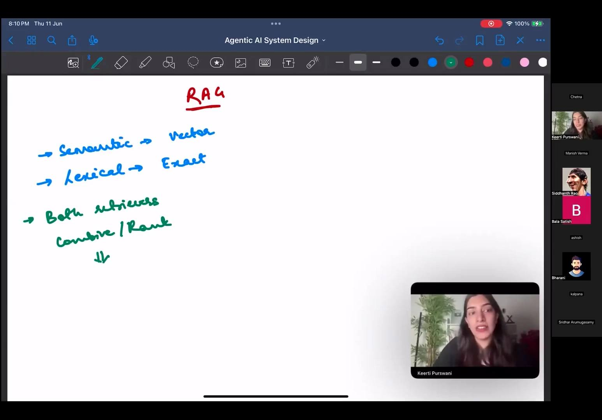
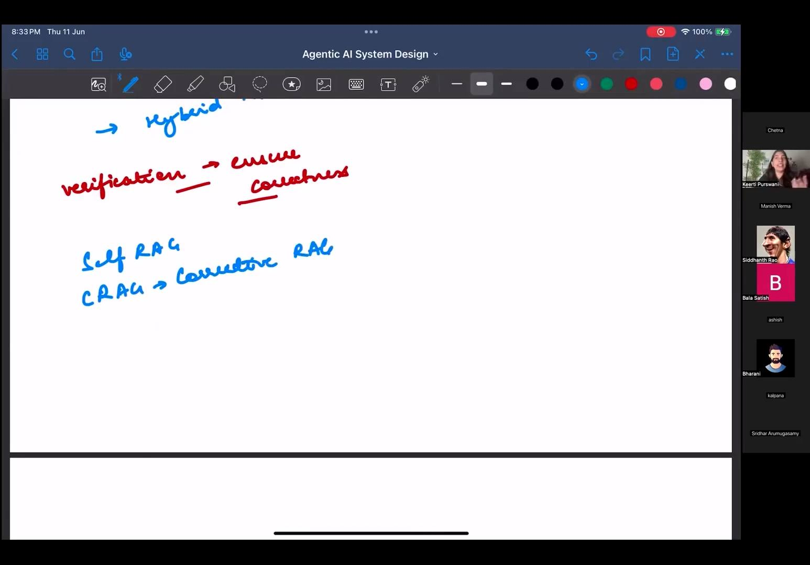
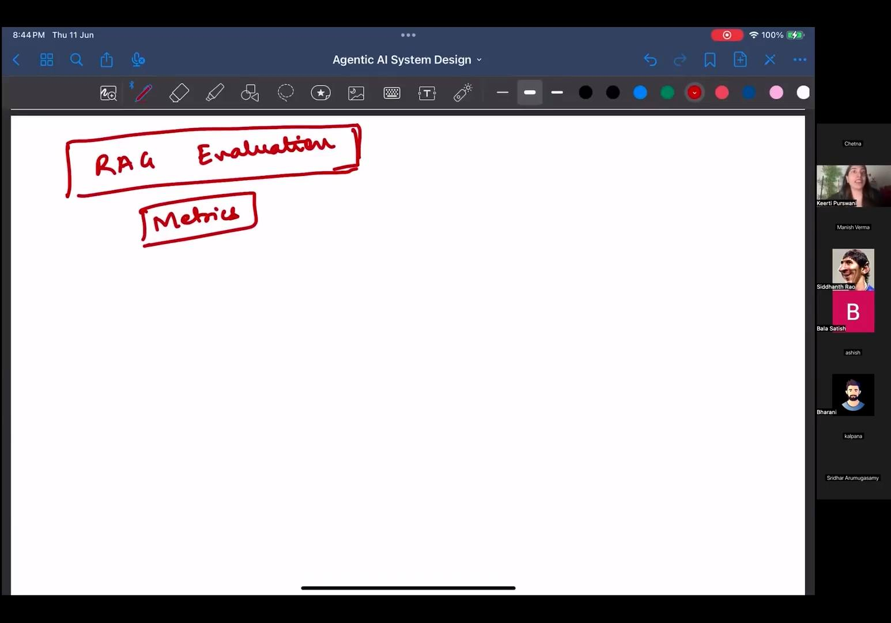
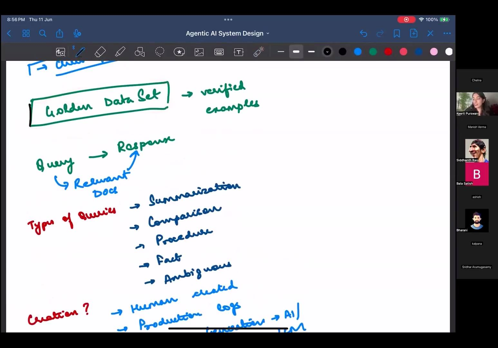

# Agentic AI System Design（BV1ntMt6TEe4）第 3 课复现文档

> 素材范围：P3（0:00–56:26）。本段是本课第一周最后一节，讲师明确说明「今天大部分是理论，因为我想把思考过程讲透」，所以本文档第 3/4 节按「纯讲解课」的写法处理：第 3 节复现讲师的推导链，第 4 节把推导结果落成可以直接拿去开工的设计产物与数据模型；凡本文档补的示意图/示意代码，一律标注「课里没有代码，以下为示意」。
>
> 截图说明：本次素材只提供 p003 的 5 个可引用帧，已全部插入正文。清单外的帧号不存在，因此不凑第 6 张；实际画面以视频为准。

---

## 1. 这一节做什么

### 1.1 这一节在整门课里的位置

前两节课已经把 RAG 的两条主干走完了一遍，并且写了代码。但那些代码有一个共同的、讲师在 [02:47] 亲自点出来的缺陷：**所有示例都是 in-memory 的**。倒排索引在内存里、向量在内存里，进程一关就没了。

这一节要解决三件事，顺序不能颠倒：

1. **把「RAG 有多少种」这句流行话术拆掉。** 外面到处是「你必须知道的 20 种 RAG」「15 种 RAG」这类帖子，讲师的态度很直接：这是在装聪明。真正需要掌握的是**一张二维地图**——第一维是「知识存在哪里、从哪个工具取」，第二维是「取回来之后要不要再验证一遍」。任何花哨名字都能在这张地图上找到坐标。
2. **把 Claude Code 项目的三库架构钉死。** 向量库（semantic）、倒排索引（lexical/BM25）、图数据库（关系），三个都要**持久化**，然后在同一个应用里被 LLM 当成三个 tool 来选。
3. **建立 RAG 评估闭环。** 从「看起来更好、感觉更好」升级到「有一个数字告诉我更好」。核心不是指标公式，而是**golden dataset（黄金数据集）**——讲师把它类比成传统软件工程里的单元测试：没有它，你所有的 metric 都是废的。

### 1.2 读完这一节你应该手里有的东西

这一节不产出可运行的完整项目（完整评估代码放在 Claude Code 大项目里），但它必须产出四份「纸面产物」，后面写代码时直接照着填：

| 产物 | 对应章节 | 用途 |
| --- | --- | --- |
| 检索器选型决策表 | 4.1 | 拿到一条 query，判断该打哪个库 |
| 三库职责表（Claude Code） | 4.2 | 决定每类数据写进哪个库、字段怎么放 |
| golden dataset 数据模型 + 查询类型分布 | 4.3 | 评估的 ground truth |
| 版本变更 → 必跑评估清单 | 4.4 | 每次改 chunking/embedding/prompt 都必须走一遍 |

### 1.3 前置条件与环境

- 你已经能跑通前两节的 RAG 主流程：`user query → LLM 决定调哪个 tool → 调 retriever → 拼 context → 生成回答`。
- 你已经理解 lexical（精确匹配，倒排索引）与 semantic（向量相似）的区别。
- **本节不需要安装任何依赖。** 讲师在这一段里没有敲任何命令、没有给任何版本号、没有给任何启动脚本。Neo4j / Elasticsearch / 向量库在后续大项目里才会真正落地，具体部署方式与版本**课里没讲**（见第 7 节）。

---

## 2. 讲师原话

### 2.1 关于两种基础检索，以及它们各自的「落地点」

> "目前在 RAG 里我们主要看到的就是 lexical 和 semantic 这两大类。semantic 本质上就是向量搜索，因为它找的是语义相似；lexical 找的是精确匹配。"
> —— p003 [02:17]

> "倒排索引、BM25，我们可以用 Elasticsearch、OpenSearch 等等。到目前为止我们在代码里看到的那些例子，全都是 in-memory 的。"
> —— p003 [02:47]

这里讲师顺手把一个常见的课堂误解纠正了：向量库和倒排索引是**两套不同的数据库**，不是同一个东西的两种模式。

### 2.2 关于 hybrid RAG 与 agentic RAG 的分界



> "如果我把两个 retriever 都检索一遍，然后把结果合并或者排序，它会变成哪一种 RAG？我们昨天讨论过，它会变成 hybrid RAG；反过来，如果我让 LLM 发一次调用来决定该调哪个 retriever，那它就变成 agentic RAG。"
> —— p003 [05:37]

这句话是整节课的「分界线」：**hybrid 是固定策略，agentic 是让模型做路由决策**。两者不互斥，后面 Claude Code 项目里两个都会用上。

### 2.3 关于「加一层验证」这件事被起了多少名字



> "这叫做 corrective RAG，我们只是给它起了个花哨名字。"
> —— p003 [07:31]

> "如果我用同一个 LLM，再发一次调用说『这是刚才的回复，你确认一下它是不是够好』，那这就叫 self-RAG。"
> —— p003 [08:00]

> "我们只是在 RAG 里加了一层，也就是验证层，对吧？延迟会增加，成本也会增加，因为我们要多打一次调用，所以这里是有 trade-off 的。"
> —— p003 [08:28]

> "corrective RAG 也叫 C-RAG。其实它被起了很多花哨的名字，还有 reflection RAG、fact verification RAG，但说到底，它就是在验证正确性而已。"
> —— p003 [28:43]

讲师还补了一个关键细节：所谓「换一个模型」，不一定真是另一个模型，**换一个 session / 换一个 thread 也算**——因为它拿不到上一轮的上下文，相当于重新提问一次。

### 2.4 关于 RAG 不等于向量数据库

> "给我所有由某个导演执导的电影——你觉得图数据库比向量数据库更能回答这个查询吗？"
> —— p003 [19:23]

> "所以 retriever 这个 tool 不是只从 semantic 数据库里取数据，RAG 也不是只关于向量数据库。"
> —— p003 [20:15]

> "这个 retriever 也可以从 SQL 里取，可以是从图里取，也可以是从 web 上取，甚至就是一个 PDF、一个 HTML、一个普通文件。"
> —— p003 [20:40]

### 2.5 关于代码场景为什么必须上图

> "Graph RAG 是极其重要的一个用例。你可以先用内存图数据库，但那只是 demo，真实场景要存到 Neo4j 这样的图数据库里。"
> —— p003 [12:19]

> "我们第三个存数据的地方就是图数据库，类似 Neo4j。所以我们最终要构建的项目里会同时用这三个。"
> —— p003 [13:44]

> "谁来写查询？LLM 会写查询。它根据用户的 query，写出 Cypher 查询或者图数据库查询，然后返回『你需要发这个调用』，我们再去真的发这个调用。"
> —— p003 [17:04]

> "是谁告诉我们该调哪个工具？是 LLM。当我把工具列表传给 LLM 时，我也会把图结构一起发过去：这些是节点，这些是关系。"
> —— p003 [24:00]

讲师还专门做了一次免责声明：

> "这不是唯一可行的设计方案。没有图数据库你也能做，你可以加校验、加 metadata 之类的，但图数据库在这里是一个非常好的用例。"
> —— p003 [22:36]

### 2.6 关于 query 本身也能被优化

> "HyDE，也就是 hypothetical document embeddings。用户 query 进来后，第一步是让 LLM 先生成一个假设性的回复，或者补一些假设性的上下文……然后再走完整的 RAG 流程。"
> —— p003 [32:59]

> "如果我们对 chunk 不满意，或者 chunk 太多，可以先把它们转成摘要再去做 RAG，这叫做 RAPTOR，是另一篇白皮书。"
> —— p003 [35:21]

> "我总的意思是说：如果你理解了 RAG 的基础、理解了整个流程，那么每个点上都可以做优化。"
> —— p003 [35:50]

### 2.7 关于评估与 golden dataset



> "RAG 里的 R 是什么？retrieval。G 是什么？generation。所以我们既能评估 retrieval，也能评估 generation，还会有 end-to-end 指标，也就是最终的 RAG 回复到底好不好。"
> —— p003 [40:56]

> "我们要造一个数据集，叫做 golden dataset，它是我们的 source of truth，是我们用来测试的 ground data set。"
> —— p003 [42:23]

> "如果我的数据集里只有 query 和 response，你觉得这足够判断我的 RAG 好不好吗？不够。还得有『这条 query 应该检索到哪些文档』，再加上『应该给出什么回复』。"
> —— p003 [44:47]

> "你的 golden dataset 不能只有一种类型的 query，要有不同类型，这样评估 RAG 的时候才是拿不同种类的 query 去测。"
> —— p003 [46:32]



> "如果我们是让 AI 来生成 golden dataset，这就叫 synthetic generation。所以一共有三种方式，也可以做组合。"
> —— p003 [51:17]

> "就像单元测试对传统软件系统非常重要一样，对 agentic 系统来说，对应的『单元测试』就是 golden dataset，极其重要。"
> —— p003 [54:32]

---

## 3. 从零复现（本节为纯讲解课，复现的是推导链）

这一节不写代码，写**步骤**。每一步的结构是：已知条件 → 你要做的判断 → 你要落下来的产物。照着走完，你会得到讲师在这一小时里反复强调的那套「思考过程」。

### 步骤 1：先把已有系统画成一条线

先把你前两节课做过的东西还原成最小链路：

```
user query
  → LLM（带 tool 列表）
  → LLM 决定调用 retriever 工具
  → retriever 从某个 DB 取回 top-k 文档
  → 拼进 prompt
  → LLM 生成回答
```

**判断点**：这条链路里，第 3 步的「某个 DB」是可替换的插槽，第 5 步和第 6 步之间可以再插一层。记住这两个「可插拔点」，后面所有的 RAG 变体都是在这两个点上做文章。

**产物**：一张只有 6 个方块的手绘链路图。别急着画架构图，先确认你承认「retriever 是可替换的」。

### 步骤 2：确定每个检索器只擅长一件事

| 检索器 | 擅长 | 典型实现 | 典型查询 |
| --- | --- | --- | --- |
| lexical / sparse | 精确匹配：错误码、函数名、类名 | 倒排索引、BM25、Elasticsearch、OpenSearch | "E1042 这个错误码是什么意思" |
| semantic / dense | 语义相似，能吃掉拼写和措辞差异 | 向量库：Chroma、FAISS、Milvus | "这个功能怎么用" |

讲师的原话是「spellings 因为有 semantic 在，问题不大」，但如果 query 里带的是**精确符号**，向量搜索反而会翻车。

**判断点**：先问自己「我的用户 query 里，符号型的精确 token 占比高不高」。代码场景几乎必然高。

**产物**：这张两行的表。它决定了你至少要上两个库，而不是一个。

### 步骤 3：承认「query 是混合的」，然后选一条分支

现实里的 query 不会乖乖落在某一边。于是有三个分支，选一个：

- **分支 A：两边都查，然后合并 + 排序** → 这叫 **hybrid RAG**。
- **分支 B：让 LLM 先判断该查哪个** → 这叫 **agentic RAG**（本质是把 retriever 做成 tool，交给模型路由）。
- **分支 C：只查一边** → 单一 RAG，成本最低、覆盖最窄。

**判断点**：分支 A 的关键工序是「合并 + 排序」，也就是 ranking。讲师点名了两种排序思路：**RRF**，或者**再发一次 LLM 调用让 LLM 来排序**。他还特意说这块「能讲两天」，所以本节不展开。

**产物**：确定你的默认路径。Claude Code 项目最终是 A 和 B 混用——平时走 hybrid，由 LLM 决定要不要额外去查图。

### 步骤 4：给「输出不可信」加一层验证

如果你的场景需要 fact checking（讲师举的例子就是「我这个用例必须做事实校验」），那就在生成之后再加一步：

```
response = LLM(query, retrieved_context)
verdict  = LLM(query, retrieved_context, response)   # 第二个模型/第二个 session
if verdict 不合格 → 重试 / 降级 / 拒答
```

三种命名的判定标准只有一条——**看这一次验证调用是不是复用同一个会话**：

| 名字 | 判定 |
| --- | --- |
| corrective RAG（C-RAG） | 用**不同**模型，或同一模型但**不同 session/thread**（拿不到上文） |
| self-RAG | 用**同一个** LLM、同一条会话再问一次 |
| reflection RAG / fact verification RAG | 同一件事的其他叫法 |

**判断点**：讲师明确说了「换一个模型不保证事实校验一定成立，我们只是多加一道检查」。所以别把它当保险，把它当概率提升。

**代价**：延迟上升 + 成本上升（多一次调用）。这就是为什么它必须是一个**可开关的层**，不是默认全开。

**产物**：在你的链路上标出「验证层」这个插槽，并写清楚它的开关条件。

### 步骤 5：把数据源从 2 个扩到 N 个

这是本节信息量最大的一步。讲师逐个点名了检索源：向量库、倒排索引、**SQL**、**图数据库**、**web**、**PDF/HTML/普通文件**。每一种对应一个 RAG 名字：

- 从 SQL 取 → **SQL RAG**
- 从图取 → **Graph RAG**
- 从 web 取 → **web RAG**
- 从多路取 + 排序 → **hybrid RAG**

**判断点**：判断标准不是「哪种 RAG 更高级」，而是**这类 query 是哪种数据库被优化过的**。讲师的原话是「数据库里，每个数据库都是为不同种类的查询优化过的」——这就是 HLD 里选型的老道理，换了个场景照样成立。

**产物**：一张 query 类型 → 数据库 的映射表（见 4.1）。

### 步骤 6：为什么「代码」这个场景特别需要图

讲师的推导路径是：

1. 昨天用 **AST** 把代码切成 chunk 存进向量库。但 AST 只是**一种 chunking 策略**，它解决的是「怎么切」，不解决「关系怎么查」。
2. AST 树会变得很大，所以它只适合局部（一个文件、一个类）。
3. 但真实的问题是跨文件的：**哪个类调用了哪个类、谁继承了谁、哪个函数调了哪个函数、一个类里有哪些方法**。
4. 这些全是关系。而「关系」在 **LLD 里就是 UML**，UML 本质就是一个图结构。
5. 所以「追踪一次完整调用链」「从哪儿调用了这个函数」「追踪整个报错路径」，这类 query 用图查最快。

**判断点**：如果你的高频 query 里出现「谁调用了谁」「从头到尾的调用栈」「依赖关系」，那图不是加分项，是必需项。

**产物**：一句话写进设计文档——「AST 负责切块进向量库，图负责回答关系型 query，两者不是替代关系。」

### 步骤 7：把 Claude Code 的三库钉死

讲师在 [13:14]–[13:44] 把架构定下来了：

| 库 | 承担 | 类比产品 |
| --- | --- | --- |
| 向量库 | semantic search | Chroma、FAISS、Milvus |
| 倒排索引 | 精确匹配（BM25） | Elasticsearch、OpenSearch |
| 图数据库 | 关系（调用/继承/包含） | Neo4j |

而且强调：**三个都要持久化**，不再用内存版。

他在 [25:24] 的 Neo4j 画面里出现过的节点名包括 `author`、`service`、`user task service`、`user reports system report` 这些类，以及一批函数节点；边是「这个函数调用那个函数」「这个类拥有这个方法」；节点上还带 properties。

**判断点**：三个库各自存一份数据 = 三份写入成本 + 三份一致性维护成本。这是这个架构的代价，讲师自己也说了「这不是唯一方案」（[22:36]）。

**产物**：三库职责表（见 4.2）。

### 步骤 8：谁写图查询？LLM 写

这是一个非常容易被面试问到的点。讲师的原话是：**「谁该写查询？LLM 会写。」**

流程是：

1. 把**图的结构描述**（有哪些节点类型、有哪些关系类型）连同工具列表一起塞进 LLM 的上下文；
2. LLM 根据用户 query，产出 **Cypher** 查询（或对应的图查询语句）；
3. 应用层执行这条查询，把结果返回。

**判断点**：这里的安全边界是——LLM 只负责**生成查询文本**，**执行查询的是你的应用**。所以你必须自己加白名单/只读约束。课里没讲这块怎么防，见第 7 节。

**产物**：在你的 tool schema 里加一个 `graph_query` 工具，输入是 `{ cypher: string }`。

### 步骤 9：query 本身可以优化（在检索之前动手）

讲师给了两个具体方案：

- **HyDE（hypothetical document embeddings）**：用户 query 进来后，先让 LLM 生成一个**假设性的回答 / 补一段假设性上下文**（他举的例子是问产品保质期，模型先猜「通常是生产日期后一年」），再拿这个中间产物去检索。目的是：用户 query 信息量太少，直接拿去检索取不到东西，先「扩写」一下。
- **把同一条 query 传两次**：讲师提到自己有个视频讲过「把同样的东西传两遍，效果就开始变好」。这是最廉价的 query transformation。

**判断点**：优化点在**检索之前**，不属于「检索器选型」，属于「query 预处理」。

**产物**：在链路上插入 `query → 改写 → 检索` 这个环节。

### 步骤 10：chunk 也可以优化（RAPTOR）

讲师提到：如果对 chunk 不满意、或者 chunk 太多，可以**先把 chunk 转成摘要再去做 RAG**，这叫 **RAPTOR**（另一篇白皮书）。这一步发生在 **ingestion 阶段**。

**判断点**：RAPTOR 改变了入库的数据形态（存的是 summary），所以它属于「写入侧优化」，不是「读取侧优化」。改它之后必须重跑评估。

### 步骤 11：把四个可优化位置列出来

讲师在 [35:50] 把所有优化点归成四段，这是全节最凝练的一句结构：

```
① ingestion（怎么切、存什么）
② retrieval（从哪取、怎么取回）
③ 拼 prompt 交给 LLM（怎么组织上下文、token 预算）
④ 生成后验证（加不加校正层）
```

**判断点**：**你在任何一段多做一步，就多出一种「RAG 类型」。** 所谓 20 种 RAG，就是这四段上的排列组合。

**产物**：一张四段式流水线图，每段下面挂上你在第 1–10 步里选定的方案。

### 步骤 12：从「感觉更好」切换到「数字更好」

到这为止都是「能跑」。接下来讲师转到评估，动机很明确：既然有这么多优化点，那我改了 chunking、改了 DB、改了检索方式、改了 embedding 维度之后，**凭什么确定新的比旧的好？**

答案分三档指标：

| 层级 | 评什么 | 对应流程位置 |
| --- | --- | --- |
| retrieval metrics | 检索得准不准 | 第 ② 段 |
| generation metrics | 基于检索内容生成得好不好 | 第 ③ 段 |
| end-to-end metrics | 最终回复整体是否合格 | 全链路 |
| chunking metrics | 切块质量（属于 ingestion） | 第 ① 段 |

**判断点**：指标是分层的，所以「哪个版本更好」这个结论也要分层给——很可能 retrieval 变好、generation 变差。

**产物**：三档指标的评估表头（具体公式课里没讲，本段在「finally can I move to metrics」处结束）。

### 步骤 13：先造 ground truth，再谈指标

讲师的原话是：在做任何量化之前，**必须先有 source of truth**。而这里的 source of truth 不是数据库，是**测试数据集**——就像软件开发里写单元测试一样。

golden dataset 的最小字段（讲师口述，本文档落成结构）：

1. `query` —— 用户问题
2. `expected_documents` —— 这条 query **应该检索到**哪些文档
3. `expected_response` —— 这条 query **应该给出**什么回复

**判断点**：只有 `query + response` 是不够的，因为那样你无法区分「检索错了」还是「生成错了」。

**产物**：golden dataset schema（见 4.3）。

### 步骤 14：让 golden dataset 覆盖多种 query 类型

讲师点名了五类，并给了电商客服的例子：

| 类型 | 例子 | 考察什么 |
| --- | --- | --- |
| 摘要型（summarization） | "帮我总结一下这个函数在干什么" / "总结退款政策" | 归纳能力 |
| 对比型（comparison） | "把这个产品和那个产品比一下" | 多文档对齐 |
| 流程型（procedure） | "怎么下单 / 怎么退款 / 怎么取消" | 步骤完整性 |
| 事实型（fact-based） | "这里的政策是什么 / 条款是什么" | 精确命中 |
| 模糊型（ambiguous） | "我下了个订单，你跟我说说" | 能否先追问澄清 |

对模糊 query，讲师给了明确的期望行为：检索侧应该先去捞**这个用户的历史订单**，然后回复**「你想了解这笔订单的什么？」**——也就是说，模糊 query 的正确输出可能是一个反问，而不是一段答案。

**判断点**：拿只有事实型 query 的测试集去评估一个客服 bot，分数会虚高；真实用户不会只问事实题。

**产物**：golden dataset 的 query 类型分布表（见 4.3）。

### 步骤 15：三种生成 golden dataset 的方式

1. **人工创建**（human-created）——最准，最慢。讲师说「很多人说评估 RAG 就应该手工建」。
2. **production logs**——从线上日志里捞真实 query，再人工筛。好处是「这些是系统里真实被问的问题」。
3. **synthetic generation**——把用例丢给 LLM（讲师举例直接说「给 ChatGPT 或任何 LLM」），让它生成 golden dataset。
4. **组合**：logs + synthetic 产出候选，再由人工审核决定哪些入库。讲师说这是最实际的路径。

讲师还提到班级里有人接了一句：**「做一个 agentic app 来自动生成某个用例的 golden dataset，本身就是一个不错的项目点子。」**

### 步骤 16：面试题的闭环——eval 很好但 prod 很差

讲师抛出的面试题（[52:36]）：

> 你的评估指标很好看，但生产环境表现不行，怎么办？

标准答案链条（讲师逐句给出的）：

1. 说明**评估集没有覆盖真实分布**；
2. 去翻 **production logs**；
3. 找出**失败的、评分低的 query**（用户给了「不满意」的反馈）；
4. 做**人工复核**，确认这条该不该进测试集；
5. **加进 golden dataset**；
6. **重跑评估**；
7. **未来所有 RAG 版本都必须通过这份更新后的数据集**。

### 步骤 17：把「每次改都要跑」写成纪律

讲师最后把这件事和单元测试对齐了：

- 单元测试保护的是传统软件系统；
- golden dataset 保护的是 agentic 系统；
- 触发重跑评估的变更清单：**embedding、chunking、re-ranking 策略、prompt、模型**——任何一处变了都要跑。

**产物**：4.4 的变更检查表。

---

## 4. 完整代码

> **本节性质说明**：这一段逐字稿里讲师没有敲任何命令、没有给任何代码块，也没有 OCR 文本。所以本节不含「讲师的原代码」。下面 4.1–4.5 是把讲师口述的设计落成可用产物；4.6 是为了让你能直接动手而补的示意代码，**已明确标注「课里没有代码，以下为示意」**。

### 4.1 检索器选型决策表

用途：拿到一条 query，先过这张表，判断打哪个库。表内容全部来自讲师本段口述的对应关系。

| query 特征 | 命中检索器 | 库 | 讲师原话依据 |
| --- | --- | --- | --- |
| 含精确符号：错误码、函数名、类名、配置键 | lexical / sparse（BM25） | Elasticsearch / OpenSearch | p003 [16:06] 倒排索引帮你找 error code、function name、class name 的精确匹配 |
| 自然语言描述「这个功能怎么用」 | semantic（向量） | Chroma / FAISS / Milvus | p003 [16:06] 向量库帮你理解语义 |
| 「谁调用了这个函数」「从头到尾的调用链」「追溯整个报错」 | graph | Neo4j | p003 [16:35] 追踪端到端调用；p003 [23:31] tracing the entire error |
| 「所有由某导演执导的电影」这类多跳条件组合 | graph | Neo4j | p003 [19:23] |
| 结构化统计、明细查询 | SQL | 关系库 | p003 [09:55] 从 SQL 取就叫 SQL RAG |
| 最新外部信息 | web | 搜索引擎 | p003 [20:40] 也可以从 web 检索 |
| 单份 PDF / HTML / 文档 | file | 本地文件 | p003 [20:40] 甚至就是一个 PDF、一个 HTML |
| 以上混合，且不确定该走哪条 | 先做路由（LLM 决定） | — | p003 [05:37] 让 LLM 决定调哪个 retriever 就是 agentic RAG |

### 4.2 Claude Code 三库职责表

| 库 | 写入什么 | 回答什么 query | 关键字段 / 结构 | 备注 |
| --- | --- | --- | --- | --- |
| 向量库（semantic） | 代码 chunk 的 embedding | 语义类问题 | chunk 文本 + embedding | chunk 由 AST 策略切出（p003 [16:35]：AST 只是一种 chunking 策略） |
| 倒排索引（lexical） | token 化后的 chunk | 精确符号类问题 | term → 文档列表 | 也就是 BM25 / sparse rag |
| 图数据库（graph） | 节点：类、函数；边：调用、继承、拥有；节点 properties | 关系类问题 | `Class -[CALLS]-> Function`、`Class -[HAS_METHOD]-> Function` | 讲师 Neo4j demo 里出现过的类节点：`author`、`service`、`user task service`、`user reports system report` |

### 4.3 golden dataset 数据模型（草案）

字段来源是讲师口述的三项（query / 应检索文档 / 应给回复）加五类 query 分类；下面的**字段命名与 JSON 结构是本文档补的**，课里没给 schema。

```json
{
  "dataset_version": "v1",
  "use_case": "claude-code-assistant",
  "items": [
    {
      "id": "gd-0001",
      "type": "fact_based",
      "query": "E1042 这个错误码是什么意思？",
      "expected_documents": [
        { "source": "lexical", "doc_id": "err-1042", "must_contain": "E1042" }
      ],
      "expected_response": "E1042 表示……",
      "notes": "精确符号，必须由 lexical 命中"
    },
    {
      "id": "gd-0002",
      "type": "procedure",
      "query": "怎么退款？",
      "expected_documents": [{ "source": "semantic", "doc_id": "refund-policy" }],
      "expected_response": "步骤 1……步骤 2……",
      "notes": "考察流程完整性"
    },
    {
      "id": "gd-0003",
      "type": "ambiguous",
      "query": "我下了个订单，你跟我说说",
      "expected_documents": [{ "source": "sql", "doc_id": "orders_of_current_user" }],
      "expected_response": "你想了解这笔订单的哪方面？",
      "notes": "正确输出是反问澄清，不是给答案"
    }
  ]
}
```

对应的 TypeScript 类型（前端同学直接抄）：

```ts
export type QueryType =
  | "summarization"
  | "comparison"
  | "procedure"
  | "fact_based"
  | "ambiguous";

export interface ExpectedDoc {
  source: "lexical" | "semantic" | "graph" | "sql" | "web" | "file";
  doc_id: string;
  must_contain?: string;
}

export interface GoldenItem {
  id: string;
  type: QueryType;
  query: string;
  expected_documents: ExpectedDoc[];
  expected_response: string;
  notes?: string;
}

export interface GoldenDataset {
  dataset_version: string;
  use_case: string;
  items: GoldenItem[];
}
```

查询类型分布建议（数字是本文档给的配比建议，课里没给具体比例）：

| 类型 | 建议占比 | 理由 |
| --- | --- | --- |
| fact_based | 25% | 最容易被测到、也最容易虚高，别放太多 |
| procedure | 20% | 客服高频 |
| summarization | 20% | 考察长上下文归纳 |
| comparison | 15% | 考察多文档对齐 |
| ambiguous | 20% | 真实用户大量如此，且能暴露「不问就瞎答」的缺陷 |

### 4.4 版本变更 → 必跑评估清单

讲师点名的触发项：embedding、chunking、re-ranking 策略、prompt、模型。任何一项变更都要对 golden dataset 重跑一遍。

| 变更 | 影响层 | 必看指标 | 不跑会怎样 |
| --- | --- | --- | --- |
| 换 embedding 模型 / 维度 | retrieval | retrieval metrics | 老索引和新 embedding 混用，召回静默下降 |
| 换 chunking 策略（含 AST 切法、RAPTOR 摘要） | ingestion + retrieval | chunking metrics + retrieval metrics | 切碎了，检索命中率崩但没人知道 |
| 换 re-ranking 策略（RRF 换 LLM 排序） | retrieval（排序） | retrieval metrics | 排序变差，答案顺序错了 |
| 改 prompt | generation | generation metrics | 话术变了但没人验证 |
| 换模型 | generation + end-to-end | end-to-end metrics | 行为漂移 |
| 加验证层（corrective / self-RAG） | 生成后 | end-to-end + 延迟 + 成本 | 花了钱没变好 |

### 4.5 代价估算表（骨架，参数需你自填）

讲师只给了**方向**，没给数字：corrective RAG「延迟会增加、成本会增加，因为多打一次调用」；hybrid「要合并排序」；他的那次演示调用 token 花得多、钱花得多，原因是「没有加限制工具调用次数的 check」。

| 方案 | 额外 LLM 调用次数 | 额外延迟 | 额外成本 | 备注 |
| --- | --- | --- | --- | --- |
| 单路检索 | 1（生成） | 基线 | 基线 | — |
| hybrid（双路 + 排序） | 1（生成），若用 LLM 排序再 +1 | ↑ | ↑ | 排序用 RRF 则不加 LLM 调用 |
| agentic 路由 | +1（路由决策） | ↑ | ↑ | 路由错则整条都错 |
| corrective / self-RAG | +1 或更多（验证） | ↑↑ | ↑↑ | 不同 session/模型属 corrective |
| 工具循环无上限 | 不可控 | 不可控 | 不可控 | 讲师踩坑点，见第 7 节 |

估算公式（本文档给的骨架，课里没给）：

```
单次请求成本 ≈ (输入 token 数 × 输入单价) + (输出 token 数 × 输出单价)
总成本       ≈ 单次成本 × 平均工具调用轮数 × QPS × 时间
```

### 4.6 示意代码：评估循环骨架

> **课里没有代码，以下为示意。** 这段只是把第 3 节步骤 13–17 的流程写成能跑的骨架，用来验证「变更 → 跑评估 → 对比」这条纪律，不是讲师的原代码。

```ts
// eval/run-eval.ts —— 课里没有代码，以下为示意
import type { GoldenDataset, GoldenItem } from "./types";

type Retriever = (query: string) => Promise<{ doc_id: string; text: string }[]>;
type Generator = (query: string, ctx: string[]) => Promise<string>;
type Judge = (query: string, ctx: string[], answer: string) => Promise<number>;

interface RagPipeline {
  retrieve: Retriever;
  generate: Generator;
  judge?: Judge; // 对应 corrective / self-RAG 那一层
}

export async function runEval(pipeline: RagPipeline, ds: GoldenDataset) {
  const rows: { id: string; type: string; hit: boolean; score: number }[] = [];

  for (const item of ds.items as GoldenItem[]) {
    // ① retrieval 层：应检索到的文档有没有出现
    const docs = await pipeline.retrieve(item.query);
    const gotIds = new Set(docs.map((d) => d.doc_id));
    const hit = item.expected_documents.every((d) => gotIds.has(d.doc_id));

    // ② generation 层
    const answer = await pipeline.generate(
      item.query,
      docs.map((d) => d.text),
    );

    // ③ 验证层（可选，开启即 corrective/self-RAG）
    const score = pipeline.judge
      ? await pipeline.judge(item.query, docs.map((d) => d.text), answer)
      : Number(hit);

    rows.push({ id: item.id, type: item.type, hit, score });
  }

  const byType = rows.reduce<Record<string, { n: number; hit: number }>>(
    (acc, r) => {
      acc[r.type] ??= { n: 0, hit: 0 };
      acc[r.type].n += 1;
      acc[r.type].hit += r.hit ? 1 : 0;
      return acc;
    },
    {},
  );

  return {
    total: rows.length,
    retrievalHitRate: rows.filter((r) => r.hit).length / rows.length,
    byType,
    rows,
  };
}
```

运行方式（示意）：

```bash
# 课里没有代码，以下为示意
node --loader ts-node/esm eval/run-eval.ts
```

---

## 5. 逐行解释

这一节解释第 3、4 节里**为什么这么定**，以及「不这么定会怎样」。

### 5.1 为什么必须有 lexical 这一路

因为向量搜索会把 `E1042` 这种符号「语义化」——它觉得 `E1042` 和 `E1043` 很像，于是召回一堆近似错误码。讲师的表述是倒排索引负责「理解精确匹配」，也就是 error code、function name、class name 这类 token。**代码场景里这类 token 密度极高**，所以省略 lexical 等于自断一臂。

### 5.2 为什么 hybrid 的排序不能省

两路检索各回一堆候选，直接拼接（concat）会得到一个「顺序毫无意义」的长列表。模型的注意力对顺序敏感，顺序错了答案就错。所以讲师说 hybrid 里最重要的工序是 ranking，并给了 RRF 和「再发一次 LLM 排序」两个方向。**不排序 = hybrid 的价值被砍掉一半。**

### 5.3 为什么 agentic 路由要单独算一种 RAG

因为它把「用哪个库」这个**决策交给了模型**，而模型需要上下文才能决策。讲师在 [24:00] 说得很清楚：把工具列表传给 LLM 时，**连同图结构一起传**——节点有哪些、关系有哪些。路由的质量直接取决于你把 schema 描述得多清楚。**不传 schema，LLM 就是在盲猜。**

> **前端视角**：这很像你写一个 `switch (intent)` 的 reducer，只不过 `intent` 不是你自己枚举出来的，而是模型根据输入动态产出的。所以你必须做兜底：模型给出不存在的工具名时要有 default 分支。

### 5.4 为什么 corrective / self-RAG 的差别只在「会话」

讲师给的定义很节省：**同一条会话再问一次 = self，换会话/换模型 = corrective。** 差异的实质是**信息独立性**——同一条会话里再问，模型会顺着自己的上文说「是的，没问题」；换一条会话，它得重新判断。所以想要真的「第三方视角」，用不同 session 才有意义。

### 5.5 为什么讲师反复说「这不是唯一方案」

因为三库架构的代价真实存在：三份写入、三份一致性、三份运维。他给了替代路径——**加校验、加 metadata 也能达到部分目的**。所以你在设计评审里如果被问「为什么上三个库」，正确的回答不是「因为图 RAG 很火」，而是「因为我的高频 query 里有 X% 是关系型，用向量+metadata 兜不住」。

### 5.6 为什么 AST 只是 chunking 策略

讲师特意澄清了这一点（[16:35]），因为很多人把 AST 和 Graph RAG 混为一谈。**AST 决定「怎么切」，图决定「怎么存关系」，两者在不同层。** 你完全可以用 AST 切块进向量库，同时另建一张图——这正是 Claude Code 的做法。

### 5.7 为什么 golden dataset 要有 `expected_documents`

因为「答错了」有两种完全不同的原因：检索没取到（retrieval 层问题），或者取到了但生成跑偏（generation 层问题）。只记 query + response，你就永远分不清是哪一层出问题，优化方向也就无从下手。这是讲师 [44:47] 那句话的工程含义。

### 5.8 为什么 golden dataset 要按 query 类型分布

因为不同 query 类型考察的完全是不同的能力。总结型考归纳，对比型考多文档对齐，流程型考步骤完整性，事实型考精确命中，模糊型考「该不该先问」。**如果测试集里全是事实型，你的 bot 在真实客服场景里一样会翻车**，因为它从没被考过「模糊 query 要澄清」这件事。

### 5.9 为什么「eval 好 prod 差」的答案是更新数据集，而不是改模型

因为指标好、生产差的唯一解释是**测试集和生产分布不一致**。此时改模型是在优化一个错误的靶子。讲师给的链条是一条**数据飞轮**：prod logs → 找失败样本 → 人工复核 → 扩数据集 → 重跑 eval → 锁死新基线。这也解释了为什么他说「未来所有 RAG 版本都必须通过这份更新后的数据集」。

### 5.10 为什么评估必须版本化

因为你改动的地方太多了（embedding、chunking、re-ranking、prompt、模型）。没有固定的测试集和固定的结果记录，你根本没法回答「这次改动到底是不是进步」。**在 JS/Node 里对应什么**：这就是 `jest` 快照测试的角色——`jest --ci` 跑不过就不许合。RAG 的 golden dataset 就是它的 `__snapshots__`，只不过快照内容换成了「该检索到哪些文档 + 该回答什么」。

### 5.11 示意图代码里为什么 `hit` 用 `every` 而不是 `some`

因为 `expected_documents` 是**必须被检索到**的集合，少一个就说明检索有缺口。用 `some` 会让「只命中一个」也算通过，指标虚高——这正是讲师担心的「评估好看但生产不行」的成因之一。

### 5.12 关于并发与调用上限（前端视角的对应）

讲师在 [14:42]–[15:39] 讲的踩坑是：他做 hybrid demo 时**没有限制工具调用次数**，结果调用次数和 token 花费都失控了。

> **在 JS/Node 里对应什么**：这类「模型自主循环调工具」的结构，在 Node 侧必须配一个上限——比如给循环加 `maxSteps`，用 `AbortController` 做超时中断，并在流式输出里累计 token 用量，超过阈值直接终止。没有这道闸，成本是**指数级**而不是线性增长的。

---

## 6. 复现检查清单

按顺序勾，全部打勾再进入下一节课。

**A. 概念地图**
- [ ] 我能不查资料说出 lexical 与 semantic 各自该用哪个库（Elasticsearch/OpenSearch vs Chroma/FAISS/Milvus）。
- [ ] 我能说出 hybrid 与 agentic 的唯一分界：**谁做路由决策**（固定双路 vs LLM 决定）。
- [ ] 我能说出 corrective / self-RAG 的唯一分界：**是否复用同一会话**。
- [ ] 我能说出 reflection RAG、fact verification RAG 是同一件事的别名。
- [ ] 我知道 C-RAG = corrective RAG。
- [ ] 我知道讲师说过「20 种 RAG」这类说法没有意义，本质是四个优化点上的组合。

**B. 三库架构**
- [ ] 三库职责表填完了（4.2）。
- [ ] 我明确写出了「AST 只是 chunking 策略，不是 Graph RAG」这句话。
- [ ] 我写下了图里出现的节点类型与边类型（类、函数、CALLS、HAS_METHOD、properties）。
- [ ] 我知道谁生成图查询：**LLM 生成 Cypher，应用执行**。
- [ ] 我知道要把图 schema 描述塞进 LLM 的工具上下文。

**C. golden dataset**
- [ ] 三个必需字段齐全：`query`、`expected_documents`、`expected_response`。
- [ ] 五类 query（摘要/对比/流程/事实/模糊）在数据集里都有样本。
- [ ] 至少准备了一条模糊 query，且它的 `expected_response` 是**反问澄清**。
- [ ] 我选定了生成方式：人工 / prod logs / synthetic / 组合，并写明理由。
- [ ] 我给数据集打了版本号。

**D. 评估纪律**
- [ ] 我列了触发重跑评估的变更清单（embedding / chunking / re-ranking / prompt / model）。
- [ ] 我在流水线上标出了 retrieval、generation、end-to-end、chunking 四处可测量的位置。
- [ ] 我写下了「eval 好但 prod 差」的七步闭环（logs → 找失败 → 人工复核 → 入库 → 重跑 → 锁新基线 → 未来版本必须过）。
- [ ] 我知道三档指标的具体公式**课里没讲**，需要后续课程或自学补。

**E. 成本与安全**
- [ ] 我给工具调用循环设了上限（这一步是讲师踩坑点）。
- [ ] 我在设计里明确标出验证层是**可开关**的（有延迟和成本代价）。
- [ ] 我知道 LLM 能生成 Cypher 就意味着必须做只读/白名单约束（课里没讲，见第 7 节）。

---

## 7. 课里没讲但你会撞上的

这一节列的是**逐字稿里没有、OCR 里也没有**，但你真照着做一定会遇到的问题。全部标为「课里没讲」。

1. **三个库的具体部署方式课里没讲。** 讲师只说了「我们会持久化」「用 Neo4j、Elasticsearch、Chroma/FAISS/Milvus 这样的库」，没有给版本号、没有给安装命令、没有给 Docker 编排。你需要自己选版本。**提示**：三库的版本要在项目 README 里锁死，否则三人协作必踩版本不一致。

2. **Cypher 语法细节课里没讲。** 讲师只说了「LLM 写 Cypher」，没给任何一条示例查询语句。你到写代码那一步要自己补：`MATCH`、`WHERE`、返回关系的方向写法等。

3. **LLM 生成 Cypher 的安全边界课里没讲。** 讲师说了「LLM 写查询、应用执行」，但没有说如何防止 `DELETE` / `DROP`。你必须自己做：只读账号、连接级只读、语句白名单、结果行数上限。**在 JS/Node 里对应什么**：用独立的只读 driver 实例，把写权限从连接层剥掉，再叠加语句校验——别指望 prompt 里的「请不要写删除语句」能兜住。

4. **RRF 的具体实现课里没讲。** 讲师说「有 RRF，也有再发一次 LLM 排序」，还说这块「能讲两天」。RRF 的公式与常数、top-k 取值，课里都没给。你自己定，并且定完要重跑评估（见 4.4）。

5. **三档评估指标的具体公式课里没讲。** 逐字稿到「finally can I move to metrics」就结束了，[56:26] 之后才开始讲。retrieval metrics / generation metrics / end-to-end metrics 各自怎么算，本段没有内容。

6. **chunking metrics 具体怎么算课里没讲。** 讲师只把它归到 ingestion 层，说了会有这类指标，没给定义。

7. **HyDE 的 prompt 模板课里没讲。** 只讲了思路（先让 LLM 生成假设性回答/上下文再检索），没给模板。

8. **RAPTOR 的实现细节课里没讲。** 只说了「把 chunk 转成摘要再做 RAG，是另一篇白皮书」，聚类与摘要层级怎么组织，本段无内容。

9. **token budget 与成本计算课里没讲。** 讲师明确说「token budgeting、成本怎么算、怎么定预算，会是另一节课」。本节只说了他的演示调用「token 用得多、钱花得多」，**没有任何具体数字**。

10. **工具调用次数的上限值课里没讲。** 讲师只说他没加这个 check 导致失控。**在 JS/Node 里对应什么**：`maxSteps` / `AbortController` / 累计 token 阈值三件套，具体阈值要按你的 QPS 和单价自己算。

11. **图数据库的增量更新策略课里没讲。** 代码在改，图怎么同步？讲师没有涉及。

12. **三库之间的一致性课里没讲。** 同一段代码同时写进向量库、倒排索引、图库，中间失败怎么办，本段无内容。

13. **synthetic golden dataset 的具体 prompt 课里没讲。** 讲师只说了「把用例丢给 ChatGPT 或任何 LLM，让它给出一个好的 golden dataset」，没给模板，也没讲怎么评估生成出来的数据集本身质量。

14. **人工复核的成本与流程课里没讲。** 讲师说了「要人工验证」，但没说复核几个人、几个标注者、怎么算一致性。

15. **模糊 query 的追问策略课里没讲。** 只给了一个电商客服的期望输出示例（「你想了解这笔订单的什么？」），没给判定规则——什么时候该追问、什么时候该直接答。

16. **本次素材只有 P3 一段。** 图表里出现的「