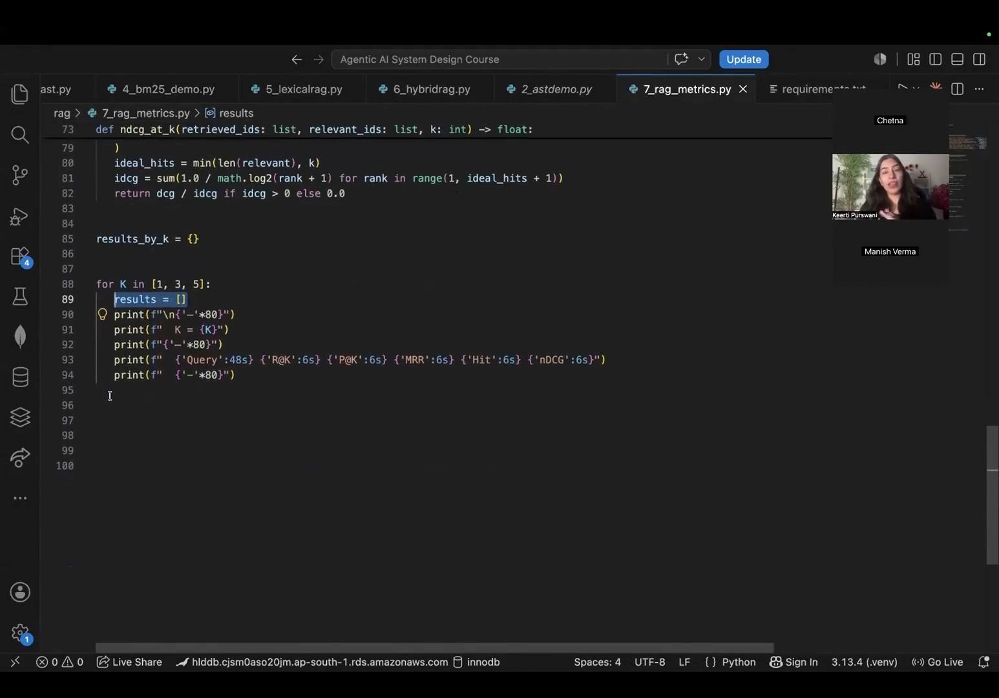
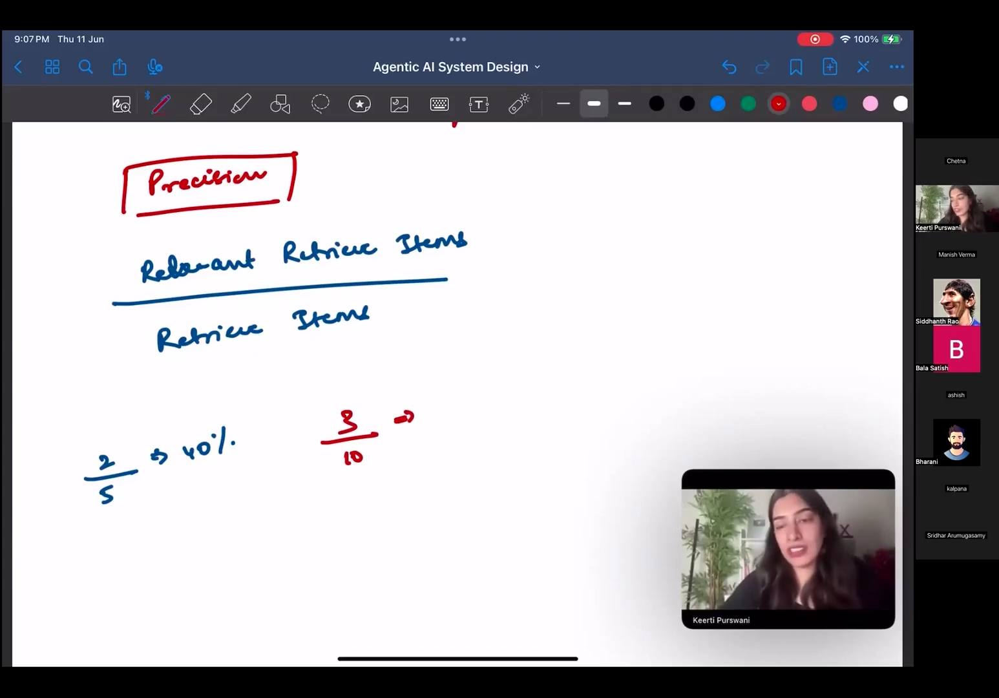
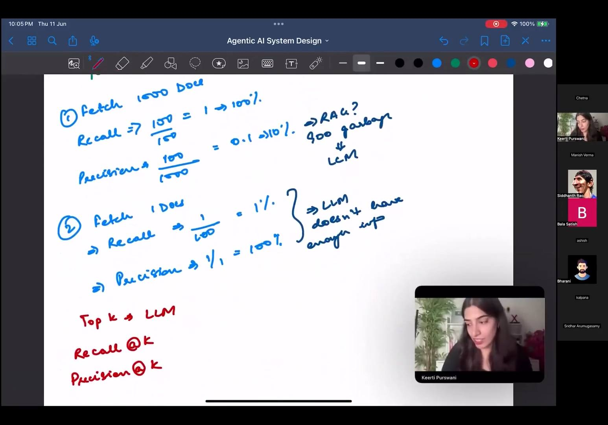

# Agentic AI 系统设计 · 第 3 讲：RAG 的评估指标体系

## 1. 这一节做什么

前两讲把 RAG 的“地图”铺开了：数据存在哪里，就决定了你属于哪一种 RAG——语义向量库是 semantic RAG，BM25 / 倒排索引是 lexical RAG，图数据库是 graph RAG，SQL 是 SQL RAG，从网上抓是 web RAG；把多个检索器的结果合起来再重排是 hybrid RAG；用 LLM 决定这次该用哪个检索器是 agentic RAG；检索完再做验证、事实核查是 corrective RAG；用同一个模型再调一次来验证是 self-RAG。

这一讲换了个方向，回答工程上更关键的问题：**RAG 建好了，你怎么知道它好不好？** 具体来说这一讲完成了四件事：

1. 用 **precision（精确率）** 和 **recall（召回率）** 把“检索得好不好”变成两个可以手算的数字；
2. 因为实际发给 LLM 的永远只是 **top K**（受 context window 限制），所以指标要落成 **recall@K / precision@K**，再补 **hit rate / MRR / NDCG**；
3. 所有指标的比较基准是 **golden data set**——它是这套系统的“单元测试”，传统软件有 TDD，agentic 应用对应的是 **eval-driven development**；
4. 评估必须**分层**：chunking、retrieval、re-ranking、generation，不同层用不同指标，其中 faithfulness、factual correctness、answer relevancy 属于生成层，需要 LLM 参与打分。

讲师在现场从空白文件开始，一段一段贴代码：先建 10 篇文档的 knowledge base，再建 4 条 query 的 golden set，然后用 in-memory vector store 存向量，接着逐个实现 5 个指标函数，最后用 k=1、3、5 三档跑出结果并解读。这一讲属于**纯讲解课**，讲师没有保留一个完整的工程源码文件，因此本文第 4 节给出的是**按讲师屏幕上出现过的结构逐段重建的、可直接运行的示意实现**——所有条目都明确标注“课里没有完整源码，以下是示意”。读者按这份文档跑完之后应该拥有一个 `rag_eval.py`：只要替换掉 `KNOWLEDGE_BASE` 和 `GOLDEN_SET`，就能给自己项目里的 RAG 输出打分。

## 2. 讲师原话

为什么需要指标？讲师用一个很具体的场景开场：

> “假设我有一千篇文档……我最终检索出或者取回了一百篇。你怎么知道你的 RAG 表现好不好？”
> —— p003 [56:55]

> “假设我有一千篇文档，对某一个 query，只有 100 篇是相关的，另外 900 篇是垃圾或者不相关。好，现在我要衡量什么？”
> —— p003 [58:18]

两个最基础的指标，定义如下：

> “你检索出来的东西里，有多少是相关的？假设我检索了 5 篇，只有 2 篇相关，那这个百分比是多少？2 除以 5 等于 40%。这就叫 precision。从字面上看就是——你到底有多精确？”
> —— p003 [63:01]

> “Recall 关心的是：你有没有把全部重要信息都拿到？……这是在讲准确性，那是在讲完整性。”
> —— p003 [63:58]

为什么指标需要“标准答案”：

> “我们怎么知道总共有多少文档、哪些是相关文档？这就是我们建 golden data set 的原因。我们是在自己的 golden data set 上跑所有这些指标。”
> —— p003 [64:55]

讲师反复强调，precision 和 recall 不可能两头都赢：

> “你只能优化其中一个，不可能两个都做到最好。要么一个表现好，要么另一个表现好。”
> —— p003 [71:53]

> “如果你在医疗数据或者法律文档里不给出完整信息，行不行？不行。”
> —— p003 [71:53]

为什么要引入 @K 版本：

> “即使你检索了很多，通常发给 LLM 的也只是 top K。这就是为什么讲指标时，我们说的是 recall@K、precision@K——因为发给 LLM 的就是 K 篇。”
> —— p003 [77:36]

hit rate 的定义，讲师用缓存做了类比：

> “缓存命中、缓存未命中……哪怕只检索到一个相关块，hit rate 就是 1，否则就是 0，它是一个二值。”
> —— p003 [80:56]

MRR 的定义：

> “如果你检索了 5 篇文档，第一篇相关文档排在第几位？……因为 1 更好，所以你取它的倒数。如果有 X 条 query，你就对这 X 条 query 的倒数排名取平均。”
> —— p003 [83:11]

> “如果你在第 20 个块或者第 100 篇文档才找到第一个相关块，这好吗？不好。”
> —— p003 [85:29]

NDCG 的定义：

> “越早出现越好，但还要看它有多相关。这里会给每个相关度分配一个权重……比如讲课程时间表时，上课时间比课程大纲更相关。这个有一个详细公式，但我先跳过。”
> —— p003 [87:49]

失败以后怎么分析：

> “如果某处出现了失败，我们该怎么分析？应该看检索到了什么、错过了什么。”
> —— p003 [102:04]

生成层的指标，先讲 faithfulness：

> “我们检索出来然后生成了答案，这个答案是否忠实于检索到的上下文？……就算检索到了错误信息……它是不是忠于我给它的 context？”
> —— p003 [109:37] / [110:04]

> “哪怕我们检索到的是‘不能退款’，但真实情况可以退款，LLM 说‘可以退款’——答案可能事实正确，但它不忠实。Faithfulness 与事实性无关，它只关乎你回不回复我给你的上下文。”
> —— p003 [111:30]

最后是整节课的落点：

> “传统软件有 TDD，测试驱动开发。现在做 agentic 应用，我们做的是 eval-driven development。这就是为什么评估极其重要。”
> —— p003 [120:03]

结尾复习 RAG 类型：

> “如果数据存在语义向量库，就是 semantic RAG。如果做精确搜索、存在 BM25 里，就是 lexical RAG。存在图数据库里，就是 graph RAG。存在 SQL 里，就是 SQL RAG。从网上抓，就是 web RAG。”
> —— p003 [115:49]

> “如果我把多个检索器的结果合起来、都调用一遍再做重排，那就是 hybrid RAG。如果我用 LLM 决定用哪个检索器，那就是 agentic RAG。检索完之后如果我有反馈环、做验证、做事实核查，那就是 corrective RAG。”
> —— p003 [116:17]

## 3. 从零复现

这一节是纯讲解课，所以“复现”复的是讲师的推导链，不是运行命令。每一步都给出数字，读者可以用纸笔跟上。

### 步骤 1：定义评估对象

讲师第一步先把“文档”这个词泛化：文档不一定是一篇 PDF，它可以是代码、可以是任何一段数据。然后把场景参数化：

- 文档总量：1000
- 对这个 query 真正相关的：100
- 不相关（垃圾）：900
- 检索器返回：100 篇（先假设数量刚好也是 100）

在这个设定下，讲师问的是两个不同的问题——这两个问题分别对应两个指标。

### 步骤 2：手算 precision 和 recall

**precision** = 返回结果里的相关文档数 / 返回结果总数
**recall** = 返回结果里的相关文档数 / 全部相关文档数

讲师现场给了两组数字，第一组：

- 文档总量 500，其中跟“agentic system design 课程”相关的有 100 篇
- 检索返回 20 篇，其中只有 5 篇相关
- precision = 5 / 20 = **25%**
- recall = 5 / 100 = **5%**

第二组：

- 文档总量 200，对该 query 相关的有 10 篇
- 检索返回 5 篇，其中 3 篇相关
- precision = 3 / 5 = **60%**
- recall = 3 / 10 = **30%**

讲师强调第二组的意义：总数里还有 7 篇相关文档没被召回——“还有 7 篇文档包含着信息，我们没拿到”。这就是 recall 低的代价。

### 步骤 3：看两个极端，理解“不可两全”

案例 C：1000 篇文档，100 篇相关，**把 1000 篇全部取回来**。

- recall = 100 / 100 = **100%**
- precision = 100 / 1000 = **10%**

讲师说这很糟：虽然你拿到全部重要信息，但你也把 900 篇垃圾一起塞给了 LLM ——token 成本上去、延迟上去、模型还容易被噪音误导产生幻觉。

案例 D：1000 篇文档，100 篇相关，**只取 1 篇，恰好相关**。

- recall = 1 / 100 = **1%**
- precision = 1 / 1 = **100%**

这同样很糟：LLM 拿到的信息根本不够回答问题。

结论：precision 和 recall 是一对反向拉锯的指标。做医疗、法律这种场景，宁可 precision 掉一点也要保 recall，因为漏掉关键信息代价极高；做一般客服，precision 更重要，因为噪音会直接拖累回答质量。

### 步骤 4：从“检索结果”过渡到 @K

讲师接着指出一个工程现实：**你不会把全部检索结果发给 LLM，你只发 top K**。原因是 context window 有限。所以公式要改写：

- `recall@K = |topK ∩ relevant| / |relevant|`
- `precision@K = |topK ∩ relevant| / K`

讲师用 k=5 的例子推了一遍：检索 5 篇，其中 2 篇相关，而库里还有 1 篇相关没被召回，所以总共相关是 3 篇。

- recall@5 = 2 / 3 ≈ **67%**
- precision@5 = 2 / 5 = **40%**

注意 precision@K 的分母永远是 K（不是实际返回条数），这是 @K 版本和通用版本唯一的结构差异；recall@K 的分子和通用版本一样。

### 步骤 5：hit rate

定义最简：topK 里**至少有一篇相关** → 1；一篇都没有 → 0。

> “命中率要么是 1 要么是 0……1 表示你至少检索到了一个相关块。”

讲师还补了一个反例：用户问订单，你返回的是产品；用户问课程，你返回的是人名——完全跑偏，那就是 0。跨 query 取平均就是整体命中率。

### 步骤 6：MRR（Mean Reciprocal Rank）

对单条 query：找到**第一个相关文档**的位置 r，取 `1/r`。

讲师给的例子是 5 个位置里，第 4 位是第一个相关的 → `1/4`。

然后讲师补了多组例子：第 4 位 → 1/4；第 3 位 → 1/3；第 1 位 → 1/1；第 4 位 → 1/4。对这四条 query 取平均：

```
MRR = (1/4 + 1/3 + 1/1 + 1/4) / 4
```

讲师提醒别和 **re-ranking** 混淆：re-ranking 是“检索完再排一次”的动作，MRR 是“评估排得好不好”的指标。这里只讲评估。

### 步骤 7：NDCG（Normalized Discounted Cumulative Gain）

讲师说这是今天最后一个、也是最容易让人懵的指标，所以只给直觉、不给公式细节：

- 它同时考虑两件事：**相关文档出现得早不早** + **每一篇各自有多相关**
- 所以要给每篇文档一个**相关度权重**（graded relevance），而不是 0/1
- 例子：讲课程时，“上课时间”比“课程大纲”更相关，两者都算相关，但权重不同

讲师明确说了公式“先跳过”（下一周再讲）。为了让第 4 节的示意代码能跑通，我在代码里用标准 NDCG 公式实现，并在注释里注明“课里没展开公式，这是标准实现的示意”。

### 步骤 8：把指标落到代码——in-memory vector store

讲师实际代码的顺序是：

1. imports
2. 写 knowledge base（`doc1` 到 `doc10`，带 metadata）
3. 写 golden set（query → 相关 doc ID → 相关度权重）
4. 建 in-memory vector store，把文档 embed 进去
5. 写 5 个指标函数：recall@K、precision@K、MRR、hit rate、NDCG@K
6. 用 `k = [1, 3, 5]` 三档遍历 golden set，逐条检索、逐条算指标、逐条打印
7. 打印结果分析失败

讲师在运行前补了一句我印象很深的话——他自己在运行时报了一次缺 import 的错：

> “我觉得我还得 import 点东西。”

这在第 4 节里已经直接补齐了（`numpy`，以及 NDCG 需要的 `math`）。

### 步骤 9：解读跑出来的结果

讲师把三档 K 的结果摊出来，然后让学生自己看趋势：

- **k=1**：recall 很低——因为只取一篇，能取到相关的概率天然小；“你并没有把所有相关文档都取回来，而你取回的文档数量太少了”
- **k=3 / k=5**：precision 相对低——因为相关文档本来就只占一小部分，检索条数一变大，分母变大，precision 掉下来

**趋势规律：K 变大 → recall 升、precision 降。** 这条规律和步骤 3 里两个极端案例完全同构。

### 步骤 10：跑挂了以后怎么分析

讲师给了非常明确的操作步骤：

> “我再看一次……你应该看实际检索到了什么、错过了什么。”

落到代码上，就是发现 recall 或 precision 偏低时，把 `retrieved_ids` 和 `relevant_ids - retrieved_ids` 一起打出来对比——看看是哪一类文档没被召回、被召回的是哪一类噪音。这个动作之所以能做，是因为有 golden set 作为参照。没有 golden set 就只能对着屏幕猜。

### 步骤 11：评估分四层

讲师最后把评估地图对上：

| 层 | 有什么 | 主要用哪些指标 |
|---|---|---|
| chunking（切分） | 文档被切成多大的块 | context precision / context recall（下节课讲） |
| retrieval（检索） | 检索器捞出什么 | recall@K、precision@K、hit rate、MRR |
| re-ranking（重排） | 排得好不好 | NDCG |
| generation（生成） | 答案怎么写 | faithfulness、factual correctness、answer relevancy |

讲师给了一张四列表格的草稿——**指标 / 量什么 / 要不要 LLM / 要不要 golden set**。按讲师口述填完整如下：

| 指标 | 量什么 | 需要 LLM？ | 需要 golden set？ |
|---|---|---|---|
| recall@K | 完整性——有没有漏 | 否 | 是 |
| precision@K | 正确性 / 噪声 | 否 | 是 |
| hit rate | 至少命中一次 | 否 | 是 |
| MRR | 第一个相关块的位置 | 否 | 是 |
| NDCG | 加权后的整体排序质量 | 否 | 是 |
| faithfulness | 答案是否忠于检索上下文 | 是 | **否** |
| factual correctness | 答案是否匹配 ground truth | 是 | 是 |
| answer relevancy | 答案是否回答了用户问题 | 是 | **否** |

讲师特意把 faithfulness 和 factual correctness 分开讲，因为它们很容易被第一次听的人混为一谈：

- faithfulness：我给你 7 周，你回 5 周就是**不忠实**，哪怕 5 周在现实里是对的
- factual correctness：我给你“不能退款”，真实情况能退款，模型说“能退款”是**事实正确但语义上不匹配 ground truth 的检索结果**

所以 faithfulness 不需要 ground truth（只看答案和检索上下文是否语义一致），需要 LLM 做语义判断；factual correctness 两个都要。

### 步骤 12：golden data set 怎么建、怎么维护

讲师最后回到根本——指标再多，都建立在 golden set 上，它等价于
“单元测试”——讲师把它类比成传统软件里的单元测试：代码改了要回归测试，RAG 改了（换 embedding、换 chunk size、换检索器）就要在 golden set 上回归跑一遍指标。围绕 golden set，讲师在最后十几分钟又补了三件事，这三件事比公式本身更重要：

**第一，golden set 里的 query 必须覆盖多种类型。** 讲师点名了五类：

> “golden set 里要有不同种类的 query：摘要、比较、流程步骤、事实、模糊问题，全都要有。”
> —— p003 [118:37]

这一点对前端转过来的同学尤其要注意：如果你只拿“事实型”query（“退款期限是多久”）去评测，那召回率会虚高，因为这类问题只要命中一篇文档就够；而“比较型”query（“标准配送和加急配送差在哪”）天然需要召回**多篇**文档才能答，是真正考验 recall 的场景。“模糊型”query 则考验检索器在 query 本身信息不足时表现如何。

**第二，golden set 有三种建法，可以任选一种，也可以组合。** 讲师原话：

> “我们可以手工创建，也可以用生产日志，再用 AI 生成数据集，然后人工审核。可以是这三种的组合，也可以是其中任意一种。”
> —— p003 [119:06]

**第三，也是讲师连说了三遍“极其重要”的那条：指标好、线上差，就回头改 golden set。**

> “如果我们的评估指标表现很好，但生产环境表现不行，我们怎么办？我们要更新 golden set。”
> —— p003 [119:35]

为什么会这样？因为指标只在 golden set 上成立——golden set 没覆盖到的 query 类型、没覆盖到的文档，指标就完全看不到。线上出了 bad case，正确做法不是去调 prompt，而是先把这条 bad case 补进 golden set，让它从此变成一条会失败的测试用例。这就是讲师说的 eval-driven development 和 TDD 的关系：

> “传统软件有 TDD，测试驱动开发。现在做 agentic 应用，我们做的是 eval-driven development。”
> —— p003 [120:03]

顺着这条逻辑，这一讲的完整推导链是：先定义“什么算好”（precision / recall）→ 承认 context window 限制，落成 @K → 补上位置类指标（hit rate / MRR / NDCG）→ 所有指标都需要参照物，所以必须建 golden set → 指标要分层（chunking / retrieval / reranking / generation）→ 生成层指标（faithfulness / factual correctness / answer relevancy）需要 LLM 参与打分。下一周讲师会用不同的 RAG 实现（semantic、agentic、graph、AST）跑同一套指标做横向对比，并补上 context precision / context recall。

## 4. 完整代码

> **重要说明**：这一讲讲师是**在屏幕上逐段粘贴代码**（他特意说了这是采纳了 Amit 的反馈，“不要一次贴完，一段一段贴，大家好跟”），现场没有留下一个完整源码文件。下面这份 `rag_eval.py` 是**按讲师贴代码的顺序和屏幕结构重建的、可直接保存运行的示意实现**。课里明确出现过的部分：文件结构顺序、`doc1`–`doc10` 的 knowledge base（含 metadata 里的 doc ID）、query → 相关 doc ID → 相关度的 golden set、in-memory vector store、5 个指标函数、`k = 1, 3, 5` 三档遍历、打印结果、失败分析时对比“检索到什么 / 漏了什么”。课里**没有念出来**的部分：具体用什么 embedding 模型做向量化、NDCG 的展开公式——这两处我用最朴素的方式补齐，并在代码注释里标注。

目录结构（一个文件就够，不需要建工程）：

```text
rag-eval/
├── rag_eval.py          # 唯一源码文件
└── requirements.txt     # 依赖清单
```

`requirements.txt`：

```text
numpy>=1.24,<3
```

安装与运行（Python 3.9+）：

```bash
cd rag-eval
python -m venv .venv
source .venv/bin/activate      # Windows: .venv\Scripts\activate
pip install -r requirements.txt
python rag_eval.py
```

`rag_eval.py`：

```python
"""rag_eval.py

RAG 检索层指标评估 —— 按 p003 讲师屏幕上逐段贴出的结构重建。

课里没有留下完整源码文件，因此本文件是「示意重建」，边界如下：
  1. knowledge base（doc1..doc10，metadata 里带 doc ID）、golden set
     （query -> relevant doc IDs -> 相关度权重）、in-memory vector store、
     5 个指标函数、k 取 1/3/5 的遍历与打印：结构来自讲师屏幕。
  2. 向量化用最朴素的「单字 token + TF-IDF + 余弦相似度」，只依赖 numpy。
     讲师屏幕上的 in-memory vector store 用的是哪种 embedding，逐字稿没有念出来。
  3. NDCG 讲师明确说「有详细公式，但先跳过」，所以这里的 DCG/IDCG 采用
     标准实现，仅作示意，不是讲师推导的版本。
"""

import math

import numpy as np

# ---------------------------------------------------------------------------
# 1) Knowledge base —— 相当于你真实项目里的向量库内容，共 10 篇
#    讲师原话：只给 doc ID 和一些示例文档 + metadata。
# ---------------------------------------------------------------------------
KNOWLEDGE_BASE = [
    {"doc_id": "doc1", "text": "退款政策：订单在购买后 30 天内可申请全额退款。", "metadata": {"category": "refund"}},
    {"doc_id": "doc2", "text": "数字产品退款：未下载的数字产品可在 7 天内申请退款，已下载的不可退款。", "metadata": {"category": "refund"}},
    {"doc_id": "doc3", "text": "退款申请流程：登录账号，进入订单页，点击申请退款，填写原因，3 个工作日内处理完成。", "metadata": {"category": "refund"}},
    {"doc_id": "doc4", "text": "课程有效期：课程自购买之日起 12 个月内有效，可申请一次延期。", "metadata": {"category": "course"}},
    {"doc_id": "doc5", "text": "配送选项：标准配送 5 到 7 个工作日，加急配送 1 到 2 个工作日，均支持物流跟踪。", "metadata": {"category": "shipping"}},
    {"doc_id": "doc6", "text": "国际配送：目前支持 30 个国家，运费按重量计算，清关时间不计入配送时效。", "metadata": {"category": "shipping"}},
    {"doc_id": "doc7", "text": "会员订阅：月付会员在到期前 24 小时自动续费，可随时在账号设置中关闭。", "metadata": {"category": "billing"}},
    {"doc_id": "doc8", "text": "发票开具：付款成功后可在订单页申请电子发票，抬头修改需在 30 天内提交。", "metadata": {"category": "billing"}},
    {"doc_id": "doc9", "text": "账号安全：连续 5 次密码错误将锁定账号 30 分钟，可通过邮箱重置密码。", "metadata": {"category": "account"}},
    {"doc_id": "doc10", "text": "客服支持：工作日 9 点到 18 点在线，非工作时间请提交工单。", "metadata": {"category": "support"}},
]

# ---------------------------------------------------------------------------
# 2) Golden data set —— 相当于你的单元测试用例
#    query -> {doc_id: 相关度权重}；权重就是 NDCG 要吃的 graded relevance。
#    讲师屏幕上的三条：退款期限（doc1 > doc2）、退款申请怎么提交（doc3）、
#    配送选项（doc5 > doc6）。
# ---------------------------------------------------------------------------
GOLDEN_SET = [
    {
        "query": "退款要在多长时间内申请",
        "grades": {"doc1": 3, "doc2": 2},
    },
    {
        "query": "退款申请怎么提交",
        "grades": {"doc3": 3, "doc2": 1},
    },
    {
        "query": "有哪些配送选项",
        "grades": {"doc5": 3, "doc6": 2},
    },
]

# 讲师原话：取 k 值 1、3、5 三档看结果
KS = [1, 3, 5]


# ---------------------------------------------------------------------------
# 3) In-memory vector store（示意：单字 token + TF-IDF + 余弦）
# ---------------------------------------------------------------------------
def tokenize(text: str) -> list[str]:
    """最简分词：转小写后按单个字母/汉字切。真实项目请换成专业分词器。"""
    return [ch for ch in text.lower() if ch.isalnum()]


def build_vocab(docs: list[dict]) -> dict[str, int]:
    vocab: dict[str, int] = {}
    for doc in docs:
        for token in tokenize(doc["text"]):
            if token not in vocab:
                vocab[token] = len(vocab)
    return vocab


def build_idf(docs: list[dict], vocab: dict[str, int]) -> np.ndarray:
    """idf = log((N+1)/(df+1)) + 1，避免除零，同时保证所有词权重为正。"""
    df = np.zeros(len(vocab), dtype=float)
    for doc in docs:
        for token in set(tokenize(doc["text"])):   # 每篇文档每个词只计一次
            df[vocab[token]] += 1.0
    n_docs = len(docs)
    return np.log((n_docs + 1.0) / (df + 1.0)) + 1.0


def embed(text: str, vocab: dict[str, int], idf: np.ndarray) -> np.ndarray:
    tokens = tokenize(text)
    vec = np.zeros(len(vocab), dtype=float)
    for token in tokens:
        if token in vocab:
            vec[vocab[token]] += 1.0
    if tokens:
        vec /= float(len(tokens))   # tf：词频归一化，抵消长文档优势
    vec = vec * idf                 # tf-idf
    norm = float(np.linalg.norm(vec))
    return vec / norm if norm > 0 else vec     # L2 归一化，点积即余弦


def build_store(kb: list[dict]):
    vocab = build_vocab(kb)
    idf = build_idf(kb, vocab)
    doc_ids = [doc["doc_id"] for doc in kb]
    vectors = np.vstack([embed(doc["text"], vocab, idf) for doc in kb])
    return doc_ids, vectors, vocab, idf


def retrieve(query: str, store, top_k: int) -> list[str]:
    """按余弦相似度倒序取 top_k 个 doc_id。"""
    doc_ids, vectors, vocab, idf = store
    q = embed(query, vocab, idf)
    scores = vectors @ q                    # 已归一化，点积=余弦
    order = np.argsort(-scores)             # 分数从高到低
    return [doc_ids[i] for i in order[:top_k]]


# ---------------------------------------------------------------------------
# 4) 五个检索层指标
# ---------------------------------------------------------------------------
def recall_at_k(retrieved_ids: list[str], relevant_ids: list[str], k: int) -> float:
    """recall@K = |topK ∩ relevant| / |relevant|
    分母是「全部相关文档数」，量完整性：有没有漏。
    """
    if len(relevant_ids) == 0:              # 讲师原话：分母不能是 0
        return 0.0
    top_k = retrieved_ids[:k]
    hits = set(top_k) & set(relevant_ids)
    return len(hits) / len(relevant_ids)


def precision_at_k(retrieved_ids: list[str], relevant_ids: list[str], k: int) -> float:
    """precision@K = |topK ∩ relevant| / K
    分母永远是 K（不是实际返回条数），量正确性：捞回来的有多少是垃圾。
    """
    if k == 0:                              # 讲师原话：检查 k 不能是 0
        return 0.0
    top_k = retrieved_ids[:k]
    hits = set(top_k) & set(relevant_ids)
    return len(hits) / k


def hit_rate_at_k(retrieved_ids: list[str], relevant_ids: list[str], k: int) -> float:
    """命中率：topK 里至少有一个相关就是 1，否则 0。二值。"""
    top_k = retrieved_ids[:k]
    return 1.0 if set(top_k) & set(relevant_ids) else 0.0


def mrr_at_k(retrieved_ids: list[str], relevant_ids: list[str], k: int) -> float:
    """单条 query 的 reciprocal rank：第一个相关文档在位置 r，得分 1/r。
    多条 query 的均值（Mean）在主循环里做。
    """
    relevant = set(relevant_ids)
    for rank, doc_id in enumerate(retrieved_ids[:k], start=1):
        if doc_id in relevant:
            return 1.0 / rank
    return 0.0                              # 前 K 条里一个相关的都没有


def ndcg_at_k(retrieved_ids: list[str], grades: dict[str, int], k: int) -> float:
    """NDCG@K（标准实现的示意，讲师课上明确说公式先跳过）。
    DCG 用 (2^rel - 1) 作为增益、log2(rank+1) 作为折损；
    IDCG 用「把相关度从高到低排满前 K」的理想顺序算出来的上界。
    """
    dcg = 0.0
    for rank, doc_id in enumerate(retrieved_ids[:k], start=1):
        gain = grades.get(doc_id, 0)
        dcg += (2.0 ** gain - 1.0) / math.log2(rank + 1.0)

    ideal_grades = sorted(grades.values(), reverse=True)[:k]
    idcg = sum((2.0 ** g - 1.0) / math.log2(i + 2.0) for i, g in enumerate(ideal_grades))

    return dcg / idcg if idcg > 0 else 0.0


# ---------------------------------------------------------------------------
# 5) 主流程：对 golden set 的每一条 query、每一档 K 跑一遍，再做失败分析
# ---------------------------------------------------------------------------
def main() -> None:
    store = build_store(KNOWLEDGE_BASE)
    max_k = max(KS)

    sums = {k: {"recall": 0.0, "precision": 0.0, "hit": 0.0, "mrr": 0.0, "ndcg": 0.0} for k in KS}
    n_queries = len(GOLDEN_SET)

    for item in GOLDEN_SET:
        query = item["query"]
        grades = item["grades"]
        relevant_ids = list(grades.keys())

        # 一次性取到 max_k，再按不同 k 切片 —— 保证各档 K 的排序完全一致
        retrieved_ids = retrieve(query, store, max_k)

        for k in KS:
            r = recall_at_k(retrieved_ids, relevant_ids, k)
            p = precision_at_k(retrieved_ids, relevant_ids, k)
            h = hit_rate_at_k(retrieved_ids, relevant_ids, k)
            m = mrr_at_k(retrieved_ids, relevant_ids, k)
            n = ndcg_at_k(retrieved_ids, grades, k)

            sums[k]["recall"] += r
            sums[k]["precision"] += p
            sums[k]["hit"] += h
            sums[k]["mrr"] += m
            sums[k]["ndcg"] += n

            print(f"[k={k}] query={query}")
            print(f"      retrieved={retrieved_ids[:k]} relevant={relevant_ids}")
            print(f"      recall={r:.3f} precision={p:.3f} hit={h:.3f} mrr={m:.3f} ndcg={n:.3f}")

    print("=" * 78)
    print(f"golden set 平均指标（{n_queries} 条 query，k 取 {KS}）")
    for k in KS:
        s = sums[k]
        print(
            f"k={k:<2} recall={s['recall'] / n_queries:.3f} "
            f"precision={s['precision'] / n_queries:.3f} "
            f"hit_rate={s['hit'] / n_queries:.3f} "
            f"mrr={s['mrr'] / n_queries:.3f} "
            f"ndcg={s['ndcg'] / n_queries:.3f}"
        )

    print("=" * 78)
    print("失败分析：检索到了什么、漏了什么")
    for item in GOLDEN_SET:
        query = item["query"]
        relevant_ids = list(item["grades"].keys())
        retrieved_ids = retrieve(query, store, max_k)
        missing = [doc_id for doc_id in relevant_ids if doc_id not in retrieved_ids]
        print(f"query: {query}")
        print(f"  retrieved(top{max_k}): {retrieved_ids}")
        print(f"  relevant            : {relevant_ids}")
        print(f"  missed              : {missing}")


if __name__ == "__main__":
    main()
```

运行后打印出来的版式如下（**数值以你实际运行结果为准**，本文不预先填数字）：

```text
[k=1] query=退款要在多长时间内申请
      retrieved=['doc?'] relevant=['doc1', 'doc2']
      recall=<R> precision=<P> hit=<H> mrr=<M> ndcg=<N>
...
==============================================================================
golden set 平均指标（3 条 query，k 取 [1, 3, 5]）
k=1  recall=<R> precision=<P> hit_rate=<H> mrr=<M> ndcg=<N>
k=3  ...
k=5  ...
==============================================================================
失败分析：检索到了什么、漏了什么
query: 退款要在多长时间内申请
  retrieved(top5): [...]
  relevant            : ['doc1', 'doc2']
  missed              : [...]
```

讲师屏幕上最后阶段的代码就是「遍历 golden set → 每档 K 各算五个指标 → 打印」这个形状：



**课里没有写的部分**：faithfulness、factual correctness、answer relevancy 这三个生成层指标，讲师明确说“需要 LLM 调用”，但**没有给代码**，所以本文不补——任何补出来的实现都属于替讲师发明。你只要记住它们的输入是（检索到的 context、生成的答案、（可选）ground truth），输出是一个 LLM 判断分数，签名形式如下（**课里没有代码，以下仅为说明新增函数的入参形状**，不要把它当成讲师原版）：

```python
# 课里没有这段实现，仅示意「需要哪些入参」，不要照抄当成讲师原版
def faithfulness(context: str, answer: str) -> float: ...
def factual_correctness(answer: str, ground_truth: str) -> float: ...
def answer_relevancy(query: str, answer: str) -> float: ...
```

## 5. 逐行解释

**`tokenize` / `build_idf` / `embed` / `build_store`**：这一节最重要的不是向量化本身，而是“in-memory vector store”这个概念——讲师说了，先把文档 embed 之后**存进内存向量库**，因为这一讲只关心指标，不关心持久化。所以我的实现是纯内存的 numpy 矩阵：`vectors` 是一个 `10 × 词表大小` 的矩阵，`retrieve` 时一条 query 变成一行向量，和矩阵做一次矩阵乘法就拿到 10 个相似度。TF-IDF 里的 IDF 我用 `log((N+1)/(df+1)) + 1`，是为了让**所有出现过至少一次的词权重都为正**，避免“某词在全部 10 篇里都出现”时权重变成 0 甚至负数，把召回搞乱；`embed` 最后做 L2 归一化，是为了让点积直接等于余弦相似度，省掉分母——这一步和真实向量库里的“归一化后内积即余弦”是同一个道理。

**`retrieve` 里为什么一次取 `max_k` 再切片**：这是这一节结果可解释性的关键。如果每档 K 都重新检索一次，理论上排序是一样的，但代码里多一次浮点运算就多一点隐患；一次取到 5、再用 `[:k]` 切，就严格保证了「k=3 的结果是 k=5 结果的前三条」。于是你才能干净地解释讲师在课上问的那个现象：**k=1 时 recall 很低，因为“你取回的文档数量本身太少了”，而 k 变大时 precision 变低，因为“相关文档本来就少，分母变大”。** 如果两档 K 的排序不一致，你就没法把差异归因到 K 上。

**`recall_at_k` 的两行核心**：`hits = set(top_k) & set(relevant_ids)` 算交集，`len(hits) / len(relevant_ids)` 就是公式 `|topK ∩ relevant| / |relevant|`。分母是**全部相关文档数**，与 K 无关——这就是 recall 衡量“完整性”的原因：K 变大只会让分子有机会变大，分母一动不动，所以 recall 天然随 K 上升。`len(relevant_ids) == 0` 的提前返回，正是讲师原话里那句“为什么有这个检查？因为分母不能是零，如果没有任何相关文档，就不要算了”。在 JS/Node 里这个交集写成 `[...new Set(topK)].filter(id => relevantSet.has(id)).length`，语义完全一致。

**`precision_at_k` 的分母**：`/ k` 而不是 `/ len(top_k)`——讲师在课上反复强调“bottom 就是 K”。这个细节决定了指标的行为：如果检索器只返回 2 条但 K=5，precision 的惩罚会体现出来（分子不变，分母按 5 算），这恰好对应真实系统里“检索器返回不足”的退化情况。`k == 0` 的检查同样是讲师原话里点明的（“检查 k 不能为 0”）。这一段的定义讲师讲得最慢：



**`hit_rate_at_k`**：整个函数就一行 `1.0 if 交集 else 0.0`。讲师用缓存命中做类比，强调它是**二值**，不关心命中了几篇、排在第几位。它存在的意义是“兜底体验”：只要命中一篇，用户至少不会得到完全无关的回答。反例讲师也给了：问订单却返回产品、问课程却返回人名——那就是 0。

**`mrr_at_k`**：`enumerate(..., start=1)` 让 rank 从 1 开始，`1.0 / rank` 就是倒数排名。注意函数里遇到第一个相关就 `return`，**不会继续往后找**——因为 MRR 只关心“第一个相关块在第几位”，后面有几个相关它不在乎。这也是它和 NDCG 的分工：MRR 只问“多快能找到第一个”，NDCG 问“整体排序加权后好不好”。讲师把这两者的直觉放在一起讲：


`return 0.0` 这一支是必要的：如果前 K 条里一个相关都没有，reciprocal rank 无定义，工程上取 0。讲师原话说“如果第一个相关块在第 20 甚至第 100 篇才出现，这好吗？不好”，所以这个 0 是合理的最差值。多条 query 取平均的动作放在 `main` 里，对应讲师说的“有 X 条 query 就对 X 个倒数排名取平均”——这样单条 query 的函数保持纯净，均值逻辑归属聚合层，和真实评估框架（比如 RAGAS）的组织方式一致。

**`ndcg_at_k`**：三行关键。增益用 `2**grade - 1`，所以相关度 3 的文档贡献 7、相关度 2 的贡献 3、不相关的贡献 0——讲师举的“上课时间比课程大纲更相关”就是这种 graded relevance 的来源，如果只用 0/1，这两篇的差别就被抹平了。折损用 `log2(rank + 1)`，rank 越大除数越大，体现“越早出现越好”。`idcg` 是把 golden set 里的相关度**从高到低**排进前 K 名算出的上界，所以最终得分一定落在 0 到 1 之间；`idcg > 0` 的判断是为了防止“该 query 一条相关文档都没有”时除零。**这里必须重申：讲师课上明确说公式先跳过，本节实现是标准做法，不是讲师推导的版本。**

**`main` 里的聚合
**`main` 里的聚合**：`sums` 是一个以 K 为键的字典，每条 query 算完后往对应档位里累加，最后统一除以 `n_queries`——这正是讲师说的“有 X 条 query 就对 X 个结果取平均”的直译。之所以把累加放在循环里、把除法放在循环外，是因为这样只遍历一次 golden set 就能拿到全部档位的均值，如果是在每个指标函数内部做聚合，就要对 golden set 反复遍历五遍。讲师在课上特意强调过“你取任意数量的 query”“你想取多少条都行”，这条要求在这里落成了 `n_queries = len(GOLDEN_SET)`——不写死 3 也不写死 100，你往 golden set 里加用例，均值自动跟着变。**注意一个真实的坑**：如果 `GOLDEN_SET` 是空列表，`n_queries` 就是 0，除法会直接抛 `ZeroDivisionError`。这一讲讲师没有讨论空评估集的场景，所以我在代码里也没有加保护分支——但这正是第 7 节要展开的“你会撞上的事”之一。

**`for k in KS` 的嵌套位置**：外层是 query、内层是 K，这个顺序不是随意的。讲师屏幕上的输出是“一条 query 一行、一行里带 k=1/3/5 三档”，也就是 query 为主序；如果反过来写成 K 在外层、query 在内层，输出就变成“先打完所有 k=1 的结果，再打所有 k=3”，对比起来要上下翻屏幕。这是一个纯粹的可读性选择，不影响数值。**但有一个真正影响数值的地方**：`retrieved_ids` 是在内层 K 循环之外、按 `max_k` 取的，所以三档 K 共享同一份排序结果。如果你把 `retrieve` 挪进内层循环并传 `k`，在真实向量库（尤其是带近似检索的库）里，`top3` 不一定等于 `top5` 的前三条——近似检索的召回本身带随机性，K 变了候选集变了，排序可能整段重排。那时你看到的“k 变大 precision 下降了”就可能混进了算法噪声，而不是纯粹的 K 效应。讲师在课上把趋势归因给 K 本身（“分母变大”），这个归因只有在共享同一份排序时才成立。

**失败分析那一段**：`missing = [doc_id for doc_id in relevant_ids if doc_id not in retrieved_ids]` 就是讲师说的“看检索到了什么、错过了什么”的代码落地。为什么这个动作必须打印 `retrieved` 和 `relevant` 两组而不是只打一个分数？因为分数只告诉你“坏了”，不告诉你“坏在哪”。如果你看到 `missed=['doc2']` 而 `doc2` 是“数字产品退款”，同时 `retrieved` 里塞了一堆 `doc7`、`doc8` 这种计费类文档，你立刻就知道问题出在“退款”和“计费”这两类语义在你的向量空间里贴得太近——这属于 embedding 或 chunk 的问题，不是 K 的问题。反过来如果 `missed` 是空的、但 precision 很低，那问题就是纯粹的噪音污染，该调相似度阈值或者加重排。讲师原话把这个动作讲得很朴素：

> “当 recall 很低或者 precision 很低的时候，你就要实际去看检索到了什么、我们漏掉了什么，然后就能看到问题发生在哪里。”
> —— p003 [102:33]

**为什么 `print` 用 `:.3f` 而不用百分数**：纯工程习惯。`0.667` 和 `66.7%` 信息量一样，但小数在三档 K 之间横着对比时更省眼睛，也避免了你手动把 25% 和 0.25 混着写进表格。讲师在课上口头算的时候是用百分数讲的（“5 除以 20 是 25%”“3 除以 5 是 60%”），你在核对自己的输出时把小数乘 100 对一下就行。

**为什么 `ndcg_at_k` 的入参是 `grades` 而不是 `relevant_ids`**：这是五个函数里唯一一个签名不一样的，原因是 NDCG 需要**分级相关度**，而其他四个只需要“相关 / 不相关”这个二值判断。`recall_at_k`、`precision_at_k`、`hit_rate_at_k`、`mrr_at_k` 都只问“在不在集合里”，所以传 `list` 就够；NDCG 要查每一篇的具体权重，所以必须传整张映射表。这个签名差异本身就是讲师那句话的体现——NDCG“给每个相关度分配了权重，有详细的公式”。你在扩写这套代码时，只要看到哪个指标开始需要分级信息，它的入参就得从 `relevant_ids` 换成 `grades`。

**关于 1000 篇文档取全部的那个极端案例**，讲师在黑板上推了两遍才把数字对齐，值得单独记一下，因为它是整节课“为什么不能只优化一个指标”的最强证据：


- 取全部 1000 篇：recall = 100/100 = 100%，precision = 100/1000 = 10%
- 只取 1 篇且相关：recall = 1/100 = 1%，precision = 1/1 = 100%

讲师对第一种情况的点评是“我们拿到了所有重要的东西，但同时也拿了一大堆垃圾”，而垃圾的代价是具体的：**这些 900 篇垃圾全都要塞进 LLM**，于是 token 成本上升、延迟上升，模型还可能因为分不清主次而答偏。第二种情况的代价反过来：LLM 手里信息不够，答不出来。这就是为什么“发给 LLM 的永远只是 top K”这件事本身就是一个工程约束，而不是优化项——K 是你为 context window 和成本付出的上限，指标必须在 K 这个前提下讨论。

**生成层指标为什么在这个文件里没有对应函数**：不是漏写。讲师明确说了这三件事需要 LLM 参与判断，而这一讲的代码全程没有出现任何 LLM 调用，所以文件里只保留了一条 `def ...: ...` 的签名示意。讲师对这三个指标的定义给得很细：

> “Faithfulness 的意思是，我们从数据里检索出来、然后生成了答案，这个答案是否忠实于检索到的上下文？”
> —— p003 [109:37]

> “就算我们检索到了错误信息……它不是关于正确与否，而是关于你对我给你的上下文是否忠实。”
> —— p003 [110:04]

> “Faithfulness 和 factual correctness 是两个不同的东西。factual correctness 是问：它跟 ground truth、跟 golden data set 对得上吗？”
> —— p003 [113:52]

> “Answer relevancy 意思是：我们回答了用户问的问题吗？它是否切题、是否和问题相关？是的，我们需要 LLM；不，我们不需要 ground truth，因为我们只需要让 LLM 看 query 和答案，判断它是否相关。”
> —— p003 [114:22]

这三个定义直接决定了各自的入参：faithfulness 要 `(context, answer)`，不需要 ground truth；factual correctness 要 `(answer, ground_truth)`；answer relevancy 要 `(query, answer)`，同样不需要 ground truth。讲师把整张四列表格摊开讲的那一屏是这样的：


## 6. 复现检查清单

按顺序打勾。任何一条对不上，都不要往下走，先回来修。

**环境层**

- [ ] Python 版本 ≥ 3.9（`python --version` 确认；代码里用了 `list[str]`、`dict[str, int]` 这类内置泛型注解，3.8 会报 `TypeError`）
- [ ] 已建虚拟环境并激活（终端提示符前出现 `(.venv)`）
- [ ] `pip install -r requirements.txt` 成功，`python -c "import numpy; print(numpy.__version__)"` 有输出
- [ ] 目录结构是 `rag-eval/` 下放 `rag_eval.py` 和 `requirements.txt` 两个文件，没有多余嵌套

**代码层**

- [ ] `KNOWLEDGE_BASE` 里是 10 条，`doc_id` 从 `doc1` 到 `doc10`，每条都有 `text` 和 `metadata`
- [ ] `GOLDEN_SET` 里是 3 条 query，每条的 `grades` 是 `dict`（不是 list）——写成 list 的话 `ndcg_at_k` 会在 `grades.get()` 上直接崩
- [ ] `GOLDEN_SET` 里每条 `grades` 的 key 都能在 `KNOWLEDGE_BASE` 的 `doc_id` 里找到（typo 会导致“该文档永远召不回”，这是最难查的一类错）
- [ ] `KS = [1, 3, 5]`，`max_k = max(KS)` 拿到的是 5
- [ ] 五个指标函数各自都有除零保护：`recall_at_k` 判 `len(relevant_ids) == 0`，`precision_at_k` 判 `k == 0`，`ndcg_at_k` 判 `idcg > 0`
- [ ] `precision_at_k` 的分母写的是 `k`，不是 `len(top_k)`
- [ ] `mrr_at_k` 里是 `start=1`，不是默认的 `start=0`（否则第一条命中的得分会变成 1/0 直接崩）
- [ ] `main()` 被 `if __name__ == "__main__":` 保护，`python rag_eval.py` 能跑，`import rag_eval` 不会自动执行

**运行层**

- [ ] `python rag_eval.py` 退出码为 0，没有 traceback
- [ ] 输出里能看到 `[k=1]`、`[k=3]`、`[k=5]` 三组各自 3 条 query 的明细，共 9 组打印
- [ ] 平均指标段落里三行（k=1 / k=3 / k=5）都在，字段名是 `recall` / `precision` / `hit_rate` / `mrr` / `ndcg` 五个
- [ ] 失败分析段落里 3 条 query 都打印了 `retrieved(top5)` / `relevant` / `missed` 三行

**数值自查（不依赖讲师的具体数字，只看不变量）**

- [ ] 同一档 K 下，五个指标全部落在 `[0.0, 1.0]` 区间。任何一个是负数或大于 1，说明公式写错了
- [ ] `hit_rate` 在三档 K 下的取值只能是 0.000 / 1.000 这种端点值（对单条 query 而言）；如果看到 0.333，说明你把求均值写进了函数内部
- [ ] **recall 随 K 单调不减**：`recall@1 ≤ recall@3 ≤ recall@5`。违反就说明你把 `retrieved_ids` 在内层循环里重取了，或者 `embedding` 每次调用结果不稳定
- [ ] **precision 随 K 单调不减的反面不一定成立，但你的输出应该能解释**：如果 `precision@1` 比 `precision@5` 高，属于正常现象（第一篇恰好相关）；如果 `precision@5` 比 `precision@3` 还高，要确认不是排序 bug
- [ ] `mrr@1` 只可能是 0 或 1（第一条相关 → 1/1；第一条不相关 → 0）；`mrr@5` 一定 ≥ `mrr@3` ≥ `mrr@1`
- [ ] `ndcg@K` 在 `K` 覆盖了全部相关文档之后应该趋于稳定：如果你的 golden set 每条 query 只有 2 篇相关文档，那 `ndcg@3` 和 `ndcg@5` 的差别只来自“后面插入了不相关文档拉低折损”，不应该出现 `ndcg@5 > ndcg@3` 的情况

**手算交叉验证**

拿 `query = "退款申请怎么提交"` 这条手工核一遍，`grades = {"doc3": 3, "doc2": 1}`，也就是相关文档共 2 篇：

- [ ] 如果 `retrieve` 返回的前 3 条里包含 `doc3`，那么 `recall@3` 的最小值是 1/2 = 0.500；如果两条都命中，就是 1.000。输出里不该出现 0.667 这种第三种可能——第二篇文档的相关度是 1，但它仍然是“相关的”，recall 只数个数不数权重
- [ ] `precision@3` 只能是 0.000、0.333、0.667 三者之一（命中 0/1/2 篇除以 3）
- [ ] `hit_rate@3` 在“命中至少一篇”时必须是精确的 `1.000`，在“一篇没中”时必须是 `0.000`
- [ ] 如果 `doc3` 排在第 1 位，`mrr@3` 就是 1.000；排第 2 位就是 0.500；排第 3 位就是 0.333
- [ ] `ndcg@3` 在“`doc3` 第 1、`doc2` 第 2”这种最理想排序下必须等于 `1.000`（因为 DCG 等于 IDCG）

**失败分析能否真的用起来**

- [ ] 手动把某条 query 改成完全不相干的内容（比如加一条 `"火星登陆需要什么手续"`，`grades` 指向 `doc10`），重跑，确认 `missed` 里出现了 `doc10`，且 `hit_rate` 掉到 0
- [ ] 把 `KS` 改成 `[1]`，重跑，确认程序不崩、平均指标只打印一行（这是验证“KS 是变量而非常量”的最快办法）
- [ ] 清空 `GOLDEN_SET` 跑一次，**预期会崩**（`ZeroDivisionError`）。崩了说明你复现对了，没崩说明你加了课里没有的保护逻辑——这种情况记下来，第 7 节会讲

## 7. 课里没讲但你会撞上的

这一节列的全是**讲师在这一段里没有提到**的东西，但只要你把上面这套东西搬进真实项目，几乎一定会遇到。每条都标了“课里没讲”，请严格按这个边界理解。

**（1）用什么 embedding，课里没讲。** 讲师说“我会把文档 embed 之后存进内存向量库”，但整段逐字稿里没有出现任何具体的 embedding 模型名、维度、或调用方式。本文给的 TF-IDF 只是一个零依赖的占位实现。你换真实模型时要注意：换成稠密向量以后，“退款”和“退款申请”的相似度会显著高于字面匹配，很多在 TF-IDF 下召不回的文档会突然被召回，指标会整体跳变一次。**这意味着你不能拿更换 embedding 前后的分数直接比较**——必须先冻结 golden set、再用同一套代码跑一遍新 embedding 建立新基线。换 anytime 都要重新跑基线。

**（2）中文分词，课里没讲。** 讲师全程用英文例子，代码里也没有分词器的讨论。本文的 `tokenize` 是按单字符切的——对中文来说这其实勉强能用（汉字单字粒度），但对英文或代码片段就非常糟：`refund` 会被切成 r/e/f/u/n/d 六个单字母。如果你的知识库是中英混合，要么换专业分词器，要么按空格 + 字符双路切。这是纯工程细节，不影响指标公式，但会极大影响你看到的分数。

**（3）相似度打平时的排序，课里没讲。** `np.argsort(-scores)` 在分数相同时的返回顺序是不保证稳定的。TF-IDF 下很容易出现两篇文档余弦完全相同（比如两篇都只共享一个词）。这会带来一个诡异现象：**同一份代码连跑两次，`retrieved` 的顺序可能不一样，指标跟着抖动**。要消除抖动，换成 `np.argsort(-scores, kind="stable")`，或者在排序的 key 里加一个 `doc_id` 作为第二排序键。真实向量库一般有这个参数，叫 tie-breaker 或 deterministic ordering，课里没讲，但线上做 A/B 对比时它是必须项。

**（4）golden set 太小，指标没有统计意义，课里没讲。** 讲师给的 golden set 是 3 到 4 条 query，作为一个教学示例完全够用，但 3 条 query 算出来的平均 precision 分辨率只有 0.333，你根本无法从 0.667 和 1.000 的差别里判断“这次改动是真的变好还是运气”。工程上一般要求每条重要指标至少有几十条 query 才能看出趋势，而且要按 query 类型分组看均值（事实型一组、比较型一组、模糊型一组），否则某一类极差的 query 会被其他类的分数摊薄掉。讲师在总结时点名了五类必须覆盖的 query：

> “golden set 里要有不同种类的 query：摘要、比较、程序性、事实、模糊，全都要有。”
> —— p003 [118:37]

**（5）golden set 里的相关度权重怎么定，课里没讲。** NDCG 需要 graded relevance（讲师举的例子是“上课时间比课程大纲更相关”），但**权重本身是主观的**，讲师没有给任何定权规则。实务上两种做法：一是人工标注时直接给 0/1/2/3 四档（不相关 / 边缘相关 / 相关 / 高度相关），二是先用 0/1 二值跑 recall 和 precision，只在需要看排序质量时才补权重。**不要在同一份评估里混用两种粒度**，否则 NDCG 的数字没人能解释。

**（6）`GOLDEN_SET` 为空会崩，课里没讲。** 前面提到过，`n_queries = 0` 时平均值那一段会 `ZeroDivisionError`。同理，如果某条 query 的 `grades` 是空字典 `{}`，`recall_at_k` 会因为 `len(relevant_ids) == 0` 返回 0，但 `ndcg_at_k` 的 `idcg` 也是 0、返回 0——这两个 0 的语义完全不同（一个是“没有标准答案所以无法评估”，一个是“有答案但一篇没中”）。真实评估框架会把“无标准答案”的用例直接从均值里剔除，而不是按 0 计入，否则你的整体分数会被无效用例拖死。课里没讲这个区分，但你一定会遇到。

**（7）检索器返回不足 K 条，课里没讲。** `precision_at_k` 的分母写死 K，前提是检索器真的能返回 K 条。真实系统里如果知识库只有 3 篇文档、K=5，你就只能返回 3 条，此时 `precision@5` 的分母按 5 算会把分数压低——而这个压低不是检索质量的问题，是数据量的问题。要么在取 K 之前先 `min(k, len(docs))`，要么在报告里把这种情况单独标出来。讲师在课上讨论 K 时默认了“库够大、能返回满 K 条”，这个假设在真实项目里经常不成立。

**（8）重复 `doc_id` 会让所有指标虚高，课里没讲。** 如果你的检索器返回了 `['doc1', 'doc1', 'doc1']`（分块重复、或者向量库里同一篇文档被切成了多块且共用一个 doc_id），那么 `set(top_k)` 会自动去重，交集算出来是 1 篇，但 `precision` 的分母仍然是 K=3，于是你会看到一个“看起来命中率 100% 但 precision 只有 0.333”的诡异结果；更糟的是如果 K=1，`precision@1` 直接变成 1.000，把一次重复返回伪装成完美命中。真实 RAG 里同一篇文档生成多个 chunk 是常态，所以**评估时用 chunk_id 而不是 doc_id 作为检索结果的标识**，或者在 `retrieved_ids` 出来之后先做一次保序去重。讲师这一讲的示例里每个 `doc_id` 都唯一，所以没碰到这个问题。

**（9）生成层指标的实现成本，课里没讲。** faithfulness、factual correctness、answer relevancy 都要调 LLM，这意味着评估本身的成本和延迟是检索层的几十倍——检索层五个指标是纯 CPU 计算，一秒钟能跑几千条 query；生成层每一条 query 至少要一次额外的 LLM 调用。讲师明确说了这三个指标“需要 LLM 调用”，但没有讨论成本控制。实务上常见的分层做法是：每次代码改动都跑**全量检索层指标**（便宜），生成层指标只在发版前跑**抽样**（贵）；并且要给 LLM 判官固定 model 版本和 prompt 版本，否则同一份答案在不同时间跑出来的分数会不一样，你就无法判断是 RAG 变了还是判官变了。**LLM 判官的非确定性是这一整套评估体系最大的隐藏噪声源**，课里没讲，但会在你准备上生产的那一刻找上你。

**（10）评估完 bad case 以后干什么，课里没讲。** 讲师给了完整的“发现 failure → 看 retrieved 和 missed”的流程，但没有给“看完之后怎么修”的决策表。这一讲在收尾时明确把这一步留到了下一次：

> “下一周我们会写代码，讨论所有这些，并更深入地展开。不要以为这就结束了，我们会讨论很多很多次。”
> —— p003 [121:29]

所以本文到失败分析为止就停。你在自己的项目里跑出指标以后，至少要知道下一步往哪个方向查：`missed` 里全是同一类文档 → embedding 或召回策略问题；`missed` 是空的但 precision 低 → 相似度阈值或重排问题；`hit_rate` 是 0 → 大概率是 query 和知识库根本不在同一语义空间（比如用户问“退钱”，文档里只有“退款”而你的分词/embedding 撑不起这层语义桥）。这些判断全都建立在**你已经把 retrieved 和 missed 打出来**这个前提上——也就是第 4 节最后那一段 `print`。别跳过它。

**（11）RAG 类型对指标的影响，课里没讲。** 讲师在这一讲最后复习了 semantic / lexical / graph / SQL / web / hybrid / agentic / corrective / self 这些 RAG 类型的划分，并预告“我们会建不同的 RAG，然后实际计算这些指标”：



但这一讲**只跑了一套 RAG**（就是那段 in-memory vector store），所以你还看不到不同类型之间的指标差异。心里要有个预期：换 RAG 类型会同时改变 recall 的上限和 precision 的分布——graph RAG 在多跳比较型 query 上 recall 会明显优于纯向量检索，但同样 K 下 precision 可能更差，因为图谱展开会带回很多“相关但不是用户要的那一篇”的节点。等下一周讲师真的横着跑完这几套，你再看分数时，记得永远在**同一份 golden set、同一档 K、同一套指标实现**下比较，缺一个条件数字就不可比。

**（12）在 JS/Node 里对应什么。** 这一讲所有指标都是纯数据计算，没有任何后端语言特有的东西——没有锁、没有事务、没有并发。对应到 Node 就是几个纯函数：`recallAtK` 用 `new Set(topK)` 加 `filter(has)` 求交集长度，`precisionAtK` 除以 `k`，`mrrAtK` 用 `findIndex + 1` 拿位置再取倒数，`ndcgAtK` 用 `reduce` 累加 `(2**grade - 1) / Math.log2(rank + 1)`。唯一的语言差异是 Python 的 `set & set` 在 JS 里没有直接对应，要手写成两遍遍历；以及 JS 里没有 `math.log2` 的问题（`Math.log2` 是有的，直接用）。如果你在做的是一个 Node 后端的 RAG 服务，把这套指标函数放在一个 `eval/` 目录下、和业务代码完全解耦，用离线脚本读 golden set JSON 跑分，是最省事的结构——**不要把评估逻辑写进请求链路里**，那会让每次线上请求都多算五遍全量指标。

**（13）这一讲和 TDD 的对应关系怎么落到工程上，课里没讲具体工具。** 讲师把 eval-driven development 和 TDD 摆在一起讲：

> “传统软件有 TDD，测试驱动开发。现在做 agentic 应用，我们做的是 eval-driven development。”
> —— p003 [120:03]

但具体用什么 CI 工具、用什么命令把 `rag_eval.py` 挂进流水线，讲师这一讲没有涉及（**不要**把 pytest、vitest、GitHub Actions 这些算成讲师提过的——一个都没提）。你能确定的只有一条：这套脚本的退出码应该和测试一样有意义。最朴素的落地方式就是让 `main()` 在平均 recall 或 precision 低于某个阈值时 `sys.exit(1)`，这样它就能像单元测试一样卡住合并。阈值定多少取决于你的业务，讲师这一讲只给了方向（医疗/法律保 recall，一般客服保 precision），没给数字。

**（14）`golden set` 的更新策略，课里给了、但没给频率。** 讲师连说三遍“极其重要”的那条，是把生产上的 bad case 回灌进 golden set：

> “如果我们的评估指标看起来很好，但生产环境表现不行，我们怎么办？我们要更新 golden set。”
> —— p003 [119:35]

以及它的三种建法：

> “我们可以手工创建，也可以用生产日志、用 AI 生成数据集再人工审核。可以是这三者的组合，也可以是其中任意一种。”
> —— p003 [119:06]

但多久更新一次、谁来审核、旧用例要不要退役，课里没讲。一个直接推论是：**golden set 是会不断变大的**，所以第 4 节的代码里 `n_queries` 必须从数据里算、不能写死，`sums` 的累加也必须能容纳任意条数——这两点本文已经按这个方向写了，你加用例的时候不用改主流程。

**（15）最后一次自我校验。** 关掉文档，从空文件开始，把 `rag_eval.py` 重写一遍。写到 `ndcg_at_k` 的时候问自己：为什么增益用 `2**grade - 1` 而不是直接 `grade`？为什么折损用 `log2(rank + 1)` 而不是 `rank`？写到 `main` 的时候问自己：为什么 `retrieve` 拿到 `max_k` 而不是 `k`？这两个问题的答案，一个对应“分级相关度要拉开差距”，一个对应“各档 K 必须共享同一份排序才能归因”。如果你能不看文档答出来，这一讲你就真的复现完了——而讲师在收尾时也正是这么要求的：

> “把代码全部自己写一遍，复习。我会加练习题，所以请练起来，在 Discord 上保持活跃。”
> —— p003 [121:58]