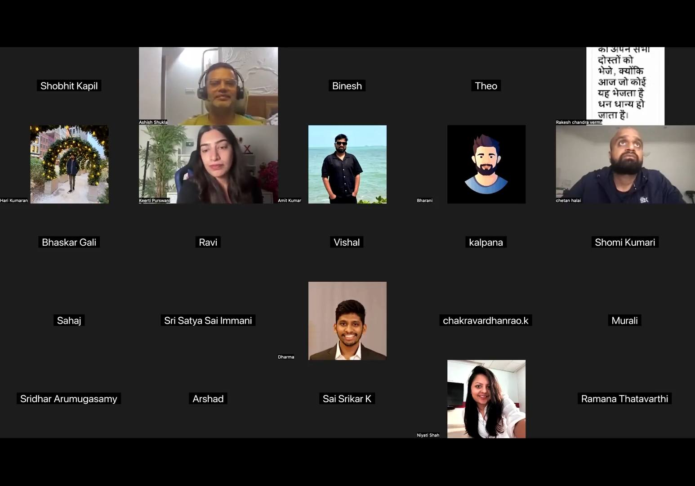
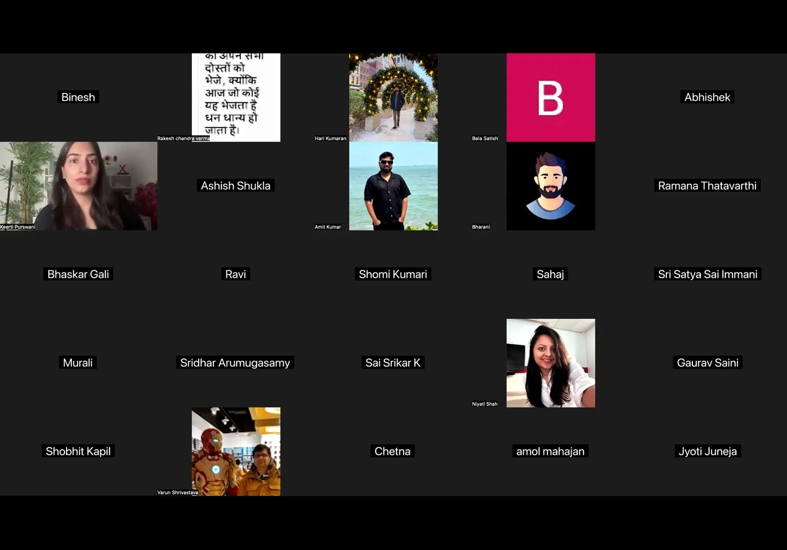
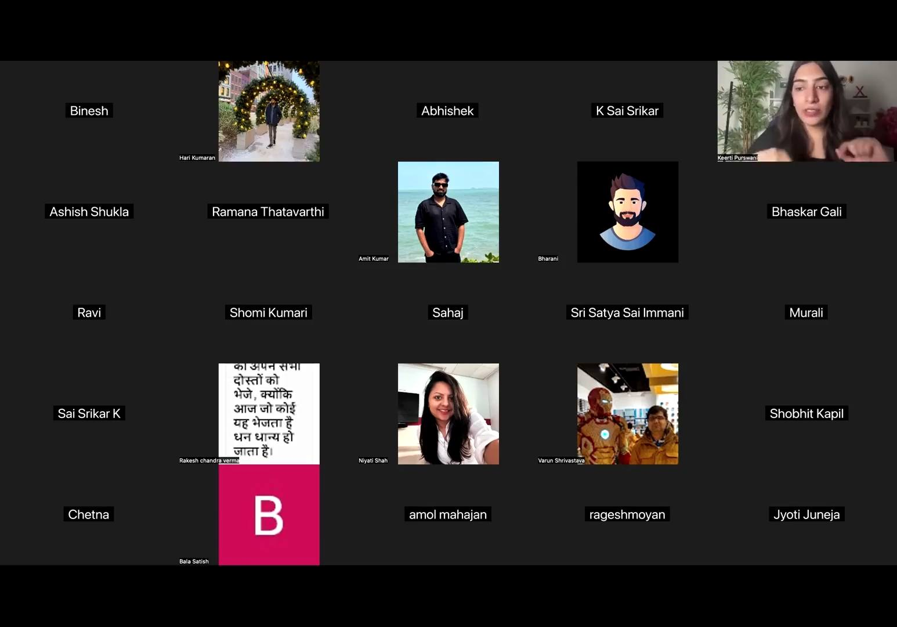
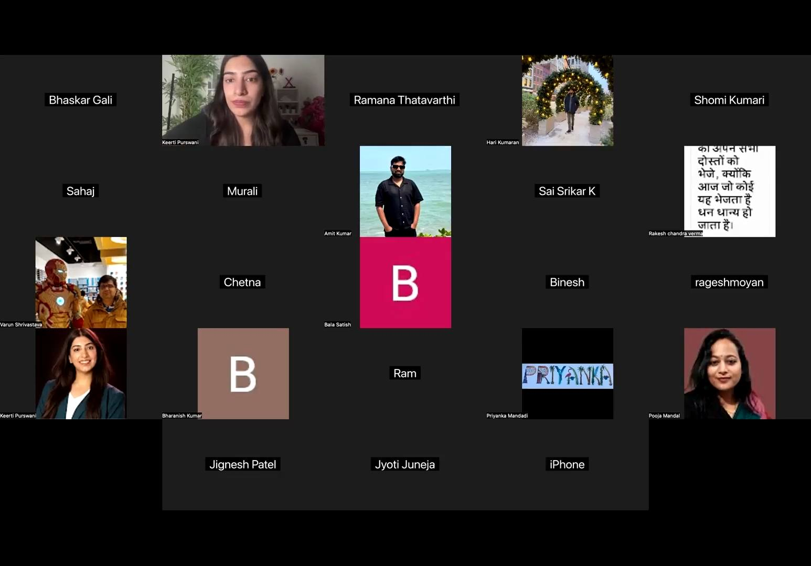

# Agentic AI System Design 第三周第三段：检索架构答疑与工程落地指南

> 说明：本段（p003，122:27–172:57）是课程的**答疑与收尾环节**，逐字稿里没有新的代码演示，也没有 OCR 截图内容。因此本文档按「纯讲解课」的结构来写：第 3 节把讲师回答的每个技术问题按「需求→约束→方案→取舍」的推导过程复现出来，第 4 节把讲师给出的架构决策整理成可直接照着落地的**决策表 / 组件职责表 / 接口草案 / 估算表**，第 5 节逐条解释每个决策为什么这样定。文中所有引用均为逐字稿中文翻译，截图按清单原样插入。

---

## 1. 这一节做什么

这一段是第三周课程的最后一节，讲师没有继续讲新知识点，而是**集中回答学员在混合检索、评估指标、Agentic RAG 架构、代码库图谱、MCP 与工具选型、Claude Code 成本观测**等方面的问题。它的价值不在于「又讲了一个概念」，而在于把前两段讲过的 RAG / 混合检索 / 评估 / Agent 架构，**从「知道是什么」推进到「我的项目该怎么选、怎么搭、怎么验证」**。

具体来说，这一段回答了下面这些会直接影响你动手实现的问题：

1. **BM25 的词法索引和向量库的语义索引，到底是不是同一个存储？** 能不能把关键词当 metadata 塞进 ChromaDB 里凑合？
2. **precision 和 recall 能不能同时是 100%？** 什么时候会、什么时候不会。
3. **MMR 排得好，能不能跳过 re-ranking？**
4. **不 chunk、不建向量库，直接对 SQL / MongoDB / 网页 / 文件做检索，怎么做？**
5. **Agentic RAG 和 Hybrid RAG 的区别是什么？谁来决定从哪个库检索？**
6. **把工具交给 LLM 时，要不要把底层数据库的数据结构也写进 tool description？**
7. **BM25 需不需要做 embedding？AST 分块是自顶向下还是自底向上？类与类的关系存哪里？**
8. **向量库里除了 embedding，还存不存原文和 metadata？**
9. **re-ranking 是应用做还是 LLM 做？ranking 和 re-ranking 有什么区别？**
10. **代码库影响面分析（C++ 大工程、DLL 依赖）该用什么图数据库、什么工具？写 tool 还是写 MCP？**
11. **self-RAG / corrective RAG 的反馈机制怎么落地？faithfulness、factual correctness、answer relevancy 怎么测？**
12. **固定 K 值做评估，遇到「相关文档数少于 K」的查询会不会误导评估？MRR 到底是对什么取平均？**
13. **能不能在不改别人代码的前提下，用一个 wrapper / 编排层优化第三方 chat 应用的延迟和 token？**
14. **Claude Code 怎么看到每次调用的 token 消耗和成本？**

下面按项目实现逻辑重组，而不是按提问顺序流水账。

---

## 2. 讲师原话

> "不需要为了精确匹配把数据存进向量库。向量库只在你想要做语义搜索的时候用——当你不知道确切关键词、只知道大意的时候。如果你确切知道要搜什么词，就用词法搜索。"
> —— p003 [127:52]

> "它会用 Chroma 也能跑起来，因为它会找到相似的结果，但它不是为这个优化的。它会多花时间。就像我昨天给的例子：你搜 order handler，它也会给你 order processor、order manager，但你只想要 order handler，所以你是在浪费算力。"
> —— p003 [128:50]

> "如果你真的想做精确搜索，除了 BM25，你还可以做通配符搜索，Grep 那种东西就是干这个的。Grep 也大量用于搜关键词。对 Grep 来说你什么都不用做，Grep 命令会直接在你所有文件上跑搜索。"
> —— p003 [129:45]

> "如果所有文档都相关——假设有 10 篇相关，你全取回来了，一共就这 10 篇——那 precision 和 recall 都是 100%。所以这是可能的。不是说一个涨另一个就一定跌。数学上可能，但现实中通常不是这样。"
> —— p003 [130:43]

> "如果 MMR 出来的结果已经很好，我们是可以跳过 re-ranking 的。"
> —— p003 [132:21]

> "很多时候你的数据本来就在 MongoDB 或 SQL 库里。你做 RAG 的时候，不一定非要把它迁移到另一个数据库。也许你只是用 LLM 帮你写查询语句，然后从你现有的库里检索。这也是一种可能。"
> —— p003 [135:46]

> "如果是 Agentic RAG，LLM 会决定从哪个库检索——从图、从 SQL、还是从别的地方。如果是 Hybrid RAG，那就是从所有地方都检索，然后做 re-ranking。这是不同的架构选项。"
> —— p003 [136:38]

> "在 tool 的 description 里、也就是 tool 的 doc string 里，这些都可以写进去。比如 tool 名字叫 MongoDB，你就说它在 MongoDB 上执行查询操作、或者从 MongoDB 检索信息，数据以这种格式呈现、这些数据存在这里。"
> —— p003 [138:59]

> "BM25 是关键词搜索算法，这种情况下我们真的需要做 embedding、做向量化吗？不需要，对吧？因为我们有可以直接在 Elasticsearch 之类上面跑的算法。"
> —— p003 [140:25]

> "AST 转成不同的类和方法之后，我们可以用不同的方式遍历 AST。基于遍历结果去分块、去 embedding，但遍历顺序其实不重要。为什么？因为最终你要做的是什么？……如果你问的是 AST 里怎么存『哪个类依赖哪个类』这种信息，那只能靠图数据、靠 Graph RAG。"
> —— p003 [141:19]

> "是的，数据本身、文档本身也会存。有时候我们检索到东西，想看看这个 embedding 到底是什么。所以文档、metadata、embedding 三样都存，等我们写代码的时候用 ChromaDB 会展示给你看。"
> —— p003 [142:35]

> "re-ranking 不会由 LLM 提供。LLM 只是用来回答问题的，LLM 除了回答问题做不了别的。当然，如果你在 prompt 里明确要求它排序，它会替你做。"
> —— p003 [144:52]

> "ranking 就是你拿到数据后，说『这个东西的相关性排第几』，就这样。当你改变排名、重新排序的时候，你就是在 re-ranking，就这么简单。就像我们说索引了某个东西，更新索引的时候就说 re-indexed。"
> —— p003 [147:06]

> "如果这个工具只有你自己用，就写 tool。如果要在团队里多个人用、给整个组织用，那就写 MCP。"
> —— p003 [151:10]

> "我们可以把用户 query 和最终回答都给出来，同时把检索到的上下文也给出来。这样我们可以测 faithfulness，也可以测 factual correctness——事实对不对；还可以测 answer relevancy——用户问的是什么，你只回答了这个，还是答了别的。这三样都能测。"
> —— p003 [153:32]

> "我们会在所有 query 跑完之后，对每个指标取平均，然后判断：平均值大于比如 0.7 就算通过，小于 0.7 就说明要改点什么。所以我们并不依赖单个 query，而是依赖所有 query 的平均。"
> —— p003 [159:11]

> "MRR 不是对 K 取平均，K 是你检索多少个。它是对你测试集里 X 个 query 取平均。"
> —— p003 [161:51]

> "如果 query 完全一样、数据完全一样、embedding 维度完全一样，那计算就是纯数学，就像算两点之间的距离。向量库查询没有不确定性，有不确定性的是 LLM。"
> —— p003 [163:43]

> "是可以在一定程度上控制的，可以通过 prompt、通过一些设置，但只能到某个限度，因为它们有自己的架构。Cursor 有它的构建方式，ChatGPT 有它的构建方式，它们有自己的内部设置决定怎么响应、怎么管理上下文。"
> —— p003 [166:28]

> "在终端里用 Claude Code，你可以写 `claude --verbose`。如果你看到 slash verbose，我不确定，然后它就会开始把所有东西都告诉你——它在做什么，全都会给你。"
> —— p003 [167:54]

> "第三周我们会深入讲 skills。配合 MCP，我们会写很多 skills，会讲清楚它是什么、怎么工作。"
> —— p003 [169:58]

---

## 3. 从零复现：把讲师的推导过程按步骤走一遍

这一节不是「装环境跑代码」，而是把讲师在答疑里给出的**架构推导**还原成你可以照着走的决策流程。每一步都写出：需求是什么、约束是什么、讲师给的方案是什么、取舍在哪。

### 步骤 0：先明确这一段要解决的真实项目场景

讲师在这一段里被问到的场景，其实可以归成三类真实项目：

- **场景 A：应用日志检索**。学员要在一堆应用日志里按 error code、customer ID 做精确查找，同时又要能按语义找。他原本把所有数据都塞进了 ChromaDB。
- **场景 B：需求/用户故事知识库**。某团队把用户故事、需求、评论维护在 GitHub 仓库里，想做成智能问答，还要从评论里估算每条花了多少时间。约束是「只有内部客户用，不追求可扩展性，但要把敏捷文档集中到一处供领导查阅」。
- **场景 C：C++ 大型代码库影响面分析**。开发者改代码后，QA 要跑全部测试用例，耗时一两天。目标是：改一处代码 → 找出受影响的模块 → 找出该跑哪些测试用例。

这三个场景对应三种不同的检索架构选择，下面逐个推导。

### 步骤 1：判断「要不要向量库」——先问查询是精确的还是模糊的

**需求**：场景 A 要按 error code、customer ID 精确查。

**约束**：数据已经在 ChromaDB 里了，学员不想再维护一套存储。

**讲师的推导**：

1. 先分清两类查询。语义查询是「你只知道大意、不知道确切词」时用的；词法查询是「你确切知道要搜什么词」时用的。
2. 向量库存的是 embedding，检索时算的是余弦相似度，它**天生**会把语义相近的东西一起捞回来。你搜 `order handler`，它会把 `order processor`、`order manager` 一起给你。
3. 所以把关键词当 metadata 塞进 ChromaDB 做 lookup，**能跑通，但不是为这个优化的**——会多花时间，还会把不想要的近义词捞进来当噪声喂给 LLM。
4. 结论：**精确匹配要用独立的词法索引**（BM25 / Elasticsearch 这类倒排索引），不要指望向量库兼职。

**取舍**：同一份数据存在多个地方（向量库一份、词法索引一份、图库一份），这是缺点，讲师明确承认「是的，有代价，同样的数据存在多个地方」。但换来的是每种查询都跑在它被优化过的存储上。

**落地判断表**（这是从讲师推导里提炼的，不是讲师原话的表格）：

| 你的查询长什么样 | 该用什么存储 | 理由 |
|---|---|---|
| 只知道大意、不知道确切词 | 向量库（Chroma / 向量 DB） | 语义相似度检索 |
| 确切知道关键词、错误码、ID | BM25 / Elasticsearch 倒排索引 | 精确词命中，快 |
| 要通配符、正则式匹配 | Grep 类工具 | 讲师原话：Grep 直接在所有文件上跑搜索，你什么都不用做 |
| 要问「谁依赖谁」「改这个影响哪些」 | 图数据库（Neo4j 等） | 关系与层级只能靠图 |

### 步骤 2：理解 BM25 的索引结构和向量库根本不是一回事

**需求**：学员问，混合检索时，词法那部分的 chunk 索引方式和语义那部分有区别吗？

**讲师的推导**：

1. 语义侧：chunk 转成 embedding，存进向量库，查询时算距离。
2. 词法侧：chunk 要建成**倒排索引**——本质是一个 map，key 是词，value 是包含这个词的文档列表。查询时你拿确切的关键词去这个 map 里查，能极快地拿到文档。
3. 两者的**查询目标不同**：语义查询优化的是「找语义相似」，词法存储优化的是「找确切词」。所以它们是不同的存储、不同的索引。
4. 学员追问「那我能不能把关键词抽出来当 metadata 存进同一个向量库」——讲师回答：怎么存是不一样的，因为你现在有不同种类的查询了。

**取舍**：可以只上语义检索，系统也能跑（讲师原话：只用 Chroma 或只用语义库也能工作，因为它会找到相似结果），但**不是优化过的**，会慢、会有噪声。如果业务根本不需要语义搜索，那就干脆别上向量库。

### 步骤 3：判断「要不要 chunk、要不要建库」——数据已经在别处怎么办

**需求**：学员困惑——讲师一直说 SQL、web search、文件搜索，可这些不 chunk、不存向量库，怎么检索？

**讲师的推导**：

1. 很多时候数据**本来就在** MongoDB 或 SQL 库里。做 RAG 时不一定非要迁移到新库。
2. 方案一：用 LLM 帮你**写查询语句**，然后从你现有的库里检索。也就是把「自然语言 → SQL / Mongo 查询」这件事交给 LLM。
3. 方案二：如果信息在一个很大的文件里，就让 LLM 承担更多权重，直接从那里取答案。
4. 至于「用哪个检索器、是一次用一个还是每次全用」，这取决于架构：
   - **Agentic RAG**：LLM 决定从哪个库检索（图 / SQL / 向量 / 别的）。
   - **Hybrid RAG**：从所有地方都检索，然后 re-ranking。

**取舍**：Agentic RAG 灵活但要 LLM 做路由决策，多一次调用；Hybrid RAG 简单粗暴全覆盖，但检索量大、必须配 re-ranking 压噪声。讲师明确说「这就是我们要设计的架构」。

### 步骤 4：设计 tool description——让 LLM 知道每个库长什么样

**需求**：学员问，把 tool 交给 LLM 时，除了 tool name 和 description，要不要把底层图库 / MongoDB 的数据结构也传进去，好让 LLM 知道返回的查询该针对哪个库？

**讲师的推导**：

1. 如果这个 tool 的职责就是「决定从哪检索」，那**要传**。
2. 传的位置就在 **tool description / doc string** 里。
3. 写法举例：tool 名叫 `MongoDB`，description 里写清楚「在 MongoDB 上执行查询操作 / 从 MongoDB 检索信息，数据以这种格式呈现，这些数据存在这里」。

**落地**：这直接决定了你写 tool schema 时 description 字段的详细程度。description 不是给人看的注释，是给 LLM 做路由决策的输入。

### 步骤 5：AST 分块与关系存储

**需求**：学员问，AST 拆成类和方法后，是按自底向上还是自顶向下存？两个类、一个类三个函数、另一个类两个函数，类与类的关系怎么建立？

**讲师的推导**：

1. AST 转成类和方法后，可以用**不同的遍历方式**走这棵树。
2. 基于遍历结果去分块、去 embedding，但**遍历顺序其实不重要**——因为最终目的是检索，不是还原结构。
3. 但如果你要问「哪个类依赖哪个类」「改这个函数会影响哪些类和函数」这种**关系和层级**问题，那只能靠**图数据 / Graph RAG**。讲师说他们昨天在内存里用 Chroma 试过，不行。

**取舍**：向量库存内容语义，图库存关系。两者职责不同，不能互相替代。

### 步骤 6：向量库里到底存什么

**需求**：学员问，存进向量库的除了 chunk / embedding，还存不存 metadata？

**讲师回答**：**三样都存**——文档本身（原文）、metadata、embedding。理由是：有时候检索到东西，你想看看这个 embedding 对应的原文是什么。讲师说等写代码时用 ChromaDB 会展示出来。

### 步骤 7：re-ranking 由谁做、ranking 和 re-ranking 的区别

**需求**：学员问 re-ranking 是应用提供还是 LLM 提供；ranking 和 re-ranking 是不是一回事。

**讲师的推导**：

1. **re-ranking 不由 LLM 提供**。LLM 只负责回答问题，除了回答问题做不了别的。除非你在 prompt 里明确要求它排序，那它会替你做。
2. 应用侧可以写**固定公式**：给某类信号固定权重，按公式算分排序。
3. 流程上有两个可插入 LLM 的点：
   - **检索前**：LLM 帮你决定从哪个库检索（给 LLM 看「这个库存什么、那个库存什么」）。
   - **检索后**：拿到 DB1、DB2 两批数据后，可以用自己的算法排序，也可以再发给 LLM 说「这是用户 query，从两个库拿到的信息，排序后给我」。
4. **ranking vs re-ranking**：ranking 是拿到数据后判断相关性排第几；re-ranking 是改变排名、重新排序。类比：索引 → 更新索引叫 re-indexed。

### 步骤 8：评估——precision/recall 能否同时 100%、固定 K 的陷阱、MRR 对什么取平均

**需求**：三个评估相关的疑问。

**讲师的推导**：

1. **precision 和 recall 能否同时 100%**：能。如果所有文档都相关（假设一共 10 篇相关，你全取回），两者都是 100%。数学上可能，但现实中通常是一个涨另一个跌。
2. **固定 K 的陷阱**：学员指出，有的 query 相关文档少于 K，recall 天然到不了 100%，会「误导评估」。讲师承认这是对的，但解法是：
   - **golden dataset 必须正确**，ground truth 错了指标一定差。
   - **不依赖单个 query，而是对所有 query 的每个指标取平均**，平均值 > 0.7 算通过，< 0.7 就要改。
   - K 本身也是根据「通常一个 query 需要多少文档」「context 多大」「chunk 多大」来定的。
   - 而且**不只看一个指标**，要在不同环节看多个指标，再分析失败原因——如果是因为检索多了或相关文档少，就能定位。
3. **MRR 对什么取平均**：不是对 K 取平均。K 是检索多少个；MRR 是对测试集里 **X 个 query** 取平均——每个 query 取最相关结果的排名倒数，再对所有 query 求平均。排名越靠前（数字越小）越好。
4. **同一 query 重复检索排名会变吗**：向量库不会。query 一样、数据一样、embedding 维度一样，计算就是纯数学（两点距离），结果固定。**有不确定性的是 LLM，不是向量库查询**。

### 步骤 9：代码库影响面分析的技术选型

**需求**：场景 C，C++ 大工程，模块间有大量 DLL 依赖，改代码后要定位受影响模块和该跑的测试用例。

**讲师的推导**：

1. 学员自己判断「这个场景不需要 BM25，图库就够了」——讲师没有反对这个判断，顺着往下给工具建议。
2. 图数据库：**Neo4j** 很著名（讲师说会打在聊天里）。
3. 还有工具能直接把整个代码库变成图：**Obsidian**（讲师说没亲自试过，但见过别人用）、**Graphify**（可通过 npm install 使用，配合 Claude 就能生成代码库的图）。讲师说还有一个一时想不起名字的，会放到 Discord。
4. **MCP 能不能通过 API 调用**：可以。
5. **写 tool 还是写 MCP**：如果只有你自己用，写 tool；如果团队多个人用、给整个组织用，写 MCP。

### 步骤 10：self-RAG / corrective RAG 的反馈机制怎么测

**需求**：学员问反馈机制里，把数据再喂回去、再 chunk 再给，是不是这样。

**讲师的推导**：

1. 把**用户 query**、**最终回答**、**检索到的上下文**三者一起给出来。
2. 基于这三者可以测三件事：
   - **faithfulness**：根据检索到的东西，你是照着答的还是幻觉出来的。
   - **factual correctness**：事实对不对。
   - **answer relevancy**：用户问什么，你是不是只答了这个。
3. 讲师说这些在后续课程会**实际写代码做**，会在项目里做。

### 步骤 11：不改别人代码能不能优化第三方 chat 应用

**需求**：组织内部有多个 chat 应用（可能底层都用 Claude / GPT），响应速度、准确率各不同，能不能加一个 wrapper / 编排层，在不改它们代码的前提下降延迟、省 token、少牺牲准确率。

**讲师的推导**：

1. **能控制一点，但有限度**。可以通过 prompt、通过它们提供的设置去调。
2. **不能无限控制**，因为它们有自己的架构——Cursor 有 Cursor 的构建方式，ChatGPT 有 ChatGPT 的构建方式，它们有自己的内部设置决定怎么响应、怎么管理上下文。你不改它们代码，就只能用到它们暴露的旋钮。
3. 讲师提到可以聊「什么进、什么出、怎么控制 context」。
4. 学员追问可以探索哪些方向，讲师给的方向是：**skills**——有很多外部库能帮 Claude 更好地理解代码库、更好地给建议；第三周会深入讲 skills，配合 MCP 会写很多 skills。

### 步骤 12：Claude Code 的 token / 成本观测

**需求**：用 Claude 解题时，想知道第一个 prompt 花了多少 token、整个问题花了多少 token、成本多少，有没有报告。

**讲师回答**：有办法。在终端用 Claude Code 时可以写 `claude --verbose`，它就会把正在做的所有事情都告诉你。讲师说会把相关内容放到 Scott（课程协作平台）上。Copilot 有没有类似功能，讲师说没用过、不确定。

---

## 4. 完整代码

> **重要说明**：本段逐字稿**没有代码演示**，OCR 清单也为空。因此本节不编造「讲师写过的代码」，而是把讲师给出的架构决策落成**可直接照着实现的产物**：设计决策表、组件职责表、tool schema 草案、评估指标表、容量/参数估算表。凡涉及具体代码的地方，均明确标注「课里没有代码，以下为示意」。

### 4.1 设计决策表（按讲师推导整理）

| 决策点 | 选项 | 讲师倾向 | 触发条件 |
|---|---|---|---|
| 要不要向量库 | 上 / 不上 | 只在需要语义搜索时上 | 查询是模糊的、只知道大意 |
| 精确匹配怎么做 | 塞进向量库 metadata / 独立词法索引 | 独立词法索引（BM25 / ES） | 要按 error code、customer ID 精确查 |
| 通配符/正则搜索 | 自建 / Grep | Grep 类工具 | 要模式匹配，且数据在文件里 |
| 关系/层级查询 | 向量库 / 图库 | 图库（Neo4j 等） | 问「谁依赖谁」「改动影响面」 |
| 数据已在 SQL/Mongo | 迁移 / 原地检索 | 原地检索，LLM 写查询 | 不想维护第二套存储 |
| 多库检索路由 | Agentic / Hybrid | 看场景 | Agentic=LLM 决定；Hybrid=全检+rerank |
| re-ranking 执行者 | LLM / 应用 | 应用（固定公式），或显式 prompt 让 LLM 排 | LLM 默认只答问题 |
| 工具复用范围 | tool / MCP | 自用写 tool，组织用写 MCP | 使用者范围 |
| 向量库存什么 | 只存 embedding / 三样都存 | 原文 + metadata + embedding | 要回看原文 |

### 4.2 组件职责表

| 组件 | 职责 | 输入 | 输出 | 备注 |
|---|---|---|---|---|
| 向量库（如 ChromaDB） | 语义相似检索 | query embedding | top-K chunk + 原文 + metadata | 存三样：原文、metadata、embedding |
| 词法索引（BM25 / Elasticsearch） | 精确词命中 | 关键词 | 命中文档 | 倒排索引，map 结构 |
| 图数据库（如 Neo4j） | 关系/层级查询 | 节点、关系查询 | 依赖子图 | 代码影响面分析用 |
| Grep 类工具 | 通配符/正则搜索 | 模式 | 匹配文件/行 | 讲师：直接在所有文件上跑，无需额外准备 |
| 路由器（Agentic RAG） | 决定从哪个库检索 | 用户 query + 各库描述 | 目标库列表 | 由 LLM 决策 |
| 融合器（Hybrid RAG） | 合并多库结果 | 多库结果 | 候选集 | 之后必须 rerank |
| Re-ranker | 重排候选 | 候选集 + query | 排序后列表 | 应用侧固定公式，或显式 prompt 让 LLM 排 |
| 评估器 | 算指标 | query + 回答 + 上下文 + golden | precision/recall/MRR/faithfulness 等 | 对多 query 取平均 |

### 4.3 Tool schema 草案（课里没有代码，以下为示意）

按讲师原话「在 tool 的 description / doc string 里把这些都写进去」，一个用于路由的 MongoDB 检索工具可以这样写：

```json
{
  "name": "mongodb_retrieve",
  "description": "在 MongoDB 上执行查询操作，从 MongoDB 检索信息。库中存储的是应用日志文档，字段包括 error_code（字符串，如 E1024）、customer_id（字符串）、timestamp（ISO8601）、message（文本）。返回格式为 JSON 数组，每个元素包含上述字段。当用户查询涉及确切的错误码或客户 ID 时使用本工具。",
  "input_schema": {
    "type": "object",
    "properties": {
      "filter": {
        "type": "object",
        "description": "MongoDB 查询过滤条件，例如 {\"error_code\": \"E1024\"}"
      },
      "limit": {
        "type": "integer",
        "description": "返回条数上限，默认 20"
      }
    },
    "required": ["filter"]
  }
}
```

要点：description 里写清了**存什么数据、字段是什么、返回什么格式、什么时候该用**——这正是讲师说的「让 LLM 知道底层库长什么样，好决定从哪检索」。

### 4.4 评估指标表（按讲师口径）

| 指标 | 衡量什么 | 讲师口径要点 |
|---|---|---|
| Precision | 取回的里有多少相关 | 可与 recall 同时 100%（全部相关且全取回时） |
| Recall | 相关的里取回了多少 | 相关文档数 < K 时天然偏低，靠多 query 平均缓解 |
| MRR | 最相关结果排名的倒数，对 **X 个 query** 取平均 | 不是对 K 取平均；排名越小越好 |
| Faithfulness | 回答是否忠于检索到的上下文 | 三者（query/回答/上下文）一起给评估 |
| Factual correctness | 事实是否正确 | 同上 |
| Answer relevancy | 是否只回答了用户问的 | 同上 |

通过标准（讲师举例）：**所有 query 跑完后对每个指标取平均，平均 > 0.7 算通过，< 0.7 就要改**。

### 4.5 参数估算表

| 参数 | 怎么定 | 讲师依据 |
|---|---|---|
| K（检索条数） | 按「通常一个 query 需要多少文档」定，同时考虑 context 大小和 chunk 大小 | p003 [159:56] |
| chunk 大小 | 与 K 一起权衡 context 预算 | 同上 |
| 通过阈值 | 例：平均指标 > 0.7 | p003 [159:11] |
| 测试 query 数 X | 你的测试集规模，即跑多少测试用例 | p003 [161:51] |

### 4.6 代码库图谱工具清单（讲师点名）

| 工具 | 用途 | 讲师原话要点 |
|---|---|---|
| Neo4j | 图数据库 | 「很有名」 |
| Obsidian | 把内容生成图 | 「没试过，但见过别人用」 |
| Graphify | npm install 后配合 Claude 生成代码库图 | 「有人写了 Graphify」 |
| Grep | 关键词/通配符搜索 | 「直接在所有文件上跑搜索」 |

---

## 5. 逐行解释：每个决策为什么这样定、不这样会怎样

**为什么精确匹配不能用向量库兼职？**
向量库的检索单元是 embedding，算的是余弦相似度。它的数学本质就是「找语义最近的」，所以 `order handler` 必然把 `order processor`、`order manager` 一起带出来。你把关键词当 metadata 做 lookup，确实能查到，但这条路径没被优化——慢，而且近义词会作为噪声进入 LLM 的 context，拉低回答质量。不这样做的代价是：你以为省了一套存储，实际是在检索质量和延迟上付账。

**为什么词法索引要用倒排结构？**
倒排索引是「词 → 文档列表」的 map。你拿确切关键词去查，直接命中，不需要算距离。这就是为什么它「为找确切词而优化」。如果你把同样的数据只放向量库，每次都要算相似度，等于用大炮打蚊子。

**为什么同一份数据存在多个地方是可以接受的？**
讲师明确承认这是缺点（「同样的数据存在多个地方，这是对的」），但换来每种查询跑在它被优化的存储上。这是一个**用存储冗余换检索质量**的经典取舍。如果你的业务根本不需要语义搜索，那连向量库都不该上——讲师原话是「如果不需要语义搜索，那就别用向量库」。

**为什么 Agentic RAG 和 Hybrid RAG 是两种架构而不是两种实现细节？**
Agentic RAG 把「从哪检索」的决策交给 LLM，灵活但多一次 LLM 调用、依赖 LLM 判断准不准。Hybrid RAG 是「全都检一遍再 rerank」，简单但检索量大、必须靠 rerank 压噪声。选哪个取决于你的库数量、查询分布、延迟预算。讲师说「这就是我们要设计的」。

**为什么 tool description 要写数据结构？**
因为 Agentic RAG 里 LLM 要基于「每个库存什么」来决定路由。description 是 LLM 唯一的输入来源。你写得含糊，它路由就错。讲师给的写法是：tool 名 + 在什么库上做什么操作 + 数据以什么格式呈现 + 数据存在哪里。

**为什么 AST 遍历顺序不重要，但关系必须进图库？**
遍历顺序只影响你按什么顺序切 chunk，而 chunk 最终是给语义检索用的，顺序不影响检索效果。但「类 A 依赖类 B」「改函数 f 影响哪些类」是**关系问题**，向量库的相似度算不出依赖关系，只能靠图。讲师说他们试过在 Chroma 里做，不行。

**为什么向量库要存原文？**
因为检索到 embedding 后，你需要把原文喂给 LLM，也需要人工回看「这条到底存了什么」。只存 embedding 等于存了一堆无法阅读的向量。

**为什么 re-ranking 默认不该交给 LLM？**
LLM 的职责是生成回答。让它排序要么靠 prompt 显式要求（多一次调用、结果不稳定），要么它根本不做。应用侧写固定公式（给不同信号固定权重）更可控、更便宜、更可复现。讲师原话：「LLM 除了回答问题做不了别的。」

**为什么固定 K 评估会「误导」，但平均能救？**
单个 query 的相关文档可能少于 K，recall 天然到不了 100%，看单条会误判系统差。但评估的目的是判断**系统整体**好不好，所以对所有 query 的每个指标取平均，平均值过阈值即通过。同时要**多指标交叉看**，才能定位失败原因（是检索多了，还是相关文档本来就少）。前提是 golden dataset 本身正确——ground truth 错了，指标一定差。

**为什么 MRR 对 query 取平均而不是对 K？**
K 是「检索几个」，是检索参数；MRR 衡量的是「最相关的结果排得多靠前」，这是每个 query 一个值，然后对测试集的 X 个 query 求平均。混淆这两个会把「检索深度」和「排序质量」搅在一起。

**为什么同一 query 重复查向量库结果不变？**
query 固定、数据固定、embedding 维度固定，余弦相似度就是纯数学计算，结果确定。有随机性的是 LLM 生成。这一点对评估很重要：**向量检索的指标是可复现的，LLM 输出的指标才有波动**。

**为什么自用写 tool、组织用写 MCP？**
tool 是绑在单个应用/单个 agent 里的能力；MCP 是跨应用、跨人的标准化协议。使用范围决定封装层级。给全组织用就写 MCP，否则每个人都要重复实现一遍。

**为什么 wrapper 优化第三方 chat 应用只能「到某个限度」？**
你只能用到对方暴露的旋钮（prompt、设置）。它们的上下文管理、响应策略是内部架构决定的，你不改代码就动不了。讲师举 Cursor 和 ChatGPT 为例，说明各家有自己的内部设置。

**为什么 Claude Code 用 `--verbose` 看消耗？**
讲师给的具体做法就是在终端加 `--verbose`，让它把正在做的事都打出来。这是本段唯一一条具体命令，务必记下。

---

## 6. 复现检查清单

按这份文档落地你的项目时，逐条打勾：

- [ ] 我列出了项目里所有查询类型，并标注每条是「精确词」还是「语义大意」还是「关系/层级」。
- [ ] 精确词查询走了独立词法索引（BM25 / Elasticsearch），没有硬塞进向量库。
- [ ] 需要通配符/正则的场景，评估过 Grep 类工具。
- [ ] 关系/层级查询（依赖、影响面）走了图数据库，没有用向量库硬凑。
- [ ] 数据已在 SQL/Mongo 的场景，评估过「LLM 写查询 + 原地检索」，没有盲目迁移。
- [ ] 明确了架构是 Agentic RAG（LLM 路由）还是 Hybrid RAG（全检 + rerank）。
- [ ] 每个检索工具的 description 写清了：在什么库上做什么、数据格式、数据内容、何时使用。
- [ ] 向量库里存了原文 + metadata + embedding 三样。
- [ ] re-ranking 默认由应用侧固定公式执行；若用 LLM 排序，是在 prompt 里显式要求。
- [ ] 评估集（golden dataset）经过人工校验，ground truth 正确。
- [ ] 评估对**所有 query 的每个指标取平均**，设了通过阈值（如 0.7），并交叉看多个指标定位失败原因。
- [ ] MRR 是对 X 个 query 取平均，没有和 K 混淆。
- [ ] 知道同一 query 重复查向量库结果确定，LLM 输出才有波动。
- [ ] 自用能力封装成 tool，组织级能力封装成 MCP。
- [ ] 需要看 Claude Code 消耗时，用 `claude --verbose`。
- [ ] 代码库图谱场景评估过 Neo4j / Obsidian / Graphify。

---

## 7. 课里没讲但你会撞上的

1. **BM25 的具体参数（k1、b）怎么调**：课里没讲。你实际用 Elasticsearch 或 rank_bm25 时会遇到这两个参数，需要自己按语料调。
2. **倒排索引的具体建法、分词器选择**：课里只讲了「是 map 结构、为精确词优化」，没讲中文分词、大小写归一、停用词这些工程细节。
3. **Neo4j 的 Cypher 查询语法、图 schema 怎么设计**：课里只点名了 Neo4j 和「图库存关系」，没给建模方法。
4. **Graphify 的具体安装与用法**：课里只说「npm install 后配合 Claude 能生成代码库图」，没给命令和配置。
5. **Obsidian 生成图的具体流程**：讲师自己说没试过，只见过别人用。
6. **`claude --verbose` 的完整输出字段、成本怎么换算**：课里只给了这个 flag，没讲输出里各字段含义和计价方式。该字段名请以实际输出为准。
7. **Copilot 是否有同类 token 观测功能**：讲师明确说没用过、不确定。
8. **faithfulness / factual correctness / answer relevancy 的具体计算实现**：课里说「后续课程会写代码做」，本段只给了概念。
9. **Agentic RAG 里 LLM 路由的 prompt 模板**：课里讲了「description 里写清楚」，没给完整路由 prompt。
10. **多库结果的融合公式（RRF 等）**：课里说「可以用自己的算法排序」，没指定具体算法。
11. **MCP 的协议细节、server 怎么写**：课里说第三周配合 skills 深入讲，本段只给了「组织级用就写 MCP」的判断。
12. **skills 是什么、怎么写**：课里明确说第三周才深入讲。
13. **在 JS/Node 里的对应**：本段涉及的都是架构层概念，没有锁/事务/并发的具体实现。若你的检索服务用 Node 写，倒排索引可直接用 Elasticsearch 客户端，图查询用 neo4j-driver，向量库用 chromadb 的 JS SDK——这些库名课里没提，属于你落地时会自己选型的部分。

---

### 附：本段引用的截图

本段逐字稿对应的截图清单共 4 张，均来自 p003。由于本段为纯答疑、无代码演示，截图主要用于还原讲师答疑时的板书/共享屏幕上下文：









> 注：以上四张截图的帧号严格取自清单（p003_7957s / p003_8649s / p003_9341s / p003_10033s），alt 中的时间码按清单标注。截图内容以实际画面为准；若画面中出现的命令或配置与逐字稿不一致，以逐字稿中文翻译为准，并在落地时以实际终端输出校验。