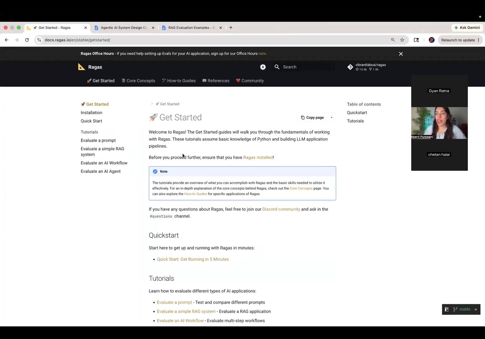
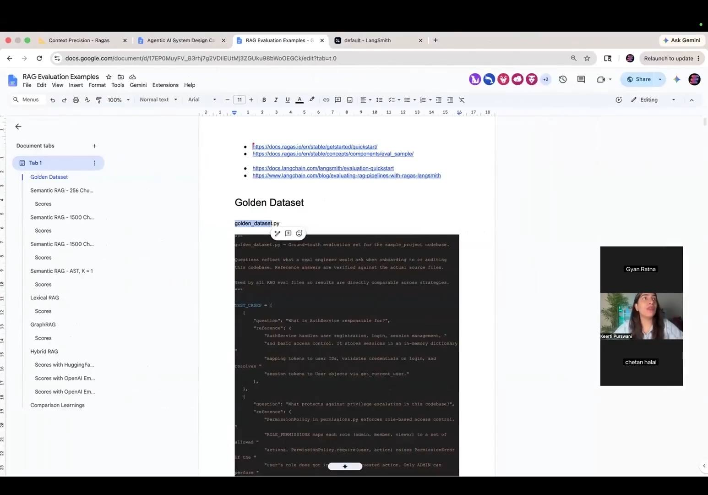
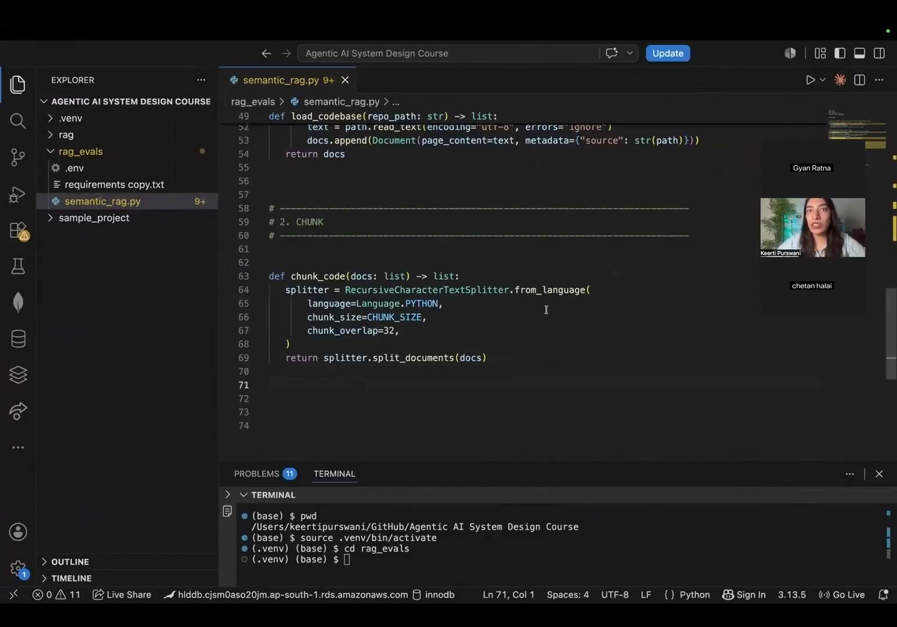
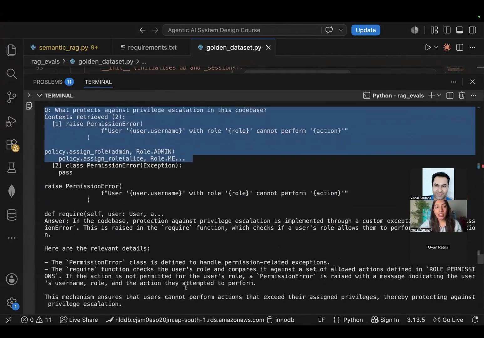

# Agentic AI System Design · Week 2（P4）：用 Ragas 横向评测四类 RAG

> 本文覆盖 P4 第 1/2 段（0:00–80:04）。这一段是 Week 2 的开场：先用 Ragas 库把上周手写的评估公式工程化，再建黄金数据集，把 semantic / lexical / hybrid / graph 四类 RAG 放在同一套测试用例和同一组指标下横向对比；最后讲师开始讲检索排序（ranking），讲到「多路检索结果融合」和「再调一次 LLM 重排」两种应用侧排序时，本段结束，后半段在下一段继续。
>
> 说明：逐字稿是讲师现场边写边讲，**没有贴出完整源文件**，本段也**没有提供 OCR 结果**。第 4 节代码是按逐字稿里出现过的库名、参数、步骤、变量语义重建的**可运行版本**；凡是逐字稿没讲到的 API 细节，都在注释里标了「课里没讲」。第三方库 API 会随版本变化，运行前请以你安装的版本为准。

---

## 1. 这一节做什么

这一段要解决一个非常具体的问题：**你怎么证明「新版本的 RAG 比旧版本好」？**

上周的做法是手写公式：recall = 检索到的相关条目 / 全部相关文档，precision = 检索到的相关条目 / 检索到的条目；还讲了 recall@K、precision@K、hit rate、MRR（第一个相关 chunk 的位置）、NDCG（给不同名次分配权重），以及 faithfulness、factual correctness、answer relevancy、context precision、context recall。问题是：**每换一次 chunk size、换一次 embedding、换一次向量库，你都要重算一遍，手写公式不现实。** 而且手写公式还有一个更隐蔽的问题：像 faithfulness、answer relevancy 这类指标本质上不是「数条目」能算出来的，它需要判断「答案里的每一句话是否被 context 支持」「答案是否真的在回答这个问题」，这类判断只能交给另一个 LLM 当裁判。手写公式既慢又不一致，还无法复现——同一份数据两个人算出来可能不一样，这在工程上是不可接受的。

所以这一节做四件事：

1. **引入 Ragas**（RAG Assessment）库，把指标计算交给库，自己只负责准备四样东西：user input、retrieved context、response、reference。这四样东西一旦固定下来，换 chunk size、换 embedding、换向量库、换 RAG 类型，评估代码一行都不用改，只改上游的检索配置即可。
2. **建黄金数据集（golden dataset）**：18–20 条测试用例，每条包含 question 和 reference（ground truth）。这是所有对比的基准。没有这个基准，任何「新版本更好」的说法都是空话，因为你没有一把固定的尺子。
3. **跑四种 RAG 并记录指标**：semantic（不同 chunk size、不同 K）、semantic + AST、lexical、graph、hybrid（不同 embedding、不同 chunk size）。每条测试用例都跑一遍 agent，把 answer 和 tool message 里的 retrieved context 存下来，送进 Ragas 打分，最后对全部测试用例取平均。取平均这一步很关键：单条用例的分数波动很大，只有平均值才能反映系统整体水平，也才能支撑「改配置到底有没有用」的判断。
4. **用数字做决策**：chunk size 从 256 改到 1500，precision / recall / faithfulness / relevancy 都上升；K 从 4 降到 1，指标下降；`which file imports task and status` 这类多跳关系查询在 semantic 里很差、在 graph rag 里很好；`billing error` 这类精确匹配查询在 lexical 里很好；`trace the entire flow` 在 semantic 和 lexical 都差、在 graph rag 好。结论不是「某个 RAG 最强」，而是**没有一种 RAG 适合所有查询，所以 hybrid 看起来最好**——这也是最后 ranking 讨论的起点。换句话说，这一节真正教给你的不是「哪个 RAG 赢」，而是「如何用一套可复现的流程，让数据告诉你哪个 RAG 在什么查询上赢」。

课程位置：Week 1 全部是 RAG；Week 2 先用一小段时间收尾 RAG，然后转到 context engineering、harness engineering、LLM 安全。这一段结束前，讲师明确说「RAG 到此为止，接下来进入 context engineering」。



---

## 2. 讲师原话

> "Ragas 就是我们今天要用的库，Ragas 代表 RAG Assessment，它会帮我们评估所有类型的 RAG。"
> —— p004 [05:03]

> "所有类型的评估都能用数学逻辑做吗？比如『这个答案和我的问题相关吗』，你觉得有数学答案吗？没有。所以有些指标我们要用另一个 LLM 当裁判、当评估器。"
> —— p004 [06:30]

> "这个 LLM 可以是同一个，也可以是不同的；如果用同一个，可能会有偏差。"
> —— p004 [07:26]

> "之前的例子里我们用的是 HuggingFace embeddings，现在我用 LangChain 的 OpenAI embeddings。……现在用的是内存版 Chroma store，所有东西都在 RAM 里，我们后面也会做持久化。"
> —— p004 [15:23]

> "请务必给这个加上限制，或者盯着你的查询花了多少时间。有些类型的 RAG 会卡在循环里，这取决于查询，也取决于文档。"
> —— p004 [16:50]

> "K=4 会给我更多上下文，但它会花掉什么？token、延迟，还有钱。"
> —— p004 [18:18]

> "评估时除了 context 和 answer，还需要什么？golden data set，ground truth。golden data set 里有什么？question、reference、answer。"
> —— p004 [23:03]

> "如果面试官问你：指标说你的 RAG 系统表现很好，但生产里表现不好，你要更新什么？更新你的 golden data set。去看生产日志，看用户都在问什么，补上 expected reference，加进测试用例再跑。"
> —— p004 [27:12]

> "在 Ragas 里评估要传什么？user input、retrieved context、response、reference。"
> —— p004 [30:26]

> "评估用的指标是 LLM context precision、LLM context recall、faithfulness、answer relevancy、factual correctness。"
> —— p004 [31:17]

> "跑 eval 是 CI/CD 流水线的一部分，不是生产应用的一部分。指标满意才把代码推到生产，不满意就不推。"
> —— p004 [43:56]

> "这就像单元测试，单测通过才推代码；同样，新 RAG 版本的评估足够好，我们才推。"
> —— p004 [44:25]

> "如果我把 chunk size 从 256 改成 1500，你猜 precision 会升还是降？……precision 升了，recall 也升，faithfulness 也升，relevancy 也升。"
> —— p004 [45:19]

> "系统设计里没有哪个值是唯一答案。K 增大评估会变好，但延迟会升、token 会多，而且不是所有查询都这样。"
> —— p004 [51:23]

> "现在用内存方案 networkx（NX），它会在内存里建一个图结构。……后面做端到端项目时我们会用 Neo4j。"
> —— p004 [54:41]

> "关系可以是 defines、imports、uses、calls、depends on、inherits from 这些。"
> —— p004 [56:07]

> "这些是实体，也就是节点；这是两个节点之间的关系，也就是边；最后这个图就是边的列表。"
> —— p004 [57:59]

> "我可以从代码里理解哪个类和哪个类相关，也可以让 LLM 自己生成图，让 agent 生成图——这就是我这份代码做的事。"
> —— p004 [59:24]

> "现在有 202 个节点、260 条边。"
> —— p004 [67:18]

> "对于大型仓库，这些上下文会消耗巨量 token。所以我要你理解权衡。"
> —— p004 [70:39]

> "不同查询由不同 RAG 处理得更好，那我到底该用哪个？hybrid 看起来是最好的方案。hybrid RAG 是什么？不同 retriever 的组合。"
> —— p004 [74:52]

> "从任何数据库检索数据——向量库也好、BM25 也好——数据库内部都会做一次排序，给你最相关的前五条。"
> —— p004 [76:42]

> "在应用侧还有两种排序可能。第一种：如果你从多个 retriever 检索，它们各自给出排好序的结果，你可以基于某种排序把这些结果融合、合并。"
> —— p004 [79:36]

---

## 3. 从零复现

### 3.1 新建目录与环境

讲师在课上新建了一个独立目录，名字是 `rag eval examples` 或 `rag evals`（口述两种都出现过），把上节课的 sample project（代码库）和 `amazon.txt` 之类的素材拷进去，**不复用之前的任何文件**，从零开始。这个「从零开始」不是洁癖，而是有意的：评估脚本必须能独立跑起来，不能依赖上一节课留下的任何中间状态，否则你无法判断结果差异是来自 RAG 改动还是来自环境残留。

建议目录结构：

```text
rag-evals/
├── .env
├── requirements.txt
├── golden_dataset.py
├── semantic_rag_eval.py
├── lexical_rag_eval.py
├── hybrid_rag_eval.py          # 课里没讲融合细节，见 4.6 说明
├── graph_rag/
│   ├── schema.py
│   ├── graph_builder.py
│   ├── graph_rag.py
│   └── graph_rag_eval.py
└── sample_project/              # 讲师说的默认项目，放你要分析的代码库
    ├── main.py
    ├── db.py
    ├── audit_service.py
    ├── task_service.py
    └── ...
```

环境准备：

```bash
python3 -m venv .venv
source .venv/bin/activate        # Windows: .venv\Scripts\activate
pip install -r requirements.txt
```

`.env` 至少要有 OpenAI 的 key（讲师用 OpenAI embeddings 和 ChatOpenAI）。LangSmith 的 key 和变量名**课里没讲**，但讲师确实在课上打开 LangSmith 看 trace，你需要按 LangSmith 官方文档配置；本段不展开。

```bash
# .env 示例；变量名课里没讲，以下为通用写法
OPENAI_API_KEY=sk-...
REPO_PATH=./sample_project
CHUNK_SIZE=256
TOP_K=4
```

`requirements.txt`：

```text
langchain
langchain-openai
langchain-community
langchain-chroma
langchain-text-splitters
langgraph
chromadb
ragas
networkx
rank-bm25
python-dotenv
pydantic
```

> 版本号课里没讲。Ragas 的 API 在 0.1.x 和 0.2.x 之间变化较大，第 4 节代码按 0.2.x 风格写；如果你装到旧版，`EvaluationDataset` / `SingleTurnSample` 和指标类名需要换成 `datasets.Dataset` + 函数式指标。这一点在第 7 节会再提醒。

### 3.2 建黄金数据集

讲师强调：**golden dataset 是整个评估的地基**。里面每条用例有 question 和 reference（expected answer / source of truth / ground truth）。数量是 18–20 条，覆盖不同类型的查询：有的适合 graph rag，有的适合 agentic rag，有的适合 lexical，有的适合 semantic。这个「覆盖不同类型」是刻意的设计——如果 20 条用例全是「某个函数在哪」，那 semantic 会赢得很轻松，但结论毫无意义；只有把多跳关系、精确匹配、流程追踪这些不同形态的查询混在一起，横向对比才有信息量。

数据来源有三种，可以组合：

1. 人工手写；
2. 从生产日志里捞真实用户查询；
3. 用 AI 生成（讲师自己就是让 AI 先生成，再人工检查）。

讲师还讲了一个面试高频问题：指标很好但生产效果差，怎么办？答案是**更新 golden dataset**——看生产日志、补 expected reference、加进测试用例、重跑，让数据集尽量反映生产系统。这个回答背后的逻辑是：指标好而生产差，通常不是指标算错了，而是**测试集和生产分布不匹配**，所以修的是数据集，不是指标公式。



### 3.3 Semantic RAG：加载 → 分块 → 嵌入 → 建库

这一段和上周完全一样，讲师明确说「到这里为止没有新东西」：

1. 加载 codebase，得到文件列表；
2. 用 LangChain 的 `RecursiveCharacterTextSplitter` 做递归分块，默认 `chunk_size=256`（课里没讲 overlap，代码里设 0）；
3. 用 **LangChain OpenAI embeddings** 嵌入（上周用的是 HuggingFace embeddings，讲师说你可以换任意 embedding，embedding model 和 LLM model **不需要来自同一个 provider**）；
4. 存进 **in-memory Chroma**，所有东西在 RAM 里。



### 3.4 建 Agent：retriever tool + system prompt + 次数上限

Agent 的组成：

- 一个 retriever tool，名字语义是「搜索整个 codebase」，内部就是对上面那个 vector store 做 similarity search，取 top K；
- system prompt：「你是一个 senior engineer」；
- **middleware / 次数上限**：讲师反复强调必须加，因为「有些类型的 RAG 会卡在循环里」。这个检查是 LangChain / LangGraph 框架侧做的，检查模型被调用了多少次、工具被调用了多少次，超过就不再调用。讲师说这在 LangSmith 里能看到。

K 的取值：讲师口述里有一处提到「five and two」，但紧接着明确说 `k equal to four`、`retrieving top four chunks`，所以本段按 **K=4** 复现，并说明这个值是可配置的。K=4 比 K=1 给更多上下文，但代价是 token、延迟、钱。

### 3.5 跑 Agent 时保存 answer 和 context

这是整段代码里**唯一新增的部分**。之前跑 agent 只打印答案，现在要：

- 从返回的 `messages` 里取**最后一条 message** 作为 answer；
- 从 `messages` 里把所有 **tool message** 取出来，作为 retrieved context。

消息类型有三种：human message（用户输入）、AI message（LLM 回复）、tool message（工具返回）。讲师在 LangSmith 里现场展示了这一点。context 必须存下来，因为 Ragas 评估要用。



### 3.6 组装 evaluation sample 并调用 Ragas

对 golden dataset 里每一条测试用例：

1. 用 question 跑 agent；
2. 拿到 answer 和 context；
3. 组装成一条 sample：`user_input=question`、`retrieved_contexts=context`、`response=answer`、`reference=reference`；
4. 全部跑完后，一次性送进 Ragas 的 `evaluate`。

指标五个：LLM context precision、LLM context recall、faithfulness、answer relevancy、factual correctness。

讲师特别解释了两个「LLM 裁判」参数：

- **evaluator LLM**：faithfulness、relevancy 这些需要 LLM 判断，可以指定一个**更小的模型**专门做评估，和主 agent 的模型不同；
- **evaluator embedding**：answer relevancy 需要把答案再嵌入、比较相似度，所以还要指定 embedding 模型。

讲师还讲了不同指标需要的输入不同：context precision 需要 answer、context、question 三样；faithfulness 主要看 answer 和 question（讲师提到 statement generator，response 是重点）。但这些不用你手动管，库会处理。

### 3.7 运行与读输出

运行 semantic 评估脚本。因为要对 18–20 条测试用例逐条跑 agent（每条都要加载、检索、生成），再加上 Ragas 的多次 LLM 调用，**整个过程很慢**。讲师在课上跑的时候，先看到逐条打印的 question / context / answer，然后看到 Ragas 开始调用 LLM precision、context recall、faithfulness、factual correctness。

输出有两层：

- 每条测试用例的五个指标；
- 所有测试用例的**平均值**（就是 mean）。

讲师还把 LangSmith 打开给你看：每条测试用例是一次 trace，Ragas 的评估调用也在 LangSmith 里可见。评估结果本身也会出现在 LangSmith。

### 3.8 换配置重跑：chunk size、K、embedding

Semantic 本身就可以做很多组实验：

| 实验 | chunk size | K | embedding | 讲师口述结果 |
|---|---|---|---|---|
| baseline | 256 | 4 | OpenAI | 基准 |
| 大 chunk | 1500 | 4 | OpenAI | precision、recall、faithfulness、relevancy 全部上升 |
| 小 K | 256 | 1 | OpenAI | 指标下降 |
| 换 embedding | 256 | 4 | HuggingFace | 课里没给具体数字 |

讲师说得很清楚：这些组合他**周末全跑过**，课上来不及全部重跑，所以把输出复制到文档里对比。你要自己跑，就改 `CHUNK_SIZE` 和 `TOP_K` 两个环境变量，其他代码不动。

### 3.9 Lexical RAG 与 Hybrid RAG

Lexical 上周已经讲过代码，这一段只做对比，**课里没重写 lexical 的实现**。它靠精确匹配，所以 `billing error`、`check is active` 这类查询预期表现好。讲师的实测：`billing error` 在 lexical 里很好，在 semantic 里一般。原因不难理解：BM25 这类词法检索对「原词命中」极其敏感，而 embedding 会把 `billing` 和 `invoice`、`charge` 混在一起，反而稀释了精确信号。

Hybrid 是「不同 retriever 的组合」。讲师在这一段只讲了概念和动机（不同查询由不同 RAG 处理得更好，所以组合起来），**没有展开融合算法**，融合细节留到 ranking 部分。本段复现时，hybrid 可以先做成最简单的「两路检索、结果拼接去重」，把融合策略当成一个待调参数，等下一段讲 ranking 时再替换成加权融合或 RRF。

### 3.10 Graph RAG：schema → 建图 → 查询

Graph RAG 是本段唯一一个「新架构」，讲师花了相当篇幅：

1. **定义 schema**：节点类型（实体）和边类型（关系）。关系可以是 `defines`、`imports`、`uses`、`calls`、`depends on`、`inherits from` 这些。讲师的原话是「这些是实体，也就是节点；这是两个节点之间的关系，也就是边；最后这个图就是边的列表」。
2. **建图**：用 **networkx** 在内存里建图结构（后面端到端项目会换 Neo4j）。建图方式有两种：从代码里静态分析出关系，或者**让 LLM / agent 自己生成图**——讲师这份代码走的是后者。
3. **规模**：讲师现场跑出来是 **202 个节点、260 条边**。
4. **查询**：graph rag 擅长多跳关系查询，比如 `which file imports task and status`、`trace the entire flow`。这类查询在 semantic 和 lexical 里都差，因为答案不在任何单个 chunk 里，而在 chunk 之间的关系里。

讲师还提醒了 graph rag 的代价：「对于大型仓库，这些上下文会消耗巨量 token。所以我要你理解权衡。」图越大，喂给 LLM 的子图越大，token 成本越高，这是 graph rag 用精度换成本的地方。

### 3.11 汇总对比与结论

把四类 RAG 在同一套 golden dataset、同一组指标下的平均值放在一张表里，讲师的结论是：

- 没有一种 RAG 适合所有查询；
- semantic 对语义相近的查询好，对精确匹配和多跳关系差；
- lexical 对精确匹配好，对语义改写差；
- graph 对多跳关系好，成本高；
- **hybrid 看起来最好**，因为它把不同 retriever 的结果组合起来。

这个结论直接引出下一段的 ranking：既然 hybrid 要组合多路结果，那「怎么组合、怎么排序」就成了核心问题。讲师在这一段末尾点出两种应用侧排序：多路检索结果融合，以及再调一次 LLM 重排。

---

## 4. 完整代码

> 以下代码按逐字稿重建，可运行；标注「课里没讲」的地方是讲师没展开、但跑通必须补的细节。

### 4.1 `golden_dataset.py`

```python
# golden_dataset.py
# 黄金数据集：18-20 条，覆盖 semantic / lexical / graph 各自擅长的查询类型
# 课里没讲具体 20 条内容，这里给出结构与示例，实际使用时替换成你自己的用例

GOLDEN_DATASET = [
    {
        "question": "Where is the billing error handled?",
        "reference": "Billing errors are handled in billing_service.py, function handle_billing_error.",
    },
    {
        "question": "Which file imports task and status?",
        "reference": "task_service.py imports both task and status from models.py.",
    },
    {
        "question": "Trace the entire flow of creating a task.",
        "reference": "API layer -> task_service.create_task -> db.insert -> audit_service.log.",
    },
    # ... 继续补到 18-20 条
]
```

### 4.2 `semantic_rag_eval.py`

```python
# semantic_rag_eval.py
import os
from dotenv import load_dotenv
from langchain_community.document_loaders import DirectoryLoader, TextLoader
from langchain_text_splitters import RecursiveCharacterTextSplitter
from langchain_openai import OpenAIEmbeddings, ChatOpenAI
from langchain_chroma import Chroma
from langchain_core.tools import tool
from langgraph.prebuilt import create_react_agent
from langchain_core.messages import ToolMessage

from golden_dataset import GOLDEN_DATASET

load_dotenv()

CHUNK_SIZE = int(os.getenv("CHUNK_SIZE", 256))
TOP_K = int(os.getenv("TOP_K", 4))
REPO_PATH = os.getenv("REPO_PATH", "./sample_project")

# 1. 加载
loader = DirectoryLoader(REPO_PATH, glob="**/*.py", loader_cls=TextLoader)
docs = loader.load()

# 2. 分块（课里没讲 overlap，这里设 0）
splitter = RecursiveCharacterTextSplitter(chunk_size=CHUNK_SIZE, chunk_overlap=0)
chunks = splitter.split_documents(docs)

# 3. 嵌入 + 4. 内存 Chroma
embeddings = OpenAIEmbeddings()
vectorstore = Chroma.from_documents(chunks, embeddings)

# retriever tool
@tool
def search_codebase(query: str) -> str:
    """Search the entire codebase for relevant code chunks."""
    results = vectorstore.similarity_search(query, k=TOP_K)
    return "\n\n".join(doc.page_content for doc in results)

# Agent（课里没讲 middleware 具体写法，这里用 recursion_limit 兜底）
llm = ChatOpenAI(model="gpt-4o-mini")
agent = create_react_agent(
    llm,
    tools=[search_codebase],
    prompt="You are a senior engineer. Answer questions about the codebase.",
)

def run_agent(question: str):
    result = agent.invoke(
        {"messages": [{"role": "user", "content": question}]},
        config={"recursion_limit": 10},  # 次数上限，防止卡循环
    )
    messages = result["messages"]
    answer = messages[-1].content
    contexts = [m.content for m in messages if isinstance(m, ToolMessage)]
    return answer, contexts

# 5. 跑 golden dataset，收集 sample
samples = []
for item in GOLDEN_DATASET:
    answer, contexts = run_agent(item["question"])
    print("Q:", item["question"])
    print("A:", answer)
    print("C:", contexts)
    samples.append({
        "user_input": item["question"],
        "retrieved_contexts": contexts,
        "response": answer,
        "reference": item["reference"],
    })

# 6. Ragas 评估（0.2.x 风格）
from ragas import evaluate, EvaluationDataset, SingleTurnSample
from ragas.metrics import (
    LLMContextPrecisionWithReference,
    LLMContextRecall,
    Faithfulness,
    ResponseRelevancy,
    FactualCorrectness,
)
from ragas.llms import LangchainLLMWrapper
from ragas.embeddings import LangchainEmbeddingsWrapper

eval_dataset = EvaluationDataset(
    samples=[SingleTurnSample(**s) for s in samples]
)

evaluator_llm = LangchainLLMWrapper(ChatOpenAI(model="gpt-4o-mini"))
evaluator_emb = LangchainEmbeddingsWrapper(OpenAIEmbeddings())

result = evaluate(
    dataset=eval_dataset,
    metrics=[
        LLMContextPrecisionWithReference(),
        LLMContextRecall(),
        Faithfulness(),
        ResponseRelevancy(),
        FactualCorrectness(),
    ],
    llm=evaluator_llm,
    embeddings=evaluator_emb,
)
print(result)
```

### 4.3 `lexical_rag_eval.py`

```python
# lexical_rag_eval.py
# 课里没重写 lexical 实现，这里按上周 BM25 思路重建，评估流程与 semantic 一致
from rank_bm25 import BM25Okapi
from golden_dataset import GOLDEN_DATASET
# ... 加载 chunks 同上
tokenized = [c.page_content.split() for c in chunks]
bm25 = BM25Okapi(tokenized)

def search_bm25(query: str, k: int = TOP_K):
    scores = bm25.get_scores(query.split())
    top_idx = sorted(range(len(scores)), key=lambda i: scores[i], reverse=True)[:k]
    return [chunks[i].page_content for i in top_idx]

# 后续组装 sample、调用 evaluate 与 semantic 完全相同
```

### 4.4 `graph_rag/schema.py`

```python
# graph_rag/schema.py
from pydantic import BaseModel
from typing import List

class Entity(BaseModel):
    name: str
    type: str  # file / class / function

class Relationship(BaseModel):
    source: str
    relation: str  # defines / imports / uses / calls / depends_on / inherits_from
    target: str

class GraphSchema(BaseModel):
    entities: List[Entity]
    relationships: List[Relationship]
```

### 4.5 `graph_rag/graph_builder.py`

```python
# graph_rag/graph_builder.py
import networkx as nx
from langchain_openai import ChatOpenAI
from graph_rag.schema import GraphSchema

llm = ChatOpenAI(model="gpt-4o-mini").with_structured_output(GraphSchema)

def build_graph(chunks):
    G = nx.DiGraph()
    for chunk in chunks:
        schema: GraphSchema = llm.invoke(
            f"Extract entities and relationships from this code:\n{chunk.page_content}"
        )
        for e in schema.entities:
            G.add_node(e.name, type=e.type)
        for r in schema.relationships:
            G.add_edge(r.source, r.target, relation=r.relation)
    return G

# 讲师现场结果：202 nodes, 260 edges
```

### 4.6 `hybrid_rag_eval.py`（融合细节课里没讲）

```python
# hybrid_rag_eval.py
# 课里只讲了「不同 retriever 的组合」，融合算法留到 ranking 段
# 这里先做最简单的拼接去重，作为可运行基线
def hybrid_search(query: str, k: int = TOP_K):
    semantic_results = vectorstore.similarity_search(query, k=k)
    lexical_results = search_bm25(query, k=k)
    seen, merged = set(), []
    for doc in semantic_results + lexical_results:
        text = doc if isinstance(doc, str) else doc.page_content
        if text not in seen:
            seen.add(text)
            merged.append(text)
    return merged[:k]
```

---

## 5. 逐行解释

**`DirectoryLoader(REPO_PATH, glob="**/*.py", ...)`**：递归加载整个代码库的 `.py` 文件。`glob` 决定加载范围，换成 `**/*.md` 就能评估文档库。这一步的常见错误是路径写错导致 `docs` 为空，后面 Chroma 建库会直接报错或建出空库，评估结果全是 0。

**`RecursiveCharacterTextSplitter(chunk_size=CHUNK_SIZE, chunk_overlap=0)`**：递归分块，优先按段落、再按句子、最后按字符切。`chunk_size` 是这一节最重要的实验变量，256 → 1500 会让指标全面上升，但 token 成本也上升。`chunk_overlap=0` 是课里没讲、代码里设的值；实际工程中通常设 10%–20% overlap 来避免跨块语义被切断。

**`Chroma.from_documents(chunks, embeddings)`**：把 chunks 嵌入后存进内存 Chroma。内存版的好处是快、无副作用；坏处是每次跑脚本都要重新嵌入，评估 20 条用例时这个开销会被放大。常见错误是忘记设 `OPENAI_API_KEY`，报 401。

**`@tool def search_codebase(query)`**：把检索封装成 agent 可调用的工具。docstring 很重要，agent 靠它决定什么时候调用这个工具。如果 docstring 写得太模糊，agent 可能不调用工具直接瞎答，faithfulness 会异常低。

**`create_react_agent(llm, tools, prompt)`**：构建 ReAct 风格的 agent。`prompt` 是 system prompt，讲师用的是「你是一个 senior engineer」。

**`config={"recursion_limit": 10}`**：次数上限。讲师反复强调必须加，因为「有些类型的 RAG 会卡在循环里」。`recursion_limit` 是 LangGraph 的兜底机制，超过就抛异常而不是无限循环。常见错误是不设上限，跑评估时某条用例卡死，整个脚本挂起。

**`messages[-1].content`**：取最后一条消息作为 answer。注意最后一条不一定是 AI message——如果 agent 在工具调用后异常结束，最后一条可能是 tool message，这时 answer 会是工具返回内容而不是自然语言答案。排查方法是在取 answer 前断言 `messages[-1].type == "ai"`。

**`[m.content for m in messages if isinstance(m, ToolMessage)]`**：把所有工具返回内容收集为 retrieved context。这是 Ragas 评估的输入之一。常见错误是只取最后一次工具调用，导致 context recall 偏低——因为 agent 可能调用了多次工具，每次的 context 都应该算进去。

**`SingleTurnSample(user_input=..., retrieved_contexts=..., response=..., reference=...)`**：Ragas 的样本结构。四个字段对应讲师说的「user input、retrieved context、response、reference」。字段名写错会直接报 validation error。

**`LangchainLLMWrapper(ChatOpenAI(...))`**：把 LangChain 的 LLM 包装成 Ragas 的 evaluator。讲师说可以用更小的模型专门做评估，这里用 `gpt-4o-mini`。用同一个模型评估主 agent 的输出会有偏差，这是讲师明确提醒过的。

**`evaluate(dataset, metrics, llm, embeddings)`**：Ragas 的主入口。`metrics` 列表对应讲师说的五个指标。`embeddings` 是 answer relevancy 需要的，因为 relevancy 要把答案再嵌入、和问题比较相似度。

**`print(result)`**：输出每条用例的分数和平均值。平均值就是讲师说的 mean，是横向对比的依据。

---

## 6. 复现检查清单

- [ ] **环境能跑通**：`pip install -r requirements.txt` 无报错，`python -c "import ragas"` 成功。验证方法：在空目录跑一遍，确认没有依赖上周的残留文件。
- [ ] **`.env` 配置正确**：`OPENAI_API_KEY` 有效，`REPO_PATH` 指向真实存在的代码库。验证方法：`python -c "from dotenv import load_dotenv; load_dotenv(); import os; print(os.getenv('OPENAI_API_KEY')[:8])"` 能打印出 key 前缀。
- [ ] **加载到文档**：`len(docs) > 0`。验证方法：在脚本里 `print(len(docs), len(chunks))`，两个数都大于 0。
- [ ] **分块数量合理**：`chunk_size=256` 时 chunks 数量应明显多于文件数。验证方法：`print(f"{len(chunks)} chunks from {len(docs)} docs")`。
- [ ] **向量库可检索**：`vectorstore.similarity_search("test", k=1)` 返回非空。验证方法：单独跑一行，确认返回内容不是空列表。
- [ ] **Agent 能回答**：`run_agent("Where is billing error handled?")` 返回非空 answer 和非空 contexts。验证方法：打印 answer 和 contexts 长度。
- [ ] **次数上限生效**：故意问一个会触发多轮工具调用的问题，确认不会无限循环。验证方法：把 `recursion_limit` 设成 2，观察是否抛异常。
- [ ] **Golden dataset 覆盖四类查询**：至少各有一条 semantic 友好、lexical 友好、graph 友好、多跳关系的用例。验证方法：人工过一遍 20 条，标注每条预期哪类 RAG 赢。
- [ ] **Ragas 评估能跑完**：`evaluate(...)` 返回结果，五个指标都有值。验证方法：`print(result)` 输出包含五个指标名。
- [ ] **结果可复现**：同一配置跑两次，平均值差异在合理范围内（LLM 评估有随机性，差异不应超过 0.05）。验证方法：跑两次，对比 mean。
- [ ] **换配置能对比**：改 `CHUNK_SIZE=1500` 重跑，确认指标变化方向与讲师口述一致（precision、recall、faithfulness、relevancy 上升）。验证方法：把两次结果并排打印。
- [ ] **LangSmith trace 可见**（可选）：每条用例一次 trace，Ragas 评估调用也在 trace 里。验证方法：打开 LangSmith 项目页，确认 trace 数量等于用例数。

---

## 7. 课里没讲但你会撞上的

| 现象 | 原因 | 怎么办 |
|---|---|---|
| `ImportError: cannot import name 'EvaluationDataset'` | Ragas 版本低于 0.2.x，旧版用 `datasets.Dataset` + 函数式指标 | `pip install -U ragas`，或按旧版 API 改写：`from datasets import Dataset`，指标用 `faithfulness` 等函数 |
| `evaluate` 跑很久甚至超时 | 每条用例要多次 LLM 调用（statement generator、verifier 等），20 条用例 × 5 指标 = 上百次调用 | 用更小的 evaluator 模型（如 `gpt-4o-mini`）；减少用例数先跑通；加 `max_workers` 并发（课里没讲，Ragas 支持） |
| `retrieved_contexts` 为空，context recall 为 0 | agent 没调用工具直接回答，或 `ToolMessage` 过滤条件写错 | 检查 system prompt 是否鼓励先检索；打印 `messages` 确认有 tool message；确认 `isinstance(m, ToolMessage)` 用的是正确的类 |
| answer 是工具返回的原始文本而不是自然语言 | agent 在工具调用后异常结束，最后一条是 tool message | 取 answer 前断言 `messages[-1].type == "ai"`；检查 `recursion_limit` 是否太小导致提前截断 |
| 同一配置两次跑结果差异很大 | LLM 评估有随机性；agent 的工具调用次数也不稳定 | 设 `temperature=0`；跑 3 次取平均；用例数增加到 20 条以上降低方差 |
| chunk size 改大后指标上升但延迟爆炸 | 大 chunk 给更多上下文，precision/recall 上升，但 token 和延迟同步上升 | 这是讲师强调的权衡；用 `K` 和 `chunk_size` 的组合找平衡点，不要只看指标 |
| graph rag 建图时 token 消耗巨大 | 每个 chunk 都调一次 LLM 抽实体和关系，大仓库 chunk 数上千 | 先在小仓库（如 sample_project）跑通；大仓库考虑静态分析（AST）替代 LLM 抽图；或分批建图后合并 |
| graph rag 节点数和讲师不一致（202/260） | 仓库内容不同、LLM 抽取不稳定、chunk 划分不同 | 节点数不是目标，指标才是；确认 schema 的 relation 类型与讲师一致（defines/imports/uses/calls/depends_on/inherits_from） |
| hybrid 结果不如单一 RAG | 简单拼接去重会引入噪声，lexical 的精确匹配结果被 semantic 的语义结果稀释 | 这是下一段 ranking 要解决的问题；先做加权融合或 RRF，再调权重；不要用「拼接去重」当最终方案 |
| LangSmith 看不到 trace | 环境变量没配（课里没讲变量名） | 按 LangSmith 官方文档设 `LANGCHAIN_TRACING_V2=true`、`LANGCHAIN_API_KEY`、`LANGCHAIN_PROJECT` |
| `OPENAI_API_KEY` 报 401 | `.env` 没加载，或 key 失效 | 确认 `load_dotenv()` 在 import 后第一行；`print(os.getenv("OPENAI_API_KEY"))` 确认非空 |
| 评估结果和讲师文档对不上 | 仓库不同、模型版本不同、Ragas 版本不同 | 评估的目的是**相对对比**（改配置前后），不是复现讲师的绝对数字；只要方向一致即可 |