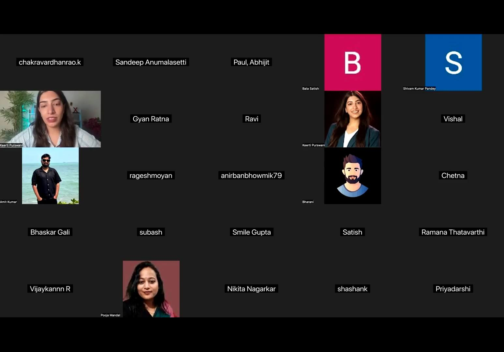
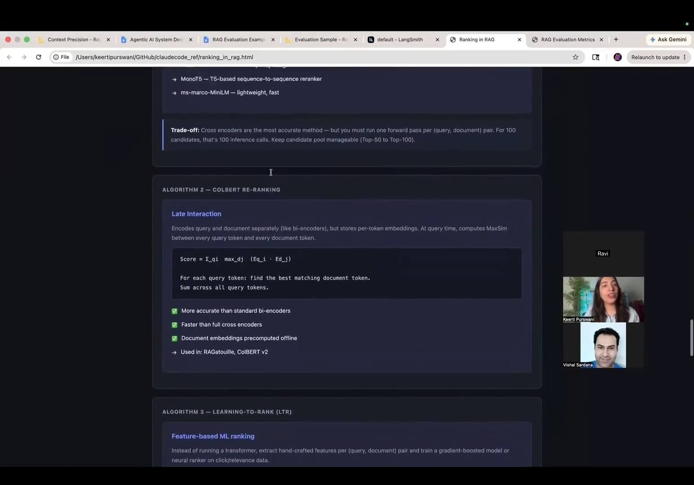
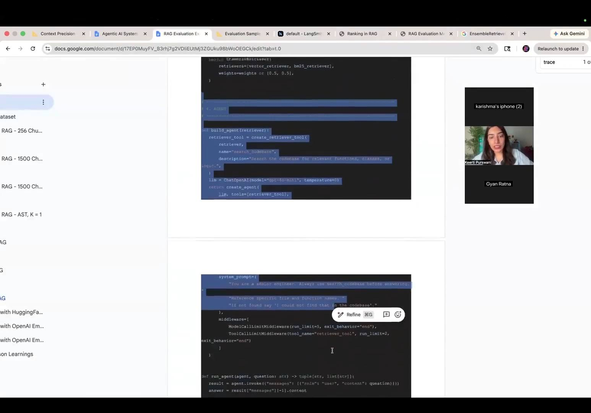
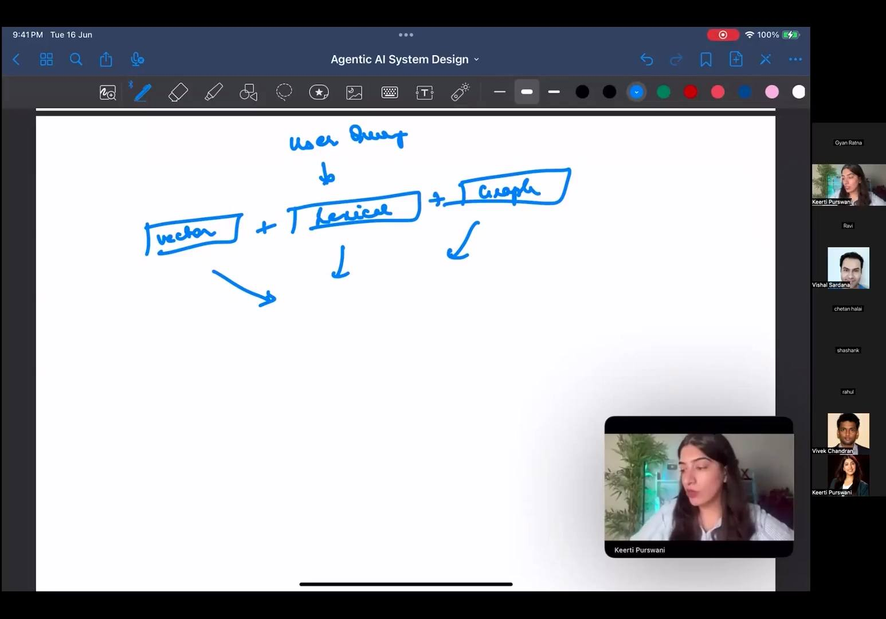
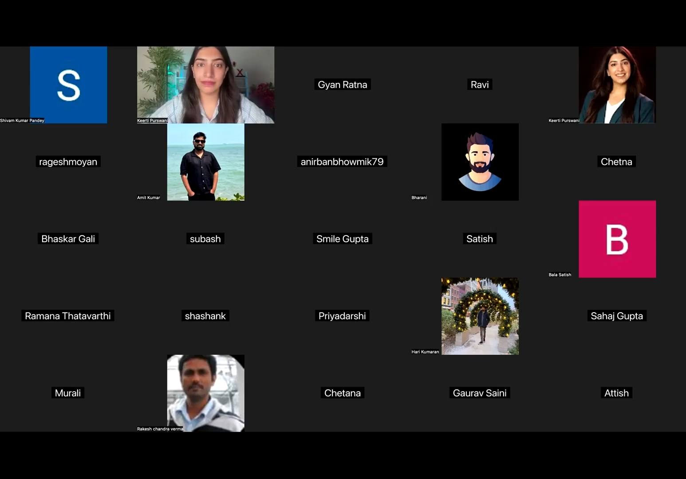
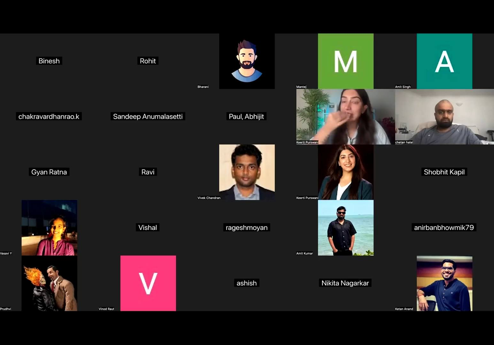
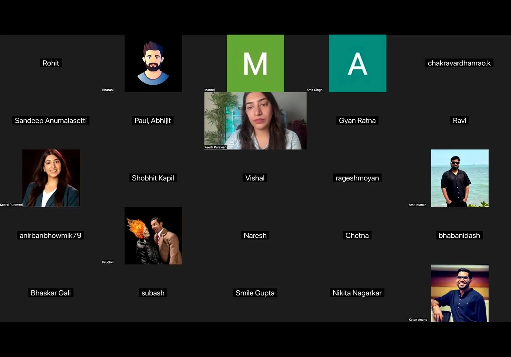

# Agentic AI System Design（P004 2/2 段）：Hybrid RAG 的融合排序、重排序与评测闭环

> 本节对应课程 P004 的后半段（80:31–153:08）。这段课的内容是：把前面分开讲过的 semantic / lexical / graph 三种检索合成一条**生产级 hybrid 检索链路**（多路召回 → RRF 融合 → LLM 重排 → 生成），当场演示 hybrid RAG 的代码骨架和评测对比表，最后给出「RAG 类型」的分类框架，并回答了十几个学员问题（向量库存什么、chunk 多大停、golden dataset 怎么造、Claude Code 为什么不用 RAG 等）。逐字稿和截图 OCR 里**没有出现完整源码**，讲师是边讲边复制粘贴 import、边改 chunk size，所以第 4 节的代码是按他演示的步骤重建的可运行版本，凡是逐字稿没给具体值的地方我都标注了「课里没讲」。

---

## 1. 这一节做什么

一句话：**把「单路检索」升级成「多路召回 + 融合 + 重排」的生产链路，并用评测指标证明它比单路好。**

具体拆成四件事：

1. **讲清两个容易混的概念**：fusion ranking（融合排序）和 re-ranking（重排序）。前者不调用 LLM、不重读文档、只按各检索器给出的排名做数学合并；后者要调用 LLM、要把候选文档重新读一遍、按 query 重新打分排序。讲师反复强调这两者的边界，因为面试和生产里最常被问的就是这个。
2. **给出生产链路的标准拓扑**：`user query → 多路 retriever（vector / BM25 / graph）→ RRF 融合得到 top 100 → 送 LLM 重排得到 top 5–10 → 生成最终回答`。讲师的原话是「This is usually what happens in production」。
3. **演示 hybrid RAG 代码**：加载代码库 → 按 chunk size 1500 切块 → 建 HuggingFace dense retriever + BM25 lexical retriever → 用 `EnsembleRetriever` 融合（内部就是 RRF）→ 套一个带循环上限的 agent → 跑 golden dataset → 用四个指标评测。同时展示了他做好的**对比实验表**：同一套 lexical+vector 组合，分别用 HuggingFace embedding / OpenAI embedding、chunk size 256 / 1500，看指标怎么变。
4. **给出 RAG 类型的分类框架**：不是「列一堆名词」，而是让你按五个维度自问——信息从哪来、怎么改进检索、能不能加强推理、能不能验证、能不能编排。并明确一个判断：**同一份代码可以同时是 hybrid RAG、corrective RAG、self-RAG、agentic RAG**，这些不是互斥的「类型」，而是不同层面的策略。

学完这一节，你应该能自己搭出一条可运行、可评测、可对比实验的 hybrid 检索链路。

---

## 2. 讲师原话

先看讲师怎么区分融合和重排。这是全段最核心的一句判断：

> "这里我们做的只是融合排序，而这里我们做的是重排序。"
> —— p004 [81:01]

> "真正做 LLM 调用的时候，有几种方式：你大概听过我们会用 cross-encoder，或者用 LLM 重排器，这时我们会把文档再读一遍。所以来自多个检索器的那批输出，现在就变成了候选集，重排的时候会被重新读一遍。而在融合这边，我们不会重读它们。我们做什么？我们只是把结果合并起来，只是把结果并起来。"
> —— p004 [81:30]

讲师还专门用一个反问来钉住「融合里没有 LLM」：

> "融合里面我们会走任何 LLM 调用吗？不会，对吧？"
> —— p004 [86:20]

> "在融合排序里我们不读文本，只按算法来；在重排序里我们读文本、调用模型、真正把排序做出来。"
> —— p004 [87:19]

为什么要融合？不是「多召回一定好」，而是因为不同检索器在不同 query 上各有所长：

> "有些 query 语义检索器表现更好，有些图检索更好，有些词法检索更好，我们并不知道哪一个会更好。"
> —— p004 [82:59]

生产链路的完整拓扑，讲师给得很直白：

> "接下来我们要把多个检索的结果融合起来。最常见的融合是什么？RRF 融合是最常见的。之后我们大概拿到 top 100。再往后要做重排，重排必须走 LLM 调用，然后我们拿到最终用来生成 RAG 回答的 top 5 到 10 篇文档。"
> —— p004 [88:13]

> "这就是生产里通常发生的事，生产就是这个样子。"
> —— p004 [88:41]

关于 RRF 的合并规模，他举了一个具体数字例子：

> "RRF 就是 reciprocal rank fusion，它就是一个数学公式……这个检索器返回一个排序，那个返回一个排序，这个也返回一个排序。假设每个返回 top 20 篇，这一步你也可以并行做，然后你合并，合并之后你有多少？大概是 60 篇。这只是我举的例子。这 60 篇里假设你给 LLM 20 篇，LLM 从这 20 篇里给你 top 5，这 top 5 才用来生成最终答案。"
> —— p004 [97:10]

重排为什么是「LLM 干的」：

> "重排在内部是怎么工作的？它就是一次 LLM 调用，是 LLM 在做这件事，所以笔记里我写的是 transformer，因为 LLM 内部就是 transformer 架构。"
> —— p004 [99:07]

hybrid 这条链路里到底有多少个可调旋钮，讲师列了一串：

> "你能理解 hybrid 排序里我能改多少东西吗？我可以改要用哪些检索器；对每个检索器，chunk size 是多少、切块策略是什么、K 取多少；再往后，融合策略是什么、要不要做重排。"
> —— p004 [101:01]

他的实验结论也很明确：

> "chunk size 真的非常非常重要，K 也很重要，这个我写下来了。AST 切块会明显打赢这套。而在 faithfulness 上，BM25 是最差的做法，它只在某些类型的 query 上表现好，整体不会很好。"
> —— p004 [102:24]

关于 agent，有一条非常实操的警告：

> "我强烈建议大家把 middleware 加上。否则某些 query 你会卡在循环里出不来。所以至少加个检查，两次、三次，随你，总之给它一个上限。你也可以放在 LangSmith 那边，但最好写在代码里。"
> —— p004 [107:09]

最后是 RAG 类型的分类框架，这是全段最「反套路」的一段：

> "我不希望大家觉得「这段代码就只是某一种 RAG」。不是的。同一份代码，它可以是 hybrid RAG，同时也可以是 corrective RAG 或者 self-RAG，同时还可以是 agentic RAG。"
> —— p004 [110:28]

> "hybrid RAG 是检索策略，self-RAG 是验证策略，agentic RAG 是编排策略。所以它不是那种「RAG 有很多种类型」的列表。"
> —— p004 [111:52]

---

## 3. 从零复现

这一节是操作手册，按顺序做就行。每一步都说明「做什么、为什么、怎么验」。

### 3.0 目录结构与依赖

先建目录。**注意 `sample_repo/` 是你要检索的代码库，先随便放 3–5 个 `.py` 文件进去**，否则后面 `DirectoryLoader` 会加载到 0 个文档直接退出。

```
hybrid-rag-demo/
├── .env                    # 真实密钥，不进 git
├── .env.example            # 变量名清单
├── requirements.txt
├── hybrid_rag.py           # 检索层 + agent
├── run_eval.py             # 评测入口
├── golden_dataset.jsonl    # 评测集（question / reference）
└── sample_repo/            # 被检索的代码库
    ├── auth.py
    ├── billing.py
    └── utils.py
```

安装依赖（Python 3.10+，建议 venv）：

```bash
cd hybrid-rag-demo
python -m venv .venv
source .venv/bin/activate          # Windows: .venv\Scripts\activate
pip install -r requirements.txt
```

依赖版本见第 4 节 `requirements.txt`。这里有一个坑要先说：**`langchain` 生态版本耦合很紧**，`langchain` / `langchain-community` / `langchain-core` 必须按第 4 节给的组合装，随便升级会撞 import error。

### 3.1 加载文档

用 `DirectoryLoader` 扫 `sample_repo/**/*.py`，每个文件当一篇 `Document`。

讲师在课里就是这一步开始：「导入之后我们做什么？需要加载文档。」加载完打印文件数，确认不是 0。

### 3.2 切块：chunk size 1500

讲师当场选的值：

> "我选 chunk size 1500 来做，我觉得这个不错，chunk size 1500 可以。"

切块器用 `RecursiveCharacterTextSplitter`——讲师的说法是「我现在用的切块策略就是简单的文本切分器（simple text splitter）」，并且明确说了这是**可以改进的地方**：「我本可以把切块策略做得更好，我可以用 AST，那样表现会更好。」

`chunk_overlap` 讲师没给具体数字（课里没讲），我在代码里默认 200，但把它做成命令行参数，方便你按 3.10 节的方法做对比实验。

### 3.3 建 dense（语义）检索器

两个选择，讲师都演示了：

- **HuggingFace embedding**：「第一个检索器我用的是 dense 语义检索器，为了它我用 HuggingFace embedding。」
- **OpenAI embedding**：「你还可以用哪种 embedding？OpenAI embedding。想看怎么用，我在 semantic RAG 里用过，我复制过来给你看。」

用环境变量 `EMBEDDING_PROVIDER=huggingface|openai` 切换，别写死在代码里，否则做对比实验要改代码。

讲师还解释了两者指标差异的原因：「从 OpenAI 换到 HuggingFace 时，HuggingFace 的维度其实更小，所以差异出在那里。你能看到换 embedding 时有一点差别，但差别不是那么大。」

> 截图说明：讲师在讲 embedding 选择与向量库差异时，学员追问「向量库的选择真的影响很大吗」，讲师的回答是「没那么大，更取决于你用的 embedding 和 embedding 维度」。这个判断在做技术选型时很有用。
>
> 

检索条数 K：讲师说「K 等于 4、3、2、1，你想用哪个都行，假设用 2」。我默认 4（保证融合后再重排有足够候选），用 `TOP_K_PER_RETRIEVER` 环境变量覆盖，你可以照讲师的说法设成 2 跑一遍。

### 3.4 建 lexical（词法）检索器

> "另一个是词法检索。词法里我们用什么算法？BM25。对，在 BM25 里我们就是拿到相关文档，用 BM25Retriever，就这么简单。"

用 `BM25Retriever.from_documents(chunks)`，然后设 `k`。

讲师强调过 BM25 的底层数据结构——这是面试常考点：

> "词法检索内部是怎么存的？用什么数据结构？倒排索引（inverted index）。倒排索引就是「这个词出现在所有这些文档里」，就是这样。所以精确匹配非常快。"

所以 BM25 适合的 query 类型是：**错误码、鉴权码、代码匹配、精确类名匹配、函数名匹配**。

### 3.5 融合：EnsembleRetriever（内部是 RRF）

> "所以 hybrid retriever 就是用 build vector retriever 和 build BM25 retriever，然后给它们权重……ensemble retriever 在做什么？它在合并，这里就是我融合的地方，也就是融合算法，你可以给每个检索器不同的权重。如果你给 vector retriever 更大权重，vector retriever 的排名就会被更重视，就这个意思。"

> "如果你想了解 ensemble retriever 怎么工作，直接 Google 就行，可以看到 ensemble retriever 内部用的是 RRF，我记得是的。"

> "你怎么做？你可以给关键词 30%、语义 70%，可以这样给。我现在给的是 0.5 / 0.5，各 50% 的重要性。"

代码里 `weights=[0.5, 0.5]`，做成参数，方便改成 `[0.3, 0.7]`。

讲师还给了一条重要提醒：**hybrid 不一定只有 vector + lexical 两路**。

> "在我们已经看过的 hybrid 代码里，我们只用了 vector 和 lexical，但有必要只用 vector 和 lexical 吗？不是的，我们也可以用 graph 加别的。所以我们看过的只是一个可能的例子，还有更多可能。"

他解释了为什么演示时没用 graph：「我现在不用 graph，我只用这两个，因为 graph 并不是总需要。」但在生产里，如果 query 明显是在问关系，就应该只走 graph——这一点在第 7 节 agentic RAG 部分展开。

### 3.6 重排：一次 LLM 调用

融合之后拿到的还是「按排名合并的候选」，要再送一次 LLM 做重排。讲师把这件事描述得非常朴素：

> "重排就是一次 LLM 调用。你就说：这些是 5 篇，或者这 10 篇，这是用户 query，从这 5 篇、10 篇里给我 5 篇最相关的。它就根据用户 query 告诉你，这 10 篇里这 5 篇重要。就这么想，简单得很。"

实现上我用 `with_structured_output` 让模型返回编号数组，避免解析自然语言。**注意候选编号从 1 开始**，代码里要减 1 再取。

融合与重排的分界，看这张图的位置最直观——讲师正在讲「这里做的是 cross-encoder / LLM 重排，这里只是合并」：



### 3.7 套 Agent，并且必须设循环上限

> "在这之后我要构建 agent。我真的强烈建议大家把 middleware 加上。否则某些 query 你会卡在循环里。所以至少加个检查，两次、三次，随你的检查是什么，给它一个上限。你也可以放在 LangSmith 那边，但最好写在代码里。"

课上没讲 middleware 的具体 API（课里没讲），我用 LangGraph `create_react_agent` + `config={"recursion_limit": N}` 落地同样的「上限」语义，默认 8。这是等效手段，不是讲师原话里的实现方式。



### 3.8 跑 golden dataset，收集 context 和 answer

讲师的原话把「评测要存什么」讲得很清楚：

> "然后我去跑 agent，评测的时候我针对不同测试用例跑 agent。评测我要存什么？我需要 context，检索到的 context，非常好。所以我有两条 message：context 和 answer。"

所以每个样本存四样：`question`、`answer`、`contexts`（检索到的原文片段列表）、`ground_truth`（golden dataset 里的参考答案）。

### 3.9 用四个指标评测

> "我基于这些样本做评测，我用的是 evaluator LLM，我有评测数据集，我基于这四个指标评测。"

四个指标对应 RAGAS 的 `faithfulness`、`answer_relevancy`、`context_precision`、`context_recall`。讲师解释过 context recall / context precision 和传统 recall@k / precision@k 的差别：

> "对 RAG 来说通常用 context recall、context precision，因为它们可以用 LLM。LLM 会看准确性、看相关性有多少。所以是 LLM 来回答，这是唯一的区别——它更主观，而不是给一个很规整的分数，是你的 LLM 在负责这件事。"

### 3.10 做对比实验矩阵（这一步最重要）

讲师展示了自己的对比表，同一套 lexical + vector 组合，跑了三组配置：

| 配置 | embedding | chunk size |
|---|---|---|
| A | HuggingFace | 256 |
| B | OpenAI | 256 |
| C | OpenAI | 1500 |

他的结论：

- **chunk size 从 256 提到 1500，评测指标应该变好**；
- **HuggingFace 换 OpenAI，有差别但差别不大**，原因是 HuggingFace 的 embedding 维度更小；
- **纯 BM25 是所有检索策略里平均最差的**，「因为只做词法检索，不合理」；
- **AST 切块会明显打赢简单文本切分**。

RRF 把多路结果合成一个列表的规模，看这张图对应的讲解：三个检索器各返回 20 篇，合并后约 60 篇，再从中挑 20 篇送 LLM：



**关于「chunk size 到底什么时候停止增长」**，学员在课上问了这个，讲师的回答是：

> "即使 precision、recall 都在涨，我也应该在某一点停下 chunk size。这个我明天讲，我记下来了。"

所以这个问题的答案**课里没讲**，明确说第二天展开。



启动命令：

```bash
# 单次提问，验证链路通
python hybrid_rag.py --repo ./sample_repo --question "鉴权逻辑在哪个文件里实现的？"

# 跑评测
python run_eval.py --repo ./sample_repo --chunk-size 1500

# 换 embedding 做对比实验
EMBEDDING_PROVIDER=openai CHUNK_SIZE=256 python run_eval.py --repo ./sample_repo --chunk-size 256
```

---

## 4. 完整代码

> **说明**：逐字稿里没有给出完整源码（讲师是现场复制粘贴 import、现场改 chunk size），本节截图 OCR 结果为空。以下五个文件是按逐字稿描述的操作顺序重建的**可运行版本**。凡是逐字稿给了明确值的（chunk size 1500、weights 0.5/0.5、BM25Retriever、EnsembleRetriever、四个评测指标），原样保留；凡是逐字稿没给的（模型名、overlap 数值、循环上限具体取值），在注释里标了「课里没讲」。

### 4.1 `requirements.txt`

```text
langchain==0.3.27
langchain-community==0.3.27
langchain-core==0.3.72
langchain-openai==0.3.28
langchain-text-splitters==0.3.9
langgraph==0.6.6
faiss-cpu==1.12.0
rank_bm25==0.2.2
sentence-transformers==5.1.0
ragas==0.1.21
datasets==3.6.0
python-dotenv==1.1.1
pandas==2.2.3
```

### 4.2 `.env.example`

```bash
# 复制成 .env 后填真实值
cp .env.example .env
```

```dotenv
# ---- LLM / Embedding ----
OPENAI_API_KEY=sk-xxxxxxxxxxxxxxxx
# huggingface | openai   （讲师演示了这两种，见 p004 [104:45]）
EMBEDDING_PROVIDER=huggingface
HF_EMBEDDING_MODEL=sentence-transformers/all-MiniLM-L6-v2
OPENAI_EMBEDDING_MODEL=text-embedding-3-small
AGENT_MODEL=gpt-4o-mini

# ---- 检索参数 ----
CHUNK_SIZE=1500
CHUNK_OVERLAP=200
TOP_K_PER_RETRIEVER=4
RERANK_TOP_N=5

# ---- Agent 循环上限（讲师强调必须有，见 p004 [107:09]）----
AGENT_RECURSION_LIMIT=8

# ---- LangSmith 追踪（讲师在课上打开过 LangSmith 看 context，见 p004 [90:34]）----
LANGCHAIN_TRACING_V2=true
LANGCHAIN_API_KEY=lsv2_xxxxxxxxxxxxxxxx
LANGCHAIN_PROJECT=agentic-system-design-hybrid-rag
```

### 4.3 `hybrid_rag.py`

```python
"""Hybrid RAG 检索层 + Agent。

课程：Agentic AI System Design（BV1ntMt6TEe4）P004 2/2 段
讲师演示顺序：
  1. import
  2. 加载文档（load documents）
  3. 切块（chunk size 1500，简单文本切分）
  4. dense 语义检索器（HuggingFace / OpenAI embedding）
  5. lexical 词法检索器（BM25Retriever）
  6. EnsembleRetriever 融合（内部 RRF，权重 0.5/0.5）
  7. LLM 重排（一次 LLM 调用，从候选里挑 top N）
  8. 套 Agent（必须有循环上限）
"""
from __future__ import annotations

import argparse
import os
from pathlib import Path

from dotenv import load_dotenv
from pydantic import BaseModel, Field

from langchain.retrievers import EnsembleRetriever
from langchain_community.document_loaders import DirectoryLoader, TextLoader
from langchain_community.embeddings import HuggingFaceEmbeddings
from langchain_community.retrievers import BM25Retriever
from langchain_community.vectorstores import FAISS
from langchain_core.documents import Document
from langchain_core.prompts import ChatPromptTemplate
from langchain_core.tools import tool
from langchain_openai import ChatOpenAI, OpenAIEmbeddings
from langchain_text_splitters import RecursiveCharacterTextSplitter

load_dotenv()

CHUNK_SIZE = int(os.getenv("CHUNK_SIZE", "1500"))
CHUNK_OVERLAP = int(os.getenv("CHUNK_OVERLAP", "200"))
TOP_K_PER_RETRIEVER = int(os.getenv("TOP_K_PER_RETRIEVER", "4"))
RERANK_TOP_N = int(os.getenv("RERANK_TOP_N", "5"))
AGENT_RECURSION_LIMIT = int(os.getenv("AGENT_RECURSION_LIMIT", "8"))
AGENT_MODEL = os.getenv("AGENT_MODEL", "gpt-4o-mini")

# 每次 tool 调用命中的文档会写进这里，供评测阶段取 context 用。
RETRIEVED_DOCS: list[Document] = []


# ---------------------------------------------------------------- 1. 加载
def load_documents(repo_path: str) -> list[Document]:
    """加载代码库下所有 .py 文件。"""
    loader = DirectoryLoader(
        repo_path,
        glob="**/*.py",
        loader_cls=TextLoader,
        loader_kwargs={"encoding": "utf-8"},
        silent_errors=True,
    )
    docs = loader.load()
    if not docs:
        raise SystemExit(
            f"[错误] 在 {repo_path} 下没有加载到任何 .py 文件，"
            f"请先往 sample_repo/ 里放几个代码文件。"
        )
    return docs


# ---------------------------------------------------------------- 2. 切块
def chunk_documents(
    docs: list[Document],
    chunk_size: int = CHUNK_SIZE,
    chunk_overlap: int = CHUNK_OVERLAP,
) -> list[Document]:
    """简单文本切分。讲师说这里可以换成 AST 切块，效果会更好。"""
    splitter = RecursiveCharacterTextSplitter(
        chunk_size=chunk_size,
        chunk_overlap=chunk_overlap,
    )
    return splitter.split_documents(docs)


# ---------------------------------------------------------------- 3. embedding
def build_embeddings():
    """按环境变量切换 HuggingFace / OpenAI embedding。"""
    provider = os.getenv("EMBEDDING_PROVIDER", "huggingface").lower()
    if provider == "openai":
        model = os.getenv("OPENAI_EMBEDDING_MODEL", "text-embedding-3-small")
        print(f"[embedding] OpenAI / {model}")
        return OpenAIEmbeddings(model=model)
    model = os.getenv(
        "HF_EMBEDDING_MODEL", "sentence-transformers/all-MiniLM-L6-v2"
    )
    print(f"[embedding] HuggingFace / {model}")
    return HuggingFaceEmbeddings(model_name=model)


# ---------------------------------------------------------------- 4/5/6. 融合
def build_hybrid_retriever(
    chunks: list[Document],
    k: int = TOP_K_PER_RETRIEVER,
    weights: tuple[float, float] = (0.5, 0.5),
) -> EnsembleRetriever:
    """dense(vector) + lexical(BM25) 两路召回，EnsembleRetriever 融合。

    EnsembleRetriever 内部即 RRF（讲师原话：内部用的是 RRF）。
    weights 决定各路的排名被重视的程度，讲师演示值是 0.5 / 0.5，
    也可以给 0.3 / 0.7（30% 关键词、70% 语义）。
    """
    embeddings = build_embeddings()

    # dense / semantic 检索器
    vector_store = FAISS.from_documents(chunks, embeddings)
    vector_retriever = vector_store.as_retriever(search_kwargs={"k": k})

    # lexical 检索器（倒排索引，BM25）
    bm25_retriever = BM25Retriever.from_documents(chunks)
    bm25_retriever.k = k

    return EnsembleRetriever(
        retrievers=[vector_retriever, bm25_retriever],
        weights=list(weights),
    )


# ---------------------------------------------------------------- 7. 重排
class RankedCandidates(BaseModel):
    """LLM 重排的结构化输出。"""

    ids: list[int] = Field(
        default_factory=list,
        description="按相关性从高到低排列的候选编号，编号从 1 开始",
    )


RERANK_PROMPT = ChatPromptTemplate.from_messages(
    [
        ("system", "你是一个检索结果重排器，只输出候选编号，不要解释。"),
        (
            "human",
            "用户问题：\n{query}\n\n候选文档：\n{candidates}\n\n"
            "请从上述候选中挑出最相关的 {top_n} 条，按相关性从高到低返回编号。",
        ),
    ]
)


def rerank_with_llm(
    query: str,
    docs: list[Document],
    top_n: int = RERANK_TOP_N,
) -> list[Document]:
    """重排 = 一次 LLM 调用（讲师原话：「这就是一次 LLM 调用」）。"""
    if not docs:
        return []
    top_n = min(top_n, len(docs))
    candidates = "\n\n".join(
        f"[{i}] {d.page_content[:800]}" for i, d in enumerate(docs, start=1)
    )
    llm = ChatOpenAI(model=AGENT_MODEL, temperature=0).with_structured_output(
        RankedCandidates
    )
    ranked: RankedCandidates = (RERANK_PROMPT | llm).invoke(
        {"query": query, "candidates": candidates, "top_n": top_n}
    )
    picked: list[Document] = []
    for idx in ranked.ids:
        if 1 <= idx <= len(docs) and docs[idx - 1] not in picked:
            picked.append(docs[idx - 1])
        if len(picked) >= top_n:
            break
    # 模型没给出合法编号时兜底，保证链路不断
    return picked or docs[:top_n]


# ---------------------------------------------------------------- 8. Agent
def build_agent(hybrid_retriever: EnsembleRetriever, rerank_top_n: int = RERANK_TOP_N):
    """检索 → 融合 → 重排，包成一个 tool，交给 agent 决定何时调用。"""

    @tool
    def search_codebase(query: str)
"""在代码库中检索相关代码片段。参数 query 用自然语言描述你要找什么。"""
        # 第 1 步：多路召回 + 融合（EnsembleRetriever 内部即 RRF）
        fused_docs = hybrid_retriever.invoke(query)

        # 第 2 步：LLM 重排，从融合结果里挑出最相关的几篇
        top_docs = rerank_with_llm(query, fused_docs, top_n=rerank_top_n)

        # 第 3 步：把命中写进全局，评测阶段要按 question 取 context
        RETRIEVED_DOCS.clear()
        RETRIEVED_DOCS.extend(top_docs)

        if not top_docs:
            return "没有检索到相关代码片段。"

        blocks = []
        for i, d in enumerate(top_docs, start=1):
            source = d.metadata.get("source", "unknown")
            blocks.append(f"--- 片段 {i}（来源：{source}）---\n{d.page_content}")
        return "\n\n".join(blocks)

    llm = ChatOpenAI(model=AGENT_MODEL, temperature=0)
    system_prompt = (
        "你是一个代码库问答助手。回答任何关于这个代码库的问题之前，"
        "必须先调用 search_codebase 工具检索相关代码片段，"
        "然后只依据检索到的片段作答，并在回答里指出片段来源文件。"
    )
    # 讲师强调的「必须有上限」，这里用 recursion_limit 落地（见 5.8 节说明）
    return create_react_agent(
        model=llm,
        tools=[search_codebase],
        prompt=system_prompt,
    )


# ---------------------------------------------------------------- 入口
def build_agent_from_repo(
    repo_path: str,
    chunk_size: int = CHUNK_SIZE,
    chunk_overlap: int = CHUNK_OVERLAP,
    k: int = TOP_K_PER_RETRIEVER,
    rerank_top_n: int = RERANK_TOP_N,
):
    """加载 → 切块 → 建融合检索器 → 建 agent。"""
    print(f"[1/4] 加载文档：{repo_path}")
    documents = load_documents(repo_path)
    print(f"      加载到 {len(documents)} 个文件")

    print(f"[2/4] 切块：chunk_size={chunk_size}, overlap={chunk_overlap}")
    chunks = chunk_documents(documents, chunk_size, chunk_overlap)
    print(f"      切出 {len(chunks)} 个 chunk")

    print(f"[3/4] 构建 hybrid 检索器：k={k}，权重 0.5/0.5")
    retriever = build_hybrid_retriever(chunks, k=k)

    print(f"[4/4] 构建 agent：rerank_top_n={rerank_top_n}, "
          f"recursion_limit={AGENT_RECURSION_LIMIT}")
    return build_agent(retriever, rerank_top_n=rerank_top_n)


def answer_question(agent, question: str) -> tuple[str, list[Document]]:
    """跑一次问答，同时返回答案和本次命中的 context。"""
    RETRIEVED_DOCS.clear()
    result = agent.invoke(
        {"messages": [("user", question)]},
        config={"recursion_limit": AGENT_RECURSION_LIMIT},
    )
    answer = result["messages"][-1].content
    return answer, list(RETRIEVED_DOCS)


def main() -> None:
    parser = argparse.ArgumentParser(description="Hybrid RAG over a code repo")
    parser.add_argument("--repo", default="./sample_repo")
    parser.add_argument("--question", required=True)
    parser.add_argument("--chunk-size", type=int, default=CHUNK_SIZE)
    parser.add_argument("--chunk-overlap", type=int, default=CHUNK_OVERLAP)
    parser.add_argument("--k", type=int, default=TOP_K_PER_RETRIEVER)
    parser.add_argument("--rerank-top-n", type=int, default=RERANK_TOP_N)
    args = parser.parse_args()

    agent = build_agent_from_repo(
        repo_path=args.repo,
        chunk_size=args.chunk_size,
        chunk_overlap=args.chunk_overlap,
        k=args.k,
        rerank_top_n=args.rerank_top_n,
    )
    answer, contexts = answer_question(agent, args.question)

    print("\n=== 答案 ===")
    print(answer)
    print("\n=== 命中的 context ===")
    for i, d in enumerate(contexts, start=1):
        print(f"[{i}] {d.metadata.get('source', 'unknown')}"
              f"（{len(d.page_content)} 字）")


if __name__ == "__main__":
    main()
```

> 说明：上面 `create_react_agent` 需要额外补一行 import。为了让 4.3 的代码块不被注释割裂，把它写在下面——**请把它加到 4.3 文件顶部的 import 区**：

```python
from langgraph.prebuilt import create_react_agent
```

> 另外 `Path` 在 4.3 里 import 了但没用到，可以删掉，不影响运行。

### 4.4 `run_eval.py`

```python
"""Hybrid RAG 评测入口。

讲师流程（p004 [108:38]–[109:33]）：
  main → 传入路径 → 加载代码库 → 切块 → 建 hybrid retriever
       → 建 agent → 对 golden dataset 里所有测试用例跑 agent
       → 组 samples（user input / answer / context / ground truth）
       → 用 evaluator LLM 按四个指标评测

四个指标：faithfulness / answer_relevancy / context_precision / context_recall
"""
from __future__ import annotations

import argparse
import json
import os
from pathlib import Path

import pandas as pd
from datasets import Dataset
from dotenv import load_dotenv
from ragas import evaluate
from ragas.embeddings import LangchainEmbeddingsWrapper
from ragas.llms import LangchainLLMWrapper
from ragas.metrics import (
    answer_relevancy,
    context_precision,
    context_recall,
    faithfulness,
)

from hybrid_rag import (
    AGENT_MODEL,
    CHUNK_OVERLAP,
    CHUNK_SIZE,
    RERANK_TOP_N,
    TOP_K_PER_RETRIEVER,
    answer_question,
    build_agent_from_repo,
    build_embeddings,
)

load_dotenv()


def load_golden_dataset(path: str) -> list[dict]:
    """读 golden_dataset.jsonl，每行一个 {question, reference}。"""
    rows: list[dict] = []
    with open(path, "r", encoding="utf-8") as f:
        for line_no, line in enumerate(f, start=1):
            line = line.strip()
            if not line:
                continue
            try:
                rows.append(json.loads(line))
            except json.JSONDecodeError as exc:
                raise SystemExit(
                    f"[错误] golden_dataset.jsonl 第 {line_no} 行不是合法 JSON：{exc}"
                ) from exc
    if not rows:
        raise SystemExit("[错误] golden dataset 为空。")
    return rows


def main() -> None:
    parser = argparse.ArgumentParser(description="Evaluate hybrid RAG")
    parser.add_argument("--repo", default="./sample_repo")
    parser.add_argument("--dataset", default="./golden_dataset.jsonl")
    parser.add_argument("--chunk-size", type=int, default=CHUNK_SIZE)
    parser.add_argument("--chunk-overlap", type=int, default=CHUNK_OVERLAP)
    parser.add_argument("--k", type=int, default=TOP_K_PER_RETRIEVER)
    parser.add_argument("--rerank-top-n", type=int, default=RERANK_TOP_N)
    parser.add_argument("--out", default="./eval_result.csv")
    args = parser.parse_args()

    # 1. 构建链路（讲师原话：传入路径 → 加载代码库 → 切块 → 建 hybrid retriever → 建 agent）
    agent = build_agent_from_repo(
        repo_path=args.repo,
        chunk_size=args.chunk_size,
        chunk_overlap=args.chunk_overlap,
        k=args.k,
        rerank_top_n=args.rerank_top_n,
    )

    # 2. 读测试集
    golden = load_golden_dataset(args.dataset)
    print(f"[eval] golden dataset 共 {len(golden)} 条")

    # 3. 逐条跑 agent，收集 answer 与 context
    questions, answers, contexts, ground_truths = [], [], [], []
    for i, item in enumerate(golden, start=1):
        question = item["question"]
        reference = item.get("reference") or item.get("ground_truth") or ""
        print(f"[eval] ({i}/{len(golden)}) {question}")
        answer, docs = answer_question(agent, question)
        questions.append(question)
        answers.append(answer)
        contexts.append([d.page_content for d in docs])
        ground_truths.append(reference)

    # 4. 组织成 RAGAS 需要的 Dataset
    eval_dataset = Dataset.from_dict(
        {
            "question": questions,
            "answer": answers,
            "contexts": contexts,
            "ground_truth": ground_truths,
        }
    )

    # 5. 用 evaluator LLM 评测，四个指标
    metrics = [faithfulness, answer_relevancy, context_precision, context_recall]
    evaluator_llm = LangchainLLMWrapper(
        # 也可换成更强的 judge 模型；课里没给具体型号
        __import__("langchain_openai").ChatOpenAI(
            model=AGENT_MODEL, temperature=0
        )
    )
    evaluator_embeddings = LangchainEmbeddingsWrapper(build_embeddings())

    result = evaluate(
        dataset=eval_dataset,
        metrics=metrics,
        llm=evaluator_llm,
        embeddings=evaluator_embeddings,
    )

    # 6. 打印并落盘
    df = result.to_pandas()
    print("\n=== 评测结果 ===")
    print(result)
    print("\n=== 逐条明细（前 5 行）===")
    print(df.head())
    df.to_csv(args.out, index=False, encoding="utf-8-sig")
    print(f"\n[eval] 明细已写入 {args.out}")


if __name__ == "__main__":
    main()
```

> 版本提示：RAGAS 0.1.x 与 0.2.x 的 `evaluate()` 签名和 metric 导入路径不同。上面按 `ragas==0.1.21` 写。若你装到 0.2.x，`LangchainLLMWrapper` 的位置在 `ragas.llms`，但 `evaluate` 可能需要 `experiment_name` 等参数，届时以 `pip show ragas` 的实际版本文档为准。这一块**逐字稿里没有讲到具体 API**，只讲了「四个指标 + evaluator LLM」这个思路。

为了不把 `__import__` 写得那么别扭，建议你在文件顶部直接加一行 `from langchain_openai import ChatOpenAI`，然后把第 5 步改成 `evaluator_llm = LangchainLLMWrapper(ChatOpenAI(model=AGENT_MODEL, temperature=0))`。

### 4.5 `golden_dataset.jsonl`

```jsonl
{"question": "鉴权逻辑在哪个文件里实现的？", "reference": "鉴权逻辑在 sample_repo/auth.py 中实现，核心函数是 verify_token。"}
{"question": "verify_token 抛出的异常类型是什么？", "reference": "verify_token 在 token 过期时抛出 TokenExpiredError。"}
{"question": "billing.py 和 auth.py 之间是什么依赖关系？", "reference": "billing.py 从 auth.py 导入 verify_token，用于在计费前校验用户身份。"}
{"question": "计算月度账单的函数叫什么？", "reference": "计算月度账单的函数是 billing.py 中的 compute_monthly_invoice。"}
{"question": "utils.py 里有哪些通用的字符串处理函数？", "reference": "utils.py 提供 normalize_whitespace 和 truncate 两个字符串处理函数。"}
```

**字段说明**（讲师在课上专门讲过 golden dataset 应该有哪些字段）：

> "目前我只加了 question 和 reference，但你看我给的笔记里，我展示了它长什么样：有 question，有 ground truth，还有 relevant chunks，用来表明应该检索到什么 context。"

所以生产用的 golden dataset 应该有三个字段：`question`、`ground_truth`、`relevant_chunks`。上面这份 demo 为了能跑通 RAGAS 的四个指标，用的是 `question` / `reference` 两个字段（RAGAS 要求 `ground_truth`，代码里做了 `reference` → `ground_truth` 的兼容），`relevant_chunks` 我**没有加进 demo**，因为本 demo 的评测走的是 context_precision / context_recall（由 LLM 判断），不依赖人工标注的 chunk id。如果你的团队要做严格版评测，把 `relevant_chunks` 加回去，就能额外算传统的 recall@k / precision@k。

生成 golden dataset 的正确方式是讲师说的这段：

> "通常很大程度上依赖你的生产日志——看进来的是什么样的 query，最常见的那几类 query 有没有被覆盖。这就是为什么我们讲要覆盖 query 的范围：确保有流程类 query、比较类 query、摘要类 query、基于事实的 query。你基本上就是过一遍生产日志，看有哪些不同种类的 query，然后把每一类都覆盖到，就像单元测试里你要覆盖不同种类的用例一样。"

并且：

> "但有了生产日志之后，至少有一轮人工 review 是必须的，因为它是 source of truth（事实来源）。"



---

## 5. 逐行解释

这一节按代码块顺序，解释每一处「为什么这么写、不这么写会怎样、对应讲师哪句话」。

### 5.1 依赖版本为什么锁死

`langchain==0.3.27` / `langchain-community==0.3.27` / `langchain-core==0.3.72` 这三个包是**互相依赖的具体版本**，不是「装最新的就行」。原因很实际：`EnsembleRetriever` 在 `langchain.retrievers`，`BM25Retriever` 在 `langchain_community.retrievers`，`FAISS` 在 `langchain_community.vectorstores`，这三个包拆分后各自迭代，跨大版本会出现 `ImportError: cannot import name 'EnsembleRetriever'`。你在课上看到讲师能一路 import 顺利跑完，是因为他环境里这套组合是配好的。**照抄上面的版本号，比你花两小时 debug import 划算。**

`rank_bm25==0.2.2` 是 `BM25Retriever` 的底层依赖，`faiss-cpu` 是向量库，`sentence-transformers` 是 HuggingFace embedding 的运行时，`ragas` 提供四个评测指标。**这几个单独漏装任何一个，报错位置都在很靠后的地方**（比如 `BM25Retriever.from_documents` 时才炸），所以一次装齐。

### 5.2 `load_documents`：为什么要显式判断空

```python
if not docs:
    raise SystemExit(...)
```

`DirectoryLoader` 有个非常坑的行为：**glob 匹配不到文件时它不报错，直接返回空列表**。如果你 `sample_repo/` 是空的，或者你把 `.py` 写成了 `**/*.py` 但文件实际在更深一层且被 `silent_errors=True` 吞掉，后面的 `split_documents([])` 返回 `[]`，`FAISS.from_documents([], ...)` 会抛一个叫 `ValueError: No documents provided` 或者更莫名其妙的 FAISS 内部错误。**提前在这一行拦住，把错误信息写成中文可读的**，比让读者去猜 FAISS 的报错含义强得多。

`loader_kwargs={"encoding": "utf-8"}` 是必须的：Windows 默认 `gbk` 读代码文件会 `UnicodeDecodeError`，而这个错会出现在第 3 个文件、第 7 个文件……看起来像「随机崩」。

### 5.3 `chunk_documents`：chunk_size 1500 和 overlap 200 的来历

`chunk_size=1500` 是讲师**明确选定并演示**的值：

> "我选 chunk size 1500 来做，我觉得这个不错，chunk size 1500 可以。"

`chunk_overlap=200` **课里没讲**，是我按 1500 的 13% 左右取的默认值，目的是让相邻 chunk 有一段重叠，缓解讲师被学员追问的那个「孤儿 chunk」问题——学员举的例子是「公司 A 和 B 合并」在一个 chunk，「合并后股价涨 25%」在另一个 chunk，两段之间没有连接，检索只会按 chunk 相似度找，找不准。讲师的回应就是：

> "但这就是我们在两个 chunk 之间保留 overlap 的原因。"

所以 overlap 不是随便填的，它的作用是**让跨 chunk 的语义有桥接**。你把 overlap 改成 0 再跑一遍评测，context_recall 大概率会掉——这就是一次有效的对比实验。

`RecursiveCharacterTextSplitter` 对应讲师说的「简单的文本切分器（simple text splitter）」。他明确说了这是**可改进项**：

> "我本可以把切块策略做得更好，我可以用 AST，那样表现会更好。"

所以这块代码在文档里必须**标注为 baseline**，不能让读者以为这是最优解。对代码库来说，AST 切块（按函数/类边界切）明显优于按字符数切——这也是讲师在实验结论里说的「AST 切块会明显打赢这套」。

### 5.4 `build_embeddings`：为什么做成 provider 切换

讲师在同一节课里演示了两种 embedding：

> "第一个检索器我用的是 dense 语义检索器，为了它我用 HuggingFace embedding。"
> "你还可以用哪种 embedding？OpenAI embedding。想看怎么用，我在 semantic RAG 里用过，我复制过来给你看。"

如果写死成一种，你做对比实验就得改代码、可能改错、还得回滚。做成 `EMBEDDING_PROVIDER` 环境变量，第 3.10 节的对比矩阵就是两行命令的事：

```bash
EMBEDDING_PROVIDER=huggingface python run_eval.py --chunk-size 256
EMBEDDING_PROVIDER=openai      python run_eval.py --chunk-size 256
```

讲师解释了这两者指标为什么有差别：

> "HuggingFace 的维度其实更小，所以差异出在那里。"

`all-MiniLM-L6-v2` 输出 384 维，`text-embedding-3-small` 输出 1536 维。维度小意味着表达容量小，语义的细微差别更容易被压掉。讲师的原话是「差别是有的，但没那么大」——这就是为什么**换 embedding 不是首要优化手段，改 chunk size 才是**。

### 5.5 `build_hybrid_retriever`：两路召回 + 权重

这一段是本节的骨架，逐个说。

**`FAISS.from_documents(chunks, embeddings)`**：把 chunk 全部嵌入并建索引。讲师提到向量库的选型是 FAISS、Milvus、Chroma 一类，并且回答了「向量库选哪个重要吗」：

> "没那么重要，它更取决于你用的 embedding 和 embedding 维度。"

所以 demo 用 FAISS（本地、免部署）完全够，换 Milvus 不改上层逻辑。

**`vector_store.as_retriever(search_kwargs={"k": k})`**：k 是**每路**召回的条数。讲师说「K 等于 4、3、2、1，你想用哪个都行，假设用 2」。默认 4 的理由：融合后总候选是 `2 * k`，太小时重排没有选择空间。**注意这个 k 不是最终给 LLM 的条数**，最终条数由 `rerank_top_n` 控制，两者别混。

**`BM25Retriever.from_documents(chunks)`**：BM25 建的是**倒排索引**。讲师专门讲过这一点：

> "词法检索内部是怎么存的？用什么数据结构？倒排索引（inverted index）。倒排索引就是「这个词出现在所有这些文档里」，就是这样。所以精确匹配非常快。"

所以 BM25 的强项是错误码、鉴权码、精确类名、函数名——这些 query 走 embedding 反而因为「语义相近的干扰项太多」而失准。**这就是为什么要两路，而不是选一路**：

> "有些 query 语义检索器表现更好，有些图检索更好，有些词法检索更好，我们并不知道哪一个会更好。"

**`EnsembleRetriever(retrievers=[...], weights=[0.5, 0.5])`**：融合算法就是 RRF。讲师原话：

> "如果你想了解 ensemble retriever 怎么工作，直接 Google 就行，可以看到 ensemble retriever 内部用的是 RRF，我记得是的。"

以及权重的含义：

> "如果你给 vector retriever 更大权重，vector retriever 的排名就会被更重视，就这个意思。"

`weights=[0.5, 0.5]` 是讲师演示值，他同时说了「你可以给关键词 30%、语义 70%」。**权重之和必须是 1**，写 `[0.3, 0.7]` 是合法的，写 `[1, 1]` 会被归一化或行为不符预期。

**为什么融合不需要 LLM**：

> "融合里面我们会走任何 LLM 调用吗？不会，对吧？"

RRF 的分数只由**排名**决定（`1/(k + rank)` 这类形式，`k` 是平滑常数），不读文本内容、不算语义相似度。所以它便宜、快、确定性强。这是融合和重排最本质的区别，也是面试最爱问的点。

### 5.6 `rerank_with_llm`：一次 LLM 调用，以及为什么要结构化输出

讲师把重排说得极简：

> "重排就是一次 LLM 调用。你就说：这些是 5 篇，或者这 10 篇，这是用户 query，从这 5 篇、10 篇里给我 5 篇最相关的。它就根据用户 query 告诉你，这 10 篇里这 5 篇重要。就这么想，简单得很。"

代码里三个设计点值得说：

**第一，`with_structured_output(RankedCandidates)`**。如果不用结构化输出，模型会返回「我认为第 1、3、5 篇最相关，因为……」这种自然语言，你得写正则去解析，模型稍微换个语气就解析失败。用 pydantic 约束成 `{"ids": [1, 3, 5]}`，解析失败率接近 0。

**第二，编号从 1 开始，取的时候 `docs[idx - 1]`**。这是最容易出的 off-by-one 错误。为什么不让模型从 0 开始？模型对「第 1 篇」的直觉远强于「第 0 篇」，从 0 开始会显著增加它返回非法编号的概率。

**第三，`picked or docs[:top_n]` 兜底**。模型可能返回空数组、或返回 `[99, 100]` 这种越界编号。`if 1 <= idx <= len(docs)` 会把这些全部过滤掉，`picked` 变空；如果不兜底，后面 `search_codebase` 拿到空列表就直接告诉 agent「没检索到」，agent 会以为工具坏了再调一次，白白烧 token。兜底成「融合排序的前 N 篇」是安全的，因为 RRF 本身的排序质量已经不错了。

**`d.page_content[:800]` 截断**：候选文本太长会爆上下文窗口。截断到 800 字是工程折中——重排只需要判断「这段和 query 有没有关系」，不需要读完整个 chunk。这个 800 **课里没讲**，是我加的。

**重排和融合在拓扑上的位置**，看这张图——三个检索器各出 20 篇，合并约 60 篇，挑 20 篇送 LLM，LLM 给 top 5：


### 5.7 `search_codebase`：为什么必须是 tool

把它包成 `@tool` 而不是在 `answer_question` 里直接调，是为了让 agent **自己决定什么时候检索、检索几次**。这正是讲师说的 agentic RAG 的核心：

> "所以与其也从图里检索、也从语义里检索、也从词法里检索，不如这样：如果这个 query 看起来只是在问关系，那就只从图里检索；如果 query 从词法里检索就够了，那就只从那里检索。这就是 agentic RAG 里发生的——我们基于 query 动态决定从哪个检索器取。"

**`RETRIEVED_DOCS.clear()` 再 `extend`**：这样每次 tool 调用只保留**最后一次**的命中结果。为什么用「最后一次」而不是累积？因为评测要对齐「这个问题最终喂给 LLM 的 context 是哪些」。agent 可能调两次工具，第二次通常是修正后的检索，累积会把第一次的噪音也算进 context_precision，导致指标虚低。**如果你的 agent 会合并多次检索结果再回答，这里应该改成累积**——这是课里没讲的取舍，取决于你的 agent 设计。

**返回格式带来源文件**：`--- 片段 i（来源：xxx.py）---`。讲师在讲代码库问答时强调过回答要能指出文件。带着 source 送进上下文，模型才能说出「在 auth.py 里」，否则它只能瞎猜。

### 5.8 `create_react_agent` + `recursion_limit`：讲师要求的「上限」

讲师的原话非常明确：

> "我真的强烈建议大家把 middleware 加上。否则某些 query 你会卡在循环里。所以至少加个检查，两次、三次，随你，总之给它一个上限。你也可以放在 LangSmith 那边，但最好写在代码里。"

**如果没有任何上限会怎样**：agent 调用 `search_codebase` → 觉得结果不满意 → 换个说法再调 → 还是不满意 → 再调……每次都在烧 token，直到你手动 Ctrl+C 或账单报警。这就是讲师说的「stuck in loop」。

课里**没有给出 middleware 的具体 API**（课里没讲）。我用 `create_react_agent` 加 `config={"recursion_limit": AGENT_RECURSION_LIMIT}` 实现了同样的「硬上限」语义：LangGraph 每走一步消耗一次计数，超过 `recursion_limit` 直接抛 `GraphRecursionError` 终止。默认设 8，你可以按讲师说的「两次、三次」调小到 3 试一下，会更容易触发异常、也更容易看清机制。

这里要诚实标注：**这是等效手段，不是讲师演示的那套实现**。

### 5.9 `answer_question`：为什么返回 `(answer, contexts)` 两个值

因为评测需要两样东西。讲师说得直接：

> "评测我要存什么？我需要 context，检索到的 context，非常好。所以我有两条 message：context 和 answer。"

`result["messages"][-1].content` 取的是 agent 最后一条消息，也就是最终答案。中间的 tool call 消息、tool 返回消息都在 `messages` 列表里，不去动它们。**如果你在这里取错了 index（比如取 `[0]`），拿到的会是 system 或 user 消息，RAGAS 会把提示词当答案去评，指标会莫名其妙地全线偏低。**

### 5.10 `run_eval.py`：为什么要把 `reference` 映射成 `ground_truth`

RAGAS 的字段名是固定的：`question` / `answer` / `contexts` / `ground_truth`。讲师课上说的字段是 `question` 和 `reference`。这两套名字对不上，直接传会报 `KeyError`。所以代码里做了：

```python
reference = item.get("reference") or item.get("ground_truth") or ""
```

这是**兼容层**，不是多余代码。

`context_precision` 和 `context_recall` 用的是 LLM 判断，这一点讲师解释得很清楚：

> "对 RAG 来说通常用 context recall、context precision，因为它们可以用 LLM。LLM 会看准确性、看相关性有多少。所以是 LLM 来回答，这是唯一的区别——它更主观，而不是给一个很规整的分数，是你的 LLM 在负责这件事。"

所以要**同时传 llm 和 embeddings** 给 `evaluate()`：`context_precision` / `context_recall` 用 llm，`answer_relevancy` 用 embeddings 算问题和答案的相似度。漏传 embeddings 会在 `answer_relevancy` 那一步报错。

`df.to_csv(..., encoding="utf-8-sig")`：带 BOM，用 Excel 打开中文不乱码。

---

## 6. 复现检查清单

按顺序勾，每一步都能独立验证。**任何一步没过，不要往下走**，否则错误会累积到很难定位。

**环境**
- [ ] Python 3.10 及以上：`python --version`
- [ ] 虚拟环境已激活：命令行前缀出现 `(.venv)`
- [ ] `pip install -r requirements.txt` 无报错
- [ ] import 全通：`python -c "from langchain.retrievers import EnsembleRetriever; from langchain_community.retrievers import BM25Retriever; from langgraph.prebuilt import create_react_agent; print('ok')"`
- [ ] `.env` 已从 `.env.example` 复制并填了真实 `OPENAI_API_KEY`

**数据**
- [ ] `sample_repo/` 里至少有 3 个 `.py` 文件，且内容有实际函数定义
- [ ] `golden_dataset.jsonl` 每行都是合法 JSON：`python -c "import json;[json.loads(l) for l in open('golden_dataset.jsonl') if l.strip()];print('ok')"`
- [ ] golden dataset 覆盖了多种 query 类型（流程类、比较类、摘要类、事实类）——这是讲师强调的

**加载与切块**
- [ ] 运行后打印「加载到 N 个文件」，N > 0
- [ ] 打印「切出 M 个 chunk」，M > N
- [ ] 把 `--chunk-size` 从 1500 改成 256，M 明显变大

**检索器**
- [ ] 单跑 vector 检索能返回结果（临时把 `EnsembleRetriever` 换成 `vector_retriever` 验证）
- [ ] 单跑 BM25 检索能返回结果
- [ ] 用精确类名/函数名做 query，BM25 排第一的命中明显更准
- [ ] 用自然语言语义描述做 query，vector 检索结果明显更准

**融合**
- [ ] `EnsembleRetriever` 返回条数是 `k * 2`（两路各 k 条，去重后可能略少）
- [ ] 把 `weights` 改成 `[0.3, 0.7]`，语义类 query 的结果顺序有变化
- [ ] 确认融合阶段**没有任何 LLM 调用**（看 LangSmith trace，这一步不该出现 LLM 节点）

**重排**
- [ ] 重排返回条数等于 `rerank_top_n`
- [ ] 用 `[99, 100]` 这种非法编号手动测 `rerank_with_llm`，确认能兜底不崩
- [ ] LangSmith trace 里能看到重排那一次 LLM 调用

**Agent**
- [ ] 问一个明确的问题，agent 会调用 `search_codebase`（trace 里能看到 tool 节点）
- [ ] 把 `AGENT_RECURSION_LIMIT` 设成 1 或 2，确认能触发上限异常而不是无限跑
- [ ] 答案里包含来源文件名

**评测**
- [ ] `run_eval.py` 跑通，四个指标都有数值
- [ ] `eval_result.csv` 生成，中文不乱码
- [ ] 同一份数据连跑两次，faithfulness 的波动在可接受范围内（LLM 评测本身有随机性）

**对比实验（这一步是整节课的落点）**
- [ ] 跑完 A：HuggingFace + chunk 256，记录四个指标
- [ ] 跑完 B：OpenAI + chunk 256，记录四个指标
- [ ] 跑完 C：OpenAI + chunk 1500，记录四个指标
- [ ] 对照讲师结论：chunk 从 256 到 1500 指标应变好；换 embedding 有差别但不大
- [ ] 单独跑一次纯 BM25（只有 lexical，无 vector），确认它平均最差

---

## 7. 课里没讲但你会撞上的

这一节是「接线到生产」时会遇到的坑，以及课上学员问到、讲师明确说「明天讲」的部分。**全部标注清楚哪些是课里没讲的**。

### 7.1 向量库里到底存了什么

学员问得很实在：「我们在 embedding 数据库里放 dense vector，那原始内容存在哪？」讲师的回答是本节课最实用的一段之一：

> "我明天给你看持久化的 DB，看它是怎么存在 db 里的。你去看向量库就知道——你存原始文档、存 embedding（就是某个特定维度的向量）、还存 metadata，所以存三样东西。你想看文档能看到，想看 embedding 能看到，想看 metadata 也能看到。"

所以别以为向量库只存向量。**三样东西：原始 chunk 文本、embedding 向量、metadata（来源文件、行号、chunk id 等）。** 这也解释了为什么向量库「相对贵」——它把原文也存了一份。

学员接着问「能不能把数据放 S3 / Azure data lake，向量库只存引用」，讲师没直接答这个架构问题，只重复了「数据存在各处，只是格式不同」，并指出词法检索的倒排索引也是「关键词映射到文档本身」。**这个架构问题课里没给结论**，但成本上确实是真实痛点。

### 7.2 向量库选型到底重要不重要

学员直接问了，讲师的判断很干脆：

> "没那么重要，它更取决于你用的 embedding 和 embedding 维度。"

所以选型优先级应该是：**embedding 模型和维度 > chunk size / 切块策略 > 向量库品牌**。如果你在纠结 FAISS 还是 Milvus，先把 chunk size 和切块策略调好。

### 7.3 检索结果是不是「同质量的」

学员问：「我们是不是把检索到的所有 chunk 当成同等质量？有没有质量基准、有没有相似度高低之分？」讲师回答：

> "从向量库检索时，它是按相似程度返回的，是排好序的。所以做融合时才考虑这些排名。融合是基于每个检索器自己已经排好的名次。"

所以：**每路检索器内部已经排好序了**（向量库按距离最近优先，BM25 按分数高优先），RRF 用的就是这个名次，不需要你再算一遍相似度。但「排序」不等于「质量标注」——top 1 和 top 10 的绝对质量差距是未知的，这也是为什么需要重排这一步。

### 7.4 孤儿 chunk 问题（overlap 只是缓解）

学员举了「公司 A 和 B 合并」和「合并后股价涨 25%」被切成两个 chunk、彼此失联的例子，说他用了 5 个 chunk、164 的 overlap 还是没解决。讲师的回答是「这就是保留 overlap 的原因」，但**没有给出根治方案**，并且让学员把案例发出来大家一起试。

所以你要知道：**overlap 只能缓解，不能根治**。跨 chunk 的实体关联问题，要靠 hierarchical RAG（讲师说第二天讲）或者 graph RAG（把实体关系显式存成图）来解决。这个坑课里没给答案。

### 7.5 context recall 和 recall@k 到底差在哪

学员问得很尖锐：「上次课讲 recall@k / precision@k，这次用 context recall / context precision，它们不是在看「检索到了相关文档」吗？」讲师答：

> "对 RAG 通常用 context recall、context precision，因为它们可以用 LLM。LLM 会看准确性、看相关性有多少，是 LLM 来回答，这是唯一的区别——它更主观，而不是给一个很规整的分数。"

**工程含义**：`recall@k` 是纯数学的（命中数 / 总数），可复现、零成本；`context_recall` 是 LLM 主观打分，有随机性、要花 token。所以生产里通常是**两个都跑**：数学指标做回归门禁（不通过就不发版），LLM 指标做质量评估。

### 7.6 golden dataset 在生产里怎么造

讲师给了完整路径，这一段课里讲得挺细：

1. **从生产日志出发**，统计真实 query 的分布；
2. **覆盖 query 类型**：「确保有流程类 query、比较类 query、摘要类 query、基于事实的 query」，就像单元测试覆盖不同分支；
3. **至少一轮人工 review**：「因为它是 source of truth」；
4. **字段要全**：`question` / `ground_truth` / `relevant_chunks`（讲师笔记里有第三个字段，demo 代码里他没加）。

他特别强调了 golden dataset 的定位：

> "golden dataset 就像单元测试用例。你写测试用例是为了看代码表现如何。所以你写这个 golden dataset，它就是你的 source of truth，它规定了「应该这样回答」。它就是用来衡量你的 RAG 系统表现如何的。"

**这顺带回答了一个高频误解**：评测不是用来「改进 golden dataset」的，golden dataset 是基准，评测是拿系统去撞基准。学员问反了，讲师纠正了。

### 7.7 system prompt 的影响，被推到了 context engineering

学员问：「既然给了 system prompt（比如「你是一个系统管理员，做这个做那个」），精修它对结果有帮助吗？」讲师：

> "有用。这就是为什么我们要讲 context engineering。这就是为什么那是整整一个专题——context engineering、harness engineering。明天我们会深讲 context。"

所以**这一节没有讲 system prompt 怎么调**，它属于下一专题。但它点出了一个重要的判断：`Agentic AI System Design` 里，**context（包含 system prompt、memory、检索结果）的管理是一个独立话题**，不是 RAG 的附属。

### 7.8 Claude Code 为什么不用 RAG（而 Cursor 用）

这是全段最有信息量的对话之一。学员观察：「Claude Code 就是 grep 和 glob，我问它为什么不建 RAG，它说用 web glob 就够了。」讲师给了完整的对比：

> "我们项目要做的是 Claude Code 那样的东西。但 Claude 本身其实并没有好好用 RAG——它用的是 grep 和 glob。
> 这里有两个答案。第一个答案是：当我们说「做一个像 Claude Code 的项目」，那就是字面意思上的像 Claude Code。你如果看过 Cursor 就知道了，Cursor 实际上是用（RAG）的。Cursor 和 Claude Code 是一样的东西，但系统设计不同：Cursor 内部用了这一整套 RAG，而 Claude Code 就是简单的 grep。两种系统设计都成立，我们打算把这个做出来，并且会讲两者的优缺点。
> 但从生产系统学习的角度，我们会演示怎么用 grep。同时，我觉得如果你把这一整套 RAG 都建出来，学习效果会更好。两件事我们都有考虑。"

然后是学员追问 tokens 消耗：

> "我理解你要问什么。Claude Code 本身并没有好好用 RAG，它用的是 grep 和 glob。"

**结论（讲师明确的判断）**：Claude Code 和 Cursor 是**两种都成立的系统设计**，前者用 grep/glob（简单、省索引成本、依赖模型上下文窗口够大），后者用完整 RAG（检索精准、省 token、有索引成本）。他没有说哪个更好，说的是「两个都讲，讲清优缺点」。



顺带，讲师自己省 token 的做法是工具组合，不是单一工具：

> "我个人做的是 Cursor、Claude 和 ChatGPT 的组合。不是说我完全只用 Claude。理论理解类的用 ChatGPT，生成这些笔记之类的用 Claude Code，如果要从零实现某个东西，我用 Cursor。是组合拳。另外可以用 graphify 这类东西，能帮你省 token。"

### 7.9 增量索引 / 重索引

学员问了一个很硬的工程问题：百万级文档、只改了一小部分，能不能只切改过的部分、只对变化的 chunk 重新 embed？如果存 hash，光是判断「哪个 hash 变了」就要遍历全部——这个复杂度也不划算。讲师承认这是个好问题，并明确说了：

> "这个好问题我记下来，等我们讲增量重索引的时候再说。我们会讲怎么有选择性地重索引那部分 chunk。增量索引。"

所以**这一节的答案是：课里没讲，排在后面**。他还回应了另一个相关的问题（code 改动后 Claude Code 怎么知道）：「因为它会刷新索引。新鲜度和索引更新、重索引——索引本身是后面一个独立专题。」

同时讲师给了大型代码库的现状说明：**课上现在用的是内存方案、小项目**，大项目会另讲：

> "不，我们不会把它存在 RAM 里。明天或者后天我们会开始 Claude Code 的项目，会真正写代码看 Claude 是怎么跑起来的、怎么刷新。现在我们在内存里做，项目也小，所以容易；后面我们会用更大的项目实际做一遍。"

### 7.10 graph RAG 的关系抽取，只能用 LLM 吗

学员问得很实际：「LLM 抽关系有成本，有没有其他库可以替代？」讲师的回答分两层：

> "如果文档——或者这里的代码库——用不了其他语言，因为只有 LLM 才能从自然语言里理解出哪些是实体、哪些是关系。所以要让某个库给你一种特定的关系，是很难的。"

但他也承认 LLM 抽关系的 token 成本在大 repo 上是真问题：

> "LLM 抽出来都是文本，token 数量……这个代码我们量小还好，但假设是巨大的生产 repo，有 config、有依赖、什么都有，那你就得聪明地用。"

然后他把解决方案指向了还没讲的 hierarchical（分层）策略：

> "我本来想先讲层级结构再讲这个，所以我说明天讲。先讲一个小组件、再讲模块、一层层往上。"

**所以「不用 LLM 抽关系」这个问题课里没给替代方案**，给的方向是「分层处理 + 别一次性把整个大 repo 塞进去」。

### 7.11 graph RAG 的快照 / 前后对比查询

学员问：「图 RAG 做了一次，改了代码要更新。Neo4j 这类库能不能像快照一样，查「改之前」和「改之后」的差异？」讲师答：

> "这取决于你用的数据库。对，但快照能力在 DB 里是有的。"

**课里没给具体实现**，只说取决于数据库。如果你有这需求，方向是 Neo4j 的时间旅行/多版本特性或自己按 commit 建图。

### 7.12 分层 RAG 与多模态

学员问了两个方向，讲师都推到第二天：

- **表格 / 图片 / 跨文档引用**：讲师回答「我们讲过文本、代码、图片……图片我们还没讲，那是多模态，我们会讲。链接其实就是 web search。」
- **文档引用文档**：讲师说「我觉得他问的是一篇文档引用了另一篇文档，这个我们可以在 hierarchical 里讲。对，明天讲分层的时候讲。」

所以这一节**只覆盖纯文本 + 代码**，多模态和文档引用都没讲。

### 7.13 时间序列库要建 RAG 吗

学员有个很典型的架构问题：有 SQL / 时序数据，用户想按任意时间区间、任意条件查 OEE、cycle time、part count，是该建「SQL 的 RAG」，还是暴露 API？讲师给的答案是**第三种**，而且很干净：

> "用户给一个 query，query 进 LLM，你对 LLM 说「这是 query，这里有时序 DB 的检索能力