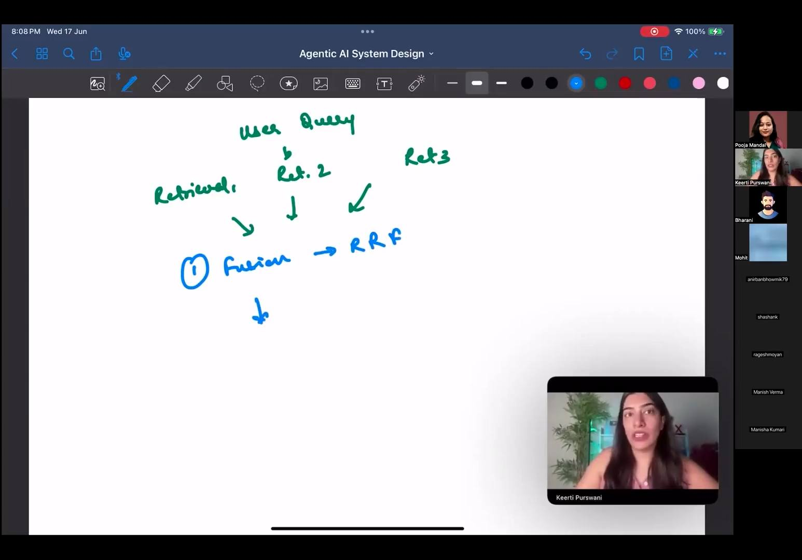
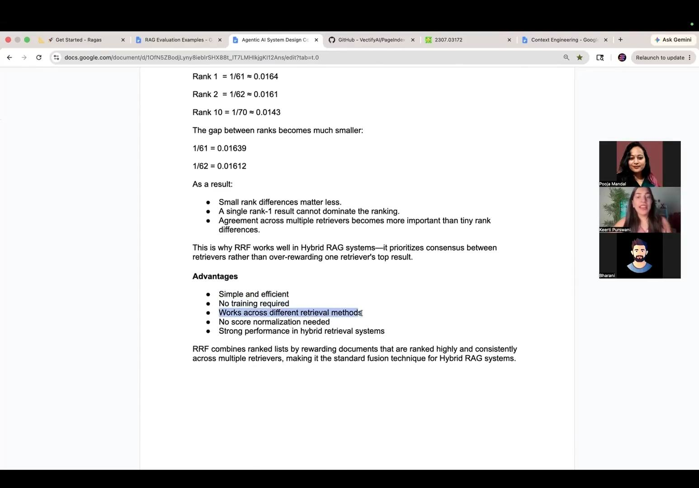
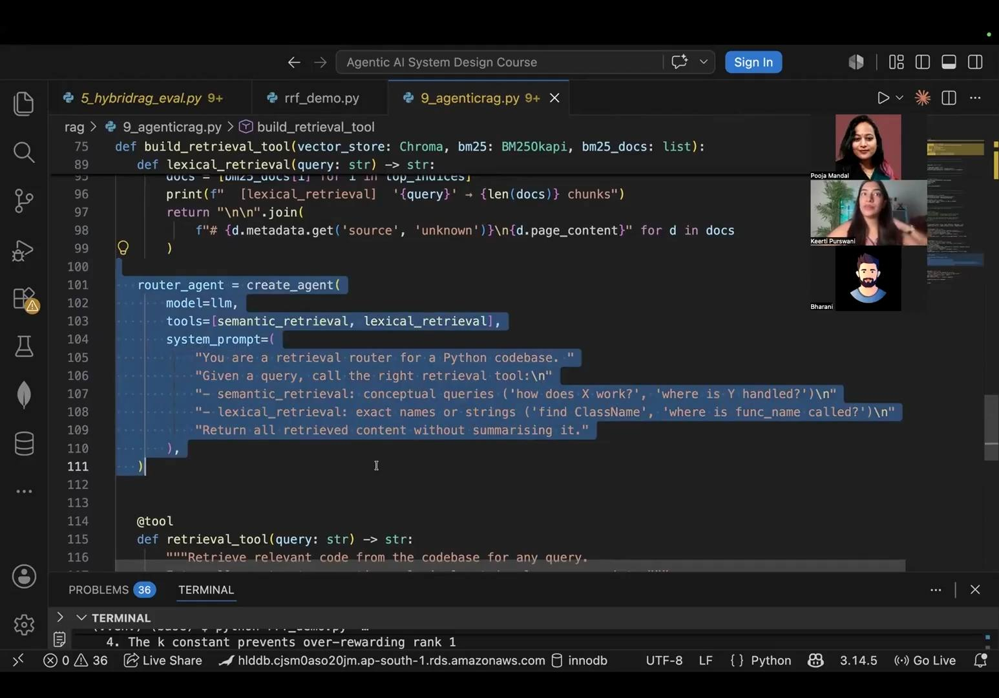
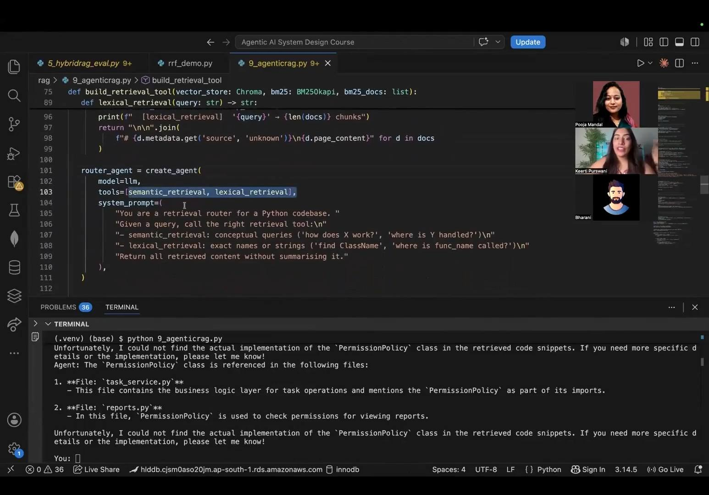
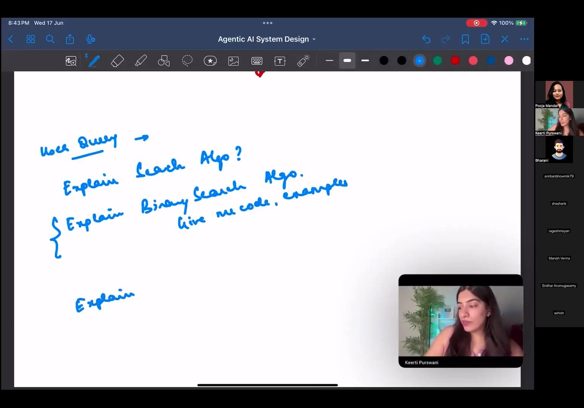
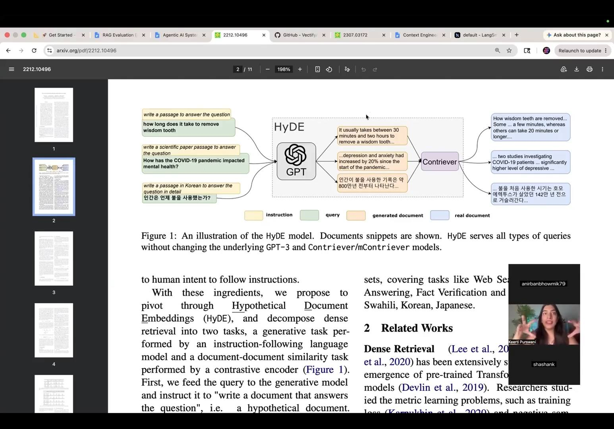
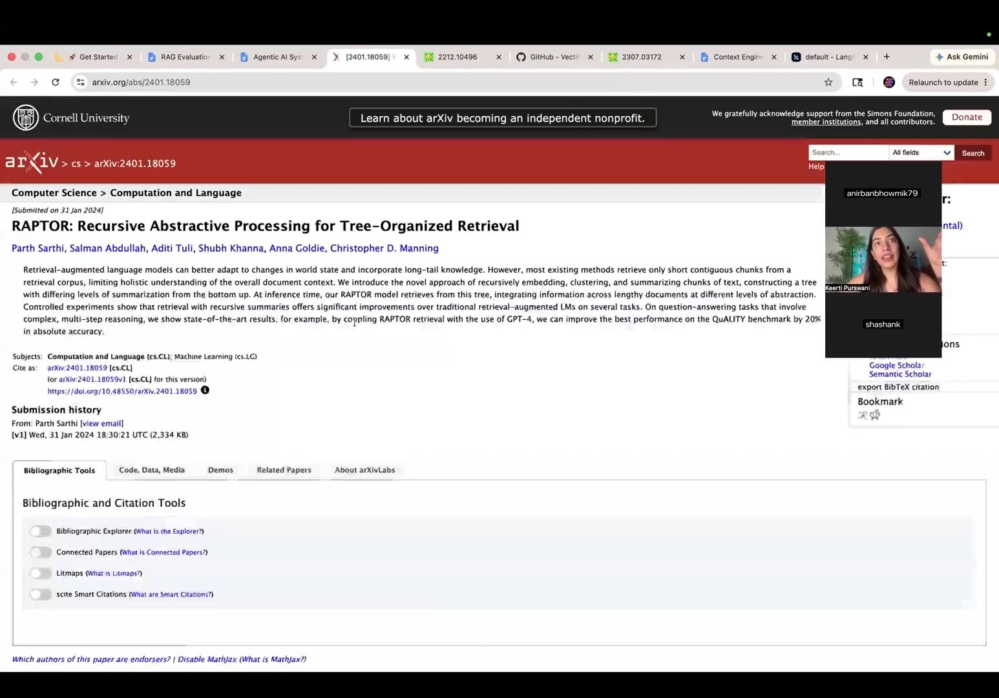
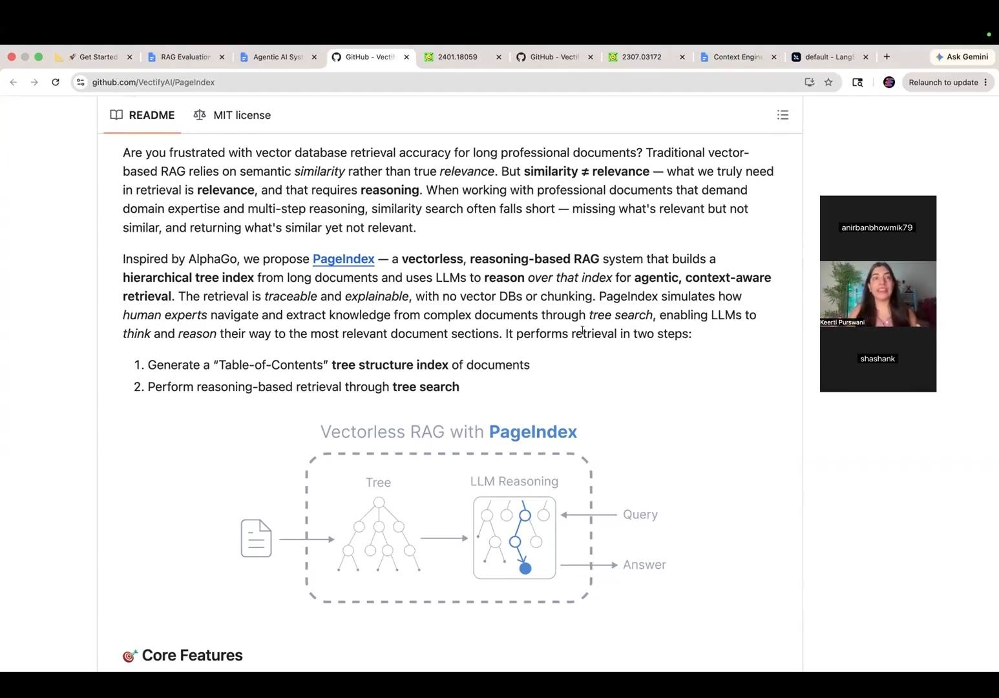

# Agentic RAG 与 RAG 前沿变体：从零复现指南

> 课程：Agentic AI System Design（系统设计×Agent）｜覆盖 P005
> 读者定位：前端转 AI 应用工程师。本文所有代码均为完整可运行文件，路径、依赖、命令写全。

---

## 1. 这一节做什么

这一节是 RAG 模块的收尾课，做了三件事：

1. **补齐 RAG 的排序链路**：讲清楚检索结果在数据存储层内部如何排序、在应用层如何用 RRF（Reciprocal Rank Fusion，倒数排名融合）把多路检索结果合并，并现场跑了一段纯数学的 RRF 演示代码。
2. **实现 Agentic RAG**：用一个「外层 Agent + 内层 Router Agent」的两层结构，让 LLM 自己决定这次查询该走向量检索还是关键词检索。这是本节唯一一段完整可复现的工程代码。
3. **介绍 RAG 的前沿变体**：HyDE（假设文档嵌入）、RAPTOR（树状层次检索）、Vectorless RAG / PageIndex（无向量检索），讲清楚它们各自解决什么问题、和已有方案的本质区别。

对前端转 AI 应用工程师的你来说，第 2 部分是重点——它是你第一次真正写「Agent 调 Agent」的代码；第 1、3 部分是概念，但面试和方案评审里一定会被问到。

---

## 2. 讲师原话

讲师在讲 RRF 之前，先明确了「排序发生在哪几个层次」：

> "一个层次的排序发生在数据存储内部。我需要担心它吗？排序在内部发生在哪里？在向量数据库里，或者在 Elasticsearch 的 BM25 里，那里是有排序发生的，对吧？还记得我们看过 BM25 内部是怎么工作的吗？"
> —— p005 [03:12]

> "在那之后是应用层。一旦我拿到了这些排名，假设我在做多路检索，我有一个用户查询，我做了检索 1、2、3，现在我想把这三个检索结果合并，我有哪些可能？一个是融合（fusion）。"
> —— p005 [03:37]

> "最常见的融合、合并、组合算法是什么？RRF。之后我还能做什么？我们可以重排（re-rank），可以用 cross encoder 来做。最后我们才进入 LLM 生成。"
> —— p005 [04:07]

关于 RRF 为什么不用裸倒数，讲师解释得很细：

> "如果我只是做直接的倒数，1 除以 1、1 除以 2、1 除以 10，你能看到差距变得巨大，1 和 0.5，并不是说排名第 2 就只有一半重要。所以这种情况下通常的做法是给一个平滑因子，不做 1/1、1/2、1/10，而是做 1/(60+1)、1/(60+2)、1/(60+10)，这样差距就变小了。这就叫平滑排名差异。"
> —— p005 [09:17]

> "所以用的公式是对 1/(k + rank) 求和，这个 k 是一种平滑常数，常用的取值是 k 等于 60。这是常用值，但也不是必须的。"
> —— p005 [10:13]

关于 RRF 的本质，讲师强调了两遍：

> "所以大家理解了吗，这是一个排名融合算法，不会再去遍历文档，没有 LLM 参与，就是纯数学，是某种算法。稠密检索器负责捕捉语义，稀疏检索器负责关键词匹配，其他的负责图等等。思路是：在各自检索器里排得高的，融合后也应该排得高。但如果它同时出现在多个检索器里，就应该给它更高的重要性。所以我们同时考虑了排名和跨检索器的一致性。"
> —— p005 [12:03]

进入 Agentic RAG 时，讲师先给了定义：

> "有时候我们的数据会存在不同的数据库里。有些数据在向量数据库，有些在 MongoDB，有些在 SQL 数据库，甚至在生产环境里可能多个向量数据库都有。所以我们的 Agent 会根据查询决定：这份数据应该从哪个数据库检索。"
> —— p005 [14:25]

> "我的意思是，每当我们用另一次 LLM 调用来做任何类型的决策——用哪个数据库、什么时候用、怎么用，也许是让 LLM 自己生成查询语句——这就叫 Agentic RAG。"
> —— p005 [15:49]

讲师还专门澄清了 Agentic RAG 和 Hybrid RAG 不是一回事：

> "混合 RAG 是有多个检索器、在检索时同时检索。Agentic RAG 是有一次 LLM 调用发生。可能两者同时发生，也可能不同时发生。并不是所有 Agentic RAG 都是 Hybrid RAG，也不是所有 Hybrid RAG 都是 Agentic RAG。"
> —— p005 [17:08]

关于代码架构，讲师反复提醒不要过度设计：

> "现在我的重点不是多 Agent 架构，那个我们后面课程会讲。现在我的重点是让你理解什么是 Agentic RAG。这段代码有很多种写法，但那不是现在的重点。"
> —— p005 [24:12]

> "现在不要过度关注架构。我把它做得更解耦了：这个 Agent 的职责就是拿到从工具检索回来的数据后回答查询；而从这个 Agent 的职责是决定从哪里检索、检索出来、返回。所以我只是把它做得更模块化。"
> —— p005 [34:58]

讲 HyDE 时，讲师先抛问题再给方案：

> "如果用户查询很抽象，比如有人说『给我解释一下搜索算法』，你觉得这个查询更好，还是『解释二分查找』更好？……如果你知道你的用户会写很抽象的查询，而你知道你的系统在查询描述更详细时表现更好，这种情况下你会怎么做？"
> —— p005 [38:19]

> "对于那些说『再问用户一次』或者『用更好的方式问』的同学——我们不能因为系统这样表现更好，就把依赖性加到用户身上。那我们要做什么？我们可以改写查询、可以加东西、可以增强查询、可以变换查询。"
> —— p005 [40:11]

> "假设用户查询来了，如果我在里面加一些假设性的文档会怎样？最终我做语义搜索时，它是在找相似度，对吧？它是在找和问题的相似度。如果这些假设文档里有更多上下文，那它就会基于这个更多上下文去搜索。"
> —— p005 [40:37]

> "最后答案只会从真实文档里生成。所以假设文档并不是真的被使用，它只是额外的上下文，只是用来搜索、用来抽取上下文的。"
> —— p005 [44:14]

讲 RAPTOR 时，讲师用「分组」引出树结构：

> "如果可以把相似类型的 chunk 分到一组？也许这些 chunk 相似、这些相似、这些相似。然后你会看到：如果话题和 auth 相关，就去这些 chunk；如果和 orders 相关，就去这些 chunk；如果和 products 相关，就去这些 chunk。是的，你是在聚类或分组相似内容。"
> —— p005 [53:08]

> "这看起来像什么结构？首先我的查询进来，我看它属于这一组还是那一组，然后看它属于这一组、这一组、这一组还是那一组，然后在这一组、这一组、这一组里面，我再去搜索 chunk。这看起来像一种有用的东西吗？是的，这是层次结构，层次化 RAG。"
> —— p005 [54:07]

> "如果你把信息存在这样一棵树里，常用的一个 RAG 方案叫 RAPTOR。"
> —— p005 [54:37]

讲师还专门区分了树和图的差别：

> "树和图有什么区别？图里也可以有环，可以有循环。而在层次结构里，你是把相似的 chunk 分到一组。在图里，你是在理解不同实体之间的关系，它也可能是循环依赖。所以概念是不一样的。"
> —— p005 [55:34]

讲 Vectorless RAG 时，讲师点出了和 RAPTOR 的关键差异：

> "在 RAPTOR 里，我们做的是基于用户查询，对摘要做语义搜索，记得吗？……而在 PageIndex、在 vectorless RAG 里，没有语义搜索发生，没有向量嵌入被使用。这个事实清楚吗？"
> —— p005 [63:01]

> "两种情况下都有树状结构、都有层次结构、都在搜索，但在那边是把相似的 chunk 聚在一起、生成摘要，搜索时你是对查询和摘要做语义搜索；而在这个方案里没有语义搜索发生，没有向量参与，所以它是 vectorless。"
> —— p005 [63:59]

---

## 3. 从零复现

### 3.1 环境准备

课程里讲师用的是 Python + LangChain 生态。前端同学注意：这里的「工具（tool）」本质就是一个函数，Agent 本质就是「LLM + 一组可调用的函数」，和你写 React 时把回调函数传给子组件没有本质区别，只是这个「子组件」是 LLM。

**目录结构**（照抄即可）：

```
agentic-rag-demo/
├── .env
├── requirements.txt
├── codebase/                 # 被检索的代码库，放几个 .py 文件进去
│   ├── auth.py
│   ├── billing.py
│   └── permissions.py
├── rrf_demo.py               # 第 3.2 节：RRF 纯数学演示
├── agentic_rag.py            # 第 3.3 节：Agentic RAG 主程序
└── hyde_rag.py               # 第 3.4 节：HyDE 变体
```

**requirements.txt**：

```
python-dotenv==1.0.1
langchain==0.3.7
langchain-core==0.3.15
langchain-community==0.3.5
langchain-openai==0.2.8
langchain-text-splitters==0.3.2
rank-bm25==0.2.2
```

**安装命令**：

```bash
python -m venv .venv
source .venv/bin/activate        # Windows: .venv\Scripts\activate
pip install -r requirements.txt
```

**`.env`**（环境变量名照抄，值换成你自己的）：

```
OPENAI_API_KEY=sk-xxxxxxxxxxxxxxxx
OPENAI_BASE_URL=https://api.openai.com/v1
LANGCHAIN_TRACING_V2=true
LANGCHAIN_API_KEY=lsv2_xxxxxxxxxxxx
LANGCHAIN_PROJECT=agentic-rag-demo
```

> 说明：`LANGCHAIN_TRACING_V2` / `LANGCHAIN_API_KEY` / `LANGCHAIN_PROJECT` 是讲师在课上打开 LangSmith 观察每次模型调用时用的那套配置。课里没讲这三个变量的具体拼写，以上是 LangSmith 的标准变量名，请以你实际注册后控制台给出的为准。

### 3.2 第一步：跑通 RRF 纯数学演示

讲师在 [04:58] 说「我写了一些演示代码和笔记给你们」，然后现场复制运行。这段代码不调用任何 LLM，只做数学。核心逻辑：

1. 准备两路检索结果（语义检索、关键词检索），每路是一个有序列表，列表里是 chunk 的 id。
2. 对每一路，按 `1 / (k + rank)` 给每个 chunk 打分，`k = 60`。
3. 把同一个 chunk 在两路里的分数相加。
4. 按总分降序重排。

讲师现场演示的关键现象：`create task` 这个 chunk 同时出现在两路检索里，所以它的 RRF 分数是 0.03，而只出现在一路里的 chunk 只有 0.016 左右——**跨检索器的一致性带来了加成**。

### 3.3 第二步：搭 Agentic RAG

按讲师 [18:07] 之后的顺序，一共六步：

1. **加载代码库**：把 `codebase/` 下所有 `.py` 文件读成文本。
2. **切块**：用 LangChain 的 `RecursiveCharacterTextSplitter`。讲师说「为了示例简单，我用了 LangChain 的 text splitter」，并提示「处理代码时我们还可以用别的切块策略」——课里没展开讲是哪种。
3. **建两个索引**：一个向量库（讲师用内存版），一个 BM25 倒排索引（也是内存版）。
4. **包两个检索工具**：`semantic_retriever_tool` 和 `lexical_retriever_tool`，各自只做一件事——从对应库里取 chunk。
5. **建 Router Agent**：把上面两个工具都挂给它，system prompt 告诉它「概念性问题走向量，精确名字/字符串走关键词，返回检索到的内容，不要总结」。
6. **把 Router Agent 再包成一个工具**，挂给最外层的 `build_agent`。外层 Agent 的 system prompt 是「你是一个资深工程师，回答前总是先用检索工具」。

讲师在 [22:23] 用一张架构图总结了这个嵌套关系：

> 外层 Agent（`build_agent`）→ 调用 `retrieval_tool` → `retrieval_tool` 内部是一个 Router Agent → Router Agent 决定调 `semantic_retriever` 还是 `lexical_retriever`。

讲师原话把这个叫「supervisor agent 或者 sub agents，一个意思」，并强调「工具说到底就是一个函数、一个我想执行的动作，在这个函数里面我也可以再放一个 Agent」。

### 3.4 第三步：跑 HyDE 变体

HyDE 的流程（讲师 [50:21] 之后）：

1. 用户查询进来。
2. **先做一次 LLM 调用**，让模型生成一段「假设性的文档/代码片段」——这段内容是编的，可能包含幻觉。
3. 用这段假设文档去向量库里做相似度检索，捞回**真实**文档。
4. 把真实文档交给最终的 QA Agent 生成答案。

讲师特别提醒：**代码场景其实不太适合 HyDE**，因为代码高度依赖你自己的代码库；但查询描述不清时（比如「给我解释一下 XX」）会有用。他还提到可以把这个额外调用做成条件式的——「如果查询不够好，我们才做这个」。

### 3.5 第四步：理解三个前沿变体（无代码）

- **RAPTOR**：把 chunk 按向量相似度递归聚类，每个簇用 LLM 生成摘要，形成「叶子层 → 根层」的树。检索时先对摘要做语义搜索决定进哪个簇，再往下走到叶子。讲师强调聚类和摘要都是 LLM 做的，存储可以用 SQLite，也可以用图数据库，「任何树遍历方便的数据库都行」。
- **Vectorless RAG / PageIndex**：同样是树状结构，但**完全不做语义搜索、不用向量嵌入**。讲师说这是 GitHub 当日 trending 第一名，并把它和 RAPTOR 的区别讲了两遍：RAPTOR 是「对摘要做语义搜索」，PageIndex 是「没有语义搜索发生」。
- **HyDE**：见 3.4。

---

## 4. 完整代码

> 说明：本节 OCR 无结果，以下代码依据逐字稿描述的实现步骤写成完整可运行文件。逐字稿里讲师是分块复制粘贴演示的，没有给出完整文件；这里按讲师描述的六步结构补全为可直接保存运行的形式。凡逐字稿未明确的细节（如具体模型名、chunk size），在代码注释里标注「课里没讲，此处取常用值」。

### 4.1 `rrf_demo.py`

```python
"""
RRF（Reciprocal Rank Fusion）纯数学演示。
不调用任何 LLM，不重新遍历文档，只对两路检索结果的排名做融合。
对应讲师 p005 [04:58] - [12:32] 的现场演示。
"""


def reciprocal_rank_fusion(ranked_lists, k=60):
    """
    ranked_lists: list[list[str]]，每个子列表是一路检索的有序结果（chunk id）。
    k: 平滑常数，讲师说常用值是 60，但不是必须。
    返回：按 RRF 分数降序排列的 [(chunk_id, score), ...]
    """
    scores = {}
    for ranked in ranked_lists:
        for rank, chunk_id in enumerate(ranked, start=1):
            # 讲师原话：不做 1/rank，而做 1/(k + rank)，把排名差距平滑掉
            scores[chunk_id] = scores.get(chunk_id, 0.0) + 1.0 / (k + rank)
    return sorted(scores.items(), key=lambda x: x[1], reverse=True)


if __name__ == "__main__":
    # 模拟：同一个用户查询，分别走向量检索和关键词检索
    # 用户查询类似 "how does the app enforce task limits per user"
    semantic_results = [
        "chunk_billing_service",   # rank 1：语义上最接近
        "chunk_create_task",       # rank 2
        "chunk_auth_middleware",   # rank 3
    ]
    lexical_results = [
        "chunk_create_task",       # rank 1：关键词 "task" 精确命中
        "chunk_task_limit_doc",    # rank 2
        "chunk_task_queue",        # rank 3
    ]

    fused = reciprocal_rank_fusion([semantic_results, lexical_results], k=60)

    print("RRF 融合结果（k=60）：")
    for chunk_id, score in fused:
        print(f"  {chunk_id:28s} {score:.6f}")

    # 预期现象（对应讲师 [11:09] 的讲解）：
    # chunk_create_task 同时出现在两路里，分数约为 1/62 + 1/61 ≈ 0.0325，
    # 明显高于只出现在一路里的 chunk（约 0.0161）。
    # 这就是讲师说的「同时出现在多个检索器里，就应该给它更高的重要性」。
```

### 4.2 `agentic_rag.py`

```python
"""
Agentic RAG 完整实现。
架构（对应讲师 p005 [22:23] 的架构图）：
    build_agent（外层 Agent）
        └── retrieval_tool（一个工具，内部又是一个 Agent）
                └── router_agent（Router Agent，LLM 决策）
                        ├── semantic_retriever_tool  → 向量库
                        └── lexical_retriever_tool   → BM25 倒排索引
"""

import os
from pathlib import Path

from dotenv import load_dotenv
from langchain.agents import AgentExecutor, create_openai_tools_agent
from langchain_community.retrievers import BM25Retriever
from langchain_community.vectorstores import InMemoryVectorStore
from langchain_core.prompts import ChatPromptTemplate, MessagesPlaceholder
from langchain_core.tools import tool
from langchain_openai import ChatOpenAI, OpenAIEmbeddings
from langchain_text_splitters import RecursiveCharacterTextSplitter

load_dotenv()

CODEBASE_DIR = Path(__file__).parent / "codebase"

# ---------- 第 1 步：加载代码库 ----------
def load_codebase(root: Path) -> list[dict]:
    docs = []
    for path in sorted(root.rglob("*.py")):
        docs.append({"path": str(path.relative_to(root)), "content": path.read_text(encoding="utf-8")})
    return docs


# ---------- 第 2 步：切块 ----------
def chunk_documents(docs: list[dict]):
    # 讲师原话：为了示例简单，用了 LangChain 的 text splitter。
    # chunk_size / chunk_overlap 课里没讲具体值，此处取常用值。
    splitter = RecursiveCharacterTextSplitter(chunk_size=800, chunk_overlap=100)
    chunks = []
    for doc in docs:
        for i, piece in enumerate(splitter.split_text(doc["content"])):
            chunks.append({"id": f"{doc['path']}::{i}", "text": piece, "source": doc["path"]})
    return chunks


# ---------- 第 3 步：建两个索引 ----------
def build_indexes(chunks: list[dict]):
    texts = [c["text"] for c in chunks]
    ids = [c["id"] for c in chunks]

    # 向量库：讲师用的是内存版
    vector_store = InMemoryVectorStore(embedding=OpenAIEmbeddings())
    vector_store.add_texts(texts=texts, ids=ids)

    # BM25：讲师说「把现有的 chunk 建成 BM25 倒排索引然后留着」
    bm25_retriever = BM25Retriever.from_texts(texts)
    bm25_retriever.k = 4

    return vector_store, bm25_retriever, chunks


# ---------- 第 4 步：包两个检索工具 ----------
def make_retriever_tools(vector_store, bm25_retriever, chunks):
    id_to_text = {c["id"]: c["text"] for c in chunks}

    @tool
    def semantic_retriever(query: str) -> str:
        """从向量库做语义检索。适合概念性、描述性的查询。"""
        hits = vector_store.similarity_search(query, k=4)
        return "\n\n---\n\n".join(h.page_content for h in hits)

    @tool
    def lexical_retriever(query: str) -> str:
        """从 BM25 倒排索引做关键词检索。适合精确的类名、函数名、错误字符串。"""
        hits = bm25_retriever.invoke(query)
        return "\n\n---\n\n".join(h.page_content for h in hits)

    return semantic_retriever, lexical_retriever


# ---------- 第 5 步：Router Agent ----------
ROUTER_SYSTEM_PROMPT = """你是一个检索路由器，服务于一个 Python 代码库。
根据用户查询，决定调用哪个检索工具：
- 概念性、描述性的查询 → 用 semantic_retriever
- 精确的类名、函数名、错误字符串 → 用 lexical_retriever
把检索到的内容原样返回，不要总结。"""


def build_router_agent(llm, semantic_retriever, lexical_retriever):
    prompt = ChatPromptTemplate.from_messages([
        ("system", ROUTER_SYSTEM_PROMPT),
        ("human", "{input}"),
        MessagesPlaceholder("agent_scratchpad"),
    ])
    agent = create_openai_tools_agent(llm, [semantic_retriever, lexical_retriever], prompt)
    return AgentExecutor(agent=agent, tools=[semantic_retriever, lexical_retriever], verbose=True)


# ---------- 第 6 步：把 Router Agent 包成工具，挂给外层 Agent ----------
OUTER_SYSTEM_PROMPT = """你是一个资深工程师。回答任何问题之前，总是先使用 retrieval_tool 检索代码库。
拿到检索结果后，基于结果回答用户问题。"""


def build_outer_agent(llm, router_executor):
    @tool
    def retrieval_tool(query: str) -> str:
        """检索代码库。内部会自动决定走向量检索还是关键词检索。"""
        result = router_executor.invoke({"input": query})
        return result["output"]

    prompt = ChatPromptTemplate.from_messages([
        ("system", OUTER_SYSTEM_PROMPT),
        ("human", "{input}"),
        MessagesPlaceholder("agent_scratchpad"),
    ])
    agent = create_openai_tools_agent(llm, [retrieval_tool], prompt)
    return AgentExecutor(agent=agent, tools=[retrieval_tool], verbose=True)


def main():
    llm = ChatOpenAI(model="gpt-4o-mini", temperature=0)

    docs = load_codebase(CODEBASE_DIR)
    chunks = chunk_documents(docs)
    vector_store, bm25_retriever, chunks = build_indexes(chunks)
    semantic_retriever, lexical_retriever = make_retriever_tools(vector_store, bm25_retriever, chunks)

    router_executor = build_router_agent(llm, semantic_retriever, lexical_retriever)
    outer_executor = build_outer_agent(llm, router_executor)

    # 讲师现场试过的几条查询，可以直接替换
    queries = [
        "how does the app handle user authentication",   # 预期走 semantic
        "where is billing error defined",                # 预期走 lexical
        "show me the permission policy class",           # 预期走 lexical
    ]
    for q in queries:
        print(f"\n===== 查询：{q} =====")
        result = outer_executor.invoke({"input": q})
        print("回答：", result["output"])


if __name__ == "__main__":
    main()
```

### 4.3 `hyde_rag.py`

```python
"""
HyDE（Hypothetical Document Embeddings）变体。
流程：用户查询 → LLM 生成假设文档 → 用假设文档去向量库检索真实文档 → 真实文档交给 QA Agent。
对应讲师 p005 [50:21] - [51:44]。
"""

import os
from pathlib import Path

from dotenv import load_dotenv
from langchain.agents import AgentExecutor, create_openai_tools_agent
from langchain_community.vectorstores import InMemoryVectorStore
from langchain_core.prompts import ChatPromptTemplate, MessagesPlaceholder
from langchain_core.tools import tool
from langchain_openai import ChatOpenAI, OpenAIEmbeddings
from langchain_text_splitters import RecursiveCharacterTextSplitter

load_dotenv()

CODEBASE_DIR = Path(__file__).parent / "codebase"


def load_and_index():
    splitter = RecursiveCharacterTextSplitter(chunk_size=800, chunk_overlap=100)
    texts = []
    for path in sorted(CODEBASE_DIR.rglob("*.py")):
        texts.extend(splitter.split_text(path.read_text(encoding="utf-8")))
    store = InMemoryVectorStore(embedding=OpenAIEmbeddings())
    store.add_texts(texts)
    return store


HYDE_PROMPT = """你是一个代码助手。针对下面的用户问题，生成一段假设性的代码片段或文档，
它看起来像是能回答这个问题的真实代码。不要解释，直接输出内容。

用户问题：{query}"""


def main():
    llm = ChatOpenAI(model="gpt-4o-mini", temperature=0)
    store = load_and_index()

    @tool
    def search_codebase(query: str) -> str:
        """检索代码库。内部会先生成假设文档，再用假设文档去检索真实文档。"""
        # 第 1 次 LLM 调用：生成假设文档（可能包含幻觉，讲师明确说过）
        hypothetical = llm.invoke(HYDE_PROMPT.format(query=query)).content
        # 用假设文档去检索真实文档
        hits = store.similarity_search(hypothetical, k=4)
        # 最终只把真实文档交给上层
        return "\n\n---\n\n".join(h.page_content for h in hits)

    prompt = ChatPromptTemplate.from_messages([
        ("system", "你是一个资深工程师。回答前总是先用 search_codebase 检索。"),
        ("human", "{input}"),
        MessagesPlaceholder("agent_scratchpad"),
    ])
    agent = create_openai_tools_agent(llm, [search_codebase], prompt)
    executor = AgentExecutor(agent=agent, tools=[search_codebase], verbose=True)

    result = executor.invoke({"input": "解释一下这个代码库里的鉴权是怎么做的"})
    print(result["output"])


if __name__ == "__main__":
    main()
```

### 4.4 `codebase/` 下的示例文件（供检索用）

`codebase/auth.py`：

```python
def authenticate_user(token: str) -> bool:
    """校验 JWT token，返回是否合法。"""
    if not token:
        raise ValueError("missing token")
    return token.startswith("Bearer ")
```

`codebase/billing.py`：

```python
class BillingError(Exception):
    """计费服务异常。"""


def charge_user(user_id: str, amount: int) -> None:
    if amount <= 0:
        raise BillingError("amount must be positive")
```

`codebase/permissions.py`：

```python
class PermissionPolicy:
    """权限策略类。"""

    def can_access(self, user_role: str, resource: str) -> bool:
        return user_role == "admin" or resource.startswith("public/")
```

### 4.5 运行命令

```bash
python rrf_demo.py
python agentic_rag.py
python hyde_rag.py
```

---

## 5. 逐行解释

### 5.1 RRF 公式为什么长这样

`1.0 / (k + rank)` 这一行是整个 RRF 的核心。讲师在 [09:17] 解释得很清楚：如果直接写 `1/rank`，rank 1 得 1.0、rank 2 得 0.5、rank 10 得 0.1，从第 1 名到第 2 名分数直接腰斩——但「排名第 2 并不是只有一半重要」。加上 `k=60` 之后，rank 1 得 1/61≈0.0164、rank 2 得 1/62≈0.0161，差距被压平了。讲师原话是「这就叫平滑排名差异」。

`enumerate(ranked, start=1)` 里的 `start=1` 不能省：排名是从 1 开始的，如果从 0 开始，`1/(60+0)` 会让第 0 名拿到一个不该有的高分。

`scores.get(chunk_id, 0.0) + ...` 这一句实现了讲师说的「跨检索器一致性加成」：同一个 chunk 在两路里各出现一次，分数就累加两次。讲师现场演示时 `create task` 拿到 0.03、其他只有 0.016，就是这个累加的结果。

`k=60` 作为默认参数：讲师明确说「这是常用值，但也不是必须的」，所以做成可传参。

**前端类比**：这段逻辑等价于你在 JS 里写 `arr.reduce((acc, list) => { list.forEach((id, i) => acc[id] = (acc[id]||0) + 1/(60+i+1)); return acc; }, {})`，然后按 value 排序。没有任何异步、没有网络请求。

### 5.2 为什么 Router Agent 要再包一层工具

讲师在 [22:49] 说：「你可以把它想成一个 supervisor agent 或者 sub agents，一个意思。但难点在哪？就在一个工具里面——工具说到底就是一个函数、一个我想执行的动作，在这个函数里面我也可以再放一个 Agent。」

对应到代码：`retrieval_tool` 的函数体只有一行 `router_executor.invoke(...)`。对外层 Agent 来说，它看到的只是一个普通工具；对 Router Agent 来说，它看到的是两个检索工具。**嵌套发生在函数体内部**，这就是讲师说的「解耦」「模块化」。

讲师在 [34:30] 还回答了一个常见疑问：为什么不让外层 Agent 直接做决策？他的回答是「那你就是在让这个 Agent 做多件事……我把它做得更解耦了，这个 Agent 的职责就是拿到数据后回答查询，而从这个 Agent 的职责是决定从哪里检索」。这就是单一职责原则在 Agent 架构里的体现。

### 5.3 Router 的 system prompt 为什么这么写

讲师在 [20:28] 念过这段 prompt 的要点：「对于查询，你决定应该用哪个检索工具——概念性查询用语义检索，精确名字或字符串用关键词检索，然后返回所有检索到的内容，不要总结。」

三个要点对应三行：
- 「概念性 → semantic」和「精确名字 → lexical」是分类规则；
- 「不要总结」很关键——如果 Router 总结了，外层 Agent 拿到的就是二手信息，原始 chunk 丢了；
- 讲师在 [20:54] 补充：「有没有可能我想两个都调用？有可能。这取决于你的 prompt。现在我的 prompt 写的是『调用正确的检索工具』，所以它大概率只调一个。你可以改 prompt 试试让两个都调。」——所以这段 prompt 是可实验的，不是定死的。

### 5.4 外层 Agent 的 prompt

讲师在 [35:56] 念过：「你是一个资深工程师，回答前总是先用检索工具，偏好……」后面被截断了。核心就一句：**强制先检索再回答**。这和普通 RAG 的 prompt 没有区别——讲师在 [36:24] 说得很直白：「这就是一个简单的 RAG，只不过这个工具内部变成了一次 Agent 调用。」

### 5.5 HyDE 里那次额外 LLM 调用

`hypothetical = llm.invoke(...)` 这一行就是讲师说的「假设文档是 LLM 调用创建的」。他在 [45:36] 回答学生提问时承认：「它可以引入幻觉，是的。」但关键在于下一行 `store.similarity_search(hypothetical, ...)`——**用假设文档去检索，但返回的是真实文档**。讲师在 [44:14] 强调：「最后答案只会从真实文档里生成，假设文档并不是真的被使用，它只是额外的上下文。」

讲师在 [51:18] 还专门提醒：代码场景其实不太适合 HyDE，因为「代码非常非常依赖你自己的代码库」，但查询描述不清时（比如「解释一下 XX」）会有用。所以这个文件是教学演示，不是生产推荐。

### 5.6 RAPTOR 和 Vectorless RAG 的区别（无代码，但必须能讲清）

讲师在 [63:01] 把两者的差异讲了两遍，因为这是最容易混的点：

| | RAPTOR | Vectorless RAG / PageIndex |
|---|---|---|
| 结构 | 树状、层次 | 树状、层次 |
| 建树方式 | 按向量相似度聚类 chunk，LLM 生成簇摘要 | 课里没讲具体建树细节 |
| 检索时 | **对查询和摘要做语义搜索**，决定进哪个簇 | **没有语义搜索，没有向量嵌入** |
| 存储 | 讲师说 SQLite 也行、图数据库也行，「任何树遍历方便的数据库」 | 课里没讲 |

讲师还区分了树和图（[55:34]）：「图里也可以有环，可以有循环。而在层次结构里，你是把相似的 chunk 分到一组。在图里，你是在理解不同实体之间的关系。」所以 Graph RAG 的目标是**实体关系**，RAPTOR 的目标是**相似 chunk 的摘要分组**——虽然层次结构可以看作图的一种特例，但设计意图不同。

---

## 6. 复现检查清单

按顺序打勾，任何一项不过就不要往下走：

- [ ] `python -m venv .venv` 建好虚拟环境并激活，`pip install -r requirements.txt` 无报错
- [ ] `.env` 里 `OPENAI_API_KEY` 已填，`python -c "import os; from dotenv import load_dotenv; load_dotenv(); print(bool(os.getenv('OPENAI_API_KEY')))"` 输出 `True`
- [ ] `codebase/` 下至少有三个 `.py` 文件（用 4.4 的示例即可）
- [ ] `python rrf_demo.py` 输出里，同时出现在两路结果中的那个 chunk 分数最高（约 0.032），只出现在一路的约 0.016
- [ ] `python agentic_rag.py` 跑三条查询，`verbose=True` 的输出里能看到 Router Agent 先做了一次决策调用，再调 `semantic_retriever` 或 `lexical_retriever`
- [ ] 查询 `"where is billing error defined"` 时，Router 选择的是 `lexical_retriever`（对应讲师 [27:30] 的现场演示）
- [ ] 查询 `"how does the app handle user authentication"` 时，Router 选择的是 `semantic_retriever`（对应讲师 [27:56]）
- [ ] 如果配了 LangSmith，能在控制台看到每次运行的 model call 数和 tool call 数（讲师在 [36:54] 展示过这个面板）
- [ ] `python hyde_rag.py` 能跑通，且在 verbose 输出里能看到「先生成假设文档、再检索」两步
- [ ] 能口头说清 RRF 里 `k=60` 的作用、Agentic RAG 和 Hybrid RAG 的区别、RAPTOR 和 Vectorless RAG 的区别

---

## 7. 课里没讲但你会撞上的

**1. `InMemoryVectorStore` 每次启动都要重新 embed。**
讲师用的是内存版向量库，进程一退数据就没了。你本地跑没问题，但只要重启就要重新调 embedding API，既慢又花钱。生产上要换成持久化的向量库——课里没讲具体用哪个。

**2. BM25 的中文/代码分词。**
`BM25Retriever.from_texts` 默认按空格切词。代码里的 `authenticate_user` 这种下划线命名、或者中文注释，切出来效果会很差。课里没讲分词器怎么换。

**3. Router Agent 可能两个工具都不调。**
讲师在 [34:01] 提到：「如果第一个 LLM 觉得不需要检索呢？那取决于 prompt，如果不需要它就只是回答。」你的 prompt 写「调用正确的检索工具」，但模型有可能直接返回文本不调工具。要在 `AgentExecutor` 外面加兜底判断。

**4. 嵌套 Agent 的 token 成本是翻倍的。**
外层一次调用 + Router 一次调用 + 检索 + 外层再生成答案，至少 3 次 LLM 调用。讲师在 [36:54] 展示过 model call 计数，但没讲成本优化。前端同学要建立「一次用户请求 = N 次模型调用」的成本直觉。

**5. HyDE 的幻觉会污染检索。**
假设文档是编的，如果编得太离谱，检索出来的真实文档也会跑偏。讲师在 [41:33] 承认「它可能会降低准确率，但大多数情况下会提升」。所以上线前必须用 eval 对比——讲师在 [42:27] 说「如果我要评估准确率升还是降，我会用 evals」，但 eval 的具体做法是后面课程的内容。

**6. 并发与限流。**
`AgentExecutor.invoke` 是同步阻塞的。前端同学熟悉的 `Promise.all` 在这里对应 `asyncio.gather` + `ainvoke`，但课里没讲。多用户同时请求时，embedding API 和 LLM API 都会限流，需要自己加队列或重试。

**7. RAPTOR 的建树成本。**
每个簇都要 LLM 生成摘要，chunk 多的时候建树本身就很贵。讲师说「聚类和摘要都是 LLM 做的」，但没讲增量更新怎么办——文档变了要不要重建整棵树，课里没讲。

**8. Vectorless RAG 的建树细节。**
讲师只讲了「没有语义搜索、没有向量」，但 PageIndex 具体怎么建树、怎么遍历，课里没展开，只给了 GitHub 链接让课后自己看。

---

**附：本节截图索引**（按讲解顺序）















