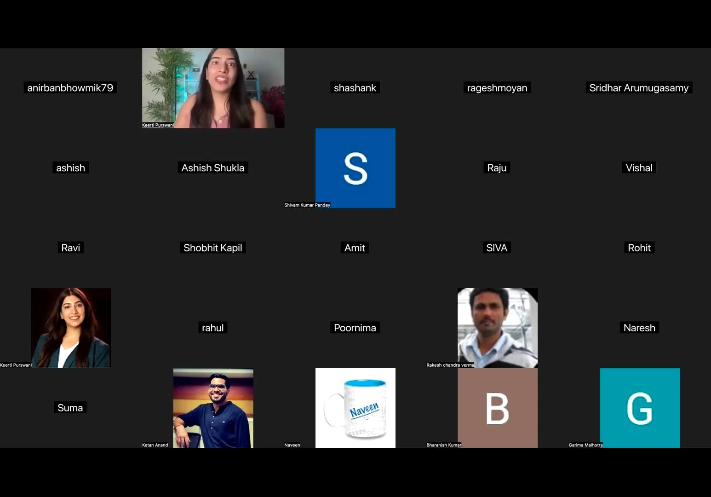
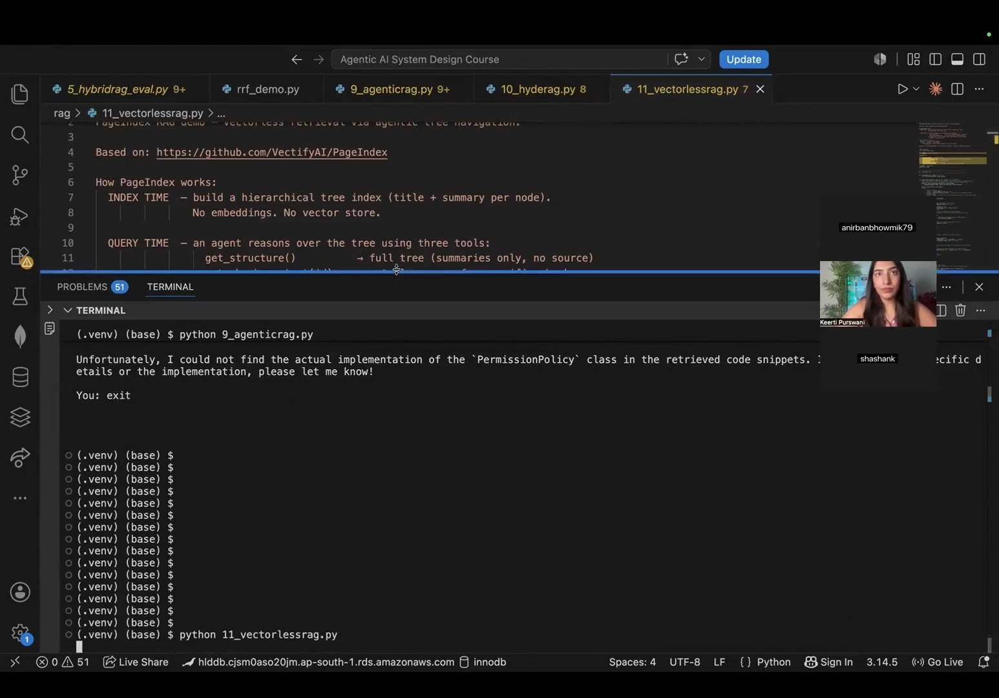
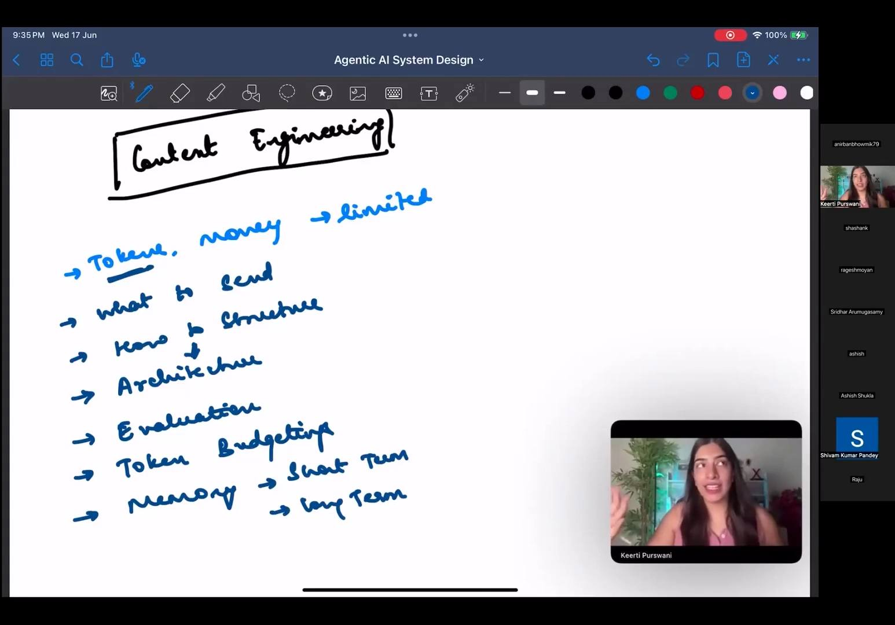
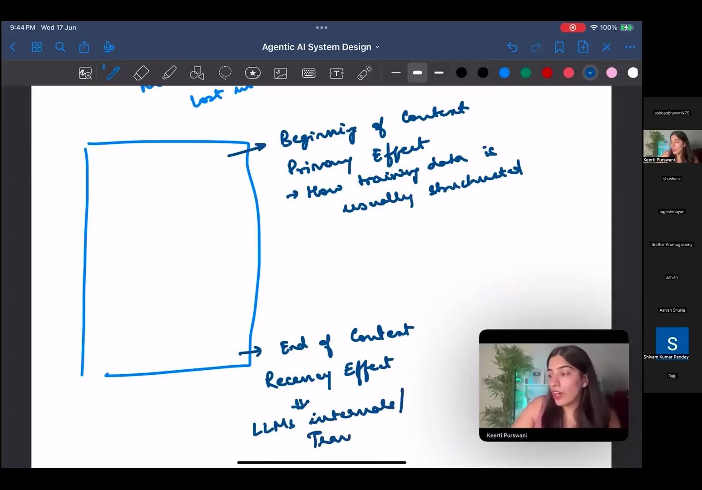
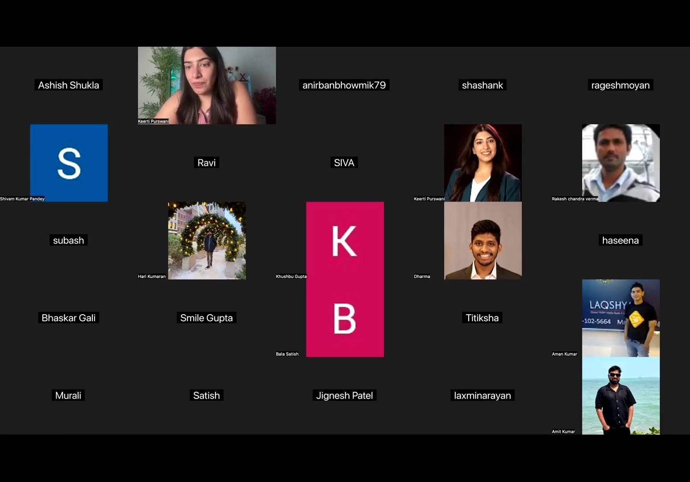
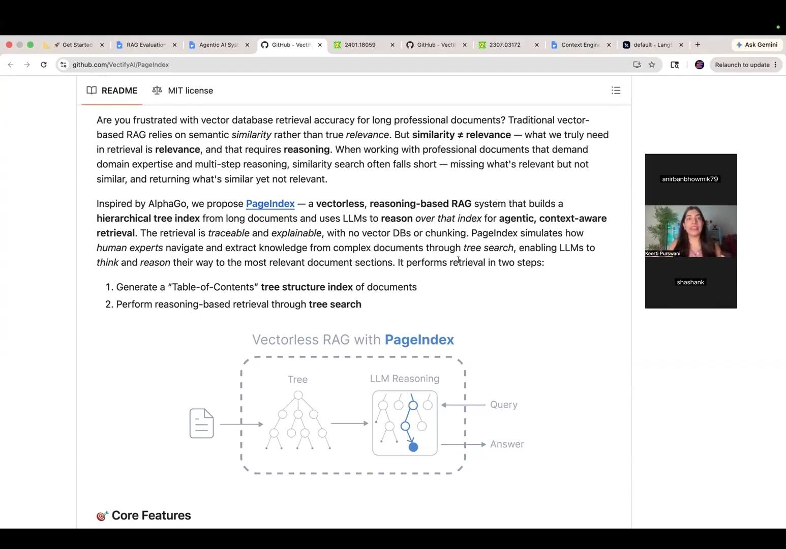
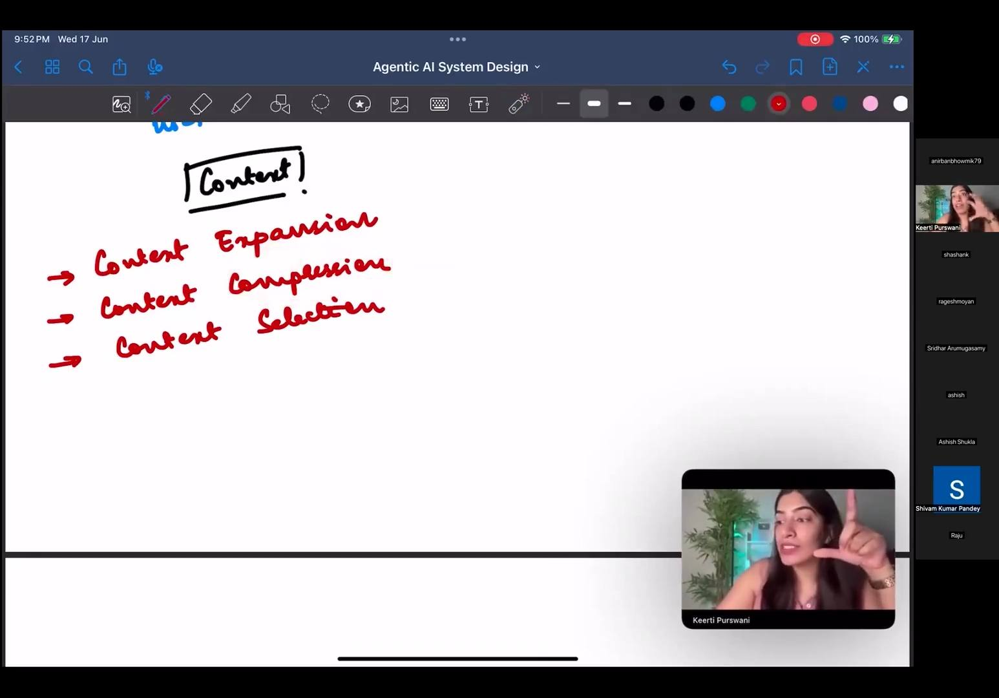
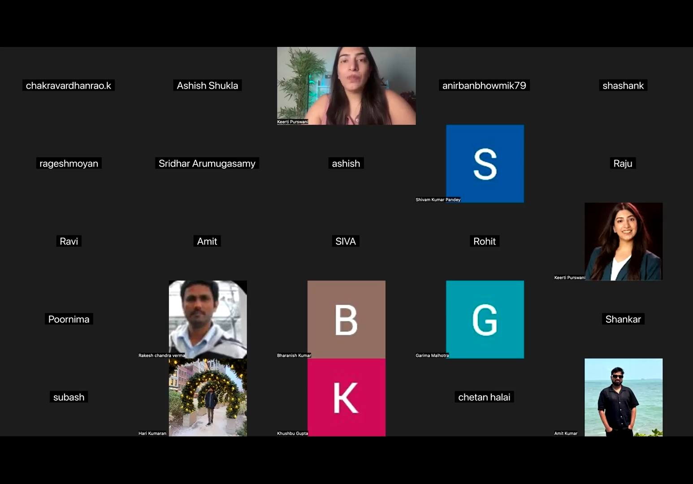

# 1. 这一节做什么

这一节对应 P005（第 2/2 段，64:56–130:02）。课程前半段收尾 RAG：先用问答复习 agentic、hybrid、融合、重排、RAPTOR、HyDE、RAG 评估，然后把 **PageIndex（讲师也叫 vectorless RAG、reasoning-based RAG）** 的原理和代码演示讲透；后半段正式进入 **Context Engineering**：context 由什么组成、顺序为什么重要（lost in the middle）、context 的五种组合方式、扩展/压缩/选择/剪枝/排序五种操作，以及短期/长期记忆的分类。最后约二十分钟是学员问答，涉及分层 chunking、PageIndex 的构建成本、法律文档场景，以及查询时如何逐层导航到叶子。

需要先说明这一节的**性质**：讲师在屏幕上跑了一个 PageIndex 示例，LangSmith 里能看到逐文件摘要调用，最终树有 34 个 chunk，但逐字稿没有逐行贴出代码，本段也没有 OCR 文本。因此第 4 节我把讲师描述的结构落成**数据模型、决策表、流程示意代码**，并明确标注哪些是示意、哪些“课里没讲”。读者照着这份文档能复现的是**设计决策和树结构**，不是一个装好就能跑的现成库。

这一节还要建立一条主线：**RAG 的选型不是比谁高级，而是看文档结构和查询类型**。讲师反复强调没有硬性规则，PageIndex 也不是所有场景都更好。

# 2. 讲师原话

## 2.1 PageIndex：用 LLM 推理代替向量相似度

> "这里不发生向量语义搜索，用的是 LLM 推理。"
> —— p005 [66:22]

> "相似不等于相关。"
> —— p005 [66:22]

> "LLM 被用来在那个索引上推理，做 agentic、上下文感知的检索；但没有语义搜索发生。"
> —— p005 [67:17]

> "所以我们生成一个目录树结构、文档索引，然后执行基于推理的检索。"
> —— p005 [67:47]

> "分层 RAG 里我们是对相似 chunk 做摘要并保留；而 PageIndex 里没有语义相似度搜索，也没有 embedding。"
> —— p005 [80:03]

> "这里没有语义相似度，发生的是 LLM 推理；没有 embedding，只是 LLM 处理摘要，我们把摘要本身存下来。"
> —— p005 [85:11]

这里有一个逐字稿内部的表述差异需要保留：讲师在 66:22 先说“摘要不保留”，但后面代码演示时实际对每个文件生成了摘要，并保存在树节点里。我的理解是，“不保留摘要”指的是**不把摘要当作向量检索的入口**；PageIndex 仍然保留各级摘要，用于 LLM 导航。这个差异课里没有进一步澄清，落地时以代码演示的结构为准。

## 2.2 RAG 复习：agentic、hybrid、融合与重排

> "agentic 里我们会做一次 LLM 调用，来决定从哪儿检索。如果 LLM 说应该从多个检索器取，那它就同时变成 hybrid。"
> —— p005 [70:36]

> "融合时我们不会重新过一遍文档；重排时我们会重新过一遍文档。"
> —— p005 [71:34]

> "如果不做 RRF 直接重排，我会花更多 context，会把更多文档发给 LLM，LLM 会更慢。"
> —— p005 [72:02]

> "假设每个检索器给我 5 个，总共 15 个；用融合从 15 个里选出 5 个，再对这 5 个重排。"
> —— p005 [72:56]

> "融合是第一轮面试。"
> —— p005 [73:26]

> "很常见的分层 RAG 论文是 RAPTOR。"
> —— p005 [74:24]

> "在 HyDE 里我们会生成一些假设文档，然后用它去取真实文档。"
> —— p005 [74:52]

> "可以用 Ragas 这个库；比较评估的真值来源是 golden dataset。"
> —— p005 [75:20]

> "如果在生产里效果不好，我会分析生产日志，看缺了哪类查询，把它加进 golden dataset。"
> —— p005 [75:49]

> "agentic RAG 就是任何你用了额外 agent 调用的地方：可以是决定用哪个检索器，可以是查询分解，可以是检索规划，任何事。"
> —— p005 [79:10]



## 2.3 PageIndex 代码演示

> "用一句话总结这个用于搜索索引的 Python 包。"
> —— p005 [82:49]

> "page index 有 34 个 chunk，完全没有向量、没有 embedding；root 是我的 sample project，有项目摘要。"
> —— p005 [83:44]

> "建树的时候你也可以用 AST。"
> —— p005 [85:40]



## 2.4 Context Engineering：组成、顺序、操作

> "每次我们把任何东西传给 LLM，都会发送一些 context；这是有限的，我们要为 token 花钱。"
> —— p005 [88:26]

> "我们会讲 token 预算，因为 token 就是我们花出去的钱；普通 HLD 里算 DAU、QPS、RPS、存储、延迟，这里算 token。"
> —— p005 [89:47]

> "为什么要管理对话历史或记忆？因为 LLM 是无状态的。"
> —— p005 [92:06]

> "这篇白皮书叫 lost in the middle，讲的是语言模型如何使用长上下文。"
> —— p005 [93:57]

> "context 中间的内容得到最少的注意力或重要性；开头重要，结尾重要，中间不重要。"
> —— p005 [94:25]

> "结尾因为 recency effect 被重视，开头因为 primary effect 被重视；于是中间变弱，这就是 lost in the middle。"
> —— p005 [97:11]



> "最简单的一种可能是只发 system prompt 和 user query。"
> —— p005 [101:00]

> "除了检索，还有别的工具，比如 calendar API、stock API、Gmail API、Slack、GitHub。"
> —— p005 [102:53]

> "虽然看起来反直觉，因为我们让它更贵、浪费更多 token，但在某些场景下 context expansion 是合理用例。"
> —— p005 [106:39]

> "token 太多、上下文太多时，我们会做摘要，这叫 context compression。"
> —— p005 [107:09]

> "如果我有 100 个候选 chunk，只选 10 个，我做的不是摘要，那是 context selection。"
> —— p005 [108:07]

> "从多个检索器取数据又不重排，会有重复 chunk、无关数据、旧输出、stale context；去重、去掉旧数据、去掉无关数据，都属于 context pruning。"
> —— p005 [108:35]

> "最后你可以做 context ordering：按特定顺序排，开头和结尾会被重视，中间更弱。"
> —— p005 [109:59]

> "短期记忆是某一次聊天；长期记忆是跨会话的，比如用户偏好。"
> —— p005 [110:27]

> "长期记忆里还分 episodic、semantic、procedural 等类型。"
> —— p005 [111:52]



## 2.5 取舍：没有硬性规则

> "没有硬性规则说哪个一定更好，一切都取决于场景和你要处理的文档类型。"
> —— p005 [125:31]

> "比如你有一批法律文档，PageIndex 会是更好的选择，能得到更准确的答案，因为法律文档里有大量引用。"
> —— p005 [125:55]

> "查询先到 LLM，它知道这类查询有哪个 DB 可搜；先看 root，也就是我们建好的目录，从目录里判断去第三块内容。"
> —— p005 [127:18]

> "可以把它想成 B+ 树或二叉搜索树那种索引导航；即使多几次调用，也比遍历所有 chunk 快。"
> —— p005 [128:11]

> "最终 LLM 调用发的是叶子 chunk，也就是最终代码；白皮书里也说叶子节点是最终文档、chunk。"
> —— p005 [129:06]



# 3. 从零复现

这一节不是跑某一条命令，而是把讲师的**推导过程**按步骤复现：先需求，再约束，再方案，再取舍。

## 3.1 先判断问题：你的查询需要哪种 RAG

讲师的复习从“如果我不知道查询会是什么类型”开始。可能的查询类型有三种：

- **lexical 精确匹配**：关键词、编号、错误码，需要词法检索。
- **semantic 语义搜索**：意思相近但用词不同，需要向量检索。
- **graph 图结构**：实体之间有多跳关系，需要图检索。

如果你**不知道**未来查询会落在哪一类，就选 agentic 或 hybrid：

- **agentic**：额外做一次 LLM 调用，让模型决定从哪个检索器取。
- **hybrid**：如果 LLM 决定从多个检索器取，它自然就变成 hybrid。

对应到 Node 里，这相当于一个 router：LLM 输出 JSON（选哪个 retriever、要不要并行取），应用层用 `Promise.all` 并发调用多个 retriever。课里没有给 router 的代码，这里只是设计对应。

## 3.2 融合与重排的次序

讲师给的顺序是**先融合、再重排**：

1. 每个检索器各返回 k 个（例子里 k=5）。
2. 假设三个检索器（semantic、lexical、graph），一共 15 个候选。
3. 用 **RRF（Reciprocal Rank Fusion，倒数排名融合）** 按排名做数学合并，从 15 个里选出 5 个。
4. 对这 5 个做 LLM 重排（re-ranking）。
5. 重排后的结果送进最终生成。

为什么不直接重排？因为重排要把**所有候选**重新过一遍 LLM，token 多、延迟高；融合是纯数学逻辑，先砍掉大部分候选。讲师的原话是“融合是第一轮面试”，HR 先筛一轮，面试官再见少量候选人。

## 3.3 当相似 chunk 太多：分层结构

如果大量 chunk 相似、检索很慢，就用 **hierarchical RAG**。讲师点名的最常见论文是 **RAPTOR**：先对相似 chunk 生成摘要，查询时先看摘要决定去哪个簇，再逐层下降到更细的节点。存储用任何能存树结构的数据库，graph DB 也可以。

## 3.4 当查询本身不好：HyDE

用户查询太短、不够具体时，先生成一些**假设文档**，再用假设文档去取真实文档。这相当于给查询补上下文，让检索更容易命中。

这里顺便带出 RAG 评估的闭环：任何 pipeline 改动（embedding、chunking、检索策略）都可以用 **Ragas** 比较新旧哪个更好，比较的真值来源是 **gold
比较的真值来源是 **golden dataset（金标准数据集）**。讲师的原话是“所有评估都发生在 golden dataset 上”；没有足够好的数据集时，可以手动来，也可以做 AI 的合成生成。反过来，生产里效果不好就去翻生产日志，看缺了哪类查询，把样本补进 golden dataset。

## 3.5 用“书”的类比理解 PageIndex

> "想一想我们是怎么读一本书的，对吧。"
> —— p005 [64:56]

讲师的类比是这样的：拿到一本书，先看目录；查 SQL 就知道该进「数据库」那一章，不该进「网络」那一章；查二分查找就知道该进「搜索算法」那一章。判断依据是**章节标题**，不是字面相似度。这就解释了讲师为什么说“相似不等于相关”。



向量检索的问题在于：一个长专业文档里，两个块可能字面很像，但讲的不是一回事；也可能讲的是同一件事，却散落在相隔 10 页、20 页的两章里。讲师在问答里举过这个例子：一本 AI 的书，一章讲 RAG、一章讲数据库、一章讲别的，同一条查询需要的块可能在三章里各有一段，向量索引因为先切块再排序，很难把这几段凑到一起，而目录式索引可以。

> "相似不等于相关。"
> —— p005 [66:22]

## 3.6 PageIndex 的构建流程

讲师在 68:45 说自己“加了代码示例”，随后在 [82:22] 现场跑了一遍。按他演示和讲解的顺序，构建流程是：

1. **确定根**：根节点是一个项目／一个目录。演示里 root 是 sample project。
2. **遍历文件**：把项目目录下的文件逐个枚举。LangSmith 里能看到的文件有 `permissions.py`、`reports.py`、`scheduler.py`、`task_service.py`，视频里还提到了 `audit_log.py`、`auth.py`、`billing.py`、`database.py`、`email_client.py`。
3. **对每个文件调用 LLM 做摘要**：讲师用的提示词是“用一两句话总结这个 Python 文件”。他明确讲了这条提示词是拿来对单个文件生成摘要的。
4. **文件内部再切 chunk**：每个文件节点下再挂类／函数级别的 chunk。
5. **把摘要和 chunk 组装成树**：root 挂项目摘要，中间层是文件摘要，叶子是 chunk。
6. **多项目可选加一层**：讲师说如果有多项目，可以在 root 之上再加一层目录层。
7. **切块可以用 AST**：“建树的时候你也可以用 AST。”——用 AST 切比按行数切更贴合代码语义。

讲师演示的这棵树最后有 **34 个 chunk**，并且明确说“完全没有向量、没有 embedding”。

> "审计日志.py 的摘要，然后是不同类的 chunk；auth.py 的摘要，然后是 chunk……"
> —— p005 [84:14]

这条链路有一个容易漏掉的细节：摘要不是嵌进向量库的，**摘要本身作为节点内容存起来**。查询时 LLM 读的就是这些存下来的摘要文本。



## 3.7 PageIndex 的查询流程

讲师在问答里被追问“索引建完之后，查询来了给 LLM 发什么”，他把流程讲得比正课更细：

1. 用户查询先到 LLM。LLM 知道“这类查询有一个索引 DB 可查”。
2. **先给 LLM 看 root 那一层，也就是目录（table of contents）**。讲师特别强调。“我们是不会把整个东西发过去的。”
3. 从目录里 LLM 推理出该进哪个分支，比如“去第三块内容”。
4. 进到第三块之后，如果它不是叶子，就把这一层的**摘要**都取出来给 LLM，让它继续往下选。
5. 一层层下降，直到叶子。
6. **最终送给生成模型的是叶子 chunk**。讲师在 [129:06] 复述了白皮书的说法：叶子节点就是最终文档、chunk。

讲师把这个过程类比成 B+ 树／二叉搜索树：单看好像要 5、6 次调用很慢，但比起把 1 万行、10 万行代码全塞进去，或者遍历所有 chunk，逐层下降要便宜得多。

## 3.8 Context Engineering 的第一课：context 里到底放什么

讲师和学员一起把 context 的组成部分列了出来，逐项是：

| 组成 | 说明 | 讲师强调的点 |
|---|---|---|
| system prompt | 固定的角色与规则 | 最基础，一般都要有 |
| conversation history / memory | 多轮对话历史 | LLM 是无状态的，状态要应用层自己管 |
| retrieved context / tool outputs | 检索到的块、工具返回结果 | 检索结果算在工具输出这一类里 |
| current user query | 当前这条用户问题 | 显然最重要 |

讲师自己数的时候一会儿说“四件事”，一会儿说“四五件事”，本质上就是**这四个可选项**的组合。

> "为什么要管理对话历史或记忆？因为 LLM 是无状态的。"
> —— p005 [92:06]

## 3.9 context 的五种组合

讲师从最简单的开始一层层往上加：

1. **system prompt + user query**：静态、不取任何东西，也不做任何在线决策。
2. **+ conversation history**：变成多轮会话；此时记忆管理成为重要课题。
3. **+ retrieved chunks**：变成 RAG 结构；history 可有可无。
4. **RAG + memory**：两者叠加。
5. **+ 其他工具输出**：检索之外的工具有 calendar API、stock API、Gmail API、Slack、GitHub。讲师特别提示：**web search 也算检索**，不算“别的工具”。
6. **全都要**：system prompt + 检索文档 + 记忆 + 工具输出 + 用户查询。

讲师明确说了：不是每次都必须发全部，要看场景。

## 3.10 context 的五种操作

这是本段落最重要的分类，五种操作**互不等同**，讲师逐个给了定义：

1. **Context expansion（扩展）**。反直觉，但合理。典型例子：拿到一个函数，还需要它所在类的信息、helper 方法、它用到的数据。HyDE 也是扩展。
2. **Context compression（压缩）**。token 太多就做摘要。
3. **Context selection（选择）**。100 个候选 chunk 选 10 个，**不是摘要**，是从里面挑。融合／重排属于这一类。
4. **Context pruning（剪枝）**。多个检索器的结果直接拼在一起，会有重复 chunk、无关数据、旧输出、stale context；去重、去掉陈旧数据、去掉无关数据都算剪枝。
5. **Context ordering（排序）**。按特定顺序摆，让重要的落在一头一尾。

讲师还说这几个操作可以叠加：先扩展，再压缩，两个都用。

## 3.11 为什么顺序重要：lost in the middle

> "context 中间的内容得到最少的注意力或重要性；开头重要，结尾重要，中间不重要。"
> —— p005 [94:25]

讲师引的白皮书是 *Lost in the Middle: How Language Models Use Long Context*。他先用直觉推了一遍：LLM 是逐词生成，生成下一个词时对**最近几个词**权重最高，所以结尾天然被重视（recency effect）。按这个推论开头应该最弱，但训练数据里开头通常是指令、标题、摘要、introduction，模型被训成开头也重视（primary effect）。两头都强，**中间就塌了**。

落到工程上就是：system prompt 放开头，当前用户查询放结尾（或紧贴结尾），最容易丢的中间位置留给能容忍损失的内容。

## 3.12 记忆：短期与长期

> "短期记忆是某一次聊天；长期记忆是跨会话的，比如用户偏好。"
> —— p005 [110:27]

- **短期记忆**：单次会话内的对话历史，比如 ChatGPT 一个 chat 里的上下文。
- **长期记忆**：跨会话保存。用户偏好就是典型，比如另一个 chat 里它已经知道你在减重、你在学 AI、你是开发者。
- 长期记忆内部还分 **episodic（情节）、semantic（语义）、procedural（程序性）**，讲师只报了名字，说“明天讨论”。

## 3.13 问答里补出的三个要点

1. **分层 chunking 的实际做法**：学员分享了自己 log 分析的例子：单条应用日志是 L0，按 transaction ID / thread ID 分组是 L1，每个日志文件用 LLM 生成摘要是 L2。讲师认可这就是分层 chunking。
2. **PageIndex 的构建成本**：学员追问“不是要把整个 corpus 都发给 LLM 摘要一遍吗”。讲师承认构建是 LLM 调用，但补充了优化空间：如果文档很规整、已经知道第 1–3 页讲什么，就不必整本丢给 LLM，可以用启发式先自己摘要。
3. **适用场景**：讲师最后落到“没有硬性规则”。法律文档因为有大量交叉引用（“1970 年代这个条款发生了，去查这个条款”），PageIndex 更合适；概念散落在多章时，语义检索反而更强。



# 4. 完整代码

**先亮明边界**：逐字稿里讲师没有贴出代码，本段也没有 OCR 文本。所以下面所有代码块都标注为**「课里没有代码，以下为示意」**。它们不是讲师的原代码，而是把讲师口述的结构和决策落成可执行的参考实现，读者可以照着搭起来。

## 4.1 设计决策表（讲师在课里明确给出的取舍）

| 决策点 | 选择 | 讲师依据 | 不这样会怎样 |
|---|---|---|---|
| 检索方式 | LLM 推理遍历树，不用向量相似度 | [66:22][67:17] | 相似但不相关，长专业文档召回不准 |
| 索引结构 | 目录树：root → 文件摘要 → 类／chunk | [67:47][84:14] | 平坦 chunk 列表，查询时无法剪枝 |
| 摘要是否入向量库 | 不入，摘要作为节点文本存 | [85:11] | 又退回向量检索，失去推理式导航 |
| 切块方式 | 可用 AST 按类／函数切 | [85:40] | 按固定行数切会切断函数体 |
| 树存储 | 任何能存树结构的 DB，graph DB 也行 | [77:46] | 只能存 JSON 文件，不方便并发读 |
| 多检索器结果合并 | 先 RRF 融合，再对少数候选重排 | [71:34][72:56] | 所有候选都过 LLM，token 与延迟暴涨 |
| 融合与重排的分工 | 融合不重读文档，重排要重读 | [71:34] | 混淆两者，重复付 token |
| 查询导航 | 逐层下发摘要，叶子才是最终上下文 | [127:18][129:06] | 一次性把全树塞进去，等于没索引 |
| context 顺序 | system prompt 开头，当前 query 结尾 | [97:11][109:59] | 中间内容被模型忽略 |
| 记忆归属 | 短期＝单次会话，长期＝跨会话 | [110:27] | 把长期偏好塞进单次上下文，token 浪费 |

## 4.2 树节点的数据模型（示意）

> 课里没有代码，以下为示意。字段名是我按讲师口述的结构命名的，实际库里的字段名请以你选用的实现为准。

```typescript
// pageindex-node.ts
// 课里没有代码，以下为示意：PageIndex 树的节点模型

export type NodeKind = "project" | "file" | "class" | "function" | "chunk";

export interface PageIndexNode {
  /** 节点唯一 id，建议用路径拼接保证稳定，例如 "sample-project/auth.py::AuthService" */
  id: string;
  /** 节点类型，决定渲染方式和导航语义 */
  kind: NodeKind;
  /** 展示给 LLM 的标题，导航时 LLM 读的就是它 */
  title: string;
  /** LLM 生成的摘要文本；叶子节点可以为 null */
  summary: string | null;
  /** 叶子节点的原文（代码块或文档页）；只有叶子有 */
  content: string | null;
  /** 子节点；叶子为空数组 */
  children: PageIndexNode[];
  /** 源文件路径，便于回溯 */
  sourcePath: string;
  /** 在源文件中的行号范围，便于定位 */
  lineRange?: [number, number];
  /** 子树里的叶子数量，用于估算导航代价 */
  leafCount: number;
}

/** 整棵树的根；一个仓库对应一棵树 */
export interface PageIndex {
  root: PageIndexNode;
  /** 树的全部叶子，构建完成后统计 */
  leafCount: number;
  /** 构建元信息，便于复现 */
  builtAt: string;
  sourceRoot: string;
}
```

## 4.3 构建树的主流程（示意）

> 课里没有代码，以下为示意。讲师演示的是 Python 包，这里用 Node/TypeScript 写，便于前端背景的读者直接跑。

```typescript
// build-pageindex.ts
// 课里没有代码，以下为示意：按讲师口述的“遍历文件 → 摘要 → 切块 → 组树”复现

import { readdir, readFile } from "node:fs/promises";
import { join, relative } from "node:path";
import type { PageIndex, PageIndexNode } from "./pageindex-node";

/** LLM 调用抽象，具体用哪个 SDK 课里没讲 */
type SummarizeFn = (input: { title: string; code: string }) => Promise<string>;

/**
 * 对一个文件生成摘要。
 * 讲师在演示里用的提示词是“用一两句话总结这个 Python 文件”，
 * 中文等价如下；逐字稿里没有给出完整的 system prompt，这里只保留核心指令。
 */
async function summarizeFile(
  summarize: SummarizeFn,
  filePath: string,
  code: string
): Promise<string> {
  return summarize({
    title: relative(process.cwd(), filePath),
    code,
  });
}

/**
 * 把一个源文件切成类／函数级别的 chunk。
 * 讲师提到“建树的时候也可以用 AST”，
 * 但课里没讲具体用哪个解析器。这里留一个接口，
 * 你可以换成 ts-morph、@babel/parser、tree-sitter 等。
 */
interface CodeChunker {
  chunks(code: string): Array<{ name: string; content: string; lineRange?: [number, number] }>;
}

async function buildFileNode(
  filePath: string,
  chunker: CodeChunker,
  summarize: SummarizeFn
): Promise<PageIndexNode> {
  const code = await readFile(filePath, "utf8");
  const summary = await summarizeFile(summarize, filePath, code);
  const rawChunks = chunker.chunks(code);

  const children: PageIndexNode[] = rawChunks.map((c, i) => ({
    id: `${filePath}::${c.name || `chunk-${i}`}`,
    kind: "chunk",
    title: c.name || `chunk-${i}`,
    summary: null,
    content: c.content,
    children: [],
    sourcePath: filePath,
    lineRange: c.lineRange,
    leafCount: 1,
  }));

  return {
    id: filePath,
    kind: "file",
    title: relative(process.cwd(), filePath),
    summary,
    content: null,
    children,
    sourcePath: filePath,
    leafCount: children.length,
  };
}

/**
 * 遍历目录、建整棵树。
 * 讲师说 root 是项目、可以有项目摘要；多项目时还可以再加一层目录层。
 * 这里只演示单项目根。
 */
export async function buildPageIndex(
  rootDir: string,
  chunker: CodeChunker,
  summarize: SummarizeFn,
  extensions = [".py", ".ts", ".js"]
): Promise<PageIndex> {
  const entries = await readdir(rootDir, { withFileTypes: true });
  const fileNodes: PageIndexNode[] = [];

  for (const entry of entries) {
    if (!entry.isFile()) continue;
    if (!extensions.some((ext) => entry.name.endsWith(ext))) continue;
    const full = join(rootDir, entry.name);
    fileNodes.push(await buildFileNode(full, chunker, summarize));
  }

  const leafCount = fileNodes.reduce((sum, n) => sum + n.leafCount, 0);

  const root: PageIndexNode = {
    id: rootDir,
    kind: "project",
    title: relative(process.cwd(), rootDir),
    summary: null, // 项目级摘要按讲师说法应有；这里不自动生成，留给上层逻辑
    content: null,
    children: fileNodes,
    sourcePath: rootDir,
    leafCount,
  };

  return {
    root,
    leafCount,
    builtAt: new Date().toISOString(),
    sourceRoot: rootDir,
  };
}
```

## 4.4 查询时逐层导航（示意）

> 课里没有代码，以下为示意。对应讲师在问答里讲的“先看 root 目录 → 判断去第三块 → 如果非叶子就取该层摘要 → 继续下降 → 叶子作为最终上下文”。

```typescript
// navigate-pageindex.ts
// 课里没有代码，以下为示意：LLM 逐层导航到叶子

import type { PageIndex, PageIndexNode } from "./pageindex-node";

/** LLM 选节点：给出一层候选，返回该选哪个 id */
type SelectNodeFn = (args: {
  query: string;
  parentTitle: string;
  parentSummary: string | null;
  candidates: Array<{ id: string; title: string; summary: string | null }>;
}) => Promise<string>;

/**
 * 从 root 一路降到叶子。
 * 注意：讲师没有讲循环怎么终止，这里的 maxDepth 是防御性设计，
 * 防止 LLM 一直不选叶子导致死循环。
 */
export async function navigateToLeaf(
  index: PageIndex,
  query: string,
  selectNode: SelectNodeFn,
  maxDepth = 8
): Promise<PageIndexNode[]> {
  let current: PageIndexNode = index.root;

  for (let depth = 0; depth < maxDepth; depth++) {
    // 已经是叶子（列表为空） → 停
    if (current.children.length === 0) return [current];

    const chosenId = await selectNode({
      query,
      parentTitle: current.title,
      parentSummary: current.summary,
      candidates: current.children.map((c) => ({
        id: c.id,
        title: c.title,
        summary: c.summary,
      })),
    });

    const next = current.children.find((c) => c.id === chosenId);
    if (!next) {
      // LLM 返回了不存在的 id：这里直接当作叶子返回，避免静默失败
      return current.children.length > 0 ? [current] : [];
    }
    current = next;
  }

  // 超过深度上限还没到叶子，就把当前节点的叶子全部返回
  return collectLeaves(current);
}

function collectLeaves(node: PageIndexNode): PageIndexNode[] {
  if (node.children.length === 0) return [node];
  return node.children.flatMap(collectLeaves);
}
```

## 4.5 RRF 融合（示意）

> 课里没有代码，以下为示意。讲师的点是“融合不重读文档，只是按排名做数学合并”。RRF 的常数 k（常见取 60）逐字稿里没有给出，这里作为参数传入，不写死。

```typescript
// rrf.ts
// 课里没有代码，以下为示意：倒数排名融合

export interface Candidate {
  id: string;
  /** 原文先不取，融合阶段不需要重读文档 */
}

/**
 * 合并多个检索器的排名列表。
 * 讲师的说法：每个检索器给我 5 个，三个一共 15 个，融合完只留 5 个。
 */
export function reciprocalRankFusion(
  rankedLists: Candidate[][],
  k = 60,
  topN = 5
): Candidate[] {
  const score = new Map<string, number>();

  for (const list of rankedLists) {
    list.forEach((candidate, index) => {
      // rank 从 1 开始
      const rank = index + 1;
      const contribution = 1 / (k + rank);
      score.set(candidate.id, (score.get(candidate.id) ?? 0) + contribution);
    });
  }

  return [...score.entries()]
    .sort((a, b) => b[1] - a[1])
    .slice(0, topN)
    .map(([id]) => ({ id }));
}
```

## 4.6 context 组装（示意）

> 课里没有代码，以下为示意。核心是把讲师讲的顺序约束落下来：system prompt 在最前、当前用户问题在最后、最容易丢的放中间。

```typescript
// assemble-context.ts
// 课里没有代码，以下为示意：按 lost in the middle 的顺序拼 context

export interface ContextParts {
  systemPrompt: string;
  memory: string[];        // 历史摘要或对话要点
  retrieved: string[];     // 检索到的 chunk / 文档
  toolOutputs: string[];   // 其他工具返回
  userQuery: string;       // 当前问题，必须最后
}

/**
 * 用 messages 数组而不是单个字符串，这样顺序由结构强制保证：
 * system → 记忆 → 检索 → 工具 → user。
 * 讲师 [97:11] 说的是“开头和结尾都被重视，中间最弱”，
 * 所以可丢弃的内容应当排在 memory / retrieved 的中段。
 */
export function assembleContext(parts: ContextParts) {
  return [
    { role: "system" as const, content: parts.systemPrompt },
    { role: "system" as const, content: `# 会话记忆\n${parts.memory.join("\n")}` },
    { role: "system" as const, content: `# 检索到的事实\n${parts.retrieved.join("\n\n")}` },
    { role: "system" as const, content: `# 工具输出\n${parts.toolOutputs.join("\n\n")}` },
    { role: "user" as const, content: parts.userQuery },
  ];
}
```

## 4.7 组件职责表

| 组件 | 职责 | 输入 | 输出 |
|---|---|---|---|
| Chunker | 把源文件切成类／函数级块，可用 AST | 文件文本 | chunk 列表 |
| Summarizer | 对每个文件生成一句或两句摘要 | 文件标题 + 代码 | 摘要文本 |
| Tree Builder | 组装 project → file → chunk | chunk 列表 + 摘要 | PageIndex |
| Retriever Router | 决定走 lexical / semantic / graph / 树导航 | 用户查询 | 检索器选择 |
| Fusion | 多路结果按排名合并 | 多个候选列表 | 少数候选 |
| Re-ranker | 对少数候选逐个过 LLM | 少数候选 + 查询 | 有序结果 |
| Context Assembler | 按顺序拼 system / memory / retrieved / tools / query | 五类素材 | messages 数组 |
| Memory Store | 短期存会话，长期存用户偏好 | 会话事件 | 记忆条目 |

## 4.8 token 预算估算表（讲师点名的 HLD 对应）

讲师说 HLD 里算 DAU、QPS、RPS、存储、延迟，到了这里要算 token。下表是**估算模板**，数值全部是占位，课里没有给任何具体数字。

| 项 | 估算方式 | 备注 |
|---|---|---|
| 单次请求输入 token | system + memory + retrieved + tools + query | 逐块累加 |
| 单次请求输出 token | 期望回答长度 | — |
| 导航调用次数 | 树深度 × 每层 1 次 | 讲师说“5、6 次调用”是量级，不是定值 |
| 构建期 token | 文件数 × 单文件摘要 token | 只付一次 |
| 千次请求 token | 单次 × 1000 | 按模型单价换算成本 |
| 上下文利用率 | 有效 token / 总 token | 对应 compression / pruning 的收益 |

# 5. 逐行解释

## 5.1 关于 4.1 决策表

- **“LLM 推理遍历树，不用向量相似度”**：讲师的理由是长专业文档里“相似不等于相关”。向量打分的本质是距离，距离近不等于答案对；目录结构给了模型一个“该不该进这章”的判断依据。
- **“摘要不是入向量库，而是作为节点文本存”**：如果摘要进向量库，查询第一步又变成相似度检索，讲师说的“没有 embedding”就破了。存成节点文本，查询时它是直接塞进 prompt 的素材。
- **“先 RRF 再重排”**：15 个候选，重排一次要 15 份文档进 LLM；RRF 是纯计算，先把 15 降到 5，重排成本降为 1/3。讲师用“融合是第一轮面试”概括这个分工。
- **“查询逐层下发摘要，叶子才进最终上下文”**：如果一开始就把整棵树给 LLM，等于没有索引；逐层下降是拿多次小调用换掉一次巨大调用。讲师用 B+ 树类比正是这个意思。

## 5.2 关于 4.2 节点模型

- `summary` 允许为 `null`、`content` 只给叶子，这是为了让“中间层只放摘要、叶子才放原文”这条规则由类型强制住；否则实现的人很容易在中间层也塞原文，树就退化成一个大列表。
- `leafCount` 单独存一份，是为了不改树就能估算导航代价：一个子树里有 500 个叶子，LLM 就不会盲目往下钻。
- `id` 用路径拼接，是为了让重建索引时 node id 稳定，缓存和外键不会因为重跑而失效。

## 5.3 关于 4.3 构建

- `summarizeFile` 的提示词是“用一两句话总结这个 Python 文件”，这是讲师在 [82:49] 念出来的原话意思；完整 system prompt 课里没给，因此代码里只保留这条核心指令，没有编造更多的措辞。
- `chunker.chunks(code)` 留成接口而不是写死一个解析器，因为讲师只说了“可以用 AST”，没说用哪家。写死任何一种都是在替讲师做他没做的决定。
- 目录遍历只收 `.py/.ts/.js`，这是为了让示例能跑；真实项目要按你仓库的语言扩展。
- 根节点的 `summary` 留空并注明“项目级摘要按讲师说法应有”，是因为讲师说 root 有项目摘要，但他演示的摘要调用是针对单个文件的，项目摘要这一步课里没展开。

## 5.4 关于 4.4 导航

- `maxDepth` 是**防御性设计，课里没讲**。不加的话，模型一直返回当前层节点就会死循环。
- 找不到 `chosenId` 时直接返回当前节点的叶子，而不是抛错。这是为了 LLM 输出不稳定时不至于整条链路崩掉。
- 返回的是 `PageIndexNode[]` 而不是单个节点，因为真实查询可能需要多个叶子；讲师在 [128:38] 说的是“最终叶子 chunk”，没说只取一个。

## 5.5 关于 4.5 RRF

- 分数用 `1 / (k + rank)`，rank 从 1 起。这是 RRF 的定义式，讲师只说了“按排名做数学合并”，没给公式；实现时以你参考的论文版本为准。
- `k` 作为参数传进来，是因为逐字稿里没有出现任何具体常数，擅自写 60 就是把课上没讲的东西说成课上讲的。
- 融合阶段 `Candidate` 只留 `id`，不带原文，这是把讲师那句“融合不重读文档”落到类型上。

## 5.6 关于 4.6 context 组装

- 用 `messages` 数组而不是拼一个大字符串，是因为角色边界明确后，顺序不会因为某段内容变长而被挤乱。
- `userQuery` 固定最后一条，对应 recency effect；`systemPrompt` 固定第一条，对应 primary effect。
- `memory` 和 `retrieved` 放中段，因为按讲师的说法这里是“最容易被忽略”的位置，也是 compression / pruning 优先下手的地方。

## 5.7 关于 4.8 估算表

- “导航调用次数 = 树深度 × 每层 1 次”是个上界简化，实际可能在同一层重试；讲师只给了“5、6 次”的量级，没给公式，所以这里标成估算模板而不是结论。

# 6. 复现检查清单

按顺序打勾，一项没做到就先停下。

**A. PageIndex 构建**

- [ ] 选定一个真实的小仓库（讲师演示的是 sample project，代码文件 5 个以上）。
- [ ] 确认你有 LLM 调用通道，并且能跑批（构建期是 N 个文件 = N 次摘要调用）。
- [ ] 写一个 `chunks()` 实现：按 AST 切类／函数，而不是按行数硬切。
- [ ] 对每个文件生成摘要，提示词是“用一两句话总结这个文件”。
- [ ] 组装成 `project → file → chunk` 三层树。
- [ ] 数一下叶子总数，记下来（讲师演示时是 34 个）。
- [ ] 确认树里**没有任何 embedding 字段**，摘要作为纯文本存在节点上。
- [ ] 把树序列化成 JSON 或写进能存树的 DB，graph DB 也可以。

**B. 查询导航**

- [ ] 实现一个 `selectNode`：输入候选列表（id + title + summary），输出选中的 id。
- [ ] 从 root 开始，只把**当前层**的候选喂给 LLM，不喂整棵树。
- [ ] 加最大深度上限。
- [ ] 确认最后返回的是叶子 `content`，不是中间层摘要。
- [ ] 打印每一层走了哪个节点，和 LangSmith 里的调用链对一遍。

**C. 融合与重排**

- [ ] 准备至少两路检索（比如 lexical + semantic）。
- [ ] 每路取 5 个，用 RRF 合并成 5 个。
- [ ] 只对这 5 个做 LLM 重排。
- [ ] 对比“直接对 15 个重排”的 token 消耗和延迟，记录差异。

**D. context 组装**

- [ ] 把 system prompt 放第一条消息。
- [ ] 把当前用户查询放最后一条。
- [ ] 中段依次是 memory、retrieved、toolOutputs。
- [ ] 在长 prompt 上做一次实验：把一个关键事实分别放头、中、尾，看模型回答是否一致。

**E. 评估**

- [ ] 建一个 golden dataset（可以手动，也可以 AI 合成）。
- [ ] 用 Ragas 跑一次基线。
- [ ] 改动一处（embedding / chunking / 融合 / 重排），再跑一次，比较新旧哪版更好。
- [ ] 记录生产日志里缺的查询类型，定期补进 golden dataset。

# 7. 课里没讲但你会撞上的

这一节只写逐字稿和截图都没覆盖、但你照着第 3、4 节做时大概率会遇到的问题。每条都明确标出“课里没讲”。

**7.1 树的持久化格式**
课里没讲。讲师只说“可以用任何能存树的数据库，graph DB 也可以”。实际会撞上的是：存 JSON 文件读起来最简单，但并发更新和增量重建会很痛；存关系库需要 `parent_id` 自引用，递归查询在 MySQL 上不便宜；存 graph DB 则要额外学一套查询语言。前端背景的话，先用 JSON + 内存缓存跑通，再考虑换存储。

**7.2 构建期的并发与限流**
课里没讲。讲师演示的是一个文件一次摘要调用，串行跑。真实项目几十上百个文件，串行会非常慢；并发太高又会撞模型限流。你需要自己加并发池（Node 里是 `p-limit` 这一类），并处理 429 重试。

**7.3 增量更新**
课里没讲。改了某一个文件，要不要重建整棵树？只重建那一个 file 节点是省钱的，但项目级摘要可能失效。讲师没有给策略，你需要自己定：文件级增量 + 项目摘要按需刷新，是常见折中。

**7.4 LLM 输出的不稳定性**
课里没讲。`selectNode` 返回的 id 可能不存在、可能返回多个、可能返回自然语言。第 4.5 节给出的处理是回退到当前节点叶子；你也可以要求模型输出严格 JSON 并做 schema 校验。这块课里完全没提。

**7.5 导航的终止条件与预算**
课里没讲。讲师说“5、6 次调用”，但没说什么时候停、每次调用的 token 上限是多少。你需要自己设最大深度、最大总 token、最大总耗时，任一超限就退回上一层的叶子。

**7.6 摘要用哪个模型**
课里没讲。构建期摘要和查询期导航是两类调用：构建期可以批量用便宜模型，查询期对延迟敏感。讲师没有对比过不同模型的效果，这块需要你自己做 A/B。

**7.7 lost in the middle 的量化**
课里没讲。讲师引了白皮书，但没有给出任何具体数字（比如多少 token 之后性能开始下降）。真实 prompt 在 3k、30k、100k token 时表现完全不同，你需要在自己的业务 prompt 上实测，不能照搬论文结论。

**7.8 PageIndex 的成本对照**
课里没讲具体数字。讲师在问答里说“取决于场景”，但没有给出 PageIndex 和向量 RAG 在同等文档量下的成本比。已知的是：PageIndex 构建期要付 N 次摘要，查询期要付多次导航调用；向量 RAG 构建期