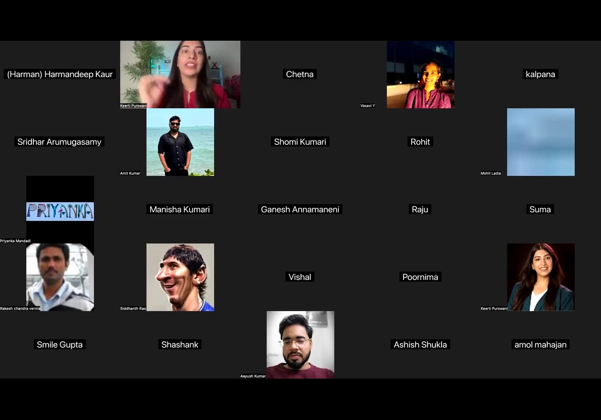
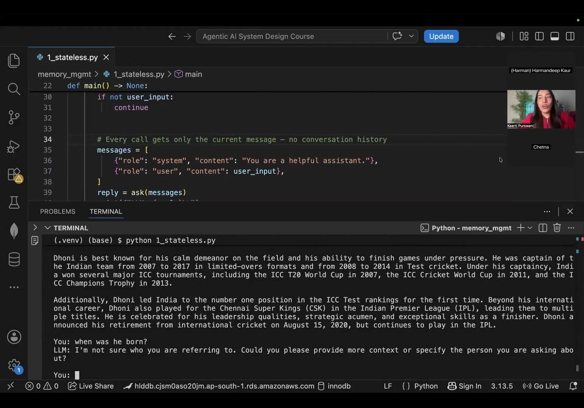
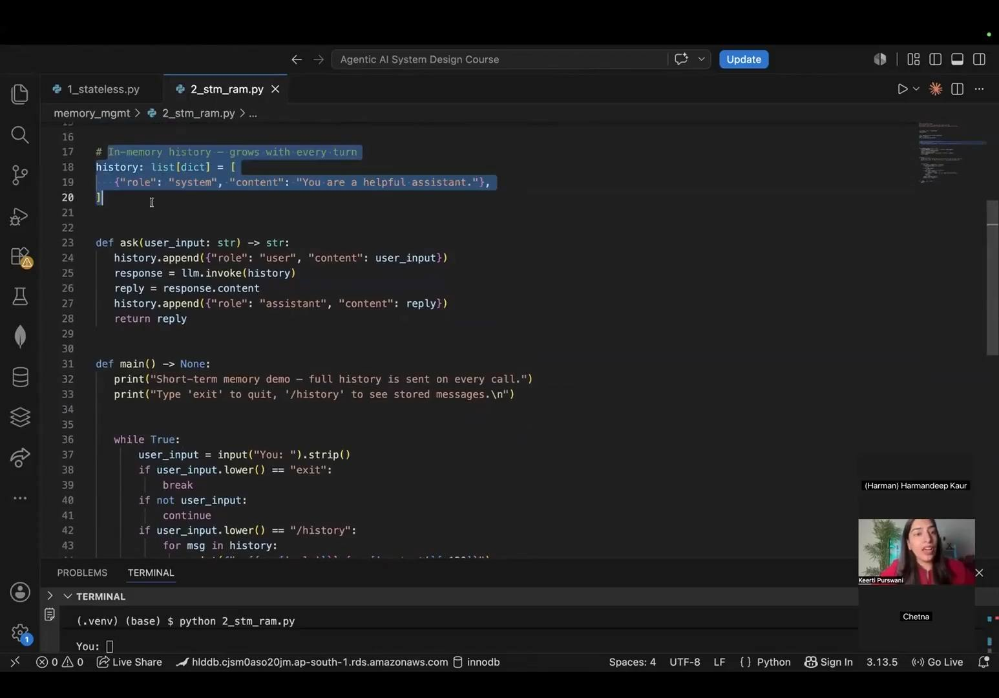
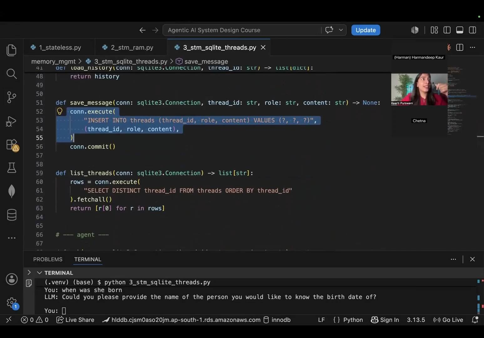
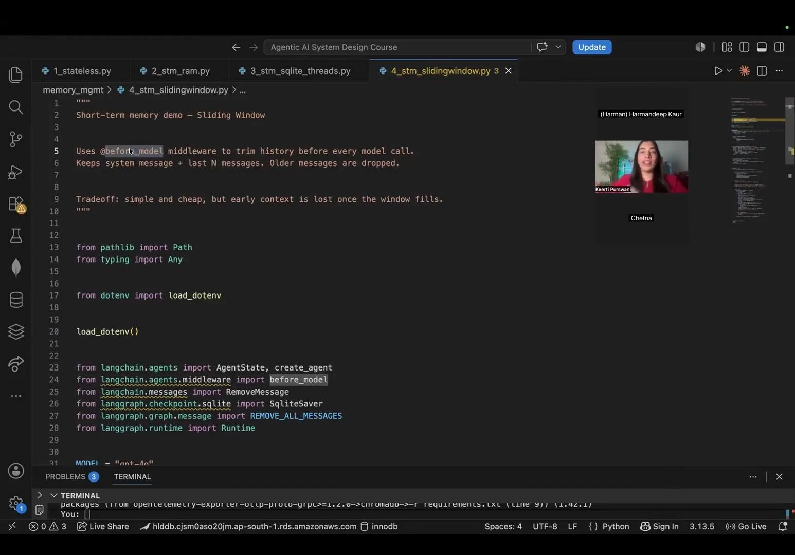
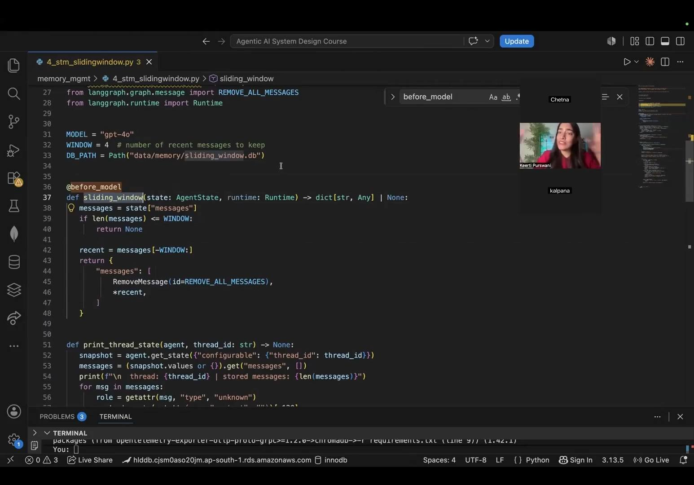
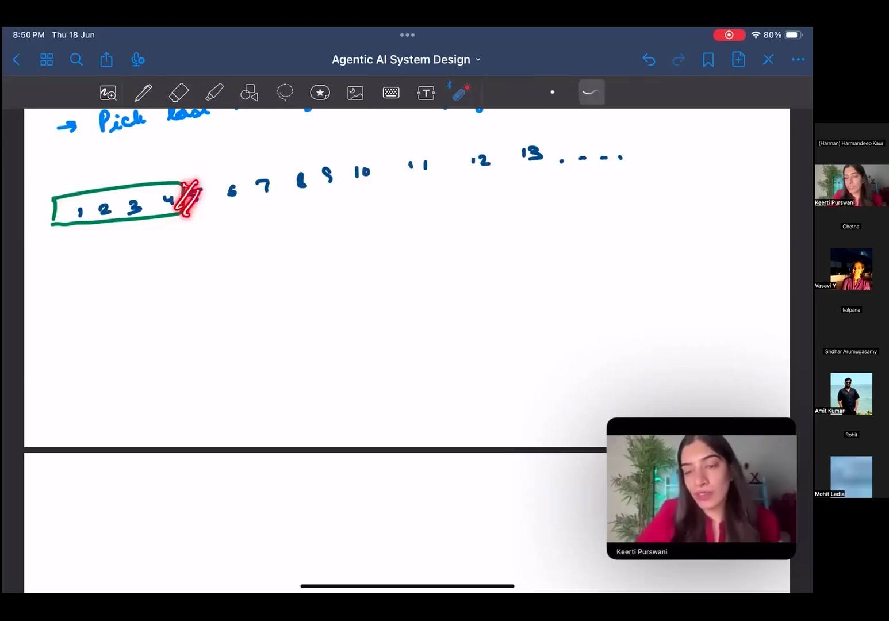
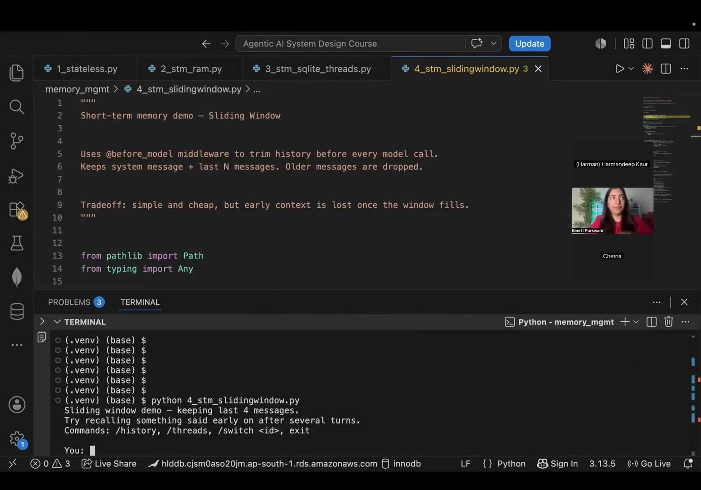

# Agentic AI System Design：从无状态到短记忆持久化与 Middleware（P006）

---

## 1. 这一节做什么

这一节课的主题只有一个词：**Memory**。讲师把 RAG 与 Context Engineering 的知识串了一遍之后,把整节课的剩余时间全部押在"LLM 会话记忆"这一件事上:先证明 LLM 天生无状态,再一步一步把一份能跑的"记忆层"从最原始的 Python list 演化到 SQLite 持久化、再演化到滑动窗口裁剪、最后落到 LangChain v1 的 checkpointer 与 `before_model` middleware 上。

学完这一节,你手上应该有的产物是:

1. 一套**可运行、可复现**的 `statelessness_demo.py / stm_in_ram.py / stm_sqlite_threads.py / stm_sliding_window.py` 纯 Python + SQLite + LangChain `ChatOpenAI` 示例,能证明"没有 history 的模型会失忆",也能证明"有了 history 之后,按 thread_id 分 session 的记忆层可以跨重启保留"。
2. 一套**LangChain v1 参照实现**:用 `create_agent` + `SqliteSaver` checkpointer + 自定义 `AgentMiddleware.before_model` 完成"持久化 STM + 滑动窗口裁剪",对应讲师屏幕上那段"和模型、工具、system prompt 一起只多传一个 middleware 就完成"的代码。
3. 一份**决策地图**:成本、延迟一上来时你怎么选——滑动窗口(trim)、摘要(summarization)、滑动窗口+摘要组合、把全部消息扔进向量库做 RAG-over-messages、分层摘要(RAPTOR 思路)——每条路的代价与取舍,以及为什么答案从来不是"只有一种"。

课程的终点不是"用框架一行搞定",而是"框架内部到底做了什么"。讲师原话说得很清楚:

> "在 LangChain 这些框架里一切都很简单,literally 一行代码,但我想演示它内部到底发生了什么,这才是重点。"
> —— p006 [54:11]

---

## 2. 讲师原话

> "因为什么?因为 LLM 是无状态的。"
> —— p006 [12:01]

> "在一个会话内,这段记忆叫什么?它叫短期记忆;跨会话或跨聊天的记忆呢?叫长期记忆。"
> —— p006 [17:32]

> "如果你把 ChatGPT 或 Claude 关掉再回来,它还是知道你在这个会话里聊了什么——所以理想情况下两者都应该被持久化。"
> —— p006 [18:19]

> "问题是上下文太长、上下文窗口太大。成本是问题,延迟也是问题。"
> —— p006 [43:59]

> "Rohit 问了一个很好的问题:为什么不能把消息做成 RAG,做语义检索之后再放进上下文?这是一个可行的方案。"
> —— p006 [50:25]

> "在调用 agent 之前,我们可以有一个额外的函数调用;在调用模型之前和之后,也可以有额外调用;调用 agent 之后也可以有调用。"
> —— p006 [62:32]

> "有这么多场景需要 middleware:调用次数限制、响应校验、guardrails、安全、响应格式、裁剪、缓存。"
> —— p006 [63:30]

> "滑动窗口的逻辑非常简单:如果消息长度小于等于窗口,就什么都不做;否则保留最后 window 条消息,删掉前面的。"
> —— p006 [67:15]

> "对于这个滑动窗口,我用的就是 SQLite3。"
> —— p006 [74:20]

---

## 3. 从零复现

### 3.0 先花 10 分钟补上两个前提(不写代码,但要装进脑子)

讲师在上新课之前先做了两轮口头复习,不是闲聊,而是后面所有取舍的来源。

**RAG 复习要点。**

- **检索类型**:semantic(向量)/ lexical(关键词)/ hybrid(两者融合)/ graph(图)/ SQL(结构化)/ web(实时抓取)。
- **切块(Chunking)策略**:AST、HyDE(Hypothetical Document Embeddings,也叫 Hydrag 风格)、agentic RAG(由 LLM 决定从哪检、何时检)、RAPTOR(分层摘要)、vectorless RAG(讲师点名了 GitHub 上很火的 `pageindex`)。
- **评估指标**:Recall、Precision、MRR、Hit Rate、Faithfulness、Answer Relevancy。Recall 的公式是 `relevant retrieved / total relevant`,对应"完整性";Precision 对应"准确性"。
- **变更即评估**:只要改动 pipeline 的任何一处(chunking、RAG 类型、embedding 维度……),就要重新评估,和 **golden dataset** 对比指标。
- **融合算法**:hybrid RAG 多检索器召回后要 fusion 或 re-ranking。RRF(Reciprocal Rank Fusion)公式是 `1 / (k + rank)`,平滑因子 `k` 常见取值 **60**。re-ranking 用 cross-encoder 做二次比对,比 fusion 贵。

**Context Engineering 复习要点。**

- **Context window 有限**,不是"想塞多少塞多少":有 size 上限,成本随 token 数线性上升,延迟随 token 数上升。
- **Lost in the middle**:开头和结尾对模型最重要,中间容易被忽略。结尾重要是因为 transformer 的 **recency effect**(next-token 生成更重视近处 token);开头重要是因为预训练语料里"指令、标题、简介、主题"通常出现在最前面。论文名是 *Lost in the Middle*。
- **让 context 更好的 5 种手段**:pruning(去重、去过期、去无关)、compression(摘要、缩句、截短)、selection(10 个 chunk 里只挑 5 个)、re-ranking(挑选后重新排序)、expansion(先展开:谁调用了这个类、导入了哪些 helper、哪些 import,然后再压缩成一句话)。
- **Context 里到底放什么**:system prompt、user query、tool outputs、tool signatures、retrieved context、conversation history / memory。工具不只有检索工具,也有 Gmail、GitHub API、天气 API、日历、MakeMyTrip 这种"非检索工具",它们的输出同样是 context 的一部分。



### 3.1 环境准备

课里没讲具体的 Python / LangChain / OpenAI SDK 版本,以下给你一份"能爬起来"的最小组合。版本兜底原则:能跑 LangChain v1 机器人就够了。

```bash
mkdir -p agentic-memory && cd agentic-memory
python -m venv .venv
source .venv/bin/activate        # Windows: .venv\Scripts\activate
pip install -U pip
pip install "langchain>=1.0.0" "langchain-openai>=1.0.0" \
            "langgraph>=1.0.0" "langgraph-checkpoint-sqlite>=3.0.0" \
            python-dotenv
```

`.env` 至少要:

```dotenv
OPENAI_API_KEY=sk-xxxxxxxxxxxxxxxx
LANGCHAIN_TRACING_V2=true
LANGCHAIN_API_KEY=ls__xxxxxxxxxxxx
LANGCHAIN_PROJECT=agentic-memory
```

> 讲师在课上多次切到 LangSmith 看 token 数和耗时(173 → 199 → 376 → 922 ……),所以这套 tracing 变量很关键。具体在 LangSmith 怎么配,课里没讲。

目录结构(所有 demo 都在同一层):

```
agentic-memory/
├── .env
├── .env.example
├── requirements.txt
├── statelessness_demo.py
├── stm_in_ram.py
├── stm_sqlite_threads.py
├── stm_sliding_window.py
├── stm_langchain_threads.py
├── stm_langchain_before_model.py
└── data/memory/                # SQLite 数据库会自动落在这里
```

### 3.2 Step 1 —— 先证明 LLM 无状态

这一节最先跑的 demo,目的是让你亲眼看见"什么都不传的时候,模型是真失忆的"。

```bash
python statelessness_demo.py
```

预期行为:第一问 "Who is Dhoni?" 与第二问 "When was he born?" 完全独立。第二个问题里 `he` 指谁模型不知道。讲师现场还专门追问过一遍:

> "我反复问它同样的问题,它根本不记得上一问。这一块大家看明白了吗?"
> —— p006 [15:28] 附近的口语



### 3.3 Step 2 —— 用 Python list 做最原始的 STM

在 Step 1 基础上只加一件事:每次调用前后把消息 append 进一个 `list[dict]`。消息角色只有 4 种:**system / user / assistant / tool**。

```bash
python stm_in_ram.py
```

会看到一个交互式命令行,支持:

- `exit` 退出
- `history` 打印内存中所有消息

**关键点**:这个版本一重启,内存里的 list 就没了。讲师当场演示了这一点——重启后再次问"When was he born?",tokens 从 ~300 掉回 ~100,因为整个 history 都没了。

讲师把这一步视为"理解框架内部发生了什么"的地基:

> "我做的唯一一件事就是维护一个消息列表。每当拿到 response,我就把它追加到 history 里。就这么简单的 Python 代码。"
> —— p006 [25:49]

### 3.4 Step 3 —— STM 落到 SQLite,按 thread 分 session

把同一个会话里的消息持久化到数据库里,并且用 `thread_id` 区分不同会话(ChatGPT 的左栏里每一个 chat 就是一个 thread)。

```bash
python stm_sqlite_threads.py
```

命令行比 Step 2 多两个命令:

- `threads` —— 列出所有已存在的 thread
- `switch <thread_id>` —— 切到另一个 thread(可以现场 `switch t2` 新建一个)

行为预期:

1. 在默认 thread 里聊完 Priyanka Chopra;
2. `switch t2` 再问 "When was she born?",模型失忆;
3. `switch default` 再问 "tell me more about her",模型立刻知道你说的是 Priyanka —— 因为它 `SELECT ... WHERE thread_id = 'default' ORDER BY id` 了。

讲师在这段里反复强调两句话:

> "短期记忆是给每一个 thread、每一个 session、每一个 chat 用的。"
> —— p006 [35:13]

> "数据库里到底存了什么?thread id、role、content。thread id 为什么重要?就是为了区分不同的会话。"
> —— p006 [34:43]



**数据库落点(课里口述,不是严格 OCR,按字幕推测实际路径)**:

- `data/memory/short_memory_demo.db`
- sliding window 版本单独建一个 `data/memory/sliding_window.db`

字幕里 "data memory short memory demo dot this" 一句对应这个路径;讲师还专门演示了"我把整个 data 目录删掉再启动,它不再记得 Priyanka"。能否命中,以你自己在代码里写死的路径为准。

### 3.5 Step 4 —— Sliding window:window size = 4

长对话的 token 会指数级膨胀。讲师用了两块数据点举证据:376 → 314 → 407 → 279,以及一次 9.39s / 922 token。

问题被摆出来了:

> "问题是上下文太长、上下文窗口太大。成本是问题,延迟也是问题。"
> —— p006 [43:59]

解法一:**trim old messages**。窗口大小取 `4`,不管什么 role,一条算一条。

```bash
python stm_sliding_window.py
```

行为和 Step 3 一致,唯一差别是**每次调用模型之前只发最后 N 条**。当场能看到:

- `history` 命令里始终最多 4 条;
- 讲师的 Kohli 例子里,user 消息 "who is Kohli" 因超出窗口被扔掉后,后续 "who is his wife?" 里 `his` 已经丢失指代;但因为上一轮 assistant 回复里还写着 "Virat Kohli",所以模型还能连上——这属于"侥幸连上",不是保证。

讲师也开诚布公地讲了这个方案的软肋:

> "如果一开始我们说的是 Dhoni,后面一直用 he / him,把第一条删了之后模型就不一定推得回来。这是不是 production 里该做的事?我不认为。"
> —— p006 [47:19]



### 3.6 Step 5 —— LangChain 写法之一:checkpointer + thread_id

回到 LangChain。LangChain v1 用 `create_agent` 包裹模型,用 `checkpointer` 保存会话历史。

**内部逻辑**:每个 `thread_id` 在 saver 里对应一个独立的 messages list。你在 `invoke` 时传 `config={"configurable": {"thread_id": "..."}}`,框架就自动加载这个 thread 的历史,处理完再写回。讲师原话:

> "他们内部做了什么呢?其实就是我们刚才看到的东西:每个 thread id 建一个独立的 list。"
> —— p006 [71:59]

**可选 saver**:

- `InMemorySaver`(进程内,重启即丢)
- `SqliteSaver`(单机持久化,本课使用)
- `PostgresSaver`
- `RedisSaver`

> 讲师原话:"如果我们不想用内存,想存到别处,可以用 SQL、Postgres 或 Redis,对应的 checkpointer 分别是 SqliteSaver / PostgresSaver / RedisSaver。"
> —— p006 [71:59] 附近

```bash
python stm_langchain_threads.py
```

### 3.7 Step 6 —— 自定义 LangChain v1 middleware(核心)

这一步和 Step 4 的目标一样,但用 LangChain v1 的 middleware 实现。课里反复强调:agent = model + tools,middleware 就是**在 agent 调用之前/之后、model 调用之前/之后**插入的函数。

讲师把可插入点数了一遍,并说明为什么它们都需要:

> "调用 agent 前一个函数、调用 model 前后各一个函数、调用 agent 后再一个——这些函数用来干什么?调用次数检查、response 校验、guardrails、safety、格式校验、裁剪、缓存。"
> —— p006 [62:32] / [63:30]

`before_model` 的调用时机比很多人想的更频繁:**只要模型会被调用,它就会被触发**——包括工具调用之后、模型要再生成一次 final answer 的时候。讲师现场专门强调:

> "即使你刚拿到 tool output,tool 输出也是一条 message,你的窗口照样在变大,还是需要再裁剪一遍。"
> —— p006 [70:07]



```bash
python stm_langchain_before_model.py
```

!!! 说明:字幕没有念出 `create_agent` 这行 import,也没念出 `before_model` 装饰器的签名。下面这份 LangChain v1 代码是**按讲师口述的逻辑 + LangChain v1 现有 API 重建**的,ponytail 版本可跑。若你本地 LangChain 版本候选 API 有出入,以 `langchain.agents.middleware.AgentMiddleware` 的 `before_model` 钩子签名为准。

### 3.8 Step 7 —— 官方预建 middleware 一览(理解,不需全跑)

讲师这一段不是一个一个讲怎么用,而是让你建立"目录感"。字幕里点到的名字按用途分类:

| middleware | 用途 |
|---|---|
| `SummarizationMiddleware` | 按 token 数触发摘要,并控制保留最近 M 条消息 |
| `HumanInTheLoopMiddleware` | 权限/事实核查/审批,例如代码生成后是否允许写文件 |
| model call limit / tool call limit | 防止 RAG 阶段陷入无限循环 |
| PII 检测 | 脱敏,防止敏感信息进入 context |
| tool retry / model retry | 失败重试 |
| context editing / file search / file system | 上下文修订、文件系统工具化 |

> "Middleware 这个概念在所有框架里都有——LangChain、LangGraph、Google ADK。这是一个非常重要的概念。"
> —— p006 [61:34]

字幕里也点到了 HumanInTheLoop 在后续 Claude Code 项目里的落点:LLM 生成的代码**不直接写入文件**,先拦截、再审视、再批准。

### 3.9 Step 8 —— 那些"长上下文"的其它方案(理解,不写代码)

这一节讲师没有继续写代码,只做了沟通。按重要性梳理如下(全部是讲师原话里明确提到的):

1. **Sliding window**(已实现):保留最后 N 条,窗口大小自定(本课是 4)。
2. **Summarization**:每 N 条(例如 5 条)触发一次 LLM 摘要,保留最近 2 条原文。摘要本身也是一次模型调用,要花 token。
3. **滑动窗口 + 摘要组合**:理由是"200 条历史不可能全部塞进 200 token 的摘要里,一定会丢东西;而真正相关的往往是最近的 2-3 条,所以两者结合最实用"。
4. **RAG over messages**:把全部历史扔进向量库,每次用 user query 做语义检索,把最相关的 message 拼回 context。优点是不丢上下文;缺点是引入向量检索延迟与成本。可以配合磁盘/内存/缓存优化,但延迟不可能为零。
5. **Hierarchical summary(RAPTOR 思路)**:按话题分层——先聊神经网络、再聊 CNN、再聊 transformer;或者先聊 Dhoni、再聊家庭、再聊 IPL——用 LLM 建一棵摘要树,每一层只保留概要。

讲师的原话是:

> "目标是什么?把 messages 存进 conversation history,然后把最相关的那些,用最优化的方式,和 user query 一起发给 LLM。"
> —— p006 [53:14]

这段是整节课的收束句——不要机械执行任何一种方案,而是随时可以换。

### 3.10 运行命令汇总

```bash
# 无状态
python statelessness_demo.py

# 内存 list
python stm_in_ram.py

# SQLite + thread
python stm_sqlite_threads.py

# 纯 Python 滑动窗口(window=4)
python stm_sliding_window.py

# LangChain checkpointer 版
python stm_langchain_threads.py

# LangChain v1 middleware 版
python stm_langchain_before_model.py
```

---

## 4. 完整代码

下面所有文件都是**可直接保存运行的整文件**。与讲师屏幕上的代码在模型名、API key 配置上有出入(这些课里没念出来),其余逻辑尽量贴合字幕。

### 4.1 `requirements.txt`

```txt
langchain>=1.0.0
langchain-openai>=1.0.0
langgraph>=1.0.0
langgraph-checkpoint-sqlite>=3.0.0
python-dotenv>=1.0.0
openai>=1.0.0
```

### 4.2 `.env.example`

```dotenv
OPENAI_API_KEY=sk-replace-me
LANGCHAIN_TRACING_V2=true
LANGCHAIN_API_KEY=ls__replace-me
LANGCHAIN_PROJECT=agentic-memory
```

### 4.3 `statelessness_demo.py`

```python
from dotenv import load_dotenv
from langchain_openai import ChatOpenAI

load_dotenv()

llm = ChatOpenAI(model="gpt-4o-mini", temperature=0)

questions = [
    "Who is Dhoni?",
    "When was he born?",   # 无状态：模型不知道 he 指谁
]

for q in questions:
    resp = llm.invoke([{"role": "user", "content": q}])
    print(f"Q: {q}")
    print(f"A: {resp.content}\n")
```

### 4.4 `stm_in_ram.py`

```python
from dotenv import load_dotenv
from langchain_openai import ChatOpenAI

load_dotenv()

llm = ChatOpenAI(model="gpt-4o-mini", temperature=0)

history: list[dict] = [
    {"role": "system", "content": "You are a helpful assistant."}
]


def chat(user_msg: str) -> str:
    history.append({"role": "user", "content": user_msg})
    resp = llm.invoke(history)
    history.append({"role": "assistant", "content": resp.content})
    return resp.content


def main() -> None:
    while True:
        q = input("You: ").strip()
        if q == "exit":
            break
        if q == "history":
            for m in history:
                print(f"[{m['role']}] {m['content'][:120]}")
            continue
        print("AI:", chat(q))


if __name__ == "__main__":
    main()
```

### 4.5 `stm_sqlite_threads.py`

```python
import sqlite3
from pathlib import Path

from dotenv import load_dotenv
from langchain_openai import ChatOpenAI

load_dotenv()

llm = ChatOpenAI(model="gpt-4o-mini", temperature=0)

DB_PATH = Path("data/memory/short_memory_demo.db")
DB_PATH.parent.mkdir(parents=True, exist_ok=True)


def init_db() -> sqlite3.Connection:
    conn = sqlite3.connect(DB_PATH)
    conn.execute(
        """
        CREATE TABLE IF NOT EXISTS messages (
            id        INTEGER PRIMARY KEY AUTOINCREMENT,
            thread_id TEXT NOT NULL,
            role      TEXT NOT NULL,
            content   TEXT NOT NULL
        )
        """
    )
    conn.commit()
    return conn


def save_message(conn: sqlite3.Connection, thread_id: str, role: str, content: str) -> None:
    conn.execute(
        "INSERT INTO messages (thread_id, role, content) VALUES (?, ?, ?)",
        (thread_id, role, content),
    )
    conn.commit()


def load_history(conn: sqlite3.Connection, thread_id: str) -> list[dict]:
    rows = conn.execute(
        "SELECT role, content FROM messages WHERE thread_id = ? ORDER BY id",
        (thread_id,),
    ).fetchall()
    return [
        {"role": "system", "content": "You are a helpful assistant."}
    ] + [{"role": r, "content": c} for r, c in rows]


def list_threads(conn: sqlite3.Connection) -> list[str]:
    rows = conn.execute("SELECT DISTINCT thread_id FROM messages").fetchall()
    return [r[0] for r in rows]


def main() -> None:
    conn = init_db()
    current_thread = "default"

    while True:
        q = input(f"[{current_thread}] You: ").strip()
        if q == "exit":
            break

        if q == "history":
            for m in load_history(conn, current_thread):
                print(f"[{m['role']}] {m['content'][:120]}")
            continue

        if q == "threads":
            print("Threads:", list_threads(conn))
            continue

        if q.startswith("switch "):
            _, t = q.split(maxsplit=1)
            current_thread = t
            print(f"Switched to: {current_thread}")
            continue

        # 正常对话
        save_message(conn, current_thread, "user", q)
        history = load_history(conn, current_thread)
        resp = llm.invoke(history)
        print("AI:", resp.content)
        save_message(conn, current_thread, "assistant", resp.content)


if __name__ == "__main__":
    main()
```

### 4.6 `stm_sliding_window.py`

```python
import sqlite3
from pathlib import Path

from dotenv import load_dotenv
from langchain_openai import ChatOpenAI

load_dotenv()

llm = ChatOpenAI(model="gpt-4o-mini", temperature=0)

WINDOW_SIZE = 4
DB_PATH = Path("data/memory/sliding_window.db")
DB_PATH.parent.mkdir(parents=True, exist_ok=True)


def init_db() -> sqlite3.Connection:
    conn = sqlite3.connect(DB_PATH)
    conn.execute(
        """
        CREATE TABLE IF NOT EXISTS messages (
            id        INTEGER PRIMARY KEY AUTOINCREMENT,
            thread_id TEXT NOT NULL,
            role      TEXT NOT NULL,
            content   TEXT NOT NULL
        )
        """
    )
    conn.commit()
    return conn


def save_message(conn: sqlite3.Connection, thread_id: str, role: str, content: str) -> None:
    conn.execute(
        "INSERT INTO messages (thread_id, role, content) VALUES (?, ?, ?)",
        (thread_id, role, content),
    )
    conn.commit()


def load_history(conn: sqlite3.Connection, thread_id: str) -> list[dict]:
    rows = conn.execute(
        "SELECT role, content FROM messages WHERE thread_id = ? ORDER BY id",
        (thread_id,),
    ).fetchall()
    return [{"role": r, "content": c} for r, c in rows]


def trim_to_window(messages: list[dict], window: int = WINDOW_SIZE) -> list[dict]:
    if len(messages) <= window:
        return messages
    return messages[-window:]


def list_threads(conn: sqlite3.Connection) -> list[str]:
    rows = conn.execute("SELECT DISTINCT thread_id FROM messages").fetchall()
    return [r[0] for r in rows]


def main() -> None:
    conn = init_db()
    current_thread = "default"
    system_prompt = {"role": "system", "content": "You are a helpful assistant."}

    while True:
        q = input(f"[{current_thread}] You: ").strip()
        if q == "exit":
            break
        if q == "history":
            for m in load_history(conn, current_thread):
                print(f"[{m['role']}] {m['content'][:120]}")
            continue
        if q == "threads":
            print("Threads:", list_threads(conn))
            continue
        if q.startswith("switch "):
            _, t = q.split(maxsplit=1)
            current_thread = t
            print(f"Switched to: {current_thread}")
            continue

        save_message(conn, current_thread, "user", q)
        history = load_history(conn, current_thread)
        windowed = trim_to_window(history, WINDOW_SIZE)
        resp = llm.invoke([system_prompt] + windowed)
        print("AI:", resp.content)
        save_message(conn, current_thread, "assistant", resp.content)


if __name__ == "__main__":
    main()
```

### 4.7 `stm_langchain_threads.py`

```python
import sqlite3
from pathlib import Path

from dotenv import load_dotenv
from langchain.agents import create_
```python
### 4.7 `stm_langchain_threads.py`（完整文件）

```python
import sqlite3
from pathlib import Path

from dotenv import load_dotenv
from langchain.agents import create_agent
from langchain_openai import ChatOpenAI
from langgraph.checkpoint.sqlite import SqliteSaver

load_dotenv()

DB_PATH = Path("data/memory/langchain_stm.db")
DB_PATH.parent.mkdir(parents=True, exist_ok=True)

# check_same_thread=False：SqliteSaver 在交互式循环里可能跨线程使用连接
conn = sqlite3.connect(str(DB_PATH), check_same_thread=False)
checkpointer = SqliteSaver(conn)

agent = create_agent(
    model=ChatOpenAI(model="gpt-4o-mini", temperature=0),
    tools=[],
    system_prompt="You are a helpful assistant.",
    checkpointer=checkpointer,
)


def list_threads() -> list[str]:
    """遍历 checkpointer 里所有 checkpoint，收集去重后的 thread_id。"""
    seen: list[str] = []
    for ckpt in checkpointer.list(None):
        tid = ckpt.config["configurable"]["thread_id"]
        if tid not in seen:
            seen.append(tid)
    return seen


def print_history(thread_id: str) -> None:
    cfg = {"configurable": {"thread_id": thread_id}}
    state = agent.get_state(cfg)
    messages = state.values.get("messages", [])
    if not messages:
        print("(empty)")
        return
    for m in messages:
        role = getattr(m, "type", m.__class__.__name__)
        content = getattr(m, "content", "")
        print(f"[{role}] {str(content)[:120]}")


def main() -> None:
    current_thread = "default"

    while True:
        q = input(f"[{current_thread}] You: ").strip()
        if q == "exit":
            break

        if q == "history":
            print_history(current_thread)
            continue

        if q == "threads":
            print("Threads:", list_threads())
            continue

        if q.startswith("switch "):
            _, t = q.split(maxsplit=1)
            current_thread = t
            print(f"Switched to: {current_thread}")
            continue

        cfg = {"configurable": {"thread_id": current_thread}}
        result = agent.invoke(
            {"messages": [{"role": "user", "content": q}]},
            config=cfg,
        )
        print("AI:", result["messages"][-1].content)


if __name__ == "__main__":
    main()
```

### 4.8 `stm_langchain_before_model.py`（完整文件，本课核心）

```python
import sqlite3
from pathlib import Path

from dotenv import load_dotenv
from langchain.agents import create_agent
from langchain.agents.middleware import AgentMiddleware
from langchain_openai import ChatOpenAI
from langgraph.checkpoint.sqlite import SqliteSaver

load_dotenv()

WINDOW_SIZE = 4

DB_PATH = Path("data/memory/langchain_sliding_window.db")
DB_PATH.parent.mkdir(parents=True, exist_ok=True)

conn = sqlite3.connect(str(DB_PATH), check_same_thread=False)
checkpointer = SqliteSaver(conn)


class SlidingWindowMiddleware(AgentMiddleware):
    """模型每次被调起之前，把 state 里的 messages 裁到最近 window 条。

    课里讲师的口述逻辑：
        if len(messages) <= window: 什么都不做
        else: 只保留最后 window 条，删掉更早的
    """

    def __init__(self, window: int = WINDOW_SIZE):
        super().__init__()
        self.window = window

    def before_model(self, state, runtime):
        messages = state["messages"]
        print(f"[before_model] 进入时 messages={len(messages)}")
        if len(messages) <= self.window:
            return None
        trimmed = messages[-self.window:]
        print(f"[before_model] 裁剪到 messages={len(trimmed)}")
        return {"messages": trimmed}


agent = create_agent(
    model=ChatOpenAI(model="gpt-4o-mini", temperature=0),
    tools=[],
    system_prompt="You are a helpful assistant.",
    checkpointer=checkpointer,
    middleware=[SlidingWindowMiddleware(window=WINDOW_SIZE)],
)


def print_history(thread_id: str) -> None:
    cfg = {"configurable": {"thread_id": thread_id}}
    state = agent.get_state(cfg)
    messages = state.values.get("messages", [])
    if not messages:
        print("(empty)")
        return
    for m in messages:
        role = getattr(m, "type", m.__class__.__name__)
        content = getattr(m, "content", "")
        print(f"[{role}] {str(content)[:120]}")


def main() -> None:
    current_thread = "default"

    while True:
        q = input(f"[{current_thread}] You: ").strip()
        if q == "exit":
            break
        if q == "history":
            print_history(current_thread)
            continue
        if q.startswith("switch "):
            _, t = q.split(maxsplit=1)
            current_thread = t
            print(f"Switched to: {current_thread}")
            continue

        cfg = {"configurable": {"thread_id": current_thread}}
        result = agent.invoke(
            {"messages": [{"role": "user", "content": q}]},
            config=cfg,
        )
        print("AI:", result["messages"][-1].content)


if __name__ == "__main__":
    main()
```

> 说明：`AgentMiddleware` 的 `before_model(self, state, runtime)` 签名在 LangChain v1 早/晚期小版本之间略有差异（有的版本会额外传入 `runtime` 用于读取 config / store，有的版本名可能略有不同）。若你本地版本报 `TypeError`，以 `langchain.agents.middleware` 文档为准，函数体逻辑不用改——讲师强调的就是"它本质上只是一个函数"。

> "你看，和 model、tool、system prompt 一起，我只是多给了 middleware，就这样。它怎么知道在哪里调用 middleware？因为 before_model。剩下的都一样。"
> —— p006 [77:37]



### 4.9 `stm_langchain_summarize.py`（摘要 + 滑动窗口，按讲师口述重建）

讲师说过"我写了两个代码，一个是滑动窗口，一个是摘要 + 滑动窗口"，但课上只演示了滑动窗口那段。下面这份是按他口述的组合策略重写的示意实现——**课里没有给出这段的完整代码**。

```python
import sqlite3
from pathlib import Path

from dotenv import load_dotenv
from langchain.agents import create_agent
from langchain.agents.middleware import AgentMiddleware
from langchain_core.messages import SystemMessage
from langchain_openai import ChatOpenAI
from langgraph.checkpoint.sqlite import SqliteSaver

load_dotenv()

llm = ChatOpenAI(model="gpt-4o-mini", temperature=0)

KEEP_RECENT = 2      # 最近 2 条永远保留原文
TRIGGER_EVERY = 5    # 超过 5 条就开始摘要
WINDOW_AFTER = 4     # 摘要 + 最近 N 条，一起作为新窗口

DB_PATH = Path("data/memory/langchain_summarize.db")
DB_PATH.parent.mkdir(parents=True, exist_ok=True)

conn = sqlite3.connect(str(DB_PATH), check_same_thread=False)
checkpointer = SqliteSaver(conn)


class SummarizeThenWindowMiddleware(AgentMiddleware):
    def before_model(self, state, runtime):
        messages = state["messages"]
        if len(messages) <= TRIGGER_EVERY:
            return None

        old = messages[:-KEEP_RECENT]
        recent = messages[-KEEP_RECENT:]

        old_text = "\n".join(
            f"{getattr(m, 'type', 'msg')}: {getattr(m, 'content', '')}"
            for m in old
        )
        summary = llm.invoke(
            [
                SystemMessage(
                    content="请把下面的对话压缩成不超过 150 字的摘要,保留人名、事实、结论。"
                ),
                {"role": "user", "content": old_text},
            ]
        )

        merged = [SystemMessage(content=f"[历史摘要] {summary.content}")] + recent
        trimmed = merged[-WINDOW_AFTER:]
        print(f"[before_model] {len(messages)} -> {len(trimmed)}")
        return {"messages": trimmed}


agent = create_agent(
    model=llm,
    tools=[],
    system_prompt="You are a helpful assistant.",
    checkpointer=checkpointer,
    middleware=[SummarizeThenWindowMiddleware()],
)


def main() -> None:
    current_thread = "default"
    while True:
        q = input(f"[{current_thread}] You: ").strip()
        if q == "exit":
            break
        if q.startswith("switch "):
            _, t = q.split(maxsplit=1)
            current_thread = t
            continue
        cfg = {"configurable": {"thread_id": current_thread}}
        result = agent.invoke(
            {"messages": [{"role": "user", "content": q}]},
            config=cfg,
        )
        print("AI:", result["messages"][-1].content)


if __name__ == "__main__":
    main()
```

---

## 5. 逐行解释

### 5.1 `statelessness_demo.py`

- `llm = ChatOpenAI(model="gpt-4o-mini", temperature=0)`：`temperature=0` 是为了让讲师在课堂上反复问同一个问题得到同样答案，方便对比 token 数。模型名课里没念，任选一个当前可用的便宜模型即可。
- 循环里每次 `llm.invoke([{"role": "user", "content": q}])` —— 每次只传**当前这一条**消息。这就是"无状态"的定义：模型没有跨调用的记忆，它看到的永远只有这一次请求里你给的那些 token。
- 为什么第二个问题会失忆：`When was he born?` 里 `he` 是一个代词，它的指代对象本应来自上一轮对话；上一轮对话在本次请求里根本不存在，所以模型只能瞎猜或者反问。这一步是整个 memory 章节**唯一的地基**——讲师的顺序是先让你看见失忆，再教你怎么治。

### 5.2 `stm_in_ram.py`

- `history: list[dict] = [{"role": "system", ...}]` —— 一条 system 消息打底，后面所有 user / assistant 追加在后面。角色的可能值讲师专门点了：**system、user、assistant(AI)、tool**。
- `history.append({"role": "user", ...})` 在调用前追加，`history.append({"role": "assistant", ...})` 在拿到响应后追加。讲师原话："只要拿到 response，我就把它加到 history 里。"这两行就是整个"手写 STM"的全部。
- `llm.invoke(history)` —— 注意这里传的是**整个 list**，不是最后一条。这就是为什么 token 会越来越多：第 N 轮请求里带了 N 轮的所有内容。讲师在 LangSmith 上现场看到的 173 → 199 → 376 → 922 就是这条线在涨。
- 为什么重启就失忆：`history` 是模块级 Python 变量，进程结束就随之销毁，没有任何持久化。不做这一步演示，你很难真正理解"持久化"这个词在解决什么。
- `history` 命令只做了 `print`，它是一个旁路视图，不参与模型调用。

**不复现的代价**：如果你跳过这一步直接上 SQLite，你会误以为是"数据库让记忆生效"。其实是"跨请求传递 history"让记忆生效，数据库只是让它活过重启。

### 5.3 `stm_sqlite_threads.py`

- `DB_PATH = Path("data/memory/short_memory_demo.db")` + `.parent.mkdir(parents=True, exist_ok=True)`：第一次运行自动建目录，讲师专门演示过"我刚一跑，它就帮我建了这个 DB 文件夹"。
- 建表只有三个业务字段：**thread_id、role、content**，外加一个自增 `id`。讲师在屏幕上逐字念过这三个字段名。`id` 的第二个作用是排序：`ORDER BY id` 等价于"按插入顺序"，这就是讲师说的"按我放进去的顺序排序"。**没有 `created_at` 字段**，课里没用时间戳，全靠自增 id 保序。
- `CREATE TABLE IF NOT EXISTS`：幂等。删掉 db 文件重启也不会炸。
- `save_message` 每次 `commit()`：单机 SQLite 这么写没问题；如果你改成批量插入，要自己做事务（在 JS/Node 里对应 `BEGIN`/`COMMIT`，Prisma 里对应 `prisma.$transaction`）。
- `load_history` 的返回是 `[system] + [历史行]`。注意 system prompt**不进数据库**，它每次读取时现拼——所以改 system prompt 不需要迁移数据。
- `SELECT DISTINCT thread_id FROM messages` 就是 `threads` 命令的实现。讲师原话："它在 list threads 里做的就是简单的 DB 查询，拿去重后的 thread id，就这么简单。"
- `switch <thread_id>` 只改内存里的 `current_thread` 变量，**不在 DB 里写任何东西**，所以切到一个从未存在过的 `t2` 之后，`threads` 不会立刻显示 t2，直到你在 t2 里发了第一条消息。讲师现场就是"先 switch 到一个新线程，再说一句话，然后 threads 里出现两个线程"。
- 主循环里的顺序很关键：**先 save user → 再 load history → 再 invoke → 再 save assistant**。如果先把 user 和 assistant 都存了再 invoke，你就把不回的那部分也存进去了；如果 invoke 前不先存 user，本轮用户输入就不在 history 里，模型看不到当前问题。这一步顺序错了会得到一个"永远在回答上一句"的诡异行为。
- 为什么这条 demo 能回答 "tell me more about her"：因为 `load_history(default)` 取回了 Priyanka 那几轮，模型在 context 里看到了这个人名。而切到 t2 之后 `load_history(t2)` 是空的，同样的问题就失忆了——**同一份 code、同一句话，只因为 thread_id 不同，行为完全不同**。这就是讲师想让你们看到的东西。


### 5.4 `stm_sliding_window.py`

- 与 5.3 的差异只有两处：新增 `WINDOW_SIZE = 4`，以及调用前多一句 `windowed = trim_to_window(history, WINDOW_SIZE)`。
- `trim_to_window` 就是讲师口述的两行逻辑直译：`if len <= window: return messages`（什么都不做），`else: return messages[-window:]`（保留最后 window 条，删掉前面的）。**不管 role，一条算一条**——这点讲师重复了两次："不管它是 human message、AI message 还是 tool output，对我来说，一条消息就是一条消息。"
- 为什么 `[system_prompt] + windowed` 要分开：system prompt 不在窗口计数里，它是每条请求必须带的东西。如果你把 system prompt 也扔进窗口，4 条窗口里有 1 条永远是 system，实际给孩子模型的对话只有 3 条。
- 这个方案的已知软肋（讲师现场用 Kohli 例子演示的）：一旦 "who is Kohli" 那条被挤出窗口，后面的 "who is his wife?" 里的 `his` 就失去了显式指代。讲师那一次是因为上一轮 AI 回复里还残留着 "Virat Kohli" 才侥幸连上，这不是设计保证。他原话说得很直白：**在 production 里，这种做法我不认为该这么做**。
- 另一个反直觉现象：token 数不一定是单调递增的。讲师看到 376 → 314 时专门解释了——因为新进窗口的几条消息比被挤出去的那几条短。所以在 LangSmith 里看到 token 掉了不要怀疑代码错了，先看是不是窗口里的内容变短了。



### 5.5 `stm_langchain_threads.py`

- `sqlite3.connect(..., check_same_thread=False)`：`SqliteSaver` 内部可能从不同线程拿这个连接，默认 CDP 会拒绝跨线程，所以关掉这个检查。**这只适合单进程单用户 demo**，多进程写同一个 sqlite 文件会锁表。
- `checkpointer = SqliteSaver(conn)`：LangChain 用它替代我们手写的 `save_message` / `load_history`。**它的内部实现就是我们 5.3 里写的那套东西**——讲师原话："它内部做了什么呢？就是我们刚看到的东西，每个 thread id 一个独立的 list。"
- `create_agent(model=..., tools=[], system_prompt=..., checkpointer=...)`：`tools=[]` 是因为这一节没有 agent 工具，我们只关心记忆。system prompt 用 `system_prompt=` 参数传，而不是自己在 messages 里塞。
- `agent.invoke({"messages": [{"role": "user", "content": q}]}, config={"configurable": {"thread_id": tid}})`：**只传本次新增的那一条 user 消息**，历史由 checkpointer 按 `thread_id` 自动补齐。这就是讲师说的"框架一行搞定"里的那一行。
- `agent.get_state(cfg)` 拿的是这个 thread 的完整 state，`.values["messages"]` 里就是历史消息对象列表。注意 LangChain 的消息对象用 `.type`（`human` / `ai` / `tool` / `system`）而不是 `.role`，这是和 5.3 手写版最直观的差别。
- `list_threads()` 遍历 `checkpointer.list(None)` 收集 `config["configurable"]["thread_id"]`。这不是官方 API，只是一个 demo 技巧；生产里你会在自己的会话表里存 thread 元信息（标题、创建时间、所属用户），**课里没讲**这一层怎么设计。

### 5.6 `stm_langchain_before_model.py`

- `class SlidingWindowMiddleware(AgentMiddleware)`：一个普通 Python 类，继承 `AgentMiddleware`。讲师在最后 1 分钟反复强调这一点："一切看起来很花哨，但 tool 是什么？就是一个函数。middleware 是什么？就是一个函数。就是在调用 model 之前被调用的一段代码。就这么简单。"
- `before_model(self, state, runtime)`：**每一次模型调用之前都会被触发**。而且不止一次——讲师专门画过这个循环：agent → before_model → model →（如果要调 tool）→ tool → before_model → model → …… → 最终答案。因为工具返回之后模型还得再生成一次 final answer，所以 `before_model` 会被再次调用。讲师的原话："即使你拿到 tool output，它也是一条 message，你的窗口照样在变大，还是需要再裁剪一遍。"
- `return None`：表示"不修改 state，原样放行"。这是裁剪分支和放行分支共用同一个函数的写法。
- `return {"messages": trimmed}`：用一个只含窗口内消息的新列表替换 state 里的 messages。**注意这会把裁剪后的结果持久化回 checkpointer**，也就是说历史被真正丢掉了，下一次读 state 就只有 4 条。如果你只想影响本次模型调用、不想真的删历史，新版 LangChain 支持在 `before_model` 里用 `request.override(messages=...)` 的方式（`ModelRequest` 风格），但这部分**课里没讲**，讲师用的就是直接返回 `{"messages": ...}` 的写法。
- `middleware=[SlidingWindowMiddleware(window=WINDOW_SIZE)]`：传给 `create_agent`。讲师最后一句："rest everything is same"——除了这一个参数，agent 构造和 5.5 完全一样。
- `print(f"[before_model] ...")`：这几行是教学用的。你跑的时候会在终端看到 `进入时 messages=6 → 裁剪到 messages=4`，这就是"亲眼看到 middleware 被调起"。讲师就是用这个打印证明"middleware 到底是什么在什么时候跑"。



### 5.7 `stm_langchain_summarize.py`

- 这一段**课里只有口述，没有给代码**。上面是把它翻译成 LangChain 的示意实现。
- `old = messages[:-KEEP_RECENT]`：把"更早的那批"切出来单独送摘要，最近 2 条保原文。为什么保留最近 2 条原文？讲师原话："我还是想保留最后两条消息，因为它们非常非常重要。"——这就是 recency effect 在工程上的落地。
- 摘要那次 `llm.invoke(...)` 是一次**额外的模型调用**，要单独付 token 和延迟。讲师明确警告过："摘要本身就要多一次 LLM 调用。"如果每 2 条就摘要一次，你的账单会比不摘要还高。
- `merged[-WINDOW_AFTER:]`：摘要 + 最近几条再拼一次窗口限制。这是"组合策略"的具体形状。
- 为什么不能"只靠摘要"：讲师用 200 条历史举过例——200 条不可能全部压进 200~300 token 的摘要里，一定会丢；而"和当前问题真正相关的往往是最近 2-3 条"，所以最优解是**摘要兜底远历史 + 原文保证近历史**。

---

## 6. 复现检查清单

按顺序打勾，任何一项没过就不要往下走——后面的现象会互相混淆。

**环境**

- [ ] `python -V` 输出 ≥ 3.10（`list[dict]` 语法需要）
- [ ] `pip list` 里能看到 `langchain`、`langchain-openai`、`langgraph`、`langgraph-checkpoint-sqlite`
- [ ] `.env` 里 `OPENAI_API_KEY` 有效，跑 `python -c "from dotenv import load_dotenv; load_dotenv(); import os; print(bool(os.getenv('OPENAI_API_KEY')))"` 输出 `True`
- [ ] `data/memory/` 目录不存在也能跑（脚本里 `.parent.mkdir(parents=True, exist_ok=True)` 会自动建）

**Step 1：无状态**

- [ ] `python statelessness_demo.py` 能跑通
- [ ] 第二个问题 "When was he born?" 的回答**不包含** Dhoni（或明确表示不知道 "he" 指谁）
- [ ] 换成 "Who is Modi? / When was he born?" 结果同样失忆，说明这不是模型巧合

**Step 2：内存 list**

- [ ] `python stm_in_ram.py` 里先问 "Who is Modi?"，再问 "When was he born?"，第二问能答出正确生日
- [ ] 输入 `history` 能看到 `[system] / [user] / [assistant] / [user] / [assistant]` 的完整序列
- [ ] `exit` 之后重启，直接问 "When was he born?"，模型失忆
- [ ] 如果你开了 LangSmith，能看到第二轮请求的 input token 明显多于第一轮

**Step 3：SQLite + thread**

- [ ] 首跑后 `data/memory/short_memory_demo.db` 文件出现（用 `ls -l data/memory/` 确认）
- [ ] 在 default 线程里问完 Priyanka 之后 `switch t2`，问 "When was she born?"，模型不知道是谁
- [ ] `switch default` 再问 "tell me more about her"，模型能接上 Priyanka
- [ ] `threads` 命令能列出 `['default', 't2']`
- [ ] `exit` 重启后 `switch default` + `history`，之前的消息还在——**这是整个 demo 的核心验证点**
- [ ] 手动 `rm -rf data/memory/` 再启动，重新失忆，并且 DB 文件被重新创建

**Step 4：滑动窗口**

- [ ] `python stm_sliding_window.py`，`data/memory/sliding_window.db` 出现
- [ ] 连续问 4 轮以上，每次 `history` 里**始终最多 4 条**
- [ ] 跑 Kohli 那一组（who is Kohli → is he married → does he play IPL → who is his wife），能观察到 `who is Kohli` 那条已被挤出窗口
- [ ] 在 LangSmith 里确认 input token 数**不再单调递增**，会在某个点回落（讲师现场看到 376 → 314，原因是新进窗口的消息更短）

**Step 5 & 6：LangChain 版本**

- [ ] `python stm_langchain_threads.py`，`data/memory/langchain_stm.db` 出现
- [ ] `switch t2` 之后失忆、`switch default` 之后恢复，行为与 Step 3 一致——证明"框架内部做的就是我们手写的那套"
- [ ] `python stm_langchain_before_model.py`，终端里能看到 `[before_model] 进入时 messages=N` 和 `[before_model] 裁剪到 messages=4` 这样的打印
- [ ] 打印出现的次数**多于**你提问的次数（例如一轮工具调用会产生两次 `before_model`），这才证明"每次模型被调起前都会触发"
- [ ] `history` 命令里 messages 数量被封顶在 4，且 `data/memory/langchain_sliding_window.db` 里存的也是 4 条

**如果卡住**

- [ ] `before_model` 报签名 `TypeError` → 打开 `python -c "import inspect, langchain.agents.middleware as m; print(inspect.signature(m.AgentMiddleware.before_model))"` 看实际参数名，逻辑不用改
- [ ] `create_agent` 报 `ImportError` → 你的 `langchain` 版本低于 v1，`pip install -U "langchain>=1.0"`
- [ ] `SqliteSaver` 报线程错误 → 确认 `check_same_thread=False`
- [ ] `sqlite3.OperationalError: database is locked` → 你同时开了两个脚本连同一个 db 文件，先关一个

---

## 7. 课里没讲但你会撞上的

下面这些是真实动手时一定会遇到、但这一节课（P006）**完全没有覆盖**的问题。列出来是为了让你撞上时知道"不是我写错了，是课里没讲"。

**1. 长期记忆（LTM）只开了个头，没有实现。**
讲师明确说了"跨会话的记忆叫长期记忆"，并说"我们还没讲到长期记忆"。字幕里能确认的只有一句"我们要用长期记忆，那是另一个概念，我们还没讲"。所以本课**所有代码都是 STM**。如果你想让"我记得我是软件工程师"这种跨 chat 的事实生效，需要另建一张 user-level 表 + 在某处做召回，这套设计课里没讲。

**2. 存储介质的选择原则只给了方向，没给判据。**
讲师的原话是"取决于你存的是什么数据：想做语义搜索就放向量库，想查精确的东西就放 SQL"。没说"多少条消息该切向量库""embedding 用哪个模型""索引怎么建"。这些课里都没讲。

**3. 消息的 token 计数没有实现。**
你会看到讲师在 LangSmith 里读 token 数，但本课所有代码里**没有任何一处主动数 token**。滑动窗口是按**条数**（4 条）裁的，不是按 token 数裁的。真实项目里按条数裁很危险——一条 5000 字的长回复就能把窗口打爆。按 token 裁需要 `tiktoken` 之类的东西，课里没讲。

**4. 摘要的触发条件、摘要质量、摘要失败重试，全都没讲。**
课里说了 `SummarizationMiddleware` 有"多少 token 触发""保留多少条"两个参数，但没给具体数值，也没讲摘要那次 LLM 调用失败了怎么办。我写的 4.9 里 `TRIGGER_EVERY=5 / KEEP_RECENT=2` 只是示意，别当生产参数。

**5. `thread_id` 的生成、生命周期、归属，全都没讲。**
课里全是手敲 `switch t2`。真实系统里 `thread_id` 谁生成（前端？后端？）、怎么和用户绑定、删会话怎么删 DB、会话标题从哪来——课里没讲。在 Node/Next.js 里这对应"你在哪张表里存 conversation 元信息"的设计问题。

**6. 消息序列化的坑没讲。**
手写版全程 `list[dict]`，LangChain 版全程 `BaseMessage` 对象。两套东西**不能直接混用**：把 dict 塞进 `agent.invoke` 是支持的（框架会转），但把 `BaseMessage` 存进你自己那张 sqlite 表的 TEXT 列就不行，得先 `.content` / 序列化。这个边界课里没提。

**7. 并发与多用户。**
课里全程单进程单用户。多用户并发写同一个 SQLite 会锁；多实例部署时 `InMemorySaver` 直接失效（各实例各一份内存）。讲师提到了 `PostgresSaver` / `RedisSaver` 是备选，但**没有演示任何一个**，也没讲 schema 迁移怎么跑。

**8. 成本与延迟的数字只出现在讲师屏幕上，没有形成结论。**
173 → 199 → 376 → 407 → 279 → 922 token 这些数字是他现场念的，`9.39 秒 / 922 tokens` 也是现场读数。课里没有给出"平均每条消息多少 token""每次请求多少钱"的任何估算公式。你如果要做容量规划，得自己测。

**9. 流式输出（streaming）与总成本的关系。**
有学员在聊天区问"流式会不会感觉快一点"，讲师回答："**是的，但 token 数和成本是一样的。**"这句很重要：streaming 只改了**首字延迟**，没改总量。课里没演示怎么开 streaming。

**10. middleware 的内置实现细节没扒。**
讲师说"有现成的 `SummarizationMiddleware`，用起来非常简单""但我要自己写一个 custom middleware，因为我们要理解它内部发生了什么"。他**只讲了自定义那一个**，内置 middleware 的实现代码、参数默认值、执行顺序（多个 middleware 同时存在时谁先谁后）——全都没讲。

**11. Guardrails / PII / human-in-the-loop 只列了名字。**
字幕里出现的 `human in the loop`、`PII`、`tool retry`、`model retry`、`context editing`、`file search`、`file system` 这些 middleware 名字，全部只是"目录"，具体怎么配、拦截后返回什么、怎么和前端做审批弹窗——课里明确说"后面 security 那一节再讲"。这一节不要试图一次学完。

**12. 分层摘要 / RAG-over-messages 完全没有代码。**
讲师把这两个方案讲成"选项"，用 Dhoni / 神经网络 / CNN / transformer 的例子说明"可以建一棵树"，但明确说"任何一种 RAG 都可以，不一定要放向量库"。这两种方案本课**零代码**，只有思路。想实现得自己补 RAPTOR 那一套。

**13. system prompt 与窗口的交互没讨论。**
我的实现里 system prompt 单独拼在窗口外，讲师屏幕上也是这么做的（"along with model, tool, system prompt, I'm just giving middleware"——system prompt 是 agent 构造参数，不走 messages 窗口）。但如果你的 system prompt 本身就有几千 token，它会不会挤占窗口？课里没讲。

**14. LangSmith 的具体配置。**
讲师频繁切到 LangSmith 看 trace，但没教你怎么配 `LANGCHAIN_TRACING_V2` / `LANGCHAIN_API_KEY` / project 名。这部分我写在 3.1 了，但那是我补的，**不是课里的内容**。

最后留一句讲师的原话作为收尾——这句话本身比任何一行代码都更像这一节的"设计原则"：

> "目标是什么？把消息存进 conversation history，然后把最相关的那些，用最优化的方式，和 user query 一起发给 LLM。"
> —— p006 [53:14]

代码只是实现这句话的一种写法。窗口是 4 还是 40、摘要触发是 5 条还是 5000 token、存 SQLite 还是 Redis，都是这条原则下的可调参数，不是标准答案。