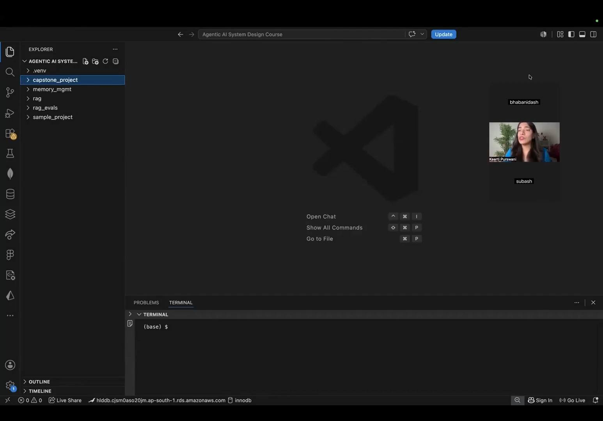
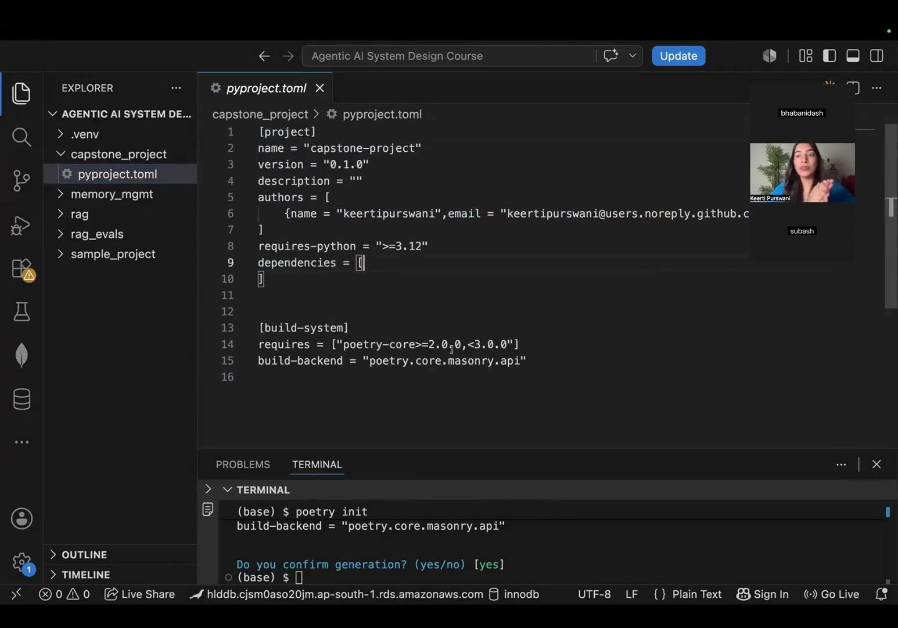
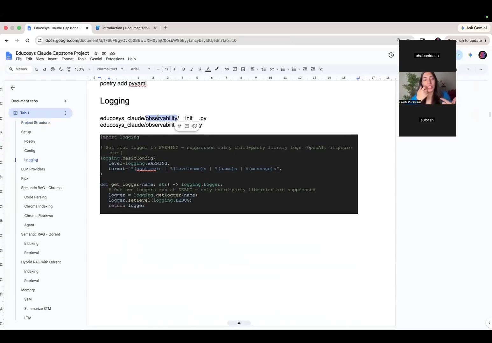
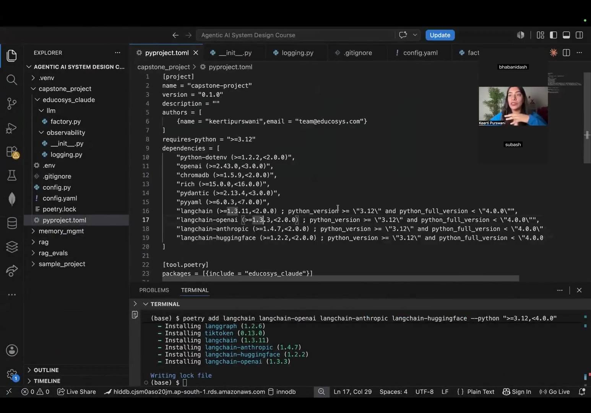
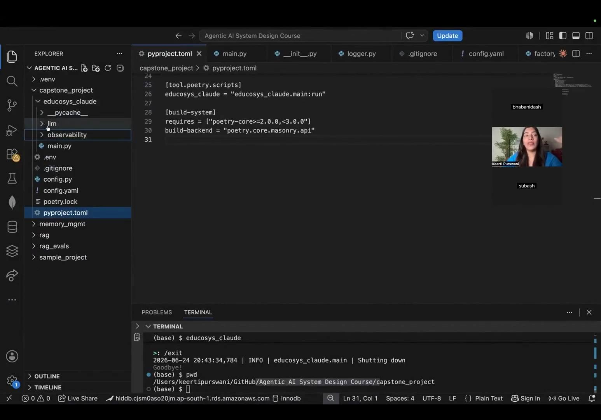
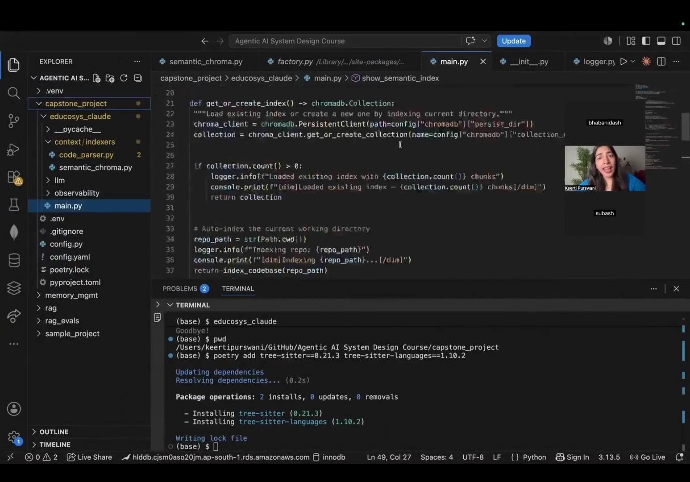
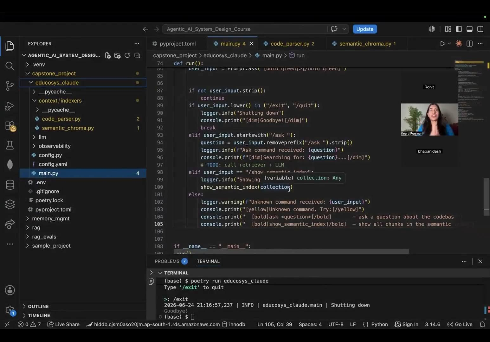

# Agentic AI System Design 第 7 讲：从零搭建 Claude Code 风格的 CLI 项目（Capstone 项目启动）

> 本讲是整门课的转折点：从理论、demo 代码，正式进入 capstone 项目——用 Python 从零搭一个「Claude Code 风格」的 CLI 代码 agent。本讲完成了工程脚手架（poetry + pipx）、模块化目录结构、LLM 工厂、日志、代码解析器（tree-sitter）、ChromaDB 语义索引，并让 CLI 在任意目录下启动时自动索引当前代码库。**本讲没有 OCR 结果，所有代码均来自逐字稿描述，凡逐字稿未念出的细节，本文档标注「课里没讲」。**

---

## 1. 这一节做什么

本讲要交付的东西非常具体：一个可以 `pipx install` 之后在**任意目录**下敲 `edu-courses-claude` 就能启动的 Python CLI 包。启动后它会：

1. 加载 `.env` 里的密钥、加载 `config.yaml` 里的可配置项（用哪个 LLM、用哪个 embedding 模型、Chroma 持久化目录、collection 名）；
2. 初始化日志（走 `observability` 模块）；
3. 通过 LLM 工厂按 config 拿到 LLM 和 embedder；
4. 检查当前工作目录的代码是否已经被索引过；没索引过就用 tree-sitter 解析代码 → 切 chunk → 用 embedder 向量化 → 写入 ChromaDB 持久化目录；
5. 进入一个交互式输入循环（本讲只做到「读输入、打印」，RAG 问答留到后面）。

讲师在开头就把整门 capstone 的**分层架构**讲清楚了，这一讲落地的是其中最底层的一部分：

| 层 / 模块 | 职责 | 本讲是否落地 |
|---|---|---|
| context 层 | indexers（code parser、semantic indexer）、retrievers、memory | 落地了 code parser + semantic indexer；retriever、memory 未落地 |
| agent 层 | agent 本体，与 retriever 解耦，便于多 agent 架构 | 未落地 |
| LLM 层 | 工厂：get_llm / get_embedder，按 config 切换 provider | 落地 |
| tools 层 | 工具（MCP、skills 等） | 未落地 |
| safety / guardrails | 安全护栏 | 未落地 |
| freshness | 代码变更后如何重新索引（全量 or 增量） | 本讲只做了「已索引就跳过」，增量留到后面 |
| observability | 日志、trace | 落地了 logging |
| evals | RAG evals、context evals | 未落地 |
| token budgeting | token 预算 | 未落地 |
| caching | 多层缓存 | 未落地 |

讲师反复强调的一句话是：**这一讲几乎没有理论，全是代码**，所以本文档也按「照着敲就能跑」的标准来写。

---

## 2. 讲师原话

> "欢迎来到课程的第三周。我们已经讨论了很多理论，也看了很多 demo 代码，但现在是时候进入我们的 capstone 项目了，我们开始写大量代码。"
> —— p007 [00:00]

> "在生产环境里，我们想要什么样的代码？我们想要模块化的代码，想要可扩展的东西——如果我加一种新的 retriever、加一种新的 indexing、做任何改动，我应该只需要改最少的地方。"
> —— p007 [01:58]

> "如果我打字 `claude`，它就应该像真正的 Claude Code 一样启动起来。它应该索引已经存在的所有代码，或者根据我的查询创建新代码。"
> —— p007 [04:20]

> "在生产系统里，Python 通常不用 pip，用的是 poetry。它会让虚拟环境的管理对我们非常容易，更好地处理依赖，配置更简单，而且用 poetry 把项目发布成 CLI 包非常非常简单。"
> —— p007 [04:49]

> "日志属于哪个模块？日志属于可观测性（observability）。"
> —— p007 [08:02]

> "如果我想从 OpenAI 的 LLM 切换到 Anthropic 的 LLM，难道我要在代码里到处改吗？不。我们要的是改一个 config 就行。"
> —— p007 [08:30]

> "RAG 最后我们要的是什么？我们要的是 RAG agent。RAG agent 里有什么？本质上就是一个带 retriever 工具的 agent。所以 agent 应该和 retriever 合并在一份代码里吗？不，我们应该把 agent 单独放，因为我们也可能有 multi-agent 架构。"
> —— p007 [09:26]

> "我们会有一个 context 层，里面有 indexers、retrievers、memory；会有 agent 层、LLM 层、tools，会有 MCP、skills，会处理安全和护栏，会处理 freshness——如果代码在变，我们怎么重新索引？还有 observability、evals、token budgeting、不同层级的 caching。"
> —— p007 [10:49]

> "Poetry 是 Python 里做依赖管理和打包的工具。它让你声明项目依赖的库，然后帮你管理安装和更新。"
> —— p007 [12:43]

> "Rich 没什么特别的，就是在终端里写命令的时候，让输出变得很好看。"
> —— p007 [15:28]

> "我们不需要 requirements.txt，poetry 会帮我们处理虚拟环境和 requirements.txt。"
> —— p007 [16:24]

> "`.env` 是放我的密钥的，密钥会被推到 GitHub 吗？不会，是放 API key 的。config 会被推到 GitHub 吗？可以。config 帮你改什么？比如你用的 LLM、你用的向量库、你用的 URL、你想给什么 collection 名。"
> —— p007 [21:04]

> "工厂（factory）就是——我们要创建东西的时候，工厂负责生产，这是行业标准做法。"
> —— p007 [29:54]

> "PIPX 把每个应用装在它自己的虚拟环境里，并把它们的命令暴露在你的 PATH 上。也就是说，你在任何地方都应该能运行 `edu-courses-claude`。它有点像 npx。"
> —— p007 [33:10]

> "在 RAG 里，我想要 retrievers，我想要 indexing。我希望它一启动，就看看这些文件是不是已经被索引过了。如果索引过了，我就不再索引；否则我就真正加载它们、放进向量数据库。"
> —— p007 [42:38]

> "处理代码的时候，我想用一个更好的代码解析器，类似 AST 那种。"
> —— p007 [43:29]

> "之前我们看过的是用 AST 包，这次我用 tree-sitter，它对不同语言都能工作。如果代码是 Java、是 C++，它也能工作。"
> —— p007 [45:21]

> "code parser 用来读代码、把它解析成 chunks。"
> —— p007 [45:50]

> "如果解析失败，还有一个滑动窗口（sliding window）的兜底方案。"
> —— p007 [46:46]

> "现在我要给我的向量数据库做语义索引，用 Chroma。"
> —— p007 [48:11]

> "embedder 从哪里来？从 LLM 模块来——LLM 模块会根据 config 给我们 embedder。"
> —— p007 [49:09]

> "在 main 里，当 run 发生的时候，我要看代码是不是已经索引过了，没索引过我就索引。"
> —— p007 [51:02]

> "不管我在哪个路径，那就是当前工作目录，我就在那里做索引。"
> —— p007 [75:18]

---

## 3. 从零复现

### 3.0 前置条件

- Python 3.x（课里没讲具体版本号，以 poetry 默认要求为准）
- 已安装 poetry（讲师说「我已经装好了 poetry，你们只需要安装 poetry」，安装方式见 poetry 官方文档）
- 已安装 pipx（讲师特意没贴命令，因为「命令可能会变」，只给了文档链接；macOS / Windows / Linux 各自按官方文档装）
- 一个 OpenAI API key（本讲默认 provider 是 OpenAI）

### 3.1 创建项目骨架

在课程同一个文件夹下新建目录 `capstone-project`，进入后执行：

```bash
poetry init
```

交互式提问一路回车即可（讲师原话：「依赖就是按回车、回车、回车」）。包名、版本、作者都用默认值，之后可以在 `pyproject.toml` 里改。执行完会生成 `pyproject.toml`。

> 注意：讲师在 `poetry init` 时把项目名给成了 `capstone-project`，但后面在 `pyproject.toml` 里把**包名**改成了 `edu_courses_claude`（终端命令名是 `edu-courses-claude`）。这两个名字不要混。

### 3.2 添加依赖

```bash
poetry add python-dotenv openai chromadb rich pydantic
```

讲师原话是「python.env、openAI、chroma、dbe、rich、pydantic」——语音识别把 `python-dotenv` 和 `chromadb` 念成了这样，实际包名以 PyPI 为准。执行后 `pyproject.toml` 的依赖段会自动更新，同时生成 `poetry.lock`（讲师说的「这个 log 文件」就是 lock 文件），它把精确版本锁死，不用自己管。

后面还要再加：

```bash
poetry add pyyaml
poetry add langchain openai langchain-anthropic langchain-huggingface
poetry add tree-sitter tree-sitter-languages
```

- `pyyaml`：读 `config.yaml`
- `langchain` / `openai` / `langchain-anthropic` / `langchain-huggingface`：LLM 工厂里按 provider 创建模型用
- `tree-sitter` / `tree-sitter-languages`：代码解析

> 课里没讲这些包的具体版本号，`poetry add` 默认装最新兼容版本即可。

### 3.3 配置 `pyproject.toml`：包 + 入口脚本

在 `pyproject.toml` 里补上 packages 和 scripts 两段（讲师原话：「我只改了这一处，加了我的 packages 和这个 script」）：

```toml
[tool.poetry]
name = "capstone-project"
version = "0.1.0"
description = ""
authors = ["你的名字 <你的邮箱>"]
packages = [{ include = "edu_courses_claude" }]

[tool.poetry.scripts]
edu-courses-claude = "edu_courses_claude.main:run"

[tool.poetry.dependencies]
python = "^3.10"
python-dotenv = "*"
openai = "*"
chromadb = "*"
rich = "*"
pydantic = "*"
pyyaml = "*"
langchain = "*"
langchain-anthropic = "*"
langchain-huggingface = "*"
tree-sitter = "*"
tree-sitter-languages = "*"

[build-system]
requires = ["poetry-core"]
build-backend = "poetry.core.masonry.api"
```

> 上面依赖段的版本约束是示意写法（`*` 表示任意版本），实际以 `poetry add` 自动写入的内容为准，不要手改版本号。`python = "^3.10"` 也是示意，以 `poetry init` 生成的为准。

关键点：`[tool.poetry.scripts]` 里 `edu-courses-claude = "edu_courses_claude.main:run"` 的意思是——**在终端敲 `edu-courses-claude`，就去执行 `edu_courses_claude/main.py` 里的 `run` 函数**。讲师强调：「函数名、文件名、包名都可以随便起，我现在想让包名叫 `edu_courses_claude`。」

### 3.4 创建包目录与基础文件

在 `capstone-project/` 下创建：

```
capstone-project/
├── pyproject.toml
├── poetry.lock
├── .env
├── .env.example
├── .gitignore
├── config.yaml
├── config.py
└── edu_courses_claude/
    ├── __init__.py
    ├── main.py
    ├── observability/
    │   ├── __init__.py
    │   └── logger.py
    ├── llm/
    │   ├── __init__.py
    │   └── factory.py
    └── context/
        ├── __init__.py
        └── indexers/
            ├── __init__.py
            ├── code_parser.py
            └── semantic_indexer.py
```

讲师踩过的两个坑，务必注意：

1. **每个包目录都必须有 `__init__.py`**。讲师第一次跑报错「`edu_courses_claude.observability` 不存在」，就是因为缺 `__init__.py`；后来在 `capstone-project` 里也补了一个 `__init__.py` 才彻底解决。
2. **`config.py` 和 `config.yaml` 放在项目根目录，不要放进包里**。讲师原话：「config 不是一个模块，它应该在外面。」

### 3.5 写 `.env`、`.env.example`、`.gitignore`

`.env`（不提交）：

```dotenv
OPENAI_API_KEY=sk-你的key
CHROMA_PERSIST_DIR=.chroma
CHROMA_COLLECTION=codebase
# 课里还提到 Neo4j、LangSmith 的配置，但没念出具体变量名，课里没讲
```

`.env.example`（提交，给别人看需要哪些变量）：内容同上，值留空。

`.gitignore`：

```gitignore
.env
.chroma/
__pycache__/
*.pyc
.venv/
```

讲师解释 `.gitignore` 的作用：「推到 GitHub 的时候，这些文件不会被推上去。」

### 3.6 写 `config.yaml` 和 `config.py`

`config.yaml`：

```yaml
llm:
  provider: openai
  model: gpt-4o-mini
embedding:
  provider: openai
  model: text-embedding-3-small
chroma:
  persist_dir: .chroma
  collection_name: codebase
```

> 课里只念出了「llm → provider / model」「chroma → persist 目录 / collection 名」这几项，具体模型名课里没讲，上面是示意值，按你实际账号可用的模型填。

`config.py`：读 YAML 并暴露成对象。课里只说「import 我的 YAML 文件，然后 load 配置」，**具体实现课里没讲**，下面给一个最小可用版本（示意）：

```python
import yaml
from pathlib import Path

_CONFIG_PATH = Path(__file__).parent / "config.yaml"

def load_config() -> dict:
    with open(_CONFIG_PATH, "r", encoding="utf-8") as f:
        return yaml.safe_load(f)

CONFIG = load_config()
```

### 3.7 写日志模块

`edu_courses_claude/observability/logger.py`（讲师原话：「就是 `getLogger`，用的是 Python 自带的 logging 包，级别先用 debug」）：

```python
import logging

logging.basicConfig(
    level=logging.DEBUG,
    format="%(asctime)s | %(levelname)s | %(name)s | %(message)s",
)

def get_logger(name: str) -> logging.Logger:
    return logging.getLogger(name)
```

> 讲师第一次把文件命名成 `logging.py`，导致 import 冲突（和标准库 `logging` 撞名），后来改名为 `logger.py`。**不要叫 `logging.py`。**

### 3.8 写 LLM 工厂

`edu_courses_claude/llm/factory.py`。讲师描述的逻辑：

- `get_llm()`：读 config，如果 provider 是 `anthropic` 就创建 Anthropic 模型，否则默认创建 OpenAI；每一步都打日志。
- `get_embedder()`：读 config，如果 provider 是 `huggingface` 就创建 HuggingFace embedding，否则默认 OpenAI；同样打日志。

```python
from langchain_openai import ChatOpenAI, OpenAIEmbeddings
from langchain_anthropic import ChatAnthropic
from langchain_huggingface import HuggingFaceEmbeddings

from config import CONFIG
from edu_courses_claude.observability.logger import get_logger

logger = get_logger(__name__)

def get_llm():
    llm_cfg = CONFIG["llm"]
    provider = llm_cfg["provider"]
    model = llm_cfg["model"]
    logger.debug(f"Creating LLM: provider={provider}, model={model}")
    if provider == "anthropic":
        return ChatAnthropic(model=model)
    return ChatOpenAI(model=model)

def get_embedder():
    emb_cfg = CONFIG["embedding"]
    provider = emb_cfg["provider"]
    model = emb_cfg["model"]
    logger.debug(f"Creating embedder: provider={provider}, model={model}")
    if provider == "huggingface":
        return HuggingFaceEmbeddings(model_name=model)
    return OpenAIEmbeddings(model=model)
```

> 课里没讲 `ChatOpenAI` / `ChatAnthropic` / `OpenAIEmbeddings` 的具体构造参数，上面是 LangChain 的常规写法，示意。讲师强调的重点是**工厂 + config 驱动**，而不是具体类名。

### 3.9 写代码解析器

`edu_courses_claude/context/indexers/code_parser.py`。讲师描述的逻辑：

- 用 `tree-sitter` + `tree-sitter-languages`，支持多语言（Python、JavaScript、TSX、Java、C++ 等）；
- 维护一份「扩展名 → 语言」映射；
- 维护一份「节点类型」列表：`function_definition`、`class_definition`、`class_declaration` 等；
- 有 `chunk_size` / `chunk_overlap` 两个参数（讲师说这两个可以放进 config，但他「得画条线」，本讲没放）；
- 解析失败时用**滑动窗口**兜底；
- 提供 `get_source_files()`：遍历当前目录下所有代码文件。

```python
from pathlib import Path
from tree_sitter_languages import get_parser

from edu_courses_claude.observability.logger import get_logger

logger = get_logger(__name__)

EXTENSION_TO_LANGUAGE = {
    ".py": "python",
    ".js": "javascript",
    ".jsx": "javascript",
    ".ts": "typescript",
    ".tsx": "tsx",
    ".java": "java",
    ".cpp": "cpp",
    ".c": "c",
}

TEXT_EXTENSIONS = {".md", ".txt", ".yaml", ".yml", ".json"}

TARGET_NODE_TYPES = {
    "function_definition",
    "class_definition",
    "class_declaration",
    "method_definition",
}

CHUNK_SIZE = 800
CHUNK_OVERLAP = 100

def get_source_files(root: str = ".") -> list[Path]:
    root_path = Path(root).resolve()
    files = []
    for p in root_path.rglob("*"):
        if not p.is_file():
            continue
        if any(part.startswith(".") for part in p.parts):
            continue
        if p.suffix in EXTENSION_TO_LANGUAGE or p.suffix in TEXT_EXTENSIONS:
            files.append(p)
    logger.debug(f"Found {len(files)} source files under {root_path}")
    return files

def _sliding_window(text: str, size: int = CHUNK_SIZE, overlap: int = CHUNK_OVERLAP):
    chunks = []
    start = 0
    while start < len(text):
        end = start + size
        chunks.append(text[start:end])
        start = end - overlap
    return chunks

def parse_file(path: Path) -> list[dict]:
    text = path.read_text(encoding="utf-8", errors="ignore")
    language = EXTENSION_TO_LANGUAGE.get(path.suffix)
    if language is None:
        return [{"text": c, "path": str(path), "start_line": None, "end_line": None, "name": None}
                for c in _sliding_window(text)]

    try:
        parser = get_parser(language)
        tree = parser.parse(text.encode("utf-8"))
        chunks = []
        stack = [tree.root_node]
        while stack:
            node = stack.pop()
            if node.type in TARGET_NODE_TYPES:
                chunks.append({
                    "text": text[node.start_byte:node.end_byte],
                    "path": str(path),
                    "start_line": node.start_point[0] + 1,
                    "end_line": node.end_point[0] + 1,
                    "name": node.child_by_field_name("name").text.decode("utf-8")
                            if node.child_by_field_name("name") else None,
                })
            else:
                stack.extend(node.children)
        if not chunks:
            raise ValueError("no target nodes found")
        return chunks
    except Exception as e:
        logger.warning(f"AST parse failed for {path}: {e}, falling back to sliding window")
        return [{"text": c, "path": str(path), "start_line": None, "end_line": None, "name": None}
                for c in _sliding_window(text)]
```

> 课里没讲 `tree_sitter_languages.get_parser` 的具体调用签名、`child_by_field_name` 的用法，上面是 tree-sitter 的常规写法，示意。讲师强调的要点是：**按语言选 parser → 遍历节点 → 命中目标节点类型就切出来 → 记录 start_line / end_line / name → 失败走滑动窗口**。

### 3.10 写语义索引器

`edu_courses_claude/context/indexers/semantic_indexer.py`。讲师描述的逻辑：

- 从 LLM 模块拿 embedder（不直接读 config）；
- 创建 Chroma，**持久化到目录**；
- 从 `code_parser` 拿 source files；
- 遍历 chunks → embed → 加进 collection；
- collection 名和 persist 目录从 config 读。

```python
import chromadb

from config import CONFIG
from edu_courses_claude.llm.factory import get_embedder
from edu_courses_claude.context.indexers.code_parser import get_source_files, parse_file
from edu_courses_claude.observability.logger import get_logger

logger = get_logger(__name__)

def index_codebase(root: str = ".") -> int:
    embedder = get_embedder()
    client = chromadb.PersistentClient(path=CONFIG["chroma"]["persist_dir"])
    collection = client.get_or_create_collection(CONFIG["chroma"]["collection_name"])

    files = get_source_files(root)
    total = 0
    for f in files:
        for i, chunk in enumerate(parse_file(f)):
            vector = embedder.embed_query(chunk["text"])
            collection.add(
                ids=[f"{chunk['path']}::{i}"],
                embeddings=[vector],
                documents=[chunk["text"]],
                metadatas=[{
                    "path": chunk["path"],
                    "start_line": chunk["start_line"] or -1,
                    "end_line": chunk["end_line"] or -1,
                    "name": chunk["name"] or "",
                }],
            )
            total += 1
    logger.info(f"Indexed {total} chunks from {len(files)} files")
    return total
```

> 课里没讲 `embed_query` 还是 `embed_documents`、`collection.add` 的完整参数，上面是 Chroma + LangChain 的常规写法，示意。讲师强调：**embedder 从 LLM 模块来，collection 名和 persist 目录从 config 来，索引结果持久化到目录**。

### 3.11 写 `main.py`

讲师描述的逻辑：

- `run()` 是入口；
- 先加载 `.env`（「第一次启动时加载环境变量」）；
- 调 `initialize()`：拿 embedder、创建/打开 Chroma、检查是否已索引，没索引就索引；
- 提供 `show_semantic_index` 之类的命令，能看 collections、documents、metadata、embeddings；
- 然后进入输入循环，读用户输入并打印（RAG 问答后面再实现）。

```python
import os
from dotenv import load_dotenv
import chromadb

from config import CONFIG
from edu_courses_claude.llm.factory import get_embedder
from edu_courses_claude.context.indexers.semantic_indexer import index_codebase
from edu_courses_claude.observability.logger import get_logger

logger = get_logger(__name__)

def initialize():
    load_dotenv()
    embedder = get_embedder()
    client = chromadb.PersistentClient(path=CONFIG["chroma"]["persist_dir"])
    collection = client.get_or_create_collection(CONFIG["chroma"]["collection_name"])
    if collection.count() == 0:
        logger.info("No index found, indexing current working directory...")
        index_codebase(os.getcwd())
    else:
        logger.info(f"Already indexed: {collection.count()} chunks, skipping.")
    return client, collection

def show_semantic_index(collection):
    data = collection.get(include=["documents", "metadatas", "embeddings"])
    print(f"Collection: {collection.name}, count={collection.count()}")
    for doc, meta in zip(data["documents"], data["metadatas"]):
        print("---")
        print("metadata:", meta)
        print("document:", doc[:200])

def run():
    logger.info("Starting edu-courses-claude")
    print("edu-courses-claude — RAG powered code agent")
    client, collection = initialize()
    while True:
        try:
            query = input("> ").strip()
        except (EOFError, KeyboardInterrupt):
            print("\nbye")
            break
        if query in {"exit", "quit"}:
            break
        if query == "show-index":
            show_semantic_index(collection)
            continue
        print(f"[echo] {query}")
```

> 课里没讲 `show-index` 这个命令的确切名字（讲师只说「我加了一个 show semantic index，这样我能看到索引结果」），上面用 `show-index` 示意。`collection.get(include=[...])` 的参数也是示意。

### 3.12 安装并运行

```bash
poetry install
poetry run edu-courses-claude
```

第一次运行会在当前目录生成 `.chroma/` 目录，并打印解析、索引日志。第二次运行会检测到已索引，跳过。

### 3.13 用 pipx 暴露成全局命令

```bash
pipx install .
pipx list
```

`pipx list` 里应该能看到 `edu-courses-claude`。然后**切到任意别的目录**（讲师演示时切到了一个完全不同的 `sample-project`），直接敲：

```bash
edu-courses-claude
```

它会在**当前工作目录**下创建 `.chroma/` 并索引当前目录的代码——这就是讲师说的「不管我在哪个路径，那就是当前工作目录，我就在那里做索引」。

### 3.14 用 poetry 的虚拟环境在别的目录跑（备选方案）

讲师还演示了另一种方式：不进 pipx，而是拿到 capstone 项目的虚拟环境路径，在别的目录里激活它：

```bash
# 在 capstone-project 里查虚拟环境路径
poetry env info --path
# 在 sample-project 里激活那个环境
source <上面输出的路径>/bin/activate
edu-courses-claude
```

这样「虽然我在 sample-project，但我的环境是 capstone 项目的环境」。

---

## 4. 完整代码

> 本节汇总上面所有文件的完整内容，可直接保存运行。**本讲没有 OCR 结果，以下代码均按逐字稿描述还原，逐字稿未念出的细节已标注「示意」。**

### 4.1 `pyproject.toml`

```toml
[tool.poetry]
name = "capstone-project"
version = "0.1.0"
description = ""
authors = ["你的名字 <你的邮箱>"]
packages = [{ include = "edu_courses_claude" }]

[tool.poetry.scripts]
edu-courses-claude = "edu_courses_claude.main:run"

[tool.poetry.dependencies]
python = "^3.10"
python-dotenv = "*"
openai = "*"
chromadb = "*"
rich = "*"
pydantic = "*"
pyyaml = "*"
langchain = "*"
langchain-anthropic = "*"
langchain-huggingface = "*"
tree-sitter = "*"
tree-sitter-languages = "*"

[build-system]
requires = ["poetry-core"]
build-backend = "poetry.core.masonry.api"
```

### 4.2 `.env`

```dotenv
OPENAI_API_KEY=sk-你的key
CHROMA_PERSIST_DIR=.chroma
CHROMA_COLLECTION=codebase
```

### 4.3 `.env.example`

```dotenv
OPENAI_API_KEY=
CHROMA_PERSIST_DIR=.chroma
CHROMA_COLLECTION=codebase
```

### 4.4 `.gitignore`

```gitignore
.env
.chroma/
__pycache__/
*.pyc
.venv/
```

### 4.5 `config.yaml`

```yaml
llm:
  provider: openai
  model: gpt-4o-mini
embedding:
  provider: openai
  model: text-embedding-3-small
chroma:
  persist_dir: .chroma
  collection_name: codebase
```

### 4.6 `config.py`

```python
import yaml
from pathlib import Path

_CONFIG_PATH = Path(__file__).parent / "config.yaml"

def load_config() -> dict:
    with open(_CONFIG_PATH, "r", encoding="utf-8") as f:
        return yaml.safe_load(f)

CONFIG = load_config()
```

### 4.7 `edu_courses_claude/__init__.py`

```python
```

（空文件，但必须有。）

### 4.8 `edu_courses_claude/observability/__init__.py`

```python
```

### 4.9 `edu_courses_claude/observability/logger.py`

```python
import logging

logging.basicConfig(
    level=logging.DEBUG,
    format="%(asctime)s | %(levelname)s | %(name)s | %(message)s",
)

def get_logger(name: str) -> logging.Logger:
    return logging.getLogger(name)
```

### 4.10 `edu_courses_claude/llm/__init__.py`

```python
```

### 4.11 `edu_courses_claude/llm/factory.py`

```python
from langchain_openai import ChatOpenAI, OpenAIEmbeddings
from langchain_anthropic import ChatAnthropic
from langchain_huggingface import HuggingFaceEmbeddings

from config import CONFIG
from edu_courses_claude.observability.logger import get_logger

logger = get_logger(__name__)

def get_llm():
    llm_cfg = CONFIG["llm"]
    provider = llm_cfg["provider"]
    model = llm_cfg["model"]
    logger.debug(f"Creating LLM: provider={provider}, model={model}")
    if provider == "anthropic":
        return ChatAnthropic(model=model)
    return ChatOpenAI(model=model)

def get_embedder():
    emb_cfg = CONFIG["embedding"]
    provider = emb_cfg["provider"]
    model = emb_cfg["model"]
    logger.debug(f"Creating embedder: provider={provider}, model={model}")
    if provider == "huggingface":
        return HuggingFaceEmbeddings(model_name=model)
    return OpenAIEmbeddings(model=model)
```

### 4.12 `edu_courses_claude/context/__init__.py`

```python
```

### 4.13 `edu_courses_claude/context/indexers/__init__.py`

```python
```

### 4.14 `edu_courses_claude/context/indexers/code_parser.py`

```python
from pathlib import Path
from tree_sitter_languages import get_parser

from edu_courses_claude.observability.logger import get_logger

logger = get_logger(__name__)

EXTENSION_TO_LANGUAGE = {
    ".py": "python",
    ".js": "javascript",
    ".jsx": "javascript",
    ".ts": "typescript",
    ".tsx": "tsx",
    ".java": "java",
    ".cpp": "cpp",
    ".c": "c",
}

TEXT_EXTENSIONS = {".md", ".txt", ".yaml", ".yml", ".json"}

TARGET_NODE_TYPES = {
    "function_definition",
    "class_definition",
    "class_declaration",
    "method_definition",
}

CHUNK_SIZE = 800
CHUNK_OVERLAP = 100

def get_source_files(root: str = ".") -> list[Path]:
    root_path = Path(root).resolve()
    files = []
    for p in root_path.rglob("*"):
        if not p.is_file():
            continue
        if any(part.startswith(".") for part in p.parts):
            continue
        if p.suffix in EXTENSION_TO_LANGUAGE or p.suffix in TEXT_EXTENSIONS:
            files.append(p)
    logger.debug(f"Found {len(files)} source files under {root_path}")
    return files

def _sliding_window(text: str, size: int = CHUNK_SIZE, overlap: int = CHUNK_OVERLAP):
    chunks = []
    start = 0
    while start < len(text):
        end = start + size
        chunks.append(text[start:end])
        start = end - overlap
    return chunks

def parse_file(path: Path) -> list[dict]:
    text = path.read_text(encoding="utf-8", errors="ignore")
    language = EXTENSION_TO_LANGUAGE.get(path.suffix)
    if language is None:
        return [{"text": c, "path": str(path), "start_line": None, "end_line": None, "name": None}
                for c in _sliding_window(text)]

    try:
        parser = get_parser(language)
        tree = parser.parse(text.encode("utf-8"))
        chunks = []
        stack = [tree.root_node]
        while stack:
            node = stack.pop()
            if node.type in TARGET_NODE_TYPES:
                chunks.append({
                    "text": text[node.start_byte:node.end_byte],
                    "path": str(path),
                    "start_line": node.start_point[0] + 1,
                    "end_line": node.end_point[0] + 1,
                    "name": node.child_by_field_name("name").text.decode("utf-8")
                            if node.child_by_field_name("name") else None,
                })
            else:
                stack.extend(node.children)
        if not chunks:
            raise ValueError("no target nodes found")
        return chunks
    except Exception as e:
        logger.warning(f"AST parse failed for {path}: {e}, falling back to sliding window")
        return [{"text": c, "path": str(path), "start_line": None, "end_line": None, "name": None}
                for c in _sliding_window(text)]
```

### 4.15 `edu_courses_claude/context/indexers/semantic_indexer.py`

```python
import chromadb

from config import CONFIG
from edu_courses_claude.llm.factory import get_embedder
from edu_courses_claude.context.indexers.code_parser import get_source_files, parse_file
from edu_courses_claude.observability.logger import get_logger

logger = get_logger(__name__)

def index_codebase(root: str = ".") -> int:
    embedder = get_embedder()
    client = chromadb.PersistentClient(path=CONFIG["chroma"]["persist_dir"])
    collection = client.get_or_create_collection(CONFIG["chroma"]["collection_name"])

    files = get_source_files(root)
    total = 0
    for f in files:
        for i, chunk in enumerate(parse_file(f)):
            vector = embedder.embed_query(chunk["text"])
            collection.add(
                ids=[f"{chunk['path']}::{i}"],
                embeddings=[vector],
                documents=[chunk["text"]],
                metadatas=[{
                    "path": chunk["path"],
                    "start_line": chunk["start_line"] or -1,
                    "end_line": chunk["end_line"] or -1,
                    "name": chunk["name"] or "",
                }],
            )
            total += 1
    logger.info(f"Indexed {total} chunks from {len(files)} files")
    return total
```

### 4.16 `edu_courses_claude/main.py`

```python
import os
from dotenv import load_dotenv
import chromadb

from config import CONFIG
from edu_courses_claude.llm.factory import get_embedder
from edu_courses_claude.context.indexers.semantic_indexer import index_codebase
from edu_courses_claude.observability.logger import get_logger

logger = get_logger(__name__)

def initialize():
    load_dotenv()
    embedder = get_embedder()
    client = chromadb.PersistentClient(path=CONFIG["chroma"]["persist_dir"])
    collection = client.get_or_create_collection(CONFIG["chroma"]["collection_name"])
    if collection.count() == 0:
        logger.info("No index found, indexing current working directory...")
        index_codebase(os.getcwd())
    else:
        logger.info(f"Already indexed: {collection.count()} chunks, skipping.")
    return client, collection

def show_semantic_index(collection):
    data = collection.get(include=["documents", "metadatas", "embeddings"])
    print(f"Collection: {collection.name}, count={collection.count()}")
    for doc, meta in zip(data["documents"], data["metadatas"]):
        print("---")
        print("metadata:", meta)
        print("document:", doc[:200])

def run():
    logger.info("Starting edu-courses-claude")
    print("edu-courses-claude — RAG powered code agent")
    client, collection = initialize()
    while True:
        try:
            query = input("> ").strip()
        except (EOFError, KeyboardInterrupt):
            print("\nbye")
            break
        if query in {"exit", "quit"}:
            break
        if query == "show-index":
            show_semantic_index(collection)
            continue
        print(f"[echo] {query}")
```

---

## 5. 逐行解释

### 5.1 为什么用 poetry 而不是 pip + venv

讲师的核心论点：pip 只管装包，虚拟环境要自己建、`requirements.txt` 要自己维护、版本冲突要自己解。poetry 把「声明依赖 → 解析版本 → 锁版本 → 建虚拟环境 → 打包发布」全包了。`poetry.lock` 就是讲师说的「自动生成的 log 文件」，它把每个依赖的精确版本和哈希都锁死，保证别人 clone 下来装出来的环境和你一模一样。

**前端类比**：poetry ≈ `package.json` + `package-lock.json` + `node_modules` + `npm link` 的合体。`poetry add` ≈ `npm install --save`，`poetry install` ≈ `npm ci`。

### 5.2 `[tool.poetry.scripts]` 这一行到底做了什么

```toml
edu-courses-claude = "edu_courses_claude.main:run"
```

poetry 在安装时会根据这一行生成一个可执行入口（console script），把 `edu-courses-claude` 这个命令映射到 `edu_courses_claude/main.py` 的 `run` 函数。所以讲师说「函数名、文件名、包名都可以随便起」——只要这一行和实际文件对得上。

**前端类比**：等价于 `package.json` 里的 `"bin": { "edu-courses-claude": "./bin/cli.js" }`。

### 5.3 为什么还要 pipx

poetry 解决的是「项目内」的依赖隔离；但讲师要的是「**在任何目录下敲 `edu-courses-claude` 都能跑**」。如果只用 poetry，你必须先 `cd` 到项目里再 `poetry run`，或者手动激活虚拟环境。pipx 的做法是：把包装进它自己的独立虚拟环境，然后把命令软链到 PATH 上。于是你在 `sample-project` 里敲 `edu-courses-claude`，跑的是 capstone 项目的代码，但**工作目录是 `sample-project`**——这正是「代码 agent 应该索引你当前所在项目」的关键。

**前端类比**：pipx ≈ `npm install -g`，但每个全局包有自己的 `node_modules`，不会互相污染。

### 5.4 为什么 `.env` 和 `config.yaml` 要分开

讲师的原话把边界划得很清楚：

- `.env`：**密钥**，不进 Git。API key、数据库密码这类。
- `config.yaml`：**行为配置**，进 Git。用哪个 LLM、哪个 embedding 模型、Chroma 持久化到哪、collection 叫什么。

这样别人 clone 你的项目，拿到 config 就知道项目怎么跑，但拿不到你的 key。`.env.example` 是给别人的模板。

### 5.5 为什么日志要单独一个 `observability` 包

讲师在架构讨论时反复问「logging 属于哪个模块」，答案是 observability。这不是为了好看，而是为了后面加 trace、加 metrics 时不用改业务代码——所有可观测性能力都收口在一个包里。`get_logger(__name__)` 让每条日志自动带上模块名，排查问题时能直接定位到文件。

### 5.6 工厂模式在这里解决什么问题

没有工厂，切换 LLM 就要在每一处 `new OpenAIClient(...)` 的地方改。有工厂，业务代码只调 `get_llm()`，具体是 OpenAI 还是 Anthropic 由 `config.yaml` 决定。讲师原话：「我只要改 provider 和 model 名字就行。」

**前端类比**：就像你写了一个 `createHttpClient()`，内部根据环境变量决定用 axios 还是 fetch，业务代码不关心。

### 5.7 为什么 embedder 和 LLM 分开

讲师专门回应了这个问题：「embedding 模型和 LLM 是不同的，你可能想给它们用不同的 provider、不同的模型。」所以工厂里有两个函数：`get_llm()` 和 `get_embedder()`，各自读 config 里不同的段。

### 5.8 为什么用 tree-sitter 而不是 AST

Python 自带的 `ast` 只能解析 Python。讲师要的是一个**代码 agent**，用户的代码可能是 Java、C++、TSX。tree-sitter 是多语言的，同一套「遍历节点 → 命中目标节点类型 → 切 chunk」的逻辑可以复用到所有语言。代价是要维护「扩展名 → 语言」和「节点类型」两张表。

### 5.9 为什么要滑动窗口兜底

tree-sitter 解析失败（语法错误、语言不支持、文件太大）时，如果直接抛异常，整个索引就断了。滑动窗口（固定大小 + 重叠）保证**任何文件都能产出 chunk**，只是粒度粗一点。`CHUNK_OVERLAP` 的作用是让相邻 chunk 有重叠，避免一个函数被从中间切断后两边都丢上下文。

### 5.10 为什么索引前要检查 `collection.count() == 0`

讲师的原话：「如果已经索引过了，我就不再索引。」这是 freshness 的最简版本——先不做增量，只做「有没有索引过」的二值判断。后面课程会讲代码变更后怎么增量重索引。注意这里用的是 `count() == 0` 而不是「文件 mtime 对比」，所以**你改了代码再跑，它不会重新索引**，这是本讲的已知限制。

### 5.11 为什么用 `os.getcwd()` 而不是项目路径

这是整个设计的关键：CLI 是全局安装的，但**索引目标应该是用户当前所在的目录**。讲师演示时特意切到 `sample-project`，敲 `edu-courses-claude`，`.chroma/` 就建在 `sample-project` 里。如果写死成 capstone 项目路径，这个工具就只能在 capstone 项目里用，失去意义。

### 5.12 讲师踩的坑，你也会踩

1. **`logging.py` 撞名标准库**：文件名不能叫 `logging.py`，否则 `import logging` 会 import 到你自己。
2. **缺 `__init__.py`**：Python 包必须有 `__init__.py`（至少在本讲的写法下），否则 `edu_courses_claude.observability` 找不到。
3. **`config.py` 放错位置**：讲师一度把 config 放进包里，导致 import 失败。config 应该在项目根目录。
4. **`main.py` 复制粘贴出错**：讲师中途「copy paste 出了 spacing 问题」，重装了一遍才好。复制代码时注意缩进。

---

## 6. 复现检查清单

按顺序打勾，任何一项不过就别往下走：

- [ ] `poetry --version` 有输出
- [ ] `pipx --version` 有输出
- [ ] `capstone-project/` 下有 `pyproject.toml`、`poetry.lock`
- [ ] `pyproject.toml` 里有 `[tool.poetry.scripts]` 且值为 `edu_courses_claude.main:run`
- [ ] `pyproject.toml` 里有 `packages = [{ include = "edu_courses_claude" }]`
- [ ] `edu_courses_claude/` 下有 `__init__.py`、`main.py`
- [ ] `observability/`、`llm/`、`context/indexers/` 每个目录下都有 `__init__.py`
- [ ] `config.py` 和 `config.yaml` 在**项目根目录**，不在包里
- [ ] `.env` 里有 `OPENAI_API_KEY`，且 `.gitignore` 里有 `.env`
- [ ] `poetry install` 无报错
- [ ] `poetry run edu-courses-claude` 能启动，打印 `Starting edu-courses-claude` 和 `edu-courses-claude — RAG powered code agent`
- [ ] 第一次运行后当前目录出现 `.chroma/`
- [ ] 第二次运行日志显示 `Already indexed: N chunks, skipping.`
- [ ] `pipx install .` 成功，`pipx list` 里能看到 `edu-courses-claude`
- [ ] 切到另一个目录，敲 `edu-courses-claude`，能在**那个目录**下生成 `.chroma/`
- [ ] 输入 `show-index` 能看到 collection 名、count、metadata、document 片段
- [ ] 输入 `exit` 能退出

---

## 7. 课里没讲但你会撞上的

1. **`tree-sitter-languages` 的版本兼容**。这个包和 `tree-sitter` 主版本强绑定，装错版本会报 `get_parser` 找不到或 ABI 不匹配。课里没讲版本，遇到报错先查这两个包的 release notes，必要时锁版本。

2. **`langchain_openai` 是独立包**。新版 LangChain 把各 provider 拆成了独立包（`langchain-openai`、`langchain-anthropic`、`langchain-huggingface`），只装 `langchain` 是不够的。课里念的是「langchain、openai、langchain anthropic、langchain huggingface」，实际 `poetry add` 时包名要带连字符。

3. **`config.py` 的 import 路径**。因为 `config.py` 在项目根目录、不在包里，`from config import CONFIG` 能跑通的前提是**运行时工作目录或 `sys.path` 包含项目根**。用 `poetry run` 和 `pipx install` 时 poetry 会处理好；但如果你直接 `python edu_courses_claude/main.py`，大概率 `ModuleNotFoundError`。课里没讲这个细节。

4. **`os.getcwd()` 在 pipx 场景下的行为**。pipx 装的命令在任意目录跑，`os.getcwd()` 返回的是**你敲命令时所在的目录**，这正是想要的。但如果你在 `$HOME` 下敲，它会试图索引整个 home 目录——第一次跑建议在个小项目里试。

5. **Chroma 的 `PersistentClient` 路径**。`config.yaml` 里写的是相对路径 `.chroma`，它相对于**运行时工作目录**，不是相对于包安装位置。所以不同目录下跑会生成不同的 `.chroma/`，这是符合设计的，但容易让人困惑。

6. **embedding 的成本**。第一次索引会对每个 chunk 调一次 embedding API，大项目会烧钱。课里没讲 batch，实际用的时候建议把多个 chunk 攒成一批调 `embed_documents`。

7. **`collection.count() == 0` 的 freshness 缺陷**。前面说过：改了代码不会重索引。想强制重索引，手动删掉 `.chroma/` 再跑。增量索引是后面课程的内容。

8. **Windows 下的路径和激活脚本**。讲师演示的是 macOS/Linux 的 `source .../bin/activate`，Windows 是 `...\Scripts\activate`。pipx 在 Windows 上的 PATH 行为也略有不同，课里没讲。

9. **`rich` 装了但本讲没用**。讲师说 rich 是「让终端输出好看」，但本讲的 `main.py` 里只用了 `print`。rich 的用法课里没讲，留到后面。

10. **Neo4j / LangSmith 的配置**。讲师在 `.env` 里提到了这两个，但没念出具体变量名，也没在本讲用到。课里没讲它们的接入方式。

---

### 附：本讲截图














