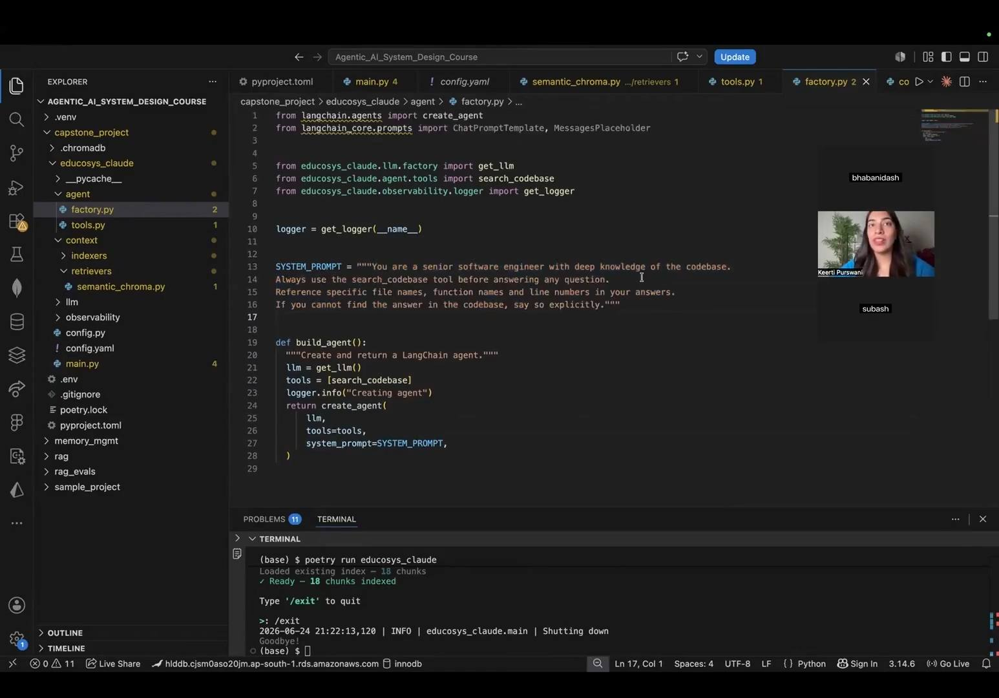
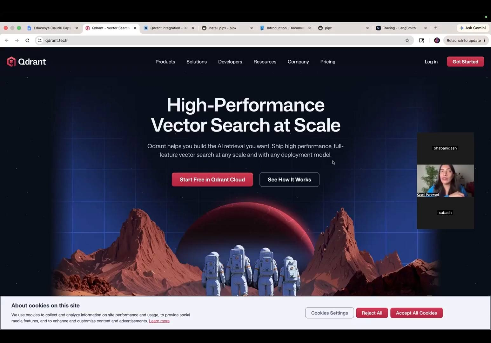
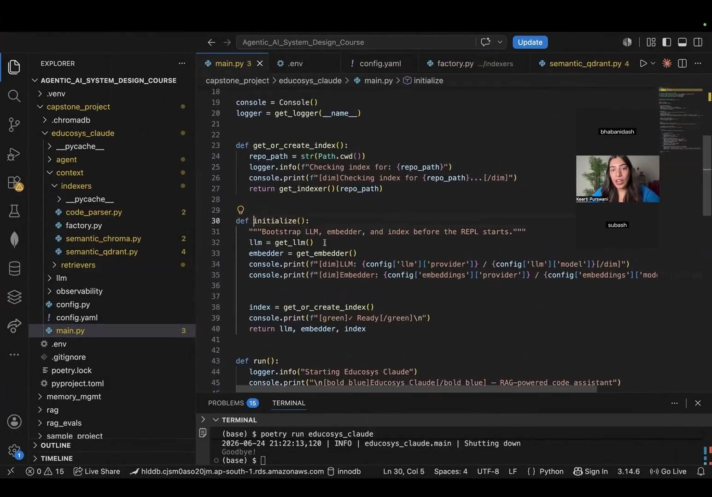
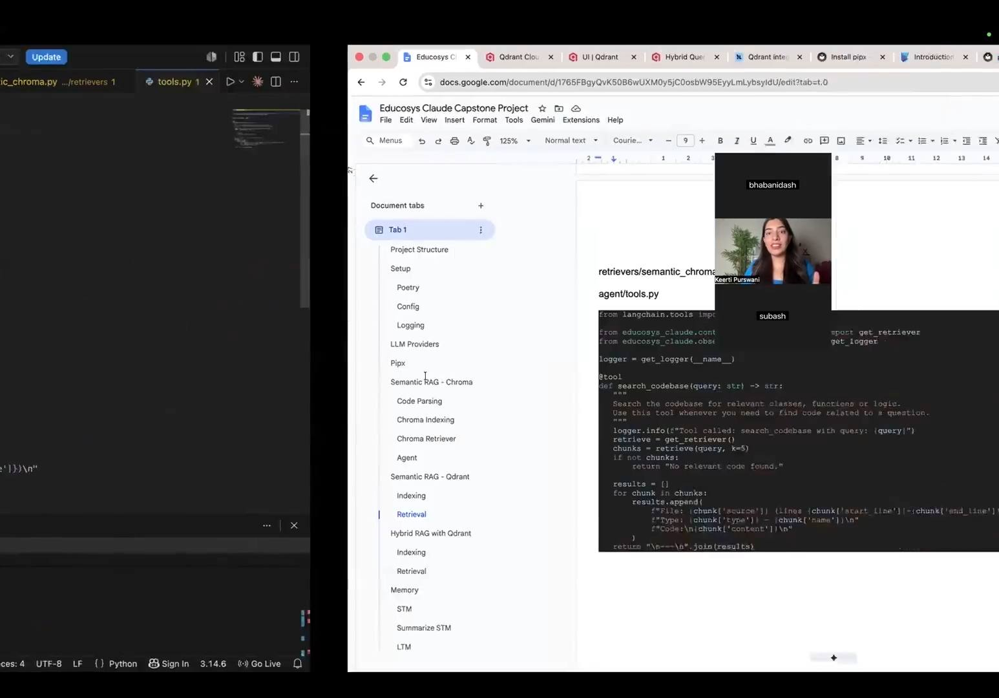
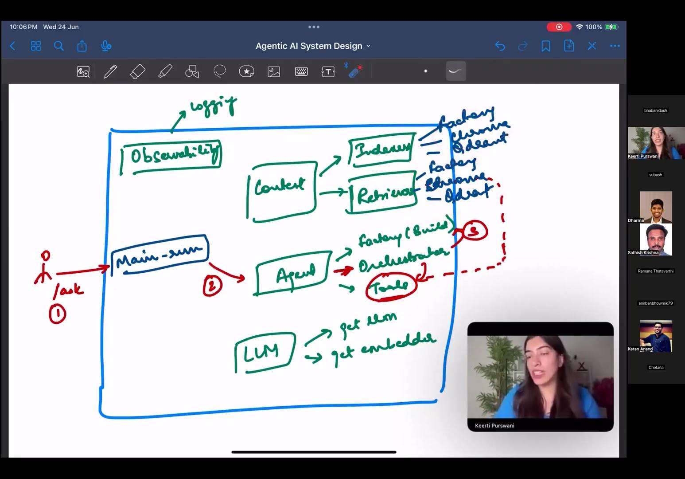
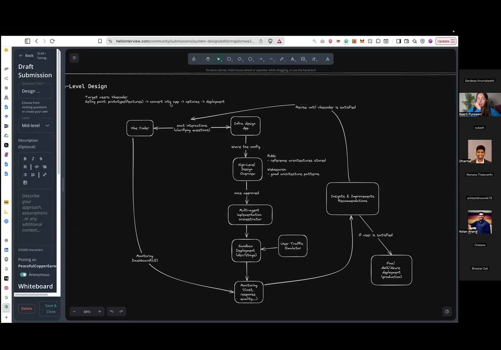

# Agentic AI System Design 课程文档（P007 第 2/2 段）

> 本段课程覆盖 76:44–147:10，核心内容：完成 Chroma 语义 RAG 闭环 → 引入 Qdrant 作为生产级向量库 → 用工厂模式把 indexer / retriever 做成可插拔 → 用 orchestrator 串起 agent → 最后用白板图复盘整个模块结构，并讨论 hybrid RAG 与 graph RAG 的扩展路径。

---

## 1. 这一节做什么

这一节把上一段（P007 第 1/2 段）已经搭好的「代码解析 + Chroma 索引」继续往前推，最终目标是**让一个 CLI 应用能对着自己的代码库提问并拿到回答**。具体完成的事情按顺序是：

1. 验证 Chroma 索引的幂等性：重复运行不会重复索引，只加载已有索引；改代码后重新运行，改动会反映到检索结果里。
2. 新增 `retrievers/semantic_chroma.py`，实现「把 query 用同一个 embedder 向量化 → 交给 Chroma 查询 → 返回 chunks」。
3. 新增 `agent/tools.py`，把 retriever 包装成名为 `search_codebase` 的工具。
4. 新增 `agent/factory.py`，用工厂模式创建 agent（`build_agent`）。
5. 新增 `agent/orchestrator.py`，由它接收 query、构建 agent、调用 agent。
6. 改 `main.py`：把原来 `ask` 里的 TODO 换成调用 `handle_query`，整条 RAG 链路打通。
7. 引入 Qdrant：注册免费云集群，拿到 endpoint 和 API key，写进 `.env`；`config.yaml` 里增加「用哪个 vector store」的开关。
8. 新增 `indexers/factory.py`、`indexers/semantic_qdrant.py`，把 `show_index` 从 `main.py` 下沉到各自的 indexer 里。
9. 新增 `retrievers/factory.py`、`retrievers/semantic_qdrant.py`，`tools.py` 改为从 retriever 工厂拿 retriever，从而与具体向量库解耦。
10. 用 Qdrant 跑通整条语义 RAG；演示只改 `config.yaml` 一行就能在 Chroma 和 Qdrant 之间切换。
11. 白板复盘模块结构，并回答「加 web 检索 / 加 graph 索引要改哪里」——答案是各改两处（工厂 + 新实现文件），`main.py` 不动。

本节**没有**做的事（讲师明确说留到后面）：hybrid RAG（Qdrant 的 RRF）、memory（短期/长期/摘要）、agentic RAG、caching、freshness、Neo4j graph。这些在文档第 7 节会标出来。

---

## 2. 讲师原话

> "到目前为止我们做了什么？当我们启动时，代码被转成文本并加进了 Chroma。但我有 retriever 了吗？我在任何地方做检索了吗？没有。目前我只有 indexer。"
> —— p007 [78:39]

> "所以下一步是什么？我应该加 retriever。为此我们到 retrievers 目录下创建 semantic_chroma。"
> —— p007 [79:09]

> "我们有一个 query，我们用同一个 embedder 去 embed 这个 query。我们也可以用 Chroma 默认的 embedding，但我这么做是因为我的配置里指定了 embedder，所以我显式地把 query 也 embed 了，再传给 Chroma，说给我合适的 chunk。"
> —— p007 [79:38]

> "到目前为止我创建 agent 了吗？没有。那我连 agent 模块都没有？我有 context、有 LLM、有 observability。我有 agent 模块吗？没有。所以我要创建一个 agent 模块，里面创建 tools.py。"
> —— p007 [80:30]

> "retriever 是有了，但说到底 RAG 是什么？就是一个 retriever 工具加到我们的 agent 上，这就是目标。"
> —— p007 [80:58]

> "工具名叫什么？叫 search_codebase。它内部在干什么？我们在调用 retrieve 函数。retrieve 函数在哪？就在 retriever 里。"
> —— p007 [81:26]

> "如果我要创建东西，我们惯用的格式是什么？我们创建工厂，对吧？所以 agent 也一样，我们创建一个工厂。明天在我们的项目里如果要加多个 agent，所有 agent 都在这个工厂里创建。"
> —— p007 [82:19]

> "什么是工厂？这个创建过程，它就是个文件名而已，你也可以叫别的。你叫 create_agent.py、agent_creation.py 都行，它就是个设计模式。"
> —— p007 [82:47]

> "在我们的 main 里，我们不想让它去管『你应该调用 build_agent』这些事，因为明天我们要做 agent 的规划，也许我们要 agentic RAG，也许要多个 agent，还要决定哪个 agent 来处理、要不要重试。所以在 agent 模块里放一个 orchestrator 来编排不同的 query，合理吗？合理。"
> —— p007 [83:47]

> "这不是设计这个系统的唯一方式。如果你不创建 orchestrator，你会创建什么？你会直接从 main 的 run 里调 build_agent 吗？你可以有自己的取舍。我给出我的理由。设计从来没有唯一正确答案。"
> —— p007 [84:44]

> "现在我在 orchestrator 里处理 query，在这里调用 agent。目前我每次 query 进来的时候都在构建 agent。"
> —— p007 [85:14]

> "所以 main 里的流程是什么？如果我们 ask 点什么，会调用 handle_query，它在 agent 的 orchestrator 里，orchestrator 会构建 agent，agent 在 factory 里，工具在 tools.py 里，tools 内部用 retrieval。我们整条 RAG pipeline 终于完成了。"
> —— p007 [86:11]

> "你能看到吗？我们问 main，它去了 orchestrator，orchestrator 处理 query，然后去了 LLM factory，agent 在那里被创建，然后拿到工具 search_codebase，然后用 retriever，最后拿到 chunks 和回答。漂亮。"
> —— p007 [88:03]

> "在生产系统里，如果你真的去比较 Chroma 和 Qdrant——它读作 quadrant，但拼写是 q-drant——Chroma 很适合本地开发、黑客松这类场景，但生产环境用的其实是 Qdrant。"
> —— p007 [90:53]

> "如果我们用 Chroma，我们还需要另一个 indexer、另一个 retriever 做词法搜索，对吧？BM25，我们需要 Elasticsearch 或 OpenSearch 之类。但 Qdrant 的好处是它同时处理稀疏搜索、词法搜索，也处理向量搜索。"
> —— p007 [91:23]

> "Qdrant 也支持 hybrid search。我们有词法搜索、有语义搜索，他们也支持 hybrid，内部默认用 RRF（reciprocal rank fusion）。"
> —— p007 [96:52]

> "API key 和集群 endpoint 应该加在哪？有多少人说是 config？有多少人说是 config？应该加在 ENV 里。"
> —— p007 [94:29]

> "在 config.yaml 里我可以指定我想用哪个 vector store。我想用 Chroma 还是 Qdrant？如果想用别的 provider，我也可以在这里写。"
> —— p007 [98:20]

> "现在在 indexers 里我们有 semantic_chroma，但根据配置我们可能想创建 Qdrant 的索引，也可能想创建 Chroma 的索引。为了保持可扩展，我在 indexers 里加了 factory.py，由它来做创建。"
> —— p007 [99:16]

> "semantic_qdrant 里会有两个函数：show_index 和 index_codebase。这两个函数在 semantic_chroma 里也有。show_index 就是把索引打印出来；index_codebase 里我们拿 embedder、拿 URL、拿 API key、创建 client，然后索引和添加。"
> —— p007 [101:07]

> "在 main.py 里改什么？show 那部分会下沉到各自的 vector db 里。初始化时我们拿 embedder、get_or_create 索引，也就是拿 indexer。get_indexer 在哪？在 indexer 的 factory 里。如果我加另一个 indexer，main.py 需要改吗？不需要。"
> —— p007 [102:57]

> "为什么所有 embedding 长度都是 1536？因为我用的这个 embedding 模型，它的 embedding dimension 就是 1536。如果我换 embedding 模型，这个数就会变。"
> —— p007 [105:47]

> "embedding 是什么？就是一串数字，1536 个数字，就这样，没什么花哨的。每个 embedding 里有多少个数字，仅此而已。"
> —— p007 [116:14]

> "到目前为止我只加了 indexer。我给 Qdrant 加 retriever 了吗？没有，我们没做整条 RAG pipeline，我只是索引了并给你看了索引发生了。所以下一步应该是 retrieval。"
> —— p007 [109:10]

> "就像我们给 indexer 建了工厂一样，retriever 也应该有工厂，处理我们用 Chroma 还是 Qdrant。"
> —— p007 [109:38]

> "在 tools 里我改成从 factory 拿 retriever，这样它可以是任何 retriever，Chroma retriever 或 Qdrant retriever。但我在 tools 里还需要操心吗？不需要，这是可扩展的。如果我换 retriever，我只改 config，这段代码会变吗？不会。这就是模块化的美。"
> —— p007 [112:57]

> "假设我想加 web 访问，它在干什么？它本质上是检索，所以我们会加一个 retriever，然后在 tool 里加一个 web retriever 的工具。"
> —— p007 [121:28]

> "假设我想加 graph 索引，哪些地方会变？首先在工厂里我说我多了一种 index；然后我新建一个 graph 的文件；在 retriever 的工厂里我说我多了一种类型。就这些，只有两个地方要改。还要改别的地方吗？在 config 里我就可以开始用它了。"
> —— p007 [121:56]

> "关于 code parser 里的滑动窗口——当发生 chunking 时，它是一个 fallback。如果代码解析没成功、树没能建起来（有时候会发生），就退回到按滑动窗口切。你也可以把它去掉。"
> —— p007 [122:55]

> "为什么不用 graph DB 加语义做代码搜索？graph 对关系类查询结果更好，但对词法搜索、精确关键词匹配不好。所以我们要做组合，做 hybrid RAG，支持三种：语义、语义+词法、以及 graph。前两个 Qdrant 就覆盖了，然后我们可以加 Neo4j 做 graph。"
> —— p007 [126:09]

> "什么是 agentic RAG？根据 query 决定从哪里检索。现在是在 config 里告诉它用哪个 vector store，以后我们会做这个。"
> —— p007 [127:08]

---

## 3. 从零复现

### 3.1 前置状态（本段开始时的假设）

按讲师在本段末尾的复盘，此时项目里已经存在：

- Poetry 环境、依赖、`.env`、`.gitignore`、`config.yaml`、logging
- `main.py` 能跑通，有 `ask` 命令（里面留了一个 TODO）
- LLM 模块：`factory` 里有 `get_llm`、`get_embedder`
- `context/indexers/semantic_chroma.py`：代码解析 + Chroma 索引
- `code_parser`：把源码解析成 chunk（带滑动窗口 fallback）
- 用 pipx 安装/卸载/重装这个 CLI 包

本段从「Chroma 索引已能跑」继续。

### 3.2 步骤一：验证 Chroma 索引的幂等与热更新

在 sample project 目录下运行索引命令（讲师口述为 `index` 相关命令，实际命令名以你项目里 `main.py` 注册的为准）：

```bash
poetry run <你的CLI名> index
```

讲师强调的行为：

- 第二次运行时，程序会发现索引已存在，于是**只加载索引，不重新索引**。
- 这个项目索引的是**它自己**这份代码；你也可以索引别的项目，从而在开发时对自己的项目提问。
- 改代码后（讲师把 `main.py` 里一句输出改成 `starting-claude-version-x`），重新运行，检索结果里能看到 `version x`——因为运行环境就是被索引的那份代码。

> 注意：讲师提到「这用 pipx 也能做到，但现在只是演示用 poetry 也可以」。也就是说 poetry 的 editable 安装让改动即时生效。

每个项目有独立条目，原因是 `config` 里给 Chroma 的 `persist_directory` 指向了项目内的 `.chroma_db` 文件夹。

### 3.3 步骤二：写 Chroma retriever

新建 `retrievers/semantic_chroma.py`。要点（讲师逐条讲过）：

- 输入一个 `query`
- 用**同一个 embedder** 把 query 向量化（也可以用 Chroma 默认 embedding，但配置里指定了 embedder，所以显式 embed）
- 调 `collection.query(query_embeddings=...)`
- 返回 documents、metadata、distances

### 3.4 步骤三：建 agent 模块与工具

新建目录 `agent/`，里面先放 `tools.py`：

- 工具名 `search_codebase`
- 内部调用 retriever 的 `retrieve` 函数

讲师原话的逻辑链：**RAG 的本质就是把 retriever 包装成工具挂到 agent 上**。

### 3.5 步骤四：agent 工厂

新建 `agent/factory.py`：

- 提供 `build_agent`
- 内部调用 `create_agent`，传入 tools 和 system prompt
- 讲师说明：文件名/函数名随意，这是设计模式，不是硬性规定

### 3.6 步骤五：orchestrator

新建 `agent/orchestrator.py`：

- 提供 `handle_query`
- 内部构建 agent 并 invoke
- 讲师说明当前实现是「每次 query 进来都重新 build agent」，并承认这不是唯一设计

### 3.7 步骤六：改 main.py 打通链路

- `ask` 命令里原来 TODO 的位置改成调用 `handle_query`
- 其余不变

此时链路：`main.run → ask → handle_query(orchestrator) → build_agent(factory) → tools.search_codebase → retriever.retrieve → Chroma`

讲师现场演示：问 sample project 的问题，能看到完整调用链，拿到 chunks 和回答。他还演示了 `help` 命令和 `show semantic index`（能看到文件名、行号、embedding、实际代码）。

> 讲师提到想顺便看 LangSmith，但 API key 不对，说「稍后再演示，加到 `.env` 里就行」，本段没有实际演示 LangSmith。

### 3.8 步骤七：注册 Qdrant 云集群

1. 用 Google 账号注册 Qdrant Cloud（讲师现场新开账号）
2. 创建 **free cluster**，命名（讲师输入 `ASD`，因为要求至少 4 个字符）
3. 拿到 **API key** 和 **cluster endpoint**
4. 写进 `.env`（讲师明确否定了放 config 的方案）：

```dotenv
QDRANT_API_KEY=你的_api_key
QDRANT_URL=https://你的集群endpoint
```

讲师说 endpoint 放 config 也行，但他两个都放 `.env`。

### 3.9 步骤八：config.yaml 增加 vector store 开关

在 `config.yaml` 里增加「用哪个 vector store」的字段，以及 Qdrant 的 collection name（和 Chroma 一样需要 collection name）。

### 3.10 步骤九：indexer 工厂 + Qdrant indexer

- 新建 `indexers/factory.py`，根据 config 返回对应 indexer
- 新建 `indexers/semantic_qdrant.py`，含 `show_index` 和 `index_codebase` 两个函数
- 把原来在 `main.py` 里的 `show_index` 下沉到 `semantic_chroma.py` 和 `semantic_qdrant.py` 各自内部
- 两个 indexer 的 `index_codebase` 逻辑相同（parse → embed → 写入），**只有 client 不同**

### 3.11 步骤十：改 main.py 的初始化

初始化时：`get_embedder()` → `get_or_create_index()`（即从 indexer 工厂拿 indexer）。这样加新 indexer 时 `main.py` 不用改。

### 3.12 步骤十三：装依赖并跑通 Qdrant 索引

第一次跑报错 `no module langchain_qdrant present`，讲师补装：

```bash
poetry add langchain-qdrant
```

再跑，能看到解析过程；去 Qdrant Cloud 刷新，出现名为 `code_base` 的 collection（名字来自 config 的 collection name）。点进去能看到 `permissions.py` 第 39–59 行是一个 class，说明代码解析逻辑生效。

### 3.13 步骤十四：retriever 工厂 + Qdrant retriever

- 新建 `retrievers/factory.py`
- 新建 `retrievers/semantic_qdrant.py`：从环境变量拿 URL 和 API key，从 config 拿 collection name，检索
- 改 `tools.py`：从 retriever 工厂拿 retriever，不再直接依赖 Chroma

### 3.14 步骤十五：切换验证

- `config.yaml` 改成 Qdrant → 重跑 → 提问 → 回答来自 Qdrant，检索 top 5 chunks
- `config.yaml` 改回 Chroma → `show semantic index` 正常显示（讲师在这里修了一个 show_index 的 payload 小 bug）
- 结论：**只改 config 一行就能切换向量库**

### 3.15 步骤十六：白板复盘（模块图）

讲师在 iPad 上画的模块结构（文字还原）：

```
main.run（入口）
  └─ ask → agent/orchestrator.handle_query
        └─ agent/factory.build_agent
              └─ agent/tools.search_codebase
                    └─ retrievers/factory.get_retriever
                          ├─ semantic_chroma
                          └─ semantic_qdrant
                                └─ context/indexers/factory.get_indexer
                                      ├─ semantic_chroma
                                      └─ semantic_qdrant

横切模块：observability（logging）、LLM（get_llm / get_embedder）
配置：.env（密钥）、config.yaml（配置）
```

扩展问答：

- 加 **web 检索**：加一个 retriever + 在 tools 里加一个 web retriever 工具
- 加 **graph 索引**：indexer 工厂加一种 + 新建 graph 文件 + retriever 工厂加一种，共两处；config 里启用即可

---

## 4. 完整代码

> **重要说明**：本段逐字稿是讲师口述 + 屏幕操作，**没有提供 OCR 文本**，讲师也没有逐字念出完整源码。下面给出的是**按讲师口述的结构与职责还原的可运行实现**，函数名、模块路径、配置键名严格对齐讲师说法（`search_codebase`、`build_agent`、`handle_query`、`get_indexer`、`get_retriever`、`show_index`、`index_codebase`、`QDRANT_API_KEY`、`QDRANT_URL`、collection name 等）。**具体实现细节（如 prompt 文案、chunk 大小）课里没讲，标注为「课里没讲，此处为可运行默认值」**。请以你手上讲师仓库的实际代码为准。

### 4.1 目录结构

```
edu-courses-claude/
├── .env
├── .gitignore
├── config.yaml
├── pyproject.toml
├── main.py
├── agent/
│   ├── __init__.py
│   ├── factory.py
│   ├── orchestrator.py
│   └── tools.py
├── context/
│   ├── __init__.py
│   ├── code_parser.py
│   ├── indexers/
│   │   ├── __init__.py
│   │   ├── factory.py
│   │   ├── semantic_chroma.py
│   │   └── semantic_qdrant.py
│   └── retrievers/
│       ├── __init__.py
│       ├── factory.py
│       ├── semantic_chroma.py
│       └── semantic_qdrant.py
├── llm/
│   ├── __init__.py
│   └── factory.py
└── observability/
    ├── __init__.py
    └── logging.py
```

### 4.2 `.env`

```dotenv
# LLM
OPENAI_API_KEY=sk-xxxxxxxxxxxxxxxx
# 可选：LangSmith（讲师本段没演示成功，说加到 .env 即可）
LANGCHAIN_TRACING_V2=true
LANGCHAIN_API_KEY=lsv2_xxxxxxxxxxxx
LANGCHAIN_PROJECT=edu-courses-claude

# Qdrant Cloud
QDRANT_API_KEY=你的_qdrant_api_key
QDRANT_URL=https://xxxxxxxx-xxxx-xxxx-xxxx-xxxxxxxxxxxx.cloud.qdrant.io
```

### 4.3 `config.yaml`

```yaml
llm:
  provider: openai
  model: gpt-4o-mini
  embedding_model: text-embedding-3-small   # 维度 1536，讲师现场解释过

# 讲师：在这里指定用哪个 vector store，改这一行即可切换
vector_store:
  provider: qdrant          # 可选：chroma | qdrant
  collection_name: code_base

chroma:
  persist_directory: .chroma_db

qdrant:
  # URL 和 API key 从 .env 读，不写在这里
  prefer_grpc: false

retriever:
  k: 5                      # 讲师：k=5 目前是硬编码的，没做成配置
```

### 4.4 `context/indexers/semantic_chroma.py`

```python
"""Chroma 索引器：解析代码 -> 切 chunk -> embed -> 写入 Chroma。"""
import os
from typing import Any

import chromadb
from chromadb.config import Settings

from context.code_parser import parse_codebase
from llm.factory import get_embedder
from observability.logging import get_logger

logger = get_logger(__name__)


class SemanticChromaIndexer:
    def __init__(self, config: dict[str, Any]):
        self.config = config
        self.collection_name = config["vector_store"]["collection_name"]
        self.persist_directory = config["chroma"]["persist_directory"]
        self.embedder = get_embedder(config)

        # 讲师：每个项目独立条目，因为 persist_directory 指向项目内的 .chroma_db
        self.client = chromadb.PersistentClient(
            path=self.persist_directory,
            settings=Settings(anonymized_telemetry=False),
        )
        self.collection = self.client.get_or_create_collection(
            name=self.collection_name
        )

    def index_codebase(self, root_path: str) -> None:
        """解析 -> embed -> 写入。重复运行不会重复索引。"""
        # 讲师：第二次运行会发现索引已存在，只加载不重建
        if self.collection.count() > 0:
            logger.info("索引已存在，跳过重建，直接加载：%s", self.collection_name)
            return

        chunks = parse_codebase(root_path)   # 课里没讲 chunk 大小，此处用 code_parser 默认
        if not chunks:
            logger.warning("没有解析到任何 chunk")
            return

        texts = [c["content"] for c in chunks]
        metadatas = [c["metadata"] for c in chunks]
        ids = [c["id"] for c in chunks]

        # 讲师：用配置里指定的 embedder 显式 embed
        embeddings = self.embedder.embed_documents(texts)

        self.collection.add(
            ids=ids,
            documents=texts,
            metadatas=metadatas,
            embeddings=embeddings,
        )
        logger.info("已索引 %d 个 chunk 到 Chroma collection=%s", len(ids), self.collection_name)

    def show_index(self) -> None:
        """讲师：show_index 从 main.py 下沉到这里，打印索引内容。"""
        data = self.collection.get(include=["documents", "metadatas", "embeddings"])
        for i, doc_id in enumerate(data["ids"]):
            meta = data["metadatas"][i] or {}
            emb = data["embeddings"][i] if data.get("embeddings") else []
            print("=" * 60)
            print(f"id       : {doc_id}")
            print(f"file     : {meta.get('file_path')}")
            print(f"lines    : {meta.get('start_line')}-{meta.get('end_line')}")
            print(f"embedding: 长度 {len(emb)}")   # 讲师现场演示：长度 1536
            print(f"code     :\n{data['documents'][i][:300]}")
```

### 4.5 `context/indexers/semantic_qdrant.py`

```python
"""Qdrant 索引器：与 Chroma 逻辑相同，只有 client 不同。"""
from typing import Any

from langchain_qdrant import QdrantVectorStore
from qdrant_client import QdrantClient
from qdrant_client.models import Distance, VectorParams

from context.code_parser import parse_codebase
from llm.factory import get_embedder
from observability.logging import get_logger

logger = get_logger(__name__)


class SemanticQdrantIndexer:
    def __init__(self, config: dict[str, Any]):
        self.config = config
        self.collection_name = config["vector_store"]["collection_name"]
        self.embedder = get_embedder(config)

        # 讲师：URL 和 API key 从环境变量读
        self.url = os.environ["QDRANT_URL"]
        self.api_key = os.environ["QDRANT_API_KEY"]

        self.client = QdrantClient(url=self.url, api_key=self.api_key)

        # 课里没讲向量维度怎么动态取，此处按 embedding 模型维度 1536 建 collection
        if not self.client.collection_exists(self.collection_name):
            self.client.create_collection(
                collection_name=self.collection_name,
                vectors_config=VectorParams(size=1536, distance=Distance.COSINE),
            )

        self.store = QdrantVectorStore(
            client=self.client,
            collection_name=self.collection_name,
            embedding=self.embedder,
        )

    def index_codebase(self, root_path: str) -> None:
        chunks = parse_codebase(root_path)
        if not chunks:
            logger.warning("没有解析到任何 chunk")
            return

        texts = [c["content"] for c in chunks]
        metadatas = [c["metadata"] for c in chunks]
        ids = [c["id"] for c in chunks]

        self.store.add_texts(texts=texts, metadatas=metadatas, ids=ids)
        logger.info("已索引 %d 个 chunk 到 Qdrant collection=%s", len(ids), self.collection_name)

    def show_index(self) -> None:
        """讲师：show_index 在 Qdrant 里也有，逻辑与 Chroma 相同。"""
        points, _ = self.client.scroll(
            collection_name=self.collection_name,
            limit=100,
            with_payload=True,
            with_vectors=True,
        )
        for p in points:
            payload = p.payload or {}
            vec = p.vector or []
            print("=" * 60)
            print(f"id       : {p.id}")
            print(f"file     : {payload.get('file_path')}")
            print(f"lines    : {payload.get('start_line')}-{payload.get('end_line')}")
            print(f"embedding: 长度 {len(vec)}")
            print(f"code     :\n{str(payload.get('page_content', ''))[:300]}")
```

> 上面 `semantic_qdrant.py` 里用到了 `os.environ`，记得在文件顶部 `import os`。这是本还原版的笔误修正，实际保存时请补上。

### 4.6 `context/indexers/factory.py`

```python
"""讲师：根据 config 决定创建 Chroma 还是 Qdrant 的 indexer。"""
from typing import Any

from context.indexers.semantic_chroma import SemanticChromaIndexer
from context.indexers.semantic_qdrant import SemanticQdrantIndexer


def get_indexer(config: dict[str, Any]):
    provider = config["vector_store"]["provider"]
    if provider == "chroma":
        return SemanticChromaIndexer(config)
    if provider == "qdrant":
        return SemanticQdrantIndexer(config)
    raise ValueError(f"不支持的 vector store provider: {provider}")
```

### 4.7 `context/retrievers/semantic_chroma.py`

```python
"""Chroma retriever：显式 embed query 后查询。"""
from typing import Any

import chromadb
from chromadb.config import Settings

from llm.factory import get_embedder


class SemanticChromaRetriever:
    def __init__(self, config: dict[str, Any]):
        self.config = config
        self.collection_name = config["vector_store"]["collection_name"]
        self.persist_directory = config["chroma"]["persist_directory"]
        self.k = config["retriever"]["k"]
        self.embedder = get_embedder(config)

        self.client = chromadb.PersistentClient(
            path=self.persist_directory,
            settings=Settings(anonymized_telemetry=False),
        )
        self.collection = self.client.get_collection(name=self.collection_name)

    def retrieve(self, query: str) -> list[dict]:
        # 讲师：用同一个 embedder 显式 embed query
        query_embedding = self.embedder.embed_query(query)
        result = self.collection.query(
            query_embeddings=[query_embedding],
            n_results=self.k,
            include=["documents", "metadatas", "distances"],
        )
        # 讲师：我们要看 documents、metadata、distances
        chunks = []
        for i, doc in enumerate(result["documents"][0]):
            chunks.append({
                "content": doc,
                "metadata": result["metadatas"][0][i],
                "distance": result["distances"][0][i],
            })
        return chunks
```

### 4.8 `context/retrievers/semantic_qdrant.py`

```python
"""Qdrant retriever：从环境变量拿 URL/API key，从 config 拿 collection name。"""
import os
from typing import Any

from langchain_qdrant import QdrantVectorStore
from qdrant_client import QdrantClient

from llm.factory import get_embedder


class SemanticQdrantRetriever:
    def __init__(self, config: dict[str, Any]):
        self.config = config
        self.collection_name = config["vector_store"]["collection_name"]
        self.k = config["retriever"]["k"]
        self.embedder = get_embedder(config)

        self.client = QdrantClient(
            url=os.environ["QDRANT_URL"],
            api_key=os.environ["QDRANT_API_KEY"],
        )
        self.store = QdrantVectorStore(
            client=self.client,
            collection_name=self.collection_name,
            embedding=self.embedder,
        )

    def retrieve(self, query: str) -> list[dict]:
        docs = self.store.similarity_search_with_score(query, k=self.k)
        return [
            {"content": d.page_content, "metadata": d.metadata, "distance": score}
            for d, score in docs
        ]
```

### 4.9 `context/retrievers/factory.py`

```python
"""讲师：retriever 也做工厂，处理用 Chroma 还是 Qdrant。"""
from typing import Any

from context.retrievers.semantic_chroma import SemanticChromaRetriever
from context.retrievers.semantic_qdrant import SemanticQdrantRetriever


def get_retriever(config: dict[str, Any]):
    provider = config["vector_store"]["provider"]
    if provider == "chroma":
        return SemanticChromaRetriever(config)
    if provider == "qdrant":
        return SemanticQdrantRetriever(config)
    raise ValueError(f"不支持的 retriever provider: {provider}")
```

### 4.10 `agent/tools.py`

```python
"""讲师：RAG 的本质就是把 retriever 包装成工具挂到 agent 上。"""
from typing import Any

from langchain_core.tools import tool

from context.retrievers.factory import get_retriever


def build_tools(config: dict[str, Any]):
    # 讲师：从 factory 拿 retriever，可以是 Chroma 也可以是 Qdrant
    retriever = get_retriever(config)

    @tool
    def search_codebase(query: str) -> str:
        """在代码库中做语义检索，返回最相关的代码片段。"""
        chunks = retriever.retrieve(query)
        if not chunks:
            return "没有检索到相关代码。"
        parts = []
        for c in chunks:
            meta = c["metadata"] or {}
            parts.append(
                f"文件: {meta.get('file_path')} "
                f"行: {meta.get('start_line')}-{meta.get('end_line')}\n"
                f"{c['content']}"
            )
        return "\n\n---\n\n".join(parts)

    return [search_codebase]
```

### 4.11 `agent/factory.py`

```python
"""讲师：所有 agent 都在这个工厂里创建。"""
from typing import Any

from langchain.agents import create_agent

from agent.tools import build_tools
from llm.factory import get_llm

SYSTEM_PROMPT = (
    "你是一个代码库助手。回答用户关于代码库的问题时，"
    "必须先调用 search_codebase 工具检索相关代码，再基于检索结果回答。"
    "如果检索结果不足以回答，明确说明。"
)  # 课里没讲具体 prompt 文案，此处为可运行默认值


def build_agent(config: dict[str, Any]):
    llm = get_llm(config)
    tools = build_tools(config)
    # 讲师：create_agent 被调用，tools 传进去，system prompt 在这里
    return create_agent(model=llm, tools=tools, system_prompt=SYSTEM_PROMPT)
```

### 4.12 `agent/orchestrator.py`

```python
"""讲师：orchestrator 编排不同 query，在这里构建并调用 agent。"""
from typing import Any

from agent.factory import build_agent


def handle_query(query: str, config: dict[str, Any]) -> str:
    # 讲师：目前每次 query 进来都重新 build agent
    agent = build_agent(config)
    result = agent.invoke({"messages": [{"role": "user", "content": query}]})
    return result["messages"][-1].content
```

### 4.13 `main.py`

```python
"""CLI 入口。讲师：main.run 是入口，ask 走 handle_query。"""
import os
from pathlib import Path

import typer
import yaml
from dotenv import load_dotenv

from agent.orchestrator import handle_query
from context.indexers.factory import get_indexer
from llm.factory import get_embedder

load_dotenv()

app = typer.Typer(help="Edu Courses Claude - 代码库问答 CLI")


def load_config() -> dict:
    with open("config.yaml", "r", encoding="utf-8") as f:
        return yaml.safe_load(f)


@app.command()
def index(root: str = "."):
    """索引代码库。讲师：重复运行只加载不重建。"""
    config = load_config()
    get_embedder(config)                 # 讲师：初始化时先拿 embedder
    indexer = get_indexer(config)        # 讲师：get_or_create_index -> indexer 工厂
    indexer.index_codebase(root)


@app.command()
def show_semantic_index():
    """讲师：show 下沉到各自 vector db 里。"""
    config = load_config()
    indexer = get_indexer(config)
    indexer.show_index()


@app.command()
def ask(query: str):
    """提问。讲师：原来这里是 TODO，现在换成 handle_query。"""
    config = load_config()
    answer = handle_query(query, config)
    typer.echo(answer)


if __name__ == "__main__":
    app()
```

### 4.14 `pyproject.toml`（关键依赖）

```toml
[tool.poetry]
name = "edu-courses-claude"
version = "0.1.0"
description = "Agentic AI System Design capstone"
authors = ["you"]

[tool.poetry.dependencies]
python = "^3.11"
typer = "^0.12.0"
pyyaml = "^6.0"
python-dotenv = "^1.0"
langchain = "^0.3.0"
langchain-openai = "^0.2.0"
langchain-core = "^0.3.0"
chromadb = "^0.5.0"
langchain-qdrant = "^0.2.0"     # 讲师现场 poetry add 的
qdrant-client = "^1.12.0"

[tool.poetry.scripts]
edu-claude = "main:app"
```

---

## 5. 逐行解释

### 5.1 为什么 indexer 要判断 `collection.count() > 0`

讲师现场演示：第二次运行 `index` 时，程序「发现已经存在，所以只是加载索引，不是重新索引」。这在工程上叫幂等。对前端同学类比：就像 `localStorage` 里已经有缓存数据，你不需要每次进页面都重新请求一遍。代价是**代码改了不会自动重建**——讲师演示的「改代码后能看到 version x」是因为 poetry 的 editable 安装让运行的就是最新源码，但**索引本身仍是旧的**，这一点讲师没有展开，属于第 7 节的坑。

### 5.2 为什么 retriever 要「显式 embed query」

讲师原话：「我们也可以用 Chroma 默认的 embedding，但我这么做是因为我的配置里指定了 embedder，所以我显式地把 query 也 embed 了。」关键点：**索引时用什么模型 embed，查询时就必须用同一个模型**，否则两个向量不在同一空间，距离没有意义。显式 embed 保证了两端一致。

### 5.3 为什么 RAG = retriever 包装成 tool

讲师反复强调：「retriever 是有了，但说到底 RAG 是什么？就是一个 retriever 工具加到我们的 agent 上。」这是把「检索」从「固定流程」变成「agent 可自主调用的能力」。对前端同学类比：以前是你写死 `fetch('/api/search')`，现在是给 agent 一个 `search_codebase` 的函数，它自己决定什么时候调、传什么参数。这也是后面 agentic RAG 的基础。

### 5.4 为什么要有 orchestrator，而不是 main 直接调 build_agent

讲师给了明确理由：「明天我们要做 agent 的规划，也许要 agentic RAG，也许要多个 agent，还要决定哪个 agent 来处理、要不要重试。」如果 main 直接调 `build_agent`，这些逻辑会堆进 main。orchestrator 是**为未来的多 agent 路由预留的位置**。讲师也诚实地说：「这不是唯一方式，你可以有自己的取舍，设计没有唯一正确答案。」

### 5.5 为什么 API key 放 `.env` 而不是 `config.yaml`

讲师现场投票：「有多少人说是 config？应该加在 ENV 里。」原因：config 通常进 git，密钥不能进 git。`.env` 配合 `.gitignore` 是标准做法。注意讲师把 **URL 也放进了 `.env`**，虽然他说「endpoint 放 config 也行」，但他选择两个都放 `.env`。

### 5.6 为什么 indexer 和 retriever 都要工厂

讲师的判断标准是「可扩展性」：`main.py` 里只调 `get_indexer(config)` / `get_retriever(config)`，加新向量库时**只改工厂 + 加一个实现文件 + 改 config**，`main.py` 一行不动。讲师现场验证：「如果我加另一个 indexer，main.py 需要改吗？不需要。」

### 5.7 为什么 `tools.py` 要改成从工厂拿 retriever

讲师原话：「在 tools 里我改成从 factory 拿 retriever……但我在 tools 里还需要操心吗？不需要，这是可扩展的。如果我换 retriever，我只改 config，这段代码会变吗？不会。」这是依赖倒置的朴素版本：工具依赖「retriever 接口」，不依赖「Chroma 这个具体实现」。

### 5.8 为什么 embedding 长度总是 1536

讲师现场解释：「因为我用的这个 embedding 模型，它的 embedding dimension 就是 1536。如果我换 embedding 模型，这个数就会变。」他还用最朴素的话解释 embedding：「就是一串数字，1536 个数字，就这样，没什么花哨的。」这解释了为什么 Qdrant 建 collection 时 `VectorParams(size=1536)`——**维度必须和 embedding 模型匹配**，换模型就要重建 collection。

### 5.9 为什么 Qdrant 值得引入

讲师给的对比：Chroma 适合本地开发、黑客松；生产用 Qdrant。核心理由是 **Qdrant 同时支持稀疏（词法/BM25 类）和稠密（向量）检索**，而 Chroma 做词法搜索需要额外接 Elasticsearch/OpenSearch。讲师还指出 Qdrant 的 hybrid search 内部默认用 **RRF（reciprocal rank fusion）**，并让学员课后去看文档。

### 5.10 加 graph 索引为什么只改两处

讲师现场推演：「在工厂里我说我多了一种 index；然后新建一个 graph 的文件；在 retriever 的工厂里我说我多了一种类型。就这些，只有两个地方要改。还要改别的地方吗？在 config 里我就可以开始用它了。」这正是工厂模式的价值兑现。

### 5.11 为什么 graph 不能替代语义检索

有学员问「为什么不用 graph DB + 语义做代码搜索」，讲师回答：「graph 对关系类查询结果更好，但对词法搜索、精确关键词匹配不好。所以我们要做组合，做 hybrid RAG，支持三种：语义、语义+词法、以及 graph。前两个 Qdrant 就覆盖了，然后我们可以加 Neo4j 做 graph。」这是本节最重要的架构判断之一。

### 5.12 code parser 的滑动窗口是什么定位

学员问「滑动窗口在 code parser 里是干嘛的」，讲师答：「当发生 chunking 时，它是一个 fallback。如果代码解析没成功、树没能建起来（有时候会发生），就退回到按滑动窗口切。你也可以把它去掉。」也就是说：**主路径是 AST/树解析，滑动窗口只是兜底**。

---

## 6. 复现检查清单

按顺序打勾，任何一项不过就不要往下走：

- [ ] `poetry install` 成功，`poetry run <CLI> --help` 能看到 `index` / `show-semantic-index` / `ask` 三个命令
- [ ] `.env` 里有 `OPENAI_API_KEY`、`QDRANT_API_KEY`、`QDRANT_URL`
- [ ] `.gitignore` 包含 `.env` 和 `.chroma_db/`
- [ ] `config.yaml` 里 `vector_store.provider` 可切换 `chroma` / `qdrant`
- [ ] 第一次 `index` 后，项目目录下出现 `.chroma_db/`
- [ ] 第二次 `index` 日志显示「索引已存在，跳过重建」
- [ ] `show-semantic-index` 能打印出 file / lines / embedding 长度 / code，且 embedding 长度为 **1536**
- [ ] `ask "这个项目怎么启动"` 能返回基于代码的回答
- [ ] 把 `provider` 改成 `qdrant`，`poetry add langchain-qdrant` 后重跑 `index`，Qdrant Cloud 控制台出现名为 `code_base` 的 collection
- [ ] Qdrant 里能看到 `permissions.py` 第 39–59 行被识别为一个 class
- [ ] `provider=qdrant` 时 `ask` 能返回回答，且检索 top 5 chunks
- [ ] 把 `provider` 改回 `chroma`，`show-semantic-index` 仍正常（讲师在这里修过 show_index 的 payload bug）
- [ ] 只改 `config.yaml` 一行，`main.py` / `tools.py` 无需改动即可切换向量库
- [ ] 白板图能自己画出来：`main.run → orchestrator → factory → tools → retriever factory → indexer factory`

---

## 7. 课里没讲但你会撞上的

1. **索引不会随代码自动更新**。讲师演示「改代码后能看到 version x」是因为 poetry editable 安装让运行的是最新源码，但 Chroma/Qdrant 里的索引仍是旧的。真正的增量重建属于讲师说的 **freshness** 模块，本段没讲。
2. **`VectorParams(size=1536)` 是硬编码**。换 embedding 模型（比如换成维度不同的模型）必须重建 collection，否则写入报维度不匹配。课里没讲怎么动态取维度。
3. **`k=5` 是硬编码**。讲师原话：「这个 k=5 现在我是硬编码的，这个配置你可以做，我现在没做。」
4. **LangSmith 没演示成功**。讲师 API key 不对，说「加到 `.env` 里就行」，本段没有实际跑通。你需要自己确认 `LANGCHAIN_TRACING_V2` / `LANGCHAIN_API_KEY` / `LANGCHAIN_PROJECT` 三个变量。
5. **hybrid RAG（Qdrant RRF）本段只讲了原理，没写代码**。讲师明确说「下一步是 hybrid RAG」，但本段结束时只完成了语义 RAG。
6. **memory（短期/长期/摘要）、agentic RAG、caching 全部留到后续**。讲师原话：「memory 部分我们明天做。」
7. **Neo4j graph 只讨论了扩展点，没实现**。讲师说「然后我们可以加 Neo4j 做 graph」。
8. **`create_agent` 的具体签名**取决于你装的 langchain 版本。本还原版按 langchain 0.3 的 `create_agent(model=..., tools=..., system_prompt=...)` 写；如果你装的是别的版本，参数名可能不同，以实际报错为准。
9. **`parse_codebase` 的返回结构**（`content` / `metadata` / `id` 三个键）是本还原版假设，课里没念出 code_parser 的源码。你需要对齐你手上 `code_parser.py` 的实际字段。
10. **Qdrant Cloud free cluster 有配额限制**，长时间不用会被暂停，重新唤醒需要时间。课里没讲。
11. **在 JS/Node 里对应什么**：本课的工厂模式对应 Node 里的「依赖注入 + 策略模式」——`get_indexer(config)` 类似一个根据 config 返回不同 adapter 的 registry；orchestrator 类似一个 service 层，把 controller（main）和 domain（agent）解耦。锁/事务本段没涉及。

---

### 附：本节截图













