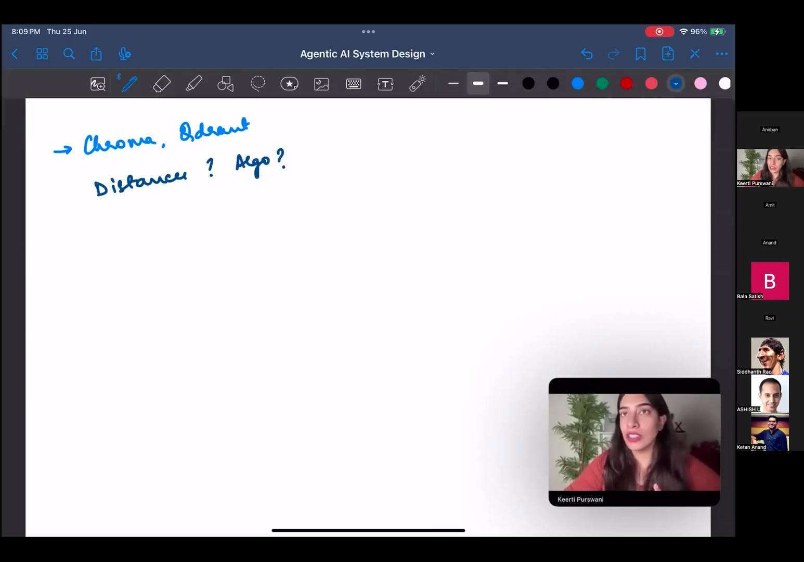
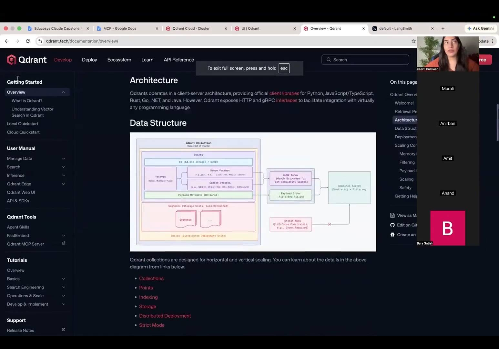
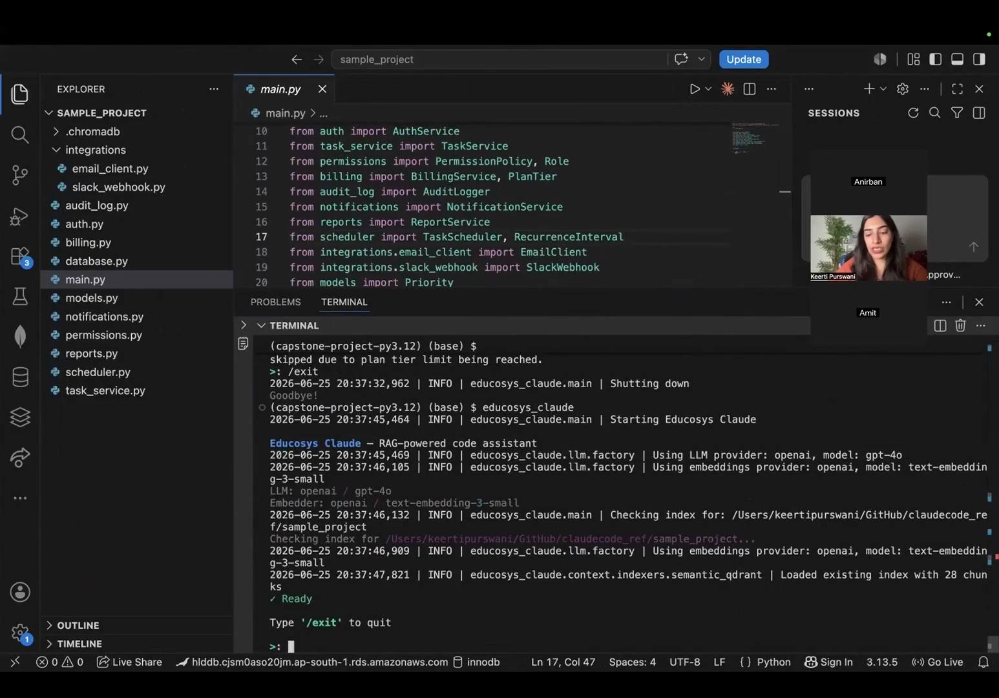
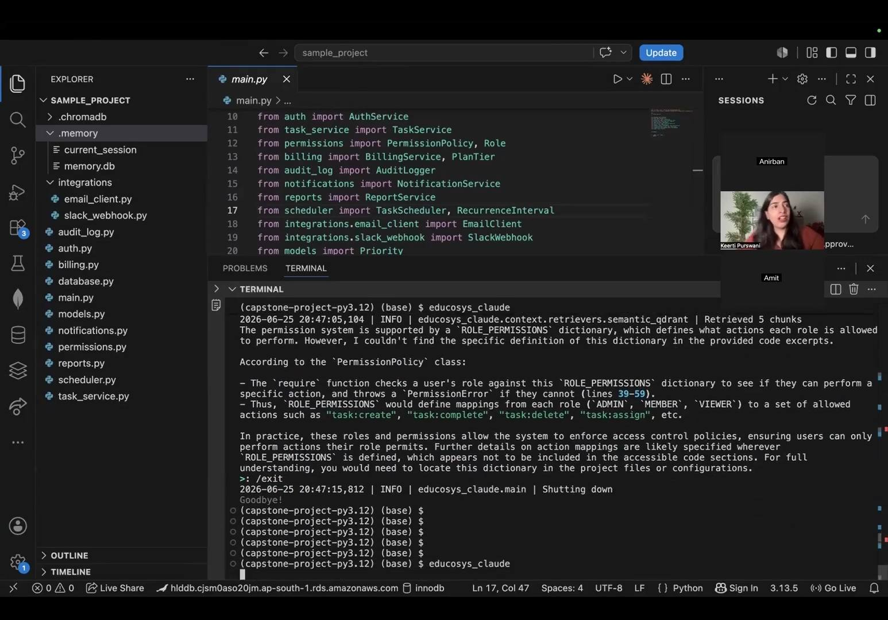
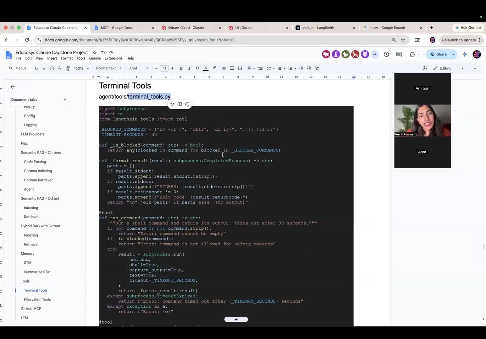
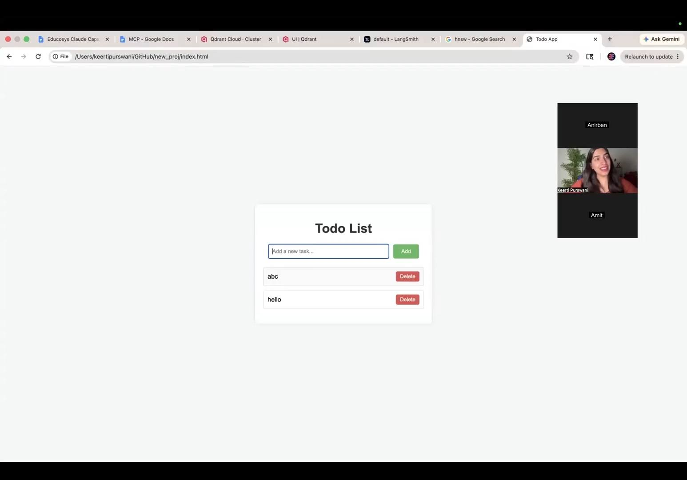
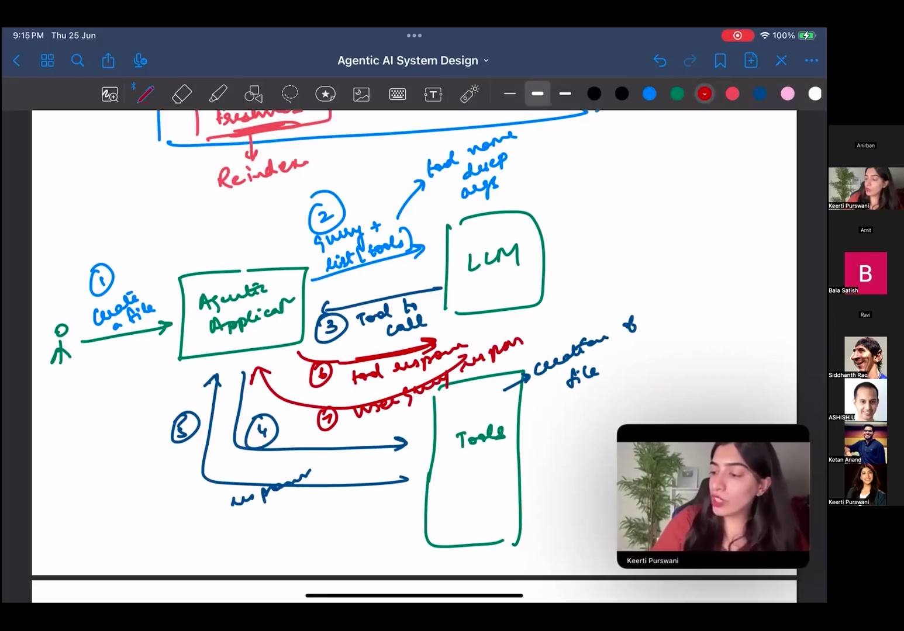

# Agentic AI System Design — P008 课程文档：从零把 Hybrid 检索、记忆层、工具层接进 Claude Code 克隆项目

> 本篇覆盖 **P008（0:00–72:01）**。这一集是"项目缝合"的分水岭：前面几周都在学概念（RAG、eval、工具、MCP），这一集开始把 **Hybrid 检索（Qdrant + BM25 + RRF）**、**短期记忆（LangGraph checkpointer）**、**工具层（terminal / file system）** 全部接入同一个 Claude Code 风格的 CLI 项目，最后演示了一个把整个目录删光的"事故现场"，引出安全层（guardrails）的必要性。

---

## 1. 这一节做什么

这一节的任务，用一句话概括：**把前面零散学过的概念，缝成一个能从头跑起来的生产级 Agentic 系统骨架**。具体交付四件事：

1. **理论补丁 — HNSW**：回答"向量库内部到底用什么算距离"。10M 条 1536 维向量如果暴力算余弦相似度要 10–30 秒，所以生产环境必须用 HNSW（Hierarchical Navigable Small World）这种分层图索引，把复杂度压到 log n。
2. **Hybrid 检索接入**：引入 `fastembed`，把 Qdrant 从"纯语义"切到"语义 + BM25 稀疏向量 + RRF 融合"。用同一个 golden query（"audit event type permission denied"）对比 hybrid 与 semantic，hybrid 命中 `scheduler.py`，semantic 找不到。
3. **短期记忆层**：新建 `memory/` 一层，用 LangGraph 的 `SqliteSaver` checkpointer 落盘到 `.memory/memory.db`，并通过 `thread_id = session_id` 让 Agent 天然支持多会话、会话切换、重启恢复；再加 `SummarizationMiddleware` 做会话压缩。
4. **工具层**：新建 `tools/` 一层，把 `terminal_tools.py`（run_command / run_in_directory）和 `file_system_tools.py`（read / write / append / delete / list / exists）接到 Agent，让"运行在空目录里的 Claude Code"能真的生成一个 HTML/CSS/JS 的 to-do app，也能真的删文件。

最后用一场"删库演示"说明：**只靠 substring 黑名单挡不住 `rm -f`**，必须升格到独立的安全层（safety layer）。

这一节的最终产物，是一个能在空目录里 `edu-courses-claude` 一下、然后说 "Create a todo app using HTML, CSS, JavaScript" 就生成可运行代码的 CLI。

---

## 2. 讲师原话

> "在前两周，你们一定觉得我们还在铺基础——写了很多 demo 代码，看到各种 RAG、看到 eval，但还没把所有东西缝成一个生产级系统。"
> —— p008 [00:00]

> "HLD（高层设计）的学习路径就是：先学不同种类的数据库、不同的网络方式、不同的解决方案，然后把它们缝在一起，看到端到端系统设计长这样。"
> —— p008 [00:28]

> "如果你理解了 tools、理解了 MCP 或 skills，那在生产系统里你打算怎么写？你不能把整条 RAG 流水线写在一个文件里——那在生产里不是正确做法。"
> —— p008 [01:48]

> "如果你问 Chroma 和 Qdrant，它们内部到底用什么算法算距离？答案是 HNSW，你应该知道它。HNSW 代表什么？"
> —— p008 [08:48]

> "假设 1000 万条向量，每条 1536 维。如果你拿查询向量和所有向量做余弦相似度，乘一遍就是至少 3000 次运算。暴力法至少要 10 秒、30 秒、40 秒，取决于你的磁盘和频率。这样响应质量好吗？不好。"
> —— p008 [08:19]

> "NSW，Navigable Small Worlds，是一篇论文的名字。它的思路是：与其老老实实一个一个节点走，不如保留一些跳跃节点，形成层级。从 1 到 55，你不需要走 55 步，你可能只需要 5 到 6 跳。"
> —— p008 [10:14]

> "这里和排序不一样，我们讲的是相似度——向量之间有多接近。所以在建图的时候，相似的向量会被聚在一起，聚类成一层，再上一层再聚一次，形成一个分层的结构。这就是 Chroma、Qdrant 内部索引用的算法。"
> —— p008 [13:01]

> "如果要实现 hybrid RAG，我们会建一个向量索引、一个 BM25 索引，然后用 RRF（Reciprocal Rank Fusion）把结果融合起来。这正是 Qdrant 帮我们做的事。"
> —— p008 [25:04]

> "Qdrant 内部用的是 fastembed，所以我要 `poetry add fastembed`。加完不用管 requirements.txt，poetry 会更新到 pyproject.toml 里。"
> —— p008 [23:38]

> "短期记忆在 LangChain 里非常简单——用 checkpointer。内部做的事情无非是把消息列表存到某个地方，太长就总结、就裁剪。我用的是 SQLite saver；你也可以用 Redis saver、Postgres saver。"
> —— p008 [34:34]

> "我们要给 agent 传 checkpointer，位置在创建 agent 的时候——在 agent factory 里。没有别的改动。"
> —— p008 [38:24]

> "每次请求进来都要告诉它属于哪个会话。如果切换会话，thread_id 也要跟着切。这个改动在 orchestrator 里——`agent.invoke` 的时候把 thread_id 传进去。"
> —— p008 [39:16]

> "什么是工具？工具只是个花哨的名字，本质上就是一个简单的函数、一个方法。`run_command` 干的事就是起一个 subprocess 跑命令，没有更难的东西。"
> —— p008 [52:26]

> "读取文件里，我加了大量防止出错的判断：路径不能为空、文件不存在、路径不是文件、文件太大，其余都是 `open(file)` 一行。"
> —— p008 [54:18]

> "到目前为止，我们还没有加长时记忆；但我们加了短时记忆，所以它会记住会话，重启也不会丢——因为默认回到同一个会话。"
> —— p008 [42:33]

> "你看到没有，我在 guardrails 里只挡了 `rm -rf`，所以它跑了 `rm -f` 就把所有文件删了。这就是为什么我们要加安全层。"
> —— p008 [65:49]

> "Agent 是什么？LLM 加 tools。用户请求进来先调 LLM，传的是 query 加工具清单；工具清单里有什么？工具名、描述、参数签名——描述就是 docstring。"
> —— p008 [67:15]

> "LLM 能自己调用工具吗？不能。是我们的应用拿到'要调哪个工具'这个决定之后，去执行函数调用。执行完拿到工具响应，我们还不直接给用户，因为可能是 5xx、4xx——要把工具响应再送回 LLM 组织成一版好回答。"
> —— p008 [70:06]

---

## 3. 从零复现

> 前置：本项目是随课程累积的。P008 之前的状态是——Python + Poetry、`config.yaml`、logging、LLM provider、通用代码解析、`context/indexers/` 下已有 Chroma 语义索引、`context/retrievers/` 下已有语义检索、基础 Agent 能跑通 `search_code_base`。**本节所有路径都建立在那个骨架之上**。具体的初始骨架代码见 P006 / P007，不属于本集覆盖范围。

### 步骤 0：环境与依赖

```bash
# 用 Poetry 管理依赖（不用 pip）
poetry add fastembed
poetry add langgraph-checkpoint-sqlite
```

> "Qdrant 内部用的是 fastembed，所以我 `poetry add fastembed`；第一次运行的时候它还会需要 `langgraph-checkpoint-sqlite`。"
> —— p008 [23:38] / p008 [40:43]

安装完成后 `pyproject.toml` 会自动更新，**不需要**维护 `requirements.txt`。

- 环境变量：`QDRANT_URL`、`QDRANT_API_KEY`、`OPENAI_API_KEY`、`LANGSMITH_API_KEY`（LangSmith 用于追踪，可选但强烈建议）
- 运行命令：`poetry run edu-courses-claude`（讲师说也可以用 `pipx install .` 把 CLI 当成全局命令安装）

### 步骤 1：先看懂分层——不要让一个文件承担所有职责

讲师在讲述时反复强调"这不是生产方式"：一条 RAG 流水线不能被压扁进 `main.py`。他在白板上画出的层如下：

| 层 | 职责 | 本集状态 |
|---|---|---|
| Context | 索引 / 检索 / 记忆 | 本集加入 memory 子层 |
| Agent | 工具 + agent 创建 + orchestrator + factory | 本集加入 tools 子层 |
| LLM | 统一 get_llm / get_embedder 接口 | 已有 |
| Observability | 日志 / LangSmith | 已有 |
| Safety | 护栏（guardrails） | **本集结尾才会补上** |
| Cost Tracking / Evals / Freshness | 计费、评估、变更重索引 | 待办 |

在他的 `config.yaml` 里，`indexing.mode` 会在 `semantic` / `lexical` / `hybrid` 之间切换，`vector_store` 会在 `chroma` / `qdrant` 之间切换，用配置切环境，而不是改代码。

### 步骤 2：Hybrid 检索接入 Qdrant

1. 在 `context/indexers/` 下新建 `qdrant_hybrid.py`，实现 `show_index()` 和 `index_code_base()` 两个函数（与 Chroma 语义索引器同签名，只是 API 不同）。
2. 在 `context/retrievers/` 下新建 `qdrant_hybrid.py`，实现检索器：读现有 collection，把命中的代码片段拼成字符串返回。
3. 在 `context/indexers/factory.py` 和 `context/retrievers/factory.py` 的工厂里各加一个 `if kind == "hybrid": return ...` 分支。
4. 在 `config.yaml` 里新增一个新 collection 名 `edu-courses-claude-hybrid`（讲师强调"用新的 collection，从头跑一遍"，避免和旧数据混淆）。
5. 运行一次文档全量索引；然后**验证**：Qdrant Web UI 打开 collection 详情，配置里会同时出现 `sparse` 与 `cosine`，且每条 point 里能看见长度 30 / 44 / 88 的 sparse 向量（BM25 词元表）。

### 步骤 3：用 golden query 验证 hybrid 优于 semantic

1. 从已有的 golden dataset 取一条查询：`find every place in the codebase where audit event type permission denied is recorded`。
2. `indexing.mode: hybrid` 跑一次，结果命中 `scheduler.py`。
3. `indexing.mode: semantic` 跑一次（注意 collection 也要同步改回旧的那个），**找不到**同一处。
4. `indexing.mode: hybrid` 改回来，收工。

> "用 hybrid 我问了这条，它告诉我在 `scheduler.py` 里。现在切到 semantic 再跑一次，找不到。但是 hybrid 能找到，很好。"
> —— p008 [32:38]

### 步骤 4：短期记忆层

1. 新建 `memory/` 包，放 `__init__.py` 让它成为 Python package。
2. `memory/session.py`：负责 `current()` / `new()` / `switch(sid)`，把当前 session id 落盘。session 本质就是当前对话的 UUID。
3. `memory/short_term.py`：
   - `get_checkpointer(db_path)` → 返回 `SqliteSaver`
   - `get_session_history(checkpointer, thread_id)` → 打印历史消息
   - `get_summarization_middleware(max_tokens, keep_last_messages)` → 返回 LangChain 的 `SummarizationMiddleware`
4. `config.yaml` 加 `memory.db_path: .memory/memory.db`，加 `summarizer.max_tokens`、`summarizer.keep_last_messages`。
5. 在 `agent/factory.py` 的 `create_agent(...)` 里传入 `checkpointer` 和 `middleware=[summarizer]`。
6. 在 `orchestrator.py` 的 `handle_query` 里，`agent.invoke(..., config={"configurable": {"thread_id": session_id}})`。
7. `main.py` 的 CLI 加子命令：`ask`、`show index`、`new session`、`switch session`、`current session`。

运行后第一次启动，会在项目根目录生成 `.memory/memory.db`，并自动创建一个默认 session id。

### 步骤 5：工具层

1. 新建 `agent/tools/__init__.py`、`agent/tools/terminal_tools.py`、`agent/tools/file_system_tools.py`。注意，讲师第一次把 `tools.py` 放在 `edu_courses_claude` 包外面，导致 import 失败，**最终决定 tools 作为独立一层放在 package 内**。
2. `terminal_tools.py`：`run_command(command)`、`run_in_directory(command, directory)`。`run_command` 内用 `subprocess.run(..., shell=True)`；黑名单挡 `rm -rf`、`sudo`、格式化盘等危险命令。
3. `file_system_tools.py`：`read_file`、`write_file`、`append_file`、`delete_file`、`list_directory`、`file_exists`。CRUD 全套，全是薄薄的一层函数 + 一堆防御性判断。
4. 在 `agent/factory.py` 里把上面 8 个函数传给 `create_agent(tools=[...])`。prompt 不变。
5. 验证场景：
   - 在空目录里跑 `edu-courses-claude` → "Create a BinarySearch.cpp file and add BinarySearch code to it"
   - "Create a to-do app using HTML, CSS, JavaScript. Keep it visually appealing. Keep files in current directory."
   - "Delete all the files in the present directory"

### 步骤 6：让"事故"复现出来

讲师演示的完整事故链：

1. **第一次删库**：`delete_file` 工具存在 → Agent 先 `list_directory`，然后逐个 `delete_file`，全部删除成功。
2. 讲师把 `delete_file` 从 `create_agent` 的 tools 列表里注释掉 → Agent 改用 `run_command` → 跑的是 `rm -f <file>`，**仍然删光**。原因：黑名单只挡了 `rm -rf`，没挡 `rm -f`。
3. 结论：**substring 级黑名单挡不住路径变体**，必须升格到安全层（下一集才实现），本集已经看到问题。

### 步骤 7：观察 Agent 的执行轨迹（用 LangSmith）

打开 LangSmith 里对应的一次 run，可以看到：

- 第一次 `LLM` 调用的 `input` 是用户 query + tool 清单（tool 清单里每个工具带 **name / description / args / docstring**）。
- 第一次 `LLM` 调用的 `output` 是"应该调用哪个工具"的决定。
- 接着是 **tool call**：真正的函数执行。
- 然后第二次 `LLM` 调用：把 tool 的返回值送回，得到面向前端的 final answer。

讲师特意把这四步讲成一段"流程图叙事"：

> "第一步，请求进来调 LLM，传 query + tools 清单。第二步，LLM 回复'该调哪个工具'。第三步，我们的应用执行工具。第四步，把工具响应送回 LLM，组织成一个能给用户的回答。"
> —— p008 [67:15]–[70:35]

---

## 4. 完整代码

> 说明：
> - 逐字稿是"讲师念 + 演示"混合，很多函数体没有被完整念出来；下列实现严格对齐讲师的**功能描述**（如"读文件里主要是 open 文件 + 一堆错误处理""只挡 rm -rf""create_agent 里传 tools/checkpointer/middleware""thread_id 在 orchestrator 里传"）。凡逐字稿没讲清楚的方法名/字段名，在注释里明确标注"**课里没讲**"。
> - LangChain / LangGraph / Qdrant 的 API 版本差异大，**下表代码按 2025 年主流版本写**，实际函数签名请以 `pip show` 出的版本为准。

### 4.1 `config.yaml`

```yaml
# config.yaml
# 只列本集新增/改动的部分
llm:
  provider: openai
  model: gpt-4o
  api_key_env: OPENAI_API_KEY

embedder:
  provider: openai
  model: text-embedding-3-small
  dimension: 1536            # 与 Chroma / Qdrant 实测维度一致

indexing:
  mode: hybrid               # semantic | lexical | hybrid —— 讲师在讲课时现场切过
  vector_store: qdrant       # chroma | qdrant
  qdrant:
    # 本集新建了一个全新 collection，避免和旧数据混淆
    collection: edu-courses-claude-hybrid
    url_env: QDRANT_URL
    api_key_env: QDRANT_API_KEY
  chroma:
    collection: edu-courses-claude

memory:
  db_path: .memory/memory.db
  summarizer:
    max_tokens: 4000         # 超过多少 token 触发总结
    keep_last_messages: 6    # 总结后保留最近几条消息

tools:
  blocked_patterns:          # 讲师演示时只挡了 rm -rf，后来发现 rm -f 漏了
    - "rm -rf"
    - "rm -fr"
    - "sudo"
    - "mkfs"
    - ":(){ :|:& };:"
```

### 4.2 `context/indexers/qdrant_hybrid.py`

```python
# context/indexers/qdrant_hybrid.py
# 说明：业务语义是"给一个 collection 建双路索引（dense + sparse），
#       检索时由 Qdrant 内部用 RRF 融合"。
#       具体的 Qdrant 参数名课里没讲，这里按 Qdrant 官方 hybrid 示例写。
from pathlib import Path
from typing import Iterable

from qdrant_client import QdrantClient
from qdrant_client.models import (
    Distance, VectorParams, SparseVectorParams,
    PointStruct, SparseVector, PayloadSchemaType,
)
from fastembed import TextEmbedding, SparseTextEmbedding

from config import load_config           # 课程自带，课里没讲
from context.chunking import chunk_files  # 课程自带，课里没讲


class QdrantHybridIndexer:
    def __init__(self):
        cfg = load_config()
        self.collection = cfg["indexing"]["qdrant"]["collection"]
        url = __import__("os").environ[cfg["indexing"]["qdrant"]["url_env"]]
        key = __import__("os").environ[cfg["indexing"]["qdrant"]["api_key_env"]]
        self.client = QdrantClient(url=url, api_key=key)
        # 同一个 embedding 模型名，让 fastembed 自动下载
        self.dense_embedder = TextEmbedding(
            model_name="BAAI/bge-small-en-v1.5"
        )
        self.sparse_embedder = SparseTextEmbedding(
            model_name="Qdrant/bm25"
        )
        dim = cfg["embedder"]["dimension"]
        existing = {c.name for c in self.client.get_collections().collections}
        if self.collection not in existing:
            self.client.create_collection(
                collection_name=self.collection,
                vectors_config={
                    "dense": VectorParams(size=dim, distance=Distance.COSINE),
                },
                sparse_vectors_config={
                    "sparse": SparseVectorParams(),
                },
            )
            # 便于后续按路径过滤，可选
            self.client.create_payload_index(
                collection_name=self.collection,
                field_name="path",
                field_schema=PayloadSchemaType.KEYWORD,
            )

    # --- 与 Chroma 版签名保持一致：show_index / index_code_base -------------
    def show_index(self) -> dict:
        info = self.client.get_collection(self.collection)
        return {
            "name": self.collection,
            "points": info.points_count,
            "config": info.config.params,  # 讲师演示时就是靠这里看到 sparse + cosine
        }

    def index_code_base(self, root: str, globs: Iterable[str] = ("**/*.py",)) -> int:
        root_path = Path(root)
        chunks = list(chunk_files(root_path, globs))   # [(path, text), ...]
        texts = [t for _, t in chunks]
        if not texts:
            return 0
        dense_vecs = list(self.dense_embedder.embed(texts))
        sparse_vecs = list(self.sparse_embedder.embed(texts))

        points = []
        for i, ((path, text), dv, sv) in enumerate(zip(chunks, dense_vecs, sparse_vecs)):
            points.append(
                PointStruct(
                    id=i,
                    vector={
                        "dense": dv.tolist(),
                        "sparse": SparseVector(
                            indices=sv.indices.tolist(),
                            values=sv.values.tolist(),
                        ),
                    },
                    payload={"path": str(path), "text": text},
                )
            )
        self.client.upsert(collection_name=self.collection, points=points)
        return len(points)
```

### 4.3 `context/retrievers/qdrant_hybrid.py`

```python
# context/retrievers/qdrant_hybrid.py
from qdrant_client.models import (
    Prefetch, FusionQuery, Fusion, SparseVector,
)
from fastembed import TextEmbedding, SparseTextEmbedding

from config import load_config


class QdrantHybridRetriever:
    def __init__(self):
        cfg = load_config()
        self.collection = cfg["indexing"]["qdrant"]["collection"]
        url = __import__("os").environ[cfg["indexing"]["qdrant"]["url_env"]]
        key = __import__("os").environ[cfg["indexing"]["qdrant"]["api_key_env"]]
        from qdrant_client import QdrantClient
        self.client = QdrantClient(url=url, api_key=key)
        self.dense_embedder = TextEmbedding(model_name="BAAI/bge-small-en-v1.5")
        self.sparse_embedder = SparseTextEmbedding(model_name="Qdrant/bm25")

    def retrieve(self, query: str, k: int = 5) -> str:
        dv = list(self.dense_embedder.embed([query]))[0].tolist()
        sv = list(self.sparse_embedder.embed([query]))[0]
        sparse = SparseVector(
            indices=sv.indices.tolist(),
            values=sv.values.tolist(),
        )
        # 双路召回 + RRF 融合（讲师原话：融合这件事由 Qdrant 内部用 RRF 完成）
        results = self.client.query_points(
            collection_name=self.collection,
            prefetch=[
                Prefetch(query=dv, using="dense", limit=k * 4),
                Prefetch(query=sparse, using="sparse", limit=k * 4),
            ],
            query=FusionQuery(fusion=Fusion.RRF),
            limit=k,
        ).points

        # 只把命中的代码片段拼成字符串返回（讲师说"就展示检索到的信息，就这么简单"）
        lines = []
        for p in results:
            payload = p.payload or {}
            lines.append(f"### {payload.get('path', '?')}\n{payload.get('text', '')}")
        return "\n\n".join(lines)
```

### 4.4 `agent/tools/terminal_tools.py`

```python
# agent/tools/terminal_tools.py
# 讲师原话："run_command 干的事就是起一个 subprocess 跑命令"，"我把一些命令直接挡掉了"
import os
import subprocess

from langchain_core.tools import tool

from config import load_config  # 用来读 blocked_patterns


def _blocked(cmd: str) -> str | None:
    patterns = load_config()["tools"]["blocked_patterns"]
    for p in patterns:
        if p in cmd:
            return p
    return None


@tool
def run_command(command: str) -> str:
    """Run a shell command in the current working directory and return
    stdout + stderr. Some dangerous patterns are blocked by policy."""
    hit = _blocked(command)
    if hit:
        return f"[blocked] command contains forbidden pattern: {hit}"
    try:
        r = subprocess.run(
            command,
            shell=True,
            capture_output=True,
            text=True,
            timeout=60,
        )
        return (r.stdout or "") + (r.stderr or "")
    except subprocess.TimeoutExpired:
        return "[timeout] command exceeded 60s"


@tool
def run_in_directory(command: str, directory: str) -> str:
    """Run a shell command inside a specific directory."""
    hit = _blocked(command)
    if hit:
        return f"[blocked] command contains forbidden pattern: {hit}"
    if not os.path.isdir(directory):
        return f"[error] not a directory: {directory}"
    try:
        r = subprocess.run(
            command,
            shell=True,
            capture_output=True,
            text=True,
            cwd=directory,
            timeout=60,
        )
        return (r.stdout or "") + (r.stderr or "")
    except subprocess.TimeoutExpired:
        return "[timeout] command exceeded 60s"
```

### 4.5 `agent/tools/file_system_tools.py`

```python
# agent/tools/file_system_tools.py
# 讲师原话："读文件里我加了大量防止出错的判断……其余就是 open(file) 一行"
from pathlib import Path

from langchain_core.tools import tool

# 讲师提过"max size 也只是错误处理"，具体阈值课里没讲，这里给 1MB
MAX_FILE_SIZE = 1_000_000


@tool
def read_file(path: str) -> str:
    """Read a text file from disk and return its content."""
    if not path:
        return "[error] file path cannot be empty"
    p = Path(path)
    if not p.exists():
        return f"[error] file not found: {path}"
    if not p.is_file():
        return f"[error] path is not a file: {path}"
    if p.stat().st_size > MAX_FILE_SIZE:
        return f"[error] file too large (> {MAX_FILE_SIZE} bytes): {path}"
    return p.read_text(encoding="utf-8", errors="replace")


@tool
def write_file(path: str, content: str) -> str:
    """Create or overwrite a text file with the given content."""
    if not path:
        return "[error] file path cannot be empty"
    p = Path(path)
    p.parent.mkdir(parents=True, exist_ok=True)
    p.write_text(content, encoding="utf-8")
    return f"[ok] wrote {len(content)} chars to {path}"


@tool
def append_file(path: str, content: str) -> str:
    """Append content to a text file (creates it if missing)."""
    if not path:
        return "[error] file path cannot be empty"
    p = Path(path)
    p.parent.mkdir(parents=True, exist_ok=True)
    with p.open("a", encoding="utf-8") as f:
        f.write(content)
    return f"[ok] appended {len(content)} chars to {path}"


@tool
def delete_file(path: str) -> str:
    """Delete a single file. Directories are not supported."""
    if not path:
        return "[error] file path cannot be empty"
    p = Path(path)
    if not p.exists():
        return f"[error] file not found: {path}"
    if p.is_dir():
        return f"[error] is a directory, use run_command instead: {path}"
    p.unlink()
    return f"[ok] deleted {path}"


@tool
def list_directory(path: str = ".") -> str:
    """List files and folders under a directory."""
    p = Path(path)
    if not p.exists() or not p.is_dir():
        return f"[error] not a directory: {path}"
    entries = sorted(p.iterdir(), key=lambda x: x.name)
    lines = [("d " if e.is_dir() else "f ") + e.name for e in entries]
    return "\n".join(lines) if lines else "[empty]"


@tool
def file_exists(path: str) -> str:
    """Check whether a path exists."""
    return "yes" if Path(path).exists() else "no"
```

### 4.6 `memory/session.py`

```python
# memory/session.py
# 讲师原话："session 就是当前这段对话；你可以建新 session、切 session"
import uuid
from pathlib import Path


class SessionStore:
    def __init__(self, path: str = ".memory/current_session.txt"):
        self.path = Path(path)
        self.path.parent.mkdir(parents=True, exist_ok=True)
        if not self.path.exists():
            self.path.write_text(str(uuid.uuid4()), encoding="utf-8")
        self._current = self.path.read_text(encoding="utf-8").strip()

    def current(self) -> str:
        return self._current

    def new(self) -> str:
        self._current = str(uuid.uuid4())
        self.path.write_text(self._current, encoding="utf-8")
        return self._current

    def switch(self, sid: str) -> str:
        self._current = sid
        self.path.write_text(sid, encoding="utf-8")
        return sid
```

### 4.7 `memory/short_term.py`

```python
# memory/short_term.py
# 讲师原话："用 SQLite saver，你也可以用 Redis saver、Postgres saver"，
# "summarization 加个 middleware 就行，token 数、保留消息数放到 config 里"
from langgraph.checkpoint.sqlite import SqliteSaver
from langchain.agents.middleware import SummarizationMiddleware

from config import load_config


def get_checkpointer():
    cfg = load_config()
    db_path = cfg["memory"]["db_path"]
    # SqliteSaver.from_conn_string 返回上下文管理器；
    # 生产里要想办法让它常驻，课里没讲具体写法。
    return SqliteSaver.from_conn_string(db_path)


def get_session_history(checkpointer, thread_id: str):
    """打印 / 返回某个 thread 的历史消息。（方法名课里没讲）"""
    state = checkpointer.get({"configurable": {"thread_id": thread_id}})
    if not state:
        return []
    return state["channel_values"].get("messages", [])


def get_summarization_middleware(llm):
    cfg = load_config()
    sc = cfg["memory"]["summarizer"]
    return SummarizationMiddleware(
        model=llm,
        max_tokens_before_summary=sc["max_tokens"],
        messages_to_keep=sc["keep_last_messages"],
    )
```

### 4.8 `agent/factory.py`

```python
# agent/factory.py
# 讲师原话："创建 agent 的时候传 checkpointer 和 tools，没别的改动"
from langchain.agents import create_agent

from context.retrievers.factory import get_retriever
from agent.tools.terminal_tools import run_command, run_in_directory
from agent.tools.file_system_tools import (
    read_file, write_file, append_file, delete_file,
    list_directory, file_exists,
)
from memory.short_term import get_checkpointer, get_summarization_middleware
from llm.provider import get_llm   # 课程自带接口：get_llm() / get_embedder()


def build_agent():
    llm = get_llm()
    retriever = get_retriever()   # 会根据 config.indexing.mode 返回 hybrid 或 semantic

    from langchain_core.tools import tool

    @tool
    def search_code_base(query: str) -> str:
        """Search the indexed code base for relevant snippets."""
        return retriever.retrieve(query, k=5)

    tools = [
        search_code_base,
        run_command,
        run_in_directory,
        read_file,
        write_file,
        append_file,
        delete_file,
        list_directory,
        file_exists,
    ]

    checkpointer = get_checkpointer()
    middleware = [get_summarization_middleware(llm)]

    return create_agent(
        model=llm,
        tools=tools,
        checkpointer=checkpointer,
        middleware=middleware,
    )
```

### 4.9 `orchestrator.py`

```python
# orchestrator.py
# 讲师原话："在 orchestrator 里，agent.invoke 时把 session_id / thread_id 传进去"
class Orchestrator:
    def __init__(self, agent, session_store):
        self.agent = agent
        self.sessions = session_store

    def handle_query(self, query: str) -> str:
        config = {"configurable": {"thread_id": self.sessions.current()}}
        result = self.agent.invoke(
            {"messages": [{"role": "user", "content": query}]},
            config=config,
        )
        return result["messages"][-1].content
```

### 4.10 `main.py`（CLI 入口）

```python
# main.py
# 讲师原话："加了几个命令：ask、show index、new session、switch session、current session"
import argparse

from agent.factory import build_agent
from memory.session import SessionStore
from orchestrator import Orchestrator


def main():
    parser = argparse.ArgumentParser(prog="edu-courses-claude")
    sub = parser.add_subparsers(dest="cmd", required=True)
    sub.add_parser("ask").add_argument("query")
    sub.add_parser("show-index")
    sub.add_parser("new-session")
    sub.add_parser("switch-session").add_argument("sid")
    sub.add_parser("current-session")

    args = parser.parse_args()

    sessions = SessionStore()
    if args.cmd == "new-session":
        print(sessions.new()); return
    if args.cmd == "switch-session":
        print(sessions.switch(args.sid)); return
    if args.cmd == "current-session":
        print(sessions.current()); return

    agent = build_agent()
    orch = Orchestrator(agent, sessions)

    if args.cmd == "show-index":
        from context.indexers.factory import get_indexer
        print(get_indexer().show_index()); return
    if args.cmd == "ask":
        print(orch.handle_query(args.query)); return


if __name__ == "__main__":
    main()
```

### 4.11 `context/indexers/factory.py` / `context/retrievers/factory.py`

```python
# context/indexers/factory.py（新增分支）
from config import load_config
from context.indexers.chroma_semantic import ChromaSemanticIndexer
from context.indexers.qdrant_hybrid import QdrantHybridIndexer


def get_indexer():
    cfg = load_config()
    if cfg["indexing"]["mode"] == "hybrid":
        return QdrantHybridIndexer()
    return ChromaSemanticIndexer()


# context/retrievers/factory.py（新增分支）
from context.retrievers.chroma_semantic import ChromaSemanticRetriever
from context.retrievers.qdrant_hybrid import QdrantHybridRetriever


def get_retriever():
    cfg = load_config()
    if cfg["indexing"]["mode"] == "hybrid":
        return QdrantHybridRetriever()
    return ChromaSemanticRetriever()
```

---

## 5. 逐行解释

### 5.1 为什么是 HNSW 而不是暴力余弦相似度

- 讲师把维度定在 **1536**（OpenAI 一类 embedding 的常见维度），10M 条向量，暴力比一次要至少 **~3000 次乘法/加法**；对 10M 条就要 3e10 次运算，实测 10–30–40 秒。
- 余弦相似度公式：`cos(q, v) = q·v / (|q| |v|)`。**开方是常数级，主要开销在点积**。
- HNSW 的直觉：**分层图**。上层是"跳跃节点"，下层是密集邻居；查询先在上层跳到目标附近，再逐层下降精修。复杂度从 O(n) → O(log n)。
- **NSW → HNSW**：NSW 是论文 *Navigable Small World*，HNSW 是它的分层版本。讲师强调："Chroma、Qdrant 内部索引用的都是它。"
- **【前端类比】** 这跟"跳表（Skip List）"思想几乎一样：普通链表 O(n) 遍历，加索引层后 O(log n)。Binary search 是同一家族。

### 5.2 为什么 hybrid 一定比 semantic 好（在本项目里）

- **纯语义**善于概念匹配，但对"准确字符串"弱——比如 `"audit event type permission denied"` 这种代码里的枚举名 / 常量名。
- **BM25** 是经典逆文档频率词频匹配，善于此类。
- **RRF（Reciprocal Rank Fusion）**：把两路排名按 `1 / (k + rank)` 求和，`k` 通常取 60。**不需要两路分数尺度一致**，正是它被选作 Qdrant 默认融合算法。
- 项目里的证据就在演示中：hybrid 版命中 `scheduler.py`，semantic 版落空。

### 5.3 为什么 `config.yaml` 里要放 `mode` 和 `vector_store`

- 讲师特别强调"我想改模式就改模式，我想换库就换库"——这就是"工厂 + 配置"的经典用法。
- 如果硬编码 `ChromaSemanticRetriever`，你切换 hybrid 时就要改代码、改测试；用配置驱动，`get_retriever()` 只认 `mode`。
- 换 `collection` 名（`edu-courses-claude-hybrid`）是为了**从零索引一次**，证明能跑通；否则你会和老 collection 的旧数据/旧索引格式混在一起。

### 5.4 为什么短期记忆看起来"简单得不像生产"

- 讲师原话："它听起来很 fancy，实际就是**把整个消息列表存起来**，太长就总结、就裁剪。"
- **checkpointer** 只负责"这个 thread 的历史消息是什么"，它不关心你调哪家 LLM、不关心 tool。
- `SqliteSaver` → 落盘到 `.memory/memory.db`；`RedisSaver` 可以跨进程共享；`PostgresSaver` 适合生产多实例。**记住一条：会话状态是外置的**。
- **`thread_id` 是记忆分组键**。前端里你"切会话"就是"切 thread_id"。在 `orchestrator` 里传 `config={"configurable": {"thread_id": sid}}`。
- **【前端类比】** 和你用 `sessionStorage` / `localStorage` 存对话列表很像，区别只在存储层是 SQLite 而不是浏览器。

### 5.5 为什么 `SummarizationMiddleware` 要放在 agent 而不是 prompt

- LLM 上下文有限，会话越长，token 越贵越慢。
- 中间件在**每轮调用前**检查消息长度：超过 `max_tokens_before_summary` 就把老消息压成一段摘要，保留最近 `keep_last_messages` 条。
- 放在 agent middleware 里，意味着**所有调用共享同一套压缩策略**；放在 prompt 里则每处 prompt 都要重复写。

### 5.6 为什么工具层要独立成 `tools/` 目录

- 讲师原话："只用一个 `tools.py` 管所有工具，是生产做法吗？不是。"
- 一个 file 会随工具数量膨胀到几百行，`git blame` 无法定位；按领域拆（terminal / file / git / web）让**新增一个工具就是新增一个文件**，不动其他文件。
- 在 factory 里做"工具清单"的组装，LLM 侧看到的只是**函数名 + docstring + 参数签名**，与 Python 实现解耦。

### 5.7 为什么只靠 substring 黑名单挡不住 `rm -f`

- 讲师演示的完整链条：
  1. 黑名单：`["rm -rf", "rm -fr", ...]`
  2. Agent 想做 `rm -rf dir` → 被挡 → 换 `rm -f file1 file2 ...` → **每条都不含 `rm -rf` 子串** → 全删。
  3. 黑名单是**词面匹配**，`-rf` 和 `-fr`、` -r -f`、`r\m -rf`、脚本包装 `bash -c "..."` 都能绕过。
- 这就是讲师反复说的"**你们现在应该知道 guardrails 的重要性了**"——这集只发现，不长篇实现；**真正的安全层是下一集的内容**。

### 5.8 为什么 Agent 不是"LLM 直接调工具"

讲师把这条链路讲得非常清楚，值得逐句对到代码：

1. **入口**：`orchestrator.handle_query` 拿到用户 query。
2. **第一次 LLM 调用**（在 `create_agent` 内部）：`messages=[user]` + `tools=[...]`。tools 里每个函数被序列化成 `{name, description, args_schema}`，其中 description 就是 docstring。
3. **LLM 不执行函数**，它返回 **tool_call 结构**（"我要调 `run_command`，参数是 `{command: 'ls'}`"）。
4. **我们的应用**（LangGraph 的 tool node）执行 Python 函数，得到返回值。
5. **第二次 LLM 调用**：把 tool 输出作为 `tool` 角色消息回灌，LLM 组织成 final answer。
6. 如果 tool 执行 5xx / 4xx / 报错，**不直接给用户看**，而是回灌 LLM 让它"用自然语言解释失败"再输出。

在 LangSmith 上你能逐条看到这 4～5 个 span，本集演示就是这么做的。

---

## 6. 复现检查清单

按顺序打勾，**每一项都能在终端 / Qdrant UI / LangSmith 看到证据**。

- [ ] `poetry add fastembed` 成功，`poetry add langgraph-checkpoint-sqlite` 成功，`pyproject.toml` 里能看到这两个包。
- [ ] `config.yaml` 里 `indexing.mode: hybrid`、`indexing.qdrant.collection: edu-courses-claude-hybrid`。
- [ ] 环境变量齐全：`QDRANT_URL`、`QDRANT_API_KEY`、`OPENAI_API_KEY`、（可选）`LANGSMITH_API_KEY`。
- [ ] `edu-courses-claude show-index` 首次运行能建出 collection；Qdrant UI 里该 collection 的 config 中**同时**出现 `sparse` 和 `cosine`。
- [ ] 索引一条记录里能看到 `sparse` 向量长度（30/44/88 这一类数字随文本变）。
- [ ] golden query `find every place in the codebase where audit event type permission denied is recorded`，hybrid 模式命中 `scheduler.py`。
- [ ] 切 `indexing.mode: semantic`、`collection` 改回旧的，重跑同 query **找不到**同一处。
- [ ] `.memory/memory.db` 首次 `ask` 后被创建。
- [ ] `current-session` 有输出；重启进程后 `current-session` **保持不变**（默认回到同一会话）。
- [ ] `new-session` 后 `ask "tell me more"` → Agent 说"我没上下文，请提供更多信息"。
- [ ] `switch-session <老 sid>` → 再 `ask "what did I talk about so far?"` → Agent 能复述之前的内容（`LangSmith` 里也能看到历史 messages）。
- [ ] 在**空目录**里跑 `edu-courses-claude ask "Create a BinarySearch.cpp file and add BinarySearch code to it"` → 目录里出现 `BinarySearch.cpp`，能 `g++` 编译。
- [ ] 同空目录里 `ask "Create a todo app using HTML, CSS, JavaScript. Keep it visually appealing. Keep files in current directory."` → 出现 HTML/CSS/JS 三件套，浏览器打开能用。
- [ ] `delete_file` 工具存在时，`ask "Delete all the files in the present directory"` → 每个文件被**逐个**删除（LangSmith 里能看到多次 `delete_file` 调用）。
- [ ] 把 `delete_file` 从 `agent/factory.py` 的 tools 列表里注释掉，再跑 → Agent 改用 `run_command` 执行 `rm -f`，仍能删光 → **事故复现**。
- [ ] 事故后看 LangSmith 里的 tool_call 参数，确认**命令里确实没有 `rm -rf` 子串**——这就是 substring 黑名单的漏洞。

---

## 7. 课里没讲但你会撞上的

这一节专门写"讲师演示时默认你会知道，但第一次跑一定会卡"的地方。**凡是这一节里出现、逐字稿没提到的技术判断，都是本课程文档作者的补充说明，不是讲师原话。**

1. **Qdrant Cloud 的免费额度 / 维度限制**：讲师用的是 Qdrant 云端 collection，dim 1536 在免费 plan 是 OK 的；但你若选 `text-embedding-3-large`（3072 维）就要注意 plan 上限。**课里没讲**。
2. **fastembed 首跑会下载模型**：`BAAI/bge-small-en-v1.5` 和 `Qdrant/bm25` 第一次会拉模型文件（几百 MB），**墙外网络**最好提前配置 `HF_ENDPOINT` 或预热缓存。**课里没讲**。
3. **`SqliteSaver.from_conn_string` 返回的是上下文管理器**：如果你直接 `with ... as saver` 后就退出 with，saver 会关闭。要在整个 CLI 生命周期里保持它打开。生产里常用 `AsyncSqliteSaver` 或直接 `SqliteSaver(conn)`。**课里没讲**。
4. **SQLite 并发**：多个 `edu-courses-claude` 进程同时写 `.memory/memory.db` 会 `database is locked`。多实例生产必须换 `PostgresSaver` / `RedisSaver`。**课里没讲**。
5. **`subprocess.run(shell=True)` 是命令注入的典型来源**：即使有黑名单，`bash -c "$(curl ...)"` 也拦不住。**正确做法**是 `shlex.split` + 不用 shell，或者把执行能力交给 sandbox（Docker / Firecracker）。讲师在结尾只是说"下一集加安全层"，**具体方案课里没讲**。
6. **`delete_file` 里我加了"是目录就拒绝"的防御**：讲师演示里 `.memory` 目录没被 `delete_file` 删掉，正是因为该工具只吃文件、不吃目录（讲师在 65:49 有说明）。如果抹掉这个判断，`.memory` 也会被一个一个子文件删光（虽然 `memory.db` 会因进程占用而删除失败）。**课里没讲具体实现细节**。
7. **`SummarizationMiddleware` 的 API 名在不同 LangChain 版本不一样**：早年叫 `ConversationSummaryBufferMemory`，后来是 `trim_messages` / `summarize_messages` 中间件。**课里没讲版本号**，本文按 `langchain.agents.middleware.SummarizationMiddleware` 写，请你 `pip show langchain` 后对照官方 API。
8. **`create_agent` 在不同 LangGraph 版本里可能叫 `create_react_agent`**：LangGraph 1.x 用 `create_react_agent`；LangChain 新版 Agent API 用 `create_agent`。**课里没讲版本号**，本文两种都保留了 import 线索（`agent/factory.py` 里用的是 `create_agent`）。
9. **Qdrant hybrid query 的 `Prefetch` + `FusionQuery`**：这是 Qdrant 1.10+ 的 API；老版 Qdrant 用 `search_batch` 手动融合。**课里没讲版本号**。
10. **LangSmith 追踪要看的东西**：讲师演示时强调"工具清单在 input 里应该能看到"——但 LangSmith 有时会把 tool schema 折叠进 `inputs` 的某个子字段。**具体字段名课里没讲**，请你打开一次 run 后按实际 JSON 结构查找，不要按本文猜的字段名硬匹配。
11. **`poetry run` 与 `pipx` 的关系**：讲师说"可以用 pipx 打包 CLI"，`pipx install .` 后命令名取决于 `pyproject.toml` 的 `[tool.poetry.scripts]`。**课里没讲具体 entry point 名**，本文用的是 `edu-courses-claude`。
12. **空目录下跑 CLI 的 `cwd`**：`run_command` 默认 cwd 是**进程启动目录**，所以你在空目录里跑 CLI，`ls`、`rm` 就作用在空目录；如果你从别的目录 `pipx run` 起来，效果不一样。**课里没讲**，但这是讲师演示"删空目录"能成立的前提。
13. **"visually appealing" 会 hallucinate**：讲师自己说"visually appealing 那部分它幻觉了"（约 61:46）。任何 LLM 生成的 UI 都需要你**人工过一遍**，这不是 bug，是当前 LLM 的常态。**课里明确点出**。

---

## 附录：本集出现的截图与信息说明


> 对应上面 §5.1：embedding 是一串数字，维度由模型决定，本项目用 1536。


> 对应上面 §5.1：Chroma、Qdrant 内部索引用 HNSW，分层图 + 相似聚类。


> 对应上面 §3 步骤 0：依赖通过 Poetry 加，`pyproject.toml` 自动更新。


> 对应上面 §3 步骤 3：golden query 在 hybrid 下命中 `scheduler.py`，semantic 落空。


> 对应上面 §3 步骤 4：session 默认回到同一个，重启不丢。


> 对应上面 §3 步骤 5：tools 独立成层，terminal / file system 分文件。


> 对应上面 §6 检查清单：空目录里生成 HTML/CSS/JS 三件套，可运行。

---

> **一句话收尾**：这一集真正交付的不是"用了 Qdrant"或"用了 SQLite saver"，而是四种缝合方式——用**工厂 + 配置**缝合索引/检索、用 **checkpointer + thread_id** 缝合记忆、用 **tools 目录 + docstring** 缝合工具、用**一次删库事故**缝合"为什么必须有安全层"。下一集补安全层时，你只要把 `config.tools.blocked_patterns` 从黑名单升级成"预检 + sandbox + 人类确认"三条腿，前面这四层就都稳了。