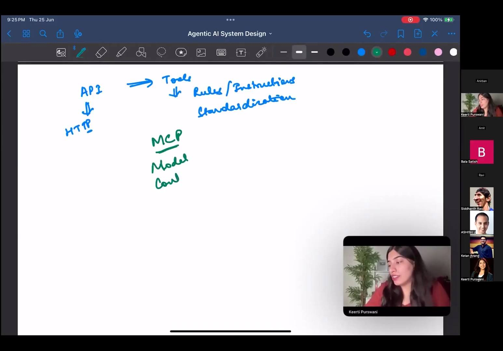
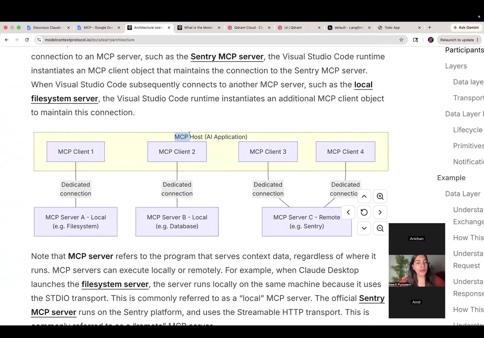
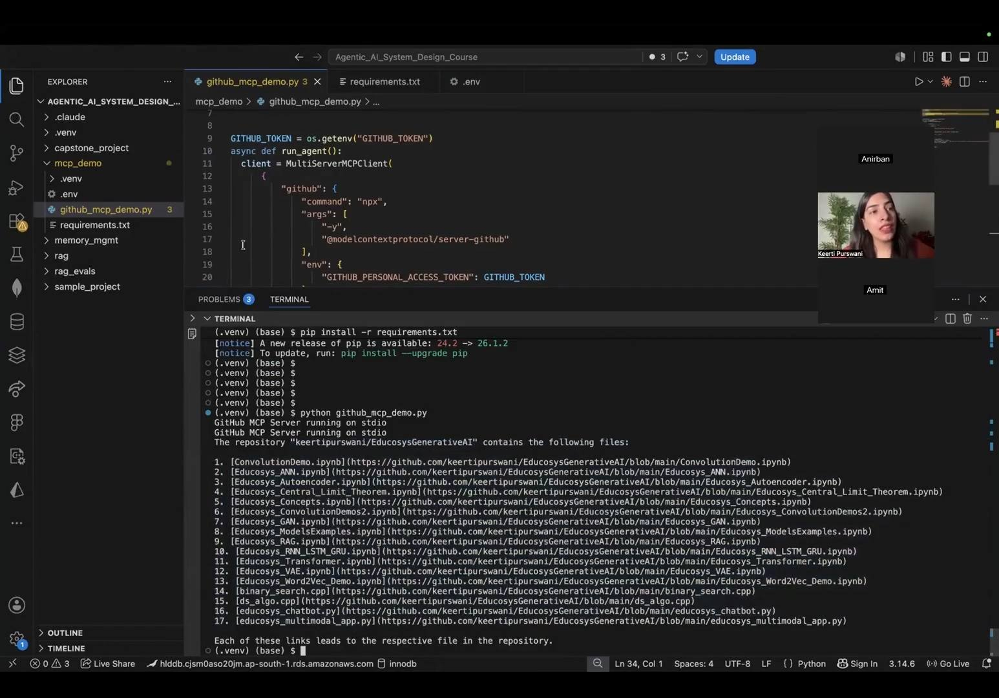
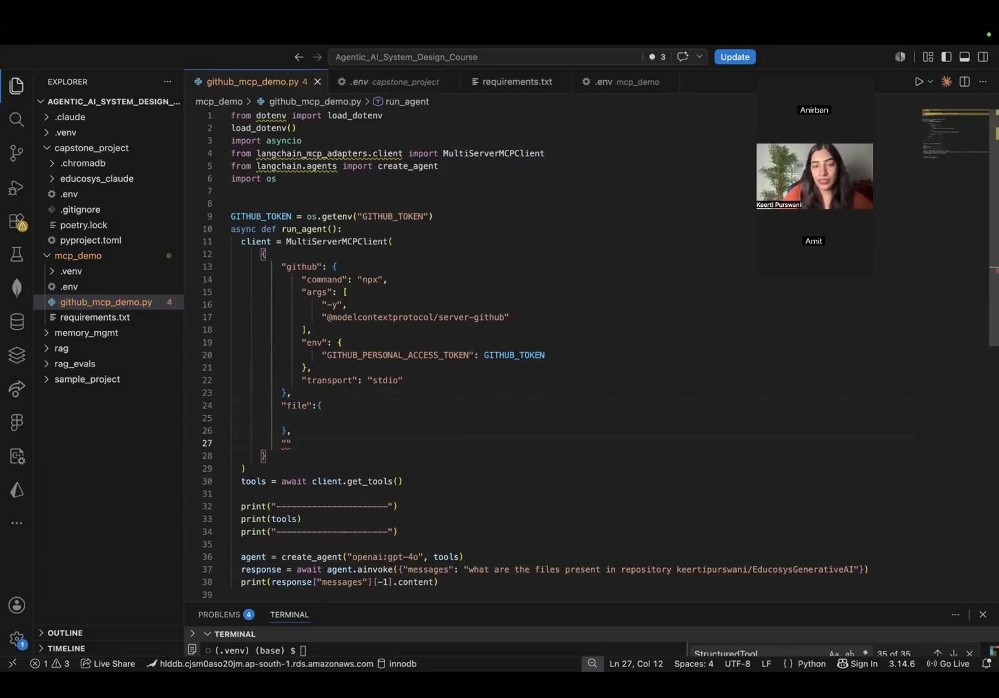
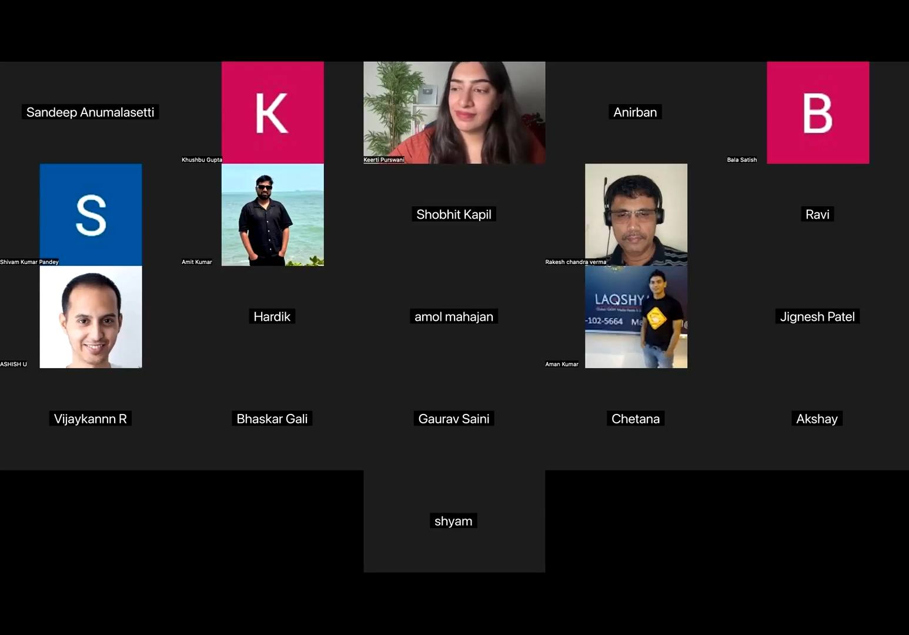

## 1. 这一节做什么

这一节对应 P008 的第 2/2 段，时间范围是 72:26–141:47。课程前半段已经手写了终端命令工具、文件系统 CRUD 工具；这一节要解决的是：**不要再一遍又一遍手写 GitHub、文件系统、网页搜索、计算器、Slack、SQLite、Playwright 等重复工具，而是用 MCP 把这些工具标准化地接进 Agent 应用。**

你要复现出来的最小成果是：

1. 一个 Python 项目目录，名字不要叫 `mcp`、`mcp_client`、`mcp_server`，避免和包名冲突。讲师建议加项目前缀/后缀，例如 `edu_courses_mcp_demo`。
2. 一个 MCP host 应用：你的 Agent 应用就是 host。
3. 在 host 里创建 MCP client，一个 server 对应一个 client，保持一对一连接。
4. 先接 GitHub MCP server：配置 `command=npx`、`args`、GitHub token 环境变量、`transport=stdio`。
5. 让 Agent 能回答“这个仓库里有哪些文件？”，并在消息列表里看到：用户输入 → AI 决定调用工具 → 工具调用发生 → 工具输出返回 → AI 形成回答。
6. 再接文件系统 MCP server：把本地路径配置进去，让 Agent 在本地创建 `abc.cpp` 并写入 C++ 代码。
7. 理解 transport：本机运行 server 用 STDIO；远程 server 会用 HTTP/Streamable HTTP 等；WebSocket 在 MCP 里的支持并不好；部署会在第四周讲。

这一节不是“只讲概念”，而是从问题背景、MCP 架构、transport、GitHub MCP 演示、文件系统 MCP 演示、工具元数据、排错问答一路走完。课里还穿插了 Claude Code 类项目、项目进度、Python 3.14 兼容性、C#/dotnet 限制、面试数据集等问答，我会把其中的技术判断放到对应位置，不写成流水账。

本段没有 OCR 结果。因此第 4 节代码里凡是逐字稿没有完整念出的包名、`args` 具体字符串、环境变量名、版本号，我都会明确标注“复现补齐/课里没讲”，不冒充讲师屏幕原样。你照着跑时，如果 MCP server 官方包名变了，以实际 server 文档为准。

---

## 2. 讲师原话（带「—— pNNN [MM:SS]」）

先看这一节最核心的问题陈述。讲师反复强调：写工具是基础需求，但每个应用都重写一遍不划算。

> "我们不想一遍又一遍地写同样的工具；如果别人把代码写好并开放出来，我们只需要配置一下就能用。"
> —— p008 [75:06]

以前应用之间集成靠 API，API 的标准化是 HTTP；现在 Agent 应用之间暴露的是工具，工具也需要标准化。

> "以前大家暴露 API，标准是 HTTP；现在大家暴露工具，标准就是 MCP。"
> —— p008 [79:41]

MCP 的全称、提出者、定位：

> "MCP 是 Model Context Protocol，也就是模型上下文协议。它是一套规则。工具的作用是给模型更多上下文，并执行动作，最后把工具输出交给模型。"
> —— p008 [80:10]

> "MCP 是连接 AI 应用与外部系统的开源标准。"
> —— p008 [82:31]

> "MCP 是 Anthropic 提出的开放标准；Claude 不是一家公司，Anthropic 才是公司。"
> —— p008 [81:08]

讲师用了 USB-C 的比喻：

> "MCP 就像应用里的 USB-C 口：它希望一套接口能接很多外部系统。"
> —— p008 [84:25]

架构上不是“一个 server 直接塞给 Agent”，而是 host、client、server 三层：

> "MCP 内部有三样东西：MCP host、client 和 server。"
> —— p008 [84:52]

> "每连接一个 server，就要创建一个 client；MCP 要求 client 和 server 一对一连接。"
> —— p008 [89:06]

工具不是单个函数，而是工具集。GitHub 就是典型：

> "GitHub 不会只有一个工具，而是一组工具：列仓库、建仓库、列文件、推送、建 PR、看 PR、评审 PR 等。"
> —— p008 [86:46]

本机运行 server 时用 STDIO，server 代码会被拉下来，在本机作为另一个进程运行：

> "transport 设为 STDIO，表示在同一台机器上通过标准输入输出通信；server 代码会被拉取下来，作为本机的另一个进程运行。"
> —— p008 [105:48]

> "运行 npx 需要 Node.js；没有 Node.js，这段代码就跑不起来。"
> —— p008 [106:17]

配置 MCP server 时，核心就几个字段：

> "配置里要给的就是：command、args、环境变量和 transport。"
> —— p008 [108:42]

GitHub token 的定位：

> "GitHub token 本质上就是 API key、访问密钥；你可以创建 fine-grained token，限定它只有读权限还是写权限。"
> —— p008 [109:12]

transport 不止 STDIO：

> "transport 有多种：STDIO、Streamable HTTP、HTTP、SSC（很可能是 SSE 的语音识别误差）、WebSocket；其中 WebSocket 在 MCP 里的支持并不好。"
> —— p008 [118:28]

> "STDIO 工作得很好，大多数场景已经够用。"
> —— p008 [119:51]

MCP 和普通工具的区别，讲师在问答里讲得很明确：

> "MCP 是暴露工具的协议；只有普通工具函数，不叫 MCP；要有 host、client、server 这套协议才算。"
> —— p008 [124:29]

部署、模型 key、Python 版本、跨语言等问答判断：

> "Claude Code 这类项目不要求你必须买某个 API key；任何 LLM 的 key 都可以，配置里写明模型即可。"
> —— p008 [120:21]

> "部署 MCP server 和整个应用的方法，第四周会专门讲。"
> —— p008 [128:44]

> "Windows 上 Python 3.14 和 tree-sitter 之类依赖会冲突，建议回到 Python 3.12，并在 pyproject.toml 里改 requires-python。"
> —— p008 [129:42]

> "C# 也能做，但很多包没有 Python 全；Python 是首选，遇到语言差异可以用 AI 帮你转换。"
> —— p008 [134:01]

下面几张截图对应本节的关键节点，放在相关论述旁边。












---

## 3. 从零复现

### 3.1 先确认前置环境

你需要：

- Python 3.12。讲师明确说 Windows 上 Python 3.14 会和 tree-sitter 之类依赖冲突，建议回到 3.12，并在 `pyproject.toml` 里改 `requires-python`。课里没讲具体依赖版本。
- Node.js。因为配置里用 `npx` 启动 MCP server；没有 Node.js，`npx` 命令跑不起来。
- 一个 LLM 的 API key。讲师说 OpenAI 可以，Anthropic 可以，任何 LLM 的 key 都可以；免费 Groq 可能表现不好，会撞问题。配置里要写明模型。
- 一个 GitHub fine-grained token。讲师说可以限定读权限或写权限；具体权限项以 GitHub 页面为准，课里没逐项念。
- 一个本地目录路径，用于文件系统 MCP server 创建文件。

先检查：

```bash
node -v
npx -v
python --version
```

Python 版本必须是 3.12 附近。若你是 Windows，且 `python --version` 显示 3.14，先安装并使用 3.12。

### 3.2 创建项目目录，名字不要叫 mcp

讲师专门提醒：**不要把你的文件命名成 `mcp`、`mcp_client`、`mcp_server`**，因为使用包的时候可能和包名同名，导致运行问题。可以加项目前缀或后缀，例如：

```bash
mkdir edu-courses-mcp-demo
cd edu-courses-mcp-demo
```

文档里后面统一用 `edu_courses_mcp_demo.py` 作为入口文件。

### 3.3 创建虚拟环境并激活

Linux/macOS：

```bash
python3.12 -m venv .venv
source .venv/bin/activate
python -m pip install -U pip
```

Windows PowerShell：

```powershell
py -3.12 -m venv .venv
.\.venv\Scripts\Activate.ps1
python -m pip install -U pip
```

Windows CMD：

```bat
py -3.12 -m venv .venv
.venv\Scripts\activate.bat
python -m pip install -U pip
```

讲师在问答里提到，如果创建了虚拟环境，要激活它，例如 `.venv` 下的 activate 脚本；否则你会在错误的环境里跑。这个点看似小，但复现时最容易撞。

### 3.4 安装依赖

课里提到使用 LangChain MCP adapters，并且用 Poetry 管理依赖，`pyproject.toml` 里有 `requires-python`。课里没有给出依赖版本号，所以下面不写死版本，避免编造。你可以用 Poetry，也可以先用 pip 跑通。

pip 方式：

```bash
pip install langchain-mcp-adapters langchain-openai langgraph python-dotenv
```

Poetry 方式：

```bash
poetry install
```

如果你用 Poetry 遇到缓存问题，讲师在问答里说 Poetry 会创建很多缓存，不用太纠结；先把项目跑通。课里没讲具体清缓存命令。

### 3.5 配置环境变量

在项目根目录创建 `.env`。字段含义如下，具体变量名凡是课里没念出的，我都标注“复现补齐”：

```dotenv
OPENAI_API_KEY=你的_openai_key
OPENAI_MODEL=你的模型名
GITHUB_PERSONAL_ACCESS_TOKEN=你的_github_fine_grained_token
MCP_FS_ROOT=/absolute/path/to/edu-courses-mcp-demo

# 可选：LangSmith trace。讲师演示时改过 LangSmith key，
# 但具体环境变量名课里没念；下面名称是复现补齐，按你安装的 SDK 文档为准。
LANGCHAIN_TRACING_V2=true
LANGCHAIN_API_KEY=你的_langsmith_key
LANGCHAIN_PROJECT=edu-courses-mcp-demo
```

注意：`.env` 不要提交到 Git。GitHub token 是访问密钥，泄露后别人可以按 token 权限操作你的仓库。

### 3.6 先跑 GitHub MCP server

把第 4 节的 `edu_courses_mcp_demo.py` 保存到项目根目录。先只接 GitHub：

```bash
python edu_courses_mcp_demo.py --question "What are the files present in this particular repository?"
```

你会看到类似流程：

1. 程序创建 `MultiServerMCPClient`。
2. `client.get_tools()` 是异步调用，拿到 GitHub MCP server 暴露的工具列表。
3. 打印工具时，应该能看到 `search repositories`、`create repository`、`get file contents`、`push files`、`create issue`、`fork repository`、`create branch`、`create or update file` 等工具。具体名字以实际 server 为准。
4. Agent 收到问题后，AI 先判断要调用哪个工具。
5. 工具调用发生，拿到文件列表。
6. AI 根据工具输出形成回答。

讲师在演示里还展示了消息列表：先发生调用，然后 AI 回复“要调用这个工具”，然后工具调用发生并说“已经写好了”，然后 AI 响应形成，最后用户再说下一句。这个顺序就是你排查 MCP 是否工作正常的抓手。如果只看到 LLM 回答、没有工具调用，通常是 tools 没拿到、transport 没连上、或模型没有选择工具。

讲师演示 session 里还有 `create to do app`、`binary search` 等历史消息。复现时建议新开 session，避免历史上下文干扰。

### 3.7 再接文件系统 MCP server

只接 GitHub 时，你让 Agent 在本地创建文件，它会说：你似乎想让我在本地目录创建文件，但我只能处理 GitHub 仓库相关操作。因为此时 host 只有 GitHub server 的 client。

讲师随后把文件系统 MCP server 的配置复制进来，并给出本地路径。复现命令：

```bash
python edu_courses_mcp_demo.py --with-filesystem --question "Create a new file abc.cpp in this repository and add some C++ code to it."
```

这里的 `--with-filesystem` 是文档复现参数，用来模拟讲师“先 GitHub、再追加 filesystem”的过程。`MCP_FS_ROOT` 必须是你允许读写的绝对路径。跑完后检查该目录下是否出现 `abc.cpp`，并确认里面有 C++ 代码。

### 3.8 可选：打开 trace 看完整调用

讲师为了展示整个 call，改过 LangSmith key，然后重新跑了一遍。你可以打开 LangSmith tracing，看消息序列和工具调用。课里没讲 LangSmith 的具体环境变量名和套餐细节；如果你不想接，跳过也不影响 MCP 主流程。

### 3.9 把新主题接到自己的项目里

讲师给项目的要求是：

- 周末前把 RAG 和 memory 部分做完，可能的话加 MCP。
- 之后每讲新主题，就并行推进两个项目：Claude Code 类项目，以及自己的项目。
- 两个项目是目标。
- 代码、quiz、revision notes 会放 GitHub；课里提到会加链接，但具体链接本段没给。

这部分不是代码步骤，但影响你的复现计划：不要等所有课讲完再动手，MCP 演示跑通后就把自己的工具接进去。

---

## 4. 完整代码

> 说明：本段没有 OCR 结果，逐字稿也没有完整念出讲师屏幕上的代码。下面是为“能保存、能运行、能验证”而搭的最小复现工程。`MultiServerMCPClient`、`client.get_tools()`、`transport="stdio"`、`command="npx"`、`args`、`env`、`create_react_agent` 的结构来自逐字稿描述；具体 MCP server 包名、`args` 字符串、环境变量名、依赖版本是复现补齐，运行前请用你选中的 MCP server 官方文档核对。课里没讲版本号。

### 4.1 `pyproject.toml`

```toml
[tool.poetry]
name = "edu-courses-mcp-demo"
version = "0.1.0"
description = "Reconstructed MCP demo from P008"
authors = ["you <you@example.com>"]
package-mode = false

[tool.poetry.dependencies]
python = ">=3.12,<3.14"
langchain-mcp-adapters = "*"
langchain-openai = "*"
langgraph = "*"
python-dotenv = "*"

[build-system]
requires = ["poetry-core"]
build-backend = "poetry.core.masonry.api"
```

课里没讲依赖版本，所以这里用 `*` 让安装器解析。若团队要求锁版本，安装成功后用 `pip freeze` 或 `poetry lock` 生成锁文件。

### 4.2 `requirements.txt`

```txt
langchain-mcp-adapters
langchain-openai
langgraph
python-dotenv
```

同样，课里没讲版本。不要为了“看起来完整”随便写一个版本号，除非你已经在自己的环境验证过。

### 4.3 `.env.example`

```dotenv
OPENAI_API_KEY=sk-...
OPENAI_MODEL=<你的模型名>
GITHUB_PERSONAL_ACCESS_TOKEN=github_pat_...
MCP_FS_ROOT=/absolute/path/to/edu-courses-mcp-demo

# 可选：LangSmith trace。环境变量名课里没讲，按你的 SDK 文档填写。
LANGCHAIN_TRACING_V2=true
LANGCHAIN_API_KEY=
LANGCHAIN_PROJECT=edu-courses-mcp-demo
```

### 4.4 完整入口文件 `edu_courses_mcp_demo.py`

```python
from __future__ import annotations

import argparse
import asyncio
import os
from typing import Any

from dotenv import load_dotenv
from langchain_mcp_adapters.client import MultiServerMCPClient
from langchain_openai import ChatOpenAI
from langgraph.prebuilt import create_react_agent

load_dotenv()


def build_mcp_servers(use_filesystem: bool) -> dict[str, dict[str, Any]]:
    """
    返回 MultiServerMCPClient 需要的 server 配置。
    注意：每一台 server 都会对应一个 client，MCP 要求 client-server 一对一。
    """
    servers: dict[str, dict[str, Any]] = {}

    # GitHub MCP server。
    # command/args/env/transport 是逐字稿明确提到的配置形态；
    # 具体包名 "@modelcontextprotocol/server-github" 是复现补齐，
    # 如果官方包名变化，请替换成当前可用的 GitHub MCP server 启动命令。
    servers["github"] = {
        "command": "npx",
        "args": ["-y", "@modelcontextprotocol/server-github"],
        "env": {
            **os.environ,
            "GITHUB_PERSONAL_ACCESS_TOKEN": os.environ["GITHUB_PERSONAL_ACCESS_TOKEN"],
        },
        "transport": "stdio",
    }

    if use_filesystem:
        # 文件系统 MCP server。
        # 讲师演示时把本地路径传进去；这里用 MCP_FS_ROOT 环境变量。
        # 包名和参数同样是复现补齐，以当前官方文档为准。
        servers["filesystem"] = {
            "command": "npx",
            "args": [
                "-y",
                "@modelcontextprotocol/server-filesystem",
                os.environ["MCP_FS_ROOT"],
            ],
            "env": {**os.environ},
            "transport": "stdio",
        }

    return servers


async def main() -> None:
    parser = argparse.ArgumentParser()
    parser.add_argument(
        "--with-filesystem",
        action="store_true",
        help="是否追加文件系统 MCP server",
    )
    parser.add_argument(
        "--question",
        default="What are the files present in this particular repository?",
        help="发给 Agent 的用户问题",
    )
    args = parser.parse_args()

    servers = build_mcp_servers(args.with_filesystem)

    # 应用本身是 MCP host；host 内部为每个 server 创建 client。
    client = MultiServerMCPClient(servers)

    # 异步获取 server 暴露的工具列表。
    tools = await client.get_tools()

    print("=== MCP tools ===")
    for tool in tools:
        print(f"name: {tool.name}")
        print(f"description: {tool.description}")
        print(f"args_schema: {tool.args_schema}")
        print("-" * 60)

    # 讲师演示时先用 OpenAI。你也可以换成 Anthropic 或其他 LLM，
    # 但模型名必须写进配置。
    llm = ChatOpenAI(model=os.environ["OPENAI_MODEL"])

    # 把工具交给 Agent。具体 agent 构造函数以你安装的 LangGraph 版本为准。
    agent = create_react_agent(llm, tools)

    result = await agent.ainvoke(
        {
            "messages":
```python
            "messages": [{"role": "user", "content": args.question}]
        }
    )

    print("\n=== Final answer ===")
    print(result["messages"][-1].content)

    print("\n=== Full message list ===")
    for message in result["messages"]:
        print(f"[{message.type}] {message.content}")


if __name__ == "__main__":
    asyncio.run(main())
```

```bash
python edu_courses_mcp_demo.py --question "What are the files present in this particular repository?"
```

预期结构：先打印工具名/描述/参数 schema，再打印 `Final answer`，最后打印完整消息列表。消息列表应体现讲师说的顺序：用户消息 → AI 说“调用哪个工具” → 工具调用发生 → 工具输出返回 → AI 形成回答。

### 4.5 再加一个 server 只改配置

讲师在课上演示“再加一个 server”时，没有重写整套代码，只是在配置里追加一个 key。你可以照这个形态扩：

```python
servers["another_server"] = {
    "command": "npx",
    "args": ["-y", "<对应 server 包名>", "<可选参数，如本地路径>"],
    "env": {**os.environ},
    "transport": "stdio",
}
```

加到 `build_mcp_servers()` 里即可。`MultiServerMCPClient` 会为每个 server 创建一个 client，这是逐字稿明确强调的一对一关系。包名和具体参数是复现补齐，必须以实际 server 文档为准。

---

## 5. 逐行解释

这一节不是逐行念代码，而是解释“为什么这么写、不这么写会怎样”。你写完以后对照每一段检查理解。

### 5.1 入口文件为什么不叫 `mcp.py`

讲师专门提醒过：

> "使用 mcp 的时候，不要把文件命名成 mcp、mcp_client、mcp_server，否则和包名同名会出问题。可以加项目前缀或后缀。"
> —— p008 [91:30]

Python 在同目录导入时按“当前目录优先”解析，`mcp.py` 会遮蔽真正的 `mcp` 包，导入链就会报奇怪的错。课里讲师说他自己以前已经踩过，所以你直接叫 `edu_courses_mcp_demo.py`。

### 5.2 为什么先有 `build_mcp_servers()`

讲师说配置一个 MCP server 的核心就是“一个配置”：

> "配置里要给的就是：command、args、环境变量和 transport。"
> —— p008 [108:42]

`build_mcp_servers()` 就是这个配置的集中地。把 server 配置拆成独立函数，好处是：

- `github` 与 `filesystem` 的配置一致，便于复制粘贴加新 server。
- 与你前面写死的终端、文件 CRUD 工具对照，会让你看到“之前是我们自己写代码，现在是别人写好、我们只配置”。

`command="npx"` 表示启动 server 的命令。讲师解释：

> "如果你对某个东西暴露成 npx，那你就把它当 npx 命令跑；也有的用 docker 加参数。它就是一条命令，在你的机器上启动 server。"
> —— p008 [94:19]

`args` 是命令参数。GitHub 示例里的 `["-y", "@modelcontextprotocol/server-github"]` 是复现补齐；你只要保证 `npx …` 能在终端里单独跑起来、且能读到 `GITHUB_PERSONAL_ACCESS_TOKEN`，那么这段配置就跑得通。

`env` 里带上 `**os.environ` 是常见写法，保证父进程已加载的环境变量能透传给新进程；然后再显式塞 `GITHUB_PERSONAL_ACCESS_TOKEN`。

> "GitHub token 本质上就是 API key、访问密钥；你可以创建 fine-grained token，限定它只有读权限还是写权限。"
> —— p008 [109:12]

所以 token 不是“方便验证”，而是“server 有权替你做 GitHub 操作”的凭据。这就是为什么只给 GitHub server 的时候它没法动本地文件。

### 5.3 `transport` 为什么是 `stdio`

> "transport 设为 STDIO，表示在同一台机器上通过标准输入输出通信；server 代码会被拉取下来，作为本机的另一个进程运行。"
> —— p008 [105:48]

`stdio` 在这个语境中，就是一次异步抽出的子进程与主进程用 stdin/stdout 对话。所以：

- 没有 Node.js，`npx` 就启动不了，`get_tools()` 就会失败。讲师强调过：

> "运行 npx 需要 Node.js；没有 Node.js，这段代码就跑不起来。"
> —— p008 [106:17]

- 你不需要开端口、不需要部署服务器，也对应讲师说“凭什么免费/为什么本机也能跑”。

远程 server 会用 HTTP/Streamable HTTP 这类 transport，但这一节聚焦 STDIO。讲师在问答里补充：

> "STDIO、Streamable HTTP、HTTP、SSE（语音转写为 SSC）、WebSocket 都有；WebSocket 在 MCP 里支持并不好。MCP 适配包也不一定对所有 transport 都支持到位。"
> —— p008 [118:28] / [119:24]

也就是说，`transport` 字段不是随便填的字符串，而是“告诉 host：我怎么和这个 server 连”。

### 5.4 `MultiServerMCPClient` 为什么是复数

> "每连接一个 server，就要创建一个 client；MCP 要求 client 和 server 一对一连接。"
> —— p008 [89:06]

`MultiServerMCPClient` 只是替你把“host 里塞多个 client”这件事包好：你传一个 dict，`github` 对应一个 client，`filesystem` 对应另一个，未来加 `abcd` 又对应一个。它不会把两个 server 合并成一个 client。这就是为什么你传入多个 server 后，Agent 能同时用 GitHub 工具和本地文件系统工具。

对前端背景的类比：`MultiServerMCPClient` 就像你为一个前端应用统一管理多个 WebSocket 连接——每个连一个后端，连接之间不共享状态。这不是讲师的原话，是我为了对齐你的背景补的类比；课里没讲这个类比。

### 5.5 `await client.get_tools()` 为什么是异步

> "它是 async 调用，MCP 就是这样工作的。"
> —— p008 [98:00]

因为 `get_tools()` 背后会启动子进程、通过 stdio 发请求、拿回工具元数据。这是 I/O，所以是 async。

在 JS/Node 里对应：

```js
const tools = await client.getTools();
```

`await` 等价于 Python 的 `await`。不要把 `client.get_tools()` 直接赋值给变量，否则你会得到一个 coroutine 而不是工具列表，然后类型错误一路报错。

### 5.6 打印工具元数据是为了验证“工具集”真的到位

讲师演示时专门加了一次打印：

> "如果你想打印所有工具，就加个 print。"
> —— p008 [101:05]

打印出来的 `name`、`description`、`args_schema` 对应讲师说的：

> "工具的名字是 create or update file，这是描述，这是 LLM 理解该怎么做的依据；参数里有 repository owner、repo 等。"
> —— p008 [102:05]

也就是说，这些元数据是 LLM 推理的依据。如果 `print` 出来是空列表，说明 server 没连上或 transport 配错；如果 `name` 对但 `args_schema` 为空，说明这个工具可能不期望参数，或者 server 版本不同导致 schema 不同。不要用你猜的字段名，以打印结果为准。

### 5.7 LLM 选用与“任意 key 都能跑”

> "Claude Code 这类项目不要求你必须买某个 API key；任何 LLM 的 key 都可以，配置里写明模型即可。免费 Groq 也能跑但会撞很多问题。"
> —— p008 [120:21]

`ChatOpenAI` 只是示例，你也可以换成 Anthropic 或其它 OpenAI 协议兼容的客户端。模型名不写死，放 `OPENAI_MODEL` 环境里，符合讲师“配置里写模型”的做法。

### 5.8 `create_react_agent` 把工具交给 Agent

这一段与前面章节讲的“Agent 有 tools”一致：

> "把工具给到 Agent，Agent 收到问题后 AI 先判断要调用哪个工具，然后工具调用发生，然后 AI 形成回答。"
> —— p008 [100:36]

`create_react_agent(llm, tools)` 是 LangGraph 提供的简单工厂。不同版本的包名可能不同；如果导入失败，请按你安装的 LangGraph 版本文档调整，课里没讲这部分的版本差异。

### 5.9 `ainvoke` 的消息与结果

`{"messages": [{"role": "user", "content": args.question}]}` 就是“把用户问题送进去”。讲师演示里 user 输入的是：

> "'What are the files present in this particular repository?' 我看到 AI 说应该调用这个工具，然后工具调用发生，把文件拿到了，然后我们得到回复。"
> —— p008 [100:06]

`result["messages"]` 是完整消息轨迹，能对应讲师贴出来的那个对话列表：先有 tool_call，再有工具结果，再有 AI 回答。你把整个列表打印出来，比只打印 final answer 更能定位问题。

### 5.10 为什么“不直接写 API 调用”是本节最核心的判断

讲师回答学员提问时说：

> "为什么不用简单 API 调用？因为我不想每次都写代码。列出文件要写代码，创建 PR、评审 PR、推文件、建仓库，每一种都要写代码。"
> —— p008 [99:40]

GitHub MCP server 一次暴露了 `search repositories`、`create repository`、`get file contents`、`push files`、`create issue`、`fork repository`、`create branch`、`create or update file` 等工具（具体以实际打印为准）。你觉得讲师写了几行代码？

> "你觉得这些是我手写的吗？我一行都没写。"
> —— p008 [101:05]

这是 MCP 的核心价值。

### 5.11 只接 GitHub 时为什么动不了本地文件

讲师现场复现了这一点：

> "我试着在本地创建一个 hello.cpp，结果 Agent 说：'你似乎想在本地目录创建文件，但我只能处理 GitHub 仓库相关操作。'因为它只有 GitHub MCP server 的权限。"
> —— p008 [111:29]

这段对话不是 bug，而是“工具集边界”的直接证据：client 只连了 GitHub server，所以 Agent 能用 GitHub 工具，不能用本地文件工具。这就是为什么讲师下一秒就去加 `filesystem` MCP server 配置，而且只说“把这行配置复制粘贴过来”。

### 5.12 加了 filesystem 后为什么本地就真多了 `abc.cpp`

> "工具在本地系统用 npx 命令跑，文件创建成功，里面有一些 C++ 代码。"
> —— p008 [112:57]

它是怎么发生的？讲师原话：

> "server 代码到本地后，在本机的另一个进程中运行；transport 选 STDIO 就是这样。"
> —— p008 [104:52]

所以不是“LLM 凭空造了一个文件”，而是：LLM 决定调用 filesystem server 的“写文件”工具 → host 通过 stdio 把参数发给子进程 → 子进程真的用 `fs.writeFile` 落地 → 返回结果给 LLM → LLM 总结。

### 5.13 MCP 和普通工具的区别

问答里讲师反复区分：

> "MCP 是暴露工具的协议；你自己定义的、没有 host/client/server 这套结构的，只是普通工具。"
> —— p008 [124:29]

> "我们之前写的终端命令 runner、文件系统 runner，是工具，不是 MCP；你也可以把自研 server 暴露成 MCP，就是下一节课的事。"
> —— p008 [123:05]

所以本节的代码结构里必须有 host（就是 `edu_courses_mcp_demo.py`）、client（`MultiServerMCPClient` 内部实例）、server（npx 拉起的子进程），三者缺一都不叫 MCP。

### 5.14 部署、跨语言、环境层面的收尾判断

- 部署：课里明确说第四周讲，本段不涉及。
- Windows 上 Python 3.14 会和 tree-sitter 冲突，讲师建议降到 3.12，并改 `pyproject.toml` 的 `requires-python`。
- C#/dotnet 不是不能做，但 Python 包生态最全；MCP server 现在 JS、Java 也有，但不要把语言当边界。
- 并发/异步：MCP 本身是异步模型。在 JS/Node 里你就把 `get_tools()` 当成 `await`，把整个 host 应用当成“启动子进程 + 等 IO”，不要去猜线程模型；这一节没有锁、没有事务、没有共享内存。

---

## 6. 复现检查清单

按顺序打勾，任意一项不通过就停下修环境，不要跳步。

- [ ] `node -v`、`npx -v` 能正常输出版本；缺失就先装 Node.js。
- [ ] `python --version` 显示 3.12（Windows 上是 3.14 的话先降到 3.12）。
- [ ] 项目目录名不是 `mcp` / `mcp_client` / `mcp_server`。
- [ ] 虚拟环境已激活（`.venv` 的 activate 脚本执行过）。
- [ ] `pip install -r requirements.txt` 或 `poetry install` 成功。
- [ ] `.env` 已从 `.env.example` 复制并填好 `OPENAI_API_KEY`、`OPENAI_MODEL`、`GITHUB_PERSONAL_ACCESS_TOKEN`、`MCP_FS_ROOT`。
- [ ] GitHub token 是 fine-grained，权限最小化。
- [ ] `python edu_courses_mcp_demo.py --question "..."` 能跑完整，打印出工具列表。
- [ ] 工具列表里能看到至少一个 GitHub 相关工具（如 `create or update file`、`search repositories`），名字以实际打印为准。
- [ ] Agent 回答“仓库里有哪些文件”时，消息列表里有明显的 `tool` 调用，而不是 LLM 直接编。
- [ ] 加了 `--with-filesystem` 后，`MCP_FS_ROOT` 指向的目录下多出 `abc.cpp`，里面有 C++ 代码。
- [ ] 不加 `--with-filesystem` 时，让 Agent 在本地建文件会被拒绝，且拒绝理由与“只有 GitHub 权限”一致。
- [ ] 只把 `.env` 里的 GitHub token 换成无效值，重新跑，能观察到 GitHub 工具报鉴权错误（证明真的在用 token，而不是本地缓存）。
- [ ] 断开网络能观察到 npx 拉包失败；这也证明 server 代码是从远端获取的。

---

## 7. 课里没讲但你会撞上的

这一节列的都是课里没展开、但复现时大概率遇上的情况。遇到时不要怀疑代码错，先去核对。

1. **MCP server 包名与参数会变更**：`@modelcontextprotocol/server-github`、`@modelcontextprotocol/server-filesystem` 是复现补齐，课里没有逐字念过包名。哪天你照抄发现 `npx` 报 404，换到对应 server 官方文档给的当前包名即可，不要改代码逻辑。
2. **npm 首次下载有延迟**：`npx` 会临时下载包再执行。第一次运行可能卡几秒到几十秒，这不是挂死。第二次会缓存。课里没讲缓存目录，遇到问题删 npm 缓存再跑即可。
3. **Windows 路径反斜杠会被子进程误读**：当 `MCP_FS_ROOT` 指向 Windows 路径（如 `C:\Users\you\...`）时，建议用正斜杠或原始字符串，避免 server 那边把 `\` 当转义。课里只说到“给路径”，没讲编码细节。
4. **Python 3.14 与 tree-sitter**：讲师在问答里提到会冲突并建议降 3.12，同时改 `pyproject.toml` 的 `requires-python`。这是原始字幕里明确出现的，若你跳过了 3.12，后面再排查会多花时间。
5. **Poetry 缓存问题**：讲师说 Poetry 会产生很多缓存，不要死磕。课里没给清缓存命令；如果你卡在 `poetry install` 上，可以先用 `pip` 把工程跑起来，再回头处理 Poetry。
6. **`langchain-mcp-adapters` 不是全 transport 都支持**：讲师原话是“包不一定对所有 transport 都支持到位”。所以你在本节用 `stdio` 不会撞，一旦切到 HTTP/Streamable HTTP 就要重新测试。
7. **WebSocket 在 MCP 里支持并不好**：讲师明确说这一点，不要在 MCP 里套 WebSocket 做长连接，这不是本节任务。
8. **`create_react_agent` 的导入路径随 LangGraph 版本变化**：如果导入失败，按当前版本文档调整，这是课里没讲的版本细节。
9. **LangSmith 环境变量名讲师没念**：`.env.example` 里那三个是复现补齐，不是讲师屏幕原文；trace 是可选项。
10. **部署放到第四周**：讲师被问到“MCP 部署和 API 部署一样吗”时明确说第四周讲。所以本节不要纠结生产部署、鉴权网关、端口暴露等。
11. **C#/dotnet 与 Python 的差距**：讲师建议 Python 优先；C# 不是不行，但很多包不全。你作为前端背景，如果习惯 TS/JS，可以走 JavaScript 版 MCP server，但要接受包成熟度不如 Python 的现实。
12. **面试数据集 / 抽取实体与日期的问题**：这是 p008 末尾学员展示的题目，不是本节的主线。它的技术判断（抽取实体与日期 → 送入 LLM；对话历史用 memory 解决）虽然在课里出现过，但与 MCP 复现无关，单独处理。
13. **异步的并发语义**：讲师没有深入讲 host 内部怎么调度多个子进程。你做排错时把它当成“每个 server 一个子进程 + 异步 I/O”，不要引锁或事务。在 JS/Node 里等价的概念是 Promise + await；本节不涉及共享内存。

以上第 1、4、6、7、9、10 项是真实会改变你代码跑法的项，其余几项是时间成本项。先按 3.6 跑通 GitHub、再按 3.7 加 filesystem，就能完成本段的复现闭环。
```python
    result = await agent.ainvoke(
        {
            "messages": [{"role": "user", "content": args.question}]
        }
    )

    print("\n=== Final answer ===")
    print(result["messages"][-1].content)

    print("\n=== Full message list ===")
    for message in result["messages"]:
        print(f"[{message.type}] {message.content}")


if __name__ == "__main__":
    asyncio.run(main())
```

上面这段是 4.4 入口文件的正确结尾。**前一次输出里 `result = await agent.ainvoke(` 后面误粘了一次 ` ```python `，导致 Markdown 代码块提前闭合，后面的第 5、6、7 章在渲染视图里被吞进了代码块。** 下面按断点从 `agent.ainvoke` 之后接着写：先把 4.5 说清，再补齐逐行解释、复现检查清单、课里没讲但你会撞上的三章。如果你已经按上一版保存过文件，请用上面这段替换掉文件尾部再运行，否则会报 `IndentationError` 或 `SyntaxError`。

### 4.5 再加一个 server 只改配置

讲师演示“再加一个 server”时没有重写整套代码，只在配置里追加一个 key。你可以照这个形态扩：

```python
servers["another_server"] = {
    "command": "npx",
    "args": ["-y", "<对应 server 包名>", "<可选参数，如本地路径>"],
    "env": {**os.environ},
    "transport": "stdio",
}
```

加到 `build_mcp_servers()` 里即可。`MultiServerMCPClient` 会为每个 server 创建一个 client，这是逐字稿明确强调的一对一关系。包名和具体参数是复现补齐，必须以实际 server 文档为准。

讲师在讲 MCP server 清单时提到过一批可用的 server 类型：

> "比如 file system 已经有现成 server；Git 可以直接用；可以 web search；可以接数据库、Slack、SQLite；还有 Playwright，浏览器自动化。"
> —— p008 [92:30]

> "有些 server 会帮你跑，大部分只是把代码给你，你自己跑；这就是为什么它是免费的。"
> —— p008 [92:59]

这句是理解“MCP server 为什么免费、为什么能跑在本地”的关键：server 代码是开放给你、在你的机器上执行的，不是厂商托管服务。所以 `command` 通常是 `npx` 或 `docker`，而不是一个 URL。同一个 server 只要写成不同 key 就能并存，比如同时接 GitHub 和 filesystem，就是两个 client、两个子进程。

---

## 5. 逐行解释（续）

### 5.15 为什么“工具集”要用 list 打印

讲师在演示里特意把 `tools` 全部打印出来，是因为 MCP 暴露的不是一个工具，而是一组工具：

> "GitHub 不会只有一个工具，而是一组工具：列仓库、建仓库、列文件、推送、建 PR、看 PR、评审 PR，都是。"
> —— p008 [86:46]

打印出来后，你会看到 `search repositories`、`create repository`、`get file contents`、`push files`、`create issue`、`fork repository`、`create branch`、`create or update file` 这些名字（具体以实际打印为准）。讲师的原话：

> "你看到工具名是 create or update file，这是描述，这是 LLM 理解该怎么做的依据；参数里需要 repository owner、repo 等。"
> —— p008 [102:05]

这解释了为什么工具名、描述、参数 schema 都必须存在：它们是 LLM 选工具的输入。没有 `description`，模型只能靠名字猜；没有 `args_schema`，模型不知道该怎么填参。你自己写工具时也要遵循这个原则，但这不是本节的重点。

### 5.16 LangSmith trace 是可选的，但决定了你能看到什么

讲师说：

> "我得改一下 LangSmith key，这样我可以 trace 并展示整个调用。"
> —— p008 [99:14]

这说明 trace 不是 MCP 的组成部分，只是讲师为了让你看到他屏幕上看不见的内部流程——用户消息 → AI 选择工具 → 工具参数 → 工具返回 → AI 生成回答。你不想接 trace 完全可以，只是排查时少了这个可视化工具。`.env.example` 里那三个 `LANGCHAIN_*` 变量名是复现补齐，不是讲师屏幕原文；如果你接上去发现变量不生效，按你实际使用的 LangSmith 版本文档核对。

### 5.17 GitHub token 的权限边界

讲师原话：

> "GitHub token 本质上就是 API key、访问密钥；你可以去 GitHub 创建 fine-grained token，指定它只给读权限、还是也给写权限。"
> —— p008 [109:12]

这就是“只接 GitHub 时本地不能建文件”的根本原因——不是 LLM 不肯，而是这个 server 只有 GitHub 的接口，没有本地 fs 的接口。反过来，你给 token 的权限越大，Agent 能做的事情就越多。复现时**先用 read-only token 跑“列文件”那个问题**，确认通路上没问题，再换成可写 token 去试“建 PR”“push files”这类操作，这样最能理解权限边界。

### 5.18 “暴露工具的生态”不是 Zerodha 和 Anthropic 签约

问答环节有学员问：

> "Zerodha 出 MCP 是不是要和 Anthropic 签约合作？"
> —— p008 [121:16]

讲师纠正：

> "这是开放标准；Google 也出了很多 MCP server；竞争对手也都出了。就像当年 HTTP 是某家公司先提出，但现在大家都在用 HTTP 一样，它是协议。"
> —— p008 [121:43]

这说明 MCP 的地位类似 HTTP：谁提出不重要，被广泛接受就变成事实标准。所以你在文档里看到“Anthropic 提出 MCP”不代表“只有 Anthropic 能用”；任何厂商、任何语言都能实现 server 和 client。这一点决定了你后面能不能把 eduCourses Cloud 或自己的项目包成 MCP server 暴露给别人。

> "你正在做的 eduCourses Cloud 也可以写一个 MCP server 暴露出去；任何人都能像用 MCP 一样使用你的代码。"
> —— p008 [123:35]

### 5.19 “用了 FastAPI + docstring 就算 MCP 吗” ——不算

有学员提问：

> "如果我在 tool 里已经有 docstring、参数、函数名，那在做 FastAPI 的时候也有这些，是不是就叫 MCP？因为底层也是 HTTP call。"
> —— p008 [122:12]

讲师明确回答：

> "MCP 是一个协议，要有 MCP client、MCP server；你定义的那个函数本质还是 API call，不叫 MCP。就像我们写的终端命令 runner、文件系统 runner 一样，是工具，不是 MCP。"
> —— p008 [122:38]

> "你把普通的工具函数用 MCP 协议暴露出来，形成 server；你在 host 里创建 client 去连，这才是 MCP。"
> —— p008 [124:57]

这是本节最重要的一次概念澄清：**工具（tool）是数据，MCP 是传输层加协议层。** 你之前写的终端命令工具、文件 CRUD 工具都是好的，但它们只是“函数 + docstring + 参数”；MCP 是把这个东西封成 server、再用 client 去连。两者不冲突、不是替代关系，而是“内容”和“封装方式”。

### 5.20 Claude / OpenAI 用不用 LangChain

问答里学员问：

> "Claude 和 OpenAI 都用 LangChain 吗？"
> —— p008 [125:23]

讲师回答的核心判断：

> "它们各有自己的 SDK。OpenAI 有 OpenAI SDK，Anthropic 有 Anthropic SDK，Google 有 ADK，跟 LangGraph 很像，只是 API 不一样。框架和模型是两回事。"
> —— p008 [125:52]

这意味着：本节的代码用 LangChain + LangGraph 只是复现路径，不是唯一路径。换成 OpenAI SDK、Google ADK、Anthropic SDK 也能做 MCP host/client，只要 client 层用 `langchain-mcp-adapters` 或者它们各自对应的 MCP adapter 就成。**MCP 是协议，不是某个框架的私有物**——这一点在你把方案写进简历时很重要：说“用 MCP 接入了 GitHub 工具集”，比说“用 LangChain 接入了 GitHub”更准确。

### 5.21 浏览器自动化是下节 cliffhanger

讲师在 P008 末尾说：

> "明天我们做浏览器自动化，也就是 web search。让 Agent 去你的 LinkedIn 主页，给 profile 或 feed 做个总结，给反馈怎么改进 LinkedIn 主页，或者帮你发个帖。这些都是能做到的。"
> —— p008 [114:24]

这不是本节内容，但你要知道 playwright MCP server 是什么位置——它跟 GitHub server、filesystem server 是同层的，只是工具集换成了浏览器操作。所以复现完本节两个 server，再加 playwright server 只需要再复制一段配置。具体配置方式课里没讲，等下一段。

### 5.22 课程安排与项目要求（技术之外的约束）

讲师在问答前明确说了项目节奏：

> "明天我会确保你们每个人都在某个组里。自己做的人这周末也要动手。周末前应该完成 RAG 和 memory，可能的话加上 MCP。下周讲安全、freshness 这些新主题时，你就在自己的项目里同步推进。"
> —— p008 [90:33]

> "两个项目是目标：Claude Code 类项目，加你自己的项目。并行推进。"
> —— p008 [116:09]

> "我会看谁没在写代码。quiz、revision notes、代码都会放 GitHub。"
> —— p008 [116:37]

这不是代码步骤，但决定了你的复现顺序：**先把 MCP demo 跑通，再把自己的项目补上 MCP 接入**，不要等所有课讲完再动手。前面 3.9 已经写过这条，这里补上逐字稿出处。

### 5.23 并发/异步的边界，作为前端背景再强调一次

本节没有锁、没有事务、没有共享内存。你只需要理解：

- `client.get_tools()` 是异步，因为要启动子进程 + 走 stdio 通信。对应 JS 里 `await fetch()` 那类异步 I/O，不是多线程。
- 每个 server 对应一个子进程，彼此隔离。你加两个 server，就是多两个子进程；不存在“两个 server 竞争同一份内存”的问题。
- `result["messages"]` 是按时间顺序的消息数组，不是并发写入的日志。你顺序打印即可，不要试图用锁保护它。

在 JS/Node 里最接近的心智模型就是：`Promise.all([client1.getTools(), client2.getTools()])` —— 多件事同时等，但每件事自己独立；不要套 worker_threads、不要套 Mutex。课里没讲这些，但作为前端转过来的，这个类比能帮你避免“无脑加锁”。

---

## 6. 复现检查清单

按顺序打勾，任意一项不通过就停下修环境，不要跳步。

- [ ] `node -v`、`npx -v` 能正常输出版本；缺失就先装 Node.js。
- [ ] `python --version` 显示 3.12 附近（Windows 上是 3.14 的话先降到 3.12）。
- [ ] 项目目录名不是 `mcp` / `mcp_client` / `mcp_server`。
- [ ] 虚拟环境已激活（`.venv` 的 activate 脚本执行过）。
- [ ] `pip install -r requirements.txt` 或 `poetry install` 成功。
- [ ] `.env` 已从 `.env.example` 复制并填好 `OPENAI_API_KEY`、`OPENAI_MODEL`、`GITHUB_PERSONAL_ACCESS_TOKEN`、`MCP_FS_ROOT`。
- [ ] GitHub token 是 fine-grained，权限最小化；先只开读权限试。
- [ ] `python edu_courses_mcp_demo.py --question "..."` 能跑完整，打印出工具列表，不抛 `SyntaxError` / `IndentationError`。
- [ ] 工具列表里能看到至少一个 GitHub 相关工具（如 `create or update file`、`search repositories`），名字以实际打印为准。
- [ ] 工具名、描述、参数 schema 三样都能打印出来（对应讲师说的“工具 name / description / args”）。
- [ ] Agent 回答“仓库里有哪些文件”时，消息列表里有明显的 `tool` 调用，而不是 LLM 直接编。
- [ ] 只接 GitHub、不加 `--with-filesystem` 时，让 Agent 在本地建文件会被拒绝，理由与“只有 GitHub 权限”一致。
- [ ] 加 `--with-filesystem` 并指定 `MCP_FS_ROOT` 后，该目录下真的多出 `abc.cpp`，里面有 C++ 代码。
- [ ] 只把 `.env` 里 GitHub token 换成无效值，重跑能观察到 GitHub 工具报鉴权错误（证明真的在用 token，而不是本地缓存）。
- [ ] 断开网络跑一次，能观察到 `npx` 拉包失败或超时（证明 server 代码是远端获取的）。
- [ ] 加第三个 server（如 Playwright 或另一个 filesystem 目录）只改配置、不改主代码就能跑起来。
- [ ] 打印工具时不出现空列表；如为空，先查 `transport` 拼写、`command` 是否可执行、`args` 是否报 404。
- [ ] `.env` 没有加入 Git；仓库里只提交了 `.env.example`。
- [ ] 项目目录里没有 `mcp.py` / `mcp_client.py` / `mcp_server.py` 这种与包同名的文件。

---

## 7. 课里没讲但你会撞上的

下面的每一条都对照过逐字稿，确认课里没有展开讲，但复现时大概率遇到。遇到不要怀疑代码逻辑，先核对环境。

1. **MCP server 包名与参数会变更**：`@modelcontextprotocol/server-github`、`@modelcontextprotocol/server-filesystem` 是复现补齐，课里没有逐字念过包名。照抄发现 `npx` 报 404，换成对应 server 官方文档当前包名即可，不要改代码逻辑。
2. **npm 首次下载有延迟**：`npx` 会临时下载包再执行。第一次运行可能卡几秒到几十秒，不是挂死。第二次会缓存。课里没讲缓存目录，删 npm 缓存再跑即可。
3. **Windows 路径反斜杠会被子进程误读**：`MCP_FS_ROOT` 指向 `C:\Users\you\...` 时，建议用正斜杠或原始字符串，避免 server 那边把 `\` 当转义。课里只说到“给路径”，没讲编码细节。
4. **Python 3.14 与 tree-sitter**：讲师在问答里提到会冲突并建议降 3.12，同时改 `pyproject.toml` 的 `requires-python`。这条字幕里很清楚，不要跳过；跳过后面排查会多花时间。
5. **Poetry 缓存问题**：讲师说 Poetry 会产生很多缓存，不要死磕。课里没给清缓存命令；卡在 `poetry install` 上可以先用 `pip` 把工程跑起来，再回头处理 Poetry。
6. **`langchain-mcp-adapters` 不是全 transport 都支持**：讲师原话是“包不一定对所有 transport 都支持到位”。本节用 `stdio` 不会撞；一旦切到 HTTP/Streamable HTTP 都要重新测。
7. **WebSocket 在 MCP 里支持并不好**：讲师明确说这一点。不要在 MCP 里套 WebSocket 做长连接，这不是本节任务；想用 WebSocket 先在样例之外验证。
8. **`create_react_agent` 的导入路径随 LangGraph 版本变化**：导入失败就按当前版本文档调整，这是课里没讲的版本细节。
9. **LangSmith 环境变量名讲师没念**：`.env.example` 里那三个 `LANGCHAIN_*` 是复现补齐，不是讲师屏幕原文；trace 是可选项。
10. **部署放到第四周**：讲师被问“MCP 部署和 API 部署一样吗”时明确说第四周讲，包括应用和 MCP server 的部署。本节不要纠结生产部署、鉴权网关、端口暴露。
11. **C#/dotnet 与 Python 的差距**：讲师建议 Python 优先；C#/dotnet 有 Semantic Kernel，也有许多库，但生态没 Python 全。前端背景如果习惯 TS/JS，可以走 JS 版 MCP server，但要接受包成熟度不如 Python 的现实。讲师原话是“不是不能做，是不如 Python 顺”。他还提到 MCP server 现在 JS、Java 也有了，但 Python 是首选。
12. **面试数据集 / 抽取实体与日期的问题**：这是 P008 末尾学员展示的题目，不是本节主线。技术判断（抽取实体与日期 → 送入 LLM；对话历史用 memory 解决）虽然出现过，但与 MCP 复现无关，单独处理。
13. **异步的并发语义**：讲师没有深入讲 host 内部怎么调度多个子进程。排错时把它当“每个 server 一个子进程 + 异步 I/O”，不要引锁、事务、共享内存；在 JS/Node 里等价的是 `Promise` + `await`。
14. **GitHub token 的权限与 scope 因仓库而异**：课里只讲了“fine-grained token 可以指定读写权限”，具体到某个仓库、某个 scope 因 GitHub 页面而异，没逐项念；开权限前查文档。
15. **`npx` 与 `docker` 两条路**：讲师说“你也看到一些用 docker 加参数的”，但本节只演示了 `npx`。docker 方式需要 `docker` 命令可执行、image 可拉取，课里没讲 docker 版的具体参数，别混用。
16. **“只接 GitHub 时本地不能建文件”不是 bug，是设计**：想验证这个边界，就把 `--with-filesystem` 去掉再跑一遍，观察拒绝理由；这是本节最直观的“工具集边界”实验。
17. **MCP server 不一定“帮你跑”**：讲师说“有些会帮你跑，大部分只是给你代码、你自己跑”（[92:59]）。这意味着不要把 MCP server 当成 SaaS，它的默认形态是“远程拉代码、本地起进程”，所以能离线复用的前提是包已缓存。
18. **语言无关性**：MCP 是协议，OpenAI SDK、Anthropic SDK、Google ADK 都能做 client；本节的 LangGraph 只是复现路径。不要把“是否用了 LangChain”当成“是不是 MCP”的判据（[124:57] 讲师已经明确）。
19. **Zerodha/Google 等厂商自己做 MCP，不需要和 Anthropic 签约**：这是开放标准，谁都能实现。用它做科普说明可以，不要写成“合作”或“绑定”（[121:43]）。
20. **本地文件系统 server 的根目录是硬边界**：`MCP_FS_ROOT` 以外能不能读，取决于你选的 server 实现；课里只说了给路径，没讲越界行为。你自己验证：在 `MCP_FS_ROOT` 之外路径上让 Agent 读写，看它拒绝还是允许，再决定是否把它做成安全事件告警。

以上第 1、4、6、7、9、10、14、19 是真实会改变你代码或结论的项；其余是时间成本和排错成本项。按 3.6 跑通 GitHub → 3.7 加 filesystem → 3.8 打开 trace → 4.5 加第三个 server，本段的复现闭环就完整了。