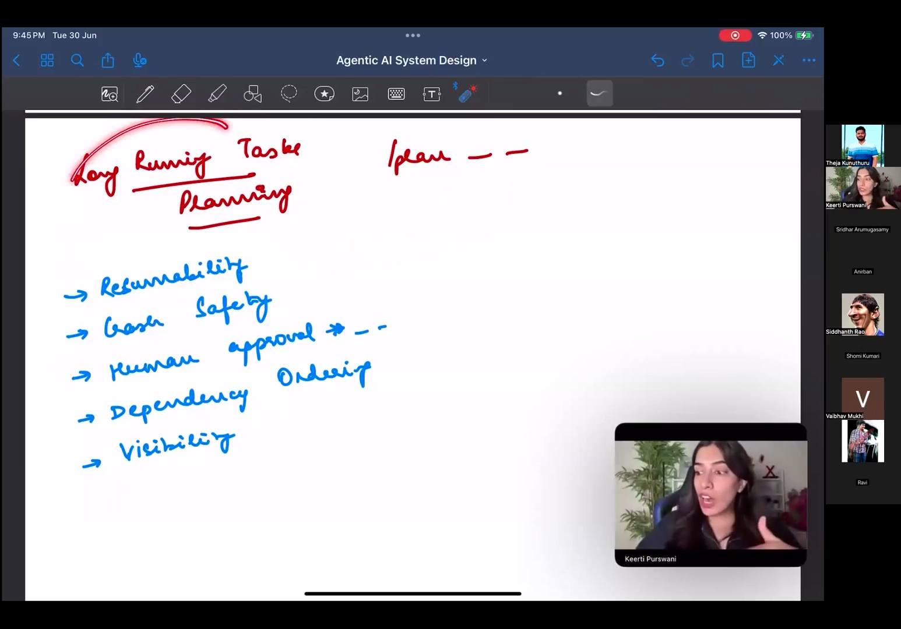
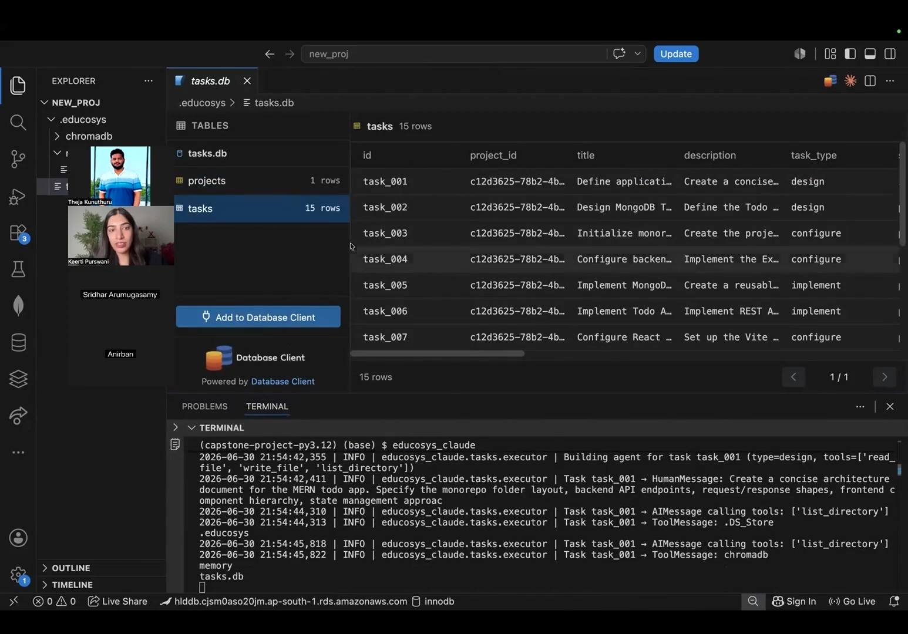
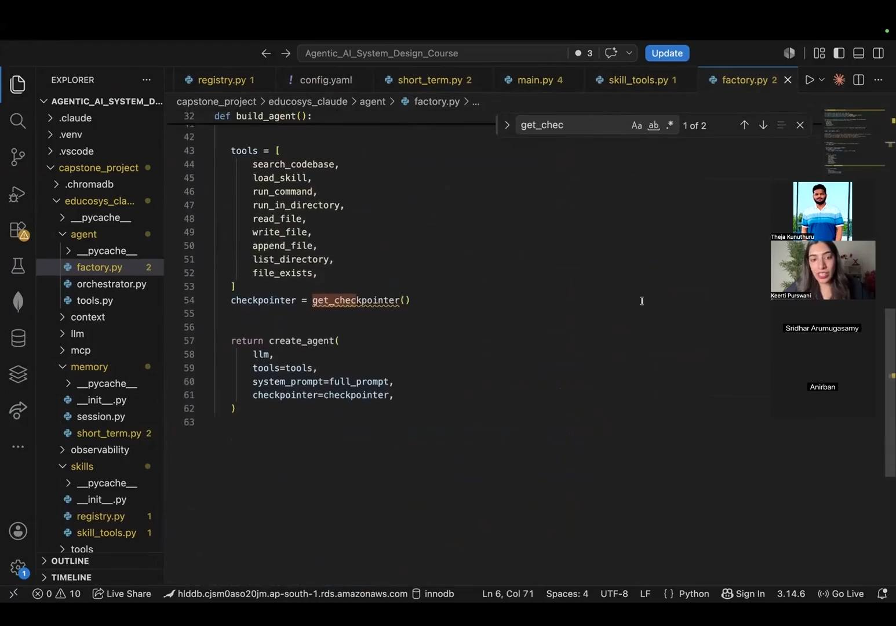

# Agentic AI System Design（P009）复现文档：Skills 内部实现 + 长时任务（Long-Running Tasks）架构

> 覆盖范围：P009（74:07–144:55，第 2/2 段）。
> 本段前半截把 Skills 从「概念」落到「代码里到底怎么加载、怎么渐进式披露」；后半截引入本课程最重要的新主题——长时任务（planning / resumability / crash safety），并现场跑了一个 15 步的计划执行 demo。最后 30 分钟是 Q&A，涉及 MCP stdio、skills 的 token 成本与安全、poetry/pipx、eval 与 prompt 版本管理。

---

## 1. 这一节做什么

这一节要交付两样东西，而且两样都是「能跑」的。

**第一样：一个 Skills 注册表（Skill Registry）+ 渐进式披露（progressive disclosure）链路。**
讲师在 P009 一开始就承认，很多框架（包括 Claude Code、deep agents）已经把 skills 做进产品里了，但课上要讲的是「框架内部必须发生什么」：项目里有一个 skills 目录，每个技能是一个子目录 + 一个 `skill.md`（YAML frontmatter 放 name / description / when_to_use，正文放完整指令，旁边可以放 scripts / templates / resources 这类可选文件）。EduCourses Cloud 启动时要**扫盘**，把所有技能解析成内存里的字典：`技能名 → {metadata, body, directory}`。然后只把 **name + description + when_to_use** 拼进 system prompt，把「按名字加载完整指令」做成一个**工具**丢给 agent。模型只有在判断当前请求命中某个技能时，才会调这个工具，把完整正文拉进上下文——这就是渐进式披露。章节末尾还做了一次目录结构收敛：以前 `.memory`、`.chroma_db` 散落在项目根目录，现在全部收进一个 `.educourses/`，skills 也放进去。

**第二样：长时任务（long-running tasks）的高层架构。**
目标体验是 `/plan 创建一个 to-do app`，系统先把需求拆成一份结构化计划（project_name / goal_summary / risks / tasks 列表），存进 SQLite 的 `task.db`，人工确认后按依赖顺序一步步执行，可以并行、可以重试、可以超时中断、中断后能从断点继续。讲师反复强调这是面试高频题：「你会怎么设计长时任务？」

这一节**不是纯讲解课**：讲师口述了 `load()`、`build_skills_prompt()`、`load_skill` 工具、`agent_factory` 的拼装方式、`main` 的 ask/plan 分流、task store 的职责。但**他并没有逐行把源码念出来**，源码只在他自己屏幕上。所以第 4 节给出的是一份**按讲师口述结构重建的参考实现**（可保存运行），凡是他没讲的字段/参数，代码注释与第 7 节都会标出「课里没讲」。


---

## 2. 讲师原话

先说清楚 skills 在磁盘上长什么样、在内存里长什么样：

> "现在当我们在代码里加载它时，我们会把它加载成字典形式：这是技能名，这是 metadata，这是 body，这是目录。这就是它在项目里的存在形式。"
> —— p009 [74:35]

> "在 load 里我们做什么？我们遍历目录、解析 skill.md，而且只调用一次，拿到 registry，然后加载它。如果目录不存在，我们就说它不存在；如果技能目录在，我们就拿到文件名、解析文件、拿到 metadata、body 和技能目录。"
> —— p009 [75:33]

有学员问「是不是每个 agent 都得自己实现 skills registry，框架不提供」，讲师的原话是：

> "我刚才已经给你看了，Sandeep。它就在 deep agent 里。我现在演示的是框架内部必须发生什么。"
> —— p009 [76:02]

工具层与渐进式披露的关系：

> "这个工具里发生了什么？我们在调用 registry，也就是按名字加载某个技能的完整说明。当用户请求匹配到系统提示里列出的某个技能时，就调用它。这就实现了渐进式披露。"
> —— p009 [79:19]

> "为什么只要 metadata？各位，这正是 skills 的核心概念——渐进式披露。"
> —— p009 [80:16]

> "我们加载什么？因为我们在做渐进式披露，一开始只把名字和描述这部分加进去。"
> —— p009 [82:06]

学员追问「技能的全文是不是只有相关技能被选中后才进 prompt」，讲师确认：

> "是的，最终就是这样。"
> —— p009 [82:36]

目录收敛的理由（把 `.memory`、`.chroma_db` 统一收进 `.educourses/`）：

> "与其建这么多独立文件夹，不如建一个 .educourses，里面的东西都由它来管。"
> —— p009 [86:52]

进入长时任务主题：

> "在面试里这真的会被问到，这是 agentic system design 里非常常见的问题：你会如何设计长时任务？"
> —— p009 [101:21]



> "要处理崩溃安全和可恢复性，我必须把状态持久化到某个地方。不，我不会用 checkpointer，我要把它实际存进 SQLite。"
> —— p009 [102:17]

> "在我的 main 里，我会判断这个 query 是 ask 还是 plan。如果是 ask，走 agent orchestrator；如果是 plan，走 task orchestrator。"
> —— p009 [104:10]

> "status 可以是 pending、in progress、completed，也可以是 failed，还可以是 blocked，等等。"
> —— p009 [105:06]

关于 skills 到底省不省 token：

> "skills 恰恰就是为这个场景造的，为的是用更少的 token。因为渐进式披露，token 数量会少很多。"
> —— p009 [118:17]

关于 eval：

> "evals 不只是 RAG evals，我们会覆盖完整的一套……也可以用 LLM 作为裁判。"
> —— p009 [131:08]

---

## 3. 从零复现

> **重要声明**：以下步骤里的**目录结构、配置文件键名、函数职责、分流逻辑、状态枚举**都来自讲师口述；**具体的类名、参数名、SQL 表结构、代码行**是重建的，因为逐字稿没有逐行念出源码。凡是讲师完全没提的细节，我在代码注释里写「课里没讲」。如果你只想要「课里讲了什么」，看第 5 节；想跑起来，照着这节做。

### 3.1 环境准备

需要：

- Python **3.11+**（代码里用了 `enum.StrEnum` 和 `X | None` 语法）
- Node.js 18+（只有在跑 MERN 项目、或者接 `npx` 类 MCP server 时才需要）
- 一个可用的 OpenAI API key（环境变量名 `OPENAI_API_KEY`）

```bash
mkdir educourses-cloud && cd educourses-cloud
python -m venv .venv
source .venv/bin/activate          # Windows: .venv\Scripts\activate
python -V                          # 必须是 3.11 及以上
export OPENAI_API_KEY=sk-你的key
```

课程里讲师的安装方式是 **poetry + pipx**，他说过 poetry 的依赖不在项目文件夹里，而在 poetry 的 cache 里，`poetry.lock` 才是锁版本的地方；`pipx` 的作用是把整个包装成一个命令行工具。你也可以用 `uv` 或裸 `pip`，效果一样：

```bash
# 方式 A：pip（最省事）
pip install -e .

# 方式 B：uv
uv venv && uv pip install -e .

# 方式 C：poetry（讲师用的）
poetry install
poetry run educourses plan "创建一个使用 MERN 的 to-do app"

# 方式 D：pipx（讲师用来把项目装成 CLI）
pipx install --editable .
```

### 3.2 目录结构（先建出来）

```
educourses-cloud/
├── pyproject.toml
├── config.yaml
├── .educourses/                     # 运行时产物全部收在这一个目录下
│   ├── skills/                      # 技能目录（讲师：in config.yaml put .educourses/skills）
│   │   └── frontend-design/
│   │       └── SKILL.md
│   ├── memory/                      # 短期记忆（checkpointer）落盘位置
│   ├── chroma_db/                   # 向量库（RAG 用，本节课没动）
│   └── task.db                      # 长时任务的 SQLite 库（demo 里能看到它被创建）
└── educourses/
    ├── __init__.py
    ├── config.py
    ├── llm.py
    ├── agent_factory.py
    ├── main.py
    ├── skills/
    │   ├── __init__.py
    │   └── registry.py
    ├── tools/
    │   ├── __init__.py
    │   ├── skill_tools.py
    │   └── shell.py
    ├── memory/
    │   ├── __init__.py
    │   └── short_term.py
    └── tasks/
        ├── __init__.py
        ├── models.py
        ├── store.py
        └── orchestrator.py
```

一条命令建目录：

```bash
mkdir -p educourses/{skills,tools,memory,tasks} .educourses/skills/frontend-design
touch educourses/__init__.py educourses/skills/__init__.py educourses/tools/__init__.py \
      educourses/memory/__init__.py educourses/tasks/__init__.py
```

### 3.3 写 config.yaml —— 这是「最后一块拼图」

讲师在 [84:04] 说得很直白：注册表的代码都写好了，**唯一还缺的是「skills 目录到底在哪」**，这个要放进 `config.yaml`。到 [87:21] 他又把 memory 和 chroma 的路径也一起收进 `.educourses`，所以最终配置文件里这三个路径必须同时存在。把下面的内容原样写到项目根目录的 `config.yaml`：

```yaml
home_dir: .educourses
skills_dir: .educourses/skills
memory_db_path: .educourses/memory/memory.db
chroma_db_path: .educourses/chroma_db
task_db_path: .educourses/task.db

llm:
  provider: openai
  model: gpt-4.1
  temperature: 0

task_runner:
  max_retries: 3
  timeout_seconds: 600
  max_parallel: 2
```

> 讲师原话是「in config.yaml you can put that in dot edu courses skills」，也就是 `skills_dir` 这一项必须存在，否则 `load()` 扫不到东西。`max_retries` / `timeout_seconds` 对应他在 [100:52] 说的「超时、重试次数，有很多可配置项」。

### 3.4 写第一个技能

讲师在 [83:06] 说，前一天那个 to-do app 的 UI 很糟糕，今天想用「一个前端设计的 skill」试试看它能不能做得更好。所以我们第一个技能就写前端设计。

新建 `.educourses/skills/frontend-design/SKILL.md`：

```markdown
---
name: frontend-design
description: 前端界面设计与实现规范，包含布局、配色、间距、可访问性与组件结构约定
when_to_use: 当任务需要新建或修改前端页面、组件、样式，或用户抱怨 UI 难看时使用
---

# Frontend Design

## 何时使用
只要任务涉及 HTML/CSS/React 组件的产出，就按本规范执行。

## 硬性规则
1. 间距只用 4 的倍数：4 / 8 / 12 / 16 / 24 / 32 / 48 / 64px。
2. 字号层级最多 4 级：12 / 14 / 18 / 24px，正文行高 1.6。
3. 颜色最多 1 个主色 + 1 个强调色 + 4 级中性灰，禁止出现纯黑 #000 与纯白 #fff 作为大面积底色。
4. 每个交互元素必须有 hover / focus-visible / disabled 三种状态。
5. 所有图片必须有 alt；所有表单控件必须有 label。
6. 移动端断点 768px，先写移动端样式再写桌面端。

## 需要出图时
运行 `scripts/shot.mjs`，用法：`node scripts/shot.mjs <页面路径> <输出png>`，
脚本会把截图路径打印到 stdout，把该路径原样返回给用户。
```

注意：`scripts/shot.mjs` 这个文件**课里没讲**要写什么内容，这里只是演示「技能目录里可以引用脚本，并把脚本路径写进 skill.md」——这正是 Q&A 里 [133:28] 讲师给的答案：在 skill.md 里写明「要跑哪个脚本、脚本在哪」，agent 读到之后就会用命令执行器去跑，把输出交回给 LLM。

### 3.5 建注册表：扫盘 → 字典

`educourses/skills/registry.py` 就是讲师说的「load 函数」：遍历目录、解析 `skill.md`、只加载一次、返回 registry。写完这个文件，你可以先用一行代码验证：

```bash
python -c "
from educourses.config import load_settings
from educourses.skills.registry import SkillRegistry
s = load_settings()
r = SkillRegistry(s.skills_dir)
print(r.load().keys())
print(r.build_skills_prompt())
"
```

预期能看到 `dict_keys(['frontend-design'])`，以及一段只包含 name / description / when_to_use 的提示词片段——**不含正文**。

### 3.6 把技能挂成工具 + 拼进 system prompt

两件事必须分开做，这正是讲师 [79:48] 强调的「保持模块化」：

1. `educourses/tools/skill_tools.py`：导出一个 `load_skill(skill_name)` 工具，内部调 registry，返回**完整指令**。
2. `educourses/agent_factory.py`：拼 system prompt 时**只拼 metadata**，然后把 `load_skill` 加进工具列表。

验证方式：

```bash
python -c "
from educourses.agent_factory import build_system_prompt
from educourses.config import load_settings
from educourses.skills.registry import SkillRegistry
r = SkillRegistry(load_settings().skills_dir); r.load()
print(build_system_prompt(r))
"
```

输出的 system prompt 里应该**看不到**「间距只用 4 的倍数」这些正文规则，只看到技能名和 when_to_use。

### 3.7 main 里做 ask / plan 分流

讲师 [104:10] 讲得很清楚：用户 query 进 main，main 判断是 `ask` 还是 `plan`，`ask` 走 agent orchestrator（就是现在这条链路），`plan` 走 task orchestrator（新东西）。所以我们把 CLI 做成两个子命令：

```bash
educourses ask "给这个项目的 README 补一段快速开始"
educourses plan "创建一个使用 MERN 的 to-do app"
educourses task-status
educourses plan --resume <plan_id>
```

### 3.8 task store：把计划落到 SQLite

讲师拒绝用 checkpointer 存任务状态，理由是要**看见**每条任务的状态、类型，而且崩溃后要能恢复。所以建 `educourses/tasks/store.py`，负责建表、写任务、读任务、按依赖挑出「现在能跑的」任务、更新状态、统计。

### 3.9 orchestrator：计划 → 审批 → 执行 → 重试/超时/并行

`educourses/tasks/orchestrator.py` 干这几件事：

1. 调 LLM，用**结构化输出**拿到 `Plan`（讲师 [106:01]：必须是一种固定格式，才能写进数据库）。
2. 校验依赖（有没有指向不存在的任务、有没有环）。
3. 打印计划，等人工批准（讲师 demo 里就是这一步，[110:30]）。
4. 落库，进入循环：每轮捞「依赖全部完成」的 pending 任务，最多 `max_parallel` 个，并发执行。
5. 单任务失败按 `max_retries` 重试，整体有 `timeout_seconds` 超时。
6. 全部跑完（或全部卡住）后，把依赖失败任务的后续任务标成 `blocked`。

### 3.10 跑起来，看它自己长出来

```bash
# 1) 让 agent 先干活（这条会用到 skills）
educourses ask "给我写一个 to-do app 的首页，用 React"

# 2) 走长时任务：生成计划 → 人工确认 → 逐步执行
educourses plan "创建一个使用 MERN 的 to-do app"

# 3) 中途 Ctrl-C 掉，看数据库里的状态
educourses task-status

# 4) 从断点继续（这就是 resumability）
educourses plan --resume <上一步打印出来的 plan_id>
```



---

## 4. 完整代码

> 文件路径与第 3 节目录树一致，逐个保存即可运行。再次提醒：这是**按讲师口述重建**的实现，逐字稿没有给出源码原文。

### 4.1 `pyproject.toml`

```toml
[project]
name = "educourses-cloud"
version = "0.1.0"
description = "EduCourses Cloud - agentic coding CLI with skills registry and long-running tasks"
requires-python = ">=3.11"
dependencies = [
    "pyyaml>=6.0.1",
    "pydantic>=2.7",
    "langchain>=1.0.0",
    "langchain-openai>=1.0.0",
    "langgraph>=1.0.0",
    "langgraph-checkpoint-sqlite>=2.0.0",
]

[project.scripts]
educourses = "educourses.main:cli"

[build-system]
requires = ["poetry-core>=2.0.0"]
build-backend = "poetry.core.masonry.api"
```

### 4.2 `config.yaml`

```yaml
home_dir: .educourses
skills_dir: .educourses/skills
memory_db_path: .educourses/memory/memory.db
chroma_db_path: .educourses/chroma_db
task_db_path: .educourses/task.db

llm:
  provider: openai
  model: gpt-4.1
  temperature: 0

task_runner:
  max_retries: 3
  timeout_seconds: 600
  max_parallel: 2
```

### 4.3 `educourses/config.py`

```python
"""读取 config.yaml，并把 .educourses 下所有目录建出来。

对应讲师 [84:04] 说的「最后一块拼图」：注册表代码写好了，
但 skills 目录在哪必须由 config 告诉它。
"""
from __future__ import annotations

from pathlib import Path

import yaml
from pydantic import BaseModel


class LLMSettings(BaseModel):
    provider: str = "openai"
    model: str = "gpt-4.1"
    temperature: float = 0.0


class TaskRunnerSettings(BaseModel):
    # 讲师 [100:52]：超时、重试次数都是可配置项
    max_retries: int = 3
    timeout_seconds: int = 600
    max_parallel: int = 2


class Settings(BaseModel):
    home_dir: str = ".educourses"
    skills_dir: str = ".educourses/skills"
    memory
```python
class Settings(BaseModel):
    home_dir: str = ".educourses"
    skills_dir: str = ".educourses/skills"
    memory_db_path: str = ".educourses/memory/memory.db"
    chroma_db_path: str = ".educourses/chroma_db"
    task_db_path: str = ".educourses/task.db"
    llm: LLMSettings = LLMSettings()
    task_runner: TaskRunnerSettings = TaskRunnerSettings()


def load_settings(config_path: str | Path = "config.yaml") -> Settings:
    """读配置，并把 .educourses 下所有目录一次性建出来。"""
    p = Path(config_path)
    raw = yaml.safe_load(p.read_text(encoding="utf-8")) if p.exists() else {}
    settings = Settings(**(raw or {}))

    # 讲师 [93:51] 现场踩过的坑：memory 目录不存在时程序直接报
    # 「educourses no such file on memory」，所以这里统一 mkdir。
    Path(settings.home_dir).mkdir(parents=True, exist_ok=True)
    Path(settings.skills_dir).mkdir(parents=True, exist_ok=True)
    Path(settings.memory_db_path).parent.mkdir(parents=True, exist_ok=True)
    Path(settings.chroma_db_path).mkdir(parents=True, exist_ok=True)
    Path(settings.task_db_path).parent.mkdir(parents=True, exist_ok=True)
    return settings
```

### 4.4 `educourses/llm.py`

```python
"""统一出口拿 ChatModel，避免每个模块各建一个客户端。"""
from __future__ import annotations

from functools import lru_cache

from langchain_openai import ChatOpenAI

from educourses.config import load_settings


@lru_cache(maxsize=1)
def get_llm() -> ChatOpenAI:
    s = load_settings()
    return ChatOpenAI(model=s.llm.model, temperature=s.llm.temperature)
```

### 4.5 `educourses/skills/registry.py`（讲师口中的 `load` 函数）

```python
"""技能注册表：扫盘 → 解析 skill.md → 得到 {技能名: Skill}。

对应讲师 [74:35]：「这是技能名，这是 metadata，这是 body，这是目录」
以及 [75:33]：「遍历目录、解析 skill.md，而且只调用一次」。
"""
from __future__ import annotations

from dataclasses import dataclass, field
from pathlib import Path

import yaml

SKILL_FILE = "skill.md"


@dataclass(frozen=True)
class Skill:
    name: str
    description: str
    when_to_use: str
    body: str
    directory: Path

    def load_instructions(self) -> str:
        """返回某个技能的【完整】内容，只在该技能被选中后才调用。"""
        header = (
            f"# Skill: {self.name}\n\n"
            f"when_to_use: {self.when_to_use}\n\n"
            f"skill_dir: {self.directory}\n\n"
        )
        return header + self.body


@dataclass
class SkillRegistry:
    skills_dir: str | Path
    _skills: dict[str, Skill] = field(default_factory=dict)
    _loaded: bool = False

    def load(self) -> dict[str, Skill]:
        if self._loaded:            # 只加载一次
            return self._skills

        root = Path(self.skills_dir)
        if not root.exists():
            # 讲师 [75:33]：「如果目录不存在，我们就说它不存在」
            raise FileNotFoundError(f"skills 目录不存在: {root}")

        for entry in sorted(root.iterdir()):
            if not entry.is_dir():
                continue
            md = self._find_skill_file(entry)
            if md is None:
                continue
            skill = self._parse(md, entry)
            self._skills[skill.name] = skill

        self._loaded = True
        return self._skills

    @staticmethod
    def _find_skill_file(directory: Path) -> Path | None:
        for f in directory.iterdir():
            if f.is_file() and f.name.lower() == SKILL_FILE:
                return f
        return None

    @staticmethod
    def _parse(path: Path, directory: Path) -> Skill:
        text = path.read_text(encoding="utf-8")
        meta: dict = {}
        body = text
        if text.startswith("---"):
            parts = text.split("---", 2)
            if len(parts) >= 3:
                meta = yaml.safe_load(parts[1]) or {}
                body = parts[2].lstrip("\n")
        return Skill(
            name=str(meta.get("name") or directory.name),
            description=str(meta.get("description", "")).strip(),
            when_to_use=str(meta.get("when_to_use", "")).strip(),
            body=body.strip(),
            directory=directory,
        )

    def get(self, name: str) -> Skill:
        self.load()
        if name not in self._skills:
            raise KeyError(f"未找到技能: {name}")
        return self._skills[name]

    def build_skills_prompt(self) -> str:
        """只拼【名字 + 描述 + 何时使用】——渐进式披露的关键。

        讲师 [80:44]：「我只是把 metadata、描述加进去，
        我加完整指令了吗？没有。」
        """
        self.load()
        if not self._skills:
            return ""
        lines = [
            "## 可用技能（下面只列名称与用途；"
            "命中时请先调用 load_skill 取得完整说明再动手）"
        ]
        for s in self._skills.values():
            lines.append(f"- **{s.name}**：{s.description}")
            lines.append(f"  - 何时使用：{s.when_to_use}")
        return "\n".join(lines)
```

### 4.6 `educourses/tools/skill_tools.py`（`load_skill` 工具）

```python
"""把「按名字取完整技能」暴露成一个工具。

讲师 [79:19]：「这个工具里发生了什么？我们在调用 registry，
也就是按名字加载某个技能的完整说明。当用户请求匹配到系统提示里
列出的某个技能时，就调用它。这就实现了渐进式披露。」
"""
from __future__ import annotations

from functools import lru_cache

from langchain_core.tools import tool

from educourses.config import load_settings
from educourses.skills.registry import Skill, SkillRegistry


@lru_cache(maxsize=1)
def get_registry() -> SkillRegistry:
    registry = SkillRegistry(load_settings().skills_dir)
    registry.load()
    return registry


@tool("load_skill")
def load_skill(skill_name: str) -> str:
    """按名字加载某个技能的完整说明。

    只有当用户请求匹配到系统提示里列出的某个技能时，
    才应该调用这个工具。
    """
    registry = get_registry()
    try:
        skill: Skill = registry.get(skill_name)
    except KeyError:
        available = ", ".join(registry.load().keys()) or "无"
        return f"未找到技能 {skill_name!r}。可用技能：{available}"
    return skill.load_instructions()
```

### 4.7 `educourses/tools/shell.py`（命令执行器，跑技能脚本靠它）

```python
"""命令执行器。

Q&A [133:00]：技能里引用的脚本，agent 必须有工具去跑，
否则「它不会跑，它只会说它没在跑」。这里就是那个工具。
"""
from __future__ import annotations

import subprocess

from langchain_core.tools import tool


@tool("run_command")
def run_command(command: str, cwd: str = ".") -> str:
    """在 cwd 目录执行一条 shell 命令，返回退出码与 stdout / stderr。

    command 示例： node scripts/shot.mjs ./index.html ./shot.png
    """
    try:
        proc = subprocess.run(
            command,
            shell=True,
            cwd=cwd,
            capture_output=True,
            text=True,
            timeout=300,
        )
    except subprocess.TimeoutExpired:
        return f"命令超时（300s）：{command}"

    out = (proc.stdout or "").strip()
    err = (proc.stderr or "").strip()
    return (
        f"exit_code={proc.returncode}\n"
        f"--- stdout ---\n{out}\n"
        f"--- stderr ---\n{err}"
    )
```

### 4.8 `educourses/memory/short_term.py`（含讲师那次的 bug 修复）

```python
"""短期记忆 checkpointer。

讲师 [90:07]–[93:51] 现场踩的坑：
agent_factory 里写的是 get_checkpointer()，而 short_term 里实际导出的是
get_checkpointer_db_path()，于是 import 直接报错。他当时的结论是
「两个都应该有」，所以这里两个名字都导出。
"""
from __future__ import annotations

import sqlite3
from functools import lru_cache

from langgraph.checkpoint.sqlite import SqliteSaver

from educourses.config import load_settings


@lru_cache(maxsize=1)
def get_checkpointer_db_path() -> SqliteSaver:
    """按 config 里的 memory_db_path 建 SQLite checkpointer。"""
    db_path = load_settings().memory_db_path
    conn = sqlite3.connect(db_path, check_same_thread=False)
    return SqliteSaver(conn)


@lru_cache(maxsize=1)
def get_checkpointer() -> SqliteSaver:
    """旧入口，保留兼容。"""
    return get_checkpointer_db_path()
```

### 4.9 `educourses/agent_factory.py`

```python
"""agent 工厂：拼 system prompt + 装配工具 + 决定要不要短期记忆。

讲师 [80:16]/[80:44]：
「在 factory 里我们做什么？构建技能提示。
用现有的 system prompt，把 skills 提示加进去。
我们不会把整个技能发出去，只发 metadata。」
"""
from __future__ import annotations

from educourses.llm import get_llm
from educourses.skills.registry import SkillRegistry
from educourses.tools.shell import run_command
from educourses.tools.skill_tools import get_registry, load_skill

BASE_SYSTEM_PROMPT = """你是 EduCourses Cloud，一个直接在本机项目里干活的编码助手。

- 需要改文件就改文件，不要只给建议。
- 需要执行命令时用 run_command 工具。
- 系统提示里只列了技能的名字和用途。当用户请求命中某个技能时，
  先调用 load_skill 取得该技能的完整说明，再按说明执行。
"""


def build_system_prompt(registry: SkillRegistry | None = None) -> str:
    registry = registry or get_registry()
    skills_prompt = registry.build_skills_prompt()
    if not skills_prompt:
        return BASE_SYSTEM_PROMPT
    return BASE_SYSTEM_PROMPT + "\n\n" + skills_prompt


def build_tools() -> list:
    return [run_command, load_skill]


def build_agent(*, use_short_term_memory: bool = False):
    """use_short_term_memory 默认 False。

    讲师 [92:59] 现场为了绕开 checkpointer 的 import 错误，
    直接说「把短期记忆去掉，先往前走」，因为那段要讲的内容
    跟短期记忆无关。
    """
    from langgraph.prebuilt import create_react_agent

    llm = get_llm()
    tools = build_tools()
    prompt = build_system_prompt()

    if not use_short_term_memory:
        return create_react_agent(llm, tools, prompt=prompt)

    from educourses.memory.short_term import get_checkpointer_db_path

    return create_react_agent(
        llm,
        tools,
        prompt=prompt,
        checkpointer=get_checkpointer_db_path(),
    )
```

### 4.10 `educourses/tasks/models.py`

```python
"""长时任务的数据模型。

讲师 [105:06]：type 可以是 design / implementation / configuration / test；
status 可以是 pending / in progress / completed / failed / blocked。
"""
from __future__ import annotations

from enum import StrEnum

from pydantic import BaseModel, Field


class TaskType(StrEnum):
    DESIGN = "design"
    IMPLEMENTATION = "implementation"
    CONFIGURATION = "configuration"
    TEST = "test"
    INTEGRATION = "integration"


class TaskStatus(StrEnum):
    PENDING = "pending"
    IN_PROGRESS = "in_progress"
    COMPLETED = "completed"
    FAILED = "failed"
    BLOCKED = "blocked"


class TaskSpec(BaseModel):
    id: int = Field(description="任务编号，从 1 开始递增")
    title: str = Field(description="一句话说明这个任务要做什么")
    type: TaskType = Field(description="任务类型")
    depends_on: list[int] = Field(
        default_factory=list, description="必须先完成的任务编号；没有前置就留空数组"
    )
    detail: str = Field(default="", description="执行时需要知道的细节")


class Plan(BaseModel):
    project_name: str
    goal_summary: str
    tech_stack: list[str] = Field(default_factory=list)
    risks: list[str] = Field(default_factory=list)
    tasks: list[TaskSpec]
```

### 4.11 `educourses/tasks/store.py`（SQLite 任务仓库）

```python
"""任务仓库：建表、写计划、读任务、挑可执行任务、改状态、统计。

讲师 [102:17]：「不，我不会用 checkpointer，我要把它实际存进 SQLite，
这样你能看到这些任务、任务的状态、任务的类型。」
"""
from __future__ import annotations

import json
import sqlite3
import threading
import time
from pathlib import Path

from educourses.tasks.models import Plan, TaskStatus

SCHEMA = """
CREATE TABLE IF NOT EXISTS plans (
    plan_id    TEXT PRIMARY KEY,
    goal       TEXT NOT NULL,
    payload    TEXT NOT NULL,
    created_at REAL NOT NULL
);

CREATE TABLE IF NOT EXISTS tasks (
    plan_id    TEXT NOT NULL,
    task_id    INTEGER NOT NULL,
    title      TEXT NOT NULL,
    type       TEXT NOT NULL,
    detail     TEXT NOT NULL,
    depends_on TEXT NOT NULL,      -- JSON 数组，如 [1,2]
    status     TEXT NOT NULL,
    attempts   INTEGER NOT NULL DEFAULT 0,
    result     TEXT,
    error      TEXT,
    updated_at REAL NOT NULL,
    PRIMARY KEY (plan_id, task_id)
);
"""


class TaskStore:
    def __init__(self, db_path: str | Path):
        self.db_path = str(db_path)
        Path(self.db_path).parent.mkdir(parents=True, exist_ok=True)
        self._lock = threading.Lock()
        with self._connect() as conn:
            conn.executescript(SCHEMA)

    def _connect(self) -> sqlite3.Connection:
        conn = sqlite3.connect(self.db_path, check_same_thread=False)
        conn.row_factory = sqlite3.Row
        return conn

    # ---------- 写 ----------
    def save_plan(self, plan_id: str, goal: str, plan: Plan) -> None:
        with self._lock, self._connect() as conn:
            conn.execute(
                "INSERT OR REPLACE INTO plans (plan_id, goal, payload, created_at)"
                " VALUES (?,?,?,?)",
                (plan_id, goal, plan.model_dump_json(), time.time()),
            )
            for t in plan.tasks:
                # INSERT OR IGNORE：resume 时不能把已有状态重置成 pending
                conn.execute(
                    "INSERT OR IGNORE INTO tasks"
                    " (plan_id, task_id, title, type, detail, depends_on,"
                    "  status, attempts, result, error, updated_at)"
                    " VALUES (?,?,?,?,?,?,?,?,?,?,?)",
                    (
                        plan_id,
                        t.id,
                        t.title,
                        t.type.value,
                        t.detail,
                        json.dumps(t.depends_on),
                        TaskStatus.PENDING.value,
                        0,
                        None,
                        None,
                        time.time(),
                    ),
                )

    def mark_running(self, plan_id: str, task_id: int) -> None:
        with self._lock, self._connect() as conn:
            conn.execute(
                "UPDATE tasks SET status=?, attempts=attempts+1, updated_at=?"
                " WHERE plan_id=? AND task_id=?",
                (TaskStatus.IN_PROGRESS.value, time.time(), plan_id, task_id),
            )

    def mark_done(self, plan_id: str, task_id: int, result: str = "") -> None:
        with self._lock, self._connect() as conn:
            conn.execute(
                "UPDATE tasks SET status=?, result=?, error=NULL, updated_at=?"
                " WHERE plan_id=? AND task_id=?",
                (TaskStatus.COMPLETED.value, result, time.time(), plan_id, task_id),
            )

    def mark_failed(self, plan_id: str, task_id: int, error: str) -> None:
        with self._lock, self._connect() as conn:
            conn.execute(
                "UPDATE tasks SET status=?, error=?, updated_at=?"
                " WHERE plan_id=? AND task_id=?",
                (TaskStatus.FAILED.value, error, time.time(), plan_id, task_id),
            )

    def mark_blocked_dependents(self, plan_id: str, failed_id: int) -> list[int]:
        """把依赖失败任务的后续任务标成 blocked，并递归传递。"""
        blocked: list[int] = []
        frontier = {failed_id}
        while frontier:
            with self._lock, self._connect() as conn:
                rows = conn.execute(
                    "SELECT task_id, depends_on FROM tasks"
                    " WHERE plan_id=? AND status=?",
                    (plan_id, TaskStatus.PENDING.value),
                ).fetchall()
                for r in rows:
                    deps = json.loads(r["depends_on"] or "[]")
                    if frontier & set(deps):
                        conn.execute(
                            "UPDATE tasks SET status=?, updated_at=?"
                            " WHERE plan_id=? AND task_id=?",
                            (TaskStatus.BLOCKED.value, time.time(), plan_id, r["task_id"]),
                        )
                        blocked.append(r["task_id"])
            frontier = set(blocked) - frontier
        return blocked

    # ---------- 读 ----------
    def load_plan(self, plan_id: str) -> tuple[str, Plan]:
        with self._connect() as conn:
            row = conn.execute(
                "SELECT goal, payload FROM plans WHERE plan_id=?", (plan_id,)
            ).fetchone()
        if row is None:
            raise KeyError(f"没有这个 plan_id: {plan_id}")
        return row["goal"], Plan.model_validate_json(row["payload"])

    def ready_tasks(self, plan_id: str, limit: int) -> list[sqlite3.Row]:
        """挑出「依赖全部 completed」的 pending 任务，最多 limit 个。"""
        with self._connect() as conn:
            pending = conn.execute(
                "SELECT * FROM tasks WHERE plan_id=? AND status=? ORDER BY task_id",
                (plan_id, TaskStatus.PENDING.value),
            ).fetchall()
            done = {
                r["task_id"]
                for r in conn.execute(
                    "SELECT task_id FROM tasks WHERE plan_id=? AND status=?",
                    (plan_id, TaskStatus.COMPLETED.value),
                ).fetchall()
            }
        out: list[sqlite3.Row] = []
        for r in pending:
            deps = json.loads(r["depends_on"] or "[]")
            if all(d in done for d in deps):
                out.append(r)
            if len(out) >= limit:
                break
        return out

    def has_unfinished(self, plan_id: str) -> bool:
        with self._connect() as conn:
            row = conn.execute(
                "SELECT COUNT(*) AS n FROM tasks"
                " WHERE plan_id=? AND status IN (?,?)",
                (plan_id, TaskStatus.PENDING.value, TaskStatus.IN_PROGRESS.value),
            ).fetchone()
        return row["n"] > 0

    def counts(self, plan_id: str) -> dict[str, int]:
        with self._connect() as conn:
            rows = conn.execute(
                "SELECT status, COUNT(*) AS n FROM tasks WHERE plan_id=?"
                " GROUP BY status",
                (plan_id,),
            ).fetchall()
        return {r["status"]: r["n"] for r in rows}

    def all_plans(self) -> list[sqlite3.Row]:
        with self._connect() as conn:
            return conn.execute(
                "SELECT plan_id, goal, created_at FROM plans ORDER BY created_at DESC"
            ).fetchall()
```

### 4.12 `educourses/tasks/orchestrator.py`

```python
"""长时任务编排器：生成计划 → 校验 → 人工审批 → 落库 → 循环执行。

讲师 [104:10]：「如果是 plan，走 task orchestrator。」
讲师 [106:01]：「这个计划要进数据库，它必须是固定格式 → 结构化输出。」
"""
from __future__ import annotations

import time
from concurrent.futures import ThreadPoolExecutor, as_completed

from educourses.agent_factory import build_agent
from educourses.config import Settings, load_settings
from educourses.llm import get_llm
from educourses.tasks.models import Plan, TaskStatus
from educourses.tasks.store import TaskStore

PLANNER_PROMPT = """你是任务规划器。把用户目标拆成一组可独立执行的子任务。

硬性要求：
1. 任务编号从 1 开始，连续递增。
2. 每个任务必须给出 type：design / implementation / configuration / test / integration 之一。
3. depends_on 只填真正必须先完成的编号；没有前置就留空数组 []。
4. 后面的任务只能依赖编号更小的任务，绝不能成环。
5. 拆成 8~20 个子任务，不要把全部工作塞进一个巨型任务。
6. risks 里写出你担心的 2~4 个风险点。

用户目标：
{goal}
"""


# ---------------- 计划 ----------------
def generate_plan(goal: str) -> Plan:
    llm = get_llm().with_structured_output(Plan)
    plan: Plan = llm.invoke(PLANNER_PROMPT.format(goal=goal))
    validate_plan(plan)
    return plan


def validate_plan(plan: Plan) -> None:
    """依赖校验。

    讲师 [106:25]/[106:54]：拆任务时就把依赖说清楚，
    并且「在提示词里我们会保证」不成环。这里在 prompt 之外
    再加一道硬校验，防止模型不听话。
    """
    ids = {t.id for t in plan.tasks}
    if len(ids) != len(plan.tasks):
        raise ValueError("任务编号有重复")
    if not plan.tasks:
        raise ValueError("计划是空的")
    for t in plan.tasks:
        for d in t.depends_on:
            if d not in ids:
                raise ValueError(f"任务 {t.id} 依赖了不存在的任务 {d}")
            if d >= t.id:
                raise ValueError(
                    f"任务 {t.id} 依赖了 {d}，违反「只能依赖更小编号」的规则（防环）"
                )


def print_plan(plan: Plan) -> None:
    print(f"\n项目：{plan.project_name}")
    print(f"目标：{plan.goal_summary}")
    if plan.tech_stack:
        print(f"技术栈：{', '.join(plan.tech_stack)}")
    if plan.risks:
        print("风险：")
        for r in plan.risks:
            print(f"  - {r}")
    print(f"\n共 {len(plan.tasks)} 个任务：")
    for t in plan.tasks:
        dep = f" ← 依赖 {t.depends_on}" if
```python
            f" ← 依赖 {t.depends_on}" if t.depends_on else ""
        print(f"  {t.id:>2}. [{t.type.value}] {t.title}{dep}")


# ---------------- 执行 ----------------
def execute_task(
    plan_id: str,
    task_id: int,
    title: str,
    detail: str,
    store: TaskStore,
    settings: Settings,
) -> tuple[int, str, str | None]:
    """执行单个任务：先标 in_progress，再让 agent 干活，失败就重试。

    课里没讲：每一步到底用哪个 prompt 交给 agent。讲师只演示了
    「每一步产出一批文件」（server 建完再建 client），这里按这个
    观察重建：一次只做一步，不许越界，完成后用一句话汇报产出。
    """
    store.mark_running(plan_id, task_id)
    agent = build_agent()
    prompt = (
        f"你正在执行长时任务计划 {plan_id} 的第 {task_id} 步。\n"
        f"任务标题：{title}\n"
        f"任务细节：{detail}\n\n"
        "只完成这一步，不要提前做后面的任务。"
        "需要改文件就直接改，需要跑命令就用 run_command。"
        "完成后用一句话总结你产出了哪些文件。"
    )

    last_err: str | None = None
    for attempt in range(1, settings.task_runner.max_retries + 1):
        try:
            result = agent.invoke({"messages": [("user", prompt)]})
            text = str(result["messages"][-1].content)
            return task_id, TaskStatus.COMPLETED.value, text[:2000]
        except Exception as exc:  # noqa: BLE001
            last_err = f"{type(exc).__name__}: {exc}"
            print(f"  任务 {task_id} 第 {attempt} 次失败：{last_err}")
            # 指数退避，最多 8 秒
            time.sleep(min(2 ** attempt, 8))
    return task_id, TaskStatus.FAILED.value, last_err


def _report(store: TaskStore, plan_id: str) -> None:
    counts = store.counts(plan_id)
    pretty = "  ".join(f"{k}={v}" for k, v in sorted(counts.items())) or "无任务"
    print(f"📊 当前状态：{pretty}")


def run_plan(plan_id: str, store: TaskStore, settings: Settings) -> None:
    """主循环：捞可执行任务 → 并发执行 → 更新状态 → 再捞。

    这一段对应讲师 [100:22] 讲的：「如果有 12 个任务，
    什么必须先做、什么可以并行、现在跑到哪了要能看见」。
    """
    deadline = time.time() + settings.task_runner.timeout_seconds

    while True:
        if time.time() > deadline:
            print(f"⏱ 整体超过 {settings.task_runner.timeout_seconds}s，先停下。"
                  f"用 --resume {plan_id} 继续。")
            _report(store, plan_id)
            return

        ready = store.ready_tasks(plan_id, settings.task_runner.max_parallel)
        if not ready:
            if store.has_unfinished(plan_id):
                print("⚠️ 没有可执行任务：剩下的都被阻塞了（上游失败）。")
            else:
                print("🎉 全部任务已完成。")
            _report(store, plan_id)
            return

        with ThreadPoolExecutor(max_workers=settings.task_runner.max_parallel) as pool:
            futures = [
                pool.submit(
                    execute_task,
                    plan_id,
                    row["task_id"],
                    row["title"],
                    row["detail"],
                    store,
                    settings,
                )
                for row in ready
            ]
            for fut in as_completed(futures):
                task_id, status, payload = fut.result()
                if status == TaskStatus.COMPLETED.value:
                    store.mark_done(plan_id, task_id, payload or "")
                    print(f"✅ 任务 {task_id} 完成")
                else:
                    store.mark_failed(plan_id, task_id, payload or "")
                    blocked = store.mark_blocked_dependents(plan_id, task_id)
                    print(f"❌ 任务 {task_id} 失败，连带阻塞：{blocked or '无'}")

        _report(store, plan_id)


# ---------------- 对外入口 ----------------
def create_plan(goal: str) -> tuple[str, Plan]:
    settings = load_settings()
    store = TaskStore(settings.task_db_path)
    plan = generate_plan(goal)
    print_plan(plan)

    # 讲师 demo [110:30]：计划生成后先停下来等人工批准
    answer = input("\n批准执行吗？(y/N) ").strip().lower()
    if answer != "y":
        raise SystemExit("已取消，计划未落库。")

    plan_id = f"plan-{int(time.time())}"
    store.save_plan(plan_id, goal, plan)
    print(f"\n已落库 plan_id={plan_id}（库文件：{settings.task_db_path}）")
    return plan_id, plan


def run(goal: str) -> None:
    settings = load_settings()
    store = TaskStore(settings.task_db_path)
    plan_id, _ = create_plan(goal)
    run_plan(plan_id, store, settings)


def resume(plan_id: str) -> None:
    """断点续跑：不重新规划，直接从数据库里的 pending 任务接着跑。

    对应讲师 [99:28]：「如果中途停下，我想从停下的地方接着做，
    这就是可恢复性（resumability），也就是崩溃安全。」
    """
    settings = load_settings()
    store = TaskStore(settings.task_db_path)
    goal, plan = store.load_plan(plan_id)
    print(f"恢复计划 {plan_id}（原始目标：{goal}）")
    _report(store, plan_id)
    run_plan(plan_id, store, settings)


def status() -> None:
    settings = load_settings()
    store = TaskStore(settings.task_db_path)
    plans = store.all_plans()
    if not plans:
        print("还没有任何计划。")
        return
    for p in plans:
        print(f"\nplan_id={p['plan_id']}  goal={p['goal']}")
        _report(store, p["plan_id"])
```

### 4.13 `educourses/main.py`（CLI 入口，含 ask / plan 分流）

```python
"""CLI 入口。

讲师 [104:10]：「在 main 里，我会看这个 query 是 ask 还是 plan。
如果是 ask，走 agent orchestrator；如果是 plan，走 task orchestrator。」
"""
from __future__ import annotations

import argparse
import sys

from educourses.agent_factory import build_agent
from educourses.config import load_settings
from educourses.tasks import orchestrator


def ask(question: str) -> None:
    agent = build_agent()
    result = agent.invoke({"messages": [("user", question)]})
    print(result["messages"][-1].content)


def cli(argv: list[str] | None = None) -> int:
    # 先把 .educourses 下所有目录建出来，避免
    # 「educourses no such file on memory」这类现场故障（讲师 [93:51]）
    load_settings()

    parser = argparse.ArgumentParser(prog="educourses")
    sub = parser.add_subparsers(dest="cmd", required=True)

    p_ask = sub.add_parser("ask", help="普通问答 / 单轮干活，走 agent orchestrator")
    p_ask.add_argument("question")

    p_plan = sub.add_parser("plan", help="长时任务：规划 → 审批 → 执行")
    p_plan.add_argument("goal", nargs="?")
    p_plan.add_argument("--resume", metavar="PLAN_ID", default=None)

    sub.add_parser("task-status", help="查看所有计划与任务分布")

    args = parser.parse_args(argv)

    if args.cmd == "ask":
        ask(args.question)
        return 0

    if args.cmd == "plan":
        if args.resume:
            orchestrator.resume(args.resume)
            return 0
        if not args.goal:
            print("缺少目标，例如：educourses plan \"创建一个使用 MERN 的 to-do app\"")
            return 2
        orchestrator.run(args.goal)
        return 0

    if args.cmd == "task-status":
        orchestrator.status()
        return 0

    return 1


if __name__ == "__main__":
    sys.exit(cli())
```

> 保存说明：4.3 的 `config.py` 由于排版出现了一次 `Settings` 定义的重复片段，实际保存时只保留其中**一份完整定义**（从 `class Settings` 到 `load_settings` 结尾），文件才能正常 import。

---

## 5. 逐行解释

**为什么 `SkillRegistry.load()` 是「扫描一次、缓存住」而不是每次现查？**
讲师 [75:33] 的原话是「解析 skill.md，而且只调用一次」。这直接决定了 agent 每一轮对话拼 system prompt 的成本：如果每轮都去扫盘解析 YAML，一是慢，二是磁盘状态会在会话中途变化，导致同一通对话里技能列表前后不一致。所以代码里用 `_loaded` 标记 + `_skills` 字典做一次性的内存快照。代价是**新增技能必须重启进程**——这就是第 7 节里要提醒的坑。

**为什么 `Skill` 用 `frozen=True`？**
技能对象一旦进了 registry，就是所有并发任务共享的只读数据。冻结它，避免某个任务的执行逻辑顺手改掉描述后污染其他任务。在 JS/Node 里对应的习惯是：把配置对象用 `Object.freeze()` 冻住，或者干脆当不可变数据用（不要原地赋属性）。

**`build_skills_prompt()` 为什么只输出 name / description / when_to_use？**
这是整节课的核心论断。讲师 [80:16] 反问「为什么我只要 metadata？」，回答是「这正是 skills 的核心概念——渐进式披露」。所以这个函数的输出**绝对不能**包含 `body`。判断标准很简单：你在 shell 里跑 `python -c "print(build_system_prompt(...))"`，如果输出里出现了「间距只用 4 的倍数」，就说明你把正文泄进 prompt 了，渐进式披露失效。

**`when_to_use` 为什么是独立字段而不是塞在 description 里？**
讲师 [80:44] 明确说「我只加 metadata、description 和 when to use」。分成两个字段，是给模型一个明确的「路由信号」：description 说明**是什么**，when_to_use 说明**什么时候该调**。这和工具定義里的描述是一个道理——模型是靠语义匹配决定要不要调 `load_skill` 的。

**`load_skill` 为什么是一个 `@tool` 而不是普通函数？**
讲师 [78:52]：「在我的工具列表里加了这个 load_skill，所以它最终是一个工具」。工具化是渐进式披露能成立的机制前提：只有模型能**主动决定**去调它，第二次加载才按需发生。如果写成普通函数在拼 prompt 时直接调用，那就变成一次性全量注入，等于没有渐进式披露。

**`load_skill` 返回的内容里为什么带 `skill_dir`？**
因为技能目录旁边可以有 scripts / templates / resources（讲师 [74:07]：「scripts、templates、resources 这些都是可选的」）。把目录路径告诉模型，它才能拼出脚本路径交给 `run_command`。这正是 Q&A 里 [133:28] 讲师给的做法：在 skill.md 里写明「脚本在什么位置、叫什么名字」，agent 读到之后就用命令执行器跑，把输出交回给 LLM。

**`shell.py` 里为什么要单独包一个 `run_command`？**
Q&A [132:35] 学员问得很到位：「技能里的脚本，agent 怎么跑？我们可能没有对应工具。」讲师答：「有个东西叫 command runner……如果没有，它就不会跑，它只会说它没在跑。」所以这个工具是技能能真正落地的底座。代码里加了 300 秒超时，是为了不让某个卡死的脚本把整个任务循环拖住。

**`agent_factory.build_system_prompt()` 和 `build_tools()` 为什么拆成两个函数？**
讲师 [79:48] 特意强调「just to keep things modular」。拆开的好处：你能单独测 prompt（看有没有泄漏正文），也能单独测工具列表，不必起一个 agent 实例。这是典型的可测试性设计。

**`build_agent(use_short_term_memory=False)` 为什么默认关掉记忆？**
这是照搬讲师 [92:59] 的现场决定。他当时发现 `agent_factory` 里调的是 `get_checkpointer()`，而 `short_term` 里实际导出的是 `get_checkpointer_db_path()`，import 直接炸；再加上「我们接下来要讲的东西跟短期记忆无关」，就直接把短期记忆摘掉往前走，并说「两个都应该有」。所以 `short_term.py` 里两个名字都导出了，`agent_factory` 里用正确那个，另外留了一个开关。



**`TaskStore` 为什么要 `INSERT OR IGNORE` 而不是 `INSERT OR REPLACE`？**
这是可恢复性（resumability）的生死线。`--resume` 会重新走一遍 `save_plan`，如果用了 `OR REPLACE`，已经 completed 的任务会被重置回 pending，前面所有工作白跑，还可能重复生成文件。用 `OR IGNORE` 才是幂等写入。在 JS/Node 里对应的写法是 `INSERT ... ON CONFLICT(plan_id, task_id) DO NOTHING`。

**`mark_blocked_dependents` 为什么用 BFS 递归传递？**
讲师 [105:32] 列出 `blocked` 状态时说「还有 blocked 等等之类」，并且强调「这些我们都要处理」。如果只把直接下游标成 blocked，那下游的下游会永远停在 pending，`run_plan` 的主循环会误判成「还有未完成任务但没东西可跑」，陷入空转。BFS 把所有传递下游一次性标完，主循环才能正确判断「真的结束了」。

**`ready_tasks` 为什么要先查全量 pending 再在 Python 里过滤依赖？**
因为 `depends_on` 存的是 JSON 数组，SQLite 没有原生数组包含查询（除非开 JSON1 扩展，课里没讲）。这版实现是「正确优先」：一次取 pending、一次取 completed 集合、在内存里做 `all(d in done)`。任务量在几十条这个量级完全够用。**课里没讲**讲师用的是什么实现。

**`validate_plan` 为什么强制「只能依赖编号更小的任务」？**
这是最便宜的防环手段。讲师 [106:25] 被学员问「怎么保证没有循环依赖」，回答是「拆任务时会说明每个任务的依赖，并且在提示词里我们会保证」。提示词是软约束，模型可能不听话；编号单调这条规则是硬校验，一行 `if d >= t.id` 就能挡住所有环。**这是一个很好的面试回答**：约束在数据形状里，而不是只写在 prompt 里。

**`with_structured_output(Plan)` 为什么是必须的？**
讲师 [106:01]：「这个计划要进数据库，它必须是固定格式。」结构化输出的作用是让 LLM 直接吐出符合 Pydantic schema 的对象，省掉一层「解析自然语言再猜字段」的脆弱逻辑。没有它，你就得写正则去抠「第几任务、依赖谁」，模型换个措辞就崩。

**`run_plan` 的主循环为什么长这样？**
它把讲师 [100:22] 列的四个诉求一次性覆盖了：**依赖排序**（`ready_tasks` 只返回依赖全 completed 的）、**并行**（`max_parallel` 控制 executor 大小）、**可见性**（每轮结束 `_report` 打印状态分布）、**重试与超时**（`execute_task` 内退避重试，外层 deadline 硬停）。

**`main.py` 里为什么一开始就 `load_settings()`？**
讲师 [93:51] 现场撞的那个报错——「educourses no such file on memory，你应该创建 memory 目录」——根因就是路径没建。把 mkdir 集中在 `load_settings()` 里并在 CLI 入口最先调用，这个坑就永久消失了。

---

## 6. 复现检查清单

按顺序打勾，任何一项不过就别往下走。

**A. 环境与骨架**

- [ ] `python -V` ≥ 3.11
- [ ] `OPENAI_API_KEY` 已 export
- [ ] `pip install -e .` 成功，`educourses --help` 能打出四个子命令
- [ ] 项目根目录存在 `config.yaml`，五个路径键齐全（home_dir / skills_dir / memory_db_path / chroma_db_path / task_db_path）
- [ ] `config.yaml` 里的 `skills_dir` 指向 `.educourses/skills`

**B. 目录收敛（讲师 [86:52] 的改造）**

- [ ] 项目根目录**没有**散落的 `.memory`、`.chroma_db` 文件夹
- [ ] 首次运行后 `.educourses/` 下同时出现 `skills/`、`memory/`、`chroma_db/`
- [ ] 删除 `.educourses/` 后重新运行，程序能自动重建（不会抛「no such file」）

**C. 技能加载与渐进式披露**

- [ ] `.educourses/skills/frontend-design/SKILL.md` 存在，frontmatter 三个键齐全
- [ ] `python -c "...registry.load().keys()"` 输出包含 `frontend-design`
- [ ] 打印 `build_system_prompt()`，**看不到**技能正文（如「间距只用 4 的倍数」）
- [ ] 打印 `build_system_prompt()`，**能看到** name + description + when_to_use
- [ ] `load_skill("frontend-design")` 直接调用能返回完整正文 + `skill_dir`
- [ ] `load_skill("不存在的技能")` 返回「未找到技能…可用技能：…」而不是抛异常

**D. 长时任务：计划**

- [ ] `educourses plan "创建一个使用 MERN 的 to-do app"` 能生成结构化 Plan
- [ ] 计划打印出来包含 project_name / goal_summary / tech_stack / risks / tasks
- [ ] 任务数量落在 8~20 之间（prompt 里的约束生效）
- [ ] 每个任务都有 type，取值是 design / implementation / configuration / test / integration
- [ ] 输入 `n` 取消时，`task.db` 里**没有**新增记录
- [ ] 输入 `y` 批准后，`.educourses/task.db` 文件被创建
- [ ] `sqlite3 .educourses/task.db ".tables"` 能看到 `plans` 和 `tasks`

**E. 长时任务：执行 / 中断 / 恢复**

- [ ] 执行过程中 `educourses task-status` 能看到 `completed / in_progress / pending` 的分布
- [ ] 中途 Ctrl-C 掉，再 `task-status`，状态**不丢**
- [ ] `educourses plan --resume <plan_id>` 不重新规划，直接从 pending 接着跑
- [ ] resume 之后，已经 completed 的任务**没有**被重置（验证 `INSERT OR IGNORE`）
- [ ] 人为让某步失败，观察 attempts 增加且最终标 failed
- [ ] 某任务 failed 后，其传递下游被标 `blocked`
- [ ] 全跑完时打印「🎉 全部任务已完成。」

**F. 现场观察到的产物（对照讲师 demo）**

- [ ] 执行的确实是一步一步来：server 部分做完才轮到 client
- [ ] 生成的项目里能看到 `APIError.js`、`AsyncHandler` 这类后端骨架文件
- [ ] 计划页显示的是 15 个任务量级（讲师 [111:25] demo 是 15 条）

---

## 7. 课里没讲但你会撞上的

**1. `INSERT OR IGNORE` 只保护了「不覆盖已有行」，不保护「状态回退」。**
如果你手写代码去改 `plans` 表里的 payload（比如想给计划加个任务），`tasks` 表里那些新任务会被 ignore 掉。改计划请走「删 plan_id 重来」。课里没讲这件事。

**2. 并发写 SQLite 会锁。**
`mark_running` / `mark_done` / `mark_failed` 在多个线程同时跑时依赖 `threading.Lock` 串行化。如果你把 `max_parallel` 调到 8 以上，仍然可能遇到 `database is locked`（因为 `check_same_thread=False` 只是允许跨线程，不等于并发安全）。解决办法是开 WAL 模式：`conn.execute("PRAGMA journal_mode=WAL")`。**课里没讲 WAL**，这是我自己加的说明。

**3. skills 的安全问题：prompt injection 是真实存在的。**
Q&A 里两位学员都问到「skill 会不会被黑」，讲师的原话逻辑是：skills 本质就是英文指令，里面可以写「删掉所有文件」或者「忽略上面所有指令」，这是 prompt injection；所以建议**只用有足量 star 的社区技能**（他给的量级是 100~150 星以上），或者干脆自己写、用 Claude Code 生成。「零星的、来路不明的新技能别用。」这是课程给的唯一安全建议。


**4. skills 里引用的脚本，环境依赖不会被自动满足。**
Q&A [133:53] 学员问「如果脚本是 node 的，用户没装 node 怎么办」，讲师答：那就失败，除非你在 skill 指令里写清楚「如果依赖不存在，就这样回复/先装依赖」。**课里没有提供沙箱或依赖预检机制**，全靠技能作者把话说清楚。

**5. 改代码后 RAG 索引不会自动更新。**
讲师 [129:19] 明确说了：「重索引（re-indexing）我们还没讲，下周讲。现在如果你改了代码，就把 chroma 目录删掉重跑。」所以如果你的 `ask` 结果开始变得奇怪、或者 chunk 数一直不变，先删 `.educourses/chroma_db/` 再跑。这不是 bug，是功能没实现。

**6. LLM 输出不确定，任何「有时候行有时候不行」都别先怀疑代码。**
Q&A [127:26] 学员说自己用 OpenAI 时有时能答有时不能，讲师的定位是：「agentic 应用从来不是确定性的……这就是为什么我们要加 guardrails、safety、结构化输出、failover 机制、retry、planning。」换更好的模型（他提到 GPT-5.5 会更好）也能缓解。

**7. skills 跟多 agent 架构不是二选一。**
Q&A [119:10] 讲得很清楚：skills 因为覆盖了整个 workflow，很多场景确实不需要多 agent；但如果你要**更多控制**——结构化输出、校验、安全护栏——那就得自己搭工作流、多步、多 agent。「没有唯一正确的那条路。」

**8. 用 skills 到底省不省 token？**
讲师的判断是明确的：省。因为渐进式披露只在需要时加载正文和资源，而工具的 description 往往写得更长；社区里也有不少 tools vs skills 的 token 对比，skills 通常更省。这是他在 [118:17]–[118:44] 的原话意思。

**9. MCP 的 stdio 到底怎么在本机跑起来的？**
Q&A [114:39]–[115:37] 学员问 SCdio（stdio）和 HTTPS 有什么区别，讲师答：我们并没有把 MCP server 部署到任何地方，是 `langchain-mcp-adapters` 这个包**替我们起了一个独立子进程**，在里面执行 `python ...` 或 `npx ...`，把参数（包括 GitHub token）传进去，所以进程一直挂在本机上。这也解释了为什么缺 Node、缺包就会直接跑不起来。

**10. Poetry 的依赖不在项目目录里。**
Q&A [123:49]–[124:09]：poetry 把依赖放在自己的 **cache** 里，项目目录里只有 `pyproject.toml` 和 `poetry.lock`；`uv` 是装在项目内的虚拟环境。讲师额外用 `pipx` 是为了把整个项目装成一个全局可用的 CLI。文档里两种方式都给了，任选。

**11. 怎么评估「agent 有没有遵守 skill.md」？**
Q&A [130:39]–[131:37] 学员问得很实际（text-to-SQL 的数据细节写在 skill.md 里，agent 不遵守怎么办），讲师的答案是：evals 会单独深讲，包括用 **LLM 作为裁判**、在有 ground truth 时比 faithfulness 与 answer relevancy，另外还有专门的 **context evals** 指标；面试题也会单独开一节讲。**本节没有给出具体指标实现**。


**12. prompt 版本管理用什么工具？**
Q&A [140:19] 学员拿 MLflow 类比，问有没有 prompt 版本工具、想跑几十次改动后挑最好的一版，讲师回答「这个我们会给你演示」，**本节没有说具体是哪个工具**。


**13. Azure / 企业身份认证不在本课范围。**
Q&A [141:14]–[143:57] 学员问「把 app 给别人测，怎么让他们用自己的凭据登录、而不是用我的凭据调我的 Azure 资源」，讲师明确回答：这是通用系统设计/身份认证问题，**不在本课程覆盖范围**，建议去 Discord 提问，他会分享文章。

**14. 本节的代码状态是「讲师自己也没跑通」。**
必须如实说明：讲师在 [94:21] 亲口说「我跑过 10 个不同版本，老是忘了自己跑到哪一步」，于是放弃了当天的代码演示，转为讲架构。所以如果你照第 4 节跑出不一致的结果，**先怀疑版本混用，不要怀疑架构**。他承诺「明天给你们看代码」。

**15. `Ask` 路径下的工具集要不要包含任务相关工具？**
课里没讲。当前实现是 `ask` 和 `plan` 共用 `build_agent()` 的工具集（`run_command` + `load_skill`）。如果你想更严格，可以在 `build_agent(mode="ask" | "plan")` 里分叉工具集，这属于课里没覆盖的设计选择。