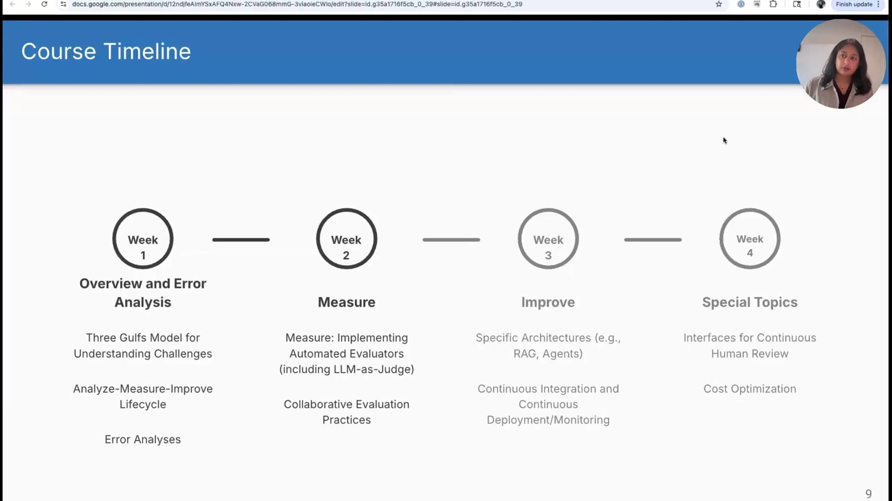
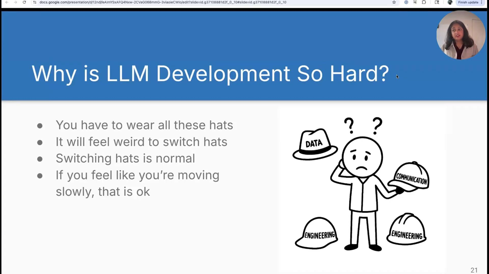
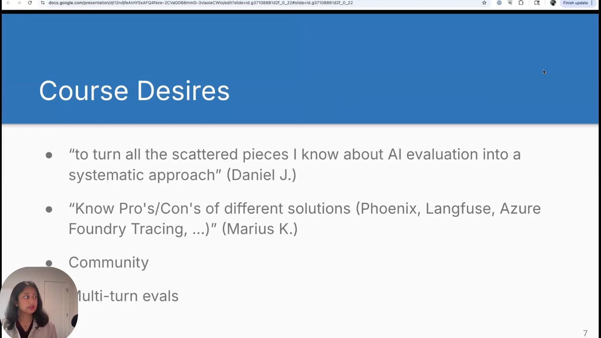
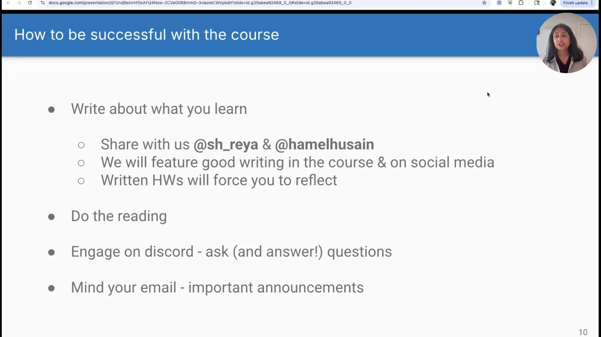
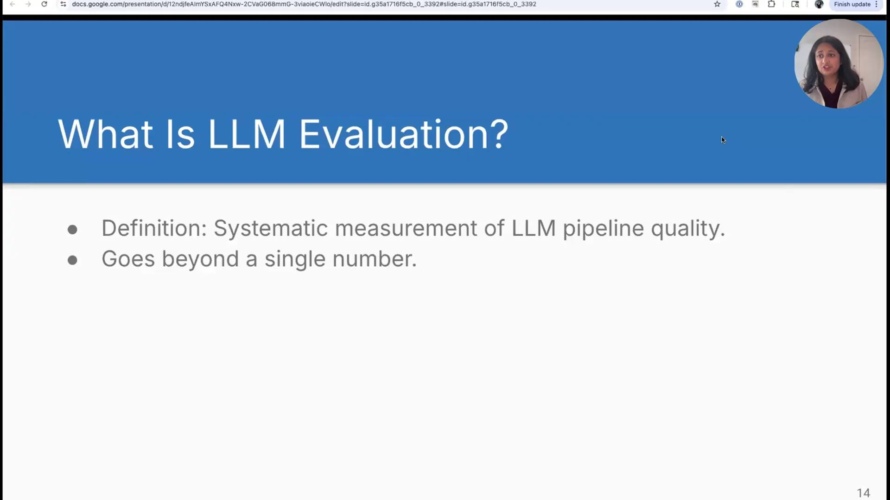
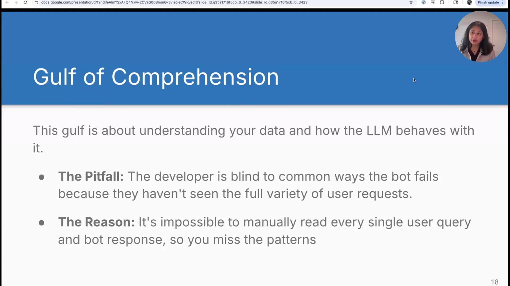
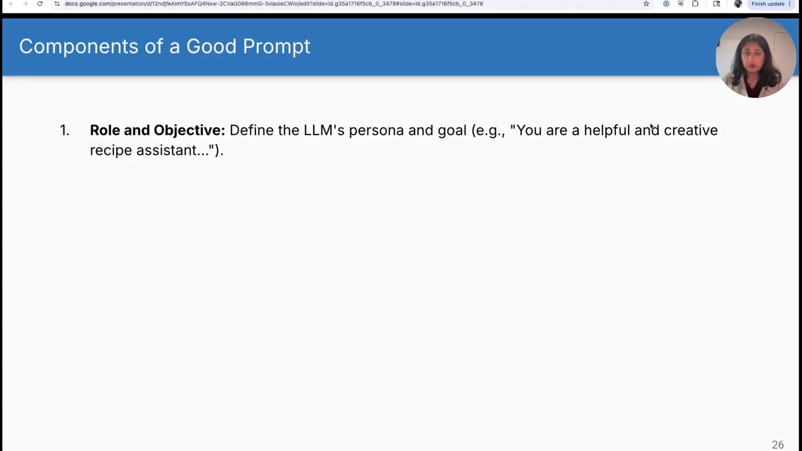

# AI Evals 第一讲：评测是什么、为什么难、以及怎么开始

> 课程：AI Evals For Engineers & PMs（第二期）｜覆盖 P1-1
> 性质：**纯讲解课**。全程没有终端命令、没有代码编辑器画面，讲师用 PPT 讲概念与方法。本文档第 3、4 节把讲师口述的流程落成可执行的工程骨架，凡属我补充的部分都会明确标注「课里没有代码，以下为示意」。

---

## 1. 这一节做什么

这是第二期（cohort two）的第一讲，主讲人是 Shreya 和 Hamel Hussein。Shreya 是 UC Berkeley 的 AI 与数据管理方向博士候选人，研究 GenAI 驱动的数据 pipeline，写 ML Ops / LLM Ops 方向的论文，自认是课程里偏学术的那一半；Hamel 有约 25 年机器学习和 AI 经验，待过 Airbnb、GitHub，长期做 LLM 与 MLOps，是偏工业实践的那一半。两人是在 MLOps 工作上认识的。

这一讲不教任何工具的具体用法，它要解决的是三个前置问题：

1. **为什么 LLM pipeline 这么难做**——讲师给出「三大鸿沟」模型（Gulf of Comprehension / Specification / Generalization）；
2. **评测（eval）到底是什么、为什么非做不可**——以及评测生命周期的四个阶段：初始 pipeline → error analysis → measurement → improvement；
3. **在开始评测之前，怎么写出一个合格的初始 system prompt**——七组件清单，以及怎么从「用户不满的来源」反推规格（specification）。

课程有一个贯穿四周的项目：**recipe bot（食谱机器人）**。讲师选它的理由说得很直白：这个例子有点刻意（contrived），但它对应一个所有人都熟悉的领域——「在座每个人都吃饭，所以每个人都知道食物是什么、食谱是什么」；同时它天然涉及多轮对话、可能涉及多个工具，而且 LLM 在这件事上并不完美。另一个实际好处是 recipe bot 很容易用合成数据起步：网上有大量食谱，课程也会教一套生成合成数据的流程，这样你不依赖自己公司的数据也能跑起来做 error analysis。

课程节奏与材料（这些直接决定你怎么安排复现时间）：

- 讲座**每周两次**，共八次；其中**大约五次**带编程作业。
- 编程作业用 **Python**；数据存在你自己电脑上，或从课程提供的源下载；不接任何专有工具，但需要**LLM API 访问权限**（公司没有的话可以找讲师协调）。
- 书面作业（reflection）每次课后 **5–10 分钟**，可选，写在哪里都行（Maven、Google Docs 皆可）。
- 有作业答疑时间（homework office hours）和一般答疑时间（general office hours）。
- 所有录像在直播结束后 **48 小时内**上传到 Maven 学生门户；幻灯片、录像、材料对已报名学员**终身可看**。
- 社区在 **Discord**：每节课一个频道（第一讲是 `lesson one fundamentals`），每场客座讲座一个频道，另有线下见面/学习小组频道。讲师明确说他们和助教会逐条看、逐条回答。
- 有 **course reader**，链接在标题含 "orientation" 的欢迎邮件里，每周发更新章节；讲师建议开课前先读**第 1–3 章**。
- 本期新增「vendor battle」：Phoenix、Brain Trust、Langsmith 等评测工具厂商会跟着做同一份作业，让你在熟悉的场景里横向比较。另有约 **10 场客座讲座**和厂商 workshop，全部可选。本周五有一场 Brain Trust 的教程（讲师提到 Wade）。



四周主线可以整理成这张表：

| 周 | 主题 | 关键产出 |
|---|---|---|
| 第 1 周 | 总览；从「想做 error analysis」到真正能做；写出合格的初始 prompt | recipe bot 的 system prompt（作业一） |
| 第 2 周 | error analysis 深入；多人协作与领域专家参与；主观标准的量化对齐；实现 automated evaluator（如 LLM Judge） | 一份 failure mode 分类体系 + 可运行的 evaluator |
| 第 3 周 | 复杂 pipeline：RAG、agent、多步与多轮对话；CI/CD | 把评测接进复杂架构与流水线 |
| 第 4 周 | special topics：可直接落地的最新研究、接口（interfaces）、**成本优化** | 「已经有很准的 AI，怎么把成本降一个数量级甚至两个」 |

学完这一节，你应该能做到四件事：

1. 用三大鸿沟判断自己当前卡在哪一步，以及该换哪顶帽子；
2. 说出评测生命周期四个阶段各自的输入、动作、输出和典型陷阱；
3. 按七组件清单写出 recipe bot 的初始 system prompt，并保证每条 specification 都是**可检查的**；
4. 知道下一步要造一份 synthetic trace 数据集、跑出输出，然后开始 open coding → axial coding。

---

## 2. 讲师原话

先看讲师怎么定义「评测」。这个定义是整门课的地基：

> "它是症状性的，也是一种测量。所以里面会涉及某个数字或一组数字。它衡量的是某种质量。而这就是主观的地方：质量对不同的人意味着不同的东西。它可以指正确性，可以指个性化，也可以指延迟，还可以是以上全部。"
> —— p001 [16:20]

> "很多时候它不止一个数字。在实践中，大多数应用里我们看到人们实际上会为产品准备 5 到 10 个不同的评测指标。"
> —— p001 [16:47]

为什么不能省掉评测，讲师用了一个很具体的画面：

> "你发布东西，然后有人告诉你产品指标掉了，或者客户、用户来投诉，然后你就开始打地鼠。所以别那样做。"
> —— p001 [18:09]

然后是三大鸿沟的总体设定：

> "你是一个开发者，你在试着搭一条 LLM pipeline，而这条 pipeline 必须跑在数据上。为了让整件事运转起来，你总得想办法在这些'岛屿'之间的鸿沟上架桥。"
> —— p001 [19:05]

第一道鸿沟，理解鸿沟（Gulf of Comprehension）：

> "如果你对此是盲的，你没有见过用户请求的完整多样性，那你就建不出有效的产品。"
> —— p001 [20:24]

Hamel 在这里讲了一个非常关键的翻车案例——HR 场景的邮件助手，团队用 edit distance（编辑距离）当指标，逻辑听起来很顺：AI 生成内容，人改得越少说明越好。结果呢：

> "我们发现很多时候是非英语母语的人在编辑结果，而且在这个具体场景里，很多时候反而把语法改错了。结果证明这是一个非常糟糕的指标。"
> —— p001 [22:20]

所以「看数据」这件事有个很硬的判据：

> "如果你感到意外，那某种程度上说明：也许你建错了东西，或者你需要调整你的指标。"
> —— p001 [23:49]

第二道鸿沟，规格鸿沟（Gulf of Specification），核心难点在于「说清楚」：

> "即便你认为自己有一个好 prompt，里面大概率也有某些主观的东西，值得进一步澄清或细化。"
> —— p001 [25:40]

而最典型的翻车方式是直接把写 prompt 的活外包给 AI：

> "你不应该完全用 AI 来写你的 prompt。这很有诱惑力。在直接跳到用 AI 写 prompt 之前，先自己想一想，其实是很有用的。"
> —— p001 [28:02]

正确的用法是让 LLM 当编辑，不当作者：

> "这是我的 prompt，请稍微提升一下清晰度，也许给我一些改进建议。但不是让它来写 prompt。"
> —— p001 [29:00]

第三道鸿沟，泛化鸿沟（Gulf of Generalization）：

> "我对 LLM 什么时候能泛化、什么时候不能，没有一个很好的心智模型。它们并不总像人类那样泛化。"
> —— p001 [29:54]

三道鸿沟对应三顶帽子，这是全课最好记的一句话：

> "为什么 LLM 开发这么难？因为为了闭合理解鸿沟，你得戴上数据科学家的帽子；为了闭合规格鸿沟，你得戴上沟通和产品的帽子；为了闭合泛化鸿沟，你得戴上工程的帽子。"
> —— p001 [31:19]



进入生命周期后，讲师反复强调「分析」阶段的权重：

> "分析阶段大概是所有阶段里最重要的。原因在于，那是你学到最多的地方。那也是大多数人跳过的地方。"
> —— p001 [36:30]

> "我粗略估计，我 75% 到 80% 的时间都花在分析上。"
> —— p001 [36:59]

测量阶段最大的坑是「假指标」：

> "本质上，如果你有一个糟糕的 LLM judge，它就相当于给你失败模式的发生率返回了一个随机数，你没法信任它。"
> —— p001 [37:28]

改进阶段最大的坑是抢跑：

> "改进阶段最大的问题我看到的是过早改进。人们很喜欢在还没做前面这些步骤之前，就跳到非常复杂的架构，或者跳到 prompt engineering、自动化方案。"
> —— p001 [38:24]

讲完七组件之后，讲师给了一个优先级判断，这是你写 prompt 时最该记住的一句：

> "步骤一到四，一定要做。步骤六，如果你不用 tool calling 或结构化输出，就应该做。步骤五和七，看你的应用是否合适再做。"
> —— p001 [41:44]

怎么定义「好」？讲师的路径是从「坏」倒推：

> "最核心的想法是：如果你头脑风暴出这些不快乐的路径，你就能定义什么是坏，而好至少是坏的不存在。"
> —— p001 [45:25]

规格写得对不对，有一个可操作的判据：

> "判断你写的规格好不好，一个好办法是：是否存在某种方式可以去检查它。"
> —— p001 [47:20]

error analysis 什么时候停？

> "你会一直看你的数据，基本上直到你不再观察到新的失败模式为止。"
> —— p001 [50:10]

最后，这门课的方法论不是凭空造的：

> "比如扎根理论，以及错误分析，在社会科学里被研究得很透彻……我们是在把非常成功的工具和实践应用到 AI 工程里。"
> —— p001 [51:38]

> "错误分析将会是你们的一项超能力，很少有人拥有它。"
> —— p001 [53:28]

---

## 3. 从零复现

这一节没有代码可抄，所以「复现」指的是**复现讲师的推理路径**：需求 → 约束 → 估算 → 方案 → 取舍，然后落到你这一周实际要动手的动作上。

### 3.0 先把问题和约束摆清楚

| 维度 | 内容 | 讲师依据 |
|---|---|---|
| 需求 | 给自己团队的应用建一套**应用中心**（application-centric）的评测，而不是去刷通用 benchmark | [07:54] 大模型厂商的 eval 是测通用能力，类似「评测界的 SAT」，那不是这门课要做的；你要做的是拿现成模型改造成自己应用，并**在自己的评测集上做到 90%+** |
| 约束 1 | 没有标注团队，没有现成标注数据 | [36:00] 讲师明确反对把标注外包出去，认为 analyze 阶段是最重要、行业里指导最少的环节 |
| 约束 2 | 用户 query 是自由文本，量大到读不完 | [20:24] 可能每天几千、几万条，「你不可能把那些文本全读完」 |
| 约束 3 | 起步阶段没有真实用户数据 | [15:23] recipe bot 的好处是可以用合成数据起步 |
| 约束 4 | 时间有限 | [36:59] 讲师自己 75–80% 时间花在分析上，说明这是重投入环节 |

### 3.1 估算（讲师给出的所有量化判断，一个不漏）

- **指标数量**：5–10 个评测指标是常态，不是夸张 [16:47]。
- **时间分配**：分析阶段占 75–80% [36:59]。
- **Prompt 组件优先级**：1–4 必做；6 在不使用 tool calling / 结构化输出时必须做；5 和 7 视应用而定 [41:44]。
- **停止条件**：看数据直到**不再出现新的 failure mode** [50:10]。课里**没有给**最小样本量、也没有给「看多少条 trace 才算够」的具体数字。
- **对齐率陷阱**：把好例坏例写进 judge prompt 再拿同一批例子测试，会得到 100% 对齐，但换到生产数据上就变成随机数 [37:57]。

### 3.2 方案：九个步骤

#### 步骤 0｜准备环境与材料

你需要：Python 环境（课里只说作业是 Python，**没给版本号**）、一个可用的 LLM API key（课里没规定厂商）、course reader 第 1–3 章、Discord 的 `lesson one fundamentals` 频道。



目录结构课里没给，以下是**示意**，按作业要求整理：

```
ai-evals-recipe-bot/
├── prompts/
│   └── recipe_bot_v1.md        # 你的 system prompt，每次改版都新建文件
├── data/
│   ├── queries.jsonl           # 合成 query 集
│   ├── traces_v1.jsonl         # 跑出来的 trace
│   └── labels_v1.csv           # 人工 open coding 的结果
├── scripts/
│   ├── run_traces.py
│   └── judge_too_complex.py
├── .env                        # 不要提交到 git
└── requirements.txt
```

#### 步骤 1｜先做理解鸿沟的功课，别急着写 prompt

讲师反复说，专家和新手的区别在于：专家拿到新应用，第一件事就是看数据。你要做的是**列出你预期 recipe bot 会收到的 query 类型**，并且标出哪些是你不确定的。判据是讲师那句「不该有任何东西让你意外」。

这一步的产出是一张 query 类型清单（例如：按食材找菜、按饮食限制找菜、按时间找菜、按人数换算份量、要求替换食材、要求解释某个烹饪动作……）。课里没讲清单要多少条。

#### 步骤 2｜按七组件写初始 system prompt

顺序不能反：**先自己写**，写到「你已经把自己脑子里认为好的规格榨干」，再让 LLM 帮你提清晰度。讲师的原话是给 LLM 的指令应该是「这是我的 prompt，请提升清晰度、给改进建议」，而不是「帮我写一个 prompt」。

七个组件与 recipe bot 的对应关系：

| # | 组件 | 在 recipe bot 里写什么 | 是否必做 |
|---|---|---|---|
| 1 | 角色与目标（role & objective） | 「你是一个 X，你要做 Y」 | 必做 |
| 2 | 规格（specification） | 明确做什么、不做什么；例如「先列食材再列步骤」「食材要带具体用量」 | 必做 |
| 3 | 相关上下文（relevant context） | 从网上取的食谱、用户历史偏好、之前生成过的食谱 | 必做 |
| 4 | Few-shot 示例 | 给几条「其他 query 对应的食谱」作为格式与风格锚点 | 必做 |
| 5 | 推理 / chain-of-thought | 「先思考再回答」「回答前先反思」 | 视情况 |
| 6 | 格式约束 | JSON / YAML / XML，或直接用 JSON mode、tool calling、结构化输出 API | 不用结构化输出时必做 |
| 7 | 分隔符（delimiters） | 用分隔符把不同区块隔开 | 可选 |

讲师对第 5 项有一个明确判断：随着模型已经被训练成会先输出推理 token，这一项「如果不是现在已经过时，那明年也会过时」；只有当你用很老的模型时，才需要显式要求 step by step 或回答前反思。

#### 步骤 3｜从「用户不满的来源」反推规格

讲师给的 recipe bot 用户不满清单（原话举例）：

- 用了买不到的食材；
- 忽略饮食限制——讲师自己有坚果过敏，在搜索引擎上找食谱，「结果里面居然还是有坚果」；
- 步骤说明不清楚——「把这东西烤一下」这种，对不太会做饭的人来说完全无法执行；
- 太简单；
- 太复杂。

把这些转成 do / don't 之后，**每一条都要能检查**。讲师举了两个检查思路：如果规格是「先食材后步骤」，就检查输出里食材是否出现在步骤之前；如果规格是「询问过敏」，就检查用户声明了过敏原之后，食谱里是否出现了该食材。这门课不要求你现在就把 evaluator 写出来，但要求你在写规格时就想清楚「这条怎么验」。

#### 步骤 4｜造合成数据

课里明确说 recipe bot 的一大优势是**容易用合成数据起步**，网上有大量食谱可用，课程也会教生成流程。但**具体怎么生成，这一讲没讲**（属于下周 error analysis 的前置内容）。你这一步的产出是一份 `queries.jsonl`，覆盖步骤 1 列出的各类 query。

#### 步骤 5｜跑第一份 trace 数据集

讲师对 trace 的定义：**一串调用，或一串消息**，可以理解成 LLM 对话里 user 和 assistant 交替出现的序列。你要做的是把 system prompt 跑在这批 query 上，得到一批输出（食谱），并**连同输入一起存下来**。

#### 步骤 6｜open coding → axial coding

这是下周的正题，这一讲只给了名字和目标：对数据做定性分析，逐步构建 failure mode 集合；先 open coding（逐条打标签、发现新的失败类型），再 axial coding（把零散标签归并成有层级的分类体系）。终止条件是「不再观察到新的 failure mode」。最终你会得到一棵 failure mode 的**层级/分类树（taxonomy）**，每个 failure mode 都附带通过和不通过的样例。

#### 步骤 7｜measurement：把定性洞察变成发生率的数字

你可能会找到三个 failure mode，但你需要知道**每一个有多普遍**。手动标注每一条 trace 太痛苦，所以要把 failure mode 翻译成 automated evaluator。这一步的两个红线：judge prompt 必须真的在测那个 failure mode；训练用的好例坏例**不能**出现在测试集里。

#### 步骤 8｜improvement

到这里你才知道该动哪里：prompt engineering、换模型、微调、RAG、agent——「你工具箱里那些花哨东西」。讲师的红线是**不要过早改进**：先有 prompt、先跑数据、先做 error analysis，再谈改。

#### 步骤 9｜回到步骤 1

讲师特别强调，第一期没强调够的一点是：不只是每个阶段内部是循环，**整个生命周期本身要重复很多次**，贯穿产品的一生。

### 3.3 取舍：讲师明确站边的几个选择

| 选择点 | 讲师的选择 | 反面 |
|---|---|---|
| 先看数据还是先定指标 | 先看数据 | 先定指标会把 edit distance 这种指标定成「随机数」 |
| 先做哪个鸿沟 | 严格按 comprehension → specification → generalization 的顺序 | 前两个没闭合就调泛化，是在错误的问题上做优化 |
| prompt 谁写 | 人写草稿，LLM 只做清晰化 | 让 LLM 全权写，会出现「你是数据科学家」这种和业务完全无关的 prompt |
| 标注谁做 | 自己做，不外包 | 外包标注等于把最重要的学习环节扔掉 |
| 什么时候改架构 | 做完 error analysis 之后 | 一上来就上复杂架构 = premature improvement |
| 评测集和 judge 例子 | 严格隔离 | 泄漏 few-shot 例子，对齐率虚高 |

---

## 4. 完整代码

> **课里没有代码，以下为示意。** 这一讲是纯讲解，讲师没有展示任何脚本、配置或终端命令。下面所有内容都是把第 3 节的流程落成「可以照着建、照着跑」的文件，用于让你下周能直接进入 error analysis；命名、字段、判定标准均为示意，不是讲师给出的实现。

### 4.1 设计决策表：三大鸿沟

| 鸿沟 | 一句话定义 | 要戴的帽子 | 典型翻车 | 本课对应手段 |
|---|---|---|---|---|
| 理解（Comprehension） | 你根本不知道用户会问什么、数据长什么样 | 数据科学家 | HR 邮件助手用 edit distance，结果非母语者把语法改错 | 看数据、聚类、构建高优先级数据 review 流程 |
| 规格（Specification） | 你说不清楚到底要 LLM 干什么 | 沟通 + 产品 | 客服机器人 prompt 里写「你是数据科学家」 | 七组件、do/don't 清单、可检查性 |
| 泛化（Generalization） | LLM 没把你想要的迁移到新数据上 | 工程 | 测试 query 都很好，一上生产就崩 | 升级模型、拆 pipeline、微调、接外部数据、长上下文 |

### 4.2 组件职责表：七组件

| # | 组件 | 职责 | recipe bot 填写要点 | 优先级 |
|---|---|---|---|---|
| 1 | Role & Objective | 定身份和任务边界 | 「你是一个面向家庭厨房的食谱助手……」 | 必做 |
| 2 | Specification | 定 do / don't，且每条可检查 | 先食材后步骤；过敏原零出现；用量必须给数字 | 必做 |
| 3 | Relevant Context | 注入外部知识与用户状态 | 用户过敏史、历史偏好、可用食材 | 必做 |
| 4 | Few-shot | 锚定格式与风格 | 2–3 条示例食谱 | 必做 |
| 5 | Reasoning | 让模型先想再答 | 老模型才需要显式要求 | 视情况 |
| 6 | Format | 让输出可被程序解析 | 只用 JSON mode / tool calling 时可省 | 不用结构化输出时必做
| 7 | Delimiters | 把区块隔开，防止 prompt 注入式串台 | 用 XML 风格标签或 `###` | 可选 |

### 4.3 `prompts/recipe_bot_v1.md`（完整文件，可直接保存）

下面是按七组件写出来的第一版 system prompt。它不是标准答案，只是「一个合格的第一版」应该长什么样：**每条规格都能被检查**，格式被固定，do/don't 分开写。

```markdown
# 角色与目标

你是一个面向家庭厨房的食谱助手（recipe bot）。你的任务是根据用户的请求，
生成一份用户可以直接照着做的食谱。

# 规格：你必须做的（do）

1. 必须按固定顺序输出：标题 → 份量 → 食材 → 步骤 → 小贴士。
2. 食材必须出现在步骤之前。
3. 每一条食材都必须带数量与单位（例如「鸡蛋 2 个」「盐 3 克」），
   不允许出现「适量」「少许」这类无法执行的写法。
4. 如果用户在对话中声明了任何饮食限制或过敏原（例如坚果、乳制品、麸质、
   素食），该过敏原及其常见衍生品不得出现在食材列表与步骤中。
5. 如果用户没有声明饮食限制，且请求中包含任何可能触发过敏的高风险食材
   （坚果、贝类、乳制品、蛋、麸质），你必须先在回答开头用一句话询问
   用户是否有相关过敏，再给出食谱。
6. 步骤必须是可执行的动词句，每一步只做一件事，并且必须写明火候/温度/
   时间中的至少一项（适用于需要加热的步骤）。
7. 如果用户的请求缺少关键信息（人数、可用食材、时间上限），
   你必须只问一个最关键的澄清问题，不要一次问三个以上问题。

# 规格：你绝对不能做的（don't）

1. 不要推荐用户所在地区买不到的食材；如果必须使用，要给出替代方案。
2. 不要在同一个回答里给出超过一份食谱。
3. 不要输出 JSON、YAML、Markdown 表格以外的任何结构化格式（见下方格式约束）。
4. 不要编造营养数据（热量、蛋白质等）；如果用户问了，明确说明你不提供精确营养值。
5. 不要在步骤里使用「适量」「若干」「差不多」这类模糊词。
6. 不要假装记得之前对话中并不存在的信息。

# 相关上下文

## 用户画像
- 用户的饮食限制：{{user_dietary_restrictions}}
- 用户的历史偏好：{{user_preferences}}
- 用户手头已有的食材：{{user_available_ingredients}}

## 参考食谱（来自外部检索，可能为空）
{{retrieved_recipes}}

# 示例（few-shot）

## 示例 1
用户：我想做个两人份的番茄炒蛋，家里只有鸡蛋和番茄。
助手：
### 番茄炒蛋（2 人份）
**食材**
- 鸡蛋 4 个
- 番茄 2 个（约 300 克）
- 食用油 15 毫升
- 盐 3 克
- 白砂糖 2 克
**步骤**
1. 把 4 个鸡蛋打入碗中，用筷子搅打 30 秒至蛋液均匀。
2. 中火热锅 1 分钟，倒入 15 毫升食用油，油温约 160 度时倒入蛋液。
3. 用锅铲翻炒 40 秒，蛋液刚凝固就盛出备用。
4. 同一锅中火下番茄块，翻炒 2 分钟至出汁。
5. 倒回鸡蛋，加 3 克盐和 2 克白砂糖，翻炒 30 秒出锅。
**小贴士**
- 番茄去皮口感更顺滑，可用开水烫 30 秒后剥皮。

## 示例 2
用户：我想吃点清淡的，但是我不知道做什么。
助手：
在给你食谱之前，我想先确认一件事：你对坚果、贝类、乳制品、蛋或麸质有过敏吗？
（我会根据你的回答再给出一份清淡的食谱。）

# 格式约束

严格按以下 Markdown 结构输出，不要增删一级标题：

### <菜名>（<份量> 人份）
**食材**
- <食材名> <数量><单位>
**步骤**
1. <可执行动作>
**小贴士**
- <可选，最多 2 条>

# 对话历史

{{conversation_history}}
```

### 4.4 数据文件的结构草案（三个文件的 schema）

`data/queries.jsonl`：一行一条合成 query。字段是示意，课里没规定字段名。

```json
{"query_id": "q001", "user_id": "u01", "turn": 1, "text": "我想做个两人份的番茄炒蛋，家里只有鸡蛋和番茄。", "dietary_restrictions": [], "source": "synthetic"}
{"query_id": "q002", "user_id": "u02", "turn": 1, "text": "推荐一个适合新手的、20 分钟能做完的晚饭。", "dietary_restrictions": ["peanut"], "source": "synthetic"}
{"query_id": "q003", "user_id": "u03", "turn": 1, "text": "我对牛奶过敏，有没有不用奶油的白酱意面做法？", "dietary_restrictions": ["dairy"], "source": "synthetic"}
```

`data/traces_v1.jsonl`：一行一条 trace。注意讲师对 trace 的定义是「一串调用，或一串消息」，所以多轮对话要放在 `messages` 数组里，而不是压成一个字符串。

```json
{"trace_id": "t001", "query_id": "q001", "prompt_version": "v1", "messages": [{"role": "system", "content": "<recipe_bot_v1 的完整内容>"}, {"role": "user", "content": "我想做个两人份的番茄炒蛋，家里只有鸡蛋和番茄。"}, {"role": "assistant", "content": "### 番茄炒蛋（2 人份）\n**食材**\n- 鸡蛋 4 个……"}], "model": "<你用的模型名>", "created_at": "2024-01-01T00:00:00Z"}
```

`data/labels_v1.csv`：一行一条人工标注。`failure_mode` 先留空，等你做 open coding 时填，并且**新的失败类型随时可以新增一行**。

```csv
trace_id,annotator,failure_mode,severity,note
t001,me,,,
t002,me,ignores_dietary_restriction,high,"用户说花生过敏，食谱里出现了花生碎"
t003,me,vague_instruction,medium,"步骤写了「烤一下」但没给温度和时间"
```

### 4.5 `scripts/run_traces.py`（完整文件）

```python
"""把 system prompt 跑在一批 query 上，产出 trace 数据集。

课里没有代码，以下为示意。
"""

import json
import os
import time
from pathlib import Path

from dotenv import load_dotenv
from openai import OpenAI

load_dotenv()

ROOT = Path(__file__).resolve().parent.parent
PROMPT_PATH = ROOT / "prompts" / "recipe_bot_v1.md"
QUERIES_PATH = ROOT / "data" / "queries.jsonl"
OUT_PATH = ROOT / "data" / "traces_v1.jsonl"

MODEL = os.environ.get("MODEL_NAME", "gpt-4o-mini")
PROMPT_VERSION = "v1"


def load_prompt(path: Path) -> str:
    return path.read_text(encoding="utf-8")


def load_queries(path: Path) -> list[dict]:
    rows = []
    with path.open("r", encoding="utf-8") as f:
        for line in f:
            line = line.strip()
            if not line:
                continue
            rows.append(json.loads(line))
    return rows


def render_prompt(template: str, query: dict) -> str:
    """把 prompt 里的占位符替换成这条 query 的实际值。"""
    restrictions = query.get("dietary_restrictions") or []
    rendered = template.replace(
        "{{user_dietary_restrictions}}",
        "、".join(restrictions) if restrictions else "用户未声明",
    )
    rendered = rendered.replace("{{user_preferences}}", "无历史记录")
    rendered = rendered.replace("{{user_available_ingredients}}", "用户未说明")
    rendered = rendered.replace("{{retrieved_recipes}}", "（本次未检索到参考食谱）")
    rendered = rendered.replace("{{conversation_history}}", "（这是第一轮对话）")
    return rendered


def call_model(client: OpenAI, system_prompt: str, user_text: str) -> str:
    resp = client.chat.completions.create(
        model=MODEL,
        messages=[
            {"role": "system", "content": system_prompt},
            {"role": "user", "content": user_text},
        ],
        temperature=0,
    )
    return resp.choices[0].message.content


def main() -> None:
    client = OpenAI(api_key=os.environ["OPENAI_API_KEY"])
    template = load_prompt(PROMPT_PATH)
    queries = load_queries(QUERIES_PATH)

    OUT_PATH.parent.mkdir(parents=True, exist_ok=True)
    done = set()
    if OUT_PATH.exists():
        with OUT_PATH.open("r", encoding="utf-8") as f:
            for line in f:
                if line.strip():
                    done.add(json.loads(line)["query_id"])

    with OUT_PATH.open("a", encoding="utf-8") as out:
        for i, q in enumerate(queries):
            if q["query_id"] in done:
                continue
            system_prompt = render_prompt(template, q)
            try:
                answer = call_model(client, system_prompt, q["text"])
            except Exception as exc:  # 网络或限流问题，记下来继续跑
                print(f"[FAIL] {q['query_id']}: {exc}")
                time.sleep(3)
                continue

            trace = {
                "trace_id": f"t{i + 1:03d}",
                "query_id": q["query_id"],
                "prompt_version": PROMPT_VERSION,
                "messages": [
                    {"role": "system", "content": system_prompt},
                    {"role": "user", "content": q["text"]},
                    {"role": "assistant", "content": answer},
                ],
                "model": MODEL,
            }
            out.write(json.dumps(trace, ensure_ascii=False) + "\n")
            out.flush()
            print(f"[OK] {q['query_id']} -> {trace['trace_id']}")
            time.sleep(1)


if __name__ == "__main__":
    main()
```

运行：

```bash
pip install openai python-dotenv
python scripts/run_traces.py
```

`.env`（不要提交）：

```bash
OPENAI_API_KEY=sk-xxxxxxxxxxxxxxxx
MODEL_NAME=gpt-4o-mini
```

> 版本号课里没给，上面 `openai` / `python-dotenv` 都没写死版本，是因为这门课没有规定依赖版本；你按自己环境的当前版本装即可，但请把装到的版本写进 `requirements.txt` 方便复现（`pip freeze > requirements.txt`）。

### 4.6 `scripts/judge_too_complex.py`（完整文件，示意 evaluator）

这是把「太复杂 / 太简单 / 步骤不清楚 / 过敏原」四类 failure mode 初步自动化的一版代码。注意它体现的是讲师说的两条红线：judge prompt 必须真的描述那个 failure mode；示例只能来自**训练/dev** 那份数据。

```python
"""一个最小的 LLM judge：判断一条 trace 的食谱是否「步骤不可执行」。

课里没有代码，以下为示意。
"""

import json
import os
from pathlib import Path

from dotenv import load_dotenv
from openai import OpenAI

load_dotenv()

ROOT = Path(__file__).resolve().parent.parent
TRACES = ROOT / "data" / "traces_v1.jsonl"
OUT = ROOT / "data" / "judge_scores.jsonl"
JUDGE_MODEL = os.environ.get("JUDGE_MODEL_NAME", "gpt-4o-mini")

JUDGE_SYSTEM = """你是一个严格的评测员。你要判断一份食谱的「步骤」部分是否可执行。

不可执行的定义（满足任意一条即判为不可执行）：
1. 出现「适量」「若干」「差不多」等无法量化的词。
2. 需要加热的步骤没有给出温度、火候或时间中的任意一项。
3. 一个步骤里塞了三个以上不同的动作。
4. 使用了家常厨房没有的设备或原料，且没有给出替代方案。

只输出一个 JSON 对象，不要输出任何其他文字：
{"unexecutable": true 或 false, "reason": "用一句中文说明判断依据"}
"""


def load_traces(path: Path) -> list[dict]:
    traces = []
    with path.open("r", encoding="utf-8") as f:
        for line in f:
            if line.strip():
                traces.append(json.loads(line))
    return traces


def extract_steps(answer: str) -> str:
    """把「**步骤**」到下一个标题之间的内容截出来，减少 judge 的输入噪音。"""
    marker = "**步骤**"
    if marker not in answer:
        return answer
    tail = answer.split(marker, 1)[1]
    for stop in ("**小贴士**", "### "):
        if stop in tail:
            tail = tail.split(stop, 1)[0]
    return tail.strip()


def judge(client: OpenAI, steps_text: str) -> dict:
    resp = client.chat.completions.create(
        model=JUDGE_MODEL,
        messages=[
            {"role": "system", "content": JUDGE_SYSTEM},
            {"role": "user", "content": steps_text},
        ],
        temperature=0,
        response_format={"type": "json_object"},
    )
    raw = resp.choices[0].message.content
    try:
        return json.loads(raw)
    except json.JSONDecodeError:
        return {"unexecutable": None, "reason": f"解析失败: {raw[:200]}"}


def main() -> None:
    client = OpenAI(api_key=os.environ["OPENAI_API_KEY"])
    traces = load_traces(TRACES)

    with OUT.open("w", encoding="utf-8") as out:
        for t in traces:
            answer = t["messages"][-1]["content"]
            verdict = judge(client, extract_steps(answer))
            row = {
                "trace_id": t["trace_id"],
                "prompt_version": t.get("prompt_version"),
                "failure_mode": "unexecutable_steps",
                "judge_model": JUDGE_MODEL,
                "judge_unexecutable": verdict.get("unexecutable"),
                "judge_reason": verdict.get("reason"),
            }
            out.write(json.dumps(row, ensure_ascii=False) + "\n")
            print(row)


if __name__ == "__main__":
    main()
```

### 4.7 发生率估算表（measurement 阶段的产物长什么样）

讲师的说法是：你可能有三个 failure mode，但你要知道**每一个有多普遍**。下面这张表就是那个产物的形态。**表中数字全部为示意**，课里没有给任何真实数值。

| failure_mode | 定义 | 命中 trace 数 | 总 trace 数 | 发生率 | 是否已和人工标注对齐 | 对齐方式 |
|---|---|---|---|---|---|---|
| ignores_dietary_restriction | 用户声明过敏原后，该过敏原或其衍生品仍出现在食材/步骤中 | 7 | 120 | 5.8% | 是 | 在 **dev 集**上抽 30 条人工复核 |
| unexecutable_steps | 步骤含模糊词或缺温度/火候/时间 | 23 | 120 | 19.2% | 是 | 同上 |
| too_complex | 需要的工具或步骤量明显超出「新手 30 分钟」 | 15 | 120 | 12.5% | 否 | 定义仍主观，待收紧 |
| format_violation | 一级标题顺序不符合格式约束 | 3 | 120 | 2.5% | 是 | 可以用纯代码检查，不依赖 judge |

### 4.8 本周交付物清单

| 文件 | 内容 | 对应讲师要求 |
|---|---|---|
| `prompts/recipe_bot_v1.md` | 按七组件写的 system prompt | 作业一：写一份有效的 recipe bot system prompt |
| `data/queries.jsonl` | 覆盖多类 query 的合成数据集 | 「如果没有数据，先造合成数据」 |
| `data/traces_v1.jsonl` | 用 v1 prompt 跑出的 trace | 「trace 是一串调用或一串消息」 |
| `data/labels_v1.csv` | open coding 的人工标注（下周继续补） | 「一直看到不再出现新的失败模式」 |
| `data/judge_scores.jsonl` | 至少一个 failure mode 的 automated evaluator 结果 | 「把定性洞察翻译成定量发生率」 |
| 一段 reflection 文字 | 5–10 分钟的书面作业 | 讲师明确说这是最重要的学习习惯之一 |



---

## 5. 逐行解释

### 5.1 prompt 文件的每一个区块为什么这样定

**`# 角色与目标` 放在最前面**——对应组件的第 1 项，讲师给的句式就是「你是一个空白，你要做空白」。这句话的作用不是玄学，是给整个对话定一个稳定的语域（register）和任务边界：它是食谱助手，不是营养师，不是餐厅推荐，也不是聊天伴侣。不写这一句会怎样？模型会自己在「给食谱」和「陪你聊吃什么」之间飘，而讲师特别反感的一种失败就是「我不知道你想吃什么」那种来回推。

**do 列表里的第 1、2 条（顺序 + 食材在步骤前）**——这两条是整份 prompt 里最「工程」的部分，因为它们是**纯字符串可检查的**。讲师说的判据就在这里生效：如果规格是「先食材后步骤」，你就能写代码检查食材块的起始位置是否小于步骤块的起始位置。这就是为什么第 1 条和第 2 条要拆成两条写，而不是合成一句「格式规范」：拆开才可以分别检查、分别算发生率。

**第 3 条（必须带数量与单位，禁止「适量」）**——注意这条直接对应后来 judge 里的第 1 条判据。写规格时就要想着「谁来验它」。讲师举的例子是「你这东西烤一下」——对不太会做饭的人来说根本没法执行。规格里禁掉模糊词，比事后抱怨模型写得模糊要有效得多。

**第 4、5 条（过敏原）**——这是讲师点名的、他本人最在意的失败：他有坚果过敏，在网上搜食谱，「结果里面居然还是有坚果」。第 4 条处理「用户已声明」的情况，第 5 条处理「用户没声明但风险高」的情况。必须拆成两条，因为它们的判定条件完全不同：一个看用户输入，一个看食谱内容。第 5 条还暗含了讲师说的「自由度」问题——bot 到底能不能超出用户 query 主动追问？在过敏这件事上，答案是能，而且要主动问。

**第 6 条（每步一个动作 + 必须给温度/火候/时间）**——这条是把「清楚」这个主观词变成可检查条件的示范。它也解释了为什么 judge 的第 2、3 条判据长那样。

**第 7 条（缺信息时只问一个最关键的问题）**——这是讲师在作业提示里说的「你的 bot 应该有自由度吗？」的具体回答：可以问，但一次只问一个。如果不写这条，模型会连着抛三四个问题，用户体感极差；这也是多轮对话场景里最常见的失败之一（讲师说复杂 pipeline 是后半程的重点，多轮 conversation 的 failure mode 正是其中之一）。

**don't 列表的作用**——讲师说「好至少是坏的不存在」。don't 列表就是「坏」的显式化。第 4 条（不编造营养数据）值得单独说：它是一个「模型很爱做但没能力做」的动作，属于典型的泛化失败——模型在别的地方见过营养表，于是迁移到这份食谱上，但数字是编的。

**`# 相关上下文` 里的 `{{...}}` 占位符**——对应组件第 3 项。讲师列的三类上下文是：从互联网取的食谱、用户个性化信息（偏好、之前生成的食谱）。字段名是示意，但结构上要注意：**上下文是注入的，不是让模型自己回忆的**。这也是为什么 `run_traces.py` 里有 `render_prompt()` 这个函数专门干替换。

**`# 示例（few-shot）` 里的示例 2**——示例 2 是一个「只问不答」的回答。之所以要放这样一个反例，是因为如果 few-shot 全是完整食谱，模型会把「必须给食谱」当成硬约束，于是用户没声明过敏时也不问，直接硬给。few-shot 不只锚定格式，也锚定**行为分支**。

**`# 格式约束` 用 Markdown 而不是 JSON**——这里有个真实的取舍。讲师说格式可以是 JSON / YAML / XML，也可以直接用 JSON mode、tool calling 这类结构化输出 API。我这一版选 Markdown，是因为食谱是给人读的；如果选 JSON，可读性会掉，但你的程序解析会容易得多。**如果你要做严格的格式合规检查，换成 JSON + `response_format={"type": "json_object"}` 会更省事**——那正好对应讲师说的「如果你用了结构化输出，第 6 项就不用单独写」。

**`{{conversation_history}}` 放在最末尾**——多轮对话里，历史越长越容易把 system 里的规格「冲淡」。放在末尾是常见做法，但这一讲**没有讨论**上下文长度与规格遗忘的问题，属于课里没讲。

### 5.2 脚本里的关键行

**`temperature=0`**——课里没讲 temperature。我设 0 是因为要做 error analysis：你需要**相对稳定**的输出，否则同一个 query 每次跑出不同的失败，你无法判断是 prompt 的问题还是采样噪声。这是一个工程判断，不是讲师给的。

**`system_prompt = render_prompt(template, q)` 每条 query 都重新渲染**——因为用户过敏史是 per-user 的。如果把用户信息写死在 system 里，你就得为每个用户准备一份 prompt，无法复用。

**追加写 + `done` 集合**——`run_traces.py` 在启动时先读一遍已有输出，跳过跑过的 query。这样限流或断网时你可以直接重跑，不会重复花钱。这个「断点续跑」的模式不是课里讲的，但课上说的「你需要 LLM API 访问权限」意味着每一行输出都是要花钱的。

**`out.flush()`**——每写一行就刷盘。脚本中途崩了也不丢已花的钱。

**`messages` 存的是渲染后的完整 system prompt**——这一步很关键。如果你只存 `prompt_version: "v1"` 而不存实际内容，等你改了 prompt 文件，历史 trace 就再也解释不清了。讲师强调「trace 是一串消息」，那就把消息原样存下来。

**judge 里的 `extract_steps()`**——先把「步骤」段截出来再喂给 judge。这对应讲师的一个隐性要求：judge prompt 必须真的在测那个 failure mode。如果你把整份回答丢进去问「可执行吗」，模型的注意力会被标题、小贴士分走，判定就会漂。截取是一种「让 judge 只看该看的」的手段。

**judge 里的 `response_format={"type": "json_object"}`**——这是讲师提到的结构化输出 API 的直接应用。好处是你不必写正则去解析自然语言。

**judge 里的 `except json.JSONDecodeError`**——解析失败时把 `unexecutable` 置为 `None` 而不是 `False`。这个区别很重要：`False` 会被算进分母，让发生率偏低；`None` 可以被单独统计为「judge 失效」，提醒你这条 evaluator 本身不可靠。讲师说的「糟糕的 judge 就是随机数」，在数据层面就长这样。

**`# training/dev 与 test 的隔离`**——注意 4.6 的示例里我**没有**放任何 few-shot 示例，正是为了不踩讲师点名的那条红线：把好例坏例写进 judge prompt，再拿同一批例子测，会得到 100% 对齐，但上生产就变随机数。如果你要给 judge 加示例，示例必须来自 dev 集，测试必须用另一批 trace。

### 5.3 发生率表为什么必须带「是否已对齐」这一列

一张只有百分比的发生率表是没有用的。讲师的原话是：糟糕的 judge 等于给失败模式的发生率返回一个随机数。所以这张表的每一行都必须是「数字 + 可信度」。`format_violation` 那一行我标了「可以用纯代码检查，不依赖 judge」——这是最值得优先做的一类指标：凡是能用字符串或结构检查的规格（顺序、单位、是否出现某食材），都不要交给 LLM judge，省成本也更稳。这一条是工程判断，课里没讲，但和讲师说的「每条规格都要能检查」完全一致。

---

## 6. 复现检查清单

按顺序勾，任何一项没打勾就别往下走。

**准备工作**

- [ ] 装好 Python 环境，能 `pip install openai python-dotenv` 成功
- [ ] 有一个可用的 LLM API key，并能用它成功发一次请求
- [ ] 建好目录：`prompts/`、`data/`、`scripts/`
- [ ] `.env` 写好并且**没有**被提交到 git（`.gitignore` 里有 `.env`）
- [ ] 读了 course reader 第 1–3 章
- [ ] 进了 Discord 的 `lesson one fundamentals` 频道

**理解鸿沟（comprehension）**

- [ ] 写出了 recipe bot 预期会收到的 query 类型清单，至少覆盖：按食材找菜、按饮食限制找菜、按时间找菜、按人数换算、要求替换食材、要求解释烹饪动作
- [ ] 清单里标出了哪些类型你「不确定 bot 会怎么处理」
- [ ] 你能说出：如果看到哪一类 query 会让你意外，说明你的产品可能建错了什么

**规格鸿沟（specification）**

- [ ] 先自己写完了草稿，**之后**才用 LLM 提清晰度，且给 LLM 的指令是「这是我的 prompt，请提升清晰度并给建议」
- [ ] 七组件逐项检查：1–4 都在；6 在（因为你没用结构化输出 API）；5 和 7 你明确决定要不要
- [ ] 每条 do / don't 都能回答「怎么检查它」
- [ ] do 和 don't 是分开的两组，不是混在一段散文里
- [ ] prompt 里明确写了输出格式，且格式固定到能被程序解析
- [ ] prompt 里没有任何和业务无关的身份残留（自查：有没有出现「你是数据科学家」这类东西）

**数据与 trace**

- [ ] `queries.jsonl` 至少几十条，覆盖上面的 query 类型
- [ ] `traces_v1.jsonl` 里每条都存了**渲染后的完整 system prompt**，而不只是版本号
- [ ] 多轮对话用 `messages` 数组存，没有压成一个字符串
- [ ] 脚本支持断点续跑（重跑不会重复调用已完成的 query）

**measurement**

- [ ] 至少有一条规格是用**纯代码**检查的（顺序、单位、某食材是否出现）
- [ ] 至少有一个 failure mode 写了 judge prompt
- [ ] judge prompt 里对 failure mode 的定义是可判定的（有明确的「满足任意一条即判为 X」）
- [ ] judge 的 few-shot 示例（如果有）来自 dev 集，测试用的是另一批 trace
- [ ] 发生率表里带了「是否已对齐人工标注」这一列

**流程纪律**

- [ ] 没有在写 prompt 之前就上复杂架构
- [ ] 没有把标注工作外包
- [ ] 没有在只看 5 条 trace 之后就宣布「我知道 failure mode 是什么了」
- [ ] 知道停止条件是「不再观察到新的 failure mode」，而不是「凑够 50 条」



---

## 7. 课里没讲但你会撞上的

这一讲是总览，讲师自己说「我不想现在把所有要避免的东西都砸给你」。下面这些问题你在照着做的时候一定会遇到，但**这一讲里没有答案**，我把它们标出来，免得你以为自己漏听了。

**1. 成本与限流。** 讲师说你需要 LLM API 访问权限，但没讲一次 error analysis 大概要花多少钱、遇到 rate limit 怎么退避。我的示意脚本里用 `time.sleep(1)` 和失败重试兜底，这只够应付几十条 query；规模一大就必须自己设计并发与重试策略。

**2. 确定性。** 课里没提 temperature。但你做 error analysis 时如果同一个 query 每次跑出不同的失败，你很难归因。建议在跑 trace 时固定采样参数并把参数记进 trace。

**3. 「看多少条 trace 才够」。** 讲师给的停止条件是「不再观察到新的失败模式」，但没给起始样本量。你实际会遇到的问题是：前 10 条就冒出 8 种 failure mode，你会误以为快做完了。经验做法是先跑一批、标完、再跑一批新的、标完，直到一批全新的 trace 里没有新类型——这个「用新数据验证饱和」的做法，课里没讲。

**4. 合成数据的真实性缺口。** 讲师说 recipe bot 容易用合成数据起步，但没讲合成 query 的分布和真实用户 query 分布差多远。合成数据会让你漏掉真实世界里最脏的那些输入（错别字、方言、半句话、多意图混在一条里）。这是理解鸿沟的一个隐藏入口。

**5. 多轮对话的 trace 结构。** 讲师说 trace 是「一串调用或一串消息」，但对多轮场景只提到「multi-turn conversations 的 failure mode 怎么评」是后半程的主题。你自己会遇到的具体问题是：failure 发生在第几轮？trace_id 按轮切还是按会话切？会话级和轮级指标怎么并存？这一讲没给答案。

**6. LLM judge 的稳定性。** 同一个 judge prompt 跑两遍结果不一致是常态。课里讲了「judge 糟糕等于随机数」，但没讲怎么量化 judge 自身的稳定性（比如同一批数据跑两次看一致率）。

**7. 「规格」和「prompt」的边界。** 讲师自己说，业界有人讲「别关注 prompting，关注 specification」，他觉得这种说法满天飞、很混乱。他给的操作性定义是「specification 就是 do's and don'ts」。所以你在团队里讨论时，建议直接采用这个定义，否则会陷入术语争论。

**8. 过敏/医疗这类高风险规格的法律边界。** 讲师用坚果过敏举例，但明确说「安全」在这里指的是「人类可以信任它」，不涉及核威胁那类安全。至于免责声明、合规要求，课里完全没讲。

**9. 在 JS/Node 里对应什么。** 因为你是前端转过来，补一句：本文档的 Python 脚本里那些 `json`、`csv` 读写，在 Node 里对应内置 `node:fs` 配合 `JSON.parse/JSON.stringify`；`python-dotenv` 对应 `dotenv` 包；`time.sleep` 对应 `await new Promise(r => setTimeout(r, 1000))`；「追加写 + 去重跳过」这个模式在 Node 里用 `fs.appendFile` 加一个内存 Set 就能实现。写法差异不影响第 3 节的流程本身。

**10. 关于「vendor battle」的实操。** 讲师说 Phoenix、Brain Trust、Langsmith 会跟着做同一份作业，让你横向比较。但他也说了这是「友好的竞争」、workshop 会录像、全部可选。课里没给任何工具的具体安装与接入步骤——如果你要参加，得等本周五 Brain Trust 那场客座教程（讲师提到 Wade）或等 workshop 录像。

**11. 作业的评分。** 讲师明确说不评分（"Nothing is graded"），reflection 只是帮你把内容记住。所以不要在 prompt 上追求完美——讲师原话是第一版 prompt「几乎不可能完美」，它只是起点。





**下一步就一句话**：把第 4.3 的 prompt 换成你自己的版本，跑出第一批 trace，然后等下一讲——error analysis，讲师说那是这门课的超能力，也是他花掉 75–80% 时间的地方。