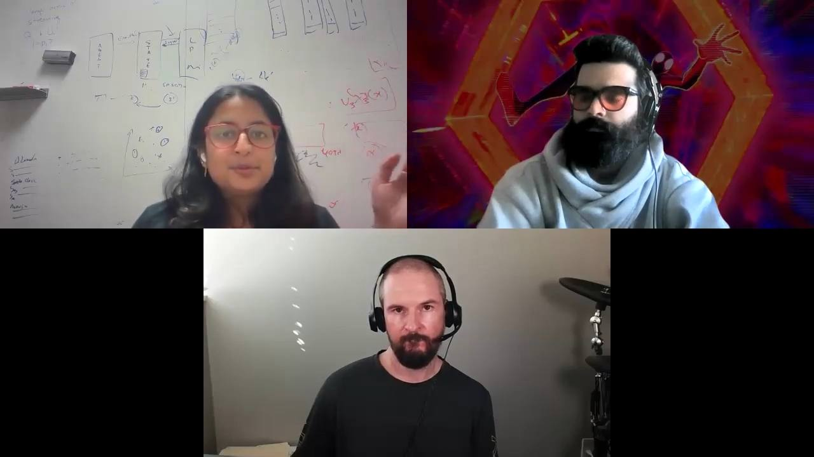

# AI Evals for Engineers & PMs · 第 10 讲：答疑课——把「看数据」落成一套可复现的评测闭环

> 本文只覆盖 **p010** 这一集。这一集是纯答疑（AMA）形式，讲师 Shreya 全程没有共享代码、没有 PPT 翻页、没有新的命令演示。所以本文的「完整代码」章节不是抄录课堂代码，而是**把讲师口述的流程整理成可以直接照着搭的产物**（数据模型、界面规格、决策表、成本估算表）。所有代码块都会明确标注「课里没有代码，以下为示意」。

---

## 1. 这一节做什么

p010 是一场约 47 分钟的开放答疑。学员轮流举手提问，问题集中在六个方向：

1. **LLM judge 能不能自我进化**——用推理模型给 judge 的 prompt 提反馈、甚至用强化学习让它自己改，靠不靠谱；
2. **guardrail 该不该上、用什么上**——用 LLM 判断「这条 query 该不该回答」，还是单独训一个分类器；
3. **「看你的数据」到底是一项什么技能**——它是一句口号，还是一整套可以拆解训练的能力；
4. **错误分析之后，手里有哪些「杠杆」**——改 prompt、换模型、加工具、拆 workflow、加 guardrail、加多 agent，什么时候拉哪个；
5. **怎么让「看数据」这件事变快**——讲师给出的答案非常具体：花 30 分钟到 1 小时 vibe code 一个**只服务于你这个应用的标注界面**；
6. **eval 驱动的开发（先写 eval 再写 prompt）应该怎么做，坑在哪**——尤其是「先写 eval 就再也不用做错误分析」这个陷阱。

这一节没有交付一个「项目」，它交付的是**一套方法论的操作细节**。所以本文要做的事是：把讲师在这些问答里散落的口径、阈值、判断标准、反例，重组成一条**你今天下午就能在自己项目上跑一遍的流水线**，并把它落成四张表 + 两份规格 + 一份示意数据模型。

读者画像按前端转 AI 应用工程师来写。凡涉及并发/文件写入的地方，会补一句「在 JS/Node 里对应什么」。

---

## 2. 讲师原话

下面按主题摘录，全部是译文。

**关于用推理模型去改进 LLM judge 的 prompt：**

> "明显的好处是，用推理模型给 LLM judge 的 prompt 提供反馈可以立刻规模化。但我通常看到的缺点是，它无法推断出你心里那些潜在或隐藏的评判标准。"
> —— p010 [03:14]

> "对于拼写检查这类你非常有信心、相信推理模型或强模型被训练过的事情，这可能是个好选择。但任何有点主观、甚至只需要一点点品味才能挖出来的东西，我发现把反馈外包给推理模型或任何模型，都会彻底失败。"
> —— p010 [03:43]

> "话虽如此，有时候我喜欢让推理模型帮我判断，哪些 trace 最可能表现出某种失败模式，这似乎很有用。我给它一张我所有 trace 的表格，让它逐条过一遍，告诉我哪些最可能表现出这个失败模式，然后我用它来给我的注意力排优先级。"
> —— p010 [03:43]

> "我并不是完全不用 LLM，而是非常审慎地用，并且在我的监督之下。"
> —— p010 [04:37]


**关于 guardrail 的成本：**

> "每一条上线的 guardrail 都有成本：如果它由 LLM 驱动，就有金钱成本；还有延迟成本，它会明显拖慢你的系统；还有误杀的成本——我感觉大多数人只有在部署 guardrail 的时候才凭直觉发现这一点，事前很少有人讨论。"
> —— p010 [05:24]

> "如果你的 guardrail 非常保守，它会拒掉很多用户查询，这也是有代价的。所以最终我会先弄清楚这些成本里哪些是我的优先级：我能容忍误杀吗？为了它值得吗？我的 guardrail 能容忍的误杀率是多少？然后从那里倒推。"
> —— p010 [06:14]

**关于「看你的数据」这项技能：**

> "如果你想广义地擅长看数据，你应该去上一门数据科学或数据分析的课，比如 Coursera 上的某个专项。在我们这门课里，我们非常聚焦于生成式 AI 应用，看这种特定类型的数据。我们不谈看传统机器学习的输入输出，比如特征向量、聚类，那不是我们。"
> —— p010 [08:11]

> "「看你的数据」是个梗，但它的本质是练出这种肌肉：知道怎么嗅出看起来奇怪的数据，并把它当作失败的信号，而且要做得非常快，这样你不用在那么多数据里翻找。很多人不想看自己的数据，我觉得要么是他们太害怕，要么是他们真的不相信这会有那么高的影响力。"
> —— p010 [08:38]

> "错误分析的本质是排优先级：决定往哪个方向改进。所以也许那确实是在教模型、或者教你的团队做这件事。但归根到底，它是关于怎么把产品往前推。那不是一份工程工作——它会涉及工程，但它不像构建传统软件那样主要以工程为主。"
> —— p010 [10:34]


**关于错误分析之后可以拉的那些杠杆：**

> "我知道出了问题。我通过错误分析和测量，精确地知道失败是什么。那么任何改进系统的方式，都只是我拉其中一根杠杆。"
> —— p010 [12:03]

> "另一个杠杆是加入新上下文。这是最大的未知数。不是所有问题都能通过加新上下文解决。这才是难的部分——就是 AI 真的还不行，它还不是专家。"
> —— p010 [12:28]


**关于「先把最简单的东西做出来」：**

> "这里的过早失败模式是，一上来就跳到「我需要把这个任务拆成 XYZ 组件」。你能建的最简单的东西是什么？"
> —— p010 [14:25]

> "我喜欢的一条经验法则是：写一段我会发给 Upwork 上招来的一个相当聪明的人的描述，然后看看会发生什么。"
> —— p010 [14:53]

> "最乐观的情况是你其实没那么多错误。更可能的情况是你有一些错误，而这会告诉你，有些特定的流程 agent 恢复不了。你也可能发现，一旦拆开、让每种流程类型单独调一次 LLM，产品会变好。"
> —— p010 [15:23]

> "开始简单，做错误分析，用它来指导往哪个方向走，重跑你改进后的 pipeline，再做一次错误分析。到某个点你会饱和，比如这类任务到了 95% 的准确率。"
> —— p010 [15:44]


**关于为看数据专门做界面：**

> "第 7 课整节都在讲界面——构建自定义界面来看你的数据。我试过太多工具了，包括最早那批 LLM 出来时的工具，比如不知道大家熟不熟 Lilac，或者那些让大型语言模型可理解的看板类工具。最终，只要 AI 写代码够好了，我为每一个应用能做的最好的事情，就是 literally vibe code 一个数据标注界面。"
> —— p010 [17:33]

> "比如在 Nurture Boss 里，有一类问题是它试图调用 reschedule 工具，但这个工具根本不存在。所以也许可以想个办法把工具列表显示在侧边，如果某个工具不在列表里就高亮出来。"
> —— p010 [18:02]

> "我总跟人说，花 30 分钟到 1 小时 vibe code 一个界面，给你和你的团队去刷一堆标注，把所有标注写进 CSV，然后自己再想怎么做数据分析。"
> —— p010 [18:29]



> "我几乎用同一份 system prompt 来写每一个界面。我会说我想要一个单屏的 trace 查看器，任何我手头的数据都可以展开看。"
> —— p010 [19:27]

> "我觉得快捷键是相当通用的东西，我会尽量做进去。每次有标注，我总会让它自动保存到 parquet 文件里，这样我可以直接重新加载回来。"
> —— p010 [19:55]

> "有一件事我做过、觉得有用（最近做得少了，可能因为那个应用更复杂一点）：在标注某条 trace 的时候，搜索相似的 trace。"
> —— p010 [20:25]


**关于「怎么决定该往界面里加什么」：**

> "我做一件事超过两次、而且不想再做的时候，我就有感觉了：这里有重复。别人可能会想「让 LLM 来做吧」，但我会立刻去想：我能不能一次性把它们都做了？"
> —— p010 [21:51]

> "能不能一次性看这一整簇 trace，然后一次性给它们全部打标注？……你不是把工作外包给另一个 agent 再去验证，你是在把自己并行化。"
> —— p010 [22:15]

> "我一直在想办法让我的团队自己也能做这件事。作为他们的经理，我想给他们工具，更准确地说，是给他们「没有理由不做」的条件。"
> —— p010 [23:09]

**关于把长 trace 丢给推理模型：**

> "我会把表格存下来。每一行是一条 trace。有一列是消息历史，其他列是元数据之类。我把它下载成 CSV，扔进 chat，把模型设成 O3，然后让它从 CSV 里把工具调用抽出来。"
> —— p010 [24:07]

> "我会用某种方式强迫它把所有 trace 内容都输出出来，然后试着一次推理这么多内容。这些模型有 100 万以上的上下文窗口，我发现一条 trace 很难长到超过那么多；或者我会把它削一削，比如把每条消息总结一下，好让至少 10 条 trace 能塞进上下文窗口。"
> —— p010 [25:04]

> "我不会对 3 到 5 轮的 trace 这么做。"
> —— p010 [25:31]

> "我会说正好是 80-20。"
> —— p010 [26:00]

> "我们永远不可能拿到 100% 的错误，但至少先往前走一点，先找出三个非常常见的失败模式，那是我觉得可以修、可以写 eval 去修的，那这个任务就好推理多了。"
> —— p010 [26:30]


**关于可调的「旋钮」可以分成哪几类：**

> "也许把你能拧的旋钮分个类会有帮助。一类是提供上下文，那可能是规范鸿沟问题——你脑子里有、但从来没写进 prompt 的上下文。"
> —— p010 [29:54]

> "另一类是外部上下文，比如用户问的某些工具版本有点旧，或者是另一个 npm 版本，那你也许想接一种方式，去抓取那些你确信能在网上可靠找到的上下文。"
> —— p010 [30:10]

> "然后是一类关于 workflow 拆分的旋钮。这一类很难抽象地做，因为你可能有一个复杂任务，然后想出一种拆法……但你没有任何办法知道这个拆法是否匹配、每一步 LLM 是否都能有好的表现。"
> —— p010 [30:39]

> "我会说 evals 就是你要走的路。根本不要拆它。做错误分析，看它在哪断裂，然后用这个来指导你的任务拆分。"
> —— p010 [31:32]

> "第三类是做一个 AI 人：换模型、训自己的模型、微调自己的模型。我会说，除非你有专门的 AI 人员和资源去部署，否则别做这个。"
> —— p010 [31:59]

> "我希望两年后，所有 SOTA 模型的能力会大致接近。会有不同的档位，但你不用在 Gemini、Claude、OpenAI 之间纠结，就像现在的云计算厂商，基本可以互换。"
> —— p010 [32:26]


**关于多 agent：**

> "我总是会说保持简单，做错误分析，然后在你错误最大的地方，才在那里放一个专门的子 agent，或者在那里做 workflow 拆分。"
> —— p010 [33:51]

> "很多人试图自下而上地构建最好的 agent 系统，把构建 agent 系统时能做的所有决策做笛卡尔积，全部试一遍看哪个最好——这是极其低效的搜索策略。从一个非常简单的东西开始，然后随着你发现失败模式、意识到需要在那里拆分，再沿着可能系统的搜索空间往下走。"
> —— p010 [34:20]


**关于初始 prompt 该花多少功夫：**

> "第一讲里我们给了一个 prompt 模板公式，那真的是我写过的几百个 prompt、读过的几千个 prompt 最终收敛到的结果。我做一个非常好的第一版尝试，然后我就不管了。"
> —— p010 [36:39]

> "我也知道我要把它发给 LLM，而因为 LLM 不会像人那样泛化，我在错误分析里会看到很多错误。也许不是每条 trace 都有错，但我会看到我没预料到的错误，这一点我是知道的。"
> —— p010 [37:08]

> "我不会看着错误分析里的每一个错误去改 prompt。我觉得那就是你想避免的打地鼠。"
> —— p010 [37:35]


**关于「不要」类指令与 eval 驱动开发：**

> "我很同意你。尤其是早期的模型，4.0 mini 就不听这个，ironically，它不听「不要」这类指令。但你要看趋势：随着模型变好，它们是不是越来越遵守你的指令。"
> —— p010 [39:47]

> "如果你今天就需要某个东西，那种情况下我会给我的每一条「要」和「不要」都写 eval，然后对失败的那些去做某种任务拆分把它隔离出来，或者给特定的失败模式加一个 guardrail，检测坏输出是否出现然后重试。"
> —— p010 [40:12]

> "有些人一开始写 eval 会出现的一个失败模式是：他们说「这些就是失败模式，兄弟们，现在我再也不用做错误分析了，因为我可以在数据上跑 eval，就知道我的 trace 什么时候是坏的」。但你不 LLM 会以什么方式失去泛化能力，如果不做错误分析，你会漏掉非常多的 eval。"
> —— p010 [42:10]

> "要做 eval 驱动的开发，因为它是个很好的起点，但也一定要做错误分析。否则你的 eval 过程会有很多偏差。"
> —— p010 [42:35]

**关于长对话里指令遵循能力衰减：**

> "如果你把你多轮对话里的每一条单独消息合并成一条消息——内容全都保留，但表示成一条消息——我记得有一篇论文显示指令遵循能力大幅提升。"
> —— p010 [44:33]

> "还有人在探索的是：让一个后台 LLM 线程去读你的消息，持续跟踪那些「要」和「不要」的约束。然后你把这组约束攒起来，把它们注入到几乎每一条新的用户消息里，用来提醒 LLM 之前规定过的约束。"
> —— p010 [45:56]

---

## 3. 从零复现

这一节按「需求 → 约束 → 估算 → 方案 → 取舍」五步，把讲师在答疑里给出的口径拼成一条能跑起来的流水线。

### 3.1 需求：把「看数据」变成一条有入口、有出口的流水线

讲师反复强调的判断是：错误分析不是「读一读 trace」，它是**排优先级**——「决定往哪个方向改进」（p010 [10:34]）。要把这件事做成流程，你必须回答四个问题，缺一个流程就会断：

| 问题 | 讲师给的口径 | 落到工程上是什么 |
|---|---|---|
| 数据从哪来 | trace 本身，含消息历史 + 元数据 | 一份可导出的 trace 表 |
| 用什么看 | 专门 vibe code 的标注界面，不是通用看板 | 一个单屏 trace viewer |
| 看的时候产出什么 | 标注，写进 CSV / 自动存 parquet | 一张标注结果表 |
| 看完之后做什么 | 归纳出 3 个高频 failure mode，再决定拉哪根杠杆 | 一张「旋钮」决策表 |

**出口必须是「3 个失败模式」而不是「一堆笔记」**，因为讲师在 p010 [26:30] 说得很直白：先找出三个非常常见的失败模式，那是我觉得可以修、可以写 eval 去修的，那这个任务就好推理多了。

### 3.2 约束：讲师在答疑里点名的 5 条硬约束

1. **人的注意力是瓶颈，不是钱。** 界面设计目标是「看到一条 trace，2 秒内知道好坏」（p010 [17:33]）。这条约束直接决定了界面必须单屏、必须可折叠、必须有快捷键。
2. **上下文窗口有上限，但很大。** 「这些模型有 100 万以上的上下文窗口」，目标是「至少 10 条 trace 能塞进上下文窗口」（p010 [25:04]）。
3. **推理模型会漏东西。** 「我会说正好是 80-20」（p010 [26:00]）。
4. **guardrail 有三重成本：金钱、延迟、误杀。** 而误杀成本「大多数人只有在部署的时候才凭直觉发现」（p010 [05:24]）。
5. **不要在没有专门 AI 人和资源的情况下自己训模型/微调**（p010 [31:59]）。

### 3.3 估算：把讲师给的口径算成数字

> 下面这些算式是本文档为了让你能排期、能设阈值而补的，**课里没有给出这些数字**。讲师只给了「1M+ 上下文」「10 条 trace」「2 秒判断」「误杀率倒推」这几个锚点。

**(a) 单条 trace 的 token 预算**

```
总预算 ≈ 1,000,000 tokens（讲师口径：1 million plus）
目标条数 = 10 条
每条 trace 预算 ≈ 1,000,000 / 10 = 100,000 tokens
```

一条 30 轮的 trace，如果每轮（含工具参数）平均 3,000 tokens：

```
30 轮 × 3,000 = 90,000 tokens   → 刚好在 100,000 预算内，能放 10 条出头
40 轮 × 3,000 = 120,000 tokens  → 超预算，放不下 10 条
```

结论：**30 轮左右是「原样塞」的上限，超过就必须压缩**。压缩方式按讲师说法是「把每条消息总结一下」（p010 [25:04]）。若每条消息摘要压到 100 tokens：

```
30 轮 × 100 = 3,000 tokens / 条  → 同样预算能放 333 条
压缩比 30:1，但这就是 80-20 里被丢掉的 20%
```

**(b) 标注吞吐**

讲师给的「2 秒判断一条」是**界面设计指标**，不是端到端产能：

```
纯判断时间 = 100 条 × 2s = 200s ≈ 3.3 分钟
```

端到端还要加上阅读、翻页、写备注。这也是为什么讲师坚持要做界面、要快捷键、要一次性标一簇（p010 [22:15]）——他要压缩的是那部分开销，不是判断本身。

**(c) guardrail 的净收益**

讲师说要从「我能容忍的误杀率」倒推（p010 [06:14]）。写成式子：

```
净收益 = (被正确拦下的坏查询数 × 单次坏查询的处理成本)
       − (误杀率 fpr × 日查询量 Q × 单次合法查询的价值)
       − (Q × 单次 guardrail 的 token 成本)
       − (guardrail 带来的额外延迟 × Q × 单位等待成本)
```

示例假设（**全部是我编的示例数字，只为演示怎么算**）：Q = 10,000 次/天，fpr = 2%：

```
每天被误杀的合法查询 = 10,000 × 2% = 200 条
```

这 200 条就是讲师说的「事前没人讨论、部署后才发现」的那笔账。

### 3.4 方案：八步流水线（照做即可）

**Step 0｜写一个「非常好的第一版」prompt，然后封笔。**
按第一讲的模板公式写。讲师说的验收标准是：「我雇一个 Upwork 上自称这个领域专家的人，他能干这个活」（p010 [37:08]）。投入 30 分钟以上，然后**不要**逐错改 prompt。

**Step 1｜跑真实流量，攒 trace。**
需要留下的字段见第 4 节数据模型。关键是：每条 trace 一整行，消息历史一列，其余是元数据列（p010 [24:07]）。

**Step 2｜花 30–60 分钟 vibe code 一个标注界面。**
规格见 4.4：单屏、可展开、快捷键、每次标注自动落盘到 parquet、工具面板 + 高亮不存在的工具、相似 trace 搜索。

**Step 3｜标注，产出 CSV / parquet。**
标注动作要能在 2 秒内完成。标完立刻落盘，不要有「保存」按钮。

**Step 4｜对 3–5 轮的短 trace，人眼直接看。**
讲师明确说：「我不会对 3 到 5 轮的 trace 这么做」（p010 [25:31]）。推理模型只用来处理 30 轮以上的长 trace。

**Step 5｜对 30+ 轮的长 trace，导出 CSV 交给推理模型排优先级。**
prompt 见 4.5。要它做的是**排序**，不是下结论；结论由你复核。

**Step 6｜归纳出 3 个高频失败模式，写 eval。**
每个失败模式对应一条 eval。注意讲师的警告：不要以为写了 eval 就不用做错误分析了（p010 [42:10]）。

**Step 7｜按「三类旋钮」决定拉哪一根，然后重跑、再错误分析，直到饱和。**
饱和的判据是讲师给的「这类任务到了 95% 的准确率」（p010 [15:44]）。

### 3.5 取舍：三类旋钮的适用边界

讲师把手段归成三类（p010 [29:54]–[31:59]），我把它做成一张「先试哪个」的表：

| 旋钮类别 | 具体手段 | 什么时候拉 | 代价 / 风险 |
|---|---|---|---|
| ① 上下文 | 补规范（你脑子里有、没写进 prompt 的东西）；补外部上下文（工具版本、npm 版本、网上可靠可查的资料） | 失败模式表现为「它不知道这件事」 | 讲师警告：不是所有问题都能靠加上下文解决，「AI 就是还没到那个水平」 |
| ② workflow 拆分 | 拆成多步、按流程类型分别调 LLM、加子 agent、self-refinement 循环 | **只在错误分析指出断裂点之后**才拆 | 抽象地拆没法预判每步 LLM 表现；拆错等于白干 |
| ③ AI 能力 | 换模型（thinking / non-thinking）、训自己的模型、微调 | 有专门 AI 人员和部署资源时 | 讲师原话：没有就别做 |

关于 ③ 还有一条时间判断：「我希望两年后所有 SOTA 模型能力大致接近……就像现在的云计算厂商，基本可以互换」（p010 [32:26]）。意思是**不要为了「押对模型」去做长期架构投入**。

---

## 4. 完整代码

> **课里没有代码。** 讲师全程只讲方法，没有共享屏幕写代码，也没有 OCR 可抄。以下所有代码块、schema、prompt 都是**按讲师口述的要求整理的示意产物**，可以直接用，但不是课堂原文。

### 4.1 决策表：每个问题 → 讲师的决定

| # | 问题 | 讲师的决定 | 关键理由（原话要点） |
|---|---|---|---|
| 1 | 能不能用推理模型自动改 judge prompt？ | 只用于拼写检查这类「模型被训练过」的任务；主观/需要品味的，不要 | 模型推断不出你隐藏的评判标准 |
| 2 | 推理模型在评测流程里的正确用法？ | 拿 trace 表格让它**排优先级**，你再人工复核 | 「我用它来给我的注意力排优先级」 |
| 3 | guardrail 用 LLM 还是分类器？ | 先做成本收益分析，从可容忍误杀率倒推 | 金钱 + 延迟 + 误杀三重成本 |
| 4 | 「看数据」怎么练？ | 上游学数据科学/数据分析；本课只覆盖生成式 AI 数据 | 「特征向量、聚类，那不是我们」 |
| 5 | 错误分析是什么性质的工作？ | 排优先级，决定改进方向；「不是主要意义上的工程工作」 | 会涉及工程，但重心不在工程 |
| 6 | 复杂任务（如从 Zoom 录音抽业务流程）从哪开始？ | 先做最简版本：整段 transcript 塞进去 + 认真写 prompt | 「写一段我会发给 Upwork 上相当聪明的人的描述」 |
| 7 | 什么时候才拆任务？ | 错误分析显示断裂点之后 | 「根本不要拆它。做错误分析」 |
| 8 | 怎么让看数据变快？ | 花 30–60 分钟 vibe code 一个专属标注界面 | 「只要 AI 写代码够好了……literally vibe code」 |
| 9 | 界面里必须有什么？ | 单屏、可展开、快捷键、自动存 parquet、工具面板高亮、相似 trace 搜索 | 见 4.4 |
| 10 | 怎么发现「该做工具了」？ | 同一件事做超过两次就做 | 「我能不能一次性把它们都做了」 |
| 11 | 长 trace 怎么办？ | 30+ 轮才交给推理模型；先抽工具调用，再压缩摘要，保证 ≥10 条塞得下 | 短 trace 人眼看 |
| 12 | 多 agent 什么时候上？ | 只在错误最大的地方上专门的子 agent | 「总是会说保持简单」 |
| 13 | 初始 prompt 投多少？ | 30 分钟以上，一次做到「非常好的第一版」，然后封笔 | 逐错改 prompt 是打地鼠 |
| 14 | 先写 eval 再写 prompt 行不行？ | 行，但必须继续做错误分析 | 「否则你的 eval 过程会有很多偏差」 |
| 15 | 「不要」类指令失效怎么办？ | 给每条 do / do-not 写 eval；失败的做任务拆分隔离，或加 guardrail 检测后重试 | 早期模型会把「不要」这个词丢掉 |

### 4.2 组件职责表

| 组件 | 职责 | 输入 | 输出 | 课里是否明确 |
|---|---|---|---|---|
| trace 存储 | 一行一条 trace，消息历史单独一列 | 线上调用日志 | 可导出的表 | 明确（p010 [24:07]） |
| 标注界面 | 让人 2 秒判断一条 | trace 表 | 标注结果 | 明确（p010 [17:33]） |
| 标注落盘 | 每次标注自动写 parquet | 单条标注 | parquet 文件 | 明确（p010 [19:55]） |
| CSV 导出 | 给推理模型吃的格式 | trace 表 | CSV | 明确（p010 [24:07]） |
| 推理模型 | 对长 trace 排优先级 | CSV | 排序后的 trace id 列表 | 明确（p010 [03:43]） |
| eval 集 | 固化 3 个高频失败模式 | 标注结果 | 可重复跑的检查 | 明确（p010 [26:30]） |
| guardrail | 检测坏输出并重试 | 单次输出 | 拦截 / 放行 | 明确（p010 [40:12]） |
| 约束注入线程 | 后台维护 do / do-not 列表并注入每条新消息 | 对话历史 | 约束文本 | 明确但是「别人在探索」（p010 [45:56]） |

### 4.3 数据模型（示意）

**trace 表（喂给推理模型的 CSV）：**

```ts
// 课里没有代码，以下为示意。
// 讲师口述结构：每一行是一条 trace，有一列是消息历史，其他列是元数据。
export interface TraceRow {
  trace_id: string;
  /** 讲师原话：有一列是消息历史 */
  message_history: string;
  /** 讲师原话：其他列是元数据之类 —— 具体列课里没讲，下面是我们按需要补的示意 */
  turn_count: number;
  model: string;
  latency_ms: number;
  /** 从 message_history 里抽出来的工具名，用于界面侧边工具面板高亮 */
  called_tools: string;
  /** 该应用里真实存在的工具白名单，用于高亮「调了不存在的工具」 */
  available_tools: string;
  timestamp: string;
}
```

**标注结果表（落盘到 parquet）：**

```ts
// 课里没有代码，以下为示意。
export interface LabelRow {
  trace_id: string;
  /** 讲师要的「2 秒判断」——所以这个字段只允许是枚举，不允许自由文本 */
  label: "good" | "bad";
  /** 3 个高频失败模式，见 p010 [26:30]；具体枚举值由你的错误分析决定 */
  failure_mode: string | null;
  note: string;
  annotator: string;
  labeled_at: string;
}
```

**一条 CSV 样例：**

```csv
trace_id,message_history,turn_count,model,latency_ms,called_tools,available_tools,timestamp
t-0001,"user: 帮我改一下明天的预约|assistant: 好的，我来调用 reschedule|tool_call: reschedule(...)",3,gpt-4o-mini,1820,"reschedule","book,cancel,lookup",2025-01-10T10:00:00Z
```

> 注意：真实消息历史里含有逗号和换行，CSV 必须正确转义，否则推理模型看到的就是一坨错位的内容。这一点**课里没讲**，见第 7 节。

### 4.4 标注界面需求规格（拿去 vibe code 的 system prompt）

讲师说他有「一份几乎用来写每个界面的 system prompt」，但**原文没有公开**。下面这份是按他在 p010 [19:27]–[22:15] 口述的要求整理的示意版，可以直接粘给编码模型：

```text
课里没有代码，以下为示意：按讲师口述整理的界面规格 prompt。

我要一个单屏（single pane）的 trace 查看器，用来给 trace 打标注。请一次性给出完整可运行的前端代码。

硬性要求：
1. 单屏。任何我手头的数据都可以展开看（expandable），默认收起，点击展开。
2. 工具参数不要默认全展示，尤其是某个特定工具的参数——要可展开。
3. 快捷键优先：好评 / 差评 / 下一条 / 上一条 / 展开全部，全部用键盘完成，不用鼠标。
4. 每次打标注立刻自动保存，不要「保存」按钮。保存目标是一个 parquet 文件（先给我一个能落盘的实现，格式不对我再改）。
5. 侧边栏常驻显示这个应用真实存在的工具白名单（available_tools）。
   如果这条 trace 的 called_tools 里有任何一个不在白名单里，就高亮那一个。
6. 提供一个「搜索相似 trace」的入口，能在我标注当前这条时打开。

请把状态管理写得简单直接，不要引入不必要的框架。
```

其中第 5 条直接对应讲师举的例子：在 Nurture Boss 里，agent 会试图调用一个根本不存在的 reschedule 工具，所以「把工具列表显示在侧边，如果某个工具不在列表里就高亮出来」（p010 [18:02]）。

### 4.5 长 trace 交给推理模型的 prompt（示意）

```text
课里没有代码，以下为示意。

附件是一份 CSV，每一行是一条 agent 的 trace，其中 message_history 列是完整对话。

请：
1. 从每一条 trace 的 message_history 中抽出所有工具调用，按顺序列出工具名和关键参数。
2. 然后逐条判断：这条 trace 里是否存在「重复调用同一个工具却没有推进」「调用了不存在的工具」「用户明确纠正后仍然重复同一动作」这三种情况。
3. 最后输出一个按「最可能出问题」排序的 trace_id 列表，给出理由，每条不超过两句话。

不要修改原始数据，不要编造没有出现在 message_history 里的工具名。
```

这套 prompt 对应讲师的两个动作：先「让它把工具调用抽出来」，再「强迫它输出所有 trace 内容然后一次推理」（p010 [24:07]、[25:04]）。

**该 prompt 的已知缺陷（讲师亲口承认）：** 抽出来的东西会漏，覆盖率大概是 80-20（p010 [26:00]）。所以排序结果只能用来**分配你的注意力**，不能当成结论。

### 4.6 容量估算表

| 项 | 数值 | 来源 |
|---|---|---|
| 推理模型上下文 | 1,000,000+ tokens | 讲师口径「1 million plus」 |
| 目标 trace 条数 / 次 | ≥10 条 | 讲师口径 |
| 单条 trace token 预算 | ≈100,000 tokens | 上面两项相除（本文档推算） |
| 可原样塞的轮数上限 | ≈30 轮（按 3,000 tokens/轮） | 本文档推算，非讲师所述 |
| 需要压缩的触发条件 | trace > 30 轮 | 讲师口径「30 plus turns」 |
| 不适用推理模型的场景 | 3–5 轮 trace | 讲师明确否定 |
| 压缩后信息保留率 | ≈80% | 讲师口径「正好是 80-20」 |
| 饱和判据 | 该任务 ≈95% 准确率 | 讲师口径 |
| 学员提到的规模 | 「至少 100 条 trace
条的规模，学员在 p010 [26:50] 追问「至少看 100 条 trace」 | 学员口径，非讲师设定 |

### 4.7 两类「失败模式闭环」的落地表（示意）

讲师在 p010 [40:12] 和 p010 [45:56] 给了两个具体机制：给每条 do / do-not 写 eval；以及用后台线程维护约束集并注入每条新消息。把它们落成表：

| 机制 | 触发条件 | 动作 | 讲师给的判断 |
|---|---|---|---|
| do / do-not 逐条 eval | 你在 prompt 里写了「要」或「不要」 | 每条一个检查项，跑失败的那条 | 「我会给我的每一条要和不要都写 eval」 |
| 任务拆分隔离 | 某条 do/do-not 的 eval 持续失败 | 把该约束涉及的子任务单独拆出来 | 「对失败的那些去做某种任务拆分把它隔离出来」 |
| guardrail 检测 + 重试 | 坏输出能被检测到 | 检测到 → 重试 | 「检测坏输出是否出现然后重试」 |
| 约束注入 | 多轮长对话，指令遵循衰减 | 后台线程维护 do/do-not 列表，注入每条新用户消息 | 「把这组约束攒起来，注入到几乎每一条新的用户消息里」 |
| 消息合并 | 长对话里指令被稀释 | 把多轮单独消息合并成一条消息对象（内容全保留） | 「指令遵循能力大幅提升」，但讲师补了一句「我不知道这对更新的模型是否还成立」 |

---

## 5. 逐行解释

这一节把前面每一张表、每一个算式拆开讲：为什么这样定，不这样会怎样。凡是讲师原话支撑的，标注时间戳；凡是我补的工程判断，明确写「这是我的判断」。

### 5.1 为什么「第一版 prompt 之后就封笔」

讲师在 p010 [37:08] 说他做一个「非常好的第一版」，验收标准不是「我觉得好」，而是一个可外部化的判据：**把这段描述发给 Upwork 上自称这个领域专家的人，他能不能干这个活**。这条标准的价值在于它把「prompt 写好了没有」从主观感受变成了可交付性判断——你写的是任务说明，不是咒语。

然后他明确否掉了一个动作：「我不会看着错误分析里的每一个错误去改 prompt。我觉得那就是你想避免的打地鼠」（p010 [37:35]）。

为什么不这样改？因为 LLM 的失败不是独立同分布的。你为错误 A 加一句约束，很可能在错误 B 上引入新偏差；改完 A 你又要去验证 B，于是你在一个互相耦合的空间里做单点修补。讲师在 p010 [37:08] 给了根因：「LLM 不会像人那样泛化……我会看到我没预料到的错误，这一点我是知道的」。**既然预料不到，就不要用「逐个预料」的方式去修**。正确做法是把错误聚成模式（3 个高频失败模式），再决定拉哪根旋钮。

**在 JS/Node 里对应什么：** 这相当于你不去给每个失败用例写 `if` 补丁，而是回到接口层重新定义输入输出的契约。补丁式修复在代码里也是同样的坏味道。

### 5.2 为什么「30 轮」是那条分界线

讲师说得很具体：「我不会对 3 到 5 轮的 trace 这么做」（p010 [25:31]），理由是「30 多轮的 trace，光是读完就已经疲劳到不行」（p010 [25:31] 段意）。

所以「30 轮」不是一个模型能力阈值，而是**人的疲劳阈值**。这就解释了两件事：

1. 为什么短 trace 不该用推理模型——你自己看更快，而且不漏；用模型反而引入 80-20 的损失（p010 [26:00]）。
2. 为什么长 trace 用模型也不算「作弊」——讲师原话是「你在 review 这些 30 多轮的 trace 时，你可能比 LLM 还差，你也可能漏东西」（p010 [26:00]）。模型的 80 分在这里是相对提升。

**注意别把这句读成「模型比人准」。** 讲师的用法始终是「排优先级 → 我自己复核」（p010 [03:43]、[04:37]）。

### 5.3 为什么「2 秒判断」直接决定了数据模型

标注结果表里 `label` 只允许 `"good" | "bad"` 两个枚举值，`failure_mode` 允许 `null`，`note` 是唯一自由文本字段——这不是我随便设计的。

讲师对界面的要求是「看到它，立刻在两秒内知道是好是坏」（p010 [17:33]）。两秒内不可能写完一段描述，所以**判断必须落在一个二元枚举上**；失败模式是二级字段，允许留空；备注是可选的、事后补的。如果你的 schema 让 `label` 是自由文本，界面就必然出现输入框，2 秒目标当场破产。

同理 `annotator` 和 `labeled_at` 两个字段是为了多人协作时能追溯——讲师在 p010 [26:30] 提到「到某个点你可能会想让很多人一起来帮你做错误分析，如果一个人做太多了」。多人标注就必须能区分来源。

### 5.4 为什么「自动保存、不要保存按钮」

讲师原话：「每一次有标注，总是自动保存到 parquet 文件，这样我可以直接重新加载回来。如果我想训 LLM judge，我就有这些可用」（p010 [19:55]）。

拆成三个判断：

- **不设保存按钮**，是因为任何一次「忘记保存」都会让 2 秒判断的投入蒸发。标注是高频低价值动作，不能配高摩擦的确认步骤。
- **落 parquet 而不是只留内存**，是因为它要能被**重新加载**：一部分喂给人复盘，一部分喂给 judge 做训练/验证材料。讲师明确把「重新加载回来」和「训 LLM judge」连在一起说。
- **落盘时机是每次标注**，不是每 10 条、不是退出时。

**在 JS/Node 里对应什么（这是我的判断，课里没讲）：** 每次标注就写文件，等于同一个文件被高并发追加。浏览器端不能直接写本地 parquet，通常要落到一个本地服务或 IndexedDB 再导出；Node 端如果你用 `fs.appendFile` 并发写同一个文件，可能交错写坏内容。做法是**单写者队列**——所有标注进一个内存队列，由一个 `async` 循环串行 `await` 写入。这就是「锁」在前端语境下的对应物：不是加锁，而是把并发收敛到一个消费者。

### 5.5 为什么工具白名单要放侧边、要高亮

讲师举的例子是全篇最具体的一处：「在 Nurture Boss 里，有一类问题是它试图调用 reschedule 工具，但这个工具根本不存在。所以也许可以想个办法把工具列表显示在侧边，如果某个工具不在列表里就高亮出来」（p010 [18:02]）。

这个设计的信息论价值在于：**它把「判断」变成「比对」**。原来你要读完整条 trace、回忆这个应用有哪些工具、再发现 agent 调了一个不存在的——这是三段推理。把白名单放侧边后，你只需要一眼看有没有高亮，判断成本从「理解」降到「视觉扫描」。

这也解释了讲师为什么说界面启发式「会是这个应用专属的」（p010 [17:33]）：高亮规则来自你的业务，不是通用能力。通用看板（他提到的 Lilac 那类工具，p010 [17:06]）给不了你这个。

### 5.6 为什么「相似 trace 搜索」是可选项

讲师对这条的表述非常谨慎：「我最近做得少了。我做的时候觉得有用，但也许是因为那个应用稍微复杂一点……这是我为了用强化学习训模型的时候」（p010 [20:25]）。

三个限定词：最近做得少、可能因为应用复杂、场景是 RL 训练。他给的理由是：「脱离上下文去评估单条 trace 很难，你不知道这条是比平均好还是比平均差」（p010 [20:53]）。

结论：**这条不是通用必备项**。它的适用条件是「你要判断的是一条 trace 的相对质量」，而不是「你要判断的是对错」。如果你只是做对错标注，白名单高亮 + 快捷键已经够；只有当你要做偏好比较或 RL 数据构造时，相似 trace 检索才值回成本。

### 5.7 为什么「同一件事做超过两次就做工具」

讲师的原话是：「我做一件事超过两次、而且不想再做的时候，我就有感觉了」（p010 [21:51]）。阈值只有 2 次，看起来激进，但注意后半句——他立刻区分了两种应对：

- 别人的反应：「让 LLM 来做吧」；
- 他的反应：「我能不能一次性把它们都做了？……能不能一次性看这一整簇 trace，然后一次性给它们全部打标注？」（p010 [22:15]）

差别在于**验证成本**。把活外包给 LLM，你要再花一份力气去验证 LLM 的产出；把自己并行化，你仍然是执行者，不需要额外验证。讲师自己总结得很清楚：「你不是把工作外包给另一个 agent 再去验证，你是在把自己并行化」（p010 [22:15]），以及「不是消除这些任务，而是同时做」（p010 [23:09]）。

这条规则对前端同学尤其好用：你本来就会写界面，做一个批量视图的成本远低于搭一套 agent 流水线。

### 5.8 为什么「不要自下而上穷举 agent 架构」

讲师在 p010 [34:20] 的攻击非常具体：很多人「把构建 agent 系统时能做的所有决策做笛卡尔积，全部试一遍看哪个最好——这是极其低效的搜索策略」。

把这个「笛卡尔积」写出来就知道为什么低效。假设你有 5 个二元决策：

```
模型档位（thinking / non-thinking）      2
是否拆成子 agent                          2
每个子 agent 是否带自反思循环             2
是否加 RAG                                2
是否加 guardrail + 重试                   2
→ 2^5 = 32 种组合
```

每种组合你都要跑一遍 eval 集。若 eval 集 100 条、单次运行 3 分钟，就是 32 × 100 × 3 分钟 ≈ 160 人时，而且还只是 5 个维度。真实系统维度远多于此。更糟的是，组合空间里绝大多数点对应的是「你压根没有失败模式需要它解决」的冗余复杂度。

讲师的替代路径：**从一个非常简单的东西开始，只在错误分析指出的那个点上往下降一层**（p010 [33:51]、[34:20]）。这就是他把 eval 放在 workflow 拆分之前的理由——eval 是告诉你「往哪个维度下降」的信号，没有它你只能穷举。

### 5.9 三类旋钮为什么要按这个顺序

讲师把旋钮分三类（p010 [29:54]–[31:59]），我把它排成「先试哪个」，依据是他对每类的成本描述：

**① 上下文最便宜。** 补规范只是改 prompt 文本；补外部上下文需要写检索，但讲师给出的触发条件很窄——「用户问的某些工具版本有点旧，或者是另一个 npm 版本」（p010 [30:10]），也就是**你能确信网上有可靠答案的那类关键词**。注意他同时给了上限：「不是所有问题都能通过加新上下文解决。这才是难的部分——就是 AI 真的还不行」（p010 [12:28]）。

**② workflow 拆分其次，但必须由错误分析授权。** 讲师说这类「很难抽象地做」，因为你「没有办法知道这个拆法是否匹配、每一步 LLM 是否都能有好的表现」（p010 [30:39]）。翻译成工程语言：拆分的收益不可预先验证，只能实测。所以它排在有信号之后。

**③ 换模型 / 微调最后。** 讲师的门槛写得很硬：「除非你有专门的 AI 人员和资源去部署，否则别做这个」（p010 [31:59]）。他给的时间判断是「两年后所有 SOTA 模型能力大致接近，就像现在的云计算厂商，基本可以互换」（p010 [32:26]）。含义是：**今天为了选对模型做的架构投入，在模型趋同后会贬值**。所以他建议把「换模型」当成一个可替换的旋钮，不要当成架构决策。

### 5.10 guardrail 的成本式子逐项解释

第 3.3(c) 节那个式子是：

```
净收益 = (被正确拦下的坏查询数 × 单次坏查询的处理成本)
       − (误杀率 fpr × 日查询量 Q × 单次合法查询的价值)
       − (Q × 单次 guardrail 的 token 成本)
       − (guardrail 带来的额外延迟 × Q × 单位等待成本)
```

逐项对着讲师的话：

- 第二项（误杀）是他反复强调的重点：「如果你的 guardrail 非常保守，它会拒掉很多用户查询，这也是有代价的」，而且「大多数人只有在部署 guardrail 的时候才凭直觉发现这一点，事前很少有人讨论」（p010 [05:24]）。
- 第三项（token）是他说的「如果它由 LLM 驱动，就有金钱成本」。
- 第四项（延迟）是他说的「它会明显拖慢你的系统」。
- 第一项是分子，也是他默认为你已知的部分：guardrail 存在的目的就是拦坏东西。

**他的决策方法是倒推**，不是正推：「我能容忍误杀吗？为了它值得吗？我的 guardrail 能容忍的误杀率是多少？然后从那里倒推」（p010 [06:14]）。也就是说，先定 fpr 的上限（这是业务决定，不是技术决定），再反算这个 guardrail 值不值得上、要不要换成便宜的分类器。

**学员那个问题的答案是「看情况」，但讲师给了判据**：他说「最终我认为这对每个业务都是具体的」，但接着说了一句关键的观察——「我确实发现团队会系统性地去测量这个误杀率、这个成本，真的去整体地推理有 guardrail 的代价」（p010 [06:14]）。**能不能算清楚，比选 LLM 还是分类器更重要。**

**在 JS/Node 里对应什么（我的判断）：** 延迟成本在代码里就是同步等待。如果 guardrail 是串行 await 在用户请求路径上，它直接加在首字延迟上；如果你有明确的延迟预算（比如 800ms），guardrail 的 p95 必须在这个预算内，超时要用 `AbortController` 放弃并放行（fail-open），而不是让用户等。fail-open 还是 fail-closed 是业务决策，但你必须显式写出来。

### 5.11 为什么「先写 eval」有偏置

讲师承认 eval-first 是好的起点（「要做 eval 驱动的开发，因为它是个很好的起点」），但紧接着给了失败的机制：「他们说这些就是失败模式，现在我再也不用做错误分析了……但你不知道 LLM 会以什么方式失去泛化能力，如果不做错误分析，你会漏掉非常多的 eval」（p010 [42:10]）。

机制其实很直白：**你写的 eval 只覆盖你能想到的失败模式**。而 LLM 的失败恰恰集中在你想不到的地方（这正是他在 p010 [37:08] 提前断言「我会看到我没预料到的错误」的原因）。如果你用自己写的 eval 集当唯一指标，这个指标会系统性地高估你的系统——**这就是他说的「偏置」**。

所以他给的正确组合是：先写一部分 eval（作为起点和回归网），**同时必须继续做错误分析**，用错误分析产出的新模式去扩充 eval 集。

### 5.12 「不要」丢词这件事怎么处理

学员观察到「我有一堆 `do not` 的时候，它有时候会把 `do not` 这个词丢了，然后就去干那件事」——讲师的回应是同意，并加了证据：「尤其是早期的模型，4.0 mini 就不听这个，ironically，它不听 `do not` 这类指令」（p010 [39:47]）。

他给了两条处理路径，一条看趋势、一条看当下：

- **看趋势**：「随着模型变好，它们是不是越来越遵守你的指令。如果你看到这有改善，那你可以期望有一天它会听我的指令」（p010 [39:47]）。
- **看当下**（如果你今天就需要）：「我会给我的每一条要和不要都写 eval，然后对失败的那些去做某种任务拆分把它隔离出来，或者给特定的失败模式加一个 guardrail，检测坏输出是否出现然后重试」（p010 [40:12]）。

注意这两条都不是「把 `do not` 改成更强的措辞」。他给的是**结构化解法**：拆任务让该约束不再需要，或加外挂检测。他还有一句限定：「具体也看应用的复杂度，如果是一个定义得很好的分类任务，我就不会有那么大、那么结构化的 prompt」（p010 [38:28]）。

### 5.13 长对话记忆衰减的两个候选方案

讲师在这一段（p010 [44:33]–[45:56]）非常克制，先说「这一条很难」，然后给了两个**都不确定**的方案：

1. **把多轮消息合并成一个消息对象**——内容全保留，但表示成一条。「我记得有一篇论文显示指令遵循能力大幅提升」，紧接着补「我不知道这对更新的模型是否还成立，或者它们是不是已经更擅长长上下文指令遵循了」。
2. **后台 LLM 线程维护约束集**：「让一个后台 LLM 线程去读你的消息，持续跟踪那些要和不要的约束」，然后把攒起来的约束「注入到几乎每一条新的用户消息里」。

他还明确说这个方向「是一个非常活跃的研究问题」，第二个方案「也许也只是个 hack」，来源是伯克利那边的人「anecdotally」告诉他的。所以这两条在文档里只能写成**待验证的候选**，不能写成推荐做法。

---

## 6. 复现检查清单

按顺序勾。每一项都写了「怎样算通过」，方便你自查有没有真的做到，而不是「好像做了」。

**A. 准备阶段**

- [ ] 你写下了一份第一版 prompt，并且能通过讲师的验收标准：把它发给一个「Upwork 上自称这个领域专家的人」，他能照做。投入时间 ≥ 30 分钟（p010 [37:08]）。
- [ ] 你在写第一版 prompt 时**没有**边跑边改，也没有对照具体错误逐条打补丁（p010 [37:35]）。
- [ ] 你确认了自己的 trace 能导出成「一行一条、消息历史单独一列、其余为元数据」的表（p010 [24:07]）。


**B. 建界面**

- [ ] 标注界面是单屏的（p010 [19:27]）。
- [ ] 所有数据可展开，默认收起；工具参数不默认全展示（p010 [19:27]）。
- [ ] 好评 / 差评 / 上一条 / 下一条 四个动作全键盘可完成（p010 [19:55]）。
- [ ] 没有「保存」按钮，每次标注立即落盘（p010 [19:55]）。
- [ ] 落盘格式是 parquet，并且你验证过「重新加载回来」这条路能走通（p010 [19:55]）。
- [ ] 侧边常驻工具白名单，调了不在白名单里的工具会高亮（p010 [18:02]）。
- [ ] 你的界面里至少有一条**应用专属**的启发式（白名单高亮是最低配的一条），不是纯通用看板（p010 [17:33]）。
- [ ] （可选）相似 trace 搜索已实现或已明确判定不需要，理由写下来（p010 [20:25]）。

**C. 标注与错误分析**

- [ ] 你标注了至少 100 条 trace，或者明确记录了为什么达不到这个量（学员口径，p010 [26:50]）。
- [ ] 你能在 2 秒内完成一条「好 / 坏」判断；做不到就回去改界面，不要硬扛（p010 [17:33]）。
- [ ] 3–5 轮的短 trace 是你自己看的，没有交给推理模型（p010 [25:31]）。
- [ ] 30+ 轮的长 trace 你导出了 CSV，用推理模型排过优先级，并且**你复核了它排在最前面的那些**（p010 [03:43]）。
- [ ] 你记录了推理模型的漏检情况，并接受它有约 20% 的遗漏（p010 [26:00]）。
- [ ] 你归纳出了 **3 个**高频失败模式，每个都能写成一条 eval（p010 [26:30]）。

**D. 写 eval**

- [ ] 3 个失败模式各对应一条可重复运行的检查。
- [ ] prompt 里每一条「要」和「不要」都有对应的 eval（p010 [40:12]）。
- [ ] 你**没有**把 eval 集当成唯一指标——错误分析仍在继续跑（p010 [42:10]）。

**E. 决定拉哪根旋钮**

- [ ] 每个失败模式你都先判断它属于哪一类：上下文缺失 / 需要 workflow 拆分 / 需要换模型（p010 [29:54]）。
- [ ] 在动拆分之前，你先确认了失败模式确实指向某个具体步骤，而不是「整体不行」（p010 [31:32]）。
- [ ] 你没有引入多 agent，除非错误分析明确指出某个点需要专门的子 agent（p010 [33:51]）。
- [ ] 你没有为了「试试哪个组合最好」去穷举架构（p010 [34:20]）。
- [ ] 如果你上了 guardrail，你写出了三个数字：可容忍误杀率、单次 token 成本、额外延迟（p010 [05:24]）。
- [ ] 你重跑了 pipeline 并做了第二轮错误分析，且知道终点大致是「这类任务 95% 准确率」（p010 [15:44]）。

**F. 长对话场景（如果适用）**

- [ ] 你验证过「多轮消息合并成一条」是否对你的模型仍有帮助（p010 [44:33]）。
- [ ] 你验证过「约束集注入每条新用户消息」是否有效（p010 [45:56]）。
- [ ] 两条都标了「待验证」，没有当成确定结论上线。

---

## 7. 课里没讲但你会撞上的

这一节全部是**课里没讲**的内容，是我按「你照着上面做，一定会遇到的问题」补的。每条都标了课里最接近的线索。

**1. 浏览器里没有原生 parquet。**
讲师说「自动存到 parquet 文件」（p010 [19:55]），但没讲在什么环境里写。如果你跟我一样是前端出身，直接照做会卡住：浏览器不能直接写本地文件系统，也没有内置 parquet 编码。可行路径有三条——起一个本地 Node 小服务专门接收标注并写 parquet；先写 IndexedDB 再导出；或者界面阶段先用 NDJSON 落盘，最后统一转 parquet。**讲师没有指定任何一种**，选哪条取决于你的部署形态。

**2. CSV 转义会毁掉你的推理模型输入。**
讲师说「下载成 CSV 放进 chat」（p010 [24:07]）。他没讲的是：消息历史里全是引号、逗号、换行。手写 `split(",")` 一定会错位，错位后推理模型看到的是一张错表，而你很难察觉——它照样会给你一个很像那么回事的排序。用成熟的 CSV 库，或者干脆用带转义的 JSON Lines 代替。

**3. 你怎么知道「至少 10 条 trace 塞得下」。**
讲师给了「1 million plus 上下文」和「至少 10 条 trace」两个锚点（p010 [25:04]），但没给 token 计数方法。上线前你必须自己数：把一条真实 trace 序列化后跑一次 tokenizer，得到真实数值，再决定压缩策略。凭字数估算会差出 2–3 倍。

**4. 白名单是会过期的。**
工具白名单高亮（p010 [18:02]）依赖 `available_tools` 这个字段是真实的。工具一改，白名单不更新，高亮就开始误报，你会逐渐不再相信它——一个被忽略的高亮比没有高亮更糟。这个字段必须从工具注册表自动生成，不能手写。

**5. 多人标注会不一致。**
讲师提到「到某个点你可能会想让很多人一起来帮你做错误分析」（p010 [26:30]），但没讲一致性。两个人对「这条算不算坏」的判断标准会漂移，尤其当失败模式是主观的时候。最低成本做法：先让两个人各标 20 条同一批 trace，对比差异，把分歧点写成判断标准，再开始大规模标。

**6. trace 是有采样偏差的。**
你导出的 trace 大概率来自线上流量，而线上流量偏向「用户没放弃的那些」。失败最严重的那些（用户直接关掉、重试、报错退出）往往在 trace 里反而不显眼。错误分析基于什么分布，结论就只对那个分布成立。这一点**课里没讲**。

**7. O3 这一类的调用是有账单的。**
讲师用 O3 处理 30+ 轮的长 trace（p010 [24:07]），并且要「强迫它输出所有 trace 内容」（p010 [25:04]）。长输入 + 长输出，单次成本不低。批量处理前先跑 5 条估算单条成本，再乘以你的 trace 总量。

**8. eval 集会随模型升级漂移。**
你写的 eval 是绑定在某个模型行为上的。换模型后，一部分 eval 会因为「模型行为变了」而失败，但失败原因可能不是变差。讲师在 p010 [32:26] 期待模型趋同，若真如此，eval 集的价值会越来越稳定；但在那之前，每次换模型都要重跑全量 eval 并逐条看失败原因，而不是只看通过率。

**9. guardrail 的误杀需要监控。**
讲师强调误杀成本事前没人算（p010 [05:24]），但他没讲上线后怎么量。你必须能回答「今天 guardrail 拦了多少条、其中多少条被我人工复核认为是误杀」。没有这个数据，你就无法做他说的「从可容忍的误杀率倒推」。

**10. 并发写入的时序问题（给前端同学的提醒）。**
每次标注即时落盘（p010 [19:55]）在单机单用户下没问题，多人同时标就会撞上并发写。Node 里对应的是「单写者队列」：所有标注进队列，一个消费者串行 `await` 写入。这相当于后端加锁的前端版本——不是为了性能，是为了不写坏文件。

**11. 「相似 trace 搜索」需要向量化，讲师没给实现。**
讲师只说「弹出一个窗口，我可以搜相似 trace」（p010 [20:25]），没讲相似度怎么算。可选路径至少有三条：把消息历史做 embedding 后比余弦相似度；按工具调用序列做编辑距离；按失败模式标签做分组。选哪条取决于你要回答的是「内容相似」还是「行为相似」。

**12. 95% 这个饱和判据要按任务类型调整。**
讲师说「到某个点你会饱和，比如这类任务到了 95% 的准确率」（p010 [15:44]）。但他加了「这类任务」这个限定。信息抽取类和对话类、有无标准答案、错误代价高低，都会把这个数拉开。别把 95% 当通用指标抄到自己的验收标准里。

---

**本讲一句话总结：** p010 没有交付代码，它交付的是一条纪律——**先认真写一版 prompt 然后封笔，做一个 30–60 分钟的专属界面把 100 条 trace 刷完，归纳出 3 个高频失败模式写成 eval，然后只在你测出来的断裂点上拉旋钮，重跑、再错误分析，直到饱和。** 全程唯一被反复警告的反模式是「没做错误分析就开始改」——无论是改 prompt、拆 workflow，还是上多 agent。