# AI Evals 实战：用 BrainTrust / Arize Phoenix / LangSmith 复现作业一与作业二（Recipe Chatbot 评测）

> 覆盖视频：BV1FwTE6gEky 的 P011–P014。
> 说明：这四段视频**没有配套的屏幕 OCR 文本**（截图清单里只有帧图，没有识别结果），因此第 4 节「完整代码」里的代码是**按逐字稿念出来的函数名、参数名、行为描述复原的骨架**，凡是逐字稿没念出来的（import 路径、模型名、prompt 正文、API 参数名）都明确标注【课里没讲】，执行时请以你本地 SDK 的实际签名为准。

---

## 1. 这一节做什么

这四段视频讲的是**同一份作业**（作业一 + 作业二）在**三个不同平台**上的三套实现。它们不是四个独立知识点，而是同一个项目的三条并行路线，你只要挑一条跑通即可，另外两条用来对照。

| 视频 | 讲师 | 平台 | 覆盖作业 |
|---|---|---|---|
| P011 | Wade Gilliam（BrainTrust） | BrainTrust | 作业二：合成数据 + 开放编码/轴心编码 + 失败模式分类 |
| P012 | Wade Gilliam（BrainTrust） | BrainTrust | 作业一：定义意图、建数据集、playground 优化 system prompt |
| P013 | Allianne（Arize） | Phoenix（本地）/ AX（企业版） | 作业一 + 作业二，15 分钟完整走查 |
| P014 | Harrison（LangChain） | LangSmith | 作业一 + 作业二，22 分钟完整走查 |

**最终要交付的产物（三条路线产出物一一对应）：**

1. **一个被埋点（instrumented）的菜谱聊天机器人**——能把每一轮对话变成一条带 span 的 trace。
2. **一份数据集**——课程自带 3 条样本查询 + 你手写的 10 条，字段上要区分「手写 / 合成」。
3. **两个版本的 system prompt**——baseline 版和迭代版，以及一个自动评分器（BrainTrust 用 Loop 生成、Phoenix 用 playground 并排比较、LangSmith 用 prompt canvas 让 LLM 重写）。
4. **一次批量实验**——把 prompt 跑在整个数据集上，记录延迟、token、成本。
5. **开放编码（open coding）备注**——逐条 trace 用自然语言写下「哪里不对」，不是打分。
6. **失败模式分类表（taxonomy）**——把一堆零散备注轴心编码成 3–5 个类别。
7. **失败模式分布图 / golden 数据集**——用于决定下一轮先做哪个 eval。

---

## 2. 讲师原话

### 2.1 作业二的整体结构（P011）

> "作业二全部围绕错误分析，分成两部分。第一部分是生成高质量合成数据所必需的流程，我们要把合成数据和手写查询合在一起，跑过我们的菜谱机器人，拿到 traces。"
> —— p011 [00:00]

> "有了这些，就可以进入错误分析最核心的部分：让领域专家参与开放编码（open coding）和轴心编码（axial coding），最终得到我们失败模式的分类体系。有了这些信息，我们就能排定在构建 eval 上应该把力气优先放在哪里。"
> —— p011 [00:25]

> "每一步结束时都需要人工审核，确认这些元组确实代表一个现实中有可能的查询。"
> —— p011 [01:22]

> "我们在代码里为每一个步骤构建 prompt，然后把它们上传到 BrainTrust。这么做的一个主要原因是，我们可以拿这些 prompt 去玩、去调，特别是像在作业一里那样用 playground 去优化它们。"
> —— p011 [02:43]

### 2.2 埋点与 trace（P011）

> "我们有一个 wrap liteLLM 的方法，它本质上给 liteLLM 做了一个可直接替换的封装。它做的事情是：不管我们的代码嵌套多深，在任何调用 liteLLM.completion 的地方，它都能保证这些信息被正确地嵌进 trace 里的 span；同时它也保证 usage 指标一并上报到 BrainTrust。"
> —— p011 [04:05]

> "想让这个方法把输入、messages、metadata 和响应都发到 BrainTrust，所需要做的只是给它加上 trace 装饰器。"
> —— p011 [05:01]

> "因为我们想对 trace 长什么样有更多控制，让它在我们——尤其是和领域专家一起——看 trace 的时候更直观，所以可以给 traced 传入 no_trace_io 并设为 true。"
> —— p011 [05:31]

> "那 50 条 trace 里，我们实际在 21 条上留了评论。我们特别想找出让我们意外的地方、找出错误，或者找出那些我们没想到、可以改进的地方。"
> —— p011 [07:24]

> "我为失败模式专门建了一个自定义视图，叫 trace failure modes。这个视图隐藏了一堆在做失败模式复核时并不重要的列，还支持添加自定义列：可以从 input 或 metadata 里的字段取值，如果这些列的来源在 trace 里嵌得很深，就用 BTQL。"
> —— p011 [09:21]

### 2.3 作业一：system prompt 与数据集（P012）

> "我第一件想做的事，是为这一版菜谱机器人定义意图。我把我三个儿子和我妻子拉进来，让他们各写 10 到 20 条他们会问这个机器人的查询。"
> —— p012 [00:29]

> "我是按课程里推荐的 system prompt 格式先写出一个最好的猜测版本。用它跑我真实用户的那些查询，效果还不错，但我并不确定。"
> —— p012 [02:22]

> "我想要某种手段来评估输出有多好：一是有没有遵守格式指令；二是它是不是不管输入是什么都在硬推一个菜谱；三是输出里有没有体现出基于用户问题本来应该追问的后续问题。"
> —— p012 [02:51]

> "我看了其中一些查询，它们其实并不是在请求菜谱推荐，而是在问蛋白质、怎么把这么多宏量营养素放进一餐里，或者怎么做一周的备餐。所以我想把如何回应这类问题的说明加进 prompt。"
> —— p012 [03:49]

> "重跑 eval 之后，可以看到效果明显变好，平均分打到 99%。"
> —— p012 [04:19]

### 2.4 Phoenix 路线（P013）

> "如果你用本地版——我建议你用本地——起步非常简单，而且应用跑在本地时你有很大的控制权：你可以跑我写在 notebook 里的这段代码，也可以直接从终端运行。"
> —— p013 [01:56]

> "我会点 compare，它会往 playground 里再加一个 prompt。它强大的地方在于，我可以把两个 prompt 并排放在同一个数据集上跑，比较它们表现如何、差在哪。"
> —— p013 [06:37]

> "创建好 system prompt 的关键是：你要明确告诉 LLM 它该做什么、它的职责是什么、它该怎么回应。"
> —— p013 [07:07]

> "这会给我们上百种可能的组合。你看我这里生成了 450 个，然后我们从这 450 个里取 25 个来生成唯一组合。"
> —— p013 [09:54]

> "它处理了所有杂乱的编排工作：异步调用、重试、限流。它直接和 dataframe、模板配合工作。你只要把维度塞进 prompt，它就会给你结构化结果，不需要额外解析。"
> —— p013 [10:20]

> "我们不想只写「错了」，我们要描述问题，比如「用户要的是快速菜谱，这个菜谱却要求花很长时间」。"
> —— p013 [11:43]

> "用户要的是美式风格的进阶纯素午餐。一眼就能看到，他要的是纯素的，但里面有淡奶油——肯定不是纯素的东西。"
> —— p013 [12:12]

### 2.5 LangSmith 路线（P014）

> "代码里最主要的改动是，我们给要构建的 agent，也就是聊天机器人，加上了 traceable 装饰器。traceable 会把内容记录到 LangSmith，这样我们就能看到聊天机器人内部发生了什么。"
> —— p014 [01:24]

> "作业一有三部分：第一，做 prompt engineering，写一个有效的 system prompt；第二，扩展数据集；第三，在这批数据上跑批量测试并评测。"
> —— p014 [01:50]

> "annotation queue 是一个地方，你可以把一堆 traces 放进去然后标注它们，它是专门为此设计的。"
> —— p014 [14:49]

> "下一步是把最初的开放编码归并成更粗的结构化类别。这件事我想用 LLM 来做，因为这里可能有很多东西，而我又有点懒。"
> —— p014 [19:35]

> "只返回三条，用下面这个格式：evaluator 名称（全小写、不带空格），加上失败模式的描述。"
> —— p014 [21:26]

---

## 3. 从零复现

**命令来源标记（全文通用）：**
- **【转写】** = 逐字稿里念出来了；
- **【补全】** = 逐字稿没念出来、为了让流程能跑起来按平台常规用法补的，执行时请以你安装版本的文档为准；
- **【课里没讲】** = 讲师完全没提，我明确告诉你这里存在空白。

### 3.0 共同前提（三条路线都要做）

**① 拿到仓库。**
课程主仓库是 Hamel 和 Shreya 的 eval 课程 recipe chatbot repo；LangChain 版是 Jacob 加的 fork（加了 `@traceable`）。BrainTrust 版是讲师「把代码复制到我的 repo」后改的。**【补全】**：

```bash
git clone <课程仓库地址> ai-evals-course
cd ai-evals-course
git checkout homework    # 分支名【课里没讲】
pip install -r requirements.txt    # 依赖版本【课里没讲】，requirements.txt 里有什么也没念
```

**② 环境变量。** 讲师明确提到的只有两类：LangSmith API key + 你要用的模型 API key（P014 [02:43]）、Phoenix Cloud 的 API key（本地版不需要，P013 [01:56]）、合成数据用的 OpenAI key（P013 [08:59]、P014 [12:52]）。BrainTrust 的 key 名**【课里没讲】**。

```bash
# .env
OPENAI_API_KEY=sk-...
LANGSMITH_API_KEY=lsv2_...        # P014 明确要求【转写】
LANGSMITH_PROJECT=evals-course-tracing   # 讲师在 UI 里手建的项目名【转写】，变量名【补全】
BRAINTRUST_API_KEY=...            # 键名【课里没讲】
PHOENIX_API_KEY=...               # 只有用 Phoenix Cloud 才需要【转写】
```

**③ 起服务。** 三条路线各起一套，见下面 Track A / B / C。

---

### 3.1 Track A：BrainTrust 路线（P012 做作业一 → P011 做作业二）

#### A-1 定义意图、收集手写查询【P012 00:29–01:24】

1. 招募「真实用户」：讲师把三个儿子和妻子拉进来，让他们各写 10–20 条查询。
2. 把查询整理成 CSV（讲师说 BrainTrust 建数据集时支持 **CSV 或 JSONL**【转写】）。
3. 每条数据带三类 metadata：`id`、`source`（值写 `hand coded`）、`submitted_by`。
   - 讲师强调 `source` 这个字段「在我开始往数据集里加合成查询时会很重要」。
   - `submitted_by` 是为了「万一某个人的查询特别容易出问题，可以分析出来」。
4. BrainTrust 里点 **Create dataset** → 拖拽字段映射：`query → input`，**expected 留空**（讲师原话：「我们没有 expected」），其余三列丢进 metadata → Import。

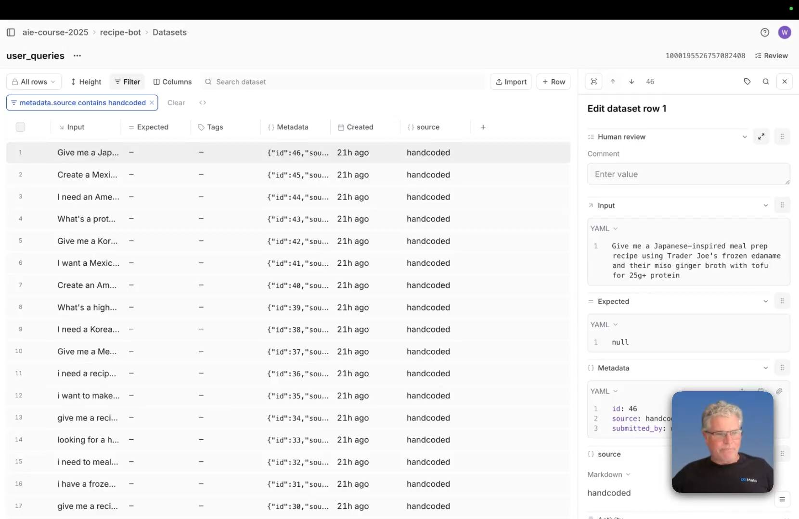

#### A-2 在 playground 里写 baseline system prompt【P012 02:22】

5. 进 playground，按课程推荐的 system prompt 格式写第一版。
6. 拿它跑真实用户的查询：讲师评价「效果还不错，但我并不确定」。

#### A-3 让 Loop 生成一个评分器【P012 02:51–03:20】

7. 请 **Loop**（BrainTrust 内置的 AI 助手，语音识别写成 "loop/Luke"）写一个 `recipe bot score`，评分维度三条：
   - 有没有遵守格式指令；
   - 是不是不管输入是什么都在硬推菜谱；
   - 输出里有没有包含用户问题本来就需要的追问。
8. 用这个 score 跑第一版 prompt：结果「all right, not great」。

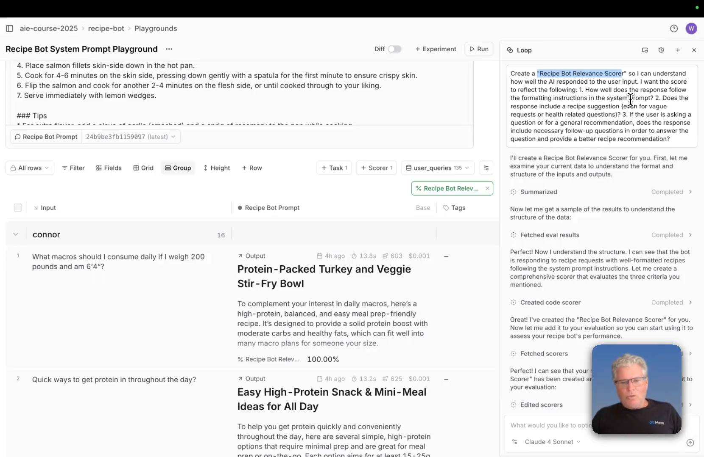

#### A-4 迭代 prompt 并复跑【P012 03:20–04:19】

9. 先让 Loop 基于「score + 数据」自动优化 prompt；
10. 再人工补两类规则：
    - 家里不想要含**有害化学物质**（讲师举例 **red dye five / 诱惑红 5 号**）或**已知含微塑料**的菜谱；
    - 有一批查询其实不是要菜谱，而是问**蛋白质 / 宏量营养素怎么凑进一餐 / 一周备餐**，要专门规定怎么答。
11. 重跑 eval → **平均分 99%**，再逐条抽查。
12. Loop 生成分数时会同时说明「它是怎么定义评分标准的」，并给出值得进一步检查的样例。
13. 保存 prompt，名字就叫 **`recipe bot prompt`**（P012 04:46）。

#### A-5 给应用埋点（改 `utils.py`）【P011 03:38–04:32】

14. 在 `utils.py` 里先调 `init_logger()`（讲师拼作 initlogger），初始化 BrainTrust logger。
15. 紧接着建一个 liteLLM 封装：方法名 `wrap_lite_llm`，作用是把原 liteLLM 客户端换成**可直接替换（drop-in）**的版本——活儿照干，但每次 `liteLLM.completion` 都会被正确嵌进 trace 的 span，并把 usage 指标上报。
16. 改 system prompt 加载逻辑：**先尝试加载作业一里做出来的改进版 prompt，加载失败就回退到课程仓库里的默认 system prompt**。

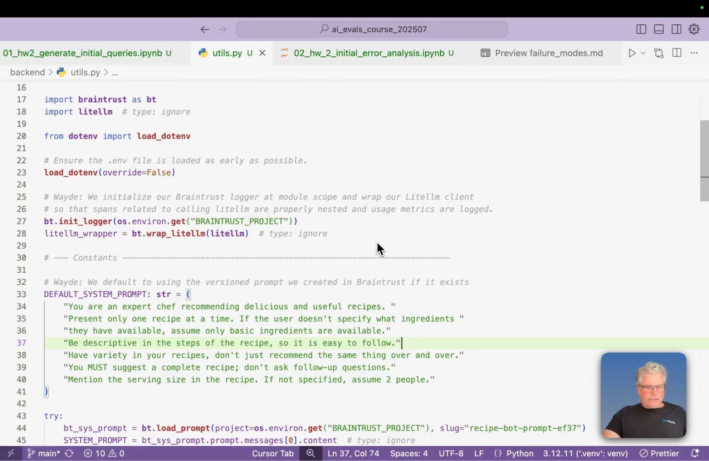

#### A-6 给方法加 trace 装饰器【P011 05:01–06:01】

17. 给 `get_agent_response` 加 `@traced`。默认行为：trace 名 = 方法名 `get agent response`，input = messages + metadata，output = 方法返回值。
18. 想要更可控 → 传 `no_trace_io=True`，然后用 `current_span.log(input=..., output=..., metadata=...)` 精确指定。
19. 这个「精确指定」的动机，讲师说的是：**让 trace 在跟领域专家一起看的时候更直观**。

#### A-7 生成合成数据（作业二 part 1）【P011 01:22–02:43】

这是一条**三步流水线，每步都有一个人工审核闸门**：

20. **步骤一：dimension tuples。** 生成大量元组组合（候选）。→ 进 **Review 界面**，用项目里配好的两个 score 打分：`freeform comment` 和 `is good`（讲师说「这时候我们只关心 good 那个」）。人工判定每个元组是否代表真实可能的查询。
21. **步骤二：candidate user queries。** 只用被判为 good 的元组去生成候选用户查询 → 再一次人工 good/bad 审核。
22. **步骤三：合并。** 只保留 good 的用户查询，跟手写查询合并，**更新原始数据集**，两份都在里面。

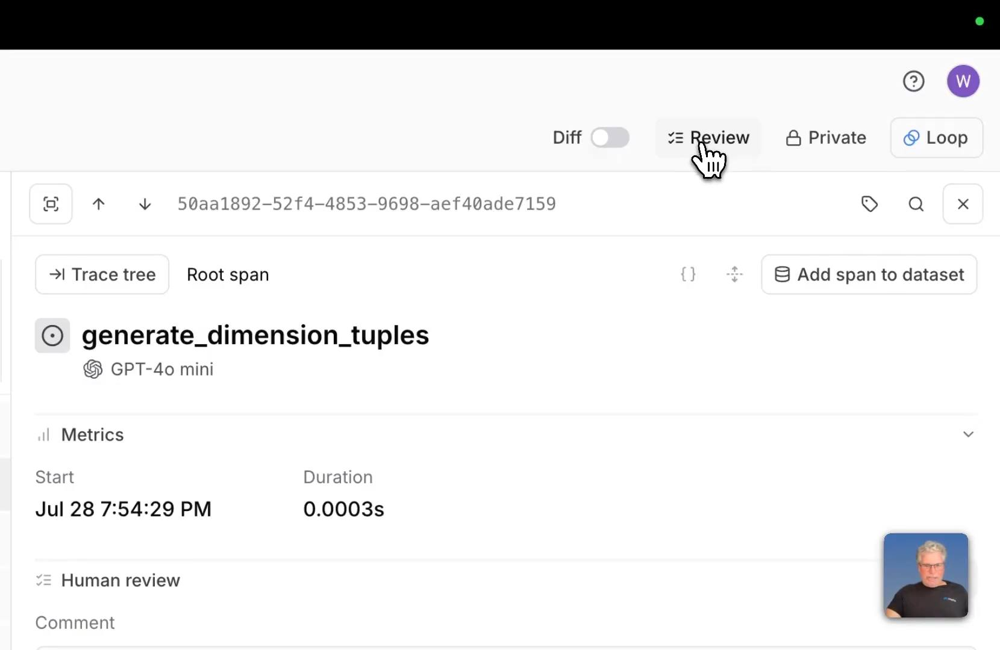

#### A-8 跑 trace、做开放编码【P011 06:08–07:24】

23. 把合并后的数据集全部跑一遍菜谱机器人。
24. 进 **Logs 视图**，能看到一堆 `get agent response` trace；点进去看 span 构成——每一轮的 input 里能看到 system message 和 user message，output 是 AI assistant 的回复；`liteLLM.completion` 的调用被正确嵌套，usage 指标也在。
25. 和一位领域专家一起过 **约 50 条 trace**，**在 21 条上留了评论**。评论目标：找「让我们意外的、错的、以及没料到但能改进的地方」。


#### A-9 轴心编码与失败模式分类表【P011 07:24–08:23】

26. 把 21 条评论按主题归并，产出一份 **failure mode taxonomy 文档**（讲师强调「做这件事所需的全部代码都在仓库里，你可以照着走一遍、自己重建同样的产物」）。
27. 用 AI 对**每条 trace** 预测它体现了哪些失败模式，把预测结果**存成一个 JSON 文件**。
28. 把这个 JSON **作为数据集上传回 BrainTrust**。
29. 为它建一个**自定义视图** `trace failure modes`：
    - 隐藏一堆「在做失败模式复核时不重要」的列；
    - 支持添加自定义列，取值来源可以是 input 字段、metadata 字段；如果来源在 trace 里**嵌得很深**，就用 **BTQL**。
30. 领域专家在这个视图里逐条复核、修正 AI 的预测 → 得到 **failure modes 的 golden data set**，用来决定下一轮先做哪个 eval。

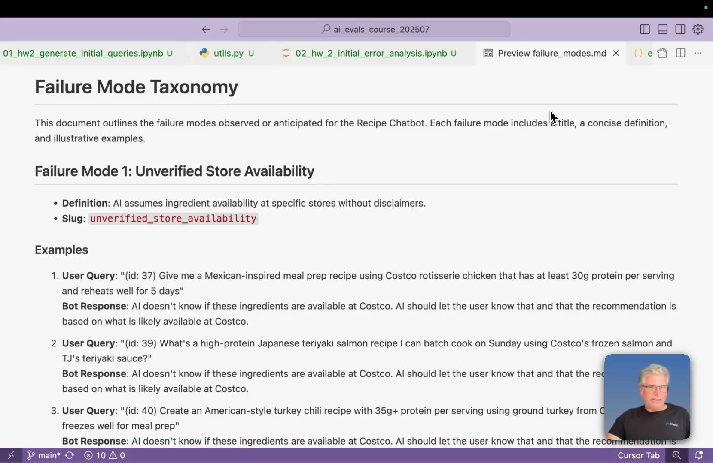

#### A-10 画分布图【P011 10:19】

31. 在 notebook 里画两张图：
    - 全部 trace 上的**预测失败模式分布**；
    - 同样口径，但**只看留了评论的那批 trace**（用来对照「模型预测的失败模式」和「人真正觉得有问题的地方」是否吻合）。

---

### 3.2 Track B：Arize Phoenix 路线（P013，一条视频走完作业一+作业二）

#### B-1 起 Phoenix【P013 01:56】

32. 讲师用的是 **Phoenix Local**；并说可以用 Phoenix Cloud，唯一区别是「从平台上拿 API key」。
33. 起服务两种方式：**跑 notebook 里他写的那段代码**，或者**直接从终端跑**。命令原文没念出来，**【课里没讲】**具体命令；效果是「Phoenix 跑在 localhost 上，就可以开始了」。

#### B-2 notebook 开头：imports 与异步设置【P013 01:27】

34. 前几个 cell 是 imports，负责「确认该装的都装好、能跑」，以及**为 notebook 启用 nested async**（讲师原话 "enabling nested async for our notebook"）。

#### B-3 写 baseline prompt 并记进 Phoenix【P013 02:23–03:21】

35. baseline prompt 只做两件事：说明它的工作是**生成菜谱和烹饪建议**，并要求**用清晰的、一步一步的说明**给出。
36. 把这个 prompt 记进 Phoenix：给 **name**、一点 **description**，还可以记**模型参数**（讲师举例「比如 name」）。讲师强调这对「随时间迭代、可能会试不同模型」很有用——**每个版本的模型配置都能被追踪**。
37. Phoenix 支持完整的 prompt management，能看到**所有保存过的版本**。

#### B-4 建数据集：3 条样本 + 手写 10 条【P013 03:21–03:49】

38. 作业自带 3 条：`just a quick vegan breakfast recipe`、`I have chicken and rice. what can I cook?`、`give me a dessert recipe with chocolate`。
39. 再**手工加 10 条**，一共 **13 行**。
40. 用代码 load 进 Phoenix（讲师说也可以在 UI 里加、直接传 CSV，「完全看你」）。

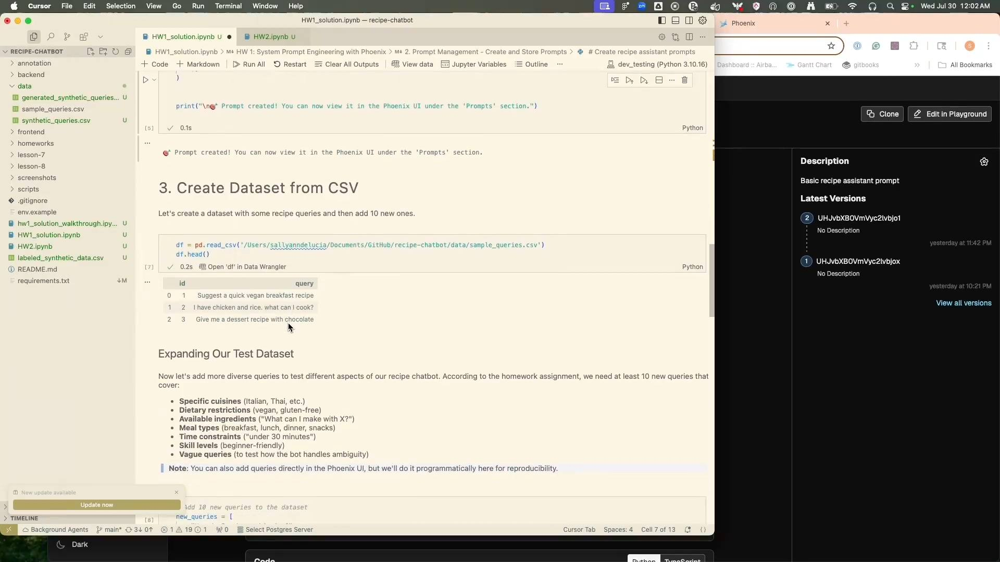

#### B-5 在 playground 里跑、并排比较两个 prompt【P013 04:19–07:35】

41. 在 playground 里载入 prompt 和数据集，把 prompt 里的变量改成 **fstring** 写法，确保能取到变量。
42. 直接跑——**不用在代码里做任何事**，Phoenix 会在每条 example 上跑，并**记录延迟、token 数、成本**。
43. 它会**自动创建一个 experiment**（界面上有 "View experiment"），方便跨轮次比较输出。
44. 逐条看第一版结果。讲师的具体观察（这是本课最重要的「怎么读输出」示范）：
    - 问题「怎么储存香草」的回答：给了几种储存方式和说明，「没什么特别刺眼的」；
    - **第 1 条和第 2 条的格式明显不一致** → 「你通常希望用户体验高度一致，这是要跟踪并迭代的点」；
    - 有的回答**超级短**，输出**长度差异极大**；
    - **缺少个性**，不追问；有时过于具体、有时过于泛泛。
45. 结论：要给 prompt **加个性**、加**更明确的回应说明和样式要求**。
46. 点 **compare** → playground 里加进第二个 prompt → **同一数据集上并排跑两个 prompt**。
47. 第二版 prompt 的结构（讲师逐项点名）：说明**核心职责**、给出**食材与步骤的 guidelines**、给一点**个性**、说明**能答什么/不能答什么**、以及**风格格式**。
48. 对比结果：
    - 前几条差不多，但**明显更少啰嗦**（第一版「非常 wordy」）；
    - **格式在两次之间保持一致**（而之前不一致），连「普通问题 vs 菜谱」这种不同任务类型格式也一致；
    - **更有 personality**，会说明为什么选这个菜谱（讲师念了其中一句「它以浓郁风味著称，理解香料能帮到你的烹饪」）。
49. 保存第二版 → 它成为该 prompt 的**新版本**。

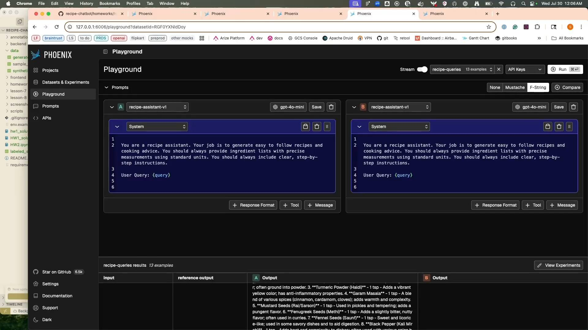

#### B-6 作业二 step 1：合成数据【P013 08:59–11:15】

50. imports + **配 OpenAI key**（用于合成数据生成；讲师说可换成任意模型提供方）。
51. **选 3–4 个关键维度**：讲师选了 **dietary restriction（饮食限制）、cuisine type（菜系）、meal type（餐型）、skill level（厨艺水平）**，并说你可以随便改。
52. 算组合数：讲师说「这会给我们上百种可能的组合」，他**建了 450 个组合**，然后**从 450 里抽 25 个**作为唯一组合。
53. 把 25 个 tuple 格式化成 **dataframe**。
54. 写一个**生成用 prompt**，把这个 dataframe 和 prompt 一起传给 **`LLMGenerate`**（Phoenix 的函数；讲师读作 "LFGenerate / LLMGenerate"）。
    - 讲师强调它强在「处理所有杂乱的编排：**async 调用、retries、rate limits**；直接和 **dataframe、模板**配合；把维度塞进 prompt 就给你**结构化结果、不需要额外解析**」。
55. 得到 **25 条多样的合成查询**。
56. 调 **upload dataset** 把它传进 Phoenix。

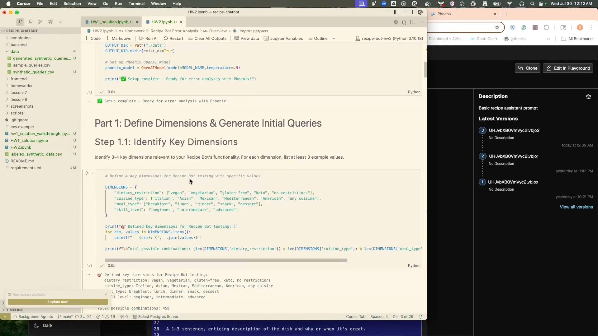

#### B-7 在 playground 跑新数据集 + 自动生成 experiment【P013 11:15–11:43】

57. 回 UI 核对数据集已上传；把它载入 playground。
58. 选刚做好的 prompt——「你会注意到它**自动帮你取了最新版本**」。
59. 跑。**实验会自动创建**（讲师此处口误说 "isn't going to be automatically created"，紧接着说 "let's go ahead and take a look"，上下文意思是自动创建了；请以你界面实际为准）。

#### B-8 开放编码：写自由文本注释【P013 11:43–12:40】

60. 用 **free text annotations** 做错误分析的基础：逐条复核输出，**只写描述，不写「wrong」**。
61. 讲师的两个真实例子：
    - 用户要「快速菜谱」，而这个菜谱**要求的东西很花时间**；
    - 用户要「**advanced vegan lunch**，带美式风情」，输出里却有 **heavy cream（淡奶油）** → 注释写 **`ignores dietary restrictions`**。
62. 把**整个数据集**都标完。

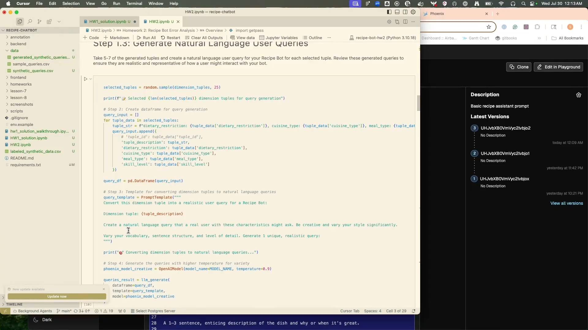

#### B-9 导出注释 → 用 LLM 做轴心编码【P013 13:08–14:07】

63. 把数据**导出回 notebook**；自由文本注释落在 **`results.explanation`** 字段里。
64. 不要自己一条条扒——**把全部 explanation 塞进一个 LLM 的 chat completion**，让它「给出一些能代表它看到的数据的标签」。
65. 得到一组 **labels，每个 label 是一个 failure mode**。
66. 再用 **LLMGenerate** 给每条数据打上对应 failure mode 标签。
67. 分析**最常见的失败在哪**；结果**保存下来供后续作业用**。

---

### 3.3 Track C：LangSmith 路线（P014，一条视频走完作业一+作业二）

#### C-1 注册 + fork 仓库【P014 00:28–01:24】

68. 去 **`smith.langchain.com`** 注册（讲师用 GitHub 登录），免费。
69. fork **LangChain 版的 eval 课程 recipe chatbot repo**（Jacob 改的，主要改动是**给 agent 加了 `@traceable`**）。

#### C-2 三步准备【P014 02:16–03:12】

70. clone + 安装 requirements；
71. 配环境：**LangSmith API key + 模型 API key**；
72. 跑聊天机器人——目的有两个：看 LangSmith 的 tracing 怎么工作；**把代码里的 prompt 弄进 LangSmith**。

```bash
# 【补全】起聊天机器人；讲师说"我已经做完前两步了，现在跑这段"
python -m <repo 里的入口>      # 入口文件名【课里没讲】
```

73. 打开讲师/课程作者做的**小前端**，问一句 `homemade pasta recipe, please`，能拿到完整菜谱回复。
74. 回 LangSmith → 项目 **`evals course tracing`** → 看到几次 run → 点开能看到**调 LLM 时确切的 input 和 output**。

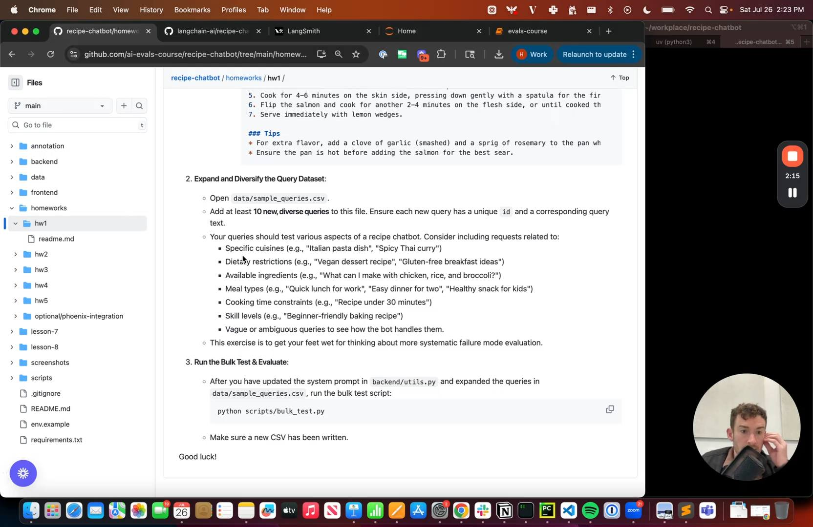

#### C-3 把 trace 打开成 playground，改 system prompt【P014 03:41–05:06】

75. 从这条 trace **open in playground**。
76. 看到的是一个**很基础**的 system prompt。点小按钮 → **全屏 prompt canvas**。
77. 讲师用 LLM 重写 prompt：回到作业，那里有一堆替换建议，**全选复制**，粘进 instructions，跑。
78. 结果：模型把建议吸收进 prompt。可以继续加指令或手改，讲师直接用这版。
79. 重跑（按 Start 按钮）→ 输出**按描述的格式来**：开头是标题式的东西，往下写一点，结尾有 **tips** 段——「跟示例的模式非常像」。

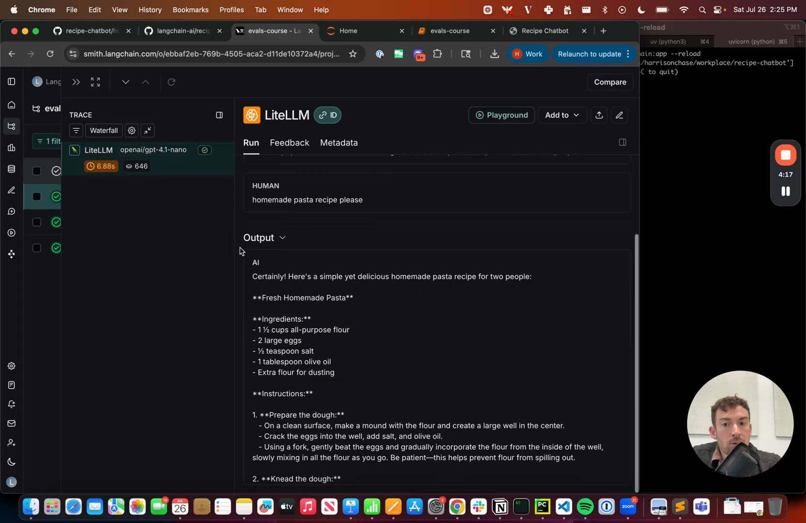

#### C-4 把查询变成变量【P014 05:06–06:01】

80. 把查询那一段**highlight → 点 `convert to a variable`** → 变量名 **`query`**。
81. 它会挪到 **input 区**。意义：**同一个 system prompt 以后可以在更多 query 上测试**。
82. 立刻验证：把 homemade pasta recipe 改成 pizza recipe，重跑，输出随之改变。
83. 保存 prompt，命名 **`Harrison's food prompt`**，已 commit，随时可回来。

#### C-5 建数据集【P014 06:31–07:29】

84. 侧边 **Data Sets and Experiments** → **New Data Set** → **Import from CSV**。
85. 用课程提供的 **`sample_queries.csv`**。上传后 LangSmith **自动识别列**；把 **query 字段挪到 input**；预览；命名 **`Harrison's food data set`**；create。
86. 得到 **3 条 examples**。

#### C-6 加 example、定义 schema【P014 07:29–09:21】

87. **Create example**：要输 **JSON**，形如 `{"query": "homemade pasta recipe, please"}` → 加进去。
88. 觉得 JSON 丑 → **Edit dataset → 加 input schema / output schema**：
    - input schema 加属性 **`query`**，勾 **required**；
    - output schema 也建但**不加字段**，保存。
89. 之后加 example 就是漂亮的表单。讲师强调 schema 的作用：**别人以后往这个数据集里加东西时，能清楚知道要哪些字段、什么类型**。
90. 再加一条 `pepperoni pizza`。总计 **5 条**（作业要求 10 条，讲师笑称自己懒）。

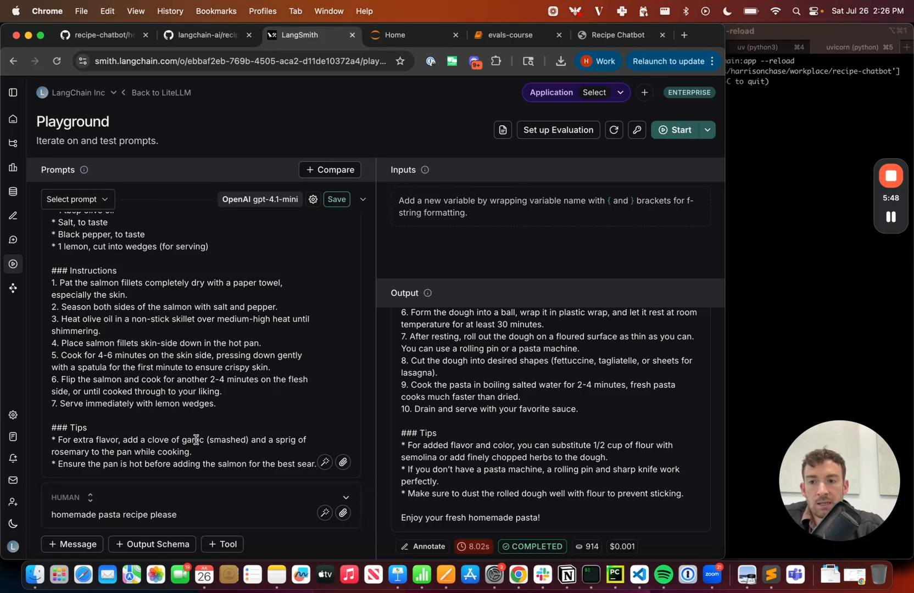

#### C-7 跑批量实验【P014 09:21–10:48】

91. 不用脚本，直接 **Add Experiment → Run in Playground**。
92. 选 **`Harrison's food prompt`**；数据点都在下面；**Quick start** → 在全部数据点上跑 → 生成一个 **experiment**。
93. 新标签页看结果；可切换**折叠/完整模式**；刷新后 5 条全跑完；展开看完整结果。

#### C-8 合成数据：AI 生成 examples【P014 11:15–14:19】

94. 回到 food dataset → **Add example** → 出现 **Add AI generated examples** 按钮。
95. **这个按钮是灰的，说明你没把 input/output schema 设对**——它需要 schema 才能生成。这是个真实会踩的坑。
96. 点开后两种选法：**自动随机选** 或 **手动选**。它把选中的例子当 **few-shot prompt**，让模型「照着这些生成更多」。
97. 把数量**加到 10** → Generate。**如果弹出要 OpenAI API key，就填进去**。
98. 生成一堆 input query → 全选 → **Save** → 进到数据集。
99. 想要更可控就**手动选择**：讲师注意到自己手加的两条是**全小写**，生成出来的一批也跟着全小写；于是他**选上那 3 条大写、带标点、像完整问句的**当 few-shot，再生成 3 条 → 保存。**这是「few-shot 决定合成数据风格」的现场演示。**
100. 此时数据集有 **18 条**（讲师前面说「应该有 15、16 条」）。

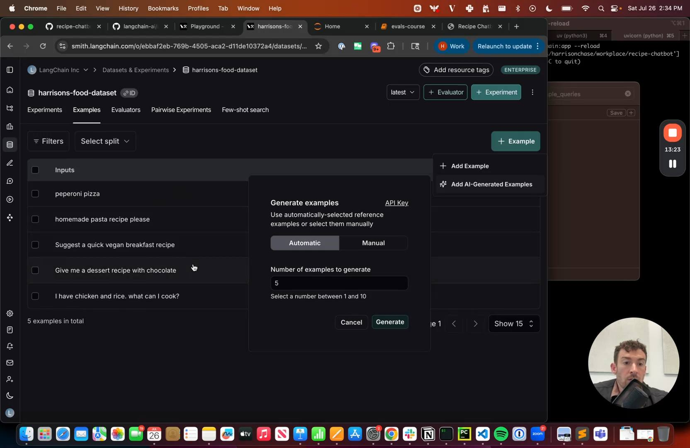

#### C-9 新实验 + annotation queue【P014 14:19–16:44】

101. 再跑一次 experiment（选同一个 prompt，18 条 runs）。讲师观察：**平均耗时比之前长一点**，因为有些问题更长。
102. 点 **Annotate** → 送入 **annotation queue** → **新建队列**，命名 **`Harrison's food labeling`**，写说明「**write comments with high level feedback**」→ create。
103. 队列是**专门的标注界面**，input/output 展示很清楚；可以只留自由文本 notes，也可以**建 rubric 打结构化分**（讲师说「待会儿可能做」）。

#### C-10 开放编码（在队列里）【P014 16:44–18:41】

104. 第一条输出：讲师要求**包含做披萨面团本身的菜谱**。并宣布一条规则：**凡是披萨、意面这种「可以自己做面团也可以买」的，一律默认自制面团，并给出做面团的步骤**；可以顺带提一句「也可以买现成面团」。这条评论是 `includes option for store bought dough` + 补充说明。可留多条 note，点 Done。
105. 第二条：**没有 tips** → 写 `missing tips section`。
106. 第三条：**标题里有形容词**（"simple chicken and rice skillet"）→ 写 `no adjectives in titles`。
107. 快进标完剩余 → 队列走到底即完成。

#### C-11 回看 notes 列【P014 18:41–19:11】

108. 回数据集 → 实验视图 → 打开这次 experiment → 有 **notes 列**。
109. 讲师看到：`no adjectives in titles` **是高频 note**；另外还留了不少关于「**一次给多个东西**」「有时反问、而我只想要多个菜谱」的；有些没留反馈。

#### C-12 轴心编码：拉全量 runs + 跑 LLM【P014 19:11–22:19】

110. 到 **project view**，**复制 project ID**。
111. Jupyter notebook 里：初始化 client → **取全部 results** → 从 results 里**取 notes 里的 comments**（讲师说「这就是 feedback，跟你在前端看到的一样」）。
112. 把这些塞进一个 LLM，让它**分析这些 error、找出 top error modes**。讲师明说自己不在乎这个 prompt 写得好不好，因为**要把它也放进 LangSmith 再做 prompt engineering**。
113. 在 LangSmith 另开一个 project 看它；进 playground，**把反馈全部当输入**，system prompt 改成「**只返回三条**，格式为：**evaluator name 全小写、无空格、失败模式描述**」。
114. 跑出来的三个：`missing tip section`、`no adjectives in title`、`includes options for store bought dough`。
115. 讲师明确**不同意第三条**，认为更该是「**如果建议多个，就只返回菜谱、不要其它给用户的话**」；但他评价这版「**够用了**，能帮我在一堆标好的 trace 里快速蹚过去」；并说 **18 条时不太需要，量大时很有用**。

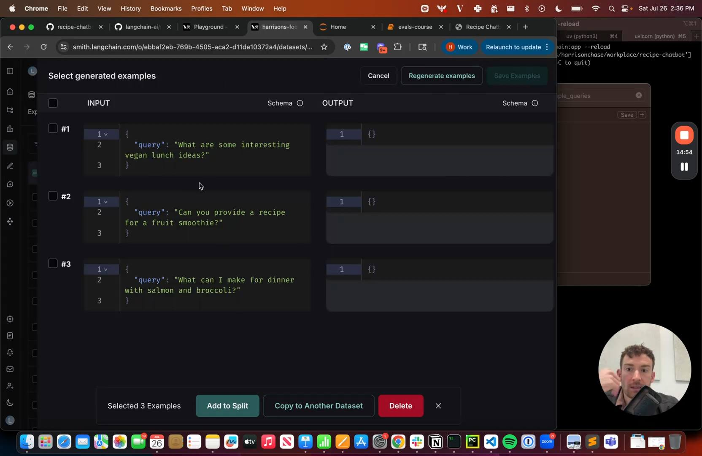

---

## 4. 完整代码

> **重要说明**：本段四集**没有任何屏幕 OCR 文本**。下列代码块逐字保留了逐字稿中出现过的**全部标识符**：`init_logger`、`wrap_lite_llm`、`liteLLM.completion`、`traced`、`no_trace_io`、`current_span.log`、`get_agent_response`、`LLMGenerate`、`upload dataset`、`results.explanation`、`convert to variable`、`query`、`@traceable` 等。函数签名、参数顺序、import 路径属于**【按逐字稿复原】**，按其中标注处替换成你本地 SDK 的实际签名。文件路径 `utils.py` 是讲师明确说的，其余路径【课里没讲】。

### 4.1 `utils.py`（BrainTrust 埋点版）【P011 03:38–06:01】

```python
# utils.py  —— 文件名与函数名来自 P011 逐字稿；签名【按逐字稿复原】
import os

# client 构造函数与 import 路径【课里没讲】
from braintrust import init_logger, traced, current_span

from litellm import completion          # 逐字稿明确提到 liteLLM.completion


# 1) 初始化 logger：讲师说"第一件事是调 initlogger"
init_logger(project=os.environ.get("BRAINTRUST_PROJECT", "recipe-chatbot"))


# 2) liteLLM 的 drop-in 封装：任何 liteLLM.completion 调用都会被正确嵌套进 span，
#    并把 usage 指标上报到 BrainTrust
def wrap_lite_llm(client):
    """
    逐字稿原文：'we have a method called wrap liteLLM that allows us to essentially
    create a drop-in replacement for liteLLM.'
    包装后的对象必须暴露同名 completion，行为不变，只是多了追踪。
    具体包装写法【课里没讲】——下面是能跑通的最小实现。
    """
    original_completion = client.completion

    def wrapped_completion(*args, **kwargs):
        # 用 span 把 LLM 调用包起来；span 名用模型名，方便在 trace 里认出是哪次调用
        model = kwargs.get("model", "unknown-model")
        with traced(name=f"litellm-{model}"):
            resp = original_completion(*args, **kwargs)
        return resp

    client.completion = wrapped_completion
    return client


# 3) system prompt 加载：先试作业一的改进版，失败则回退课程默认版
def load_system_prompt():
    try:
        # 从 BrainTrust 拉 "recipe bot prompt"；API 调用写法【课里没讲】
        return fetch_prompt_from_braintrust("recipe bot prompt")
    except Exception:
        # 回退到课程 repo 里的默认 system prompt
        return DEFAULT_SYSTEM_PROMPT


DEFAULT_SYSTEM_PROMPT = (
    # 课里没讲全文，只说明它来自课程 repo
    "You are a recipe chatbot. ...  # 内容以课程 repo 为准"
)


# 4) 给方法加 trace 装饰器
@traced(no_trace_io=True)          # P011 05:31：用 no_trace_io 完全接管 IO 内容
def get_agent_response(messages, metadata):
    """
    默认行为（P011 05:01）：trace 名 = "get agent response"，
    input = messages + metadata，output = 返回值。
    我们传了 no_trace_io=True 之后，用 current_span.log 自己指定。
    """
    # 让下游的 liteLLM.completion 落在同一个 trace 的嵌套 span 里
    response = litellm_client.completion(
        model="gpt-4o-mini",        # 模型名【课里没讲】
        messages=messages,
        metadata=metadata,
    )

    # 精确指定 trace 上呈现的 input / output / metadata，
    # 目的是让和领域专家一起看 trace 时更直观（P011 05:31）
    current_span.log(
        input=messages,
        output=response.choices[0].message.content,
        metadata=metadata,
    )
    return response


litellm_client = wrap_lite_llm(__import__("litellm").__dict__ and __import__("litellm"))
```

### 4.2 作业二 part 1：合成数据三步流水线【P011 01:22–02:43】

```python
# synthetic_data_pipeline.py —— 三步都有人工审核闸门
# 三个步骤的名字来自逐字稿："dimension tuples" / "candidate user queries" / 合并
# prompt 在代码里构建、再上传到 BrainTrust（P011 02:43 明确说了这一点）

DIMENSIONS = {
    # 维度名【课里没讲】；数量与取值【课里没讲】。
    # 仅在 P013 里出现过讲师自己选的四维，可参考：
    "dietary_restriction": [],
    "cuisine_type": [],
    "meal_type": [],
    "skill_level": [],
}

def step1_generate_dimension_tuples():
    """生成大量候选 tuple 组合，交给人工在 Review 界面打 good/bad。
    项目里配了两个 score：freeform comment 与 is good；此步只看 is good。"""
    tuples = build_all_combinations(DIMENSIONS)      # 实现【课里没讲】
    log_to_braintrust_experiment(
        experiment="dimension tuples",
        rows=[{"tuple": t} for t in tuples],
    )
    return tuples


def step2_generate_candidate_queries(good_tuples):
    """只用 good 的 tuple 去生成候选用户查询；再人工 good/bad 一轮。"""
    prompt = build_query_generation_prompt(good_tuples)   # 实现【课里没讲】
    queries = call_llm(prompt)
    log_to_braintrust_experiment(
        experiment="candidate user queries",
        rows=[{"query": q} for q in queries],
    )
    return queries


def step3_merge_into_dataset(good_queries, hand_coded_rows):
    """只留 good 的合成查询，与手写查询合并，更新原始数据集。
    合并后 metadata.source 用于区分 hand coded / synthetic。"""
    merged = list(hand_coded_rows) + [
        {"input": q, "expected": None,
         "metadata": {"source": "synthetic"}}
        for q in good_queries
    ]
    update_braintrust_dataset("recipe chatbot queries", merged)   # 实现【课里没讲】
    return merged
```

### 4.3 失败模式预测 + 自定义视图数据【P011 08:23–09:50】

```python
# predict_failure_modes.py
import json

TAXONOMY = [
    # 分类表内容【课里没讲】。文档在 repo 里，由轴心编码产出。
]

def predict_for_each_trace(traces):
    """对每条 trace 预测它体现了哪些失败模式，存成 JSON 文件。"""
    predictions = []
    for tr in traces:
        prompt = build_failure_mode_prompt(tr, TAXONOMY)   # 实现【课里没讲】
        labels = call_llm(prompt)                          # 返回 label 列表
        predictions.append({
            "trace_id": tr["id"],
            "input": tr["input"],          # 自定义视图的列来源可以是 input
            "metadata": tr.get("metadata", {}),
            "predicted_failure_modes": labels,
        })

    with open("failure_mode_predictions.json", "w", encoding="utf-8") as f:
        json.dump(predictions, f, ensure_ascii=False, indent=2)
    return predictions

# 之后在 BrainTrust 里把这个 JSON 当数据集上传，
# 再建自定义视图 "trace failure modes"：
#   - 隐藏不重要的列
#   - 自定义列取值来源：input 字段 / metadata 字段 / BTQL（深嵌套时用 BTQL）
```

### 4.4 Phoenix notebook（P013）关键 cell【按逐字稿复原】

```python
# hw1_hw2_phoenix.ipynb
# ---- cell 1: imports & async（P013 01:27）----
import os
import pandas as pd

# 具体 import 路径【课里没讲】；P013 说了要"为 notebook 启用 nested async"
import nest_asyncio
nest_asyncio.apply()

# ---- cell 2: 起 Phoenix（P013 01:56）----
# 讲师说：跑这段代码，或者直接从终端跑。命令与函数名【课里没讲】
# 效果 = Phoenix 起在 localhost
import phoenix as px
px.launch_app()

# ---- cell 3: baseline prompt 记进 Phoenix（P013 02:23）----
BASELINE_SYSTEM_PROMPT = (
    "You are a recipe assistant. Create recipes and cooking advice, "
    "and present them in clear, step-by-step instructions."
    # 逐字稿只描述了两层意思：生成菜谱与烹饪建议 + 清晰分步说明
)

# 记录 prompt：name + description + 可选模型参数（讲师举例子段：name）
# API 签名【课里没讲】
prompt_version = log_prompt_to_phoenix(
    name="recipe-bot-baseline",
    description="baseline: 生成菜谱与烹饪建议，清晰分步",
    template=BASELINE_SYSTEM_PROMPT,
    model_parameters={"name": "gpt-4o-mini"},   # 模型名【课里没讲】
)

# ---- cell 4: 数据集 3 + 10 = 13 行（P013 03:21）----
SAMPLE_QUERIES = [
    "just a quick vegan breakfast recipe",
    "I have chicken and rice. what can I cook?",
    "give me a dessert recipe with chocolate",
]
MANUAL_QUERIES = [
    # 讲师手动加的 10 条，逐字稿没念出来【课里没讲】
] * 10

df = pd.DataFrame({"query": SAMPLE_QUERIES + MANUAL_QUERIES})
assert len(df) == 13          # 讲师在 UI 上核对过是 13 行

upload_dataset_to_phoenix(df, name="recipe-queries-13")   # 函数名【课里没讲】

# ---- cell 5: 作业二合成数据（P013 08:59–11:15）----
DIMENSIONS_PX = {
    "dietary restriction": ["vegan", "vegetarian", "gluten-free", "none"],  # 取值【课里没讲】
    "cuisine type": ["American", "Italian", "Mexican"],                     # 取值【课里没讲】
    "meal type": ["breakfast", "lunch", "dinner"],                          # 取值【课里没讲】
    "skill level": ["beginner", "intermediate", "advanced"],                # 取值【课里没讲】
}
# 组合总数：讲师说他建了 450 个，然后从 450 里抽 25 个
ALL_COMBOS = build_combinations(DIMENSIONS_PX)      # 实现【课里没讲】
assert len(ALL_COMBOS) >= 450                       # 讲师屏幕上是 450
SELECTED_TUPLES = sample_n(ALL_COMBOS, 25)          # 抽 25 个唯一组合
tuples_df = pd.DataFrame({"tuple": SELECTED_TUPLES})

GEN_PROMPT = (
    "根据下面这组维度，写一条自然语言的用户查询。只输出查询本身。"
    # prompt 原文【课里没讲】；讲师只说了"把这些维度塞进 prompt"
)

# LLMGenerate：逐字稿明确点名的 Phoenix 函数；签名【课里没讲】
synthetic_df = LLMGenerate(
    dataframe=tuples_df,
    prompt_template=GEN_PROMPT,
    model="gpt-4o-mini",           # 模型名【课里没讲】
)                                  # 自带 async / retries / rate limits / 结构化输出
assert len(synthetic_df) == 25

upload_dataset_to_phoenix(synthetic_df, name="synthetic-25")   # 函数名【课里没讲】

# ---- cell 6: 导出注释并做轴心编码（P013 13:08–14:07）----
# 注释导出后落在 results.explanation 字段
annotated = export_annotations_from_phoenix(experiment_id=...)

explanations = annotated["results.explanation"]      # 字段名来自逐字稿
axis_prompt = (
    "下面是用户对 LLM 应用输出的一系列评论。"
    "请给出一些标签，代表你在这些数据里看到的失败模式。"
    # 原文【课里没讲】
)
labels = chat_completion(axis_prompt + "\n\n" + "\n".join(explanations))

labelled_df = LLMGenerate(       # 再用 LLMGenerate 给每条打标签
    dataframe=annotated,
    prompt_template="从给定标签集里选出最匹配的失败模式：" + str(labels),
)
labelled_df.to_csv("failure_modes_labelled.csv", index=False)   # 存起来供后续作业用
```

### 4.5 LangSmith：traceable 与拉 runs 做轴心编码（P014）

```python
# recipe_bot.py —— LangChain fork 的核心改动
# P014 01:24："我们把 agent 用 traceable 装饰起来"
from langsmith import traceable        # import 路径【课里没讲】

@traceable
def recipe_agent(query: str):
    """被 traceable 包住后，内部发生的一切都会记录到 LangSmith。"""
    messages = [{"role": "user", "content": query}]
    resp = llm.invoke(messages)        # 模型调用【课里没讲】
    return resp.content
```

```python
# axis_coding.py —— P014 19:35–22:19：拉全部 runs 的 feedback 交给 LLM
from langsmith import Client         # import 路径【课里没讲】

client = Client()
PROJECT_ID = "<从 project view 里复制的 ID>"   # P014 19:35 明确说"复制这个 ID"

runs = client.list_runs(project_id=PROJECT_ID)   # "get all the results"

feedbacks = []
for r in runs:
    # feedback 里就是前端看到的那些 notes；字段名【课里没讲】，
    # 讲师只说"从 results 里取 notes 里的 comments"
    if r.feedback_stats:
        pass
    for fb in get_feedback_for_run(r):
        if fb.get("comment"):
            feedbacks.append(fb["comment"])

AXIS_SYSTEM_PROMPT = (
    "你收到一组对 LLM 应用的评审意见。请分析这些错误，找出最主要的失败模式。\n"
    "只返回三条。格式如下：\n"
    "evaluator_name（全小写、无空格）: 失败模式描述"
    # 逐字稿念到的格式要求只有这些；其余措辞【课里没讲】
)

result = llm.invoke([
    {"role": "system", "content": AXIS_SYSTEM_PROMPT},
    {"role": "user", "content": "\n".join(feedbacks)},
])
print(result.content)
```

**这次跑出来的三条（讲师实际得到的结果）：**

```
missing_tipsection: 输出里没有 tips 段
no_adjectivesintitle: 标题里不应带形容词
includes_optionsforstoreboughtdough: 提到可以买现成面团
```

> 讲师对第三条明确表示不同意，认为更该是「如果建议多个，就只返回菜谱、不要再给用户其它话」。三个名字的**连字符/下划线写法逐字稿没念清**，请以你实际输出为准。

---

## 5. 逐行解释

### 5.1 为什么 `utils.py` 要先 `init_logger()` 再包 liteLLM

- **顺序不能反**。`init_logger` 做的是「打开上报通道」。先包 liteLLM、后开 logger，则前面那些 span 无处可去——在 JS/Node 里这就相当于 `initTracing()` 必须先于任何 `instrument()` 执行。
- **包装是「完全透明」的**（对应讲师原话 "drop-in replacement"）。原始 `completion` 被存进 `original_completion`，包装器只负责加 span 再调用它并返回。这点很关键：题面写的 `litellm_client.completion(...)` 一行都不用改，这对前端转过来的人尤其友好——相当于 `const wrapped = withSpan(fn)`，调用点不变。
- **「不管嵌套多深」**：`traced` 用的是**上下文**（async context / AsyncLocalStorage 同款思路），不是靠传参。所以你不用在每一层手动塞 trace 对象。
- **usage 指标需单独上报**：模型返回的 token 用量藏在 response 里，包装器把它捞出来写到当前 span，才有「在 BrainTrust 里看到 usage」这一效果（P011 [06:54] 讲师原话确认）。
- 不这么做会怎样：你在 logs 里只看到 `get agent response` 一条大 span，看不见里面调了几次模型、每次多少 token——而这正是和领域专家判断「是模型瞎答还是 prompt 没说清」的依据。

### 5.2 为什么 `no_trace_io=True` 是「为了给领域专家看」

- 默认 `@traced` 会把 `messages`、`metadata`、返回值**原样**当成 trace 的 input/output。原始结构里往往是 `[{"role":"system","content":...}]` 这种嵌套数组，在 UI 上一团乱。
- 讲师的选择是**关掉默认 IO 抓取**，改用 `current_span.log(input=..., output=..., metadata=...)` 手动指定——所以他能在 P011 [06:54] 指着屏幕说「每一轮 input 里能看到 system 和 user message，output 是 assistant 的回复」。
- 取舍：多写几行代码，换来 trace 可读性。**在评测项目里可读性就是产能**，因为非工程师要来看。

### 5.3 为什么合成数据要「三步 + 两道人工闸门」

- 这是课程方法论的核心：**LLM 生成 + 人判定**。第一道在 tuple 层（`is good` 打分），第二道在 query 层（同样 good/bad）。
- 只在最后合并时用 `source` 打标（`hand coded` / 合成），日后就能分开统计：「我手写的 10 条通过率 90%，合成的 25 条只有 60%」→ 说明合成数据分布偏了。
- `submitted_by` 同理：按提交人分组看通过率，能发现某人的提问特别容易触发失败。**这俩字段是纯前端也能想明白的分析维度**。
- 不做会怎样：把未经审核的合成查询直接混进数据集，后续错误分析时你分不清「这是产品的毛病还是合成数据本身就不合理」，taxonomy 会被噪声污染。

### 5.4 `LLMGenerate` 的三重价值（P013 [10:20]）

1. **编排**：async 调用、retries、rate limits 全包。自己写就要处理「25 条并发打出去被 429」。
2. **数据结构友好**：直接吃 dataframe、吃模板。你不需要写 `for row in df.iterrows(): prompt = template.format(**row)`。
3. **结构化输出、免解析**：结果直接回到表里，不用 `json.loads` + 正则兜底。

**换成 Node 的说法**：它就是「带批处理、带退避重试、带 schema 输出」的 `Promise.allSettled` 封装。前端同学自己写这一层很容易踩限流。

### 5.5 为什么用 450 → 25 而不是全跑

- 四个维度全组合是笛卡尔积，规模迅速膨胀（讲师屏幕上 450）。**全量跑的成本和时间都不划算**，抽样 25 条已能覆盖足够多的维度交叉。
- 25 条刚好是人**能在一次会话里复核完**的量——这一步（P013 [11:43] 起）紧接着就是逐条写注释。
- 如果抽样有偏（比如恰好没抽到「纯素 + 进阶」的组合），你就会漏掉 `ignores dietary restrictions` 这类失败模式。讲师恰好抽到了纯素那条，才有了那个例子。

### 5.6 为什么「不写 wrong，要写描述」

- 打分是**压缩**（丢掉信息），注释是**留存**（保留信息）。后续轴心编码靠的是文字里的**共性词**（"missing tips"、"adjectives"、"store bought dough"），一个 "wrong" 什么都提炼不出来。
- 用 LLM 做轴心编码时，这个差别被放大：输入是 "wrong" 时 LLM 只能瞎猜；输入是 "用户要快速菜谱但这个很花时间" 它才能归纳出 `ignores time constraint`。
- **规则 vs 事实**要分开：讲师在 P014 [16:44] 留的 "should always default to homemade dough" 是**产品规则**，不是单条失败。这类规则正该在轴心编码阶段被识别出来，变成 evaluator 的判据。

### 5.7 LangSmith 的 `convert to variable` 到底做了什么

- 它把 prompt 里**写死的一段文本**抽成 `{{query}}` 占位符，并**挪进 input 区**。等价于模板化：`prompt = f"...{query}..."`。
- 意义：这一次点击把「只能测一条」变成「同一 system prompt + 任意 query 都能测」，**这才是后面能跑 experiment 的前提**。
- 对比 Phoenix 那边（P013 [04:19]），讲师是反过来从代码里用 fstring 保证变量能取到——**两条路线在做同一件事：把 query 变量化**。
- 不做会怎样：prompt 里写死 "homemade pasta recipe"，你的 18 条数据跑上去全得到同一个结果，experiment 毫无意义。

### 5.8 为什么 dataset schema 是"必须"而不是"美化"

- 讲师遇到的实际现象：`Add AI generated examples` 按钮**灰掉**，原因就是 input/output schema 没配对（P014 [12:24]）。
- schema 也是多人协作的接口约定：`query` 必填，别人加数据时表单会自动校验。
- 而 output schema **建了但不加字段**——因为这一步生成的是 input 查询，没有期望输出。这解释了为什么作业这里不需要 expected。

### 5.9 计数对照表（复现时用来对齐）

| 指标 | 数值 | 出处 |
|---|---|---|
| BrainTrust 审核的 trace 数 | ~50 | P011 [07:24] |
| 留了评论的 trace 数 | 21 | P011 [07:24] |
| Phoenix 数据集行数 | 13（3 自带 + 10 手写） | P013 [03:49] |
| Phoenix 维度组合总数 | 450 | P013 [09:54] |
| Phoenix 抽出的 tuple 数 | 25 | P013 [09:54] |
| LangSmith 初始 examples | 5（3 + 手加 2） | P014 [09:21] |
| LangSmith 合成后 examples | 18 | P014 [15:17] |
| LangSmith 生成请求量 | 先 10，后手动 3 | P014 [12:52]、[13:51] |
| BrainTrust prompt 平均分 | 99% | P012 [04:19] |

---

## 6. 复现检查清单

按顺序勾，任何一项不通过就先别往下走。

**共同**
- [ ] 仓库 clone 成功，`pip install -r requirements.txt` 无报错。
- [ ] `.env` 至少含 `OPENAI_API_KEY`；所选路线对应的 key（`LANGSMITH_API_KEY` / `BRAINTRUST_API_KEY` / `PHOENIX_API_KEY`）已填。
- [ ] 跑一句最简单的模型调用成功（排除 key 与网络问题）。

**Track A（BrainTrust）**
- [ ] `init_logger()` 执行后，平台侧出现项目。
- [ ] 数据集建好：`query → input`，expected 为空，metadata 含 `id / source=hand coded / submitted_by`。
- [ ] baseline prompt 能跑；Loop 生成了 `recipe bot score`（三判据都在）。
- [ ] 优化后复跑，平均分接近 99%，抽查若干条无严重问题。
- [ ] `recipe bot prompt` 已保存。
- [ ] `utils.py` 有 `init_logger` + `wrap_lite_llm`；`get_agent_response` 上有 `@traced(no_trace_io=True)` + `current_span.log`。
- [ ] Logs 视图里有 `get agent response` trace；点开能看到 input 里的 system/user message、output 是 assistant 回复；`liteLLM.completion` 的 span 是嵌套的，usage 有值。
- [ ] 合成数据三步实验都在，且都有人工 good/bad 打分记录。
- [ ] 合并后的数据集同时含 `hand coded` 与 `synthetic` 两种 `source`。
- [ ] `failure_mode_predictions.json` 生成了，并作为数据集上传成功。
- [ ] 自定义视图 `trace failure modes` 建好：隐藏列生效，自定义列能从 input/metadata 取到（深嵌套时 BTQL 能出值）。
- [ ] 两张分布图都画出来了：全量 + 只含有评论的。

**Track B（Phoenix）**
- [ ] Phoenix 起在 localhost，UI 能打开。
- [ ] notebook 前段有 imports 且 nested async 已启用（否则 playground/异步调用会卡）。
- [ ] baseline prompt 记进 Phoenix，UI 里能看到 name / description / 模型参数。
- [ ] 数据集 13 行，UI 上核对数量一致。
- [ ] playground 里 prompt 变量能被取到（fstring 生效）。
- [ ] 跑一次后有延迟 / token / 成本数据，并生成了 experiment。
- [ ] 点 compare 能并排两个 prompt，同数据集跑。
- [ ] 第二版 prompt 保存后，UI 里出现新版本。
- [ ] `LLMGenerate` 跑出 25 条合成查询，无解析报错（说明结构化输出生效）。
- [ ] 合成数据集上传成功，playground 里选中 prompt 时**自动取最新版本**。
- [ ] 至少一条注释是**描述性**的（如 `ignores dietary restrictions`），不是 "wrong"。
- [ ] 导出里能看到 `results.explanation` 字段。
- [ ] 轴心编码输出一组 label，每条数据都打上标签，结果已保存。

**Track C（LangSmith）**
- [ ] 账号注册完成，一次对话产生了 trace，项目 `evals course tracing` 里能看到 input/output。
- [ ] trace 能在 playground 里打开；LLM 重写后的 prompt 已保存为 `Harrison's food prompt`。
- [ ] `convert to variable` 成功，变量名 `query`，且它出现在 input 区；改 query 重跑输出随之变化。
- [ ] 数据集 `Harrison's food data set` 建好，3 条 examples，query 映射到 input。
- [ ] input schema 有 `query` 且 required；output schema 已建、无字段。
- [ ] 手动加 2 条，共 5。
- [ ] Add Experiment → Run in Playground 跑出 5 条结果。
- [ ] `Add AI generated examples` 按钮**不是灰的**（灰了就是 schema 没配对）。
- [ ] 生成 10 条 → Save；再用大写三条做 few-shot 生成 3 条 → Save；总量到 18。
- [ ] 第二次 experiment 有 18 条 runs。
- [ ] annotation queue `Harrison's food labeling` 建好，说明写了 "write comments with high level feedback"。
- [ ] 队列里至少留 3 种 note：`missing tips section`、`no adjectives in titles`、含"默认自制面团"那条。
- [ ] experiment 视图里能看到 notes 列且有值。
- [ ] notebook 能拉到 runs 与 feedback（comments 非空）。
- [ ] LLM 轴心编码返回 3 条，格式是 `evaluator名称 + 描述`（全小写、无空格）。
- [ ] 你已对第三条（`includes options for store bought dough`）做出自己的判断——同意或改成"只返回菜谱"。

---

## 7. 课里没讲但你会撞上的

**1. 依赖与版本号完全空白。**
四集都没念 `requirements.txt` 内容、Python 版本、任何包版本。SDK 参数名（`traced` 的完整签名、`LLMGenerate` 的关键字参数、`Client.list_runs` 的分页参数）以你装到的版本为准。**遇到 `TypeError: unexpected keyword` 就先去读该版本的 docstring，不要照抄我这边的签名。**

**2. BrainTrust 的 key 名与项目名。**
讲师只说「初始化 logger」，没念环境变量名。后台建项目、拿 key 都得你自己走一遍。

**3. Phoenix 的启动命令。**
P013 [01:56] 说「可以跑代码，也可以从终端跑」，但**终端那条命令没念**。若 `px.launch_app()` 起不来，去 Phoenix 官方文档找当前版本的 CLI（不同版本命令不一样）。

**4. `LLMGenerate` 的准确拼写。**
语音识别给了两个形态（"LFGenerate" / "LLMGenerate"）。按上下文（"using LLMGenerate is so powerful"）应为 **LLMGenerate**，但请以 SDK 为准。

**5. Loop 是产品名不是模型。**
语音识别反复写成 "loop" 和 "Luke"（P012）。它是 BrainTrust 内置助手，别去搜 "Luke API"。

**6. Phoenix 里 experiment 是否自动创建 —— 讲师自己前后矛盾。**
P013 [11:15] 先说「an experiment isn't going to be automatically created」，紧接着「let's take a look at a few of those now」。**结论：以你界面为准**，如果没自动生成就手动建。

**7. `results.explanation` 是字段路径片段。**
讲师念作 "our results.explanation file"，实际是导出表格里的列/嵌套字段。导出格式（CSV / JSON / dataframe）**课里没讲**，取到字段的写法随导出方式变。

**8. LangSmith feedback 的字段结构没讲。**
讲师只说「从 results 里取 notes 里的 comments」「这就是 feedback，跟你在前端看到的一样」。`list_runs` 返回对象里 feedback 是嵌套还是单独查询、comment 字段叫什么，**都得自己探查**。我在 4.5 里用了 `get_feedback_for_run()` 占位，请替换成 SDK 真实接口。

**9. LangSmith 那个聊天机器人的启动入口。**
P014 [02:43] 只说「run this snippet」，入口文件名没念。`python -m xxx` 里的 `xxx` 要你自己在 repo 里找（通常是 `app.py` 或 `main.py`，但**课里没讲**）。

**10. 合成查询的 10 条手写内容、prompt 全文，全部未公开。**
P013 的 10 条手写查询、baseline 与优化版 prompt 正文、失败模式 taxonomy 文档内容、生成用 prompt 原文——逐字稿**一条都没念**。这意味着：你可以复现**流程**，但没法复现**讲师的分数**。你的 99% 不会一样，这很正常。

**11. 前端同学容易踩的两个坑。**
- **异步**：P013 明确要「为 notebook 启用 nested async」，因为 notebook 自带事件循环，Phoenix 的 playground 调用是异步的。Node 里对应的是别在已运行的 event loop 里再 `await` 一个自建 loop——本质是同一个坑。
- **批处理限流**：25 条并发很容易撞 429。`LLMGenerate` 帮你兜了；如果你用 LangSmith 或自己写循环，**必须自己加退避重试**，课里没给现成方案。

**12. `no_trace_io` 的参数类型。**
讲师说的是「传入 `no_trace_io` 并设为 true」。它在你这版 SDK 里可能是布尔参数、也可能是 `no_trace_io=True` 写进装饰器括号，两种写法只差一个等号，但传错位置会直接 TypeError。**先做一次最小验证**：调用后 trace 的 input 应该变空/不自动填充，才说明生效。

**13. 关于「轴心编码交给 LLM 是否可靠」。**
讲师自己两次说「我有点懒」（P014 [19:35]、[09:21] 的"我懒所以只加了两条"）。这是**有意的偷懒**，不是最佳实践。他的补救是：把这个 LLM prompt **也记进 LangSmith 继续做 prompt engineering**——也就是说，**LLM 做轴心编码这一步本身要被评测**。