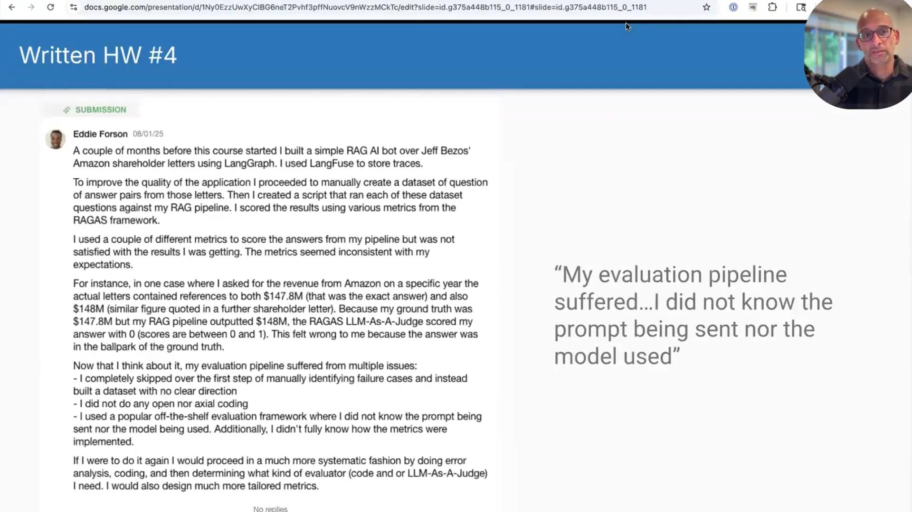
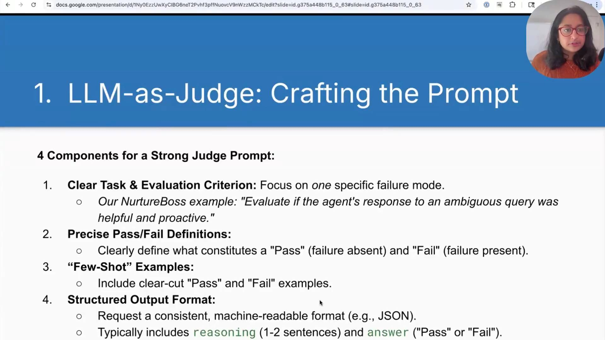
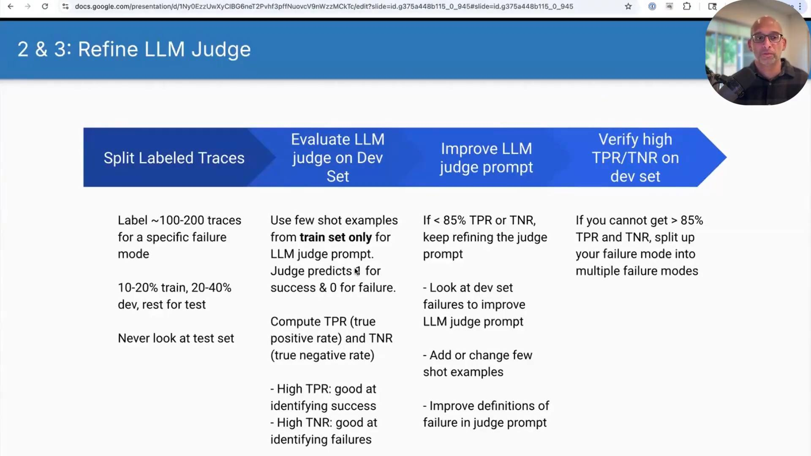
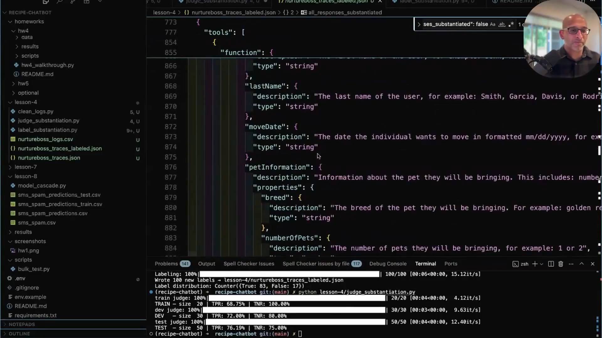
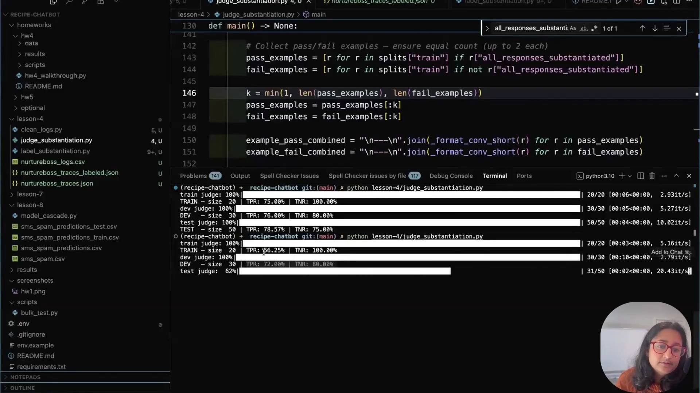
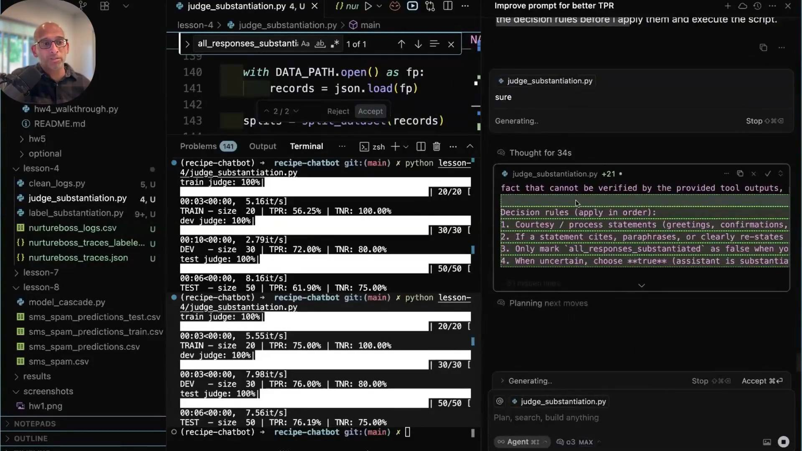
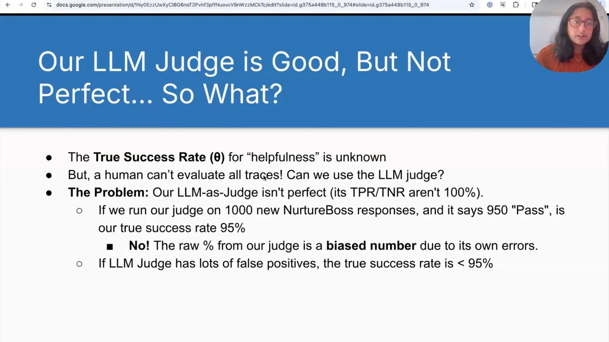
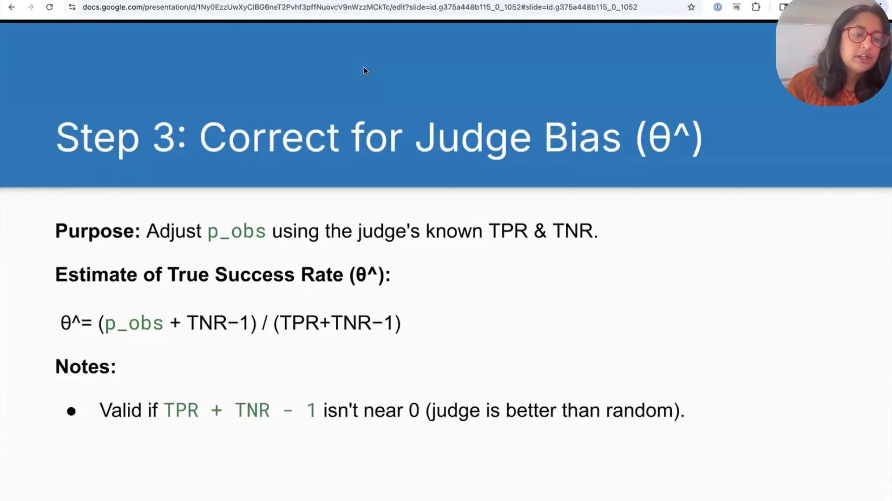

# AI Evals 实战：LLM Judge 的对齐、偏差校正与 RAG 评测

> 课程：AI Evals For Engineers & PMs（Agent 评测）｜覆盖 P15
> 读者定位：前端转 AI 应用工程师。本文所有 Python 代码可直接保存运行；涉及统计概念处会补一句「在 JS/Node 里对应什么」。

---

## 1. 这一节做什么

这一节（P15）是课程进入后半程的第一讲，承接上一讲的「LLM as a Judge」，把两件事讲透：

1. **把 LLM Judge 从「能跑」做到「可信」**：如何写 judge prompt 模板、如何用 train/dev/test 三分法迭代对齐、如何读懂 TPR/TNR（真阳性率/真阴性率）、以及最关键的一步——**当 judge 不完美时，如何用 TPR/TNR 把「观测到的通过率」校正回「真实通过率 θ」**，并量化这个估计的不确定性（bootstrap 置信区间）。
2. **RAG 评测的引入**（本讲只开了个头，详细在下一讲）：把检索质量和生成质量分开评，以及大家常踩的坑。

讲师用「nurture boss 租赁 agent」作为贯穿案例，演示了一个具体失败模式 **「所有回复都必须有工具输出佐证（unsubstantiated claims）」** 的完整评测闭环：从错误分析里的 open code → 让 LLM 把 open code 翻译成 0/1 标签 → 人工校对 → 写 judge prompt → 在 dev set 上爬山 → 用 agent 帮忙改 prompt → 用 holdout test set 算 TPR/TNR → 在无标签数据上跑 judge 并用公式校正。

**本节要交付的可复现产物**：一个能跑通的 Python 脚本，包含 judge prompt 模板、TPR/TNR 计算、偏差校正公式、bootstrap 置信区间。这是本讲真正的「代码」部分。

---

## 2. 讲师原话

> "今天我们从第五课开始，照例先聊聊上周的书面作业。上周我们有一个讨论题，关于使用 LLM judge 评测的经验、过去有没有用过、从那节课有什么收获。有两个回答我们觉得很有意思。一个是关于尽可能用基于代码的程序化评测，而不是 LLM judge。"
> —— p015 [00:00]

> "我特别认同这条评论。因为我常常觉得某些东西应该用 LLM judge 来评，是因为标准很模糊、很难做。但实践中，你其实可以想出一个非常好的近似，用基于代码的评测器，而这对你的应用可能就足够了。"
> —— p015 [00:27]

> "另一个我觉得有意思的作业回答是：人们会忍不住用 LLM 或 AI 来写你的 judge prompt，并试图去迭代这些 prompt。这位同学说，我用了一个流行的现成评测框架，但我不知道它设的 prompt 是什么、用的什么模型，也不知道指标是怎么实现的——这一点我很有共鸣。如果你用这些现成工具、它又不工作、而你对底层一无所知，你唯一的解法就是从零重来。"
> —— p015 [00:57]

> "也许这意味着你至少要自己从零搭一遍，至少在你做 LLM judge 的头几次迭代时这么做。"
> —— p015 [01:26]

> "回顾一下，我们现在课程过半了，还在生命周期的『分析和度量』阶段。我们讲了很多错误分析，上次引入了 LLM as a judge。今天的计划是把它收尾：回顾 LLM judge、怎么开始写它们的 prompt。然后补上上次没讲到的部分——现在你有了一个和你的标签对齐良好的 LLM judge prompt，怎么用它去估计一大批无标签 trace 上的通过率和失败率。"
> —— p015 [01:55]

> "这节课的第二部分是关于 RAG 的。我知道我们到目前为止一直在想多轮对话和 agent 工作流，但把 RAG 引入你的系统会带来额外的、我们想度量的指标。所以我们会聊一聊分别评估检索质量和生成质量，以及大家在构建 RAG 系统时常见的错误。"
> —— p015 [02:24]

> "照例，我们用 nurture boss 租赁 agent 作为贯穿案例。它有一堆可用的工具，所以正如我们做人工错误分析时看到的，出错的空间很大。"
> —— p015 [02:54]

> "一个 LLM judge 的 prompt 模板长什么样？你要有清晰的任务和非常清晰的评估标准，精确定义什么叫通过、什么叫失败，还要有一些 few-shot 示例——有代表性的、好的通过和失败示例。组件二和组件三（评估标准定义和 few-shot）通常就是我们在提升与标签对齐度时迭代的部分。最后是一个结构化输出格式。我个人用 OpenAI 的 structured outputs，你也可以用 XML，任何容易解析的结构都行。"
> —— p015 [03:19]

> "关于 few-shot 示例我想补充一点：不要被『clear cut（清晰明确）』这个词搞混了。并不是说你一定要用那种一眼就能看出通过还是失败的简单例子。实际上，把那些你很难用语言解释为什么通过、为什么失败的边界案例也放进去是很好的。示例之所以有价值，正是因为它展示了那些你难以用语言表达的东西。"
> —— p015 [04:17]

> "你应该始终尝试在 prompt 里用语言解释清楚。但你希望每个示例都携带大量信息。所以那种一眼就 obvious 的例子也不好。你要有多样化的示例，覆盖整个空间——有哪些不同种类的东西，尤其是那些你认为 LLM 可能会搞错的东西。"
> —— p015 [04:47]

> "你读出我的心思了，因为迭代 prompt 正是要给你这些。我本该提到『clear cut』的意思是：一开始先用『这是一个通过的例子、这是一个失败的例子』，因为你在初稿 prompt 时其实并不知道什么对 LLM judge 是难的。所以先用这种 clear cut 的例子起步。然后当你迭代时，再加入边界案例、边缘案例，也就是 Hamel 说的那些难以用语言定义的东西。这就是迭代的过程。"
> —— p015 [05:15]

> "接下来我们戴上数据科学/ML 的帽子。我们把所有有标签的 trace 分成 train/dev/test 三份。不要看你的 test set。在 dev set 上提升对齐度。所谓对齐度，就是计算真阳性率、真成功率、真失败率，并努力让这些数字在 dev set 上升高。"
> —— p015 [05:42]

> "我的经验法则是尽量把真阳性率和真阴性率做到 80% 到 85%。我发现要到达这个对齐水平挺难的。我一会儿给你们看 nurture boss 的例子。"
> —— p015 [06:11]

> "我用来提升对齐度的策略是：看 dev set 上的失败案例，认真读它们。大概也就 20 个左右，读完不难。用它们去改 prompt 里的 few-shot 示例、改进 judge prompt 里对失败的定义。"
> —— p015 [06:41]

> "澄清一下：当我们说增加或修改 few-shot 示例时，我们指的是从 train set 里取。对，不是 dev set。你可以看 dev set 来改 prompt，但尽量不要直接用 dev set 里的例子，因为那会导致过拟合。"
> —— p015 [07:06]

> "只用 train set 的 few-shot 示例。完全同意。所以唯一不能看的是 test set。在 dev set 上爬山，few-shot 示例从训练集取。就像机器学习里你只在训练集上训练模型。把 few-shot 示例想成你训练分类器用的数据集，dev set 用来帮你判断是不是过拟合了、是不是没泛化好。"
> —— p015 [07:34]

> "然后到某个点你会累：我拿不到 85%，我在这个标准上拿不到好的对齐。要么我换一个更复杂的 judge 模型，要么把这个失败模式拆成多个不同的失败模式，然后为每个单独的失败模式各写一个 LLM judge。"
> —— p015 [08:04]

> "这取决于你为这些 LLM judge 准备的资源。如果你想在线跑、或者想在生产数据上后台跑，那你可能想用更便宜的 mini 类模型省钱。如果那样效果不好，再拆分失败模式。但如果你不会在几万、几十万条 trace 上跑 judge，那用更贵的模型也没问题。完全取决于你手头的资源。"
> —— p015 [08:32]

> "关于把失败模式拆成多个这一点：从简单开始。先有一个就好。然后你很快会发现，这对一个 judge 来说太多了。做过很多次之后你会有直觉，一上来就知道该拆。但不要过度分析。最重要的是开始做，从简单开始。"
> —— p015 [09:02]

> "现在来看 nurture boss 的 LLM judge。这是我尝试迭代 LLM judge 问题的过程。我们上次简单走过一遍，但我有 nurture boss 的 trace，我想评估这个标准：assistant 有没有幻觉任何信息？或者回复了用户查询中没有任何工具能佐证的部分？"
> —— p015 [09:32]

> "每一个 JSON 对象都是一个对话，以及它可用的一组工具。所以 LLM judge 基本上能访问这些工具和这段对话。这里是可用的工具和每个工具的必需参数，这样你就知道什么可能被幻觉、什么不可能。然后还有对话本身。"
> —— p015 [10:00]

> "这里我让一个昂贵的模型去给我的标准打标签，并给每条一个 rationale（理由）。然后我逐条人工检查或修正标签，基于我认为它是 false 还是 true。这个例子里大概有 16 个 false、84 个 true，所以相当不平衡。理想情况下我会拿到更多失败这个标准的例子。"
> —— p015 [10:29]

> "澄清一下，你过了一遍、想为这个特定失败模式标注数据集。这个失败模式具体是什么？『所有回复都有佐证』——即 assistant 的每一条回复都能被某个工具的输出佐证，而不是幻觉出细节。"
> —— p015 [11:25]

> "我们经常在错误分析里发现这个模式：用户可能问 A11 号公寓，而这个公寓从来没被工具查过或验证过，但 assistant 非常自信地说『当然，这是那套公寓的所有可租情况』。"
> —— p015 [11:55]

> "你说了一件很有意思的事：你让 LLM 先做了一遍标注，然后你逐条看。我们知道有时我们不太鼓励过度自动化，但正确的自动化绝对是好东西。你能聊聊你的思路和具体做法吗？"
> —— p015 [12:24]

> "我很喜欢这个问题。记得我们做过错误分析，对这些 trace 做了 open coding 和 axial coding，Zotero 笔记里有这些 open code。我知道存在这个『回复未被佐证』的失败模式，我想为这些 trace 拿到二元的通过/失败标签。我想从 open code 里推导出来，因为我在 open code 里有它，但我从来没有为这个失败模式真正有过 0 或 1。"
> —— p015 [12:54]

> "所以我做的是：让一个 LLM 去看我们写在 Zotero 笔记里的 open code 和 axial code，再看 trace 和工具，判断这个失败模式是 true 还是 false。我对此很有信心，因为做标注的 LLM 能访问我的 open code 和 axial code。当然在真实世界里，我不会对所有 trace 都做 open/axial coding，所以这个 judge prompt 与其说是 judge，不如说是让 LLM 把我的 open code 翻译成 true/false。"
> —— p015 [13:22]

> "提醒大家，『所有回复都有佐证』是你在 axial coding 之后、统计错误时看到的头号问题之一。所以你说，我要去标注一些数据。对吗？完全正确，因为我现在想构建一个 LLM judge，去在大量我永远不会标注的 trace 上识别这个失败模式。"
> —— p015 [13:49]

> "所以你做了 open code、做了 axial coding，发现这个错误出现很多。然后你决定让 LLM 先给一些 trace 打上这个失败模式的二元标签，并给出推理。然后你逐条检查推理和判断，在你不认同的地方做修改。对吗？对。我没有改 rationale，因为 rationale 纯粹是给我自己验证用的。但我改了几个 true/false，大概三个，改得不多，因为这是由我的 open code 驱动的，所以它把 true/false 搞错的概率很低。但如果我没把 open code 放进去，我完全不知道这个 judge 会表现如何。"
> —— p015 [14:18]

> "你让 LLM 做了标注。你有没有考虑过，如果你发现它表现很差，会不会用你在 rationale 里看到的东西去更新那个 prompt？你怎么用 rationale？会用的。我几分钟后想做一个练习，在我们迭代 judge prompt 时，看看能不能让 O3 走一遍这个过程，基于这些 rationale 来迭代和改进 prompt。看看行不行，也可能不行。"
> —— p015 [15:15]

> "我们现在已经为这个特定失败模式拿到了 100 条有标签的 trace。你可以用任何方式查看：电子表格、notebook，或者如果你想用 Brain Trust 之类的工具也行。我们选择用原始格式，也完全没问题。"
> —— p015 [16:11]

> "现在我有了一版初稿 LLM judge prompt。它遵循我们之前展示的模板。这里是『你是谁』，你要检测这个失败模式：如果它无法被提供的工具输出、之前的消息或任何元数据佐证。然后有一些 few-shot 示例，还有一些其他元数据、对话。注意这里我没有把我的 open code 或 axial code 放进去，那会作弊，因为当我们部署 LLM judge、在无标签 trace 上跑时，我们不会有任何 open/axial code。"
> —— p015 [16:37]

> "不只是那样。这个 judge prompt 我们想跑在无标签 trace 上，可能在生产环境、生产数据上跑。我们不会对所有生产 trace 做 open/axial coding。这里的重点是构建一个自动评测器，部署出去，并把它当作『做标注的我的一个迷你复制品』来信任。"
> —— p015 [17:36]

> "这里是我们实际能访问的一切。注意我们还没很好地定义什么叫 pass、什么叫 fail。我们希望基于在 dev set 上观察到的失败模式来定义。这里是一些计算真阳性率、真阴性率的基础代码。我们每类有五个 few-shot 示例。然后我们跑一下。"
> —— p015 [18:05]

> "有人会问这段代码有没有。有的，在 GitHub 的 lesson four 文件夹下。我今天之后会推上去。"
> —— p015 [19:01]

> "这里发生了什么？我在 train split 和 dev split 上跑那个 LLM judge prompt。我得把 test split 藏起来，别看 test。"
> —— p015 [19:31]

> "你跑的时候，是把你刚创建的 LLM judge 和你上一步用二元标签创建的有标签数据集做对比，对吗？完全正确。"
> —— p015 [19:59]

> "你会看到，我们在识别失败上做得不错，在识别通过上做得相当差。如果我对所有东西都说 failure，我的 TNR 会是 100%。所以在 train set 上它很完美——这有点好笑，我们不该太兴奋。然后 TPR，当它说『有错误』时，只有 75% 是对的。"
> —— p015 [20:28]

> "把它想成 pass 是 1、fail 是 0。想两个极端会有帮助：极端情况下我们总说 pass，LLM 很擅长走极端，它可能总说 pass，那 TPR 100%、TNR 0%。如果它总说 fail，那 TPR 0%、TNR 100%。这就是为什么我们两个指标都关心。你也可以把它们想成某种 precision 和 recall，但真正重要的是你在最小化假阳性和假阴性。"
> —— p015 [20:58]

> "通常我们在 train set 上会看到比其它 set 更高的 TPR 和 TNR，正是因为 few-shot 示例来自 train set。它只是在鹦鹉学舌地复述 prompt 里已经看到的正确答案。所以这对我来说完全在意料之中。"
> —— p015 [21:27]

> "在 dev set 上我会看的是：TNR 我不太担心，这是 80% 以上。我有点担心 TPR，因为现在的情况是，我们在不该报失败的时候报了失败。所以怎么降低我们说 failure 的概率、提高我们标记 success 的概率？"
> —— p015 [21:56]

> "你可能在想，我该把 TPR/TNR 目标定在多少？每个用例都不同。说某样东西通过、而它其实没通过，代价是什么？反过来代价又是什么？你得看你的用例的权衡。"
> —— p015 [22:24]

> "你可能还想知道 train/test/dev 各该有多少样本。这里展示的指南是个好的起点。课程阅读材料后面会讲置信区间的计算。数据集越小，噪声越大，你可以度量它。如果噪声太大，去看课程阅读材料里的解释。数据集很小时，你的置信区间会宽得多。"
> —— p015 [22:51]

> "我们做两个活动。第一个是改一个明显的东西：我们这里有一些 few-shot 示例，我们从 train set 里挑了 K 个 pass 例子和 K 个 fail 例子。也许我们可以改成只用一个 pass 例子和一个 fail 例子。我只是想给大家看：改 prompt，数字大概率会变。"
> —— p015 [23:20]

> "因为我们提供了更少的 few-shot 示例，对齐度就下降了。这样讲得通吗，Hamel？讲得通。"
> —— p015 [23:49]

> "TPR/TNR 一开始会让人觉得有点晕，我自己也常搞混，这完全正常。值得在心里非常清楚：TPR 是什么？在你的场景里 positive 是什么意思、negative 是什么意思？值得在纸上推演几个例子，把概念弄熟。"
> —— p015 [24:18]

> "我怎么说都不为过：一定要把 LLM judge 这一章的练习做完。我们后面还会讲，LLM judge 的一个巨大陷阱就是人们用最错误的方式用它——对齐度很差，然后你还太当真。记住，50% 就是随机。你的 LLM judge 就像抛硬币，你却开始太相信它说的话。避免这个。"
> —— p015 [24:46]

> "一定要读进去，熟悉假阳性的代价、假阴性的代价，为你的应用推理清楚。也许用八个 few-shot 示例试试。我就在这瞎试。希望能说明：到某个点，few-shot 示例不会再提供更多信号。看起来五个比八个好，或者五个和八个差不多，所以我还是保持五个。也许更好的做法是去看那些假阳性和假阴性的例子。我们的情况是想提升 TPR，所以看假阳性，看能不能用它改进失败的定义。"
> —— p015 [25:38]

> "我想补充一点：不要把这个过程过度拟合到 few-shot 示例上。你需要看 judge 出错的标签，也要批判性地反思 prompt，想想我可能没向 LLM 解释清楚什么，导致它跑偏。如果你只依赖 few-shot 示例，它就很难泛化，你需要向它解释原理，或者努力去解释。"
> —— p015 [26:07]

> "到某个点，单纯增加 few-shot 示例数量不会改变什么。我们最好的办法是去改进 prompt 里的规格说明。有件事我想试试，我以前没真做过：看看 agent 能不能帮我们反思一些假阳性并改进 prompt。"
> —— p015 [26:34]

> "我可能会说：注意到我的 prompt 在 train 和 dev set 上 TPR 很差，TNR 基本没问题。我要精确告诉它步骤：运行脚本，打印出 train 和 dev set 的假阳性，结合 rationale 字段反思这些假阳性，推理如何改进 prompt 或定义。第二，明确写出 pass 和 failure 的定义。第三，提出对我 prompt 的修改以提升 TPR。"
> —— p015 [27:32]

> "这是 O3 吧？还是今天发布的 4.1？哦，我没看网。别管它，随便哪个 O3。不，这里不要用任何在线的。试试新 prompt。"
> —— p015 [28:29]

> "我开始看到很多 LLM 厂商把某种 human-in-the-loop 自动化集成进他们的工具。我们已经看到一点了：LangSmith 有 Align Eval 那个东西，Brain Trust 有类似的，我知道 Arise 也有，它们都在尝试这个非常合理的做法。"
> —— p015 [28:54]

> "我们在 Cursor 里演示的原因是，不想让你们过度绑定到工具上。我们要确保你理解底层原理。这是展示总体思路，这样当你遇到这些工具时，你明白发生了什么、它们应该怎么工作。"
> —— p015 [29:15]

> "用 AI in the loop 是个好主意，只要确保你在审阅它。这里会发生的是：当这个 agent 跑起来——看看行不行，有时不行——它会给 Shreya 一个 diff，然后她可以审阅，这才是重点。"
> —— p015 [29:44]

> "这个练习的目的是用你的工具。我们一直说，我们非常支持 AI、支持 LLM，但要在该用的地方用，同时你仍然要掌控整个过程。"
> —— p015 [30:12]

> "我在课前跟 Shreya 说，我接下来要做一系列关于评测自动化的内容，还没完全想好，但会深入不同厂商，特别是它们如何用 LLM 自动化评测工作流的一部分。接下来几周会发邮件通知。我觉得已经到了这个地步：你不该完全自动化评测，但把它放进循环里是好的，值得盘点一下我们在自动化上到哪了。"
> —— p015 [31:09]

> "我觉得奇怪的是，它在跑脚本之前就提出了对 prompt 的修改。"
> —— p015 [31:35]

> "TPR 确实涨了一点。看看。这里是一些假阳性。没人关心 test，但随它吧。『在 prompt 里写清晰的决策规则』『每次 split 评估后自动报告假阳性案例』。有意思。"
> —— p015 [32:05]

> "它在思考『luxury』，这显然是出现在假阳性里的东西。描述性限定词。好，我喜欢这个。"
> —— p015 [32:34]

> "现在我想让它涨。会涨吗？哦，这看起来有点高。76 涨到 84。涨了。所以我们不继续在这上面折腾了。因为这不是魔法子弹，不是你把 AI 一扔、砰的一下就成了。如果我们不给你看这个，只说『用某某现成工具去爬山评测』，用 few-shot 示例、自动帮你改 prompt——有各种优化器可以用，但它们不一定是魔法子弹。"
> —— p015 [33:33]

> "这能给你一些直觉：为什么？因为背后本质上就是这种事在发生。所以你必须理解，有时真的很难替代你的判断，去想清楚为什么会这样、我在 judge prompt 里没解释清楚什么导致它不泛化。"
> —— p015 [34:31]

> "到这个时候我可能还会增加数据量。你得标更多。做 open coding。这就是为什么我们说至少标 100 条，因为你要用它们做自动评测器。有时甚至需要 200 条。希望这也激励了我们要多标数据、并且都在错误分析里做完，这样就不会到了这个阶段再回头做错误分析去拿更多标签。"
> —— p015 [35:00]

> "要点：很难同时拿到好的 TPR 和 TNR。尽力各做到 80%，理想 85%。如果卡住了、还在迭代，你可以改 few-shot 示例，也可以改进 prompt 里的规格说明。说到底它就是个 LLM。"
> —— p015 [35:29]

> "这就引出一个点：LLM judge 不会完美。我从没见过 100% TPR 和 TNR 的 LLM judge。我们想做的是仍然从这个 judge 里找到价值。我们想在生产环境或生产数据上跑它，得到失败模式在真实世界有多普遍的相当好的估计。如果你真有完美的 TPR，那大概哪里出问题了。"
> —— p015 [35:59]

> "我从没见过。所以我说 80、85%。这是我在这种非常有限的数据条件下能做到的最好水平。再低，比如你发现自己在 50 到 60，那基本就是随机。50% 不好，要知道这一点。"
> —— p015 [36:28]

> "现在我们引入一个记号：θ（theta）。θ 是真实成功率或真实通过率。θ 是未知的，因为你不知道这个失败模式有多普遍。你永远不会知道 θ 是什么，但你会有对 θ 的最佳估计。把 LLM judge 想成给你对 θ 的最佳估计。"
> —— p015 [36:57]

> "那么，知道 TPR 和 TNR 不是 100% 的情况下，我们怎么用它？首先我想让你想：为什么直接把 LLM judge 应用到无标签 trace、把它的成功率估计当作真实成功率是有缺陷的？假设你在 1000 条新 trace 上跑 judge，950 条是 pass/成功。这不代表 95% 是好的，因为假阳性和假阴性率带来了偏差。"
> —— p015 [37:27]

> "这样想：如果 LLM judge 有很多假阳性，它总说 pass、总说成功，那真实成功率可能低于 95%。如果它偏向负类，那真实成功率可能其实更高。希望这能引出『校正失败率』的想法。"
> —— p015 [38:24]

> "这部分有点数学，请读课程阅读材料。如果你决定不用 LLM judge、只用基于代码的评测器，跳过也行。但如果你真的想用 LLM judge 并据此做业务决策，那你大概该想想这个。"
> —— p015 [39:19]

> "课程阅读材料里有一个很好的模块化 Python 函数，你可以直接用，也可以读。除了公式之外，另一个学习方式是：你可以从 TPR/TNR 粗略判断这个 judge 好不好，并且知道有一种数学方法可以用 TPR/TNR 去校正它告诉你的实际错误率，使其更接近真实错误率。"
> —— p015 [39:48]

> "我们提到需要估计真实成功率、必须校正偏差。怎么做？这就是为什么我们有一个从不看的 holdout test set。你可能想，为什么要有 train/dev/test？我用过某某 prompt 优化工具，它们只有 train/test。我们有这个 holdout test，是为了得到无偏的真阳性率和真阴性率，因为我们没在它上面爬山。"
> —— p015 [40:44]

> "你要做的是：拿你最终定稿的 judge prompt，在留出的 test set 上跑——希望你在调 prompt 时从没看过它——然后计算这个 test set 的 TPR 和 TNR。记住 TPR 是真成功率，TNR 是真失败率。然后我们在一大堆无标签数据上跑这个 judge，可以是几万、几十万条 trace，真的可以规模化做。"
> —— p015 [41:12]

> "然后你计算成功率/通过率。先算分母，即你用 LLM judge 跑的所有新 trace。分子是你的 judge 认为好的所有 trace。那么原始观测成功率就是分子除以分母。"
> —— p015 [41:40]

> "想想，这就是 LLM judge 认为成功的 trace 比例。如果 judge 认为一切都是成功，你会看到 100%。如果认为一切都是失败，P_observed 就是 0%。然后我们用 TPR 和 TNR 来校正它。公式看课程阅读材料，这里不细讲，只给一点直觉。"
> —— p015 [42:06]

> "实践中，这个公式只有在你的 judge 不是随机的时候才真正有效。所以尽量确保分母不接近零。实践中我们还会把观测成功率裁剪到 0 到 1 之间，因为它是比例。"
> —— p015 [42:36]

> "然后，Hamel 之前提到，因为我们在很小的有标签样本上工作，你可能想量化这个估计的不确定性。换一个样本，你的 P_observed 可能很不一样，TPR/TNR 相同，但 P_observed 会因 LLM 评分的那批样本而差异很大。如果想做，可以用 bootstrap 采样量化不确定性：反复重采样你的 test set 预测，重算 TPR/TNR，重算点估计，然后从所有这些样本里取 95% 置信区间。"
> —— p015 [43:06]

> "这部分很难在一节课里教完，所以有课程阅读材料，里面有更多细节、很多数据可视化和图表，关于置信区间和一些实验。"
> —— p015 [44:02]

> "如果你不想一开始就做，也不必。知道它存在就好：你有 TPR/TNR，如果需要，可以算校正后的错误率、算置信区间，看你的 judge 有多少噪声。你不必马上跳到这一步。"
> —— p015 [44:29]

> "如果你想看不同 TPR/TNR 如何影响校正后的成功率以及置信区间的直觉，阅读材料里有图。第一个问题：如果我标签不多，但 judge 很好呢？好 judge 意味着 TPR/TNR 都很好、和你的偏好高度对齐。这是个很假设性的例子，假设我们不知道这个标准的成功率，但示例里说是 80%。我们能用估计流程多好地恢复这个 80%？"
> —— p015 [45:25]

> "左图是随着你标注更多例子会发生什么，x 轴是标注数量。你会注意到的第一件事是：估计成功率周围的置信区间在缩小。这是好事。更多标签意味着估计更稳健。"
> —— p015 [45:55]

> "为什么宽置信区间不好？如果你只跑一次整个流程，真实值 95% 的时间可能落在这个带里。你可能得到一个 30% 的估计成功率。宽带基本意味着你完全不知道它是多少。"
> —— p015 [46:24]

> "这也是我们说标到大约 100 条的原因，因为这样你才能真正在降低不确定性上取得有意义的进展。这里的红线是不校正偏差时你会得到的估计。你马上会注意到：我以为我的对齐相当好，但它仍然偏离假设的真实率。"
> —— p015 [46:52]

> "这个红线是 LLM 告诉你的『未佐证』那个 judge 的通过率，比如 78%。如果真实是 80%，你不会知道。但你有 judge 有多好的统计量，比如 TPR/TNR，你就可以校正它。红色是 LLM judge 告诉你的，虚线是现实，蓝色是这个统计方法，浅蓝是置信区间。"
> —— p015 [47:50]

> "你标注得越多，噪声越小。你可能想知道该标多少、置信区间该多窄。这是判断问题，因为无限标注有无限成本。你能看到权衡，有边际递减。"
> —— p015 [48:46]

> "即使在这个标签很少的场景，蓝线也不太好。标更多，蓝线会变好、置信区间会缩小。另一个问题：如果我的 LLM judge TPR 或 TNR 很差呢？假设我标了很多，但就是拿不到好的 TPR，它不擅长识别成功。结果是你的原始成功率会远低于真实成功率。"
> —— p015 [49:13]

> "如果 TPR 很好，右边是完美世界（永远不会发生），100% TPR，校正基本不起作用。要点是：校正你的估计，随着 TPR 上升，你的整体置信度也会提高。最后一个图：如果 judge 的 TNR 很低、非常不擅长识别失败呢？那你会高估成功率。影响没那么糟。要点一样：校正估计，尽量提高 TNR。"
> —— p015 [50:09]

> "这是很独特的教育。我们给了你整个兔子洞，看你想走多深。主要思想是：你应该度量你的 LLM as a judge。大多数文献、大多数关于 LLM as a judge 的东西都告诉你，prompt 一下、祈祷它正确、用眼睛看。其实你不必那样。你可以科学地度量你的 judge，推理它是否足够好。"
> —— p015 [51:07]

> "我们还有一个开源的东西，我不太想叫它库，因为它真的就是一个 Python 函数，如果你有兴趣可以直接用。"
> —— p015 [52:01]

> "第一个坑：指标错位。我经常看到，TPR/TNR 很差，人们甚至不知道。下一个：对 LLM judge 过度自信。当你在仪表盘上放一个数字，人们有一种信任计算机输出的已知人类偏差。所以如果你展示 LLM judge 的分数，一定要意识到这个 judge 有多好，不要照单全收。"
> —— p015 [52:29]

> "在公司里，AI 项目失败最快的方式就是人们对你做的事失去信任。而他们失去信任最快的方式，是你在仪表盘上放一个评测，但这个评测不代表他们的体验。他们说『这产品很烂，但评测很好』，他们就再也不会信你了。"
> —— p015 [52:57]

> "TNR 上升、TPR 下降，或者两者都下降，你最终在生产数据上得到错位的指标。团队会有质量问题。"
> —— p015 [53:53]

> "糟糕的 judge prompt 设计。要避免的：不要省略好的和坏的 few-shot 示例，但你要有 few-shot 示例，并且要用心挑选。不要随便挑，要基于你认为它携带多少信息来挑。它们是否补充了你的 prompt、展示了澄清性的东西？把它想成一个人：如果我给你指令，什么样的例子最有教育意义？"
> —— p015 [54:22]

> "下一个：标准过于宽泛。你要确保把东西拆开。一个失败模式是『一个 LLM judge 统治一切』。从简单开始、judge 数量少是好的，但你也不想把它们范围铺得太宽，很多人就失败在这里。"
> —— p015 [55:17]

> "下次我们讲 RAG 和 reference。现在有 office hours。看看作业代码，继续做作业。"
> —— p015 [55:46]

---

## 3. 从零复现

这一节没有「装依赖、起服务」那种工程复现，而是**复现一条评测流水线**。按顺序做：

### 步骤 0：环境准备

```bash
# Python 3.10+，建议用 uv 或 conda（讲师自己都还在用 conda，别纠结）
python -m venv .venv
source .venv/bin/activate        # Windows: .venv\Scripts\activate
pip install openai pandas numpy scikit-learn
```

> 讲师在演示里提到自己「UV 还没配好，还在用 conda」，所以环境管理工具不重要，能跑就行。

环境变量（不要写进代码）：

```bash
export OPENAI_API_KEY="sk-..."
```

在 JS/Node 里对应 `process.env.OPENAI_API_KEY`，用 `dotenv` 加载 `.env`。

### 步骤 1：准备有标签数据（100 条 trace）

讲师的做法（这是本讲最值得复刻的「数据工程」部分）：

1. 先做**错误分析**：对 trace 做 open coding（开放式编码，给每条 trace 打上观察到的现象标签）和 axial coding（轴心编码，把 open code 归并成失败模式）。
2. 从 axial coding 里发现头号失败模式：**「所有回复都必须有工具输出佐证（unsubstantiated claims）」**。
3. 让一个**昂贵模型**读「open code + axial code + trace + 工具列表」，输出该失败模式的 `true/false` 和一个 `rationale`。
4. **人工逐条校对** true/false（讲师只改了约 3 条），rationale 不改（只用于自己验证）。
5. 结果：约 100 条，其中约 16 条 false、84 条 true（严重不平衡）。

> 关键点：**这一步的 judge prompt 可以带 open/axial code，因为它只是「把 open code 翻译成 0/1」，不是最终要部署的 judge。** 最终 judge prompt 绝不能带 open/axial code——那是信息泄漏，生产环境没有。

### 步骤 2：train/dev/test 三分

```python
# 讲师原话：不要看 test set；在 dev set 上爬山；few-shot 只从 train set 取
train_df, dev_df, test_df = split(df, ratios=(0.6, 0.2, 0.2))
```

- **train**：唯一可以取 few-shot 示例的来源（类比 ML 里训练分类器的数据集）。
- **dev**：用来爬山、看假阳性/假阴性、改 prompt 定义。可以看，但**不要直接把 dev 的例子塞进 few-shot**（会过拟合）。
- **test**：**全程不看**。只在最后定稿 judge 后跑一次，用来算无偏的 TPR/TNR。

### 步骤 3：写 judge prompt 模板（四组件）

1. **清晰的任务 + 评估标准**：精确定义 pass / fail。
2. **few-shot 示例**：起步用 clear-cut 的 pass/fail 各若干；迭代时加入边界案例。讲师最终稳定在**每类 5 个**（试过 8 个，没更好）。
3. **结构化输出**：讲师用 OpenAI structured outputs，也可用 XML。
4. （隐含）**不要放 open/axial code**。

### 步骤 4：在 train/dev 上跑，算 TPR/TNR

- **TPR（真阳性率）= 真成功率**：judge 说 pass 且标签也是 pass 的比例。
- **TNR（真阴性率）= 真失败率**：judge 说 fail 且标签也是 fail 的比例。
- 目标：**各 80%，理想 85%**。50% 等于抛硬币。
- 现象：train set 上指标虚高（few-shot 来自 train，judge 在鹦鹉学舌），**以 dev set 为准**。

### 步骤 5：迭代 prompt

按优先级：
1. 读 dev set 的假阳性/假阴性（约 20 条，全读）。
2. 改 few-shot（只从 train 取）。
3. **改进 prompt 里的规格说明/失败定义**（讲师强调：到某个点加 few-shot 没用，必须改文字定义）。
4. 还不行：换更强模型，或**把失败模式拆成多个子失败模式**各写一个 judge。
5. 成本考量：要在线/后台跑几十万条 → 用 mini 类便宜模型；不规模化 → 可以用贵模型。

### 步骤 6：用 agent 帮忙改 prompt（可选，讲师现场演示）

在 Cursor 里给 agent 三步指令：
1. 跑脚本，打印 train/dev 的假阳性，结合 `rationale` 反思。
2. 明确写出 pass 和 failure 的定义。
3. 提出对 prompt 的修改以提升 TPR。

结果：TPR 从 **76 → 84**。但讲师强调**这不是魔法子弹**，且 agent 有时会在跑脚本前就改 prompt（顺序错），必须人工审 diff。

### 步骤 7：用 holdout test set 算无偏 TPR/TNR

定稿 judge → 在**从未看过的 test set** 上跑一次 → 得到 TPR、TNR。

### 步骤 8：在无标签数据上跑 judge，算 P_observed

```
P_observed = (judge 判为 pass 的条数) / (总条数)
```

### 步骤 9：偏差校正，得到 θ 的估计

用 TPR/TNR 校正 P_observed（公式见第 4 节），并**裁剪到 [0,1]**。前提：judge 不是随机的（分母别接近 0）。

### 步骤 10（可选）：bootstrap 置信区间

重采样 test set 预测 → 重算 TPR/TNR → 重算点估计 → 取 95% 分位区间。标签越多，区间越窄；约 100 条起才有意义。

---

## 4. 完整代码

> 说明：讲师说代码在 GitHub 的 `lesson four` 文件夹（「我今天之后会推上去」），本段逐字稿与 OCR 均**未给出源码原文**。以下代码是**按讲师口述的公式与流程重建的可运行实现**，公式部分严格对应讲师描述（校正公式、裁剪、bootstrap），非讲师原码，已标注。

### 4.1 目录结构

```
evals-llm-judge/
├── .env
├── requirements.txt
├── data/
│   ├── labeled_traces.jsonl      # 100 条有标签 trace
│   └── unlabeled_traces.jsonl    # 生产无标签 trace
├── judge_prompt.py               # judge prompt 模板
├── run_judge.py                  # 跑 judge、算 TPR/TNR
├── correct_bias.py               # 偏差校正 + bootstrap
└── README.md
```

### 4.2 `requirements.txt`

```
openai>=1.40.0
pandas>=2.0.0
numpy>=1.26.0
scikit-learn>=1.3.0
python-dotenv>=1.0.0
```

### 4.3 `judge_prompt.py`（judge prompt 模板，四组件）

```python
# judge_prompt.py
# 对应讲师口述的四组件：任务+标准 / few-shot / 结构化输出
# 注意：绝不放入 open code / axial code（信息泄漏）

SYSTEM_PROMPT = """You are an evaluator for a leasing assistant agent.

TASK
Determine whether EVERY assistant response in the conversation is substantiated
by the provided tool outputs, prior messages, or metadata. Flag the trace as FAIL
if the assistant states any detail (apartment number, availability, price, tour
time, policy) that no tool output or prior message can verify.

PASS definition:
- Every factual claim in assistant responses traces back to a tool output,
  a prior user/assistant message, or provided metadata.

FAIL definition:
- The assistant asserts a specific detail that no tool output or prior message
  supports (e.g., claims availability for an apartment that was never queried).
- The assistant answers part of the user's query that no tool could substantiate.

EDGE CASES (from iteration on dev set):
- Generic acknowledgements ("Sure, happy to help") are NOT claims; do not fail them.
- If a tool was called but returned an error/empty result, the assistant must not
  invent data to fill the gap.
- Descriptive qualifiers ("luxury", "spacious") that appear in tool output are
  substantiated; invented qualifiers are not.

FEW-SHOT EXAMPLES
{ few_shot_block }

OUTPUT FORMAT (JSON)
{{"label": "pass" | "fail", "rationale": "<one or two sentences>"}}
"""

def build_few_shot_block(examples):
    """examples: list of dicts with keys conversation, tools, label, rationale.
    只从 train set 取，每类 5 个（讲师最终稳定值）。"""
    lines = []
    for ex in examples:
        lines.append(
            f"--- EXAMPLE ---\n"
            f"TOOLS: {ex['tools']}\n"
            f"CONVERSATION: {ex['conversation']}\n"
            f"LABEL: {ex['label']}\n"
            f"RATIONALE: {ex['rationale']}\n"
        )
    return "\n".join(lines)
```

### 4.4 `run_judge.py`（跑 judge、算 TPR/TNR）

```python
# run_judge.py
import json, os
from openai import OpenAI
from sklearn.metrics import confusion_matrix
from judge_prompt import SYSTEM_PROMPT, build_few_shot_block

client = OpenAI(api_key=os.environ["OPENAI_API_KEY"])

def load_jsonl(path):
    with open(path) as f:
        return [json.loads(line) for line in f]

def judge_one(trace, few_shot_block, model="gpt-4o-mini"):
    system = SYSTEM_PROMPT.format(few_shot_block=few_shot_block)
    user = (
        f"TOOLS: {trace['tools']}\n"
        f"CONVERSATION: {trace['conversation']}\n"
        f"METADATA: {trace.get('metadata', {})}"
    )
    resp = client.chat.completions.create(
        model=model,
        messages=[{"role": "system", "content": system},
                  {"role": "user", "content": user}],
        response_format={"type": "json_object"},
        temperature=0,
    )
    return json.loads(resp.choices[0].message.content)

def compute_tpr_tnr(y_true, y_pred):
    # label: pass=1, fail=0
    tn, fp, fn, tp = confusion_matrix(y_true, y_pred, labels=[0, 1]).ravel()
    tpr = tp / (tp + fn) if (tp + fn) else 0.0   # 真成功率
    tnr = tn / (tn + fp) if (tn + fp) else 0.0   # 真失败率
    return tpr, tnr

def run_split(traces, few_shot_block, model="gpt-4o-mini"):
    y_true, y_pred, rationales = [], [], []
    for t in traces:
        out = judge_one(t, few_shot_block, model)
        y_true.append(1 if t["label"] == "pass" else 0)
        y_pred.append(1 if out["label"] == "pass" else 0)
        rationales.append(out["rationale"])
    tpr, tnr = compute_tpr_tnr(y_true, y_pred)
    return {"tpr": tpr, "tnr": tnr, "y_true": y_true,
            "y_pred": y_pred, "rationales": rationales}

if __name__ == "__main__":
    data = load_jsonl("data/labeled_traces.jsonl")
    train = [d for d in data if d["split"] == "train"]
    dev   = [d for d in data if d["split"] == "dev"]
    test  = [d for d in data if d["split"] == "test"]   # 定稿前不要碰

    few_shot = [d for d in train if d["label"] == "pass"][:5] + \
               [d for d in train if d["label"] == "fail"][:5]
    fs_block = build_few_shot_block(few_shot)

    for name, split in [("train", train), ("dev", dev)]:
        r = run_split(split, fs_block)
        print(f"{name}: TPR={r['tpr']:.2f} TNR={r['tnr']:.2f}")
        # 打印假阳性供反思（讲师用 agent 做的正是这件事）
        for yt, yp, rat in zip(r["y_true"], r["y_pred"], r["rationales"]):
            if yt == 0 and yp == 1:
                print("  FALSE POSITIVE:", rat)
```

### 4.5 `correct_bias.py`（偏差校正 + bootstrap）

```python
# correct_bias.py
# 校正公式按讲师口述的「用 TPR/TNR 校正观测成功率」重建；
# 精确形式请以课程阅读材料里的模块化 Python 函数为准。
import numpy as np

def correct_success_rate(p_observed, tpr, tnr):
    """把 judge 的观测成功率校正为真实成功率 θ 的估计。
    推导：p_obs = θ*tpr + (1-θ)*(1-tnr)
    => θ = (p_obs - (1-tnr)) / (tpr + tnr - 1)
    前提：judge 非随机，分母 tpr+tnr-1 不接近 0。结果裁剪到 [0,1]。"""
    denom = tpr + tnr - 1
    if abs(denom) < 1e-6:
        raise ValueError("judge 接近随机，无法校正")
    theta = (p_observed - (1 - tnr)) / denom
    return float(np.clip(theta, 0.0, 1.0))

def bootstrap_ci(y_true, y_pred, n_boot=1000, alpha=0.05, seed=0):
    """重采样 test set 预测 -> 重算 TPR/TNR -> 重算点估计 -> 取 95% 区间。"""
    rng = np.random.default_rng(seed)
    y_true, y_pred = np.array(y_true), np.array(y_pred)
    n = len(y_true)
    ests = []
    for _ in range(n_boot):
        idx = rng.integers(0, n, n)
        yt, yp = y_true[idx], y_pred[idx]
        tp = np.sum((yt == 1) & (yp == 1)); fn = np.sum((yt == 1) & (yp == 0))
        tn = np.sum((yt == 0) & (yp == 0)); fp = np.sum((yt == 0) & (yp == 1))
        tpr = tp / (tp + fn) if (tp + fn) else 0.0
        tnr = tn / (tn + fp) if (tn + fp) else 0.0
        p_obs = yp.mean()
        try:
            ests.append(correct_success_rate(p_obs, tpr, tnr))
        except ValueError:
            continue
    lo, hi = np.quantile(ests, [alpha / 2, 1 - alpha / 2])
    return float(lo), float(hi)

if __name__ == "__main__":
    # 示例：judge 在 1000 条无标签 trace 上判 950 条 pass
    p_obs = 950 / 1000
    tpr, tnr = 0.84, 0.82          # 来自 holdout test set
    theta = correct_success_rate(p_obs, tpr, tnr)
    print(f"P_observed={p_obs:.2f} -> corrected theta={theta:.2f}")
```

### 4.6 运行

```bash
python run_judge.py        # 看 train/dev 的 TPR/TNR 和假阳性
python correct_bias.py     # 看偏差校正效果
```

---

## 5. 逐行解释

**`SYSTEM_PROMPT` 的四组件**：对应讲师说的「清晰任务 + 精确 pass/fail 定义 + few-shot + 结构化输出」。注意 `EDGE CASES` 段——这正是讲师说的「迭代时加入边界案例」，其中「descriptive qualifiers / luxury」是 agent 从假阳性里发现的真实线索（讲师现场说「它在思考 luxury，这显然出现在假阳性里」）。

**`build_few_shot_block` 只从 train 取**：讲师反复强调「few-shot 示例从训练集取，dev 只用来判断过拟合」。在 JS 里这就是「训练集/验证集」的经典划分，别把验证集样本塞进 prompt。

**`judge_one` 用 `response_format={"type":"json_object"}`**：对应讲师说的「我用 OpenAI structured outputs，你也可以用 XML」。`temperature=0` 是为了让 judge 可复现——评测器不该有随机性。

**`compute_tpr_tnr`**：`labels=[0,1]` 固定顺序，避免 sklearn 在某一类缺失时返回错位矩阵。`pass=1, fail=0` 是讲师明确的口径（「pass 是 1，fail 是 0」）。TPR = tp/(tp+fn) 是「真成功率」，TNR = tn/(tn+fp) 是「真失败率」。

**为什么 train 上指标虚高**：few-shot 来自 train，judge 在「鹦鹉学舌」。所以 `run_judge.py` 打印 train 和 dev 两组，**决策看 dev**。

**`correct_success_rate` 的推导**：设真实成功率 θ。judge 判 pass 的概率 = θ·TPR + (1−θ)·(1−TNR)（真阳性 + 假阳性）。令其等于 P_observed，解出 θ = (P_obs − (1−TNR)) / (TPR + TNR − 1)。分母 `TPR+TNR−1` 就是「judge 比随机好多少」，接近 0 说明 judge 是抛硬币，公式失效——对应讲师说的「这个公式只在 judge 不是随机时有效，确保分母不接近零」。最后 `np.clip(...,0,1)` 对应「实践中把观测成功率裁剪到 0 到 1」。

**两个方向的偏差直觉**（讲师用图讲的）：
- TPR 差（不擅长识别成功）→ 原始成功率**远低于**真实值（低估）。
- TNR 差（不擅长识别失败）→ **高估**成功率，但影响没那么糟。
- 所以「校正估计 + 尽量提高 TPR/TNR」。

**`bootstrap_ci`**：对应讲师说的「重采样 test set 预测 → 重算 TPR/TNR → 重算点估计 → 取 95% 区间」。标签越少区间越宽；约 100 条起才有意义，无限标注有无限成本、边际递减。

**在 JS/Node 里对应什么**：TPR/TNR 就是混淆矩阵的两个对角比率，`sklearn.metrics.confusion_matrix` 在 JS 里可用 `ml-confusion-matrix` 或手写四则运算；bootstrap 就是 `for` 循环 + `Math.random` 重采样，无并发/锁问题。

---

## 6. 复现检查清单

- [ ] `OPENAI_API_KEY` 已设，`pip install` 四个依赖成功
- [ ] `data/labeled_traces.jsonl` 有 100 条，含 `split`（train/dev/test）、`label`（pass/fail）、`tools`、`conversation`
- [ ] 标签来自「LLM 读 open/axial code 打 0/1 + 人工校对」，且**最终 judge prompt 里没有 open/axial code**
- [ ] few-shot 只从 train 取，每类 5 个
- [ ] `run_judge.py` 能打印 train 和 dev 的 TPR/TNR
- [ ] dev 上 TPR、TNR 至少接近 80%（50% 说明 judge 是抛硬币，回去改 prompt）
- [ ] 迭代时先读 dev 假阳性/假阴性，再改 few-shot，再改文字定义，最后才考虑拆失败模式/换模型
- [ ] test set 在定稿前**一次都没跑过**
- [ ] 定稿后在 test set 上算一次 TPR/TNR
- [ ] `correct_bias.py` 能对 `P_observed=0.95, TPR=0.84, TNR=0.82` 输出校正后的 θ 并裁剪到 [0,1]
- [ ] （可选）bootstrap 能输出 95% 置信区间
- [ ] 仪表盘上展示 judge 分数时，同时标注 judge 的 TPR/TNR

---

## 7. 课里没讲但你会撞上的

1. **数据格式**：逐字稿只说「每个 JSON 对象是一个对话 + 工具列表」，**没有给出 JSON schema**。上面代码里的 `tools/conversation/metadata/split/label` 字段是按讲师描述重建的，实际字段名请以你拿到的 trace 为准。
2. **校正公式的精确形式**：讲师明确说「公式看课程阅读材料，这里不细讲」。上面 `correct_success_rate` 是按「P_obs = θ·TPR + (1−θ)(1−TNR)」重建的，**精确实现以课程阅读材料里的模块化 Python 函数为准**。
3. **那个「开源的一个 Python 函数」**：讲师说「真的就是一个 Python 函数，可以直接用」，但**没给名字、没给链接**。课里没讲。
4. **GitHub 仓库地址**：讲师说代码在 `lesson four` 文件夹、「今天之后推上去」，**没给仓库 URL**。课里没讲。
5. **RAG 评测的具体指标**：本讲只开了头（「分别评估检索质量和生成质量」），**具体指标和代码在下一讲**。课里没讲。
6. **train/dev/test 的具体比例**：讲师说「这里展示的指南是个好的起点」，但**没念出比例数字**。上面代码用 60/20/20 是常见默认，非讲师指定。
7. **置信区间/样本量的精确计算**：讲师反复说「看课程阅读材料」，本讲只给直觉。课里没讲公式细节。
8. **agent 改 prompt 的完整 diff**：现场演示只看到 TPR 76→84 和「luxury / 描述性限定词」的线索，**完整 diff 没展示**。课里没讲。
9. **成本数字**：讲师提到「用 mini 类模型省钱」「贵模型也行」，但**没给具体价格或 token 数**。课里没讲。

---















