本文覆盖 P16。需要先说明一个关键事实：这一讲是 RAG 评测的流程与方法课，逐字稿里没有给出可运行的仓库命令、依赖版本、环境变量或启动命令；截图 OCR 也为空。因此本文不会伪造“完整项目代码”，第 4 节把讲师方案落成可交付的评测产物与数据模型草案；凡是课里没讲、但工程落地必须补的，会在第 7 节明确列出。

## 1. 这一节做什么

P16 的主题是：当你的 LLM 应用或 agent 从普通对话进入 RAG、tool calling、图片/PDF、长文档等复杂形态后，**评测生命周期不变，但错误分析的关注点要增加**。这一节要产出的不是一个“讲过的知识点列表”，而是一套可照着执行的 RAG 评测流程：

1. 先定义知识库里的 **chunk**，并保留稳定的 **source chunk ID**；
2. 用 LLM 从 chunk 反向合成 query，形成 `question + fact + source_chunk_ids` 的 synthetic dataset；
3. 用 Likert 1–5 分过滤不真实的 query，只丢掉 1/2 分，分数不作为 ground truth；
4. 用 **recall@K、precision@K、F1、MRR** 评估 retriever，优先 recall；
5. 在 retriever 的 recall 达标后，再对生成步骤做 error analysis，重点看 hallucination、representation inaccuracy、omission；
6. 对 tool calling、MCP、图片、PDF、长文档分别列出常见失败模式；
7. 把 CI/CD 理解为：CI 用“known unknowns”做回归测试，CD 用线上 trace 样本找“unknown unknowns”；
8. 对应作业：在 recipe bot repo 的 homework four 里加 RAG 组件、造 synthetic dataset、评估 retriever 并算指标。

这一节的主线不是“换哪个向量数据库”，而是讲师反复强调的：**关注 process，而不是 tools**。先把检索质量验证清楚，再谈生成优化。

## 2. 讲师原话

> "今天开始讲 RAG。上一讲我们讲了错误分析，也讲了 LLM Judge；我们一直说想讲 RAG，今天终于讲到了。"
> —— p016 [00:00]

> "RAG 的核心问题是，我们希望能够用外部知识来给 LLM 或我们构建的 agent 提供依据。"
> —— p016 [00:58]

> "RAG 有两种大类型：朴素 RAG 和 agentic RAG。agentic RAG 让 LLM 反思 retriever 的输出，它可以重写 query，直到足够自信地给出答案，再把答案返回给人。"
> —— p016 [02:25]

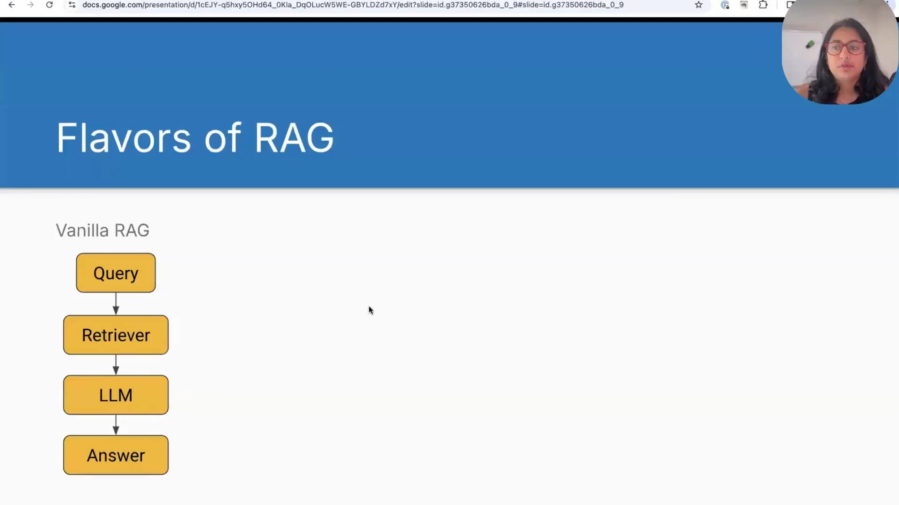

> "评估 RAG 时，你要把 retriever 组件和 LLM 组件分开评估。"
> —— p016 [04:12]

> "chunk 是知识库中用于检索的一段文本单元。"
> —— p016 [05:29]

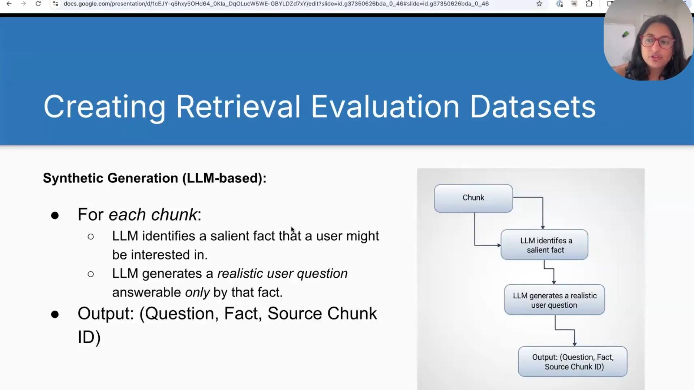

> "对每个识别出的 chunk，我们有一个两步流程：先让 LLM 找出 chunk 里用户可能关心的一个显著事实，再让 LLM 生成一个能被这个事实回答的真实用户问题。"
> —— p016 [08:48]

> "这会给你一串 question、fact 和 source chunk ID 的 tuple。"
> —— p016 [09:17]


> "我让 LLM 给每个 query 打 1 到 5 分，5 是非常真实，1 是完全不真实。"
> —— p016 [15:52]

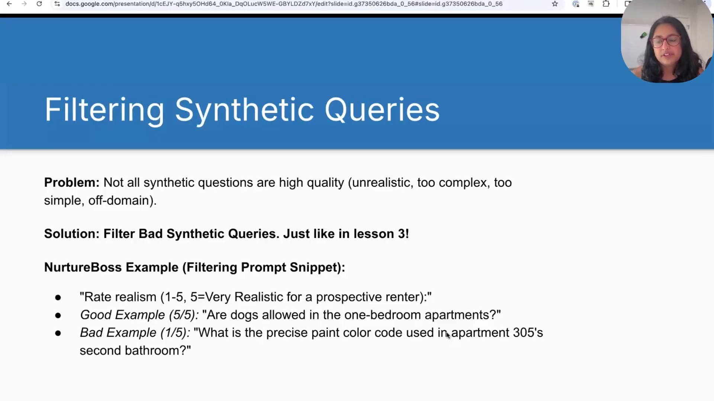

> "recall@K 问的是：所有 ground truth chunk 中，有多少出现在 retriever 的 top K 里。"
> —— p016 [21:28]

> "precision@K 问的是：我们取回的 top K 里，有多少其实是相关的。"
> —— p016 [22:24]

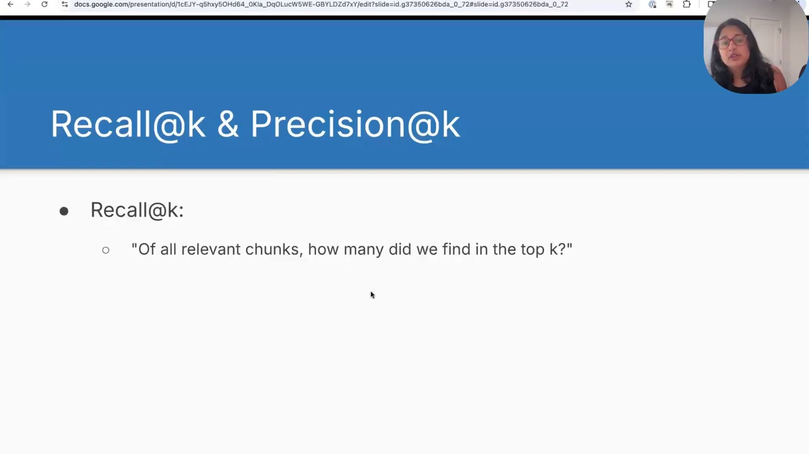

> "MRR 的计算很简单：看第一个相关文档的排名，然后对所有 query 取 1 除以这个排名的平均。"
> —— p016 [26:38]

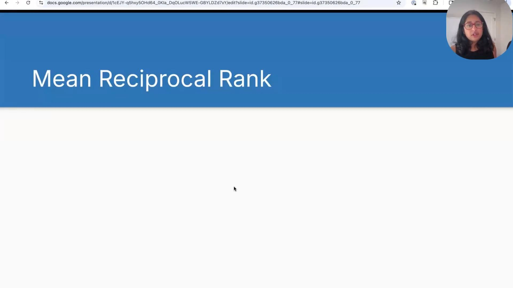

> "通常要先确保 retriever 的 recall 足够好，再去做 LLM 生成步骤的评估或详细的错误分析。"
> —— p016 [28:16]

> "做 open coding 时，我会记下幻觉，也就是输出里有、但 retrieved chunks 里没有的信息；也会记下表示不准确，比如上下文被 LLM 误解；还会记下遗漏，也就是正确答案在 retrieved chunks 里，但 LLM 完全忽略了。"
> —— p016 [29:39]

> "常见陷阱是：还没有验证 retrieval，就过早聚焦 RAG 优化。"
> —— p016 [32:02]

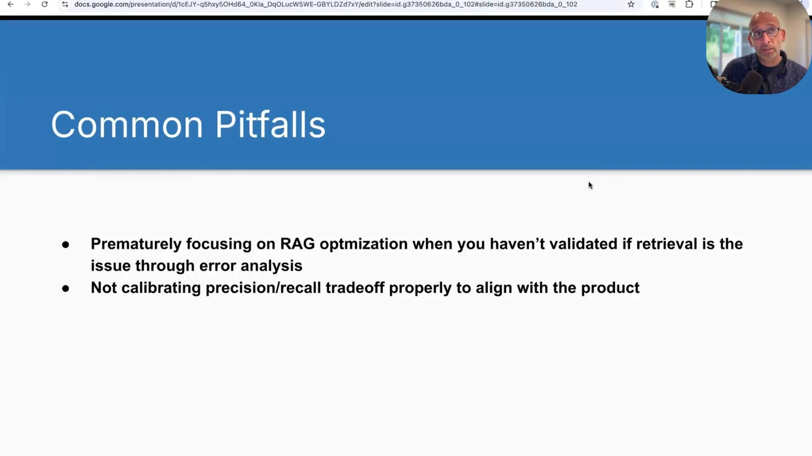

> "不要一开始就用 vector database；先用基础的关键词搜索、BM25 索引，几乎所有数据库都支持某种全文搜索或关键词搜索。"
> —— p016 [36:54]

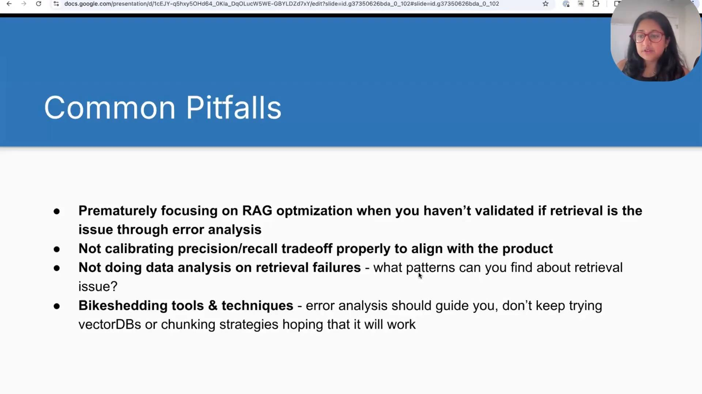

> "tool calling 的前提是你给 agent 一个工具列表，LLM 要决定用哪个工具，并生成调用参数，然后你的软件去执行 function call。"
> —— p016 [39:09]

> "MCP 也一样，因为 MCP 里你要写所有 endpoint 或 tool 的描述，一定要写清楚。"
> —— p016 [41:01]

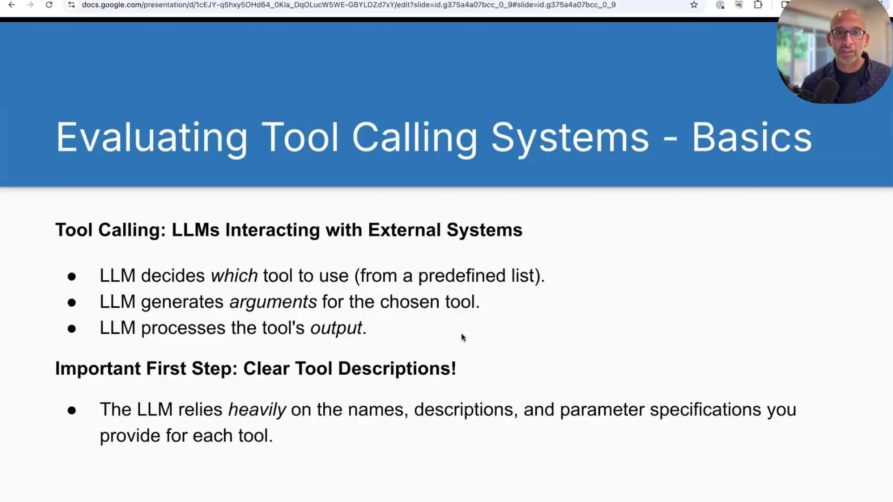

> "日期参数上我经常看到问题：如果我没有明确指定日期格式，比如月、日、年，生成的日期参数就会不一致。"
> —— p016 [43:14]

> "做错误分析时有一个启发式：先看用户输入，再看最终 outcome，判断有没有出错；如果出错，再回到开头找第一个错误。"
> —— p016 [45:29]

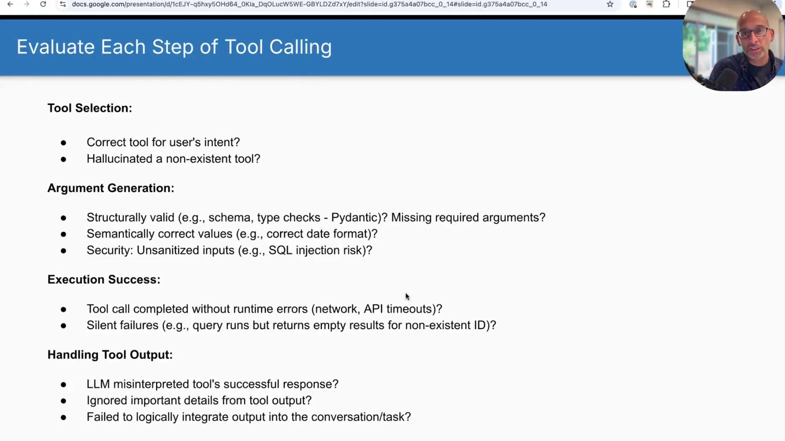

> "长文档里我见得最多的问题是：文档处理其实有两类，你要区别对待。"
> —— p016 [48:44]

> "constant output 任务里，你知道正好有一个答案，比如在文档里找针；输出大小不随文档长度增长。"
> —— p016 [49:12]

> "variable size output 任务里，你要抽取某个东西的所有实例；文档越长，输出通常越长，所以有时必须把文档分块，逐块应用 LLM。"
> —— p016 [50:10]

> "CI 要写 known unknowns 的单元测试：你已经通过错误分析知道系统有哪些失败模式，就把它们变成上线新 prompt 前要跑的测试。"
> —— p016 [53:58]

> "CD 更关注持续看线上 trace 的样本，做错误分析，找 unknown unknowns，也就是旧错误分析没发现的新失败模式。"
> —— p016 [54:26]

> "作业四是 recipe bot repo 里的 RAG 作业：我们提供了从 Kaggle 抓取的 recipes 数据集，也建好了 retriever；你的目标是创建 synthetic dataset 来评估 retriever，并计算指标。"
> —— p016 [57:44]

> "还有一个可选作业，围绕 debugging 可视化；有兴趣可以读 reader 的第七或第八章，在调试 recipe bot 时生成这些可视化。"
> —— p016 [58:41]

## 3. 从零复现

这一讲不是“跑一条命令就出结果”的课，复现时要把讲师的设计推导按步骤落地。下面按“需求 → 约束 → 估算 → 方案 → 取舍”组织。

### 3.1 需求：把 RAG 评测拆成两层

需求不是“做一个 RAG demo”，而是可测量地回答两个问题：

1. retriever 有没有把正确的上下文取回来？
2. 在正确上下文已经取回的前提下，LLM 生成步骤有没有出错？

讲师明确说，RAG 的评测要分成 retriever 和 LLM 两层。因为 RAG 是多阶段流程：检索、生成，很多时候还有 rerank。如果 retriever 的 recall 很差，后面做生成错误分析意义不大——正确答案根本不在上下文里，LLM 没有机会答对。

### 3.2 约束：课里没给工程命令，不能伪造

P16 没有给仓库 URL、安装命令、依赖版本、环境变量名、启动命令。逐字稿只提到作业在 **recipe bot repo 的 homework four**，数据是从 **Kaggle** 抓取的 recipes 数据集，retriever 已经建好，你要做 synthetic dataset、评估 retriever、算指标。还提到可选作业是 debugging 可视化，读 reader 第七或第八章。除此之外，具体命令课里没讲。

因此复现时先接受三个约束：

- **约束 A：必须先有 ground truth chunks。** 只有 `question + fact` 不够，必须有 `source chunk ID`，否则无法计算 recall 等检索指标。
- **约束 B：K 不是固定的。** K 取多少要看产品：给 LLM 看多少 chunk、给用户看多少结果、上下文窗口多大。
- **约束 C：LLM 评测天然非确定。** 所以 CI 只能测“known unknowns”，CD 要持续看线上 trace 找“unknown unknowns”。

### 3.3 估算：用讲师给的数字做心算

逐字稿里有两个可直接用来估量的数字：

1. 合成 500 条 trace，其中有 10 条不真实——这大约占 2%。讲师说这没关系，最多浪费你在错误分析时看这 10 条的时间；比一个错位的 LLM judge 替你做业务决策要好。
2. K 的影响：recall@K 的分母是 ground truth chunks 数量，K 越大，ground truth 出现在 top K 的机会越多；K=5 和 K=1000 的 recall 不可直接比较。

容量上不要自己编公式。课里没给“多少 chunk 生成多少 query”的精确比例，只说了“一个 chunk 可以生成多个 query”。所以你的估算表应写成可追溯的假设，而不是伪装成课程结论。

### 3.4 方案：按阶段复现

**第 1 步：定义 chunk。**  
chunk 是知识库中用于检索的文本单元。粒度要结合领域：

- 电商：一个商品描述可以是一个 chunk；
- 法律：一个 clause 或一个 section 可以是一个 chunk；
- NurtureBoss：任何用户可能单独提问的独立信息单元都可以是 chunk；
- FAQ 和 amenity list 可以是不同大小，允许 variable-size chunks。

讲师强调：chunk 要既让用户 query 能命中，又能放进 LLM 上下文。chunk 不能是整个知识库。还要记住“地图不是领土”：chunk 是索引，帮助你找到文档；匹配到 chunk 后，你完全可以在生成阶段把更多文档内容放进 LLM。

**第 2 步：准备 ground truth chunks。**  
每个 chunk 至少要有稳定 ID、文本、来源/元数据。合成数据要输出 `question`、`fact`、`source_chunk_ids`。如果是多 chunk 问题，`source_chunk_ids` 用列表，评估时要检查是否取回了所有相关 chunk，而不是只取回其中一个。

**第 3 步：两步合成 query。**  
第一步，让 LLM 从 chunk 中挑一个 salient fact；第二步，让 LLM 围绕这个 fact 生成 realistic user question。prompt 里可以放真实用户 query 的样例，要求匹配语气、风格，甚至可以要求 query 稍微 ambiguous。一个 chunk 可以生成多条 query。合成过程要独立于你准备用哪种 retriever：不要带着“我要用向量库/图数据库”的架构偏好去造 query。

**第 4 步：过滤不真实 query。**  
让 LLM 给每条 query 打 1–5 分，5 很真实，1 完全不真实。只删除 1/2 分，3/4/5 保留，分数之后不再使用。这个分数不是 ground truth，只是过滤极差合成 query 的临时排序工具。讲师说这里可以用 Likert scale，因为这不是正式 LLM judge，不用于上线后质量判定，只是“把明显不现实的问题丢掉”。

**第 5 步：评估 retriever 的 ranking。**  
核心指标：

- **recall@K**：所有 ground truth chunks 中，有多少出现在 top K；
- **precision@K**：top K 中，有多少真正相关；
- **F1**：组合 recall 和 precision，权重取决于产品对 false positive / false negative 的成本判断；
- **MRR**：第一个相关 chunk 的排名有多高，计算为 `1 / rank` 的跨 query 平均。

讲师建议先优化 recall@K。因为正确 chunk 不在上下文里，LLM 不可能答对。precision 在上下文窗口变大、LLM 更能处理噪声后变得没那么关键，但如果 LLM 经常被无关 chunk 搞混，就加 MRR 或 rerank。

**第 6 步：生成步骤 error analysis。**  
在 recall 达标后再做。重点记录：

- hallucination：输出里有、retrieved chunks 里没有的信息；
- representation inaccuracy：上下文被 LLM 误解；
- omission：正确答案在 retrieved chunks 里，但 LLM 完全忽略。

不要直接拿 off-the-shelf 的 hallucination 指标当结论。讲师说这类指标背后往往是一个你不知道好不好的 prompt；应该先做 error analysis 得到直觉，再构建适合自己产品的 LLM judge。

**第 7 步：处理常见陷阱。**  
不要未验证 retrieval 就优化 RAG；不要盲目换 vector database；不要盲调 chunk size 等 hyperparameter；先做 retrieval error 的 data analysis。讲师建议先用 keyword search、BM25、full text search，甚至说很多论文发现 keyword search 可以超过 embedding-based search，agentic search 也常在 keyword index 上做。

**第 8 步：tool calling 按 trace 做 error analysis。**  
工具调用不用另起一套评测哲学：给 agent 工具列表，LLM 选工具、生成参数，软件执行 function call，再把输出回填给 LLM。错误分析时看：工具选错、幻觉出不存在的工具、参数类型/取值不对、日期格式不一致、安全问题、执行失败、API 超时/网络错误、SQL filter 稍错导致空结果、误解成功响应或忽略细节。工具描述和 MCP 的 endpoint/tool 描述要写清楚。

**第 9 步：图片、PDF、长文档按失败模式处理。**  
图片模型对 do/don't 约束更差，空间推理、计数、OCR 都可能出错；PDF 继承图片和长文档问题。长文档分两类：constant output 任务（如找 clause，输出大小不随文档长度增长）要评估 lost in the middle；variable size output 任务（如抽取所有 logical fallacies）要分块、逐块提取、再合并，因为 transformer 不会同等关注整个文档。

**第 10 步：CI/CD 落到流程。**  
CI 用错误分析发现的 failure mode 写回归测试，每个 failure mode 最好有约 10 条 trace 作为 known unknowns；CD 持续采样线上 trace，做 error analysis 找 unknown unknowns。不要假设离线 CI 的 98% 准确率能预测生产；不要把 golden set/CI 样例塞进 pipeline prompt；CI 不要长期 100% 通过，要刷新、放有挑战的样本，避免过拟合。每周花约一小时看 trace，包括用户投诉的 trace 和随机样本。

### 3.5 取舍：为什么这样排顺序

- **先 recall 后 precision**：没有正确 chunk 就没有希望；precision 可以靠 rerank 或多阶段检索再处理。
- **先 keyword/BM25 后 vector DB**：先建立基线，知道问题在哪，再决定是否换工具；不要用换 vector database 来掩盖未诊断的检索错误。
- **图数据库默认不做**：讲师说大多数情况下图数据库是浪费时间，维护 metadata 成本高；可以用 key-value store、关键词搜索，甚至让 LLM 找相关 chunk。
- **合成 query 独立于 retriever**：否则你是在为自己的架构造测试，而不是为真实用户 query 造测试。
- **Likert 分数只做过滤**：不作为 ground truth，避免引入“错位 LLM judge 替你做业务决策”的风险。

## 4. 完整代码

**本节特别说明：P16 逐字稿没有给出任何可运行代码、命令、依赖、环境变量或启动命令；截图 OCR 为空，所以没有屏幕代码可抄。下面不伪造“完整项目代码”，而是把讲师给出的方案落成可交付产物：设计决策表、组件职责表、数据模型草案、指标定义表、容量估算表和检查表。**

### 4.1 设计决策表

| 决策 | 讲师方案 | 理由 |
|---|---|---|
| 评测拆分 | retriever 与 LLM 生成分开评估 | 先确认正确上下文是否取回，再做生成 error analysis |
| chunk 粒度 | 按领域自然断点，允许 variable size | chunk 要能被 query 命中，也要能放进上下文 |
| 合成 query | 两步：salient fact → realistic question | 让问题有事实依据，又接近真实用户表达 |
| 数据字段 | `question`、`fact`、`source_chunk_ids` | 没有 source chunk ID 就无法算 retrieval 指标 |
| 过滤 | LLM 1–5 分，删 1/2 | 分数只做过滤，不做 ground truth |
| 检索指标 | recall@K、precision@K、F1、MRR | 评估 ranking；优先 recall |
| 生成错误 | hallucination、representation inaccuracy、omission | 用 error analysis 找，不直接用 off-the-shelf judge |
| 工具调用 | 整条 trace 做 error analysis | 选工具、参数、执行、输出回填都可能错 |
| 长文档 | constant output 与 variable output 分开 | 一个看 lost in the middle，一个要分块提取 |
| CI/CD | CI known unknowns，CD unknown unknowns | 非确定性系统不能只靠固定单测 |

### 4.2 组件职责表

| 组件 | 职责 | 输入 | 输出 |
|---|---|---|---|
| chunker | 按领域语义切知识库 | 原始文档 | chunk 文本 + 稳定 chunk ID + 元数据 |
| synthetic query generator | 两步生成 query | chunk | `question`、`fact`、`source_chunk_ids` |
| query filter | 过滤不真实 query | synthetic query | 保留 3/4/5，删除 1/2 |
| retriever | 返回 top K chunks | query | ranked chunk IDs |
| metric calculator | 计算 recall@K、precision@K、F1、MRR | ranked IDs + ground truth IDs | 指标报告 |
| trace reviewer | 做生成/工具调用 error analysis | trace | failure mode 记录 |
| CI/CD harness | 回归与线上采样 | CI 集、线上 trace 样本 | 回归结果、unknown unknowns 列表 |

### 4.3 数据模型草案（课里没有代码，以下为示意）

` synthetic_queries.example.jsonl ` 可保存为 JSONL 文件。字段名来自讲师讲的 `question`、`fact`、`source chunk ID`；多 chunk 时用数组。下面的 chunk ID 是占位符，不是课程数据。

```jsonl
{"question":"Can I bring my friend to the pool?","fact":"Each apartment is allowed a maximum of two guests.","source_chunk_ids":["<community-policies-chunk-id>"]}
{"question":"Which document mentions the covenant not to sue clause?","fact":"The covenant not to sue clause appears in the contract.","source_chunk_ids":["<contract-clause-chunk-id-1>","<contract-clause-chunk-id-2>"]}
```

示意 TypeScript 类型如下：

```ts
// 课里没有代码；以下只是按逐字稿字段整理的数据模型草案。
export type SyntheticQuery = {
  question: string;
  fact: string;
  source_chunk_ids: string[];
};

export type RetrievedChunk = {
  chunk_id: string;
  rank: number;
  score?: number;
};
```

### 4.4 指标定义表

| 指标 | 公式/定义 | 用途 |
|---|---|---|
| recall@K | `命中 top K 的 ground truth chunk 数 / ground truth chunk
| recall@K | `命中 top K 的 ground truth chunk 数 / ground truth chunk 总数` | 衡量完整性 / 覆盖度，讲师建议优先优化 |
| precision@K | `命中 top K 的相关 chunk 数 / K` | 衡量取回结果里有多少噪声；上下文变长后重要性下降 |
| F1 | recall 与 precision 的加权组合 | 当 false positive 与 false negative 的成本不同时，按产品调权 |
| MRR | 对每条 query 取 `1 / 第一个相关 chunk 的排名`，再对所有 query 求平均 | 衡量第一个相关 chunk 出现得多靠前，帮 LLM 更快扫到答案 |

注意：上表的 K 必须固定后才能横向比较。课里没有给“标准 K 值”，只说 K 取决于你的产品——有多少 chunk 会送给 LLM、有多少结果会展示给用户、上下文窗口有多大。所以报表里一定要写清 `K=...`，否则数字没有意义。

### 4.5 容量估算表（假设需自行填写，不是课程结论）

| 项 | 符号 | 你的取值 | 说明 |
|---|---|---|---|
| 知识库 chunk 总数 | N | 待填 | 由 chunk 策略决定，课里没给具体数字 |
| 每个 chunk 合成 query 数 | m | 待填 | 课里明确说“一个 chunk 可以有多个 query”，但没给推荐值 |
| 合成 query 总量 | N × m | 待填 | 这是过滤前的数量 |
| 过滤保留率 | r | 待填 | 只删 1/2 分；讲师举例 500 条里 10 条不真实（约 2%），属可接受损耗 |
| 最终评测集规模 | N × m × r | 待填 | 用于算 recall@K、MRR 等 |
| 评估时取回的 chunk 数 | K | 待填 | 与产品上下文预算绑定 |
| 每条 trace 的人工复核时间 | t | 待填 | 讲师建议每周固定约 1 小时看 trace，可据此反推能覆盖多少条 |

这张表故意留空：逐字稿只给了“500 条里 10 条不真实”和“每周约 1 小时看 trace”这两个可引用数字，其他数量级必须由你的知识库规模和预算决定。

### 4.6 交付物清单

| 产物 | 文件名（建议） | 内容 |
|---|---|---|
| chunk 表 | `chunks.jsonl` | `chunk_id`、`text`、来源元数据 |
| 合成 query 集 | `synthetic_queries.jsonl` | `question`、`fact`、`source_chunk_ids` |
| 过滤后评测集 | `eval_set.jsonl` | 删掉 1/2 分后的 query |
| 检索结果 | `retrieval_runs.jsonl` | 每条 query 的 top K chunk ID 及排名 |
| 指标报告 | `retrieval_metrics.md` | 固定 K 下的 recall@K、precision@K、F1、MRR |
| 错误分析表 | `error_analysis.md` | 按 failure mode 归类，含 trace 链接 |
| CI 回归集 | `ci_known_unknowns.jsonl` | 每个已知 failure mode 约 10 条 trace |
| CD 采样记录 | `cd_review_log.md` | 每周复核的线上 trace 样本与发现 |

## 5. 逐行解释

**为什么数据模型一定要有 `source_chunk_ids`，而不是只有 `question` 和 `fact`？**  
因为 recall@K、precision@K、MRR 全部依赖“标准答案的 chunk 是哪几个”。讲师专门点出这是他经常看到的错误：有人拿着一堆合成 query 就说“我有 synthetic dataset 了”，但没保留 ground truth chunk，结果算不出任何检索指标。用前端能理解的话说：`source_chunk_ids` 就像数组里的稳定 key，没有 key 你只能看到“有结果”，却没法判断“结果对不对”。

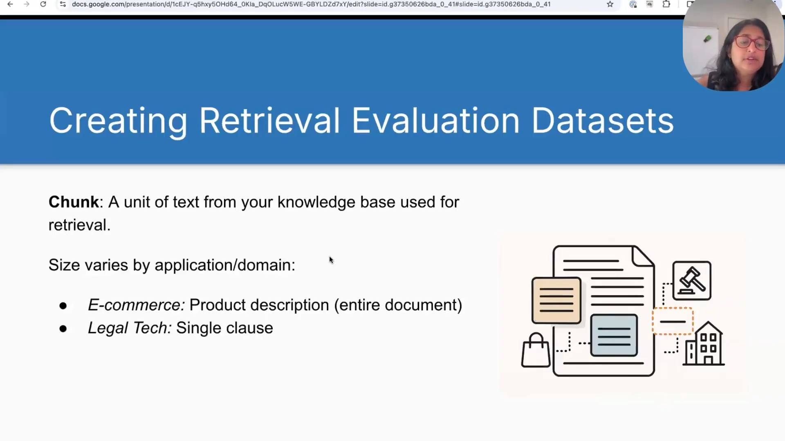

**为什么 chunk 允许 variable size？**  
讲师举了 NurtureBoss 的例子：FAQ 部分可能是一整块，amenity list 可能小得多，两者大小不同完全没问题。他还提醒“地图不是领土”：chunk 是索引，用来帮你找到文档；一旦匹配上，你在生成阶段完全可以把更多文档内容塞进 LLM。也就是说，检索单元和喂给 LLM 的上下文单元，是两个不同的东西。很多人纠结 chunk size，其实是把这两件事混成一件。

**为什么两步生成（先 fact、后 question），而不是一步直接生成问题？**  
一步生成容易造出“文档里根本没有依据”的问题，或者造出与 chunk 无关的问题。两步流程让问题先绑定一个 chunk 内的显著事实，再用它去反推用户会怎么问。讲师给的例子是社区政策 chunk 里的“每套公寓最多允许两位访客”，然后生成“我能带朋友去泳池吗”——这个问题必须依赖内部文档才能答，任何没看过你内部文档的 LLM 回答它都是 100% 幻觉。

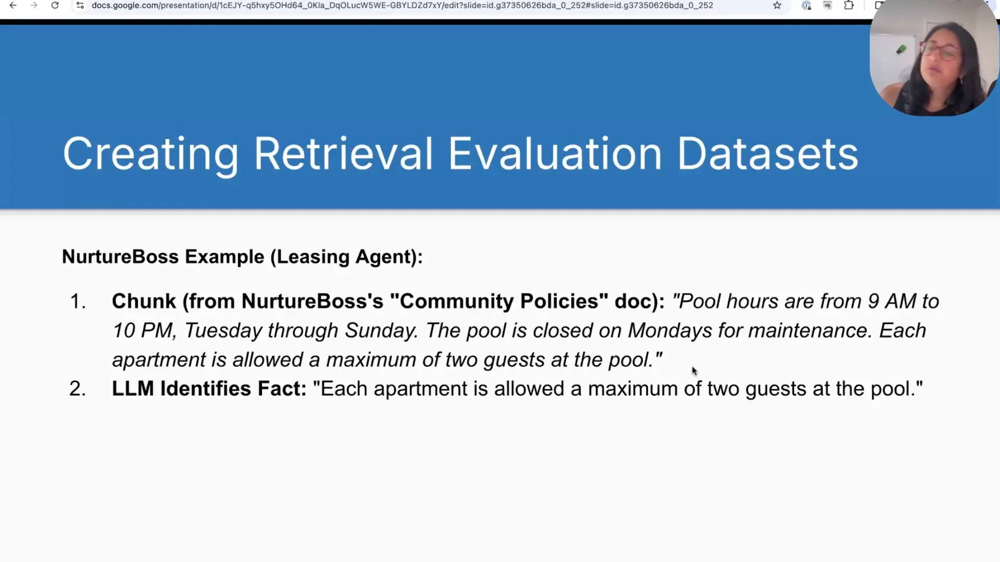

**为什么合成 query 时要放真实用户 query 做风格样例？**  
讲师说 prompt 里可以写“按这些真实样例的语气/风格生成”，甚至可以让 query 稍微 ambiguous。原因是真实用户的表达很脏：在 NurtureBoss 的例子里，大约一半的时候他们甚至看不懂用户在说什么。你想象出来的 query 和用户真实会问的 query 之间永远有鸿沟，所以要用真实 trace 去校准；如果只能合成，也要把这种“messiness”注入进去。

**为什么 Likert 1–5 分只用来过滤，之后就不用了？**  
讲师说得很直白：打分之后他不做任何事，只把 1 分和 2 分丢掉，3/4/5 留下，分数再也不会被使用。这是全课里他唯一支持用 Likert scale 的地方，因为它不是用来判断上线质量、不是用来做 criteria 的 LLM judge，只是从一堆合成 query 里筛出“最真实的前 100 条”去启动 error analysis。本质上它退化成一个二分类标签，只不过边界模糊，所以需要更细的刻度让人（或模型）自己判断。反面例子是：如果你把它当 ground truth，就会重演“错位的 LLM judge 替我做业务决策”的问题。

**为什么 recall 优先于 precision？**  
讲师的原话逻辑是：如果正确的 chunk 不在上下文里，LLM 没有任何机会答对。他打了个很生动的比方——文档根本没来参加派对。precision 之所以没那么关键，是因为消费 retrieved chunks 的是 LLM 而不是人：只要答案在里面，LLM 有机会从噪声里挑出来。他还提到，随着上下文窗口变大、模型更会给注意力，业界很多 RAG 系统就是尽量多塞上下文碰运气。但如果你发现 LLM 持续被大量无关 chunk 搞混，那就该看 MRR，或者加一个 rerank 阶段。

**为什么 MRR 要在 recall 之后看？**  
MRR 只关心第一个相关 chunk 排得多靠前。讲师说，如果一条 query 实际上只需要一个文档，那 MRR 和“相关 chunk 的排名”差不多；但在多阶段 RAG 里，第一阶段排得越好，后面的 rerank / 过滤阶段就越省力，LLM 要处理的噪声也越少。所以它是 recall 达标之后的“排序质量”指标。

**为什么 K 要由产品决定？**  
因为 K 同时决定了三件事：送给 LLM 的上下文长度（成本与延迟）、展示给用户的结果条数（体验）、以及指标本身的分母/上限。讲师明确说没有万能公式，每次都要实验。他举的对照案例是 Anki Hub：那是一个把 Anki 卡片做语义搜索的产品，人在直接看搜索结果；而大多数场景里搜索结果还要再经过 LLM，于是你要考虑的是“LLM 需要什么样的 precision/recall 取舍”，两者的 K 不可能一样。

**为什么先 keyword search / BM25，而不是先上 vector database？**  
这是“关注 process 而不是 tools”的直接推论。讲师说，如果你连检索错在哪都不知道，换 vector database 不会帮你；盲调各种 hyperparameter 也一样。他引用的观察是：多篇论文发现关键词搜索可以超过基于 embedding 的搜索；而且那些被训练来生成好搜索 query 的 SOTA 搜索 agent，底层也是跑在关键词索引上。原因是 agentic RAG 里 agent 可以自己推理 query、想同义词、发多次检索调用，这时关键词检索反而更稳。

**为什么图数据库默认不做？**  
两位讲师的态度很一致：概念上很酷，但实际项目里基本是浪费时间。维护 metadata、curate 关系成本很高；大多数需求用 key-value store、关键词搜索、或者干脆让 LLM 去找相关 chunk 就够了。讲师还开玩笑推荐去搜 Joe Burgum 在 Twitter 上关于图数据库的帖子，能乐一个小时。

**为什么 tool calling 的错误要按 trace 一段段看？**  
因为 tool calling 是一条链：选工具 → 生成参数 → 你的软件执行 function call → 把输出回填给 LLM → LLM 再推理。任何一环坏了，最终答案都错，但错因完全不同。讲师列的失败模式包括：工具选择错误（通常因为工具描述写得太差）、系统提示里说要调 reschedule 工具但可用工具列表里根本没有这个工具、幻觉出不存在的工具、参数类型对但取值语义不对（尤其日期格式）、安全问题、执行失败（API 超时、网络错误）、静默失败（SQL filter 稍微写错导致空结果，LLM 以为“没有数据”而不是“再试一次”）、以及误解成功响应或忽略细节。他还说 NurtureBoss 里 agent 有 12 个工具可调用，工具越多，选择错误的面就越大。

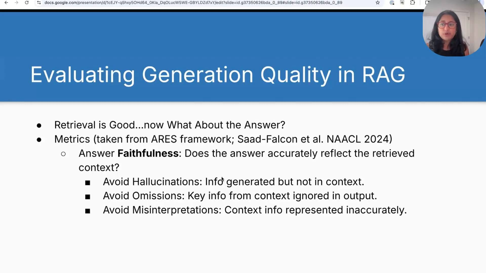

**为什么长文档要分成 constant output 和 variable size output 两类？**  
constant output 任务的输出大小不随文档长度增长：200 页合同和 500 页合同里，还是只有一个“不起诉条款”。这类任务的核心风险是 lost in the middle——答案在文档中部时模型容易漏。variable size output 任务则相反：文档越长，要抽的实例越多，输出也越长。这时哪怕整篇能塞进上下文，也不该这么做，因为 transformer 不会对上下文里每个词平均分配注意力；正确做法是切块、逐块抽取、最后合并。讲师给的例子是从辩论 transcript 里抽所有 logical fallacies：切成 chunk 逐块抽，再合成一张大列表，效果通常好于一次性喂整篇。

**为什么 CI 叫 known unknowns、CD 叫 unknown unknowns？**  
CI 用的是你已经通过 error analysis 发现的失败模式：每种失败模式找约 10 条真实 trace 当回归测试，换 prompt 上线前跑一遍，确保不会退化。CD 则是对线上 trace 持续采样、持续做 error analysis，去发现旧分析没发现的新失败模式。讲师特别提醒两个坑：一是别把离线 CI 的 98% 准确率当成生产准确率，因为 CI 集是固定的、不是生产分布；二是别把 golden set / CI 样例写进 pipeline 的 prompt，那是数据泄漏。另外 CI 长期 100% 通过也不是好事，说明它没有区分度，需要定期刷新、放入更有挑战的样本——这里没有精确科学，是判断题。

## 6. 复现检查清单

- [ ] 我已经明确区分了 retriever 评测与 LLM 生成评测，没有混在一起看。
- [ ] 我的每个 chunk 都有稳定 `chunk_id`，并保留了来源元数据。
- [ ] chunk 粒度是按领域语义断点定的，不是无脑按固定 token 切。
- [ ] 我允许 variable-size chunk，并想清楚“索引单元”和“喂给 LLM 的上下文单元”是两回事。
- [ ] 我的合成数据每条都带 `question`、`fact`、`source_chunk_ids`。
- [ ] 多 chunk 问题用数组保存多个 ground truth chunk，并在评估时检查是否全部取回。
- [ ] 合成 query 的 prompt 里有真实用户 query 作为风格样例。
- [ ] 合成 query 时没有预设某种 retriever 架构。
- [ ] 我跑了 1–5 分真实性打分，只删 1/2，且分数没有进入后续指标。
- [ ] 指标报告里写明了 K 的具体取值。
- [ ] 我先看 recall@K，再决定是否补 precision@K / F1 / MRR。
- [ ] recall 达标之后我才开始做生成步骤的 error analysis。
- [ ] error analysis 里显式标注了 hallucination / representation inaccuracy / omission。
- [ ] 我没有直接拿 off-the-shelf hallucination 指标当结论，而是先建立自己的判断。
- [ ] 我先用 keyword / BM25 / full text search 建立了基线，而不是一上来换 vector database。
- [ ] 检索效果差时，我先做 retrieval error 的 data analysis（例如某类数据根本没被索引），而不是盲调 hyperparameter。
- [ ] tool calling 的 trace 我按“选工具 / 参数 / 执行 / 输出处理”四段逐段检查。
- [ ] 每个工具和 MCP endpoint 都有清晰描述，系统提示里提到的工具确实存在于工具列表中。
- [ ] 日期类参数我明确规定了格式。
- [ ] 长文档任务我已判定属于 constant output 还是 variable size output，并采用对应策略。
- [ ] 图片 / PDF 输入我单独检查了 OCR、空间推理、计数、复合生成等失败模式。
- [ ] CI 里每个已知 failure mode 有约 10 条 trace，且没有混入 pipeline prompt。
- [ ] CD 有固定的 trace 复核节奏（讲师建议每周约 1 小时），包含用户投诉样本和随机样本。
- [ ] CI 集有刷新机制，允许它不总是 100% 通过。

## 7. 课里没讲但你会撞上的

**1）具体的检索实现与依赖。**  
课里没讲用什么语言、什么库、什么 embedding 模型、什么向量库，也没给版本号、环境变量名、启动命令。作业只说是 recipe bot repo 的 homework four，数据是从 Kaggle 抓的 recipes，retriever 已经建好。所以这部分你要去仓库里看，本文不能替你编。

**2）chunk 的 overlap、token 计数、切分库。**  
讲师强调了“按语义边界切”“允许 variable size”，但没讲 overlap 取多少、用什么 tokenizer 计数、用哪个切分库。这些属于实现细节，课里没讲。

**3）LLM 调用的重试、限流、超时、成本。**  
合成 query 和打分都要批量调 LLM，会撞上 rate limit、超时、部分失败。课里只在 tool calling 的失败模式里提到 API 超时和网络错误，没有给批量合成的工程方案。前端同学可以类比：这就像批量发请求要加并发控制和重试，否则一批 500 条里总有一部分静默失败。

**4）索引更新与服务的一致性。**  
课里没讲。真实系统里你会遇到“知识库更新了但索引还没重建”的窗口期，此时 recall 会莫名下降。如果你用 Node 写服务，可以类比为：读的是缓存，写的是数据库，中间不一致时你看到的“查不到”并不是检索算法的问题——先确认索引是否最新，再怀疑模型。

**5）评测流水线的选型。**  
讲师提到 Aries 框架（Stanford，讲师口述的负责人名字按发音写作 John Sondfalken，拼写请以实际论文为准），也提到那篇讲他们如何训练自己的 LLM judge 的论文；还有 README/课程 reader 里的章节（chapter 3 合成数据、第七或第八章可视化调试、第九章 CI/CD）。但课里没有给具体的评测框架安装与配置步骤。

**6）agentic RAG 的循环控制。**  
讲师描述了 agentic RAG 的形态：LLM 反思 retriever 输出、可以重写 query、循环到足够自信再返回答案；也有博客把 query 分解成多个子 query 各自跑 agentic loop。但课里没讲最大轮数怎么定、什么条件算“足够自信”、循环不收敛怎么办。这些要你自己定策略。

**7）多 chunk 问题的 ground truth 判定。**  
讲师给了方向：`source_chunk_ids` 用列表、评估时要检查是否取回全部相关 chunk；也提到可以让 LLM 去找与随机 chunk 相关的其他 chunk。但“部分取回算不算命中”这种评分口径，课里没讲，需要你在指标定义里写清。

**8）图片与 PDF 的具体处理链。**  
讲师提醒：很多现成 PDF 处理器底层其实是把 PDF 页面转成图片再丢给多模态模型，于是它是在“理解页面图像”而不是“读取 PDF 文本内容”，OCR 问题正来源于此。他还提到图片模型对 do/don't 约束更差（想生成不放豌豆的扬州炒饭，结果几乎总有豌豆）、空间推理和计数容易错、复杂构图很难（他花三小时想让扩散模型在一张图里画美国前 12 位总统，结果出现重复面孔和混合脸）。这些都是失败模式清单，不是实现方案；课里没讲具体该用哪个解析器。

**9）安全与权限。**  
讲师提到 tool calling 有安全问题，尤其在用户量大的产品里要重视；也提到 SQL filter 生成错误会静默返回空结果。但课里没讲具体的权限模型、注入防护、SQL 白名单方案。如果你做的是内部工具，至少要把“LLM 生成的查询只能读、不能写”当成默认前提。

**10）课程里提到但本文无法展开的延伸材料。**  
讲师多次指向课外材料，课里只给了名字没给正文：Hamel 的 RAG 系列课（YouTube，配套 reader，讲各种 retriever 架构，包括 Colbert 一类新方案）、他们做过的 advanced RAG 公开系列、关于 RAG 失败模式的论文、以及他mentee 写的一篇（口述听起来像 “What a spoiler”，标题请以实际链接为准，ASR 可能有误）。这些链接在 Discord 和课程 reader 里，课里没有逐条念出 URL。

**11）作业与配套安排。**  
RAG 作业是 homework four（recipe bot repo）：提供 Kaggle 抓取的 recipes 数据集与已建好的 retriever，你要造 synthetic dataset、评估 retriever、算指标（讲师说“算你想算的任何指标”，slides 上列了几个）。可选作业是 debugging 可视化，建议先读 reader 第七或第八章，然后在调 recipe bot 时生成这些可视化。反思作业不新增，沿用之前关于 RAG 的那份，Maven 上不用交新的。下一次课主题是改进：周二讲面向人工复核的自定义界面，周四讲成本优化与其他改进。

**12）最后一条硬提醒。**  
这一讲反复回到同一个判断：**先在流程上做对，再谈工具**。未验证 retrieval 就优化 RAG、没做数据诊断就换 vector database、拿现成的 hallucination 指标当结论、把离线 CI 准确率当生产准确率——这四件事是讲师点名的最贵错误。你照着第 6 节清单一条条打勾，基本就能避开它们。