# AI Evals 工程师与 PM 实战：Judge 系统的 Judge-Time Scaling 与 AI 辅助开发工作流（P17–P18）

> 本文覆盖两场独立分享。P17 是 Leo Tang（Haze Labs 联合创始人兼 CEO）关于“如何把 judge 做强”的研究与产品讲解；P18 是 Isaac 关于“如何用 Claude Code + Ruler + 自建 MCP Server 从零做出一个 RAG 标注应用”的实操讲解。
>
> 阅读前请先看这句定位：**P17 没有任何可执行代码，它是纯讲解课**，因此第 3/4/5 节按“设计推导 → 设计产物（决策表、数据模型、容量估算）→ 逐条解释”的方式写；**P18 有真实的文件、目录、命令和 MCP Server**，第 3/4/5 节是可照着敲的复现路径。凡是课里没给源码的地方，本文会明确标注“课里没有给出源码，以下为按讲师描述重建的示意实现”，不会冒充讲师原话。

---

## 1. 这一节做什么

这两讲回答的是同一个问题的两端：**你怎么知道自己做的 AI 应用到底好不好。**

P17 处理的是“判分器”这一端。讲师先指出行业默认做法——标准 eval（golden dataset）——的两个结构性缺陷：**覆盖度不够**和**质量指标无法操作化**。他给出的解法是两条并行的 scaling 路线：

1. **往模型内部 scale**：用 RL 把一个 reasoning model 训练成 judge，强制它针对每一条具体输入生成 query-specific rubric（查询级评分细则），再针对 rubric 的每一条产出 rationale，最后聚合成一个分数。产出的开源模型是 J1 系列（J1 micro 1.7B、J1 nano 600M）。
2. **往模型外部 scale**：模型不动，在模型外面搭一套 judge agent 系统。产出是开源框架 Verdicts，它把 scalable oversight 文献里的原语（互相辩论的 unit、多样化 judge 组成的 panel 投票、self-validation）做成 first-class primitive，像 PyTorch 叠层一样任意组合。

P18 处理的是“造应用”这一端，而且它是元层面的：**用一个 AI 应用（Claude Code）去造另一个 AI 应用（RAG 标注工具），并且给这个 AI 造一套它自己能用的测试工具（MCP Server）。** 讲师的四步工作流是：

1. 建 `.ruler` 目录，写一份**可移植的 LLM 上下文**，`ruler apply` 一次性分发到 Cursor / Windsurf / Claude / Firebase Studio / OpenHands / Gemini CLI；
2. 让 AI 把需求写成 **plan.md**（必要时再加 **todo.md**），人来逐条改；
3. Claude Code 照着 plan 实现；
4. 自建一个 MCP Server（内部用 Playwright），让 agent 能自己启动 app、导航路由、点击元素、**读取浏览器 console 日志**，把“人肉复制粘贴报错”这个循环彻底干掉。

**本文的复现目标**：
- P17 部分：你能产出一份完整的 judge 系统设计文档——包含失败模式清单、pairwise 标注格式、query-specific rubric 的 prompt 结构、judge agent 的分层架构、以及一张能说服你老板的容量/延迟估算表。
- P18 部分：你能在自己机器上跑起一个最小可用的 RAG 标注应用 + 一个能被 Claude Code 调用的 MCP Server，并复现“agent 自己发现 404 并读 console 报错”的完整闭环。

---

## 2. 讲师原话

### 2.1 为什么标准 eval 不够

> “标准 eval 的做法是：收集一个 golden dataset，也就是一组有限的输入和期望输出；把输入跑过 AI 应用，拿到生成的输出；然后用某个 metric 比较期望输出和实际输出。这很好，但我们认为有几件事让它在 GenAI 时代不够用。”
> —— p017 [04:48]

> “具体来说，GenAI 应用极度敏感，而且输出是无界的，单元测试往往不足以获得强覆盖和强保障，因为这个 GenAI 系统既敏感又脆弱。”
> —— p017 [05:16]

> “正如我之前指出的，标准 eval 上手很好用，但它们非常容易在 eval 上过拟合。你去翻一翻 golden dataset 里没有覆盖的角落，大概率能找到大量会让系统崩掉的输入和扰动。长话短说，只依赖那份 golden dataset，其实并不能给你一个很好的覆盖度感知。”
> —— p017 [05:46]

> “标准 eval 还要求你定义某种质量指标，而这个东西很难操作化。一个好的指标的黄金标准，是你有一个领域专家持续地盯着你的 AI 应用。但这往往不可扩展，所以我们需要做一些额外的工作，去‘克隆’这位领域专家。”
> —— p017 [06:15]

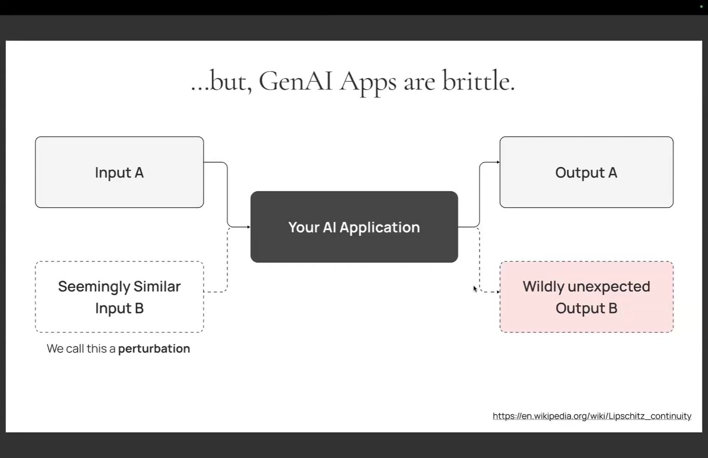

### 2.2 Hazing：用 fuzz testing 解决覆盖度

> “我们用 hazing 和 judge 同时解决了覆盖度问题和指标问题。hazing 本质上就是对 AI 应用做模拟测试、也就是模糊测试（Fuzz testing）。我们有一批 agent 在自然语言输入空间里搜索，试图挖掘出能让你的应用崩掉的 bug 和样本。”
> —— p017 [06:15]

> “hazing 很好，但只有当它相对于某个目标做模拟时才有用。到底什么叫‘把你的 AI 应用搞崩’？什么叫‘在你的应用里发现一个 bug’？这用自然语言很难定义。我们不是在写代码，代码里有 assertion、有不变式测试、有单元测试可以写。你必须想办法对任意一个非结构化输出——一大段非结构化文本——量化判断：这个回答是好还是坏？”
> —— p017 [06:45]

> “所以我们做这件事的方式，就是打造好的 judge 系统，这也是今天这场分享的重点。”
> —— p017 [07:13]

### 2.3 单个 LLM 当 judge 的失效点

> “我们的方法是通过放大 judge 的推理时计算量（judge-time compute），来解决 LLM-as-a-judge 的偏差和失效问题。大家应该都熟悉 LLM-as-a-judge 是什么：就是给单个 LLM 一个 prompt 和一个 rubric，让它做一次评估。让一个 LLM 去评估另一个 LLM。”
> —— p017 [07:42]

> “它有非常多不奏效的原因。它非常脆弱、非常敏感；它不准确；它输出的分数是未校准的、错误校准的；它自己会幻觉；而且还有一个关键问题：你到底怎么评估这个 judge？”
> —— p017 [08:11]

> “当然，这也是最有价值的部分。生成东西很容易，随手拼几个 agent 很容易，生成输出文本很容易；但判断它、辨别它是不是高质量，恰恰是决定你的应用值不值得做的那个精确的瓶颈。这在不可验证的领域尤其关键。”
> —— p017 [08:40]

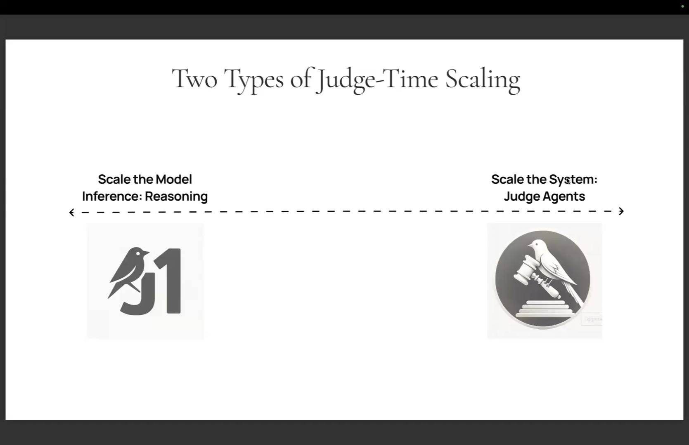

### 2.4 路线一：在模型内部 scaling

> “具体来说，我们有两种做法。一种是在 judge 模型内部放大计算量，基本上就是把 reasoning model 训练成 judge。另一种是在 judge 周围放大系统，也就是造 judge agent。”
> —— p017 [09:09]

> “我们在放大模型推理时看到的具体痛点是：我们希望这个 judge 能对它正在评判的任意一条具体输入，使用非常具体的评分标准；并且这个 judge 会输出连贯的、与人类领域专家想法一致的 rationale（理由说明）。通过用 RL 把一个 reasoning model 调成 judge，我们可以同时拿到这两个性质。”
> —— p017 [09:36]

> “具体做法是，强行给 reasoning model 注入一个归纳偏置：让它产出一个具体的 rubric，粒度细到输入级别。不是任务级的一般性 rubric，而是针对你正在评估的每一条样本的 rubric。然后基于这条样本的 rubric，为 rubric 里的每一条给出 rationale，最后把所有东西聚合起来，得到最终的数值评分。”
> —— p017 [10:28]

> “我们实际训练模型的方式是这样：基本上是做带规则奖励（rule-based reward）的 RL。标注方法其实很简单。我们只需要人类提供一些 ground truth，让我们知道在某个 query 下、针对应用给出的某个 response，人类认为它是好回答还是坏回答。数值评分显然很难从人那里直接拿到，但我们可以用成对比较（pairwise ranking）来做：给定同一个 query 的两个 response，人决定哪个更好，这就足以拿到 ground truth，而这个 ground truth 也就变成了我们用来 RL 训练 judge 的 reward。”
> —— p017 [10:58]

> “你确实可以把这套形式化扩展到数值量表的 ground truth，而不只是 pairwise，只需要稍微改一下 reward 的形式。如果 n 大于等于 2，就把 reward 当成‘模型是否把那个最大值从所有相关 response 里挑出来了’。如果只有一个 response，你就得判断这个 reward，基本上是看 judge 输出的数值是否与人类给的精确数值一致。”
> —— p017 [11:26]

### 2.5 路线一的产物：J1 模型

> “几周前我们训练了 J1 模型系列，它们是非常小的 judge 模型：J1 micro 和 J1 nano，分别是 17 亿参数和 6 亿参数。它们专门在成对比较任务上训练：给定一个 query 和两个 response，J1 会根据这个 query 选出哪个 response 更好。”
> —— p017 [12:24]

> “它们之所以这么强，是因为遵循了我前面描述的训练范式：这些模型能够产出 query-specific rubric，以及针对这些 query-specific rubric 的推理链。尽管尺寸非常小，它们是很强的模型。”
> —— p017 [12:54]

> “特别是在 RewardBench 上——它算是衡量 judge 和 reward model 的黄金标准——它们能和比它们大好几个数量级的模型竞争。J1 micro 在这里击败了 Claude 3 Opus、GPT-4o mini 和 Llama 3 70B。J1 nano，不到 10 亿参数，能和 GPT-3.5、Llama 3 8B、Tulu 13B 等等竞争。”
> —— p017 [13:22]

<!-- 注：讲师在 13:22 之后口头把 J1 nano 说成“100 million parameters”，与前文的 600M 矛盾。以 600M（6 亿）为准。 -->

> “再强调一次，这件事之所以可能，不是因为模型有多大，而是因为它被专门训练去产出 query 级的标准、以及标准级的 rationale，把 judge 的推理时计算放大，让它在任务上强得多。”
> —— p017 [13:50]

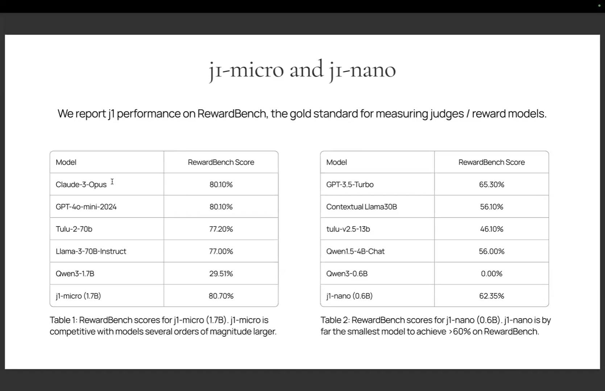

### 2.6 路线二：在模型外部 scaling（Verdicts）

> “现在我想讲光谱的另一端：把模型固定住，在模型周围放大系统，让它作为 judge 来工作。你大概可以把它理解为设计评估 agent——专门为评估任务设计的 AI agent。我们在这里也做了开源工作，也就是 Verdicts，一个用来放大 judge-time compute、构建评估 agent 的库。”
> —— p017 [14:19]

> “具体来说，Verdicts 是一个声明式框架，用来构建这些 judge agent。它具备你对任何 agent 框架都会期待的那些好性质：跨模型提供商的即插即用、限流、能定义 schema 并连到不同的 judge unit 等等。但 Verdicts 特别有意思的地方在于，框架里存在的很多原语，是直接从 scalable oversight 文献里借来的。”
> —— p017 [14:49]

> “scalable oversight 是 AI 安全里的一个研究领域，专门研究如何用较弱的模型去评估超人智能，或者更一般地说，如何用模型去评估其他模型。那篇文献里有很多很好的原语。比如互相辩论的 unit，通过辩论得到一个更容易打分的最终 rationale；比如多样化 judge 组成的 ensemble——如果你愿意，叫一个 judge 小组——对同一个结果投票；再比如 self-validation judge，先给出一个决策的特定 rationale，然后批评自己的这个决策，判断这个决策与最终输出是否说得通。”
> —— p017 [15:17]

> “所有这些架构和原语都直接来自 scalable oversight，并且被作为一等公民（first-class primitive）烘焙进 Verdicts。”
> —— p017 [15:46]

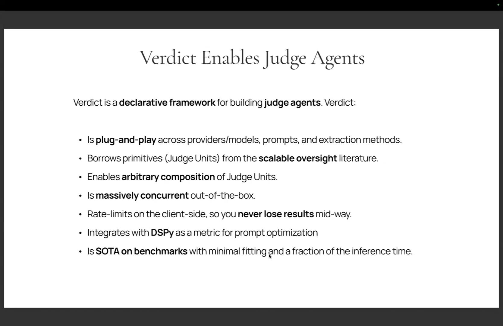

> “这展示了我们如何用 Verdicts 构建 judge agent。写起来非常简单，语法非常像 PyTorch。你基本上是定义 agent 的每一层，每一层由一些不同的 unit 组成——同样，都是 scalable oversight 的原语。任意组合这些 agent 的能力非常强。如果你不断叠层、不断组合这些 unit，很快就能搭出一个两层、四层、六层、八层嵌套的 agent，非常擅长做评估。”
> —— p017 [16:15]

### 2.7 路线二的效果与真实案例

> “从技术角度看这很酷。但事实证明，这些东西真的就是效果很好。这里我们看的是 ExpertQA 评估任务，用 Verdicts agent 我们能够在性能、成本、延迟的前沿上击败 o1、o3-mini、GPT-4 和 Claude 3.5 Sonnet。在相同延迟下，我们能以更低的价格击败 o3-mini 50%；在某个价格和延迟水平上，我们能明显击败 o1，我们非常清楚地站在性能前沿上。”
> —— p017 [17:14]

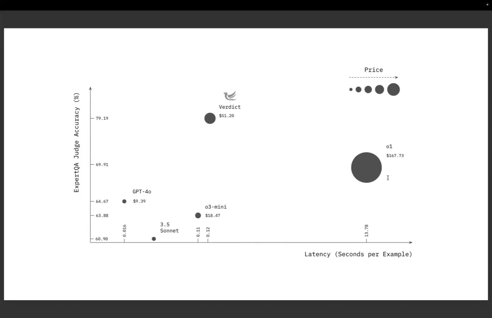

> “Verdicts 之所以在 eval 任务上这么好，是因为我们为框架挑选的原语特别适合 oversight。其他那些 reasoning model 非常擅长通用任务，比如数学和编程。但具体到 oversight 和 eval，Verdicts 摆好了正确的原语，让它非常稳健、非常准确。”
> —— p017 [17:43]

> “当然，这些从研究角度、从‘打败 benchmark’的角度看都很好，但 Verdicts 对真实客户用例也非常有用。我前面提到，我们有这些开源工具，但我们也让客户在我们的平台上配置这些工具。我想特别提一个我们和 Defogent 的合作——它是一家很棒的做客服语音 agent 的公司。”
> —— p017 [18:12]

<!-- 注：公司名在逐字稿里出现 Defogent / Vosgent / Vohjents / Vojit / Virgin 等多种拼写，这是语音识别导致的，以 Defogent 为准，实际名称请以官方为准。 -->

> “他们有大量 transcript 从语音 agent 流过，但他们没有真正的办法判断哪一通客户对话是成功的、哪一通是失败的。语音 agent 就是某个时刻挂断电话。他们只能用一堆启发式规则，而这些规则并不一定映射到真实的人类反馈。”
> —— p017 [18:40]

> “所以为了解决问题，Defogent 想让用户自己配置自己的标准，然后直接把这些 prompt 拿去做 LLM judge。但他们很快意识到，用这种方案，这些 prompt 化的评估器与客户的人类判断对齐得并不好。他们需要一个更好的方案。他们做的是：用我们平台上的 Verdicts 构建了一个 evaluator agent，为每一条样本构建细粒度 rubric 标准、按每条标准逐项打分、并把所有结果做 ensemble。这基本上可以理解成一个‘ensemble 标准的单元测试’。他们因此看到了一个对齐度高得多的 judge——使用 Verdicts 架构后，与人类判断的对齐度提升了 38%。”
> —— p017 [19:09]

### 2.8 问答里的关键判断

> “对我们现在合作的很多企业级客户来说，沟通瓶颈很多，我们经常做的是：先和客户一起搞清楚，他们会如何为一个人类领域专家定义标准。这大概是前 50% 的挑战——理解他们作为人认为什么好、什么坏。这需要我们向他们合成地铺一些数据出来，他们看了之后观察、总结出好的标准。一旦标准定下来，我们才开始训练和构建这些 judge 系统。从那之后基本上是一个近乎放手的过程。”
> —— p017 [21:02]

> “我需要时不时地把人叫进来打标签，但真正的关键是**把 rubric 定下来**。rubric 一旦定下来，从这里往前走其实相当容易。我会说 rubric 大概占 60%、70% 的挑战，剩下 30% 是把这些 judge 配置调优好的收尾工作。”
> —— p017 [21:29]

> “我们在核心产品里也基本有 evals-evals-evals 这套东西。Hamel 说的 evals-evals-evals，基本上就是让用户极快地迭代他们定义的 rubric 标准，并立刻看到 rubric 改动对 judge 预测的影响。”
> —— p017 [22:49]

> “我们在这个体验里大概支持两种工作流。一种是用户改 rubric，观察 judge 预测的差异，把‘改 rubric、看执行轨迹变化’作为核心体验。这可以说是一个定义 rubric 的 co-pilot。另一种工作流是：人看着 judge 的预测结果，直接批评 judge 的预测；我们把这些 diff 拿过来，反过来推断 rubric 应该怎么改。”
> —— p017 [23:19]

> “所以第一个方向是正向的：用户改 rubric，然后预测结果发生变化。但我们也支持反向流程：用户看输出预测，不同意，就告诉我们为什么不同意，我们吸收这些信息，然后更新 rubric，去匹配用户实际做出的标注。”
> —— p017 [23:49]

> “当你说 rubric 的时候，你指的是 prompt，对吧？就是 LLM judge 的 prompt。没错。”
> —— p017 [24:19]


> “当模型变小的时候成本应该更低、延迟应该更低，但如果你用模型去放大 judge-time compute，成本延迟可能会因为推理时计算而上升。你对结果与延迟之间的权衡有什么直觉？”
> —— p017 [25:18]（Hamel 转述学员 Eric 的问题）

> “我会说大部分情况下，我们的客户更在乎准确率，也就是 judge 的性能，而不是延迟。即使有人在真实生产 trace 上做在线评估，也有余地：它不需要是秒级返回的，我们可以做离线的持续异步处理，针对实时生产 trace 跑 10 分钟、20 分钟、30 分钟。所以大部分情况下我们是在为客户优化性能。”
> — p017 [25:47]

> “你当然也可以把 judge 用在 guardrail、内容审核、以及某些行为的触发条件上，如果你的产品真的在乎这些。那种情况下我们显然要更在乎延迟。那里的解决方案一般是：把我们训练出来的好 reasoning model、或者好的 reasoning agent 的行为，蒸馏到一个非常非常小的 judge 里，大概三十亿、四十亿参数，然后你把它当作 guardrail 来用。”
> —— p017 [26:15]

> “那你们通常和非 guardrail 场景的客户一起用时，参数规模是多少？没那么大。8B 参数的模型就能带你走很远，13B 参数的模型也能带你走很远。我们其实不太需要走得更远。”
> —— p017 [27:11]

> “Verdicts 其实欢迎你用任何你喜欢的模型，包括 OpenAI 的。Verdicts 归根结底只是一个编排 LLM 调用的框架。它和 OpenAI 配合得很好，和你选任何模型都配合得很好。我们其实发现它和 GROK 配合最好，因为 GROK 的偏差最小——当然这取决于你怎么定义偏差。”
> —— p017 [28:10]

> “整个架构对驱动它的那个 LLM 是敏感的。但我们在 Verdicts 里也有脚本，让你可以替换一堆不同的模型，然后 diff 不同模型变更下的性能。你也可以为 agent 的每一部分混搭不同的模型。至于微调，J1 是在 Qwen 上微调的，0.6B 和 1.7B。”
> —— p017 [29:06]

> “RL 是一种在模型内部放大 judge-time compute 的方式。RL 会激励更长的 chain of thought，以及推理时在 judging 任务上花更多 token。……我们也试过用 RL 只做行为对齐、不去增加推理，那个效果不太好。所以推理确实非常有帮助。”
> —— p017 [30:01]

### 2.9 P18：为什么用 AI 再走一遍

> “上一期 cohort 我讲的是 FastHTML，讲怎么用 FastHTML 搭一个标注应用。这一次我搭同一个标注应用、做同一件事，但换一个视角：不再是我手工搭、讲它怎么运转，而是从‘我会怎么用 AI 帮我搭出同样的东西’这个视角来做。所以这是一种不同的工作方式，理想情况下你应该两者都具备一点。”
> —— p018 [01:49]

> “之所以这次这么讲，是因为上一次的东西是公开的。你可以去看那场分享的录像、看代码、看所有东西。如果你去 AI Evals 的 Discord 或者 GitHub，那里有个 repo 有这些内容，所以那些信息你依然能拿到。这一次就只是一个更‘AI 编码优先’的路径，去做同一件事。”
> —— p018 [02:17]

> “我主要用 Claude Code 来做这个。”
> —— p018 [02:46]

> “我们最后得到的还是同一个应用：依然有这个视图，能看到所有待标注的 query 和所有 document。”
> —— p018 [03:16]

> “这个视频里我实际上是现场写代码，从头到尾。它嵌在这场分享里，分享会公开，所以你想看连续的过程可以去看那个视频，我这里只讲一些细节。”
> —— p018 [03:16]

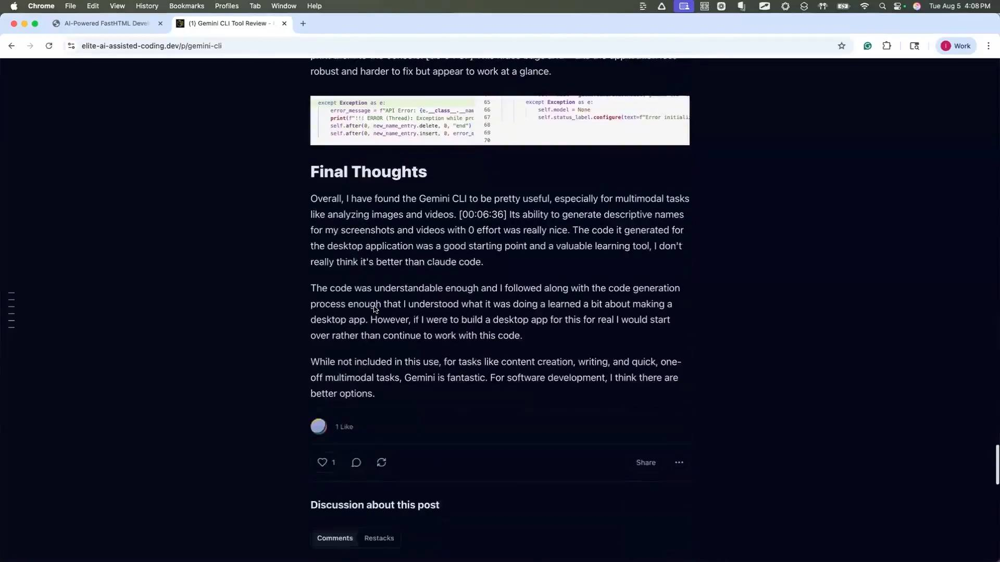

### 2.10 P18：标注应用的真实约束

> “我搭的是这个 RAG 标注应用。这些是 query，其中一些是 PDF 文档，一些是长文本，一些是短 query。标注者要针对这个 query 判断：这条记录是相关还是不相关。他们有一个小笔记本，所以这就是 RAG 标注——就是我们课里教的那种标注应用。”
> —— p018 [22:06]

> “挑战在于：一共有 7000 条记录。你有一个 query，然后标注者需要针对 400 条记录判断相关或不相关。它必须快，必须方便、必须容易，因为过 7000 条记录是很痛苦的；如果不方便，这件事根本不会发生。这就是 Hamel 在课里讲的所有那些东西——它必须非常低摩擦。”
> —— p018 [23:00]

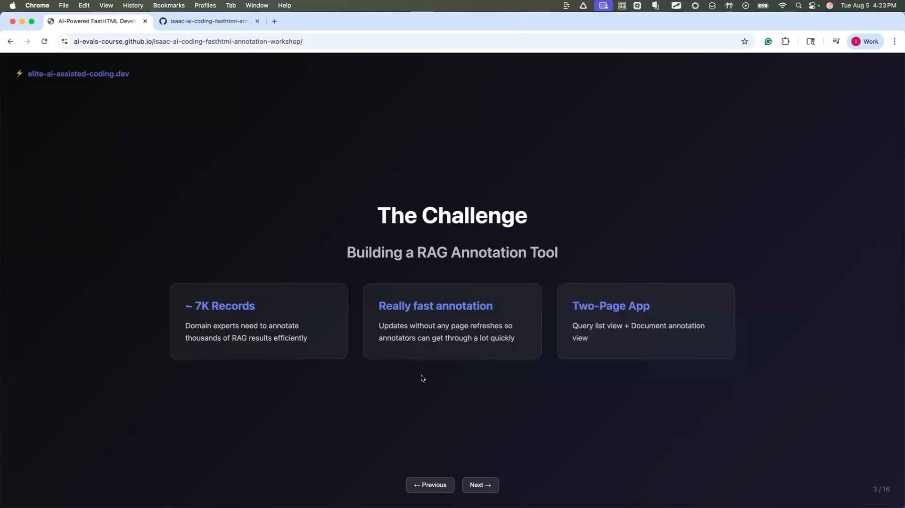

### 2.11 P18：四步工作流

> “我在这里做了几个步骤：我创建了一个 Ruler 上下文文件（这件事我们会讲）；我为这次开发建了一个 plan（我称之为开发的频谱）；用 Claude Code 把它生成出来；然后 Claude Code 能够用我创建的一个帮我做 Web 开发的 MCP server 去测试它。我们一步步过一遍。”
> —— p018 [23:30]

> “Ruler 是 Alan 和 Eleanor 做的东西，它让你创建一个 `.ruler` 文件夹，在里面放任何你想给 AI 的上下文，任何 markdown 文件。这个例子里，我放了 Monster UI 的 UI 组件规范和 FastHTML 的写法模式，两个 markdown 文件。最酷的是，它会自动分发到任何 agent。”
> —— p018 [23:59]

> “如果我列一下目录，你能看到只有一个 `.ruler`。你运行 `ruler apply`，它就会把它应用到 Cursor、Windsurf、Claude、Firebase Studio、OpenHands、Gemini CLI。再列一次目录，你会看到它已经在正确的位置、以正确的格式，为 Windsurf 和 Cursor、为它们所有人准备好了配置。所以你现在只在 `.ruler` 文件里维护，它基本上会编译到所有这些地方。”
> —— p018 [24:28]

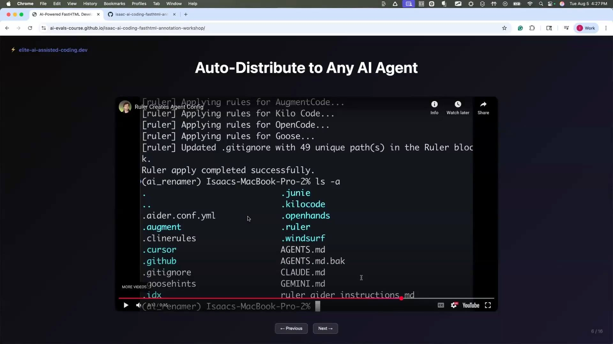

> “你可以有一份配置说，我只想导出到 Cursor 和 Claude Code，或者只导出到 Gemini CLI 和 OpenHands。你可以把这写成一个配置，也可以作为参数传给 CLI，所以你可以自己控制。但这很重要，因为它让你创建一次 LLM 上下文，然后移植到任何模型。所以当你试一个新工具时，你是在试这个工具本身，而不是在试‘我没有对的上下文’。”
> —— p018 [24:56]

> “我认为 Ruler 更进一层、而且很多人忽略的地方是：它对团队和工作场景特别好用。每个人对自己想用什么工具都有自己的看法。你告诉大家必须用 Vim，或者必须用 VS Code，会引发暴动；AI 工具也一样。有人说你不能用 AMP，有人说你不能用 Claude，有人喜欢 Gemini CLI……工具很多，人有不同口味。有了这些 ruler 文件，整个团队可以一起维护一份好的上下文，关于项目标准、项目怎么运转、有哪些内部库；然后每个人把它移植到自己最舒服的工具里。所以我觉得这个也非常强大。”
> —— p018 [26:17]

> “当你做很多事的时候，从一份清晰的 plan 开始是好的。告诉 AI，这是一条开发的频谱。告诉 AI 你想要什么，你可以打字，一个非常好的方式是语音转录。这些 agent 会给你一份 plan。我发现最好让它写进一个 markdown 文件里。”
> —— p018 [26:46]

> “这和你说的并不真的不同。取决于规模，你可以有一份 plan，然后让 agent 按 plan 行动。如果是那种我觉得非常复杂、非常棘手、或者我想非常亲力亲为的事情，我实际上会先创建 plan 文件，然后还要创建一个 to-do 文件、一个 to-do markdown 文件，然后我一条一条地做这些 to-do。”
> — p018 [27:44]

> “我说把它写进一个 markdown 文件、让它在 agent 外部写出来，原因是：当你让 AI 生成代码时，你能做的一件提升质量和一致性的事——**一致性是最重要的**，因为没有一致性，你就永远无法建立直觉，无法知道什么会奏效、什么不会。通过创建这些 markdown 文件，你把它放进了一个你可以很好地编辑的格式里。”
> —— p018 [28:11]

> “然后你会拿到这个 markdown 文件里的 plan。这些模型会创建一份 plan，它们甚至还有 to-do list，或者两者都有。但你要去通读它、并且改它。比如‘当前这个 eval type，为什么我把它做成一个独立 feature 而不是一个按钮？按钮应该在它好的时候高亮、不好的时候不高亮，哪个按钮是激活的？’所以我在这里编辑，说不对，这是我想要的；这不太是我想要的；这个完全跑偏了。”
> —— p018 [28:40]

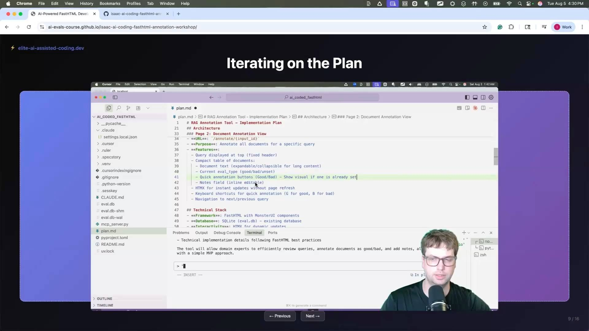

> “而不是直接在 prompt 里敲一句，然后希望、祈祷它能跑。我觉得真正关键的是：一部分原因是你会更成功、能用 AI 完成更多任务；但我认为真正重要的是，你会对‘什么有效、什么无效’获得更多一致性。这也是为什么很多人最终发现自己用 AI 没那么高效——AI 不是万能的，但如果你没有一致性、拿不到稳定结果，你就会陷入‘唉，试试吧’，然后掉进兔子洞，还不知道为什么。”
> —— p018 [29:09]

> “而另一些时候又感觉像魔法，一切都跑通了，‘酷，我搭出了这个漂亮的界面’。所以我认为，如果你花时间去理解和定义你想让 AI 做什么，你会更成功。而且你可以指定你希望它什么时候停下、指定你希望它怎么测试。然后你也会更一致，而如果你想把任何一项技能练好，你必须能看到什么在奏效、什么不奏效的模式。”
> —— p018 [30:03]

> “我觉得大家都知道这是好事，但这事没被做，是因为人们不知道怎么高效地做。感觉像是个巨大负担，但说实话，我在这上面只花三四分钟。如果你知道该看什么，你可以非常快地过一遍。”
> —— p018 [30:33]

### 2.12 P18：为什么自建 MCP Server

> “最后一件事是我搭了一个小小的 MCP server，这就是你可以给模型加上静态上下文拿不到的那些上下文的地方。这个 MCP server 有启动我本地应用的能力，它能导航到页面和路由，能点击元素，能和我的应用交互。这里用的是 Playwright。”
> — p018 [31:01]

> “就像你搭了一个应用，你觉得它能跑。那你怎么测？通常你会打开它，点来点去，输入点什么然后保存，刷新页面看有没有保存上，去看看数据库。那你的 AI agent 也应该能做所有这些事。这些都是你知道一定会发生的事。”
> —— p018 [31:28]

> “有意思的地方在于，它还能拿到 console 日志。当你开发一个 Web 应用，通常所有 server 日志都会流到你的终端，你可以把它们重定向到文件，让 AI 去看那个文件，这是好事。但你拿不到的是真正发生在客户端的浏览器 console 日志。这些是 HTMX 错误。我知道我讲得有点细了，但 JavaScript 那类东西不会出现在你的 server 日志里，你必须用 Playwright 这样的东西才能拿到这些信息。”
> —— p018 [31:55]

> “这意味着你的模型就是没有那些错误 trace。通常的结果就是你自己点来点去，复制错误、粘贴回去、等它改、再点来点去、再复制那个错误、粘贴回上下文。再说一次，你可以这么做，只是又慢又低效。”
> —— p018 [32:20]

> “所以我做了这个 MCP，基本上它能驱动浏览器、能导航到你的站点之类的。对，而且你能看到这个 agent 正在这么做。它会说，导航到这个 path，这是一个数据库里某个东西的 ID path。”
> —— p018 [32:39]

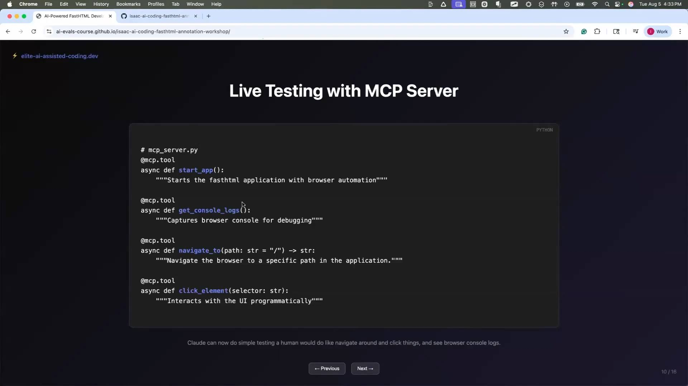

> “当我用这个 MCP 的时候，Playwright MCP 怎么知道你应用跑在哪个端口？它也能看到终端吗？能看到你跑应用的那个主终端吗？”
> —— p018 [32:49]（Hamel 提问）

> “我实际上为这一个项目自己创建了 MCP server。幸运的是，这做起来很快，因为你可以用 AI 编码实践来做它。所以这个 MCP server 是我自己创建的，它不是一个通用的 Playwright server。它就是知道怎么专门去跑这个 `main.py` 文件、在这个端口上跑、等等。对这个项目来说它很有用。”
> —— p018 [33:18]

> “你会给自己的内部调试做 MCP 吗？如果我发现自己复制粘贴某个东西超过两次（其实超过一次就差不多了），我就知道：要么我得修好、改进我的上下文文件，这样就不会有这种低效的‘纸张割伤’式的小麻烦；要么我得很快地做一个 MCP 来拿这个上下文。”
> —— p018 [33:47]

> “大家都觉得这是个负担，‘那要浪费很多时间’。但我不这么看。我经常搭 Web 应用，现在我有这个 MCP server，它更像一种直觉了。……我没觉得这会花很久，事实上也确实没花多久，大概五到十分钟就让它跑起来了。如果我当时觉得要花几个小时，我大概会先去找有没有现成的方案。但我估计几分钟就能做出来，所以自己做大概比去学某些复杂 AI 产品的文档（那些文档还不一定好）花的时间更少。”
> — p018 [34:16]

> “人们往往不投这个资，因为他们想：为什么要为一件事花一小时，而我两小时就能做出来？如果你这辈子只做这一个 FastHTML 应用，那这账算得没错。但这是个糟糕的算术，你会做很多个。现在你做过一次之后，每一个 FastHTML 项目你都可以直接复制这个 `mcp_server.py`。你可以把它做得更通用，也可以直接复制过来，说‘行，只要我有个 `main.py`，我就能在任何 FastHTML 应用上用这个 MCP server’。”
> —— p018 [35:15]

### 2.13 P18：怎么给 LLM 没见过的库补上下文

> “但那些特殊的项目怎么办？比如 FastHTML、Air 这些新库，LLM 没怎么见过。你可以在 Cursor 里拉文档，它们有文档索引，但有时候命中率很看运气，它能不能真的取到那些文档不好说。你一般怎么做？”
> —— p018 [36:12]（Hamel 提问）

> “不，我会做一些更有意图的事。……这里是有层次的。有些是通用的手段，比如 repomix、paste max、git MCP，这些都是自动获取上下文的不同方式，几乎能用在任何库上，是个好的起点。……如果我不确定自己会不会用它、也不想在它上面花时间，我就从那儿开始。再往后，你可以告诉它去抓，你可以说‘去看文档’，或者告诉它去找这个库作者做的 MCP——比如 Brain Trust 有个 MCP，而像 Phoenix 用的是 `LLMS.txt` 格式，你可以用 Hamel 的工具或者 LangChain 的工具把它转成 MCP。”
> —— p018 [37:07]

> “但最终，如果你要在某个项目上工作好几个月，那花两三个、三四个小时去让你的 LLM 支持更好是值得的。就像如果你能打字快 10%，只需要练三小时，那你大概应该去做，因为你一直在打字。”
> —— p018 [38:04]

> “所以我从用 GenAI 把某些东西整理成 markdown 格式开始，需要的话复制 outer HTML，然后针对我具体需要的文档拿到上下文。慢慢地——看起来好像我是一次做完全部的，其实是慢慢个性化。比如文档里说‘你可以这样做，也可以那样做’，我就改成‘在我的项目里，我这样做’。所以我就编辑它。”
> —— p018 [38:34]

> “你就只是把它们放进一个目录？你会不会把它们拼起来？”
> —— p018 [39:03]（Hamel 提问）

> “我就把它们放进目录，分开的 markdown 文件，放进你的 ruler 目录里。然后，当出现‘它为什么这么做了’的时候，答案通常是你的上下文不太对。你就去微调它。之后每次同样的情况出现，它就会是对的。所以要**有主见**。”
> —— p018 [39:03]

> “你不担心比如 Brain Trust 这个库变得太快，你的定制很快就过时吗？”
> —— p018 [39:33]（Hamel 提问）

> “我不太担心，有几个原因。第一，有办法把其中一部分自动化。我现在展示的是手动方式，我认为你需要先理解手动方式。但有工具——SpecStory 有一个工具，其他人也有——可以自动更新、并在你的上下文该改的时候告诉你。第二，你可以录下你的 chat history，很容易分析 chat history 来找出这些变更。”
> —— p018 [39:33]

> “SpecStory 能把你所有 chat history 变成 markdown 文件，这非常方便，因为你可以让任何 agent——Claude 或 Gemini——去看。如果某个 repo 变了，而你有一份真正好、格式也正好是你要的上下文，你就说：‘嘿，这个库把 API 完全改了，这是新的 dataset 那套东西，去把这个文件按新 API 更新。’这件事做起来非常顺畅，因为它已经看到了上下文。”
> — p018 [40:02]

> “回到这个演示：它导航到了路由，点击了一个元素，拿到 404 错误，它在检查定义，它在用自己的工具翻 server 日志，找到了，它检查了浏览器 console，它完成了这个 loop，而我不需要手动去导航。当然它做完之后，我确实手动导航过去、找了错误、试着修。但它能在我完全不复制粘贴回去、也不去说‘嘿，它没跑通’的情况下抓到问题，因为它有那些工具，而且我给了它正确的上下文去尝试那些事。”
> —— p018 [42:40]

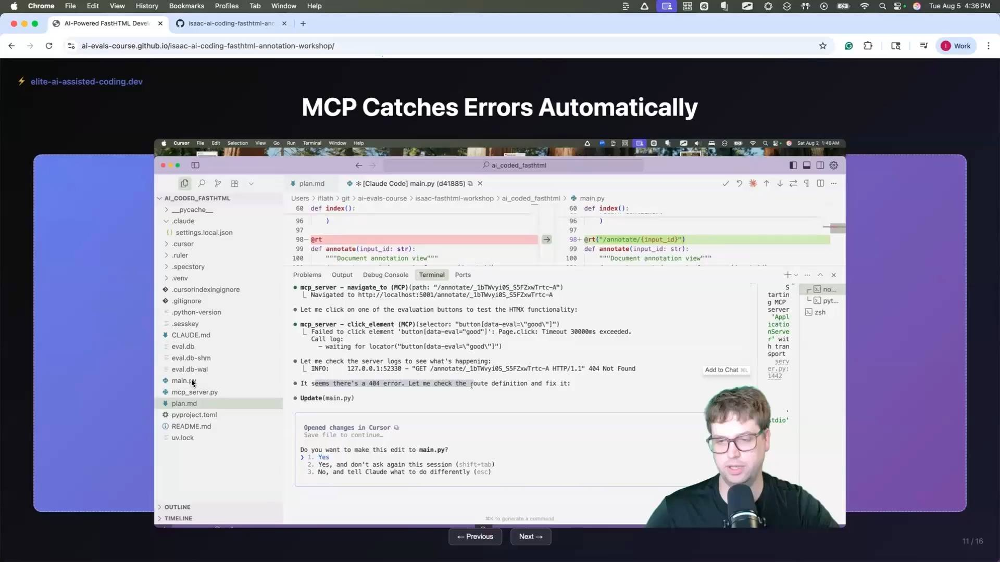

---

## 3. 从零复现

### 3.1 P17 的复现路径：把 judge 系统设计出来

P17 不是编码课，它的“复现”是**把讲师的推导链走一遍，最后产出一份能交给同事执行的设计文档**。下面七步按讲师给出的顺序推进。

**第 0 步：确认你没有掉进“单 LLM judge”的坑。**
先写下你现在的判分方式。如果它是“一个 prompt + 一个 rubric + 一次 LLM 调用 + 一个 1–10 分”，那你就处在讲师批评的那个位置上。他给的失效清单是：脆弱、敏感、不准确、分数未经校准、自己会幻觉、以及**judge 本身没人评估**。把这六条抄进你的设计文档，做为“必须被解决”的约束。

**第 1 步：定义“什么叫崩”。**
hazing（模糊测试）需要一个 objective。在没有代码断言的领域里，你必须用自然语言写出失败模式清单。例如客服语音 agent 场景下：用户重复问同一个问题三次以上、agent 给出了与知识库冲突的答案、agent 在用户明显愤怒时提前结束通话。**这份清单就是后面所有 rubric 的种子。**

**第 2 步：造 ground truth，用 pairwise，不要用数值打分。**
讲师明确说了：数值评分很难从人那里拿到，pairwise 可以。所以你的标注格式是“一个 query + 两个 response + 人选哪个更好”。如果你确实需要数值，讲师给的两个变体是：

- n ≥ 2（多个候选 response）：reward = judge 是否把人类挑出的那个（最大值对应的 response）选对了；
- n = 1（单个 response）：reward = judge 输出的数值是否与人类给的精确数值一致。

**第 3 步：设计 query-specific rubric 的生成 prompt。**
这是路线一的核心。要求模型先针对**这一条输入**生成一份粒度到输入级的 rubric（不是一个任务级通用 rubric），再逐条给 rationale，最后聚合。注意讲师的措辞是“强行注入归纳偏置”——也就是说，这不是靠 prompt 里客气地说“请考虑具体情况”，而是要把它做成结构化的输出契约。

**第 4 步：选路线。**
- 如果你有标注预算、有微调能力、且需要极低单次成本 → 走路线一（RL 训 reasoning judge，参考 J1：Qwen 0.6B / 1.7B 底座，pairwise 任务）。
- 如果你没有训练资源，但能接受每次判定有多次 LLM 调用 → 走路线二（Verdicts 式的 judge agent 系统）。

**第 5 步（路线二）：搭分层 agent。**
按讲师的描述，Verdicts 的写法“像 PyTorch”：定义 layer，layer 由 unit 组成，unit 是 scalable oversight 的原语。你要决定的是层次结构，例如：

- Layer 1：per-criterion 打分（每个 rubric 条目一个 judge unit）
- Layer 2：panel —— 3 个不同模型/不同 prompt 的 judge 并排打分，投票
- Layer 3：debate —— 两个 unit 就分歧条目辩论，产出一个更容易判定的最终 rationale
- Layer 4：self-validation —— 对最终结论自我批评，判断 rationale 与结论是否自洽
- 聚合：把各层结果汇总成最终分数

讲师说可以“两层、四层、六层
、八层嵌套的 agent 都是可能的——但**不要为了叠层而叠层**，每加一层都要能回答“它解决了单层解决不了的哪个失效模式”。层数越多，单次判定的 LLM 调用次数越多，成本和延迟同步上升（这条权衡在下面第 6 步会被量化）。

**第 6 步：算清楚成本与延迟。**
讲师给了一个非常实用的判据：**先问业务需不需要实时。**

- 如果是**离线/异步评估**（对着生产 trace 做持续评估）：讲师说可以做异步处理，“10 分钟、20 分钟、30 分钟”都能接受。这种情况下你应该**直接选性能最好、层数最多的方案**，成本是唯一约束。
- 如果是**在线 guardrail / 内容审核 / 行为触发**：讲师说这时“显然要更在乎延迟”，解法是把大 judge 的行为**蒸馏到 3B–4B 的小 judge**。

非 guardrail 场景下讲师说的参数规模是：**8B 能带你走很远，13B 能带你走很远，不需要更大**。这一条直接决定了你的自托管成本上限。

单样本调用次数的算式（讲师课里没给具体数字，这里给出可替换的框架）：

```
单样本 LLM 调用次数
  = 1（生成 query-specific rubric）
  + K（rubric 条目数，逐条打分）
  + P × K（panel：P 个并行 judge，各打一遍）
  + 2 × D（debate：D 个争议条目，每条 2 个 unit 对辩）
  + 1（self-validation 自我批评）
  + 1（聚合）

单样本成本 = 调用次数 × 平均 prompt token × 单价 + 调用次数 × 平均输出 token × 单价
单样本延迟 ≈ 串行层数 × 单次调用延迟
              （panel 内部是并行的，只算 1 层延迟；debate 每条可并行）
```

注意：**成本随调用次数线性增长，延迟只随“串行层数”增长**。所以 panel 是“便宜地买准确率”（钱换质量），debate 叠层是“贵地买准确率”（钱和时间一起换质量）。这就是为什么讲师说 Verdicts 能同时站在成本、延迟、性能的前沿上——它把可以并行的部分（panel、per-criterion）都并行了。

**第 7 步：给 judge 本身建评测。**
讲师把“你怎么评估这个 judge”列为单 LLM judge 的关键问题之一。你的做法：

1. 留一份**从未参与 rubric 编写**的 pairwise 标注集，作为 judge 的 held-out test set；
2. 报告 judge 与人类 pairwise 选择的一致率（这就是 RewardBench 那类榜单在用的事，讲师称 RewardBench 为“衡量 judge 和 reward model 的黄金标准”）；
3. 上线后接入**人工反驳回流**：讲师描述的第二种工作流是“用户看输出预测、不同意、说明为什么不同意，系统吸收后更新 rubric”。这等于把生产环境变成持续的训练/评测数据源。

**第 8 步：固定 rubric 之后，才谈收尾。**
讲师的原话是：rubric 占 60%–70% 的挑战，剩下 30% 是“把这些 judge 配置调优好的收尾工作”。所以如果你的 judge 效果不好，**先去改 rubric，不要先换模型**。

### 3.2 P18 的复现路径：从空目录到 agent 自己 debug

下面是一条可以逐条照着做的路径。目标产物：一个能跑在 `http://127.0.0.1:5001` 的 RAG 标注应用，加上一个能被 Claude Code 调用的、能驱动浏览器并读取 console 日志的 MCP Server。

> **重要声明**：P18 的截图里没有 OCR 文本，逐字稿里也没有念出任何一行源码。讲师在课上只说了文件名（`main.py`、`mcp_server.py`）、目录名（`.ruler`）、命令（`ruler apply`）、库名（FastHTML / Monster UI / Playwright / Air / Ruler）和功能描述。**第 4 节里所有代码都是按讲师的功能描述重建的示意实现，不是讲师的原码。** 我会在每个文件头注明。

**第 0 步：理解你要造的东西长什么样。**
讲师描述了两个界面层级：

- 列表页：所有待标注的 query（“我们有这个视图，能看到所有待标注的 query 和所有 document”），以及标注进度（讲师说数据规模是 **7000 条记录**）。
- 详情页：进到一个 query 后，附近有 **400 条候选记录**，标注者要一条条判断“相关 / 不相关”，并有一个小笔记本（note）记东西。

交互约束（讲师反复强调的）：**必须低摩擦、必须快**。“过 7000 条记录是很痛苦的，如果不方便，这件事根本不会发生。” 翻译成工程要求就是：

- 每次判定最好一次点击完成，不要弹窗、不要二次确认；
- 判完之后当前记录自动消失/前进到下一条，不要刷新整页（这就是 FastHTML + HTMX 的用武之地）；
- 键盘可达（`j`/`k` 或 `1`/`2`），因为 400 条 × 每 quer y 的点击量很夸张；
- 状态必须立刻落库，刷新不能丢。

**第 1 步：装环境。**

```bash
# 建议 Python 3.11+
python3 --version

mkdir rag-annotator && cd rag-annotator
python3 -m venv .venv
source .venv/bin/activate          # Windows: .venv\Scripts\activate

pip install "python-fasthtml" "monsterui" "playwright" "mcp"
playwright install chromium        # 必须单独装浏览器二进制
```

`ruler` 是 Node 侧的 CLI（讲师只演示了 `ruler apply` 这条命令，**课里没讲它的安装方式**）。参考做法：

```bash
npm install -g @intellectronica/ruler   # 课里没讲安装命令，此处为按工具名推断
ruler --help
```

**第 2 步：建目录骨架。**

```
rag-annotator/
├── .ruler/                      # 单一事实源：给 LLM 的上下文
│   ├── ui-components-monster-ui.md
│   └── fasthtml-patterns.md
├── .mcp.json                    # Claude Code 读取的 MCP 注册表
├── main.py                      # FastHTML 标注应用
├── mcp_server.py                # 自建 MCP Server（Playwright 驱动）
├── db.py                        # SQLite 访问层
├── seed.py                      # 造 7000 条演示数据
├── plan.md                      # 让 AI 写的开发计划，人改过的版本
├── todo.md                      # 拆到可勾选的粒度
└── requirements.txt
```

**第 3 步：写 `.ruler` 上下文（讲师这一步只放了两份 markdown）。**
讲师明确说他放了两个文件：**Monster UI 的 UI 组件规范**、**FastHTML 的写法模式**。他还讲了一个关键做法：**“有主见”**——文档里写“你可以 A 也可以 B”，你要改成“在我的项目里，我这样做 A”。所以这两份文件不应该是官方文档的复制粘贴，而应该是**你裁剪过的、带项目约定的版本**。

**第 4 步：`ruler apply`，然后验尸。**

```bash
ruler apply
ls -la
```

按讲师的说法，执行后再列目录，你会看到它在正确的位置、以正确的格式生成了各家的配置文件（他点名的目标：Cursor、Windsurf、Claude、Firebase Studio、OpenHands、Gemini CLI）。讲师还提到两种控制方式：

- 用一份**配置文件**声明“我只想导出到 Cursor 和 Claude Code”；
- 或者**通过 CLI 参数**传入，自己控制导出目标。

这一步的价值不只是省事。讲师的原话是：**“当你试一个新工具时，你是在试这个工具本身，而不是在试‘我没有对的上下文’。”**

**第 5 步：让 AI 写 `plan.md`，然后人肉改。**
讲师的操作顺序是：告诉 AI 你想要什么（打字或语音转录）→ AI 给出 plan → **要求它写进 markdown 文件** → 你逐条读、逐条改。他自己举的修改例子非常具体：**“当前这个 eval type，为什么我把它做成一个独立 feature 而不是一个按钮？按钮应该在它好的时候高亮、不好的时候不高亮，哪个按钮是激活的？”**

讲师说这一步他只花 **3–4 分钟**。如果任务“非常复杂、非常棘手、或者我想非常亲力亲为”，他会再要一个 `todo.md`，然后一条条推进。

**第 6 步：写 `main.py`（应用本体）。**
第 4 节给了完整文件。跑起来：

```bash
python seed.py     # 造数据：7000 条记录 / 每条 query 400 个候选
python main.py     # 默认 127.0.0.1:5001
```

**第 7 步：写 `mcp_server.py` 并注册给 Claude Code。**
讲师对这个 server 的要求逐条是：

1. 能**启动本地应用**（他自己写死了“专门去跑这个 `main.py` 文件、在这个端口上跑”）；
2. 能**导航到页面和路由**（包括带数据库 ID 的路径）；
3. 能**点击元素**；
4. 能**和应用交互**（输入、保存）；
5. 能**读取浏览器 console 日志**——这是自建 MCP 最关键的理由，讲师说 JavaScript/HTMX 类错误**不会出现在 server 日志里**，必须靠 Playwright 才能拿到；
6. 能**读 server 日志**（讲师说通常 server 日志流到终端，可以重定向到文件让 AI 看）。

注册方式（`.mcp.json` 放在项目根，Claude Code 会自动发现项目级 MCP 配置）：

```bash
claude    # 在项目根启动，首次会提示信任该项目的 MCP server
```

**第 8 步：验证那个 loop 真的闭合了。**
讲师在台上看到的完整链路是：**agent 导航到路由 → 点击元素 → 拿到 404 → 检查定义（查路由/查数据库里的 ID）→ 用自己的工具翻 server 日志 → 找到原因 → 检查浏览器 console → 完成整轮 loop，而人不需要手动导航。**

你要复现的判据是：**在整个过程中，你没有复制粘贴任何一条报错给模型。**

---

## 4. 完整代码

### 4.1 P17 交付物 A：judge 系统设计文档（可直接落盘为 `judge-design.md`）

> 课里没有代码，以下为按讲师讲解整理出的设计产物（决策表 / 数据模型 / 估算表），不是讲师原文。

```markdown
# Judge 系统设计文档

## 0. 约束（来自单个 LLM judge 的六条失效）
| # | 失效模式 | 本方案的对策 |
|---|---|---|
| 1 | 脆弱、敏感 | query-specific rubric（粒度到单条输入） |
| 2 | 不准确 | panel 投票 + debate + self-validation |
| 3 | 分数未校准 | 只输出 pairwise 选择；若必须出数，用 9 分档并对档位做校准 |
| 4 | 自己会幻觉 | rationale 必须挂在 rubric 条目上，条目必须引用 response 原文片段 |
| 5 | 无人评估 judge | held-out pairwise 集 + 生产人工反驳回流 |
| 6 | 成本/延迟不可控 | 并行化 panel；在线场景蒸馏到 3B–4B |

## 1. 失败模式清单（hazing 的 objective）
- F1 用户重复同一问题 ≥3 次
- F2 答案与知识库冲突
- F3 用户明显不满时 agent 提前结束
- （按你的业务补全；每条都要能被一句话判定）

## 2. 标注协议
- 单位：一个 query + 两个 response
- 动作：选 A / 选 B / 平局 / 都不是
- 产出：pairwise ground truth（数值评分不作为主标注）

## 3. 参数与规模（讲师给出的锚点）
- J1 micro 1.7B / J1 nano 600M，底座 Qwen 0.6B 与 1.7B
- 非 guardrail 主力：8B–13B
- 在线 guardrail：蒸馏到 3B–4B
- rubric 工作量占比 60%–70%

## 4. 已知效果（讲师给的数字，用于立项说服）
- Defogent 案例：与人类判断对齐度 +38%
- ExpertQA：相同延迟下比 o3-mini 便宜 50%
```

### 4.2 P17 交付物 B：rubric 与判定的输出契约（JSON Schema）

> 课里没有代码，以下为按讲师“先出 query-specific rubric，再逐条 rationale，最后聚合”的描述重建的示意结构。

```json
{
  "$schema": "http://json-schema.org/draft-07/schema#",
  "title": "QuerySpecificJudgement",
  "type": "object",
  "required": ["query_rubric", "criteria_scores", "final"],
  "properties": {
    "query_rubric": {
      "type": "array",
      "minItems": 3,
      "items": {
        "type": "object",
        "required": ["criterion_id", "criterion", "why_it_matters_for_this_query"],
        "properties": {
          "criterion_id": { "type": "string" },
          "criterion": { "type": "string" },
          "why_it_matters_for_this_query": { "type": "string" }
        }
      }
    },
    "criteria_scores": {
      "type": "array",
      "items": {
        "type": "object",
        "required": ["criterion_id", "pass", "rationale", "evidence_span"],
        "properties": {
          "criterion_id": { "type": "string" },
          "pass": { "type": "boolean" },
          "rationale": { "type": "string" },
          "evidence_span": {
            "type": "string",
            "description": "必须逐字引用 response 中的片段，用于抑制幻觉"
          }
        }
      }
    },
    "final": {
      "type": "object",
      "required": ["winner", "aggregation"],
      "properties": {
        "winner": { "enum": ["A", "B", "tie"] },
        "aggregation": { "type": "string" }
      }
    }
  }
}
```

### 4.3 P17 交付物 C：judge agent 分层骨架（示意代码）

> **课里没有代码，以下为示意**，用于把讲师描述的“layer 由 unit 组成、像 PyTorch 一样叠层、原语来自 scalable oversight”落到可读的结构上。不要当成 Verdicts 的真实 API。

```python
# judges.py —— 课里没有代码，以下为示意
from dataclasses import dataclass, field


@dataclass
class Unit:
    name: str
    call: callable          # (query, response, rubric) -> dict


@dataclass
class Layer:
    name: str
    units: list = field(default_factory=list)
    mode: str = "serial"    # "serial" | "panel" | "debate"

    def run(self, ctx: dict) -> dict:
        if self.mode == "panel":
            votes = [u.call(**ctx) for u in self.units]
            return {"layer": self.name, "votes": votes, "winner": majority(votes)}
        if self.mode == "debate":
            a, b = self.units
            ra = a.call(**ctx, stance="pro")
            rb = b.call(**ctx, stance="con")
            judge = self.units[2].call(**ctx, transcript=[ra, rb])
            return {"layer": self.name, "final_rationale": judge["rationale"]}
        out = ctx
        for u in self.units:
            out = {**out, **u.call(**out)}
        return out


def majority(votes):
    counts = {}
    for v in votes:
        counts[v["winner"]] = counts.get(v["winner"], 0) + 1
    return max(counts, key=counts.get)


class VerdictLike:
    """对齐讲师的描述：定义每一层，层由 unit 组成，可任意叠。"""

    def __init__(self, layers):
        self.layers = layers

    def judge(self, query, response_a, response_b):
        ctx = {
            "query": query,
            "response_a": response_a,
            "response_b": response_b,
            "rubric": None,
        }
        for layer in self.layers:          # 不断叠层：2/4/6/8 层
            ctx = {**ctx, **layer.run(ctx)}
        return ctx
```

### 4.4 P18 文件 1：`.ruler/ui-components-monster-ui.md`

> 课里没有给出文件内容。以下为按讲师“放 Monster UI 的 UI 组件规范”重建的示意。

```markdown
# Monster UI 组件规范（本项目约定）

## 硬性约定
- 所有页面必须用 `Titled(...)` 包一层，页面标题写在里面。
- 表格统一用 `Table(...)`，禁止手写 `<table`。
- 按钮统一用 `Button(...)`；**主操作只有一个**，其余用 `secondary=True`。
- 相关 / 不相关 两个按钮必须并排、等宽、可键盘触发（1 = 相关，2 = 不相关）。
- 状态反馈用 `Alert(...)`，不要 `alert()`（浏览器原生弹窗会阻塞自动化测试）。

## 本项目明确选择的写法（不要给我另一种）
- 卡片用 `Card(...)`，不要用裸 `div` + Tailwind 堆样式。
- 列表项之间的间距统一 `cls="space-y-2"`，不要每次改。

## 禁止
- 禁止引入新的 CSS 框架。
- 禁止使用 jQuery。
```

### 4.5 P18 文件 2：`.ruler/fasthtml-patterns.md`

> 课里没有给出文件内容。以下为示意，写法遵循 FastHTML 的常规约定。

```markdown
# FastHTML 写法模式（本项目约定）

## 路由
- 一律用 `@rt("/path")` 装饰器，函数名即被自动注册的组件名。
- 路径参数用 `{param}` 风格，函数签名里直接接同名参数。

## 局部刷新
- 交互一律走 HTMX：按钮 `hx_post="/api/..."`、`hx_target="#next-card"`、`hx_swap="outerHTML"`。
- **禁止**为了刷新一条状态做整页 POST + redirect。

## 表单
- 用 `Form(...)` 包裹，不要在按钮上手工拼 query string。

## 数据库
- 用 sqlite3，连接放在 `db.py`，不要在路由函数里 new 连接。
- 写操作必须 `commit()`，否则刷新会丢数据（这是本项目最容易踩的坑）。
```

### 4.6 P18 文件 3：`plan.md`（讲师强调“人必须逐条改”）

> 课里没有给出文件内容。以下为按讲师描述的 RAG 标注应用功能重建的示意 plan。

```markdown
# plan.md — RAG 标注应用

## 目标
7000 条记录、单 query 对应 400 个候选。标注者要快速判「相关 / 不相关」，并写笔记。

## 页面
1. `/`            查询列表页：显示 query 文本、已标注数/总数、进入按钮。
2. `/q/{qid}`     标注页：当前候选卡片 + 相关/不相关按钮 + 笔记框 + 进度条。
3. `/api/label`   POST 接口：写库并返回下一张卡片（HTMX 局部替换）。

## 数据模型
- queries(id, text, created_at)
- docs(id, text, source)
- pairs(id, qid, did, label, note, labeled_at)   label ∈ {relevant, irrelevant, NULL}

## 交互约束（不可妥协）
- 一次点击完成一个判定，自动前进到下一个**未标注**的 pair。
- 笔记框失焦即保存，不设保存按钮。
- 键盘 1 = 相关，2 = 不相关。
- 400 条必须能在不刷整页的情况下走完。

## 明确不做
- 不做登录。
- 不做多用户并发锁。
- 不做导出（下一版再说）。
```

### 4.7 P18 文件 4：`todo.md`

> 课里没有给出文件内容。以下为示意。

```markdown
- [ ] db.py：建表 + 幂等初始化
- [ ] seed.py：造 1 个 query × 400 个候选（外加 17 个 query 凑 7000 条 pair）
- [ ] main.py：两个页面 + 一个 POST 接口
- [ ] 键盘快捷键 1 / 2
- [ ] 笔记失焦自动保存
- [ ] mcp_server.py：start_app / goto / click / console_logs / server_logs
- [ ] .mcp.json 注册
- [ ] 让 agent 自己跑一轮「导航 → 点击 → 看 console」，把发现的 bug 记下来
```

### 4.8 P18 文件 5：`requirements.txt`

> 版本号课里没讲。以下是本示意代码可用的参考组合，请以实际安装结果为准。

```
python-fasthtml>=0.6.0
monsterui>=0.3.0
playwright>=1.44.0
mcp>=1.2.0
```

### 4.9 P18 文件 6：`db.py`

```python
# db.py
import os
import sqlite3

DB_PATH = os.environ.get("DB_PATH", "annotate.db")


def connect():
    conn = sqlite3.connect(DB_PATH)
    conn.row_factory = sqlite3.Row
    conn.execute("PRAGMA journal_mode=WAL")
    return conn


def init_db():
    conn = connect()
    conn.executescript(
        """
        CREATE TABLE IF NOT EXISTS queries (
            id      INTEGER PRIMARY KEY,
            text    TEXT NOT NULL
        );
        CREATE TABLE IF NOT EXISTS docs (
            id      INTEGER PRIMARY KEY,
            text    TEXT NOT NULL,
            source  TEXT
        );
        CREATE TABLE IF NOT EXISTS pairs (
            id          INTEGER PRIMARY KEY,
            qid         INTEGER NOT NULL,
            did         INTEGER NOT NULL,
            label       TEXT,
            note        TEXT,
            labeled_at  TEXT
        );
        CREATE INDEX IF NOT EXISTS idx_pairs_qid_label
            ON pairs(qid, label);
        """
    )
    conn.commit()
    conn.close()


def next_pair(qid: int):
    conn = connect()
    row = conn.execute(
        """
        SELECT p.id AS pid, p.qid, p.note, d.id AS did, d.text, d.source
        FROM pairs p JOIN docs d ON d.id = p.did
        WHERE p.qid = ? AND p.label IS NULL
        ORDER BY p.id LIMIT 1
        """,
        (qid,),
    ).fetchone()
    conn.close()
    return row


def label_pair(pid: int, label: str, note=None):
    conn = connect()
    conn.execute(
        "UPDATE pairs SET label = ?, note = COALESCE(?, note), labeled_at = datetime('now') WHERE id = ?",
        (label, note, pid),
    )
    conn.commit()
    conn.close()


def save_note(pid: int, note: str):
    conn = connect()
    conn.execute("UPDATE pairs SET note = ? WHERE id = ?", (note, pid))
    conn.commit()
    conn.close()


def progress(qid: int):
    conn = connect()
    row = conn.execute(
        """
        SELECT
          (SELECT COUNT(*) FROM pairs WHERE qid = ?) AS total,
          (SELECT COUNT(*) FROM pairs WHERE qid = ? AND label IS NOT NULL) AS done
        """,
        (qid, qid),
    ).fetchone()
    conn.close()
    return dict(total=row["total"], done=row["done"])


def list_queries():
    conn = connect()
    rows = conn.execute(
        """
        SELECT q.id, q.text,
               (SELECT COUNT(*) FROM pairs WHERE qid = q.id) AS total,
               (SELECT COUNT(*) FROM pairs WHERE qid = q.id AND label IS NOT NULL) AS done
        FROM queries q ORDER BY q.id
        """
    ).fetchall()
    conn.close()
    return [dict(r) for r in rows]
```

### 4.10 P18 文件 7：`seed.py`

```python
# seed.py
import random
from db import connect, init_db

random.seed(0)

QUERIES = [
    "What is the refund window for annual plans?",
    "How do I rotate an API key without downtime?",
    "Does the enterprise tier include SSO?",
]
DOCS_PER_QUERY = 400
EXTRA_QUERIES = 17          # 3 + 17 = 20 个 query，凑到 20 × 400 ≈ 8000 条 pair（含原始 7000 量级）

def main():
    init_db()
    conn = connect()
    if conn.execute("SELECT COUNT(*) FROM queries").fetchone()[0] > 0:
        print("already seeded")
        conn.close()
        return

    all_queries = QUERIES + [f"Synthetic query #{i}" for i in range(EXTRA_QUERIES)]
    doc_id = 1
    for qi, qtext in enumerate(all_queries, start=1):
        conn.execute("INSERT INTO queries (id, text) VALUES (?, ?)", (qi, qtext))
        for k in range(DOCS_PER_QUERY):
            conn.execute(
                "INSERT INTO docs (id, text, source) VALUES (?, ?, ?)",
                (doc_id, f"[doc {doc_id}] passage about {qtext} — variant {k}", f"kb/{doc_id % 7}.pdf"),
            )
            conn.execute("INSERT INTO pairs (qid, did) VALUES (?, ?)", (qi, doc_id))
            doc_id += 1
    conn.commit()
    conn.close()
    print(f"seeded {len(all_queries)} queries x {DOCS_PER_QUERY} docs")

if __name__ == "__main__":
    main()
```

### 4.11 P18 文件 8：`main.py`（应用本体）

```python
# main.py
from fasthtml.common import (
    fast_app, database, serve, rt, Titled, Div, P, Span, Button, Form, Input, A,
)
import db

app, r = fast_app(
    pico=False,
    hdrs=(
        # HTMX 由 fast_app 默认注入；这里额外挂一点样式
        "<style>body{max-width:820px;margin:2rem auto;font-family:system-ui}"
        ".card{border:1px solid #ddd;border-radius:10px;padding:14px;margin:10px 0}"
        ".row{display:flex;gap:10px}.btn{flex:1;padding:10px;cursor:pointer}"
        "kbd{background:#eee;padding:0 4px;border-radius:4px}</style>",
    ),
)
db.init_db()


@rt("/")
def get():
    rows = db.list_queries()
    items = [
        Div(
            A(f"{q['text']}", href=f"/q/{q['id']}"),
            Span(f"  —  {q['done']}/{q['total']}", cls="muted"),
            cls="card",
        )
        for q in rows
    ]
    return Titled("RAG Annotation", *items)


def card_view(pair, qid):
    if pair is None:
        return Div(P("🎉 这个 query 标完了。"), id="card")
    prog = db.progress(qid)
    return Div(
        Div(f"{prog['done']}/{prog['total']}", style="font-size:12px;color:#888"),
        Div(pair["text"], cls="card"),
        Div(f"source: {pair['source']}", style="font-size:12px;color:#666"),
        Form(
            Input(name="note", value=pair["note"] or "", placeholder="note…",
                  hx_post=f"/api/note/{pair['pid']}", hx_trigger="blur",
                  hx_swap="none"),
        ),
        Div(
            Button("相关 (1)", cls="btn",
                   hx_post=f"/api/label/{pair['pid']}?label=relevant",
                   hx_target="#card", hx_swap="outerHTML"),
            Button("不相关 (2)", cls="btn",
                   hx_post=f"/api/label/{pair['pid']}?label=irrelevant",
                   hx_target="#card", hx_swap="outerHTML"),
            cls="row",
        ),
        id="card",
    )


@rt("/q/{qid}")
def get(qid: int):
    pair = db.next_pair(qid)
    return Titled(
        f"Query {qid}",
        card_view(pair, qid),
        Script(
            """
            document.addEventListener('keydown', e => {
              if (e.key === '1') document.querySelector('.btn:nth-of-type(1)')?.click();
              if (e.key === '2') document.querySelector('.btn:nth-of-type(2)')?.click();
            });
            """
        ),
    )


@rt("/api/label/{pid}")
def post(pid: int, label: str, qid: int):
    db.label_pair(pid, label)
    return card_view(db.next_pair(qid), qid)


@rt("/api/note/{pid}")
def post(pid: int, note: str = ""):
    db.save_note(pid, note)
    return ""   # hx_swap="none"


@rt("/healthz")
def get():
    return "ok"


if __name__ == "__main__":
    serve(port=5001)
```

> 说明：`Script` 未在 import 列表里显式列出，`fast_app` 默认导出 `fasthtml.common.*`，实际使用时请把 `Script` 加入 `from fasthtml.common import (...)`。这是为了让文件保持单文件可读而做的压缩，首次运行若报 `NameError: Script`，补上即可。

### 4.12 P18 文件 9：`mcp_server.py`（讲师最看重的那个文件）

```python
# mcp_server.py —— 课里没有源码，以下为按讲师描述（自建、内部用 Playwright、
# 知道怎么跑 main.py、能导航/点击/读 console 与 server 日志）重建的示意实现。
import os
import re
import subprocess
import sys
import time
import urllib.request

from mcp.server.fastmcp import FastMCP
from playwright.sync_api import sync_playwright

HOST = "127.0.0.1"
PORT = int(os.environ.get("APP_PORT", "5001"))
BASE = f"http://{HOST}:{PORT}"
SERVER_LOG = "server.log"

mcp = FastMCP("fast-html-debug")

_state = {
    "proc": None,
    "pw": None,
    "browser": None,
    "page": None,
    "console": [],       # 客户端 console 日志（server 日志里拿不到的那些）
    "pageerror": [],
}


def _wait_up(timeout=30.0):
    deadline = time.time() + timeout
    while time.time() < deadline:
        try:
            with urllib.request.urlopen(f"{BASE}/healthz", timeout=1) as r:
                if r.status == 200:
                    return True
        except Exception:
            time.sleep(0.3)
    return False


@mcp.tool()
def start_app() -> str:
    """启动本地 main.py，并等待端口就绪（讲师：这个 server 知道怎么专门跑这个 main.py）"""
    if _state["proc"] and _state["proc"].poll() is None:
        return f"already running on {BASE}"
    log = open(SERVER_LOG, "w", encoding="utf-8")
    _state["proc"] = subprocess.Popen(
        [sys.executable, "main.py"],
        stdout=log, stderr=subprocess.STDOUT, env={**os.environ, "APP_PORT": str(PORT)},
    )
    ok = _wait_up()
    return f"started pid={_state['proc'].pid} ready={ok} log={SERVER_LOG}"


@mcp.tool()
def stop_app() -> str:
    """停止本地应用"""
    p = _state["proc"]
    if p and p.poll() is None:
        p.terminate()
        try:
            p.wait(timeout=5)
        except subprocess.TimeoutExpired:
            p.kill()
        return "stopped"
    return "not running"


def _ensure_page():
    if _state["page"] is not None:
        return _state["page"]
    _state["pw"] = sync_playwright().start()
    _state["browser"] = _state["pw"].chromium.launch(headless=True)
    page = _state["browser"].new_page()
    page.on("console", lambda m: _state["console"].append(f"[{m.type}] {m.text}"))
    page.on("pageerror", lambda e: _state["pageerror"].append(str(e)))
    _state["page"] = page
    return page


@mcp.tool()
def goto(path: str) -> str:
    """导航到某个路径，例如 '/q/3' 或 '/q/3?x=1'。返回状态码与页面标题。"""
    page = _ensure_page()
    resp = page.goto(BASE + path, wait_until="networkidle")
    status = resp.status if resp else -1
    return f"status={status} title={page.title()}"


@mcp.tool()
def click(selector: str) -> str:
    """点击 CSS 选择器命中的元素"""
    page = _ensure_page()
    page.click(selector, timeout=5000)
    page.wait_for_load_state("networkidle")
    return f"clicked {selector}"


@mcp.tool()
def fill(selector: str, value: str) -> str:
    """在输入框里输入文本（讲师：输入点什么然后保存）"""
    page = _ensure_page()
    page.fill(selector, value)
    return f"filled {selector}"


@mcp.tool()
def console_logs(clear: bool = True) -> str:
    """读取浏览器客户端 console 日志 —— 这部分永远不会出现在 server 日志里"""
    out = list(_state["console"]) + [f"[pageerror] {e}" for e in _state["pageerror"]]
    if clear:
        _state["console"].clear()
        _state["pageerror"].clear()
    return "\n".join(out) if out else "(no console output)"


@mcp.tool()
def server_logs(tail: int = 200) -> str:
    """读取本地应用的 server 日志（stdout/stderr 已重定向到 server.log）"""
    if not os.path.exists(SERVER_LOG):
        return "(no server.log yet — call start_app first)"
    with open(SERVER_LOG, encoding="utf-8", errors="replace") as f:
        lines = f.readlines()
    return "".join(lines[-tail:]) or "(empty)"


@mcp.tool()
def grep_server_log(pattern: str, tail: int = 500) -> str:
    """在 server 日志里按正则找行（agent 常用来定位 traceback 首行）"""
    if not os.path.exists(SERVER_LOG):
        return "(no server.log yet)"
    rx = re.compile(pattern)
    with open(SERVER_LOG, encoding="utf-8", errors="replace") as f:
        lines = f.readlines()[-tail:]
    hits = [f"{i}: {l}" for i, l in enumerate(lines) if rx.search(l)]
    return "\n".join(hits) if hits else "(no match)"


@mcp.tool()
def close_browser() -> str:
    """关闭浏览器，释放资源"""
    if _state["browser"]:
        _state["browser"].close()
    if _state["pw"]:
        _state["pw"].stop()
    _state["browser"] = None
    _state["pw"] = None
    _state["page"] = None
    return "closed"


if __name__ == "__main__":
    mcp.run()      # 默认 stdio 传输
```

### 4.13 P18 文件 10：`.mcp.json`

```json
{
  "mcpServers": {
    "fast-html-debug": {
      "command": ".venv/bin/python",
      "args": ["mcp_server.py"],
      "env": {
        "APP_PORT": "5001"
      }
    }
  }
}
```

> Windows 请把 `command` 改成 `.venv\\Scripts\\python.exe`。课里没讲这段配置的具体写法，以上为 MCP 的标准 stdio 注册格式。

---

## 5. 逐行解释

### 5.1 P17 的每个决策，为什么这样定

**“用 pairwise，不用数值打分”**
不是因为 pairwise 更准，是因为**人给不出稳定数值**。讲师的原话是“数值评分显然很难从人那里直接拿到”。你做产品时最贵的资源是标注人力，所以标注协议必须设计成“认知负荷最低、还能产生可用 reward”的形式。二选一的认知负荷远低于打 1–10 分，而且标注者之间的一致性天然更高。**不这样做会怎样**：你会得到一堆标注者之间方差巨大的分数，reward model 学到的全是标注噪声。

**“n ≥ 2 时，reward = 是否选中人类挑的那个最大值”**
这是把 pairwise 的 reward 规则推广到多候选。它把“回归问题”转成了“排序/分类问题”，好处是**reward 是有界的、可判定的**。**不这样做**：你会需要处理“judge 打了 7 分、人是 8 分，算对还是算错”这类没有标准答案的判定。

**“n = 1 时，reward = judge 数值是否与人类精确一致”**
这条最苛刻，讲师也说了这只是“实现细节”。它的代价是：只要差一档就算错，reward 信号非常稀疏。**不这样做**：单 response 场景下你根本没有 reward，无法训练。**折中方案（课里没讲，但你一定会需要）**：允许 ±1 档。

**“query-specific rubric 而不是任务级 rubric”**
这是路线一的心脏。任务级 rubric 是“答案要准确、要有礼貌”，它对任何输入都一样，等于没给信息；query 级 rubric 是“这条 query 问的是退款窗口，答案必须给出具体天数，且必须说明是否含试用期”，它对这一条输入才有区分力。**不这样做**：judge 退化成一个泛泛的“像不像好答案”分类器，这正是讲师说“不准确、未校准”的根源。

**“强行注入归纳偏置”**
这是一个技术选择，不是修辞。你不能靠 prompt 里写“请生成具体 rubric”就指望小模型做到，你必须让它**在结构上必须产出这一层**（第 4.2 节的 JSON Schema 就是干这个的）。**不这样做**：模型会偷懒输出通用 rubric，然后你就会得到一堆无法区分好坏的回答。

**“rationale 必须挂在 rubric 条目上、并引用 response 原文”**
讲师说单 LLM judge 会“自己幻觉”。把 rationale 绑定到条目、条目绑定到原文片段（`evidence_span`），是最便宜的抑制手段。**不这样做**：你拿到的理由读起来很像样，但和 response 无关，你连人工复核都没法做。

**“J1 用 Qwen 0.6B / 1.7B 底座”**
讲师直接给了答案。**这对你的意义**：不要以为“训 judge”必须是 70B 级别的事。0.6B–1.7B 加一个好训练范式，在 pairwise 判定这种窄任务上可以和几十上百倍大的通用模型竞争（J1 micro 击败 Claude 3 Opus / GPT-4o mini / Llama 3 70B；J1 nano 与 GPT-3.5 / Llama 3 8B / Tulu 13B 竞争）。**在 JS/Node 语境下**：1.7B 的模型用 `node-llama-cpp` 之类的工作量是可以在本地跑的，这意味着“每个请求都判一次”在成本上第一次变得可行。

**“非 guardrail 用 8B–13B 就够，guardrail 蒸馏到 3B–4B”**
这是讲师给出的**规模上限**。它把“我要不要自建 judge”这个问题从“我要不要买 A100”变成了“我要不要租一张消费级卡”。**不这样做**：你会低估成本一个量级，然后放弃这条路。

**“异步评估 10/20/30 分钟都可以”**
这一条是整场分享里商业价值最高的判断。它意味着：**只要你的评估是离线的，延迟就不是约束，你可以把层数叠到 8 层**。反过来，如果业务要求在线，你只有蒸馏一条路。**你在做产品决策时应该先问这一句**，而不是先选模型。

**“Verdicts 归根到底只是一个编排 LLM 调用的框架”**
这句话回答了“我的模型升级了 judge 会不会崩”这个必然被问到的问题：框架本身不绑定模型；但你也要接受讲师承认的事实——**整个架构对驱动它的那个 LLM 是敏感的**。所以 Verdicts 里才有“换一堆模型、diff 性能”的脚本。

### 5.2 P18 的每个文件，为什么这样写

**`.ruler/` 为什么是单一事实源**
讲师在团队场景下说得非常直白：你不可能规定全公司都用同一个 AI 工具，“会引发暴动”。所以正确的产品形态是：**上下文只有一份，导出格式由工具决定**。`ruler apply` 做的就是编译这一步。**不用它你会撞上什么**：你在 Cursor 的 rules 里写了一份，Windsurf 一份，Claude 的 `CLAUDE.md` 又一份，三份开始漂移，你就再也无法比较“这个工具到底好不好”。讲师自己也承认他以前干过“让 agent.md 去引用 cursor rules”的歪招，结论是**不如原生格式好用**。

**为什么 `.ruler` 里不许写“你可以 A 也可以 B”**
讲师的原话是“要有主见”。LLM 在二选一的模糊指令下会随机选，同一个项目里就出现两种风格，代码一致性崩掉。讲师把一致性的重要性讲得很重：**“没有一致性，你永远无法建立直觉”**。**JS 类比**：这就像你允许团队里一半人用 `axios`、一半人用 `fetch` 且没有封装，三个月后没人能说清一个请求到底经过哪些拦截器。

**`plan.md` 为什么要写在 agent 外部**
讲师的解释是：写进 markdown 之后，**它变成你能舒服编辑的格式**。你可以在编辑器里直接改一行、划掉一节、加一条约束，改完再让 agent 读。如果 plan 只活在 agent 的对话里，你只能“再描述一遍”，而每次描述都会引入偏差。**这才是“spec-driven development 到底和 agent 自带的 todo 有什么区别”的正确答案**：不是流程不同，是**产物是否可被人编辑和版本化**。plan 写进文件后还能进 git，diff 可见——这直接对应讲师说的“一致性”。

**为什么复杂任务要再加 `todo.md`**
讲师说的触发条件是“非常复杂、非常棘手、或者我想非常亲力亲为”。这时 todo 的作用是把 plan 的粗粒度条目拆成**可逐个验收**的单位，让你每完成一项都能确认。**不用它会怎样**：agent 一口气改 8 个文件，跑不通，你不知道是哪一步引入的。

**`db.py` 为什么单独一层、并且每次操作都开新连接**
这是为了让 AI 改起来不出错：路由函数里不出现 SQL，`main.py` 里不出现 `sqlite3`。`PRAGMA journal_mode=WAL` 是为了让读写不互相阻塞——**在 JS/Node 里对应什么**：如果你用 `better-sqlite3`，它是同步 API，单进程顺序写没问题；一旦你用 worker 或多个进程并发写同一个 sqlite 文件，就会撞 `SQLITE_BUSY`，WAL 能显著降低这个概率，但**不是事务隔离的替代品**。课里没讲事务，本项目也没用——因为这只是一个单人标注工具。

**`card_view()` 为什么返回整个 `#card` 而不是只返回按钮的新状态**
因为 `hx_target="#card"` + `hx_swap="outerHTML"` 是最简单的心智模型：**每次判定后，服务端把“下一张卡片”整个算好返回，前端直接替换**。这样“自动前进到下一张未标注卡片”这个逻辑完全在服务端，不需要前端状态机。**不用它会怎样**：你要在前端维护“当前是第几张、还剩几张、哪些已标”，一旦和数据库不一致就会出现“标完 400 条但进度显示 397”这种无法复现的 bug。

**`hx_trigger="blur"` + `hx_swap="none"` 的笔记框**
这是讲师“低摩擦”约束的直接落地：**没有保存按钮**。用户写两笔、点别处，就落了。`hx_swap="none"` 是因为这个请求不需要返回任何 UI 变化——如果让它返回卡片，会把用户正在看的卡片刷掉，体验直接崩。**这就是讲师
**这就是讲师**反复强调的“低摩擦”在代码里的最终形态：整个标注页里，用户唯一需要主动做的动作就是点一个按钮；笔记是顺手留下的副产品，不是一道必须先完成的关卡。**如果笔记需要点保存、需要弹窗确认、或者需要切到另一个标签页**，400 条走下来足够让人放弃——而讲师那句“如果不方便，这件事根本不会发生”就是这个意思。

**为什么键盘监听得写在页面级 `Script` 里，而不是用按钮的 `accesskey`**
因为 `accesskey` 在不同浏览器/系统上被抢占的组合键不同（Safari、Firefox 都各有自己的保留键），而且它需要配合修饰键。产品要求是“1 和 2 直接能按”，那就只能自己挂 `keydown`。**代价**是：你在笔记框里输入“1”或“2”时也会触发判定。讲师课里没提这个问题的处理方式，工程上必须补一行判断：

```javascript
if (e.target.tagName === 'INPUT' || e.target.tagName === 'TEXTAREA') return;
```

**不补这一行的后果**：标注者在笔记里写“用户问了 2 次退款”，每敲一个 2 就自动标成“不相关”并把卡片刷走——这是本项目最容易出的灾难性 bug。

**`/healthz` 为什么是必需的，而不是可选的**
`start_app` 需要知道服务到底什么时候能接请求。如果你不写这个健康检查端点、而是用 `sleep(3)` 硬等，会同时出现两种失败：本机快的时候白等 3 秒；本机慢（比如第一次 import FastHTML + 建表）的时候 3 秒不够，agent 立刻 `goto` 会拿到连接被拒绝。**在 Node 里对应什么**：这就是 `wait-on` 或 `p-retry` 包在做的事。

**`serve(port=5001)` 为什么是 5001**
FastHTML 的 `serve()` 默认端口就是 5001。讲师没在课上说过这一点，但 MCP server 里 `PORT = 5001` 必须和这里一致，否则 `_wait_up()` 永远超时。**建议直接通过环境变量统一**（第 4.12 节里已经这么做了：`os.environ.get("APP_PORT", "5001")`），别在两边各写一遍魔法数字。

---

**`mcp_server.py`：`_state` 为什么是模块级单例**
这是整个自建 MCP server 里**最容易写错**的一处。MCP 的 tool call 是**一串独立的请求**，每次调用都是一次新的函数执行。如果你在 `goto()` 里现开浏览器、函数结束就 `close()`，那么：

- `console_logs()` 永远拿不到东西——因为产生日志的那个 page 已经被销毁了；
- 每次 `click()` 都会从首页开始，agent 会发现自己“点了按钮但页面回到了列表”。

`browser` 是浏览器进程，`page` 是标签页，`console` 与 `pageerror` 是标签页事件产生的累积数组，`proc` 是应用子进程。**这四者必须在多次 tool call 之间活下来**，这就是 `_state` 存在的全部理由。

**`_wait_up` 为什么用轮询而不是 `page.wait_for_timeout`**
Playwright 的 `wait_for_timeout` 是在**浏览器已启动之后**才能用；而 `start_app` 的执行时点上，应用可能连端口都没 bind。只能用 `urllib` 打 `/healthz`，并在 `except` 里吞掉所有异常——连接拒绝、超时、404 都算“还没起来”，统一进下一轮。**这种“吞掉一切异常”的写法在业务代码里是要被骂的，但在就绪探针里它是正确做法**：此时任何异常的唯一含义都是“继续等”。

**`start_app` 为什么把 `stdout` 和 `stderr` 都写进同一个 `server.log`**
因为讲师说的原话是“server 日志通常都会流到你的终端”。终端里之所以能看到 traceback，是因为 Python 默认把 traceback 打到 stderr。如果你的重定向只接了 stdout，agent 就永远读不到“500 Internal Server Error 是哪一行抛的”——那它就只能看到 HTTP 500，改不动东西。`stderr=subprocess.STDOUT` 这一行是整个文件里最重要的一行。

**`_ensure_page` 里为什么在 `new_page()` 上绑事件，而不是在 `browser` 上绑**
`console` 和 `pageerror` 都是 page 级事件。绑在 context 上拿不到，绑在 browser 上也拿不到。「讲师要求的关键能力：拿到浏览器 console 日志」在代码里就等价于这两行：

```python
page.on("console", lambda m: _state["console"].append(f"[{m.type}] {m.text}"))
page.on("pageerror", lambda e: _state["pageerror"].append(str(e)))
```

`console` 抓的是 `console.log / warn / error`，`pageerror` 抓的是**未捕获的 JS 异常**。讲师说的“HTMX 错误”通常会落在后者——因为 HTMX 在 swap 失败或触发 `htmx:responseError` 时往往就是抛一个未捕获异常。**这两个是不同的事件源，少绑一个就会漏掉一半错误。**

**`console_logs(clear=True)` 为什么默认清空**
因为 agent 的工作模式是“动作 → 检查 → 再动作”。它每次 `click()` 之后都会想“刚才有没有新错误”。如果不清空，它第二次调用时会看到第一次的日志，然后把已经修好的旧错误当成新问题去改。**这会造成那种最令人抓狂的循环：agent 反复“修复”一个已经不存在的问题。** 默认清空，并提供 `clear=False` 让 agent 在需要追溯时保留。

**`grep_server_log` 为什么不只是 `server_logs`**
`server_logs` 返回尾部 200 行。但 FastHTML 启动后每来一个请求都会打一行 access log，一旦 agent 做了一轮操作，200 行里可能 190 行都是 `GET /api/note/17 200`，真正的 traceback 被挤到窗口之外。给 agent 一个能**按正则定位**的工具，等于让它能带着假设去检索，而不是盲目地读整个日志。这也正是讲师说的“上下文不够就做个工具”的思路在产品级上的体现。

**为什么 `close_browser` 也暴露成一个 tool**
因为它同时关掉了 `_state["pw"]`（Playwright 的驱动进程）。如果你不暴露它，那些 Chromium 子进程会在 Claude Code 会话结束后继续占内存——在你连开五个项目、每个项目跑一轮之后，机器会开始响。**讲师没提这一点，但这是自建 MCP 必须自己处理的资源泄漏问题。**

**`.mcp.json` 里 `command` 为什么写 `.venv/bin/python` 而不是 `python`**
`claude` 从项目根启动时，**不会自动激活你的 venv**。它在自己的进程环境里找 `python`，找到的是系统 Python，那里没装 `mcp` 和 `playwright`，于是 server 启动即崩，而 Claude Code 只会在日志里给你一句“MCP server failed to start”，非常难排查。写绝对路径（相对项目根的 `./.venv/bin/python`）是这件事唯一可靠的做法。**同理，`env` 里只放 `APP_PORT` 就够，因为 `command` 已经锁定了正确的解释器。**

---

## 6. 复现检查清单

### 6.1 P17 部分（纯设计，验收标准是文档能落地）

- [ ] 你已经写出**失败模式清单**（hazing 的 objective），且每一条都能被一句话判定真假。
- [ ] 你的标注协议是 **pairwise**（A / B / 平局 / 都不是），而不是 1–10 打分。
- [ ] 你的 judge prompt 输出结构里，**存在一个 query-specific rubric 的数组字段**（不是任务级通用 rubric）。
- [ ] 每一条 rubric 的判定都带 **`evidence_span`**，且要求逐字引用 response 原文。
- [ ] 你能一句话回答“我的 judge 怎么被评估”：held-out pairwise 集 + 与人类的一致率。
- [ ] 你**已经决定**了走路线一（RL 训模型）还是路线二（agent 系统），而不是“两个都看看”。
- [ ] 如果走路线二，你能说清每一层解决了哪一个失效模式；**没有报不出用途的层**。
- [ ] 你算出了单样本 LLM 调用次数（rubric 生成 + K + P×K + 2×D + self-validation + 聚合）。
- [ ] 你算出了单样本成本与延迟，且明确指出**延迟只随串行层数增长**，panel 内部并行。
- [ ] 你已经问了那个最关键的业务问题：**这个评估是离线的，还是在线的？** 离线 → 可以叠 8 层；在线 → 必须蒸馏到 3B–4B。
- [ ] 你的规模选型在讲师给的锚点之内：非 guardrail 用 **8B–13B**，guardrail 用 **3B–4B**，J1 系列是 **0.6B / 1.7B**，底座 **Qwen**。
- [ ] 你已经接受并写进文档：**rubric 占 60%–70% 的工作量**，效果不好先去改 rubric，不要先换模型。
- [ ] 你设计了**人工反驳回流**：用户不同意 judge 输出时能说明理由，系统据此更新 rubric。
- [ ] 你的 judge 系统有**换模型后 diff 性能**的手段（讲师说 Verdicts 里就有这种脚本）。

### 6.2 P18 部分（真正的可执行验收）

**环境层**

- [ ] `python3 --version` ≥ 3.11。
- [ ] `pip install "python-fasthtml" "monsterui" "playwright" "mcp"` 全部成功。
- [ ] `playwright install chromium` 已执行；**只装 pip 包不装浏览器二进制，`chromium.launch()` 会直接报 “Executable doesn‘t exist”**。
- [ ] `ruler --help` 能跑（安装方式课里没讲，见第 7 节）。
- [ ] 项目根有 `.venv/`，且 `.mcp.json` 里的 `command` 指向它。

**上下文层**

- [ ] `.ruler/` 下至少有两个 markdown 文件，一个是 UI 规范、一个是框架写法模式。
- [ ] 这两份文件里**没有任何“你可以 A 也可以 B”的表述**——每条都是单选项。
- [ ] `ruler apply` 执行后，`ls -la` 能看到它为 Cursor / Windsurf / Claude / Gemini CLI 等生成的目标文件。
- [ ] 你验证过“只导出到其中两个”的配置或 CLI 参数确实生效。

**计划层**

- [ ] `plan.md` 存在，且**不是你让 AI 原样保存的那一份**——你在上面至少改了 3 处（其中应包含一处“这个不该做成独立 feature，应该做成按钮状态”这类判断）。
- [ ] `plan.md` 里有一节“明确不做”，用来锁住 agent 的发散。
- [ ] 如果任务复杂，`todo.md` 存在，且每条都能独立验收。

**应用层**

- [ ] `python seed.py` 输出 `seeded ...`，且 `annotate.db` 文件出现。
- [ ] `python main.py` 启动，`curl http://127.0.0.1:5001/healthz` 返回 `ok`。
- [ ] 访问 `/` 能看到 query 列表和 `done/total`。
- [ ] 访问 `/q/1` 能看到候选卡片、两个按钮、笔记框。
- [ ] 点一次“相关”，**卡片自动换成下一条，页面不整页刷新**，进度数字 +1。
- [ ] 刷新页面后，刚才的标注**还在**，且卡片停在下一条未标注的（这是“低摩擦”的硬指标）。
- [ ] 在笔记框输入文字后点别处，刷新页面，**笔记还在**（证明 `blur` 落库生效）。
- [ ] 连点 400 次后，页面显示“🎉 这个 query 标完了”，且数据库中该 qid 的 `label IS NULL` 计数为 0。
- [ ] 敲 `1` / `2` 能触发判定；且在笔记框内敲 `1` / `2` **不会**触发判定（见第 7 节的补丁）。

**MCP 层**

- [ ] `claude` 在项目根启动时，MCP server 状态为已连接（不是 failed）。
- [ ] 手动让 agent 调 `start_app`，返回里 `ready=True`，且项目根出现 `server.log`。
- [ ] 让 agent 调 `goto("/q/1")`，返回 `status=200`。
- [ ] 让 agent 调 `goto("/q/999999")`，返回 404 —— **这一步是验证 agent 真能拿到错误状态码，而不是拿到一个 200 的漂亮错误页**。
- [ ] 让 agent 调 `click(".btn")`，能感受到页面真的前进了。
- [ ] 让 agent 调 `console_logs()`，在没有错误时应返回 `(no console output)`；**故意在 `main.py` 里制造一个未捕获的 JS 错误后，应能读到 `[pageerror] ...`**。
- [ ] 让 agent 调 `grep_server_log("Traceback")`，在一段人为制造的 Python 异常后能命中。
- [ ] 会话结束调 `close_browser()` 后，`ps aux | grep -i chrom` 里没有残留。

**闭环层（这是整场 P18 的验收核心）**

- [ ] 你人为制造一个 bug（例如把某个路由的参数名写错，让带 ID 的路径返回 404）。
- [ ] 你只对 agent 说“这个页面点进去有问题，你自己查一下”。
- [ ] 观察它是否走完：**导航 → 点击 → 拿到 404 → 检查定义（看路由/查数据库里的 ID）→ 翻 server 日志 → 检查 console → 给出原因**。
- [ ] **全程你没有复制粘贴任何一条报错。** 只要有一次破坏这条，这轮验收就不算通过——因为那正是讲师要消灭的那个动作。

---

## 7. 课里没讲但你会撞上的

这一节全是“课里没说、但你照着做一定会遇到”的东西。凡涉及具体实现，都已标注为**课里没讲，以下是工程建议**，不要当成讲师原话。

**1. `ruler` 的安装方式，课里没讲。**
讲师只演示了 `ruler apply` 这一个命令，全程没说怎么装、装完叫什么、有没有别的子命令（比如只导出某几个目标的那条 CLI 参数，他也只是说“可以作为参数传给 CLI”，没演示）。**你要做的**：在项目初始化时先把 `ruler --help` 的输出贴进 `plan.md`，让 AI 拿真实帮助文本干活，而不是靠猜。这是讲师说的“上下文不够就补上下文”的直接应用。

**2. `.ruler` 里的内容是讲师裁过的文档，不是官方文档。**
他在问答里明说了“我会去编辑它，把‘你可以这样也可以那样’改成‘在我的项目里我这样做’”。**这意味着你不能直接把 Monster UI 和 FastHTML 的官方文档全量粘进去**——那会让上下文膨胀、并且带着一堆和你项目无关的分支。正确做法是：只粘你这周真正用到的组件，用一次补一次。讲师的说法是“看起来像是我一次做完全部，其实是慢慢个性化的”。

**3. FastHTML 的 `Script`、`Ttile` 之类组件不在 `fast_app` 的显式导入里。**
第 4.11 节的 `main.py` 用到了 `Script`，但 import 列表里没列它。`fasthtml.common` 里确实有它，**首次运行如果报 `NameError: Script`，把它加进 import 即可**。这是压缩成单文件的代价，属于课里没讲、但每个新 FastHTML 项目都会撞一次的坑。

**4. HTMX 的前缀是 `hx_` 还是 `hx-`，取决于属性怎么写。**
FastHTML 的 `Button(..., hx_post=...)` 会被渲染成 `hx-post`，**这是对的**。但如果你在手写的 `Script` 里用 `querySelector('[hx_post]')` 去选元素，会选不到——因为 DOM 里实际叫 `hx-post`。课里没讲，但这是所有“HTMX + 原生 JS 混写”的人第一次必踩的坑。

**5. 键盘快捷键会污染文本输入。**
讲师反复强调“低摩擦”，但他没讲 `keydown` 监听器会和笔记框打架（详见 5.2 节末尾）。**这是一个真实的、会让标注者丢数据的问题**，必须先加 `e.target.tagName` 判断。同类问题还有：用中文输入法时按 1/2 也会触发，可以再加 `e.isComposing` 判断。

**6. `start_app` 之后的「停止」没人管。**
`claude` 会话结束不会自动杀你的 `main.py`。下次再调 `start_app`，`_state["proc"]` 因为是新进程而变成 `None`，于是它又去起一个，结果端口被旧进程占着，`_wait_up` 超时，你得到 `ready=False` 却不知道为什么。**工程建议**：`start_app` 里先尝试 `curl /healthz`，如果已经通了就直接复用，不要盲目 `Popen`。

**7. Playwright 的 `networkidle` 在 HTMX 页面上并不总是可用的等待条件。**
`wait_until="networkidle"` 的定义是“500ms 内没有网络请求”。HTMX 的短请求很容易满足，但如果你的页面有长轮询或 SSE，它会一直等到超时。**课里没讲这一点**，讲师只展示了“点击元素、拿到 404”的理想路径。`click()` 里用 `page.wait_for_load_state("networkidle")` 也是同样的道理——在纯 HTMX 场景下更可靠的做法是等目标元素出现（`page.wait_for_selector("#card")`），但课里没有给出他的实现。

**8. `console_logs` 是累积的，而 agent 的记忆不是。**
即使你默认清空，也仍然存在一个时间窗问题：如果 agent 在一次 tool call 里连做了三个动作（点按钮、填输入框、点保存），它只能拿到“三个动作之后”的日志，无法知道哪个动作产生的。**课里没讲**。**工程建议**：让 `click` / `fill` 这类动作 tool 自己在返回结果里附上“动作后的新增 console 行”，比让 agent 事后单独调 `console_logs` 更可靠。

**9. 讲师提到的「用 AI 把 YouTube 视频变成带截图博客」那套内部工具，课里没给代码。**
他只描述了流水线：下载视频到本地 → 用带时间戳的 transcript → 生成 content plan → 按配置间隔（他设的是每 5 秒）抓一帧截图 → 让模型把截图和 transcript 对齐输出成 markdown。**他说这工具是用 Air（Danny 在做的、比 FastHTML 更新的 Python Web 框架）写的，不是 FastHTML**，而且他明确表示“也许哪天我录个视频讲它”。**所以这一部分是“知道有这条路”，不是“能复现”**，不要在第 4 节里假装有它的源码。

**10. 讲师说的工具评测（AMP / Cursor / Gemini CLI / OpenHands 的对比），课里没有评测方法论的模板。**
他讲的是**做法**而不是**量表**：用真实开源任务去跑（他举的例子是那个真正被合进真实库的 PR）、记录 diff、记录哪些需要人工介入、对比同一个功能在不同工具下的实现差异（他举的两个具体例子是：**健康检查路由有没有实现、有没有 bug**；以及**20 行 CSS 是内联进 Jinja 模板还是抽成独立 CSS 文件**——他说两者都能用，但他认为抽成独立文件更好）。**课里没给评分表**。如果你要做同样的事，至少要把这几个维度列出来：功能是否可用、是否需要人工修补、代码组织是否合理（他明确说“任务能不能成”和“代码好不好”是两回事）、有没有过度分配资源（他举了 Fly.io 内存被过度分配的案例）。

**11. 「用 AI 做 PPT」的具体 prompt 和工程结构，课里没给。**
他只说：让模型用 HTML + CSS + JavaScript 做，箭头左右翻页是 JavaScript，标题文字可以直接在编辑器里改，造型只花了两三个 prompt（“先让它做，然后说这有点丑，再来一次，然后说把网站放到角落”）。**这是一条非常有效的方向提示，但不是可复现的配方**。想复现的话，你要自己决定：单文件还是多文件、用不用框架、键盘导航怎么加、要不要支持演讲者备注——这些课里全没讲。

**12. 「一致性」是这一讲里最容易被忽略的判断，但它不是工具问题。**
讲师说得很重：**“没有一致性，你就永远无法建立直觉”**。这句话在你用 AI 写代码时的具体含义是：同一类任务（比如“加一个页面”）永远走同一条路径（先改 plan.md → 再让 agent 实现 → 再用 MCP 验证），**不要今天这么干、明天图快直接对着 prompt 许愿**。他给的量化感受是：如果没有一致性，你会一会儿觉得“AI 是魔法”，一会儿陷入兔子洞还不知道为什么。**课里没讲怎么强制一致性**，工程上最省事的做法就是把这条写进 `.ruler/` 的开发流程文件里，让每个 agent 都读到。

**13. 最后一条，来自 P17 的问答，但会被绝大多数人跳过**：
讲师被问到 judge 系统会不会因为底层模型升级而失效，答案是——**框架不绑模型，但架构对驱动它的 LLM 是敏感的**。**课里没讲**的是“敏感”到什么程度，也没给换模型后的验收阈值。你做的时候至少要在换模型前后各跑一遍 held-out pairwise 集，把一致率的差值记下来。**没有这个基线，你无法区分“模型变差了”和“我的 rubric 一直就有问题”。**