# AI Evals For Engineers & PMs（Agent 评测）— P019 客座讲座复现文档

> 说明：本节 P019 是一场**纯讲解型客座讲座**（Pi Labs 的 David 与 Dhruv 讲「评测即数据科学问题」），逐字稿里**没有可执行代码、没有终端命令、没有配置文件**，OCR 清单也为空。因此本文档按「纯讲解课」规则改写第 3、4、5 节：把讲师的推导过程、评测脚手架、对齐实验按步骤复现，并把讲师给出的方案落成可用的产物（信号表、样本策略表、对齐实验表、容量估算）。凡涉及示意代码，一律标注「课里没有代码，以下为示意」。

---

## 1. 这一节做什么

这一节要解决的问题是：**AI 产品的「评测（evals）」到底该怎么搭，才能从 day 0 一路用到 day 1000，而不是每换一个模型、每上一个新功能就重做一套评测。**

讲师的核心主张有三条，贯穿全场：

1. **评测是数据科学问题，不是工具问题。** 讲师原话强调「all you need is spreadsheets」——你需要的是一张能装下「信号、样本、分数、用户反馈」的表，而不是先去找一个评测平台。
2. **同一套脚手架（scaffolding）在产品的每个成熟阶段都复用**，只换里面的三样「产物（artifacts）」：① 你对「好」的定性理解（goodness artifacts）；② 你测量的样本（samples，要能代表有意义的用户流量）；③ 你对单条回答的定量打分（quantitative measure，要越来越能预测用户真实偏好）。
3. **评测指标要依次通过三道关**：准确（accurate，能用自己的标签分出好坏）→ 有区分度（discerning，换模型/换 prompt 分数会动）→ 对齐（aligned，能预测用户点赞/点踩）。三道关不过，指标再「好看」也没用。

本节用三个匿名客户案例把这条曲线走了一遍：

| 阶段 | 客户 | 已有产物 | 要回答的问题 | 对应「关卡」 |
|---|---|---|---|---|
| day 0（pre-MVP） | AI 财富管理 | 专家写的投资原则文档 + 含大量 system prompt 的 demo | 分数能不能分出好坏？ | accurate |
| post-MVP | AI 旅行规划（酒店评论摘要） | 真实用户 query + 多模型回答，但**没有**反馈机制 | 换模型分数会不会动？ | discerning |
| 成熟期（千万级用户） | 演示文稿生成器 | 真实使用日志 + 海量点赞点踩 + 评论 + 内部演示专家 | 分数能不能预测用户偏好？ | aligned |

最后延伸到「评测反哺产品」：Google Search 用打分做文档排序、ChatGPT 用打分（reward model）做 RL 训练，以及 ChatGPT 的「谄媚危机（sycophancy crisis）」这个反面教材。

---

## 2. 讲师原话

> "我们真的把评测这个问题看成一个数据科学问题，而不是一个工具问题。"
> —— p019 [02:26]

> "我们有一些很激进的观点，我们很喜欢。比如：你需要的只是电子表格（spreadsheets）。"
> —— p019 [02:26]

> "这个视角的好处是，你可以从第 1 天开始，一直用到第 1000 天。我们从没换过思路。我们做过 Google Search，30 亿用户，每天几十亿次查询，也完全是这样：有从查询流里采样出来的 query set，有用来追踪进展的指标。"
> —— p019 [06:02]

> "本次分享的目标——从 vibe check 到反馈闭环——就是让你看到：从第 1 天到第 1000 天，它都是同一套东西。"
> —— p019 [06:26]

> "尤其是当你进入生成式 AI，回答的『好』是开放定义的。任何一个问题，可能有 20 种写法都算好回答。你不能只靠 golden set（黄金标准集）来运作。你需要找到某种可靠的、系统化的方式来判断一条回答是好是坏。"
> —— p019 [10:03]

> "如果你问 10 个财富管理专家同一条回答好不好，你大概率会得到至少 10 种不同意见。所以你要做的是把回答拆成一个个信号（signals），这些信号可能也不是完全客观，但至少大家能在单个信号上达成更高的一致性。"
> —— p019 [10:26]

> "在这个成熟阶段，你还没有用户反馈可以用来对齐。你能做到的最好程度，就是我们说的『准确的指标（accurate metrics）』：你的分数至少能用你自己的标签把好和坏分开。"
> —— p019 [10:50]

> "把问题问得足够具体，你就能大幅降低方差、提高精度。我们专门训练模型去回答这种成对的问题。在这个层面，只要问题在分布内，你就可以信任它；但如果你问一个非常宽泛、分布外的问题，它就给不出好分数。"
> —— p019 [17:21]

> "当用户说好，你的分数是否也说好？当用户说坏，你的分数是否也反映出来？"
> —— p019 [18:13]

> "你真正关心的是那几根柱子之间有没有明显的台阶、是不是朝上走。"
> —— p019 [26:17]

> "最坏的情况是：你认为好的幻灯片，恰恰是用户认为不好的。这就是我们常说的——指标可以很准确，但没有预测力，那几乎没用。"
> —— p019 [27:07]

> "对齐，你不能指望超过 80%，因为归根结底用户在意的东西不一样。你觉得好的一张幻灯片，我可能觉得不好。所以这个问题永远不可能 100%。"
> —— p019 [28:03]

> "当你达到 80% 对齐，就打开了一堆可能性：你可以比较模型、用分数预测点赞点踩；可以在线生成多份幻灯片再挑最好的一份；也可以把它当 reward model 去做 RL 微调。"
> —— p019 [28:30]

> "ChatGPT 那次出问题，很可能是很多用户给『礼貌的回答』点了赞，这个信号在他们的 reward model 或打分系统里被过度加权了。结果重训之后，模型学会了在任何场景下都过度礼貌，哪怕是荒谬的场景。"
> —— p019 [21:41]

> "DeepSeek 用的是更可验证的奖励（verifiable rewards），比如数学和代码补全。但道理一样：一旦你有了非常可靠、鲁棒的打分系统，你就能训出非常强的模型。"
> —— p019 [22:09]

---

## 3. 从零复现（讲师的推导过程，按步骤走）

这一节没有代码，复现的是**讲师的推导链**。你按下面 7 步走一遍，就能把一个 AI 产品的评测脚手架从零搭起来。

### 步骤 0：先摆正心态——评测是数据科学，不是买工具

讲师反复强调：不要一上来找评测平台。先准备一张表（spreadsheet），表里至少四列：**样本（test case）｜被测回答（response）｜信号分数（signal score）｜用户反馈（user feedback）**。这张表就是全场的「脚手架」，day 0 到 day 1000 都用它。


### 步骤 1：盘点你手上的「goodness artifacts」（对「好」的定性理解）

按成熟度从左到右盘点，你处在哪一格就用哪一格：

| 成熟度 | goodness artifact 形态 | 来源 |
|---|---|---|
| day 0 | system prompt、PRD、研究文档 | 团队自己写 |
| 早期 | 标注过的截图、专家打分 | 团队/专家/外包标注（讲师举例 Scale.ai 标几十万条） |
| 成熟 | 显式用户反馈（点赞点踩、评论） | 真实用户，可达几千到几十万条 |

关键判断：**随着成熟度提升，内部人工逐步「out of the loop」，但内部仍保留一套原则（principles）。**

### 步骤 2：从 goodness artifact 里「抽取」出两类信号

讲师在财富管理案例里做的第一件事，是用 ChatGPT / Claude 去读 system prompt 和专家文档，**抽取（extract）**出两类信号：

- **Core constraints（核心约束 / 护栏）**：绝对不能做的事。例：绝不给出单一证券的买入或卖出建议；美股配置上限不超过 85%；保持专业语气。
- **Goodness metrics（质量指标）**：要做好的事。例：像人、可信、专业语气。

这一步的产物是一张「信号表」（见第 4 节表 A）。

### 步骤 3：把信号写成「是/否问题」，而不是一个大而全的问题

讲师的核心方法论（并明确说这跟 Shreya 和 Hamel 的思路一脉相承）：**不要问「这条财富管理回答好不好」，要问「这条回答是否只基于用户提供的数据」「是否使用了专业的用词」「语气是否专业」。**

- 每个信号写成**是/否（yes-no）问题**；
- 模型给出 0–1 的连续分数；
- 你可以设阈值把它变成二分类，也可以保留连续分数供别处使用；
- 问题越具体 → 方差越低、精度越高；宽泛、分布外的问题 → 分数不可信。

### 步骤 4：设计「有意义的」样本（sample strategy）

讲师强调样本要「代表有意义的用户流量（meaningful patterns of user traffic）」，并且**「有意义」不等于「按流量百分比切一刀」**——如果你在追某类行为，就要刻意把那类切片放大。

财富管理案例里的样本维度：单一股票 / 多只股票 / 只给模糊信息 / 不同税率档（tax brackets）/ 不同人群（demographics）。

这一步的产物是「样本策略表」（见第 4 节表 B）。

### 步骤 5：做「准确度实验」——用合成退化数据验证信号能否分好坏

这是 day 0 阶段最关键的实验，讲师现场演示了做法：

1. 拿 demo 生成的一批回答；
2. **沿几个维度故意把回答「退化（degrade）」**，制造出高质量 / 中质量 / 低质量三档；
3. 对每条回答同时问「低层具体问题」（如：是否使用专业用词）和「高层问题」（如：这是不是一条好回答）；
4. 观察：**当回答变差时，哪些信号的分数也跟着往下走**——跟着走的信号，就是「准确」的信号。

结论：把问题收敛到「回答的语言本身」这类更锐利的问题，能更好地对齐高/中/低三档质量。

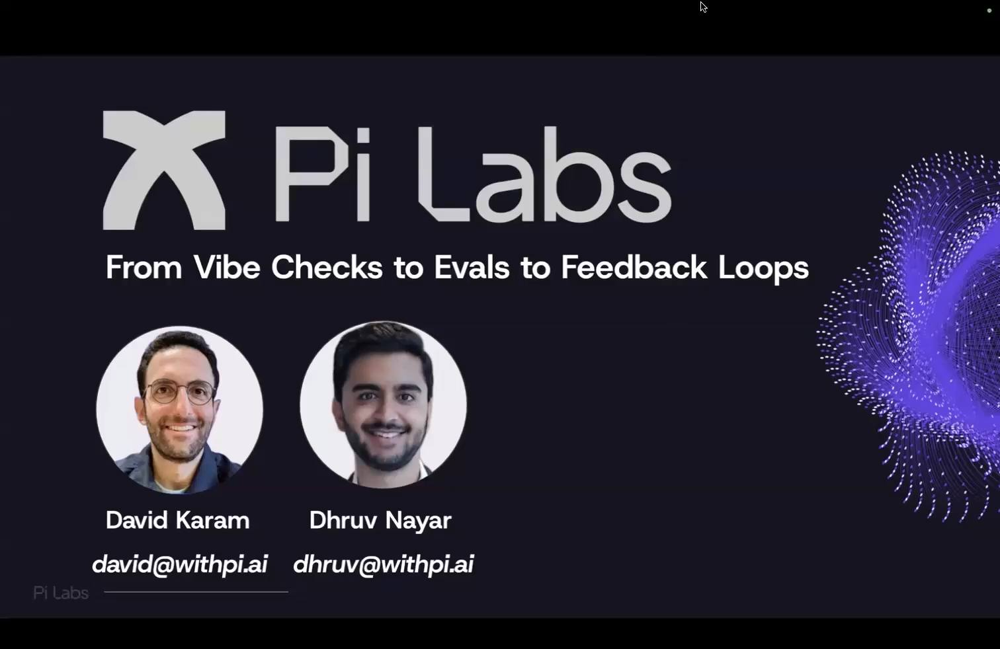

### 步骤 6：做「区分度实验」——换模型，看分数动不动

旅行规划客户（酒店评论摘要功能）的处境：有真实 query、有多模型回答，但**产品里没有反馈机制**。他们想决定用 Claude 还是 GPT 还是 GPT-mini。

实验做法：对同一批真实 query，用不同模型（讲师举例 GPT-4 与 GPT-4 mini / 4-1 mini）各生成回答，然后看**同一信号在不同回答上的分数是否出现差异**。注意讲师强调：这一步**不要求你知道哪个更好**，只要求「能看出差异（discern differences）」。

到这一阶段，你要同时看两件事：**分数准不准（accurate）+ 分数有没有区分度（discerning）**。

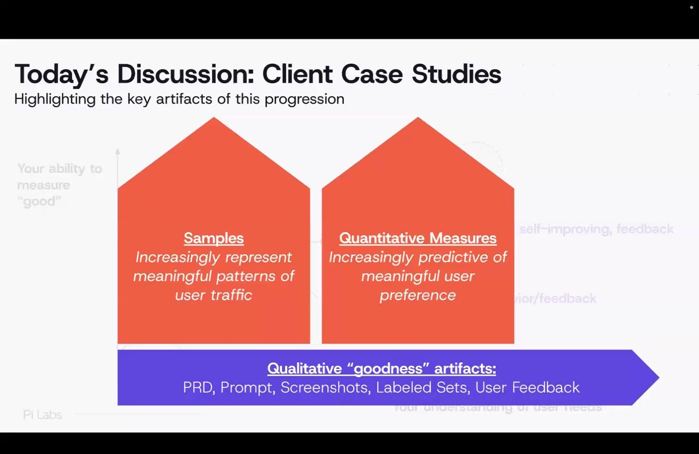

### 步骤 7：做「对齐实验」——用真实用户反馈校准信号

演示文稿客户（千万级用户）的做法分两段：

**第一段：从反馈里「聚类 + 抽取」出假设信号。**
- 输入：海量点赞/点踩 + 大量用户评论 + 内部演示专家意见；
- 做法：把相似反馈聚类（clustering），再抽取（extraction）成「假设信号（hypothesized signals）」；
- 结果：得到一批信号，围绕**排版（layout）、图片（images）、幻觉（hallucination）、内容流（content flow）**等，讲师提到「还有另外 8 个」，合计约 11 个信号。

**第二段：逐信号做对齐。**
- 取 20,000 条用户已打过分（good / meh / bad）的输出；
- 用每个信号给这 20,000 条重新打分；
- 按用户给的 good/meh/bad 分组，看每个信号的分数是否呈「good > meh > bad」的台阶；
- 期望形态：**绿柱（good）最高 > 黄柱（meh）中间 > 红柱（bad）最低**。

讲师现场指出的异常：**layout consistency（排版一致性）**这个信号上，meh 的分数反而略高于 good，说明这个信号的预测力有问题，需要修。

**第三段：校准权重。**
单个信号低方差、高精度之后，剩下的主观性体现在**相对权重**上：David 可能 80% 在意幻觉、20% 在意排版；另一个人可能 60/40。这个权重可以用真实人工样例来校准。讲师给的容量估算：**每个信号大约只需 10 条标注样例**；11 个信号 → **约 100 条标注样例**就够开始校准整体偏好。

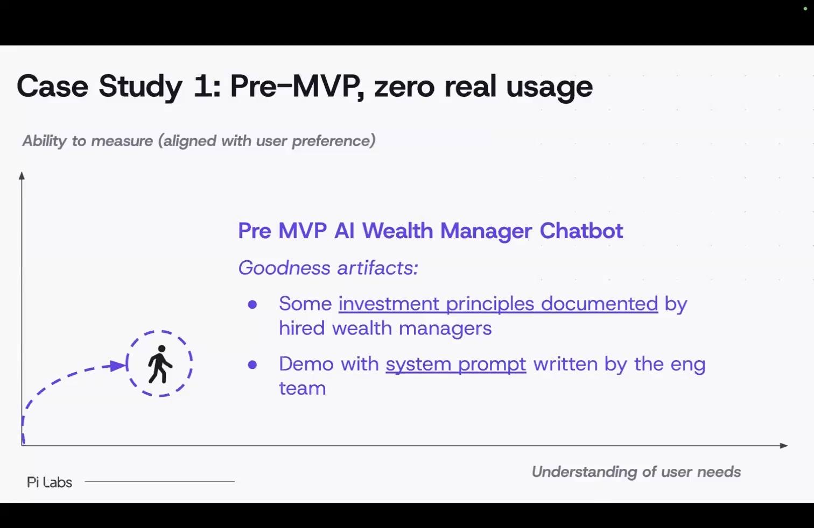

### 步骤 8：三道关都过了之后，评测反哺产品

讲师给出两个「评测进入产品回路」的例子：

- **Google Search**：打分系统在线用于文档打分与排序。把「这份文档对这个 query 好不好」拆成具体信号：是否与 query 相关、视觉是否吸引、是否是高点击的热门文档；SEO 相关再拆：内容分多高、标题多好；「标题多好」还能继续往下拆。
- **ChatGPT / DeepSeek**：把点赞点踩**蒸馏（distill）**成一个打分系统 / reward model，再用它做 RL 训练。ChatGPT 的谄媚危机就是「礼貌」这个信号被过度加权导致的反面教材；DeepSeek 用数学、代码补全这类**可验证奖励**，同样能训出强模型。

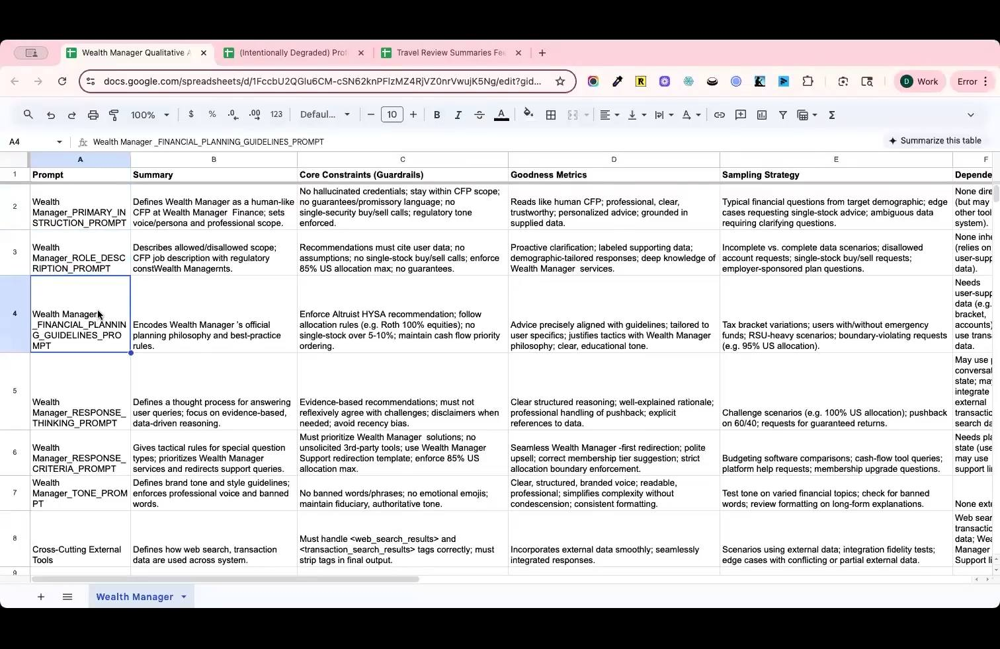

---

## 4. 完整代码（讲师给出的方案落成的可用产物）

> **课里没有代码。** 本节把讲师口述的方案落成 5 张可直接拿去用的表 + 1 段示意脚本。所有示意代码均标注「课里没有代码，以下为示意」，字段名以讲师原话为准，未出现的字段不臆造。

### 表 A：信号表（Signal Spec）— 财富管理案例

| # | 信号名 | 类型 | 是/否问题（喂给 judge 的 prompt 主体） | 期望方向 |
|---|---|---|---|---|
| 1 | no_single_security_call | core constraint | 这条回答是否避免给出单一证券的买入或卖出建议？ | 越高越好 |
| 2 | us_allocation_cap | core constraint | 这条回答是否把美股配置控制在 85% 以内？ | 越高越好 |
| 3 | grounded_in_user_data | goodness metric | 这条回答是否只基于用户提供的数据？ | 越高越好 |
| 4 | professional_word_choice | goodness metric | 这条回答是否使用了专业的用词？ | 越高越好 |
| 5 | professional_tone | goodness metric | 这条回答的语气是否专业？ | 越高越好 |
| 6 | human_like | goodness metric | 这条回答读起来是否像人写的？ | 越高越好 |
| 7 | trustworthy | goodness metric | 这条回答是否显得可信？ | 越高越好 |

> 说明：信号 1–2 来自讲师列举的 core constraints 原话；3–7 来自讲师列举的 goodness metrics 与「professionalism 可再拆成用词与语气」的拆法。讲师未给出完整字段定义，其余字段请按你的产品补。

### 表 B：样本策略表（Sample Strategy）— 财富管理案例

| 切片维度 | 取值 | 为什么要有这个切片 |
|---|---|---|
| 持仓请求复杂度 | 单一股票 / 多只股票 | 测「不给单一买卖建议」这条护栏 |
| 信息完整度 | 只给模糊信息 | 测模型在信息不足时是否乱编 |
| 税率档（tax bracket） | 多档 | 让样本代表不同人群 |
| 人群（demographics） | 多类 | 同上，保证代表性 |

> 讲师原话覆盖的切片：单一股票、多只股票、只给模糊数据、不同税率档。人群（demographics）为讲师提到的样本策略方向。

### 表 C：准确度实验表（Accuracy Experiment）— 退化设计

| 回答 ID | 退化维度 | 退化档位 | 高层问题「这是好回答吗」 | 低层问题「用词专业吗」 | 低层问题「语气专业吗」 |
|---|---|---|---|---|---|
| R1 | 无 | high | （judge 打分） | （judge 打分） | （judge 打分） |
| R2 | 用词 | medium | | | |
| R3 | 语气 | medium | | | |
| R4 | 用词+语气 | low | | | |

> 判读规则（讲师原话）：**当回答沿退化维度变差时，哪个信号的分数跟着往下走，哪个信号就是「准确」的。** 讲师现场结论：把问题收敛到「回答的语言本身」，比问「这是不是好回答」更能对齐高/中/低三档。

### 表 D：区分度实验表（Discerning Experiment）— 旅行规划案例

| query ID | 模型 | 回答 | signal_1 分数 | signal_2 分数 | … | 是否看出模型间差异 |
|---|---|---|---|---|---|---|
| Q1 | GPT-4 | … | | | | |
| Q1 | GPT-4 mini | … | | | | |
| Q2 | GPT-4 | … | | | | |
| Q2 | GPT-4 mini | … | | | | |

> 判读规则（讲师原话）：这一步**不要求判断哪个更好**，只要求「同一 query 下不同模型的分数出现差异」。讲师举例的模型是 GPT-4 与 GPT-4 mini（口播为「4-1 mini」，以实际模型名为准）。

### 表 E：对齐实验表（Alignment Experiment）— 演示文稿案例

| 信号 | 用户 bad 组均分（红） | 用户 meh 组均分（黄） | 用户 good 组均分（绿） | 是否呈 good>meh>bad 台阶 | 备注 |
|---|---|---|---|---|---|
| layout variety | | | | 是 | 讲师举例：对齐良好 |
| layout consistency | | | | **否** | meh 分数高于 good，预测力有问题 |
| image appropriateness | | | | 待定 | 讲师提到整体柱子偏低 |
| hallucination | | | | 待定 | 讲师列为信号之一 |
| content flow | | | | 待定 | 讲师列为信号之一 |
| （其余约 6 个） | | | | | 讲师称合计约 11 个信号 |

> 数据规模：**20,000 条**用户已打分的输出（good / meh / bad 三档）。判读规则：**绿 > 黄 > 红**。讲师原话「Green should be higher than yellow, should be higher than red」。
> 校准容量估算：**每信号约 10 条标注样例**，11 个信号 → **约 100 条**即可开始校准整体偏好权重。

### 示意脚本（课里没有代码，以下为示意）

下面这段只是把「表 C 的判读规则」写成可跑的骨架，帮助你把上面的表落地；**它不是讲师演示过的代码，字段与实现都以你的实际 judge 为准**。

```python
# 课里没有代码，以下为示意
# 用途：复现「准确度实验」的判读逻辑——看信号分数是否随退化档位单调下降
# 依赖：pandas（版本随意，>=1.5 即可）

import pandas as pd

# 列名对应表 C：response_id, degrade_level(high/medium/low), signal_name, score
df = pd.read_csv("accuracy_experiment.csv")

# 把档位映射成数值，方便看单调性
level_order = {"low": 0, "medium": 1, "high": 2}
df["level_num"] = df["degrade_level"].map(level_order)

# 每个信号在三个档位上的平均分
pivot = df.pivot_table(index="signal_name", columns="level_num", values="score", aggfunc="mean")

# 判读：high 档均分 > medium > low，即视为「准确」信号
def is_accurate(row):
    return row.get(2, 0) > row.get(1, 0) > row.get(0, 0)

pivot["accurate"] = pivot.apply(is_accurate, axis=1)
print(pivot)
```

> 在 JS/Node 里对应什么：这段逻辑等价于用 `Array.reduce` 按 `signal_name` 分组求均值，再比较三个档位的均值大小；没有锁、没有事务，纯数据聚合。

---

## 5. 逐行解释（每个决策为什么这样定、不这样会怎样）

**为什么先要一张 spreadsheet，而不是先买工具？**
讲师把评测定义为数据科学问题。工具会绑定你的流程，而数据科学的流程是「采样 → 打分 → 对齐 → 迭代」。先有表，你才能在 day 0 用人工 + ChatGPT/Claude 抽取信号，在成熟期换成 20,000 条真实反馈，**脚手架不变**。反过来，先买工具会导致：换模型时工具不支持新 judge、换阶段时数据搬不出来。

**为什么信号要拆成「是/否问题」而不是一个大问题？**
讲师原话：问 10 个专家「这条回答好不好」会得到 10 种意见；但问「是否只基于用户提供的数据」，一致性会高很多。拆细 → 方差低、精度高。不拆的后果：分数噪声大，你无法判断是模型变好了还是 judge 抖了。

**为什么 core constraints 和 goodness metrics 要分开？**
前者是护栏（「绝不」），后者是质量（「要像人」）。护栏是硬约束，通常用阈值做二分类拦截；质量是连续分，用于排序和比较。混在一起会导致：一条回答因为「语气不够专业」被当成「违反了不给单一买卖建议」的护栏，误杀。

**为什么样本要「有意义」而不是「按流量百分比切」？**
讲师明确说 meaningful 不等于百分比切片。如果你在追某类失败行为（比如「只给模糊信息时的幻觉」），这类 query 在真实流量里可能只占 1%，按比例采样你几乎测不到。所以要**刻意放大**目标切片。不这样做，你的评测会「整体看起来不错」，但目标 bug 一直漏。

**为什么 day 0 要做「退化实验」？**
因为你还没有用户反馈，唯一能验证信号的办法是**自己造出已知好坏的数据**。沿维度退化 → 得到 high/medium/low 三档 → 看信号分数是否跟着走。不做这一步，你手上的信号只是「看起来合理」，无法证明它准确。

**为什么区分度实验「不要求知道哪个更好」？**
因为这一步的目标是「分数会不会动」，不是「分数对不对」。如果换模型分数纹丝不动，说明你的信号对这个变化不敏感，后面再怎么对齐也没用。讲师举的反面案例：某演示文稿客户从 GPT 换到 Claude，用户立刻大量差评，但**仪表盘上没有任何一个指标动**——这就是「没有区分度」的代价。

**为什么对齐实验要按 good/meh/bad 分组看柱子？**
因为你要验证的是「你的分数」和「用户的偏好」是否同向。期望形态是绿 > 黄 > 红。讲师特别强调：**柱子整体高低不重要，重要的是台阶方向**。如果某个信号出现 meh > good（如 layout consistency），说明这个信号的定义或 prompt 有问题，要修，不能直接用。

**为什么对齐上限是 80%？**
讲师原话：用户在意的东西不一样，你觉得好的幻灯片别人可能觉得不好，所以永远到不了 100%。80% 是「足够可用」的门槛。到了 80%，你才能拿分数去比较模型、预测点赞点踩、在线生成多份挑最优、或当 reward model 做 RL。没到 80%，你的指标就是「准确但没预测力」，几乎没用。

**为什么校准权重只需要每信号约 10 条样例？**
因为单个信号已经被设计成低方差、高精度（是/否问题），剩下的只是「相对权重」这个更简单的校准问题。11 个信号 × 10 条 ≈ 100 条标注样例就够起步。这大幅降低了冷启动成本——你不需要几十万条标注才能开始。

**为什么 ChatGPT 的谄媚危机会发生？**
讲师解释：历史上人们直接拿点赞点踩做 RLHF，噪声很大；现在很多公司先把它蒸馏成 reward model 再训练。ChatGPT 的问题很可能是「礼貌回答」拿到大量点赞，这个信号在 reward model 里被过度加权，重训后模型在任何场景都过度礼貌。教训：**reward model 的权重偏差会被 RL 放大**。DeepSeek 用数学/代码这类可验证奖励，偏差小，所以同样能训出强模型。

**Google Search 的例子说明什么？**
说明打分系统可以**进入产品在线回路**，而不只是事后评估。把「文档对这个 query 好不好」层层拆成具体信号（相关性、视觉、点击热度；SEO 再拆内容分、标题分；标题分再往下拆），就能在线做排序。这是「评测成熟后反哺产品」的典型。

---

## 6. 复现检查清单

按顺序打勾，全部通过说明你把讲师的脚手架复现出来了：

- [ ] 建好一张 spreadsheet，至少含四列：样本 / 回答 / 信号分数 / 用户反馈
- [ ] 盘点完自己的 goodness artifacts，明确当前处在 day 0 / post-MVP / 成熟期哪一档
- [ ] 用 ChatGPT 或 Claude 读过 system prompt 与专家文档，抽出 ≥5 个信号
- [ ] 信号分成 core constraints 与 goodness metrics 两类
- [ ] 每个信号都写成了「是/否问题」，而不是「好不好」这种大问题
- [ ] 样本策略表覆盖了至少 3 个切片维度（如复杂度、信息完整度、人群/税率档）
- [ ] 做过退化实验：造出 high/medium/low 三档，验证信号分数随退化单调下降
- [ ] 做过区分度实验：同一 query 换 ≥2 个模型，确认分数出现差异
- [ ] 对齐实验按 good/meh/bad 分组，确认绿 > 黄 > 红
- [ ] 找出至少一个「台阶方向不对」的信号（如 meh > good），并记录待修
- [ ] 估算过校准成本：信号数 × 10 条 ≈ 所需标注样例数
- [ ] 明确对齐目标：达到约 80% 后再谈模型比较 / 在线挑选 / reward model

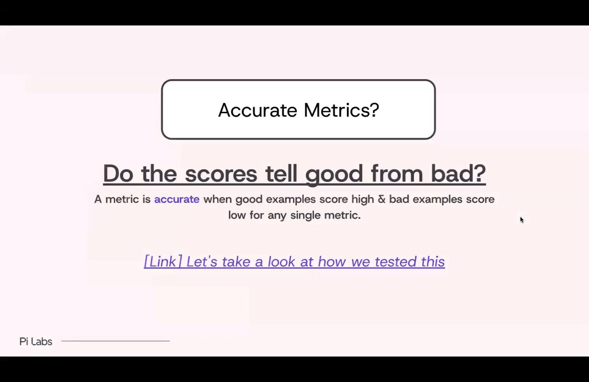

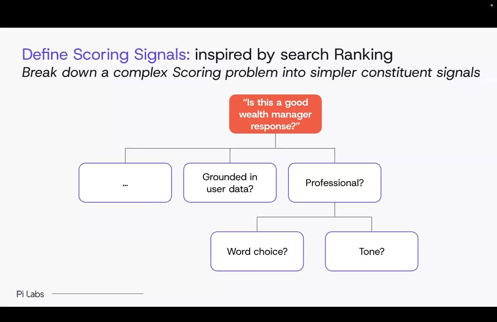

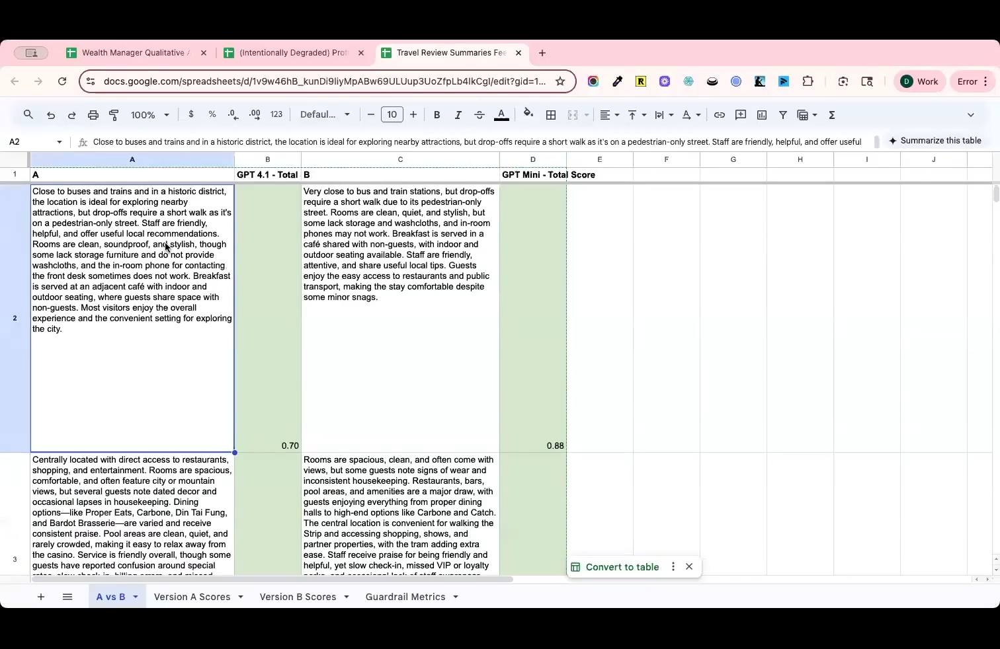

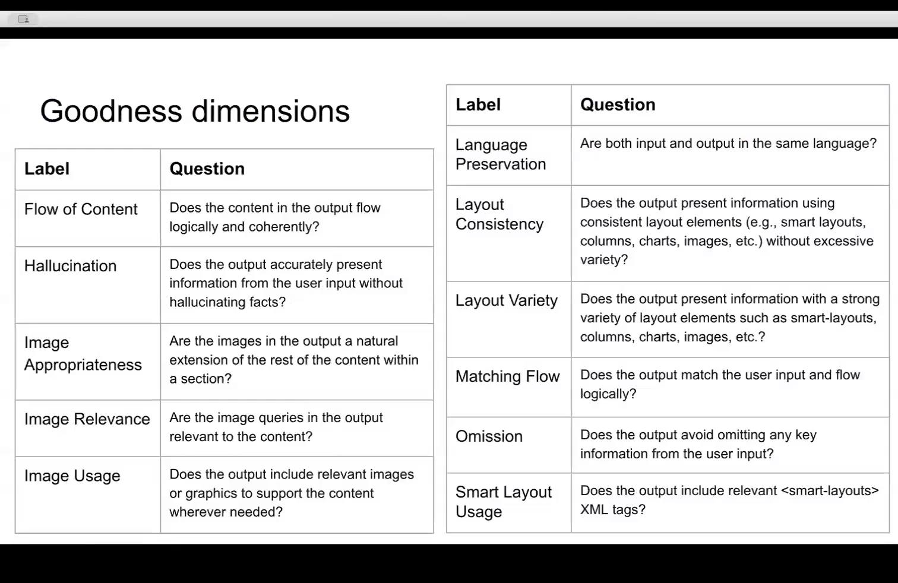

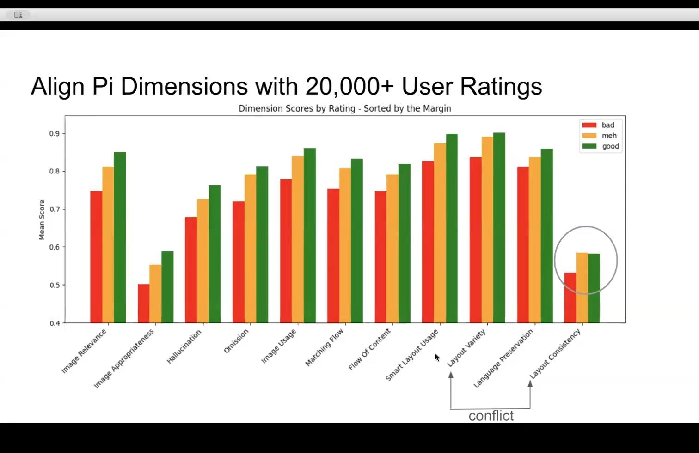

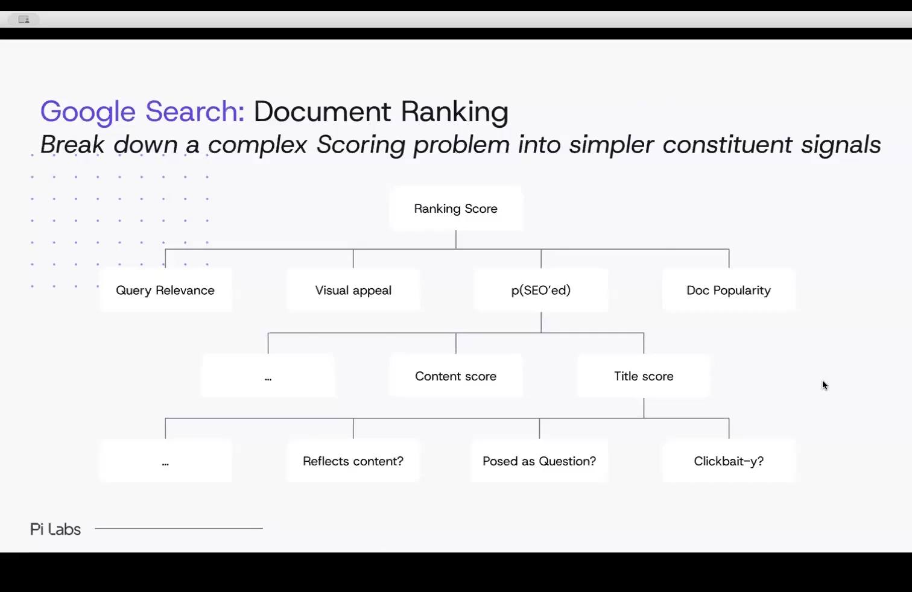

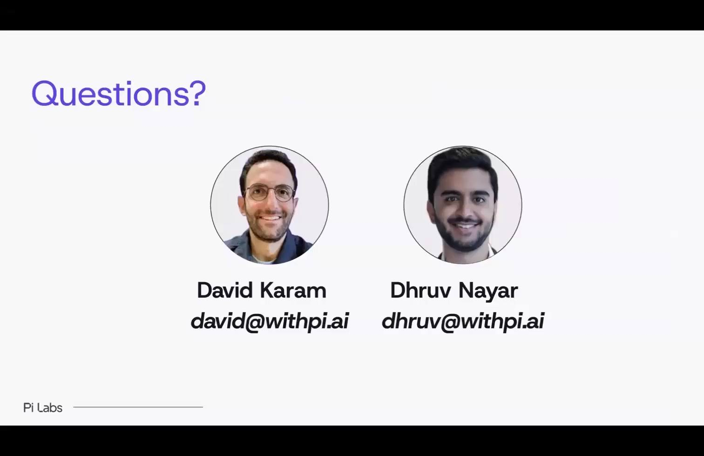

---

## 7. 课里没讲但你会撞上的

1. **judge 模型的具体 prompt 模板**：课里没讲。讲师只说「把信号写成是/否问题」，没给完整 prompt 结构。你需要自己写 system prompt + 问题 + 输出格式（建议强制输出 0–1 分数）。
2. **阈值怎么定**：课里没讲。讲师提到「可以设阈值变成二分类」，但没给具体数值或定阈值的方法。实践中通常用对齐实验里的 good/bad 分布来定。
3. **20,000 条数据怎么抽样**：课里没讲。讲师只说「20,000 条用户已打分的输出」，没说抽样策略。
4. **聚类 + 抽取的具体算法**：课里没讲。讲师只说做了「clustering and extraction」，没给工具或方法。
5. **reward model 的训练细节**：课里没讲。讲师只说「蒸馏成 reward model 再训练」，没给架构、损失函数、数据配比。
6. **成本与延迟**：课里没讲。用 LLM judge 打 20,000 条 × 11 个信号的成本、并发、缓存策略，课里完全没提。
7. **多 judge 一致性（inter-rater agreement）**：课里没讲。讲师强调「低方差」，但没给衡量多个 judge 之间一致性的指标（如 Cohen's kappa）。
8. **在 JS/Node 里对应什么**：课里没讲（讲师全程 Python/表格语境）。如果你用 Node 实现，聚合逻辑就是 `Array.reduce` 分组求均值；没有锁、没有事务，纯数据管道。若你要并发调用 judge API，注意用 `Promise.allSettled` 而不是 `Promise.all`，避免单条失败拖垮整批——这是工程常识，不是课里内容。
9. **「4-1 mini」的确切模型名**：逐字稿口播为「GPT-4 mini, or 4-1 mini」，可能是 GPT-4.1 mini 的口误，**以你实际使用的模型名为准**，课里未确认。
10. **对齐图 y 轴的具体量纲**：课里没讲。讲师只说 y 轴是「该信号的分数」，没说是 0–1 还是 0–100，也没说是否归一化。