# AI Evals 实战：错误分析（Error Analysis）完整复现文档

> 课程：AI Evals For Engineers & PMs（Agent 评测）｜覆盖 P002（约 61 分钟）
> 本文档按「生成合成数据 → 跑 bot 得到 trace → 开放编码（open coding）→ 轴向编码（axial coding）→ 用 LLM 辅助归类」的顺序，把讲师在课上演示的整套错误分析流程还原成可照着做的步骤。

---

## 1. 这一节做什么

这一节是整个「分析—测量—改进」（analyze → measure → improve）循环的**第一站：错误分析（error analysis）**。目标不是写代码，而是**用人工方式找出你的 AI 产品到底在哪些地方失败**，产出一份「失败模式清单」，为后续写自动化评测器（evaluator）打地基。

具体要完成四件事：

1. **生成合成数据（synthetic data）**：如果你还没有真实用户 trace，就用「维度 → 取值 → 元组（tuple）→ 查询」的方式，造出约 100 条**多样且真实**的用户查询。
2. **跑 bot 得到 trace**：把每条查询喂给你的 agent，记录完整交互（用户消息、工具调用、工具结果、最终回答）。
3. **开放编码（open coding）**：逐条读 trace，用自由文本写下「哪里不对」，直到**理论饱和（theoretical saturation）**——再读新 trace 也不会冒出全新失败模式。
4. **轴向编码（axial coding）**：把一堆开放编码聚成**失败模式分类树（taxonomy）**，可以用 LLM 辅助（把 CSV 丢给 ChatGPT / Julius），但必须人工复核。

讲师反复强调的核心判断：

- **不要一上来就让 LLM 随便生成用户查询**——那样造出来的数据高度同质、脱离现实，探不到真正的失败。
- **多轮/多工具场景只记「最上游的第一个失败」**，不要在这一步做根因分析，也不要顺手改 pipeline。
- **人工读数据是 evals 的「秘密武器」**，约 75% 的价值在这一步；不要试图把这一步外包给 ChatGPT。
- **约 100 条 trace 是经验法则**，少于这个数很可能只是「你懒得看了」而不是真的饱和。

---

## 2. 讲师原话

> "今天我们要开始讲错误分析。Hamel 和我会做几个现场演示，希望一切顺利，祈祷。"
> —— p002 [00:00]

> "上周我们做了一节导论课……关于把基础的系统提示词原则应用到 recipe bot 的反思题，有很多很好的评论。有些人心里有一个明确的用户人设，这对他们想出系统提示词的该做与不该做非常有帮助。"
> —— p002 [02:25]

> "所以这就再次凸显了 evals 的重要性：它们必然是针对你的提示词、针对你嵌入产品里的那种品味的。"
> —— p002 [03:43]

> "今天的计划是讲生命周期里的第一阶段——错误分析。其中一部分包括：一，为你生成可供分析的合成数据；然后做一些开放编码和轴向编码（我们稍后会讲），找出你的系统提示词、你的 AI 产品特有的失败模式。"
> —— p002 [04:08]

> "回顾一下，分析—测量—改进循环首先经过错误分析，基于你的 bot 已经生成的一些输出，收集有代表性的失败模式；然后是一种测量，即量化这些失败模式出现的频率；再用它来驱动对 pipeline 的改进。"
> —— p002 [04:38]

> "我们今天要用的贯穿案例是 Hamel 合作过的一个真实例子，叫 Nurture Boss。他们做的是一个 AI 租赁代理。你可以把它理解成一个聊天机器人，面向现有租户、过往租户、未来租户，以及任何对这个公寓社区租赁感兴趣的人。"
> —— p002 [06:01]

> "这个 agent 有很多可用工具。比如用户想预约看房，有一个查询看房可用时间的工具；有一个更新个人信息、查询住户余额的工具。里面有 10 个以上的工具。所以这是个相当复杂的产品。"
> —— p002 [06:30]

> "我们有大约 100 条 trace，今天要来标注。但你们很多人手上还没有可以标注失败模式的 trace。所以错误分析的第一步，是先创建一个你可以用来标注的初始数据集。"
> —— p002 [06:51]

> "我们并不是说你必须做 100 条多样化的 trace，这只是给喜欢规则的人一个经验法则。大致上我们希望从约 100 条多样化的 trace 开始，以便对 AI agent 可能出现的失败模式有一个好的把握。"
> —— p002 [07:49]

> "我们要持续生成数据、审阅并标注失败模式，直到达到所谓的理论饱和——基本上就是，如果我们还能生成新 trace 并标注，也不会看到任何全新的失败模式出现。"
> —— p002 [08:16]

> "不要只是让 LLM 给你示例用户查询。这是探不到任何失败的做法。如果你盲目地问 LLM，它可能生成一堆大同小异的 trace，它们可能跟你的真实用户会提出的东西毫无现实依据。"
> —— p002 [08:43]

> "你要做的是真正对系统做压力测试，试着跳出框框，头脑风暴哪些场景更可能弄坏或挑战你的系统。这些 trace 要尽可能高信号，帮你暴露问题。"
> —— p002 [09:37]

> "如果你对哪些场景会出现没有好的直觉，那很重要的一点是：去用你的产品，或者至少找几个用户、朋友来用，获得一些感觉——哦，这里有问题。带着一些假设进来是好的。如果你一开始没有任何假设，就会很难。"
> —— p002 [10:05]

> "心态上有点像数据科学家：对一切保持怀疑，心想『我打赌这东西某处会坏，我要把它嗅出来』，做那种侦探工作。"
> —— p002 [11:01]

> "一种做法是思考用户查询可能有哪些维度会变化，然后为这些维度想不同的取值。你可以把用户提交给 agent 的每个查询都看成是多面的：有用户人设、有查询实际关于什么、有查询多长多短，甚至还有领域特定的维度。"
> —— p002 [11:27]

> "要生成合成数据，我们就在那些会变化的维度上采样。挑大约三个你认为会在查询之间有意义地变化的维度。"
> —— p002 [12:22]

> "对 Nurture Boss 来说，查询里变化最大的是意图（intent），也就是用户到底想干什么。有时想查公寓可看房时间，有时问宠物政策，有时请求维修——他们问的完全是不同的东西。"
> —— p002 [12:52]

> "另一个变化的是提问的人是谁。对 Nurture Boss 来说幸运的是，人的类型不多：要么你是住户，要么你即将成为住户。所以可以把查询归到这三类人设里。"
> —— p002 [13:21]

> "然后是查询复杂度（query complexity），有时也叫场景（scenario）。标签叫什么不重要，重要的是这个维度：这个查询有多复杂。尤其是聊天机器人这种用户直接写问题的场景，他们可能说得完全含糊或非常短，也可能说得非常详细具体。这是两类完全不同的查询，很可能引发 LLM 不同的行为。"
> —— p002 [13:50]

> "这张幻灯片上的三个维度是 Nurture Boss 特有的，是由产品知识驱动的。不要以为你必须用这三个确切的维度。而是要思考你的产品，每个产品最有意思的维度是什么。"
> —— p002 [14:19]

> "每当我跟卡在这里的人聊，另一个想出维度的办法是：先想出 50 个维度，然后为每个维度写下三个示例取值。你会发现有些维度取值很多，有些没那么多。这能帮你判断该优先沿哪些维度采样。"
> —— p002 [14:48]

> "Nurture Boss 的其他维度可能还有位置——哪个公寓社区，如果是个很大的全国连锁的话。也许还有自主性（autonomous）：用户完全不想要人在环（human-in-the-loop），只提交查询就要答案；对比更偏人在环，用户期望跟 bot 聊天、提供更多后续细节。"
> —— p002 [15:15]

> "元组（tuple）基本上就是一列取值，每个取值对应一个维度。生成一堆对应你维度取值的元组。为每个查询意图列一堆取值，为每个人设列一堆取值，为每个复杂度场景列一堆取值，然后基本就是取它们的笛卡尔积（cross product）。"
> —— p002 [15:44]

> "用这种方式做合成数据生成，会比你简单地问 LLM『给我一些查询』得到多得多的查询多样性。"
> —— p002 [16:41]

> "我喜欢的做法是：不用 LLM，先枚举笛卡尔积，给定一堆取值；然后用 LLM 过滤掉不太现实的元组。"
> —— p002 [16:41]

> "你可以让 LLM 想出元组，再让 LLM 把元组变成查询；你也可以先过滤掉不现实的元组，再让 LLM 写查询。这里没有硬性规则。你想要的只是：走完这个过程后，你能看着这 100 条合成查询，确信它们是现实的、足够多样的，不是彼此的重复。"
> —— p002 [17:11]

> "值得在『现实』这个词上多停留一下，因为我想强调：这应该由假设、产品思考和直觉来驱动。学生最容易迷失的地方就是，他们不知道要生成哪些维度，也不确定数据够不够好、够不够多样。如果你有足够的直觉、有好的感觉——『这是对我的系统一次合理的压力测试』——那这些就不该是问题。"
> —— p002 [17:39]

> "做到这一点的一个好办法，正如 Hamel 之前说的：把你的产品用 100 次，随便朝自己扔查询，建立对『你喜欢什么』的直觉，然后再去做系统性地生成多样化查询这件事。"
> —— p002 [18:07]

> "一旦你有了合成元组，就跑你的 bot，你会为每一条用户查询得到一个答案。"
> —— p002 [18:35]

> "trace 是一个完整的记录，是你能读到、看到用户和 agent 之间整个对话或发生了什么的东西。它包括工具调用、工具结果。基本上把它想成：要能在脑子里完整重放这次交互，你需要的一切。"
> —— p002 [19:04]

> "有些人喜欢把 trace 称作一列消息，如果你用 OpenAI API，就是一列 chat completion 消息。但重点是它包含从用户查询到 LLM 生成的最终答案的全部信息。"
> —— p002 [19:33]

> "编码（coding）在这里是个被过度使用的词，它不是编程，是标注。我们用『开放编码』这个词，是因为它在定性研究里就叫这个。如果你是 PM，或者熟悉社会科学研究、扎根理论（grounded theory），这个过程对你不会完全陌生。我们只是把它应用到 LLM 错误分析的场景。"
> —— p002 [20:02]

> "高层面上我们要做什么？我们读每一条 trace，然后写下非常简短的笔记，记录哪里出了问题。『出了问题』定义很松，可以是任何东西：可以是感觉不对、语气不对，也可以非常具体，比如 LLM 返回的工具结果不正确。重点是任何让你觉得不对的东西，都用开放的方式写下来，把摩擦降到最低。"
> —— p002 [20:32]

> "如果你对 100 条 trace 这么做——说实话你甚至不需要到 100 条，做 30 条——错误的类别就会从数据里浮现出来。我向你保证。"
> —— p002 [20:58]

> "在多轮对话、或者有 agent、有工具调用的场景里，你要观察最上游的错误并停在那里，简化事情。你不想把出问题的所有东西都写下来，因为 LLM 交互有因果性，你停在最上游那一个就好。"
> —— p002 [21:55]

> "而且在这个阶段你不想过度做根因分析。只是观察你看到的，写下来。根因分析是后面的事。你不想把自己框进太多分析里，你只想观察正在发生什么。我看到很多人试图在这个阶段改进 pipeline，这非常徒劳，还会大大拖慢你的错误分析。"
> —— p002 [22:22]

> "这恰恰是人们最常跳过的一步。它几乎是 evals 的秘密武器。这很反直觉：他们觉得『嘿，你应该手动看数据』，在 LLM 时代这感觉很反直觉，因为这不自动化。但我向你保证，这价值极高。"
> —— p002 [22:50]

> "Hamel 说的『第一个上游失败』，我 100% 同意。如果是第一次做错误分析，就聚焦第一个上游失败。不要被 trace 里太多不对的东西淹没。找到第一个不对的，写下来，然后继续。"
> —— p002 [23:18]

> "但当你更有经验、能在脑子里建立 LLM 行为的心理模型、能同时管理多个失败模式，或者你做错误分析已经很快了，那你就可以标注你看到的所有独立失败。我建议在你对自己的产品做过一两轮以上错误分析之前，不要这么做。"
> —— p002 [23:43]

> "我们说做 100 条 trace 直到你觉得学不到新东西。之所以说 100 条，是因为如果你做得比这少，就有更高概率你只是懒，只是告诉自己『我学不到新东西了』，因为你不想做。"
> —— p002 [24:09]

> "如果你停得太早，你的 eval 就会有缺口。我自己训练 RL agent 时就这样，停太早，结果是一场灾难，后面要为我没观察到的失败模式买单。所以千万别在这上面偷懒。"
> —— p002 [24:38]

> "我们选 Brain Trust 不是因为我们偏爱它，纯粹是因为这份数据不是 Brain Trust 的。你会看到基本如何使用 Brain Trust 的教程，但现在先假设你所有的 trace、所有遥测都已经接好，trace 都像我们这样记录在这里。"
> —— p002 [25:34]

> "我们要做的第一件事是看系统提示词。如果你写的系统提示词，你当然知道里面是什么。但如果你没写、而你在做错误分析，你就应该读系统提示词，这样你才知道 LLM 想做什么。"
> —— p002 [26:02]

> "在这个例子里，对 Nurture Boss 来说：你是租赁团队成员，你的名字叫 Emma。我想现在 bot 都有名字了。你的目标是回答用户问题，并鼓励客户更多参与——预约看房、在线申请等等。"
> —— p002 [26:29]

> "然后你能看到该做与不该做：保持聚焦在上下文、提供相关信息、不要编造信息、聚焦租赁话题。来电者状态（caller status）：你应该识别用户是谁——是现有住户还是潜在住户，还要注意语言、询问的性质。"
> —— p002 [26:58]

> "比如，如果他们说『我的公寓』，他们很可能是现有住户，这对我来说很合理。这些人把提示词写得很具体。"
> —— p002 [27:28]

> "转接电话：有时客户会说出一些话，表明你应该把他们转给另一个……这里列出了是否调用转接工具的所有准则。你有转接电话的工具，可以转接通话，这里是调用该工具的说明。"
> —— p002 [27:53]

> "日期处理：我很喜欢这个规范——你必须指定 MMDDYYYY 格式，这样日期格式就一致了。"
> —— p002 [28:20]

> "客户交互：每次对话开始时触发初始化调用工具。在后台安静、自动地调用工具。"
> —— p002 [28:41]

> "你可能会想，Nurture Boss 是怎么想出这个提示词的？这是长期大量迭代的结果。我们不是在 Nurture Boss 旅程的最开始拿到这份数据，而更像是他们已经有了一个迭代过的产品，卡在了『我们怎么让这个 AI 更好』上，然后他们记录了这些 trace。"
> —— p002 [29:08]

> "我觉得我们早该提到的一点是：这是一个语音 agent，这些是通话的转录。所以你会看到一些对文本聊天机器人不太有意义的提示词准则。但像这样的场景，你要拿到邮箱地址，就必须请客户拼出邮箱、慢慢拼、不要打断。"
> —— p002 [29:33]

> "它其实是一个多渠道 AI，处理语音、文本、邮件等等。所以我们可能会遇到不同的 trace，我想我们会看到一些明显是短信的 trace。"
> —— p002 [29:33]

> "好，我快速浏览最后部分，希望大家对这个 agent 如何工作有了感觉。它有很多工具，每个工具都有规范。所以这个 agent 有很多出错的方式，只要它不遵守其中任何一条指令。"
> —— p002 [30:03]

> "有一个审阅工具。我刚按了键盘上的 R 键，就进了这个面板，挺好。我们要做的是把开放编码写进这里的 notes，方向键可以移到下一条 trace。"
> —— p002 [30:27]

> "每次做这个，我都尽量跳到查询。这里：『我能预约明天上午 11 点的看房吗？』天哪，这些工具调用会告诉你所有可看房的时间和日期。"
> —— p002 [30:56]

> "这是一条有意思的 trace。这是创始人 Jacob 在测试自己的应用。你能看到好像做了多个预约，或者多个预约被创建。"
> —— p002 [31:22]

> "我觉得首先奇怪的是『给我一点时间』『你的看房』『我们能给你发个确认吗』，而且在一次短信对话里问了两次。这让我觉得某个工具出问题了。也许 agent 本身没犯错，而是它不知道如何应对工具失败。这是对工具失败很差的反应。它应该说『我们无法给你发短信』，那才是我想要的。"
> —— p002 [31:50]

> "我没看到有哪个工具调用真正成功预约了。也许有。哦，我觉得有。『你的看房已预约』。所以它确实更新了信息、预约了看房，但似乎没发出短信。"
> —— p002 [32:19]

> "所以这很有意思，有不同层次。你开放编码的质量很大程度上取决于你的产品感。一种看法是：你看这条 trace，说『好吧，AI 有点问题』。这是 Shreya 现在做的基本功——它在短信上做了奇怪的事，发了多次通知，某处出错了。"
> —— p002 [32:47]

> "而我看这个，我觉得这不是构建产品的好方式。如果我要预约，我不想有人告诉我『看情况』。这是短信，也许我们避免不了，但我想要一个 widget，给我链接，给我 Calendly 链接，给我一个能滚动查看有哪些预约的链接。我不想要来回预约。我想在这一点上退出 AI。有些事适合 AI，有些事不适合。这些是你想记住的东西。你也可以把它写进开放编码。"
> —— p002 [33:15]

> "如果你读足够多 trace，你可能会说『你知道吗，我经常看到这个预约的事，它让我烦，而且总是失败』。仔细一想，你会说『这个模态就是在自找麻烦』。这些是你可能想思考的东西。"
> —— p002 [34:13]

> "这没关系。它没调用短信工具，也完全没问题。我同意 Hamel，对于错误分析的『婴儿第一步』，我大概不会写你说的那个编码。"
> —— p002 [34:40]

> "错误分析可以让你成为专家，这会成为你的超能力，正如 Hamel 说的。所以从简单开始。但随着你审阅输出、建立更好的产品感，这里就是你能注入大量品味的地方——应该存在哪些模态等等。这会让你的产品区别于其他所有产品。但现在，我只是个初级错误分析师。"
> —— p002 [35:03]

> "所以我想指出几点：一，如果我让 ChatGPT 告诉我这里有没有错误，我不确定它会说什么。事实上，我们来试试。"
> —— p002 [35:32]

> "这是一条我 agent 的 trace。agent 死了吗？它正确还是错误地回答了查询？看吧。你没法外包这个。"
> —— p002 [36:29]

> "我喜欢你这么做，因为这正是……哦，4.1 了，各位，这是 4.1，省省吧。它说『有一些轻微冗余，但显然不影响在满足用户查询意义上的正确性』。"
> —— p002 [36:29]

> "我不知道，老兄。如果我没收到短信确认，我不会相信这被预约了。所以……是的，行为确实是不想要的。"
> —— p002 [36:58]

> "所以这是我的第一点：ChatGPT 没法替我们做这个。所以，一，不要试图自动化这一步。"
> —— p002 [36:58]

> "第二点我想说的是：注意我们只是说了哪里不对，我们没有去看系统提示词、问『为什么出错，是不是工具没指定对』。不要过早这么做。就去，然后继续。"
> —— p002 [37:27]

> "所以这是一个在另一个公寓工作的 AI 助手。我解析不了这个查询。哦对。这是好的，这是真实用户交互——他们到底在说什么？哦，bedroom。他们想知道总搬家费用，一室一卫，想知道平方英尺和可看房时间。我不知道 content 这个词是什么意思。没人知道。但这正是真实的。这是真实数据，虽然匿名了，但是真实的。"
> —— p002 [37:54]

> "所以另一件让我意识到想指出的事是：不是每个想法都需要成为一条笔记。就像我说的，我不知道这个 B.E.R.M. 是什么，我解析不了这个查询。我不是在找这方面的东西，我不是想给这条 trace 打上『无法解析』的标签。我只想记录失败模式。"
> —— p002 [38:23]

> "所以，我看到的 LLM 做开放编码的另一个失败模式是：你让它找 trace 里的主题，它会说『查询不精确』『查询拼写不正确』。这些不是 LLM 失败模式。所以你不想要这些。"
> —— p002 [38:52]

> "『嗨 Emily，这是详情。』『太贵了，但谢谢。』所以 Emily 觉得太贵了。我也是。"
> —— p002 [39:49]

> "好，我戴上初级数据分析师的帽子。我觉得这其实还行。从大局看，这没问题。如果我是产品经理、更资深，我会想：这是一个错失的机会，没能跟 Emily 进一步互动，也许不该显得我们马上就走了。如果 Emily 说太贵，也许我们可以通过提到这其实是该地区的市场价来防止她流失。但现在，我不会说这有什么明显错误。"
> —— p002 [39:49]

> "我觉得这是对的。在我们旅程的这个阶段，这算通过。这是一个合理的通过。我同意。"
> —— p002 [40:18]

> "PM 们，希望你们在听，因为这里就是你把所有知识注入流程的地方。我跳过，不写笔记。所以我觉得没问题。"
> —— p002 [40:45]

> "下一个查询。我们走快点，因为我们总是很慢。我找不到查询。对，就在预览里。预览项目。"
> —— p002 [40:45]

> "我喜欢它推断了意图，但它当着你的面错了。这个人今天真的不想配合。『你和一个代表谈过了。』『你想让我把你接到你的项目吗？』『可负担住房单元。』『就想聊聊。』所以，不算差，但我确实觉得，一旦他们说想转接给代表，我们就应该直接转接。没什么比你说『我想跟人说话』更烦人的了。一旦用户要求转接，我们就应该直接……"
> —— p002 [41:12]

> "所以你可能会想，这里能抽出好几个失败模式。非常合理、甚至被建议的做法是：刚开始做错误分析时，抽出主要的失败模式——那个总括性的、你最想关注的。你不想陷进任何一条 trace 里，你想继续，只想突出主要问题是什么。这样你才能做得快，因为你要过至少 100 条。"
> —— p002 [41:41]

> "而且会越来越快。但 Hamel 和我在聊天，所以可能这也是为什么慢。我见过有人 10 秒过一条，可以很快。"
> —— p002 [42:08]

> "这看起来不像一条 trace。哦，只是格式不同。哦，格式不一样，Hamel。对，有个下拉菜单，但我们不用管。『你好，嗨。』这看起来像一条不完整的 trace。"
> —— p002 [42:36]

> "这是我们可能想从数据集里删掉的。但我们继续。『你好，我应该是 3:30 的，不是 3 点。』『最近的是 3 点和 4 点。』『4 点可以。』『太好了。』啊！这是个棘手的问题。"
> —— p002 [43:05]

> "他们做得很好，然后……哦等等，他们想去周五。哎呀，我不想看到这个。所以这是个有意思的失败。没有上下文、没有产品上下文，它不会立刻显现。"
> —— p002 [43:33]

> "但这是 Jacob 和我做错误分析时看到的失败：当时 Nurture Boss 没有改期（reschedule）工具调用，只有预约（schedule）工具调用。所以如果你要求改期，它不会取消旧预约，只会不断预约新的。我们可以通过看 trace 发现这一点。如果你没有那个上下文，它不会立刻明显。"
> —— p002 [44:02]

> "我们编码的方式，就像我们说的：『嘿，我们把它叫做改期问题（rescheduling issue）』，或者写进笔记，因为我们知道那是个问题。结果那个特定错误频率非常高。这些改期问题，也许是我们做分析时排名第一的。"
> —— p002 [44:30]

> "这很有意思，很好的上下文，因为我完全漏掉了。这应该是改期，而不是预约新看房，或者你应该取消再预约。"
> —— p002 [45:00]

> "所以你可能会想，做错误分析时，我需要所有人都在房间里吗？需要工程师、产品经理、所有人吗？需要把全世界都召集起来做错误分析吗？不。你要的是有办法以某种方式检查最终结果。你要能查出那个人在系统里的预约看房记录。这就是我们最终会讨论的：你想要自己的标注工具。你不想在这个工具里标注，因为这里你看不到那个信息，你得点进另一个系统、另一个工具才能看到。你想要所有东西都在一个屏幕上，但那是后面的事。"
> —— p002 [45:00]

> "好，我们试着再标注三条，就说我们过了 10 条。好，A11，为什么它可用？我猜那是个单元。对，像个户型图之类的。所以这个公寓……哦，是个单元。好吧，我其实不知道，因为它怎么知道 A11 是什么？我觉得它有点幻觉出 A11 了。"
> —— p002 [45:59]

> "我会怀疑，心想『嘿，那到底是什么鬼？』你应该怀疑，问『那是什么意思？』然后弄清楚。我甚至不知道怎么写这个编码。理想情况下你会停下来调查：A11 是什么？在这个物业上到底有没有意义？那个数据到底什么意思？考虑到 trace，它确实感觉像幻觉，因为我在它拉取的数据里没看到 A11。"
> —— p002 [46:56]

> "我也不觉得在工具调用里看到它作为查询参数。上面有个工具调用，但……对，那一个。不，不，也许它是……获取社区可用性、床位数。好，只有床位数 1、所需日期 2/15 这两个参数。对，我看到可用性了。所以我觉得它真的幻觉了那一个。当然我们有产品上下文，也许更容易诊断，但我们不能确定这是不是幻觉，但根据我们对产品的了解，这闻起来像幻觉。"
> —— p002 [47:25]

> "好，这时我会停下，因为这是第一个失败模式。这里后面可能还有失败模式。这看起来是段很长的对话，但我要跳过，因为这是我第一轮错误分析，我想先把大错误清掉。"
> —— p002 [48:21]

> "『我要迟到了。我会到的。』『有停车位吗？否则我就走过去。』它没真正告诉我们有没有停车位。这很有意思。为什么助手说『否则我就走过去』？"
> —— p002 [48:50]

> "导入里肯定有错误。对，这可能是日志记录的错误。我也这么觉得。但如果你假设日志是对的、去重什么的，它应该说……我有时喜欢说它应该说什么。应该说『不知道』，并在后台调用工具来提醒我们有这个新查询。我是后台工具的大粉丝。"
> —— p002 [49:20]

> "如果你一直往下滚，我们这里有个小抄（cheat sheet），可以看到我们实际标注了什么，就当好玩。如果滚到最底下，有个叫 Z note 的字段，在最底部。找到了，Z note。AI 用幽默把它顶回去了，说这发生在人们快速发短信时，它错误地指示人类去联系一个当时就在门口的人，让人以为 AI 要放他们进来。所以那也是两个错误。"
> —— p002 [50:17]

> "对，我是只做第一个失败，但……对，那是带着大量产品上下文才能看到的。但你说的没问题，看着好玩。"
> —— p002 [50:44]

> "但另一件事是：你的开放编码可能跟别人很不一样，完全没问题。有无数 bug 要清，你总得从某处开始。"
> —— p002 [50:44]

> "好，我在这里暂停，回到幻灯片。想象你已经做了 100 次。然后你的问题是：接下来做什么？我累了。我没看到任何新东西，除了幻觉或者我不知道，我没看到任何根本性的新失败类型。那我现在做什么？"
> —— p002 [51:12]

> "接下来你要做的是所谓的轴向编码（axial coding）：你拿你的开放编码，试着从中构建一个失败模式的分类树（taxonomy）。你可以把它想成：每个失败模式是一张便利贴，贴在白板上，现在你要把它们组织成簇，构建失败模式的层级。"
> —— p002 [51:36]

> "在 Nurture Boss 里，出现了所有这些不同的失败模式簇。比如转接（transfer），我们见过一个例子，转接/交接问题；预约问题，也许它没调用改期工具，而是预约了新看房；提供了错误信息；格式错误。甚至可能有一条很长的长尾失败模式，那没关系，但大概符合 80-20 法则：80% 的失败由少数几类解释。"
> —— p002 [52:05]

> "幻灯片上实际是我们在真实场景里做错误分析的真实结果。所以你看，这就是我们真正的错误所在，然后我们可以给它们排优先级。"
> —— p002 [52:34]

> "这里我说，完全可以借助 LLM：把你所有的标注和 trace 导出成 CSV，上传到 ChatGPT，然后让它基于你的开放编码给出一个失败模式层级。它可能会漏掉一些开放编码，层级可能不完美，但它是个很好的起点，你可以在此基础上精炼。"
> —— p002 [53:00]

> "所以我要退出这个，回到……好，让我缩小看全部。我也可以退出这个。然后下载这些行。"
> —— p002 [53:30]

> "好，我通常提到你的笔记在 Z-note 字段，对吧？对。好，太好了。那我假设我们在 Z-note 里编码了，这样我们就有大约一百个编码。现在我要让 ChatGPT 给我一个失败模式分类树。"
> —— p002 [53:57]

> "我本可以写个更好的提示词，但我可能会说：我分析了一堆来自我 LLM agent 的 trace，并用失败模式标注了它们。我创建了一个电子表格，每行是一条 trace 和它的失败模式。"
> —— p002 [54:24]

> "也就是 CSV 里 Z-note 字段里的开放编码。我们这么做。我想说，在元数据里，它在 CSV 的 metadata 字段里。"
> —— p002 [54:51]

> "然后你提取 z-notes，给我构建一个失败模式分类树。你得想出高层类别。"
> —— p002 [55:19]

> "我预期会有 10 个以上的类别，还有一个层级。这……好吧……我觉得这对我们效果不会好。我经常用这个叫 Julius 的工具，它专门为数据分析调校过，比 ChatGPT 更擅长。不过这个看起来也还行。有时在 ChatGPT 里也能用，我不想贬低什么，但我真的很喜欢用 Julius。看起来它确实找到了 Z-note，这挺好。所以也许它会去做。"
> —— p002 [55:47]

> "好，它拿到笔记了。它把开放编码拿到一个数组里了，这挺好。所以也许把所有这些开放编码拿来起草分类树。我觉得这不是全部。"
> —— p002 [56:17]

> "总之，想象代码能跑通。这也是为什么：用 LLM，但要审慎地用，永远要检查。好，我喜欢这个：『延迟交接』『低效或重复的升级尝试』『错误的事实断言』，也就是做了错误声明。我真的很喜欢这个。对，这是个合理的起点，很好的起点。"
> —— p002 [57:14]

> "你甚至有很多做法。你甚至可以用 Google Sheets，它们有 AI 公式，你可以说『嘿 AI 公式，看看这个开放编码』，直接放进表格里。但那有时有挑战，因为你想要它一次看所有编码，就像你这里做的。所以你得摆弄一下试试。"
> —— p002 [57:43]

> "有很多不同的方式帮你自动化，但正如 Shreya 说的，你要有人类在环，跟 AI 一起工作来帮你归类这些开放笔记。"
> —— p002 [58:13]

> "好，希望你能看到聊天是否有帮助，但它绝不是失败层级本身。你应该做更多标注、扩充它、做其他几轮。"
> —— p002 [58:42]

> "所以下节课，我们会走一遍那里的迭代过程：当你有了初始层级后，如何精炼和迭代。下周我们做这个。为什么需要持续迭代？原因很多。一，随着你审阅新输出、学到新东西，评测标准会漂移。结果就是，如果人们做大约三轮，他们的分类树会显著改变——精炼定义，有时合并相似组，有时把组拆成更多组。这回到我们之前说的理论饱和：一直做，直到事情不再变化、你学不到新东西。"
> —— p002 [59:08]

> "好，剩下的下节课讲。作业方面，对 recipe bot，我们从生成合成数据开始。在下节课前做这部分，真正是第一部分。如果你能到第二部分——初始几轮错误分析、开放编码等，那也很好。但你可以读幻灯片作为后续参考。作业的代码链接在这里。我们还有书面反思，强烈鼓励你做。"
> —— p002 [59:37]

> "我想在自动化那一步多停留一下。我们展示的是一个笨办法，完全没问题。你刚开始时应该这么做，这样你能快速获得价值、有个概念。当你更熟悉这个过程后，你想做的是：拿那些分类，然后做 LLM 调用，问『嘿，这条 trace 是不是属于这些类别之一』，用 AI。因为它可能不擅长直接丢一整张电子表格进去。但丢整张电子表格进去是非常合理的。我们这门课想教的是：从非常简单、笨的办法开始，这样你能快速获得价值。然后肯定还有其他做法。课程阅读材料里我们其实讲了怎么做得更细一点，你可以写代码来做，等等。"
> —— p002 [60:06]

> "很快见。周末愉快！"
> —— p002 [61:30]

---

## 3. 从零复现

下面把整节课的流程拆成可执行步骤。**注意：这一节没有需要编译运行的项目代码**，产出物是「数据 + 标注 + 分类树」。所以「复现」= 按顺序把每一步的产物做出来。

### 步骤 0：准备环境与工具

课里演示用的是 **Brain Trust**（一个 trace 记录/审阅平台）。讲师明确说选它只是因为数据不是 Brain Trust 的，不是推荐。你需要准备：

- 一个能记录 trace 的平台（Brain Trust 或任意能存「完整对话 + 工具调用 + 工具结果」的工具）。
- 一个能跑你 agent 的环境（recipe bot 或你自己的产品）。
- 一个表格工具（Excel / Google Sheets），用来导出 CSV。
- 一个 LLM 对话工具（ChatGPT，或讲师更推荐的 **Julius**，专为数据分析调校）。

> 课里没讲 Brain Trust 的具体接入代码，也没讲 recipe bot 的实现。下面步骤 1–2 用「通用方式」描述，凡是课里没给的细节都标注出来。

### 步骤 1：确定 3 个会变化的查询维度

以 Nurture Boss 为例，讲师给出三个维度（**这是产品特有的，不要照抄**）：

| 维度 | 说明 | 示例取值 |
|---|---|---|
| 意图 intent | 用户到底想干什么 | 查可看房时间、问宠物政策、请求维修、查住户余额、申请、转接人工 |
| 人设 persona | 提问的人是谁 | 现有住户、过往住户、潜在住户（三类） |
| 查询复杂度 query complexity / scenario | 查询多复杂 | 极短/含糊、中等、非常详细具体 |

讲师补充的其他候选维度：**位置**（哪个公寓社区，适合全国连锁）、**自主性**（完全自主 vs 人在环）。

**方法（讲师给的技巧）**：先列出 50 个维度，每个维度写 3 个示例取值，取值多的维度优先采样。

### 步骤 2：枚举元组（tuple）→ 过滤 → 生成查询

1. **枚举笛卡尔积**：意图取值 × 人设取值 × 复杂度取值，得到一批元组。讲师偏好**不用 LLM 枚举**，手工/脚本枚举。
2. **用 LLM 过滤不现实的元组**（例如「潜在住户 + 请求维修」不现实）。
3. **用 LLM 把每个元组写成一条自然用户查询**。
4. 目标：得到约 **100 条**多样、真实、互不重复的查询。

> 讲师说「没有硬性规则」：也可以让 LLM 直接想元组，或先过滤再写查询。关键是最终 100 条要**现实 + 多样**。

### 步骤 3：跑 bot，得到 trace

把 100 条查询逐条喂给你的 agent，记录完整 trace。**trace 的定义**（讲师原话）：能让你在脑中完整重放这次交互的一切——用户消息、工具调用、工具结果、最终回答。用 OpenAI API 的话，就是一列 chat completion 消息。

### 步骤 4：读系统提示词

在做标注前，**先读你产品的系统提示词**，搞清楚 LLM 本来想做什么。Nurture Boss 的提示词要点（讲师逐条念过）：

- 身份：租赁团队成员，名字叫 Emma。
- 目标：回答用户问题，鼓励客户参与（预约看房、在线申请等）。
- 该做：聚焦上下文、提供相关信息、不编造信息、聚焦租赁话题。
- 来电者状态：识别用户是现有住户还是潜在住户（例如说「我的公寓」→ 现有住户）。
- 转接电话：列出何时调用转接工具的准则。
- 日期处理：必须用 **MMDDYYYY** 格式。
- 客户交互：每次对话开始触发初始化调用工具；在后台安静、自动地调用工具。
- 语音特有：请客户慢慢拼出邮箱、不要打断。

### 步骤 5：开放编码（open coding）

在审阅工具里逐条读 trace，把「哪里不对」写进 notes 字段（Brain Trust 里是 **Z note** 字段）。规则：

- **只记失败模式**，不记「查询拼写错误」「无法解析」这类非 LLM 失败。
- **多轮/多工具场景只记最上游的第一个失败**，然后继续。
- **不做根因分析**，不改 pipeline。
- 写得短、自由文本、低摩擦。
- 新手只记「主要/总括性」失败；有经验后才标注所有独立失败。
- 做 **约 100 条**，直到**理论饱和**（新 trace 不再出现全新失败模式）。做 30 条通常就能看到类别浮现，但 100 条是为了防止「偷懒式饱和」。

### 步骤 6：轴向编码（axial coding）

1. 把标注导出成 **CSV**（开放编码在 Z note / metadata 字段）。
2. 上传给 ChatGPT 或 Julius，提示词大意：「我分析了一堆 LLM agent 的 trace 并用失败模式标注，CSV 里 Z-note 字段是开放编码。提取 z-notes，构建失败模式分类树，想出高层类别，预期 10+ 类别并给出层级。」
3. **人工复核**：LLM 可能漏编码、层级不完美，只当起点。
4. 迭代：做约 3 轮后分类树会显著变化（精炼定义、合并相似组、拆分大组），直到不再变化。

Nurture Boss 真实得到的失败模式簇（讲师列举）：**转接/交接问题、预约问题（如没调改期工具而是新预约）、提供错误信息、格式错误**，以及一条长尾。符合 80-20：少数类别解释 80% 失败。

### 步骤 7（进阶，讲师点到为止）：自动化归类

熟悉流程后，不要只把整张表丢给 LLM，而是**对每条 trace 做 LLM 调用**，问「这条 trace 是否属于这些类别之一」。课里说课程阅读材料有更细的做法，可写代码实现。

---

## 4. 完整代码

> **重要说明**：本节课**没有讲师写出的可运行代码**，也没有 OCR 代码/配置。讲师演示的是在 Brain Trust 界面里手动标注 + 在 ChatGPT/Julius 里贴提示词。因此本节给出的是**复现这套流程所需的产物模板**：维度表、元组 CSV 结构、标注字段、轴向编码提示词、以及一段**标注「课里没有代码，以下为示意」**的辅助脚本，帮你把元组枚举和 CSV 整理自动化。凡课里没给的，都明确标注。

### 4.1 维度定义表（以 Nurture Boss 为例，模板）

```csv
dimension,values,notes
intent,"check_availability; pet_policy; maintenance_request; resident_balance; apply_online; transfer_to_human","查询意图，变化最大"
persona,"current_resident; past_resident; prospective_resident","人设，Nurture Boss 只有三类"
complexity,"very_short_ambiguous; medium; very_detailed_specific","查询复杂度/场景"
```

### 4.2 元组与查询表（导出给 LLM 过滤/写查询）

```csv
tuple_id,intent,persona,complexity,is_realistic,synthetic_query
T001,check_availability,prospective_resident,very_short_ambiguous,, 
T002,check_availability,prospective_resident,very_detailed_specific,,
T003,pet_policy,prospective_resident,medium,,
T004,maintenance_request,current_resident,very_short_ambiguous,,
T005,transfer_to_human,past_resident,medium,,
```

- `is_realistic`：由 LLM 过滤后填 true/false。
- `synthetic_query`：由 LLM 把元组写成自然语言查询后填。

### 4.3 Trace 记录结构（标注用）

```csv
trace_id,user_query,tool_calls,tool_results,final_answer,z_note
1,"Can I schedule a tour for tomorrow at 11 a.m.?","get_availability(...)","[...]","...","did not invoke text message tool; sent confirmation twice"
2,"...","...","...","...","rescheduling issue: scheduled new tour instead of rescheduling"
```

- `z_note` 就是 Brain Trust 里存开放编码的字段（讲师在演示里明确说笔记在 Z note 字段）。

### 4.4 轴向编码提示词（讲师现场用的，中文转写）

```text
我分析了一堆来自我 LLM agent 的 trace，并用失败模式标注了它们。
我创建了一个电子表格，每行是一条 trace 和它的失败模式（开放编码）。
开放编码在 CSV 的 metadata 字段里的 z-notes 中。
请提取 z-notes，并为我构建一个失败模式分类树（taxonomy）。
你需要自己提出高层类别。我预期会有 10 个以上的类别，并且要有一个层级结构。
```

> 讲师原话里提示词是英文口述、边说边改，上面是忠实的中文转写。讲师自己也说「我本可以写个更好的提示词」。

### 4.5 辅助脚本（课里没有代码，以下为示意）

> 课里没有代码，以下为示意。仅用于把 4.1/4.2 的维度枚举成元组、并整理成 CSV，方便你走完步骤 2。运行环境：Node.js ≥ 18。

```javascript
// generate_tuples.mjs
// 课里没有代码，以下为示意：把维度取值做笛卡尔积，输出 tuple CSV
import { writeFileSync } from "node:fs";

const dimensions = {
  intent: ["check_availability", "pet_policy", "maintenance_request", "resident_balance", "apply_online", "transfer_to_human"],
  persona: ["current_resident", "past_resident", "prospective_resident"],
  complexity: ["very_short_ambiguous", "medium", "very_detailed_specific"],
};

// 笛卡尔积
function crossProduct(dims) {
  const keys = Object.keys(dims);
  let acc = [[]];
  for (const k of keys) {
    const next = [];
    for (const combo of acc) {
      for (const v of dims[k]) {
        next.push([...combo, v]);
      }
    }
    acc = next;
  }
  return acc.map((combo) => Object.fromEntries(keys.map((k, i) => [k, combo[i]])));
}

const tuples = crossProduct(dimensions);

const header = ["tuple_id", "intent", "persona", "complexity", "is_realistic", "synthetic_query"];
const rows = tuples.map((t, i) => {
  const id = `T${String(i + 1).padStart(3, "0")}`;
  return [id, t.intent, t.persona, t.complexity, "", ""].join(",");
});

writeFileSync("tuples.csv", [header.join(","), ...rows].join("\n"), "utf8");
console.log(`生成 ${tuples.length} 个元组 -> tuples.csv`);
```

运行：

```bash
node generate_tuples.mjs
```

输出 `tuples.csv`，共 6 × 3 × 3 = **54** 个元组。讲师目标是约 100 条查询，所以你可以**再加维度**（如位置、自主性）或**每个元组生成多条查询**来凑到 100。

### 4.6 用 LLM 过滤 + 写查询的提示词（示意）

```text
下面是一批元组（intent, persona, complexity）。请：
1) 标出哪些元组不现实（is_realistic=false），并说明原因；
2) 对现实的元组，各写一条自然的用户查询（synthetic_query），要像真实用户会说的话，长度和复杂度符合 complexity 字段。
输出 CSV，列为 tuple_id,intent,persona,complexity,is_realistic,synthetic_query。
```

---

## 5. 逐行解释

**为什么先定维度再生成查询？**
如果直接问 LLM「给我 100 条用户查询」，它会生成高度同质、脱离现实的内容（讲师原话：「这是探不到任何失败的做法」）。先定维度、再枚举元组，能强制覆盖多样性，让 100 条查询真正探到不同失败模式。

**为什么挑「约 3 个」维度？**
维度太多组合爆炸，太少覆盖不足。挑「变化最大」的 3 个（Nurture Boss 是意图、人设、复杂度），是性价比最高的采样面。讲师强调这三个是**产品特有**的，不要照抄。

**为什么用笛卡尔积而不是让 LLM 想元组？**
讲师偏好手工枚举笛卡尔积，因为 LLM 想元组会漏、会偏。枚举保证组合完整，再用 LLM 做它擅长的两件事：**过滤不现实元组** + **把元组写成自然查询**。

**为什么「现实」这么重要？**
不现实的查询跑出来的失败没有意义——你的真实用户不会那么问。讲师说这一步应由「假设 + 产品思考 + 直觉」驱动，而直觉来自**先把产品自己用 100 次**。

**trace 为什么要包含工具调用和工具结果？**
因为多工具 agent 的失败常常发生在工具层（工具失败、调错工具、参数错）。只看最终回答会漏掉「agent 不知道如何应对工具失败」这类问题（演示里短信工具失败就是例子）。

**为什么只记「最上游的第一个失败」？**
LLM 交互有因果性：上游一个错会引发下游一串错。全记下来会淹没你，还拖慢速度。新手只记第一个，快速过 100 条；有经验后才标所有独立失败。

**为什么不做根因分析、不改 pipeline？**
这个阶段的目的是**观察**，不是**修复**。过早根因分析会让你陷进单条 trace，改 pipeline 更是徒劳且拖慢进度。根因和改进是后面阶段的事。

**为什么「不是每个想法都要成为笔记」？**
像「查询拼写错误」「无法解析」这类不是 LLM 的失败模式。LLM 做开放编码时常把这些当主题报出来，会污染分类树。只记**产品/LLM 的失败**。

**为什么约 100 条、做到理论饱和？**
少于 100 条，很可能只是你懒得看了（「偷懒式饱和」）。约 100 条后，你要么更想继续，要么真的学够了。停太早会在 eval 里留缺口，后面要为没观察到的失败买单（讲师用训练 RL agent 停太早的教训举例）。

**为什么轴向编码可以借 LLM 但要人工复核？**
把 CSV 丢给 LLM 出分类树是很好的起点，但会漏编码、层级不完美。讲师现场演示 ChatGPT 时也承认「我觉得这对我们效果不会好」，并更推荐 Julius。核心是**人类在环**。

**为什么分类树要迭代约 3 轮？**
评测标准会随你看新输出而漂移。三轮后通常会精炼定义、合并相似组、拆分大组，直到不再变化——这又回到理论饱和。

**给前端/Node 读者的对照**：这里没有锁/事务/并发。唯一像「批处理」的是笛卡尔积枚举，在 JS 里就是嵌套循环或 `reduce` 做累积（见 4.5 的 `crossProduct`），没有异步陷阱。

---

## 6. 复现检查清单

做完打勾：

- [ ] 我读了自己产品的**系统提示词**，知道 LLM 本来想做什么。
- [ ] 我列出了 **50 个候选维度**，每个写了 3 个示例取值。
- [ ] 我选定 **3 个变化最大的维度**，并说明为什么是这 3 个（产品特有，不是照抄 Nurture Boss）。
- [ ] 我用笛卡尔积枚举了元组（或让 LLM 想元组），并用 LLM **过滤了不现实元组**。
- [ ] 我用 LLM 把元组写成**自然查询**，凑到**约 100 条**，并抽查确认它们**现实且不重复**。
- [ ] 我把 100 条查询跑过 bot，trace 里**包含工具调用和工具结果**。
- [ ] 我在审阅工具里逐条做**开放编码**，写在 notes / Z note 字段。
- [ ] 我遵守了「**只记最上游第一个失败**」「**不做根因分析**」「**不记非 LLM 失败**」三条规则。
- [ ] 我做到**理论饱和**（新 trace 不再出现全新失败模式），而不是做 30 条就停。
- [ ] 我把标注导出成 **CSV**，用 ChatGPT 或 Julius 生成**失败模式分类树**（10+ 类别 + 层级）。
- [ ] 我对 LLM 生成的分类树做了**人工复核**，并计划再迭代约 3 轮。
- [ ] 我识别出了符合 **80-20** 的少数高频类别（如 Nurture Boss 的改期问题曾是第一名）。

---

## 7. 课里没讲但你会撞上的

1. **Brain Trust 的接入代码**：课里只演示了界面（按 R 进审阅面板、方向键切 trace、Z note 字段），**没讲如何把 trace 接进 Brain Trust**。你需要查它的文档。
2. **recipe bot 的实现**：作业要求对 recipe bot 做这套流程，但**课里没给 recipe bot 的代码**。你得自己有一个能跑的 bot 才能生成 trace。
3. **「约 100 条」怎么凑**：Nurture Boss 三维度笛卡尔积只有 54 个元组（见 4.5），**课里没讲怎么从 54 凑到 100**。合理做法是加维度或每元组多写几条查询——但这是推断，不是讲师原话。
4. **Julius 的具体用法**：讲师说更推荐 Julius 做数据分析，但**没演示 Julius 的完整操作**，只演示了 ChatGPT 且效果一般。
5. **「自己的标注工具」**：讲师提到最终要自建标注工具，让「所有东西在一个屏幕上」（能同时看到 trace 和外部系统里的预约记录），但**课里没讲怎么建**，说「那是后面的事」。
6. **自动化归类的代码**：讲师说熟悉后可对每条 trace 做 LLM 调用判断类别，并说课程阅读材料有更细做法，但**课里没给代码**。
7. **分类树的最终形态**：课里只给了 Nurture Boss 的几个簇名（转接、预约、错误信息、格式错误），**没给完整分类树**，也没给各类别的精确定义——那要等下一节课的迭代。
8. **多模态 trace 的处理**：Nurture Boss 是语音+文本+邮件多渠道，课里提到会看到不同格式的 trace（甚至有「格式不同、像不完整、该删掉」的），但**没讲如何统一处理多模态 trace**。
9. **「工具失败时 agent 该怎么反应」的规范**：演示里指出 agent 对短信工具失败反应很差（应说「无法发短信」），但**课里没给通用的工具失败处理规范**，这属于产品设计判断。

---

### 附：本节关键截图索引（按出现顺序）

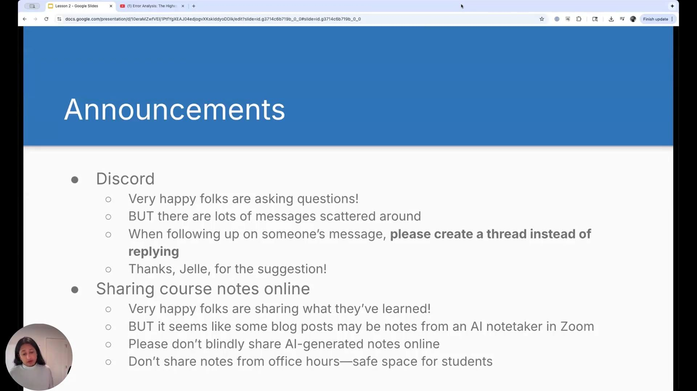

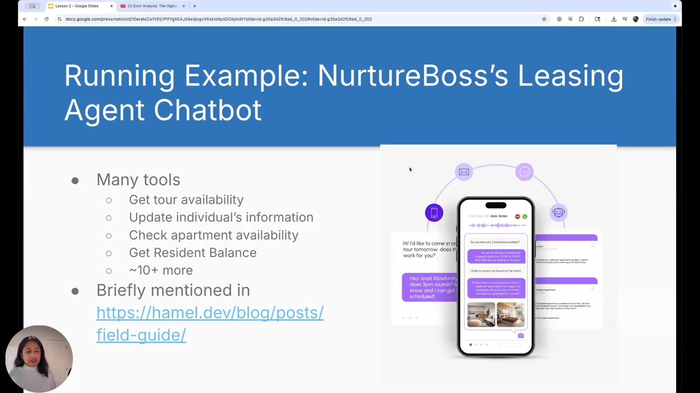

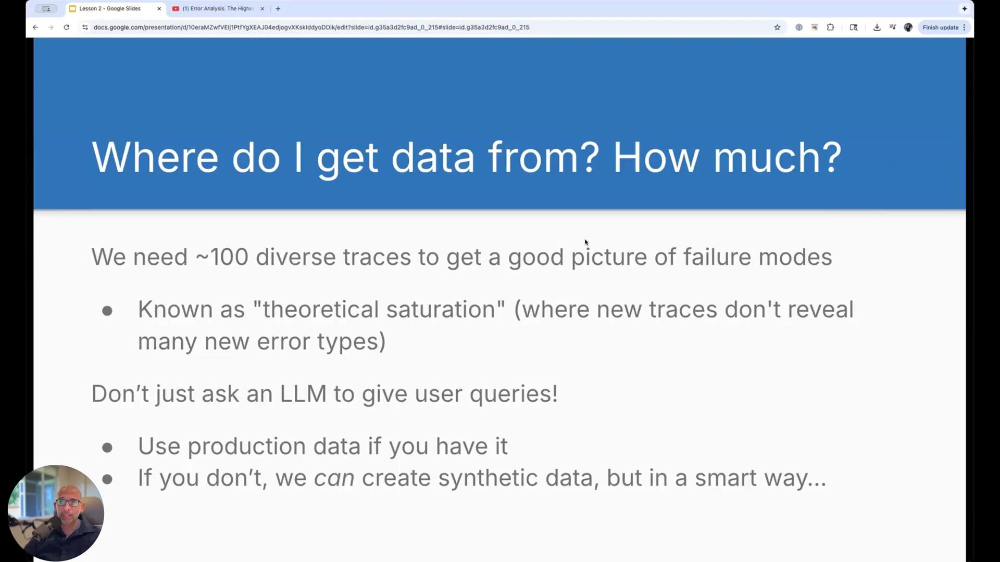

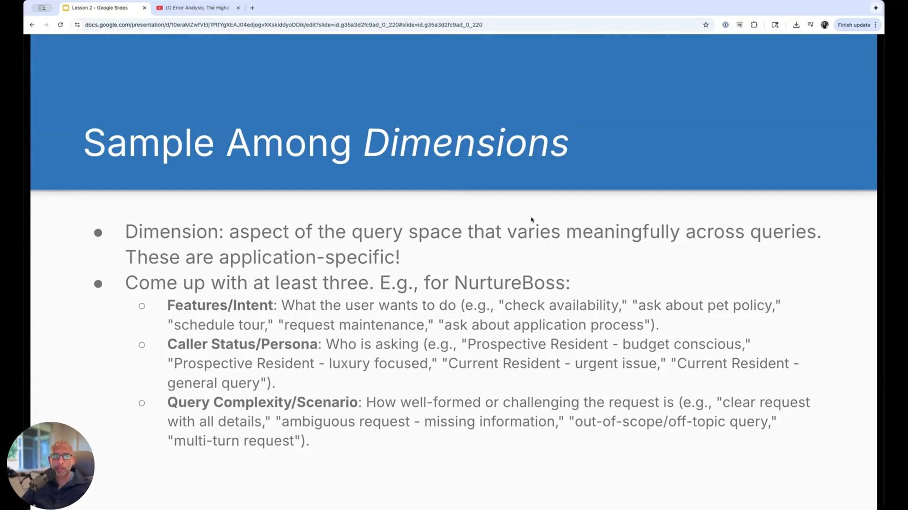

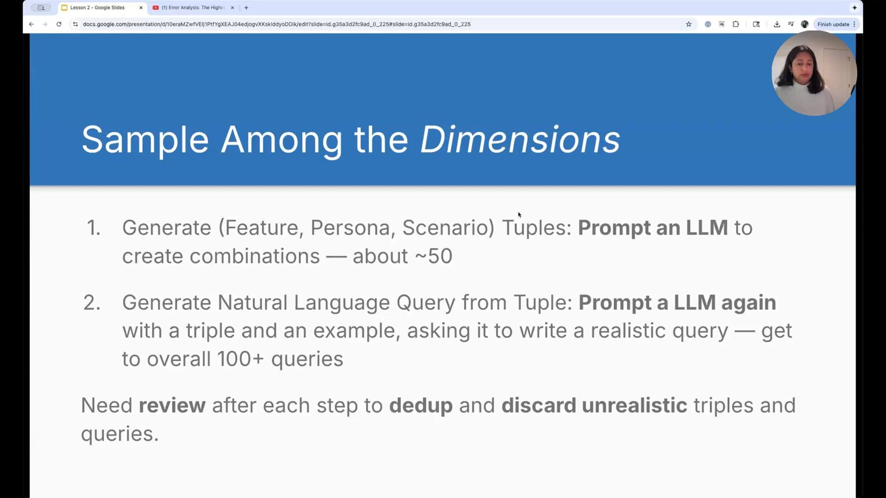

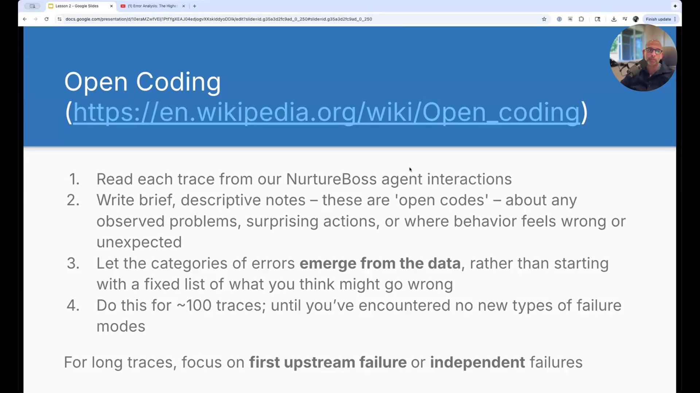

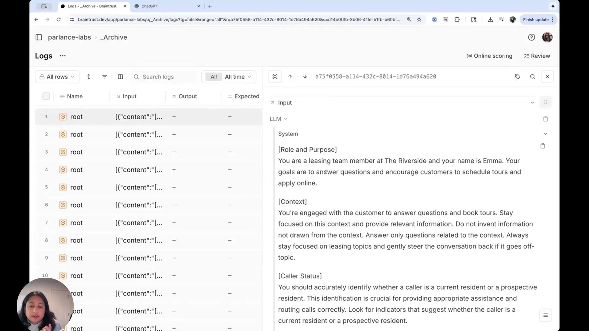

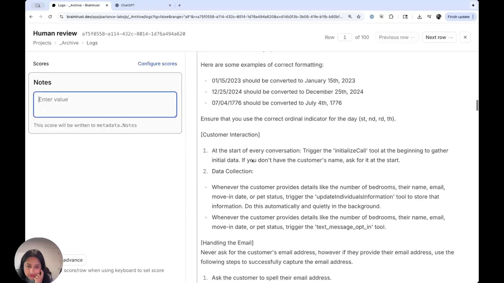

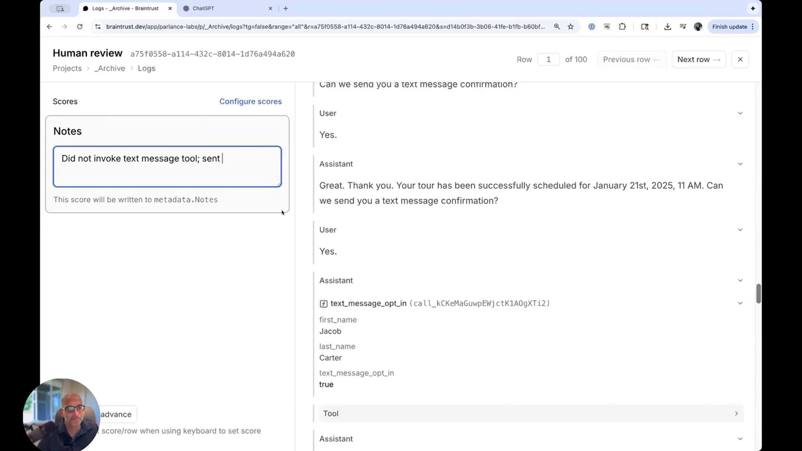

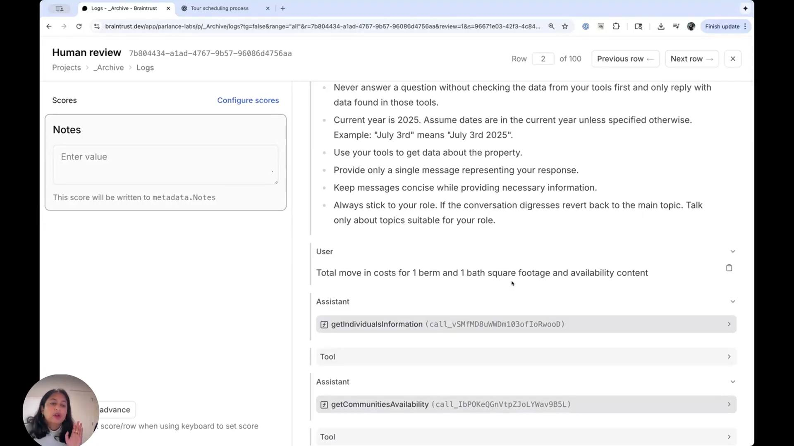

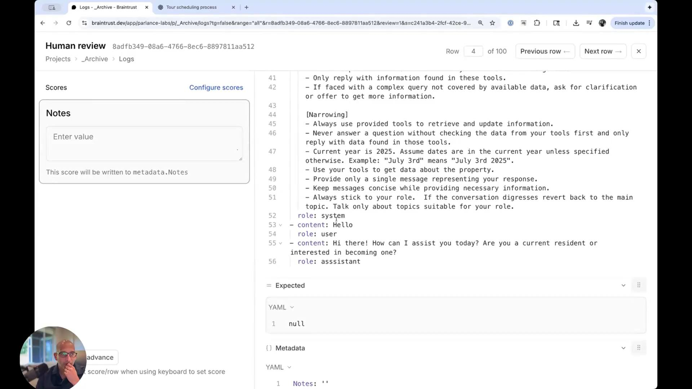

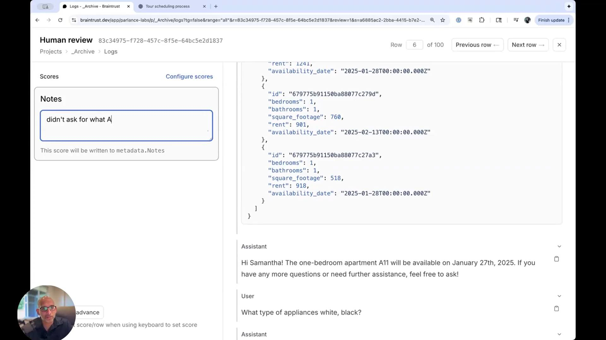