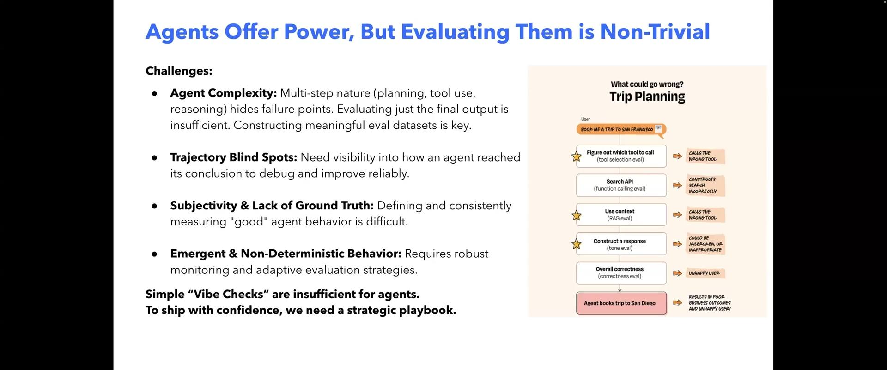
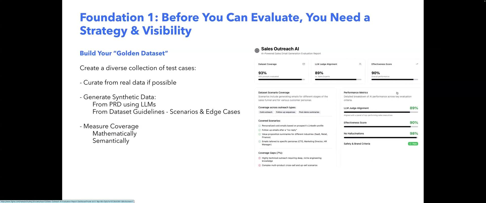
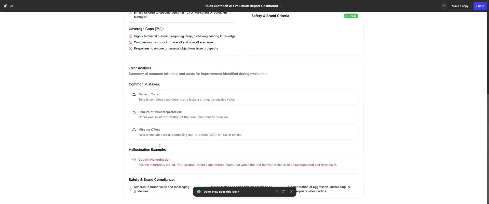
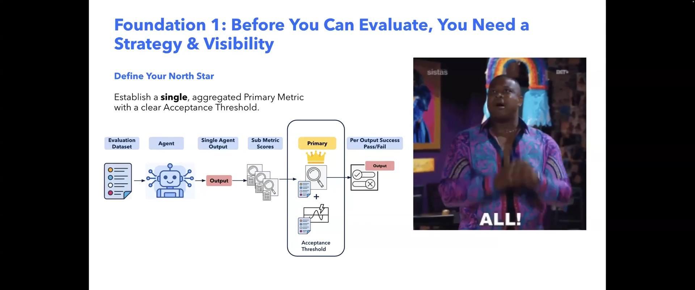
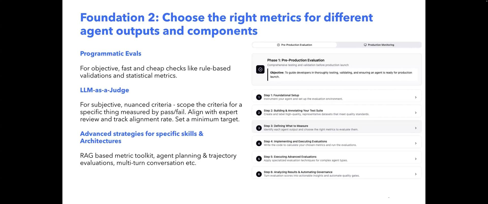
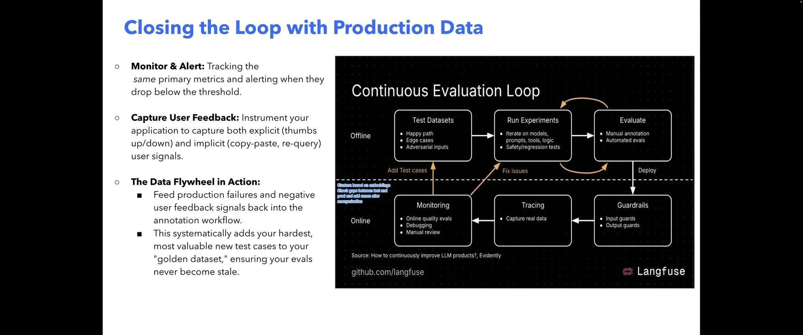
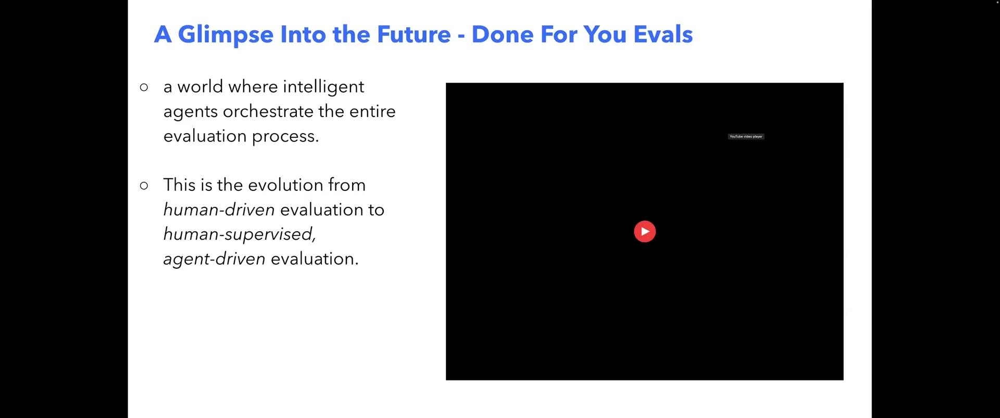
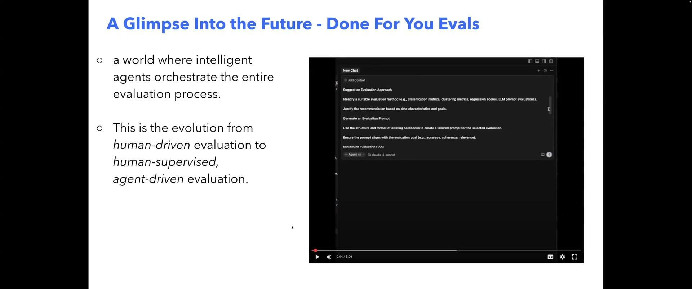
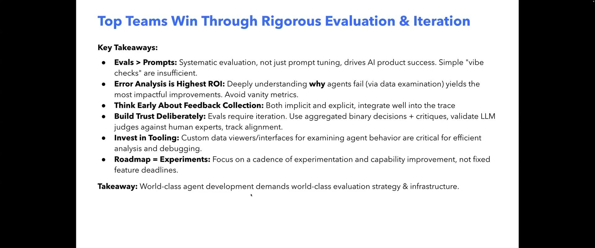

# AI Evals For Engineers & PMs（p020）：把「可信 Agent 的评测策略」从零搭起来

> 说明：本集是 Intuit 产品负责人 Udi Menkes 的嘉宾分享，属于**纯方法论/策略课**。全程没有出现终端命令、没有代码编辑器、没有配置文件。因此本文第 3～5 节按「纯讲解课」的写法组织：把讲师的推导过程拆成可执行的步骤，把口述的方案落成可以直接填写的表与数据模型草案。凡是我补充的示意内容都会明确标注，不会冒充讲师原话。

---

## 1. 这一节做什么

这一节要解决一个具体问题：**你有一个 agent，怎么判断它能不能上线、上线后怎么知道它变好了还是变坏了。**

很多人（包括不少已经写过 LLM 应用的工程师）在这一步的做法是：跑几条 prompt，肉眼看看输出顺不顺眼，觉得「可以了」就发。讲师整场都在反对这种做法。他要给的是替代方案——一套可以被复述、被交接、被写进 PRD 的评测策略。

读完这一节，你应该能产出下面这几样**具体的东西**（而不是「知道了几个概念」）：

1. 一份把 agent 每一步都摊开的 **trace 模型**（哪怕你现在还没有任何可观测性工具，也要先在纸上画出 span 层级）。
2. 一份 **黄金数据集（golden data set）的一页纸说明书**：场景、边界情况、对抗输入各有哪些。
3. 一个**主指标（North Star metric）** 和它对应的**阈值**，以及这个阈值是怎么从「出错的业务成本」倒推出来的。
4. 一张 **指标选型表**：哪些检查用程序化评测、哪些用 LLM 当裁判、裁判的 rubric 长什么样。
5. 一条**生产闭环**：监控告警 → 显式/隐式反馈采集 → 标注流 → 聚类去重 → 回灌数据集。
6. 一份**路线图**，但它不是「几月几日上线」，而是一串实验。

必须提前说清楚本集的**边界**：讲师提到的工具名（LangSmith、Langfuse、Braintrust、Arize、Cursor、11 Labs）都只是**口头点名**，他没有演示任何一个工具的界面操作、没有给 SDK 名称、没有给版本号、没有给环境变量、没有给配置文件。他的原话是「用什么工具开始时不重要」。所以本文不会替你编造 `pip install xxx` 或者 `docker run xxx` 这类命令——课里没有。

---

## 2. 讲师原话

下面按主题归类引用（不按时间顺序），方便你直接抄进自己的方案文档。

**关于评测的地位**

> "评测是区分糟糕、一般和优秀的 AI 产品的分水岭。对 PM 和工程师来说，把这件事做好，可能是当下最该掌握的核心技能。"
> —— p020 [07:29]

> "评测不是什么新东西。甚至在 LLM 出现之前，评测就已经是打造优秀 AI 产品的核心。"
> —— p020 [05:14]

> "团队是靠评测、靠不断迭代评测赢下来的，这是关键。"
> —— p020 [26:54]

**关于 agent 为什么特别难评**

> "智能体有很多步骤。即使每一步出错的概率很低，把它们乘起来，出错的机会其实很高。而且有大量隐藏的失败点。"
> —— p020 [08:53]

> "只盯着最终输出是不够的。你需要一份非常好的评测数据集，去测试所有这些步骤。盲区很多。"
> —— p020 [09:23]

> "你需要看清智能体是怎么走到那个结论的，这样你才能调试它、持续改进它。"
> —— p020 [09:23]

> "这里面有很多主观性——什么叫「好」？这必须在我们写第一行代码之前就定义清楚。"
> —— p020 [09:23]

> "只看输出、或者靠感觉检查（vibe check），对智能体来说是不够的，对普通 LLM 流程都不够，对智能体就更不够了。"
> —— p020 [09:52]

**关于第一根支柱：先有可见性**

> "在进入任何代码、甚至任何评测之前，你首先需要一套策略和可见性。核心是：先给智能体做插桩，让你能看见到底发生了什么。这就叫 tracing。"
> —— p020 [10:18]

> "你必须在做其他任何事情之前把这件事搞定，否则你就是在盲飞。你跑着智能体，也许在日志里看到最终输出，但这远远不够。"
> —— p020 [10:46]

> "市面上还有很多很好的工具，比如 Langfuse、Braintrust、Arize，厂商很多。起步阶段用哪家其实不重要，关键是你要能看见智能体在做什么。"
> —— p020 [10:46]（逐字稿把 Arize 转写成了 Arise）

**关于数据集**

> "然后我们真正要建的是数据集策略。我把它叫做黄金数据集，重点是你要非常仔细地想：我的智能体到底要解决什么？有哪些场景？我们要覆盖哪些边界情况？"
> —— p020 [11:15]

> "如果能从生产环境拿到真实数据，那是最好的。但大多数情况下你并没有。所以你要生成某种形式的合成数据。"
> —— p020 [11:45]

> "理想情况下，你甚至应该写一份一页纸的东西，把「这些是场景、这是我期望智能体做的事、这些是我认为需要覆盖的边界情况」摊开来。光是认真做这件事，后面就会帮你大忙。"
> —— p020 [11:45]

> "然后你可以把这份东西连同 PRD 一起，按照特定的指引去生成合成数据。这会让你走得很远。"
> —— p020 [12:13]

> "有了数据集之后，你要能衡量所谓的覆盖率。我们会从数学和语义两个角度看——比如异质性（heterogeneity）以及其他一些统计指标。"
> —— p020 [12:41]

**关于主指标与阈值**

> "很多团队的做法是：我们需要七个、十三个指标来衡量体验的不同侧面。这很好，你可以用它们做错误分析。但我强烈建议**只设一个主指标**。"
> —— p020 [15:06]

> "这个主指标可以是那些子指标之一，也可以是它们的组合。关键是它能给你一个高层次的视角：我的智能体随时间表现如何。而且你要给它绑定一个阈值。"
> —— p020 [15:06]

> "阈值是个难题。应该是 0.9 还是 0.8？你必须把它和业务挂钩，问自己：在我这个体验里，出错的成本是多少？"
> —— p020 [15:33]

> "比如我在做一个编码智能体，像 Cursor 那种，出错的成本是什么？最坏情况我重来一遍、我改一下代码。但如果我是一个正在和客户对话的客服机器人，而客户正需要支持，我在编造内容，那可能让他彻底失去信任。"
> —— p020 [15:33]

> "你设定的这个阈值必须把这些考虑进去，并且要和业务负责人、产品负责人对齐，在上线前就定好。之后还要持续思考：这个阈值要不要调？我的主指标是不是真的反映了业务结果？"
> —— p020 [16:00]

**关于程序化评测与 LLM 裁判**

> "第一，程序化评测。如果你想要客观、快速、便宜的检查，这非常可行。并不是所有场景都该上 LLM 当裁判。有很多统计指标能帮到你，尤其是当你有数值输出或代码输出的 ground truth、可以直接验证它能跑起来的时候。"
> —— p020 [17:52]

> "LLM 当裁判是非常主观的。所以你要真的把标准拿出来，并且持续迭代。你要把裁判聚焦在单线程的、通过/失败的 rubric 上。很多人用不同刻度的打分，结果就变得一团糟。做细粒度的通过/失败，并且确保裁判和专家对齐。"
> —— p020 [18:20]

> "这是让裁判可规模化、真正能被依赖的关键。而且你要提前设定目标：比如我的 KPI 是，如果对齐度没到某个下限，这就是我不能继续推进的门槛，我必须搞清楚为什么没达到、怎么改我的指令。"
> —— p020 [18:48]

> "你还要针对不同的技能和架构想一些进阶策略，这是我们为复用而建的：比如 RAG 工具包智能体，针对智能体的进阶评测，针对规划、针对轨迹——也就是多轮对话中所有工具调用的序列。我们开始为不同场景建这些评测模板。"
> —— p020 [19:17]

**关于错误分析**

> "第三根支柱，是把心态从「我跑分数、跑指标、看它涨了还是跌了」转变过来。这当然重要，但真正带来洞察的是错误分析。"
> —— p020 [19:44]

> "我要重复你在整门课里听到的那句话：这是实践中 ROI 最高的事情。你必须去看数据、必须做根因分析。"
> —— p020 [19:44]

> "根因分析要看是谁在做。涉及很多角色：开发者、领域专家。领域专家可能需要看输入、输出以及事情发生时的上下文；而开发者需要看整个智能体架构里发生的所有事。这两者需要不同的数据集，有时甚至需要不同的工具。"
> —— p020 [20:11]

> "第三点，你要把安全和安全测试整合进评测里。想想对抗性输入——如果有人现在正试图黑你的智能体，确保这类样本也在数据集里。"
> —— p020 [20:37]

**关于生产闭环**

> "几乎可以肯定的是：你会开发、会迭代，会到达一个你觉得自己方案不错的状态，找到了对的指标、有了场景、拿到了 95%，然后你上生产，看到的东西和开发时不一样。"
> —— p020 [21:07]

> "关键是你怎么监控它、怎么告警、怎么快速响应。你要用同一套指标、同一个主指标来做监控和告警，一旦下降就收到告警，能进去看工具里到底发生了什么。"
> —— p020 [21:36]

> "第二点是用户反馈怎么采集，这必须提前想。反馈大致分两类：显式反馈，比如我在体验里做了点赞、点踩，或者一个反馈按钮；还有隐式反馈。"
> —— p020 [22:05]

> "想一想，从用户视角看，哪些隐式信号说明我的智能体表现不好？比如复制粘贴、比如向智能体重问。他在重问什么？你要把这些信号收集起来，接进你的评测闭环，也就是让事件流动起来、并且和 trace 关联上，这样你才能规模化地学习什么在变好、什么在变坏。"
> —— p020 [22:34]

> "最后你要有一个数据飞轮在转。所有生产环境的失败、所有负向的用户信号，不管是隐式还是显式，都要接进你的标注工作流，让你能把它们放在一起看。"
> —— p020 [23:01]

> "而且每次出现新情况时——现在有 AI 的方法，比如你可以跑聚类以及其他方法把它们浮现出来——你要能说「这个不在我的黄金数据集里」。然后确保把这些案例回灌到你的数据集里，这样你就在持续积累真实用户场景。"
> —— p020 [23:28]

**关于未来**

> "我认为我们正在走向一个由智能体来编排评测流程的世界。我们会从人驱动的评测，演进到人监督下的、智能体驱动的评测。"
> —— p020 [23:58]

> "但作为你这个体验的负责人，把前面讲的所有基础搭起来仍然是关键：定义 PRD、定义场景、定义你想覆盖的一切，并且把初始部分校准好。"
> —— p020 [24:25]

> "它甚至会告诉你为什么——因为你的数据集有 ground truth、它是一个对话式体验，所以我们要用多裁判。然后它就把那段代码给你实现出来了。"
> —— p020 [25:23]

> "这些 cookbook 就是秘方，它是以 markdown 文件的形式存在的，基本上就是一种规则集。"
> —— p020 [26:21]

**关于组织与采购**

> "有一个平台团队，基本上负责所有生成式 AI 的开发。评测只是其中一部分，但不是唯一的部分。"
> —— p020 [33:52]

> "我们说的「建评测平台」，意思是我们在造一个产品，团队可以把他们的智能体、他们的用例带上来，注入他们自己的评测指标、数据集、流水线，一切都是自动化的。"
> —— p020 [34:20]

> "我们最终衡量的东西是：智能体质量、到达生产的时间、它有没有加速开发、以及我们最终能不能交付更可靠的高质量智能体。"
> —— p020 [34:49]

> "我们会在有意义的地方采用厂商。我们做很多自建还是采购的分析——如果某些东西厂商已经明显领先，那就没有理由自己造。"
> —— p020 [35:43]

> "我们确实自建更多的地方，是当我们自己对某个事情有品味、有观点的时候。所以我们会拼接不同厂商，但在上面叠加我们自己的方法论。"
> —— p020 [36:12]

**关于最后的建议**

> "评测比 prompt 更重要。很多人一直在调 prompt，你当然会去调、这很重要，但它应该被系统化的评测所引导。那才是最终驱动 AI 产品成功的因素。"
> —— p020 [27:21]

> "请不要做感觉检查。我的意思是，看看错误可以，但不要以为那够了。它必须非常系统、非常可度量、非常深思熟虑。"
> —— p020 [27:50]

> "错误分析我要再说一次：它是 ROI 最高的。你必须理解你的智能体为什么失败。为此你必须看数据。而那会带来最大、最有影响力的改进。"
> —— p020 [27:50]

> "尽早考虑反馈，因为后期再加非常难。你的智能体已经在生产里，数据已经在流了。如果一开始没建对，后面再加、再从中学习会更困难。"
> —— p020 [28:18]

> "你要有意识地建立信任。如果你用裁判，就用二元决策加批判说明，并确保它们和人类对齐。"
> —— p020 [28:18]

> "投资工具。无论是买工具、付许可费，还是在工具之上建自定义的数据视图，这都是你审视智能体行为的关键。除此之外没有别的办法看见你的智能体在做什么。没有它你就是盲飞。"
> —— p020 [28:43]

> "我怎么看路线图：因为这件事非常不确定，所以把它想成一组实验。我的下一个实验是什么？它在推动哪个能力？即使它失败了，我也知道了什么是我用这个智能体做不到的。"
> —— p020 [29:11]

> "所以不要说「不管怎样我一个月后就要上线这个智能体」，因为万一质量真的很差呢？"
> —— p020 [29:11]

> "世界级的智能体开发，依赖于世界级的评测策略，以及能把那个策略实现出来的基础设施。"
> —— p020 [29:40]

---

## 3. 从零复现

这一节把讲师的推导按**你要动手做的顺序**重排。每一步都给「产出物」和「做完的判据」。



### 第 0 步：先认清问题的形状（需求与约束）

讲师用来开场的是一个旅行预订 agent 的例子（他引自 Lenny's newsletter 的 Deep Dive）：

我说「帮我订一趟去旧金山的行程」。这背后有好几步：

1. 它得判断该调用哪个工具 —— **可能选错**。
2. 它大概要去搜航班 —— **可能把查询条件构造错**。
3. 它要把搜索结果当作上下文去驱动下一步 —— **可能用错**。
4. 就算每一步都对，**最终回复也可能错**。
5. 甚至所有步骤都对，**最终答案仍可能不满足用户** —— 最后 agent 给你订了去圣地亚哥的票。

约束由此而来：

- **约束 A：多步相乘。** 讲师原话是「即使每一步出错的概率很低，把它们乘起来，出错的机会其实很高」。把它写成算式（讲师没有给数字，这个式子是我按他的说法补的，只用于理解量级）：

  `P(整个任务出错) ≈ 1 − Π(1 − pᵢ)`，i = 1…n

  举个数：假设 4 个步骤每步出错率 5%，则 `1 − 0.95⁴ ≈ 18.6%`。**这个 5% 和 18.6% 是我为了说明「相乘」而编的示例数字，课里没有给。** 你自己算的时候把真实观测到的单步失败率代进去。
- **约束 B：隐藏失败点很多。** 你只看到最终输出，看不到中间在哪一步偏了。
- **约束 C：主观性。** 「什么叫好」没有天然定义，必须在写代码前定义。
- **约束 D：非确定性 + 持续演化。** 你的 agent、你的模型、你的用户都在变，所以评测不能是一次性的快照。

**判据：** 你能用一句话说出「我这个 agent 有 n 个关键中间步骤，我目前对其中几步完全不可见」。

### 第 1 步：先插桩，再谈评测（tracing）

讲师的第一根支柱说得非常硬：「在进入任何代码、甚至任何评测之前，你首先需要一套策略和可见性」「否则你就是在盲飞」。

动作：

1. 给 agent 的每一次运行分配一个 **trace**。
2. trace 下面挂 **span**，每个 span 对应 agent 的一个步骤。
3. 把你在第 0 步列出的每一个失败点，映射成一个 span。

旅行 agent 的 span 层级（这是按讲师第 0 步的拆解推出来的，课里没有给 schema）：

```
trace: 一次用户会话
├─ span: 选择工具
│   ├─ input: 用户原话
│   └─ output: 选中的工具名 + 参数
├─ span: 构造搜索条件
│   ├─ input: 上一步输出
│   └─ output: 结构化查询
├─ span: 调用搜索
│   └─ output: 原始结果
├─ span: 基于结果生成下一步
└─ span: 生成最终回复
```

讲师的原话是「你如何为你 tracing 的东西建模，也就是左边这部分（指幻灯片左侧），相对于你的 agent 正在做的步骤是不是合理」——意思是**trace 的层级必须和 agent 真实的步骤结构对得上**，否则你看到的是假的。

工具层面，讲师点名了 LangSmith，并补了「还有 Langfuse、Braintrust、Arize，厂商很多，起步阶段用哪家其实不重要」。所以选型阶段不要在这里卡住。

**判据：** 给你一条线上会话，你能在 trace 视图里指出「它是在第 3 步跑偏的」。



### 第 2 步：数据集策略（黄金数据集）

讲师用的词是 golden data set，但他强调重点在**想清楚**而不是**攒数量**：

- 我的 agent 到底要解决什么？
- 有哪些场景？
- 哪些边界情况要覆盖？

动作顺序（讲师给的就是这个顺序）：

1. **写一页纸。** 讲师原话：「你甚至应该写一份一页纸的东西，把『这些是场景、这是我期望智能体做的事、这些是我认为需要覆盖的边界情况』摊开来。光是认真做这件事，后面就会帮你大忙。」
2. **优先真实数据。** 「如果能从生产环境拿到真实数据，那是最好的。」
3. **没有就用合成数据。** 「大多数情况下你并没有，所以你要生成某种形式的合成数据。」而且方法是：「把这份一页纸连同 PRD 一起，按照特定的指引去生成合成数据。」
4. **算覆盖率。** 讲师给了两个维度：
   - **数学维度**：异质性（heterogeneity）以及「其他一些统计指标」——课里没讲具体是哪些指标、也没给公式。
   - **语义维度**：把你的数据和用例上下文、agent 代码、你想达成的目标放在一起看，给一个覆盖率分数，并指出缺口。

讲师展示的覆盖率报告是**模拟数据**（他明确说了「这是 mock，因为我不能给你看真实的东西，那是保密的」），里面能看到的结构是：

- 基于你的 PRD，指出你覆盖了哪些场景；
- 指出你**没覆盖**哪些场景（「我们确实看到一些基于你的 PRD 的缺口」）；
- 旁边还有一块是**已有输出后的错误分析区**，列出「幻觉」这类判据——讲师说这些是「某个具体的销售外呼 agent 所关心的判据」。

**判据：** 你手上有一页纸 + 一份初始数据集 + 一个能说清「还缺哪几类场景」的覆盖率报告。



### 第 3 步：定主指标和阈值（这是整场最实操的一段）

讲师明确反对「十三个指标平行看」的做法：

- 多指标 → **只用于错误分析**。
- **主指标只有一个** → 用于看「随时间表现如何」。
- 主指标可以是某个子指标，也可以是几个子指标的组合。
- 主指标必须绑定一个**阈值**。
- 主指标必须从第一天起就在**仪表盘**上被持续跟踪。

**阈值怎么定？** 讲师给的方法不是拍脑袋，而是**从出错成本倒推**：

| 场景 | 出错的成本 | 阈值取向 | 讲师原话依据 |
|---|---|---|---|
| 编码 agent（如 Cursor） | 低。最坏情况是重来一遍、改一下代码 | 可以容忍更高失败率 | 「最坏情况我重来一遍、我改一下代码」 |
| 客服对话机器人 | 高。编造内容会让客户彻底失去信任 | 必须更严格 | 「那可能让他彻底失去信任」 |

（上下两行的「可以容忍更高/必须更严格」是我把讲师的口述转成了可执行的取向，**具体数值课里没给**。数值必须由你和业务负责人、产品负责人一起定。）

讲师还强调了两件持续性的事：

1. 「之后还要持续思考：这个阈值要不要调？」
2. 「我的主指标是不是真的反映了业务结果？」

**判据：** 你能在一个仪表盘上看到一条主指标曲线 + 一条阈值线，并且这条阈值线旁边写着「为什么是这个数」的一句业务理由。



### 第 4 步：指标选型——程序化评测 vs LLM 当裁判

讲师在第二根支柱里点了三类做法。

**(a) 程序化评测**（objective / fast / cheap）

- 适用：有数值输出、有代码输出且有 ground truth 的场景。
- 讲师特别提到「可以直接验证它能跑起来」——即代码类输出用「跑不跑得通」来判。
- 讲师明确说：「并不是所有场景都该上 LLM 当裁判。」

**(b) LLM 当裁判**

- 定位：处理主观判断。
- 三条硬要求：
  1. 用**单线程的、通过/失败的 rubric**。讲师原话：「很多人用不同刻度的打分，结果就变得一团糟。」
  2. **裁判要和专家对齐**——「这是让裁判可规模化、真正能被依赖的关键」。
  3. **提前设对齐下限作为准入门槛**——「如果对齐度没到某个下限，这就是我不能继续推进的门槛，我必须搞清楚为什么没达到、怎么改我的指令。」
- 讲师没有给对齐度的计算公式，也没有给下限数值。**课里没讲。**

**(c) 进阶：按技能和架构分化的评测模板**

讲师点名了几类模板（他说这是他们为复用而建的）：

- RAG 工具包智能体；
- 面向 agent 的进阶评测；
- 面向**规划（planning）** 的评测；
- 面向**轨迹（trajectory）** 的评测——即**多轮对话中所有工具调用的序列**（逐字稿里的 multi-term 应为 multi-turn）。

**判据：** 你有一张表，每一行是一个评测项，标明「用程序化还是用裁判」「判据原文是什么」「对齐了谁」。

### 第 5 步：把心态切到错误分析

讲师说这是「实践中 ROI 最高的事情」，并且给了两个具体的结构：

**结构一：根因分析按角色分。**

| 角色 | 需要看什么 | 需要的数据 |
|---|---|---|
| 领域专家 | 输入、输出，以及事情发生时的**上下文** | 该用例的样本 + 上下文快照 |
| 开发者 | 整个 agent 架构里发生的**所有事** | 完整 trace |

讲师说这两者「需要不同的数据集，有时甚至需要不同的工具」。

**结构二：安全和安全测试进评测。**

- 对抗性输入要进数据集：「如果有人现在正试图黑你的智能体，确保这类样本也在数据集里。」
- 安全不是上线后才考虑的事，它属于生产的一部分。



### 第 6 步：接上生产闭环

讲师描述了一个几乎必然会发生的落差：「你拿到 95%，然后你上生产，看到的东西和开发时不一样。」

闭环分四段：

**① 监控 + 告警。** 用**同一套指标、同一个主指标**——不是你开发时一套、生产时另一套。下降就告警，告警后能顺着链接进工具里看发生了什么。

**② 反馈采集：显式 + 隐式。**

| 类型 | 例子（讲师原话里的） | 你要做的 |
|---|---|---|
| 显式 | 点赞 / 点踩 / 反馈按钮 | 埋点，绑定到 trace id |
| 隐式 | 复制粘贴、向智能体重问 | 埋点，记录「重问时问的是什么」 |

讲师对隐式的追问很具体：「他在重问什么？」——因为重问的内容本身是错误分析的原材料。

**③ 事件与 trace 关联。** 「让事件流动起来、并且和 trace 关联上，这样你才能规模化地学习什么在变好、什么在变坏。」

**④ 数据飞轮。** 生产失败 + 负向信号（隐式或显式）→ 标注工作流 → 用**聚类**等方法把「不在我黄金数据集里」的新情况浮现出来 → 回灌数据集 → 用新场景继续测。

讲师明确说了聚合手段之一：「你可以跑聚类以及其他方法」。具体算法**课里没讲**。



### 第 7 步：未来态——让 agent 产初稿，人来审

讲师演示了一个 Cursor agent 的用法（他强调这是**概念演示，不是他们现在在跑的东西**）：

- 后台挂着的是他前面说的那套 **cookbook**。
- agent 能访问：cookbook、黄金数据集、agent 架构。
- 他下的指令大意是：「看一下数据集、PRD 和 agent 代码，基于 cookbook 告诉我这里最该实现哪种评测方法。」
- agent 读完最佳实践、把点连起来，给出结论，例如：「我有这么多样本，我建议你用多裁判 LLM 加**成对比较（pairwise comparison）**，这是 cookbook 里的方法之一。」并且**给出理由**：「因为你的数据集有 ground truth、它是对话式体验，所以用多裁判。」
- 然后它直接把那段代码实现出来，你可以拿去跑、去验证「这对我的体验成立吗」。

主持人问这是不是一套 cursor rules、或者一个 prompt。讲师答：**就是整套 cookbook，以 markdown 文件的形式，基本是一种规则集。** 他同时说明这是**专有的**（proprietary），但鼓励大家自己想「playbook」这个概念。

对主持人关于「不要全自动评测」的追问，讲师澄清得很清楚：

> 「我展示的未来不是我们现在在做的事，它更像一个概念。cookbook 给的是框架和模板。举个例子：它讲的是**如何写一个好的 LLM 裁判**、**如何写好的 rubric**，而不是『这是完整性 rubric』。你需要说：对你这个用例，完整性是什么意思？所以在那部分指引里，它基本上是在告诉你——不要照抄，你需要自己定义完整性是什么，然后把它插进来。」

他还补充了「护栏」的具体形态：裁判要**给出解释**、要是**二元通过/失败**；代码要**接上平台**，这样既有可观测性、又能自动化；并且解决「我在本地写的 eval 代码，怎么在生产的所有 trace 上跑」这个问题。

**判据：** 你的 cookbook 里写的是「怎么定义 X」，而不是「X 等于什么」。



### 第 8 步：组织与采购（如果你不是一个人在做）

讲师所在的公司有**一个平台团队**负责所有生成式 AI 开发，评测是其中一部分。平台的做法是：

- 团队把**自己的 agent、自己的用例**带上来；
- 注入**自己的评测指标、数据集、流水线**；
- 平台把周边自动化掉。

平台被考核的指标（讲师原话）：

- 智能体质量；
- 到达生产的时间；
- 有没有加速开发；
- 最终能不能交付「更可靠的高质量智能体」。

采购原则（讲师原话）：

- 做**自建 vs 采购**分析；「如果某些东西厂商已经明显领先，那就没有理由自己造」。
- 自建的场合是「我们自己对某个事情有品味、有观点」的时候。
- 具体做法是「拼接不同厂商，但在上面叠加我们自己的方法论」。
- 他给的判断例子：可观测性自动化这种，买；但**judge 与人的对齐、对齐该用哪些统计量、怎么从对齐结果里自动浮现最关键的错配**——这些「工具还没做好」，所以自己建。
- 他们还维护一套 **AI 标准**，覆盖：什么是好数据集、数据集覆盖率是什么、反馈怎么采、怎么对齐。
- 他们也会给厂商提需求，把厂商当成团队的延伸。

---

## 4. 完整代码

> **课里没有代码。** 本节不含任何可运行程序。下面四张表是把讲师口述的方案落成可以直接填写、可以直接交给同事的产物；字段名是我为了让它可用而设计的草案，不是讲师给的 schema。第 4.5 节有一小段示意代码，已单独标注。

### 4.1 设计决策表

| # | 决策 | 讲师给的理由 | 不这样做会怎样 |
|---|---|---|---|
| D1 | 先做 tracing，再做评测 | 「否则你就是在盲飞」 | 你只有最终输出，看不到是哪一步偏了 |
| D2 | trace 的层级按 agent 真实步骤建模 | 「你如何为你 tracing 的东西建模……相对于你的 agent 正在做的步骤是不是合理」 | 视图漂亮但和实际执行对不上，排查时被误导 |
| D3 | 数据集先写一页纸，再产数据 | 「光是认真做这件事，后面就会帮你大忙」 | 数据集靠随手攒，覆盖不到边界情况 |
| D4 | 真实数据优先，合成数据兜底 | 「如果能从生产环境拿到真实数据，那是最好的」 | 全合成数据，测不出真实分布 |
| D5 | 主指标只设一个，其余指标只用于错误分析 | 「我强烈建议只设一个主指标」 | 十几个指标同时涨跌，没人能判断好不好 |
| D6 | 阈值从「出错成本」反推，并与业务对齐 | 「你设定的这个阈值必须把这些考虑进去」 | 阈值拍脑袋，要么过度保守要么形同虚设 |
| D7 | 有 ground truth 的数值/代码输出走程序化评测 | 「客观、快速、便宜」 | 用 LLM 判可执行代码的对错，又慢又贵又不准 |
| D8 | 裁判只用单线程 pass/fail rubric | 「很多人用不同刻度的打分，结果就变得一团糟」 | 分数漂移，无法跨版本比较 |
| D9 | 裁判必须与专家对齐，且有准入门槛 | 「这是让裁判可规模化、真正能被依赖的关键」 | 裁判分数不可信，团队不再看它 |
| D10 | 错误分析按角色拆数据集和工具 | 「领域专家」和「开发者」需要不同的东西 | 专家被淹没在 trace 里，开发者看不到业务上下文 |
| D11 | 对抗性输入进数据集 | 「如果有人现在正试图黑你的智能体」 | 安全在评测里没有位置，只能等事故 |
| D12 | 生产用同一套指标监控告警 | 「用同一套指标、同一个主指标来做监控和告警」 | 开发和生产是两套语言，告警没人认 |
| D13 | 显式 + 隐式反馈都埋，并关联 trace | 「让事件流动起来、并且和 trace 关联上」 | 有反馈但无法回放到具体执行路径 |
| D14 | 新失败用例回灌数据集 | 「确保把这些案例回灌到你的数据集里」 | 数据集是一次性快照，随时间失效 |
| D15 | 路线图=实验集，不是日期承诺 | 「万一质量真的很差呢？」 | 为了赶日期上线低质量 agent |
| D16 | cookbook 写「怎么定义」，不写「等于什么」 | 「你需要自己定义完整性是什么，然后把它插进来」 | 团队照抄通用 rubric，判的不是自己的业务 |

### 4.2 组件职责表

| 组件 | 职责 | 输入 | 输出 | 讲师是否明确提到 |
|---|---|---|---|---|
| 插桩 / Tracing | 记录 agent 每一步 | 一次 agent 运行的原始事件 | trace + span 树 | 是 |
| 黄金数据集 | 承载场景、边界、对抗样本 | 一页纸 + PRD + 真实数据 | 评测用例集合 | 是 |
| 覆盖率报告 | 指出还缺哪些场景 | 数据集 + 用例上下文 + agent 代码 | 覆盖率分数 + 缺口列表 | 是 |
| 主指标仪表盘 | 展示随时间表现 + 阈值线 | 每次评测运行的得分 | 趋势曲线 | 是 |
| 程序化评测器 | 客观检查 | 输出 + ground truth | pass/fail | 是 |
| LLM 裁判 | 主观判断 | 输出 + rubric + 上下文 | pass/fail + 解释 | 是 |
| 对齐校验 | 校验裁判与专家一致度 | 裁判结果 + 专家标注 | 对齐度 | 是（方法未讲） |
| 错误分析工作台 | 根因定位 | trace + 上下文 | 失败分类、改进项 | 是 |
| 反馈采集 | 收显式/隐式信号 | 用户行为事件 | 带 trace id 的反馈事件 | 是 |
| 标注工作流 | 把新失败转成标注 | 生产失败 + 负向信号 | 标注结果 | 是 |
| 聚类去重 | 找「不在黄金集里」的新情况 | 未分类失败样本 | 新场景簇 | 是（算法未讲） |
| 数据集回灌 | 把新场景并入黄金集 | 新场景簇 | 更新后的数据集 | 是 |

### 4.3 接口 / 数据模型草案

> 以下字段名是我设计的**草案**，用来让上面那张职责表可以落地。课里没有给任何 schema。凡是我标 `??` 的，是课里明确没讲、需要你按自己工具填空的。

**Trace / Span**

```
Trace
  trace_id:        string
  session_id:      string
  user_input:      string
  started_at:      ISO8601
  spans:           Span[]

Span
  span_id:         string
  parent_span_id:  string | null
  step_name:       string        // 必须对应 agent 的一个真实步骤
  input:           object
  output:          object
  status:          "ok" | "error"
  error_detail:    ??            // 课里没讲错误字段怎么设计
```

**Eval Case（黄金数据集的一条）**

```
EvalCase
  case_id:         string
  scenario:        string        // 来自"一页纸"
  is_edge_case:    boolean
  is_adversarial:  boolean       // 讲师要求对抗输入进数据集
  source:          "real" | "synthetic"
  input:           string
  context:         object        // 领域专家需要看的上下文
  ground_truth:    string | null // 有真值才能走程序化评测
  tags:            string[]
```

**Judge Rubric（单线程 pass/fail）**

```
JudgeRubric
  rubric_id:       string
  criterion_name:  string        // 例如"完整性"——但定义必须你自己写
  definition:      string        // "对你这个用例，X 是什么意思"
  pass_condition:  string        // 单线程、二元
  fail_condition:  string
  requires_explanation: true     // 讲师要求裁判解释
  aligned_with:    string        // 对齐的专家/标注集标识
  alignment_score: number | null // 计算方式课里没讲
  min_alignment:   number        // 准入门槛，值由你定
```

**Feedback Event**

```
FeedbackEvent
  event_id:        string
  trace_id:        string        // 必须能关联回 trace
  type:            "explicit" | "implicit"
  signal:          string        // 点赞/点踩/复制粘贴/重问...
  payload:         object        // 重问时带上"他在重问什么"
  occurred_at:     ISO8601
```

**Experiment（路线图的一项）**

```
Experiment
  experiment_id:   string
  hypothesis:      string        // 它想推动哪个能力
  target_metric:   string        // 必须是主指标
  expected_effect: string
  outcome:         "pending" | "moved" | "not_moved"
  learning:        string        // 即使失败也记下"这条路走不通"
```

### 4.4 容量估算表

> 讲师的原始算式只有一句「把每一步的概率乘起来」。下面第二行是我按这句话补的形式化，用于量级判断，**不是讲师给的数字**。

| 估算项 | 算式 | 说明 |
|---|---|---|
| agent 端到端失败率 | `1 − Π(1 − pᵢ)`，i=1…n | n = 你在这个 agent 上的关键步骤数；pᵢ 必须来自真实观测 |
| 需要覆盖的场景数下限 | 场景类别数 × 每类最小样本数 | 讲师只说要覆盖「场景、边界、对抗」，**没有给每类样本数** |
| 覆盖率缺口数 | 一页纸里的场景集合 − 数据集中已有场景集合 | 这就是覆盖率报告要输出的东西 |
| 主指标观测频次 | 每次数据集变更 + 每次上线 + 每日生产抽样 | 讲师强调「从第一天起就挂在仪表盘上」 |
| 裁判对齐样本量 | 需要专家标注的样本数 | **课里没讲** |

### 4.5 示意代码（**课里没有代码，以下为示意**）

> 下面这段只是把「程序化评测 + LLM 裁判 + 阈值门禁 + 反馈关联 trace」这个组合写成 Node/TypeScript 的形状，帮助前端背景的读者理解讲师那套方案在代码里长什么样。它不是讲师提供的代码，字段名和实现都是示意。

```ts
// 课里没有代码，以下为示意
type EvalResult = { caseId: string; passed: boolean; reason: string };

interface Judge {
  rubricId: string;
  definition: string;          // "对你这个用例，X 是什么意思" —— 必须自己填
  run(input: string, context: unknown): Promise<EvalResult>;
}

// 1) 程序化评测：有 ground truth 的、可执行可校验的，先走这里
async function programmaticCheck(testCase: {
  caseId: string;
  output: string;
  groundTruth: string | null;
}): Promise<EvalResult | null> {
  if (testCase.groundTruth === null) return null; // 没真值就不能程序化判
  const passed = testCase.output === testCase.groundTruth;
  return { caseId: testCase.caseId, passed, reason: passed ? "match" : "mismatch" };
}

// 2) LLM 裁判：单线程 pass/fail，必须带解释
const completenessJudge: Judge = {
  rubricId: "completeness-v1",
  definition:
    "【必须由你填写】在本用例里，完整性指……；不满足以下任一条即判 fail：……",
  async run(input, context) {
    const verdict = await callJudgeModel({
      rubric: completenessJudge.definition,
      input,
      context,
      // 讲师要求：二元结论 + 解释
      schema: { verdict: "pass|fail", explanation: "string" },
    });
    return {
      caseId: String(input),
      passed: verdict.verdict === "pass",
      reason: verdict.explanation,
    };
  },
};

// 3) 跑一套数据集，算主指标
async function runSuite(cases: Array<{ caseId: string; output: string; groundTruth: string | null }>) {
  const results: EvalResult[] = [];
  for (const c of cases) {
    const prog = await programmaticCheck(c);
    if (prog) {
      results.push(prog);
      continue;
    }
    results.push(await completenessJudge.run(c.output, {}));
  }
  const primaryMetric = results.filter((r) => r.passed).length / results.length;
  return { primaryMetric, results };
}

// 4) 阈值门禁：ACL 没到就不许合并 / 不许上线
//    阈值必须来自"出错的业务成本"，由业务负责人和产品负责人一起定
const THRESHOLD = Number(process.env.PRIMARY_METRIC_THRESHOLD ?? "0");

export async function gate(cases: Parameters<typeof runSuite>[0]) {
  const { primaryMetric } = await runSuite(cases);
  if (primaryMetric < THRESHOLD) {
    console.error(`primary metric ${primaryMetric} < threshold ${THRESHOLD}`);
    process.exit(1); // 在 CI 里这就是"挡住这次合并"
  }
}

// 5) 反馈事件必须能关联回 trace，否则无法做根因分析
type FeedbackEvent = {
  eventId: string;
  traceId: string;
  type: "explicit" | "implicit";
  signal: string;
  payload: Record<string, unknown>; // 重问场景要带"他在重问什么"
};
```

**说明：** `callJudgeModel` 是示意中的占位函数，**课里没有讲任何具体的模型调用方式、SDK、参数或环境变量名**。`PRIMARY_METRIC_THRESHOLD` 这个环境变量名也是我起的，课里没有。

---

## 5. 逐行解释

### 5.1 为什么先 tracing，而不是先写评测

因为评测要**针对具体步骤**。讲师说「只盯着最终输出是不够的……你需要一份非常好的评测数据集，去测试所有这些步骤」。如果你的 trace 里根本没有「选工具」这个 span，你就没法给「选工具」写评测用例。

反过来说：先写评测再插桩，你会得到一个只能判最终答案的评测集，那正是讲师说「不够」的东西。

**在 Node 里对应什么
，**没有区别——tracing 是工具层的事，不是语言层的事。** 你在 React 里打一个 `trace_id` 塞进请求头，和 Python 服务里做的是同一件事。真正需要你注意的是：前端常见的「一次点击触发多个后端请求」，到了 agent 场景就变成「一次用户输入触发多次模型调用和多次工具调用」，这些调用在时间上是**串行且互相依赖**的——父 span 的 output 就是子 span 的 input。所以不要把 trace 当成日志平铺，要保留父子关系，否则第 5 步的根因分析没法顺着链路往回走。

### 5.2 为什么 trace 层级必须和 agent 真实步骤对得上

讲师的原话是「你如何为你 tracing 的东西建模……相对于你的 agent 正在做的步骤是不是合理」。这句话看着像废话，其实是踩过坑才说得出来的。

假设你的 agent 实际执行顺序是「选工具 → 构造查询 → 调用搜索 → 生成回复」，但你在 trace 里只打了两个 span：「LLM 调用」和「工具调用」。那么当最终答案错了，你看到的是「工具调用返回了结果，LLM 给了个错答案」，你会去怀疑模型。可真实原因可能是第一步选错了工具——这个信息在你的 trace 里**根本不存在**。

对应到旅行预订的例子：讲师说的是「它得判断该调用哪个工具，**这可能出错**」。要让这句话在 trace 里可被验证，就必须有一个独立的 span 记录「选中了哪个工具、参数是什么」。这也是我在 4.3 里把 `step_name` 单独列出来的原因——`step_name` 是给人看的，必须用业务语言，不能用 `node_1`、`node_2`。

**判据反过来用：** 你在第 0 步列出的每一个「可能出错的地方」，都应该能在 trace 里找到对应的 span。找不到就是建模漏了。

### 5.3 为什么「一页纸」比数据集本身更靠前

讲师把顺序排得很死：先想清楚场景 → 再产数据。他说「光是认真做这件事，后面就会帮你大忙」。

道理和写测试一样：如果你先攒了一堆样本，再去想「我要测什么」，你得到的是一堆**碰巧存在**的样本，覆盖的是「容易采集到的输入」，而不是「用户真正会做的事 + 一定会出事的边界」。而先写一页纸，你得到的是一个**要覆盖的清单**，数据集只是这个清单的实现。

这也解释了为什么讲师说「把这份一页纸连同 PRD 一起，按照特定的指引去生成合成数据」——一页纸 + PRD 是**输入规格**，合成数据是**产物**。规格在前。

前端类比：这相当于先写交互规格（有哪些状态、空态、错误态、超长文本态），再去写 Storybook story。倒过来做，你的 Storybook 永远只有 happy path。

### 5.4 为什么优先真实数据、合成数据只是兜底

讲师的排序是明确的：「如果能从生产环境拿到真实数据，那是最好的。但大多数情况下你并没有。」

原因在于合成数据的分布是**你想象出来的分布**。你自己生成的「用户会怎么问」，天然会避开你自己都不知道自己不知道的东西。真实数据里那些奇怪的错别字、半截话、跨语言混输、用户中途改主意——合成数据几乎不会覆盖。

所以讲师给合成数据的定位是「让你走得很远」，不是「够用」。它的价值在于**在你还没有生产流量时，先把评测的管道跑通**，而不是替代真实分布。

### 5.5 为什么覆盖率要两个维度同时看

讲师说覆盖率要看「数学和语义两个角度」，数学上举了异质性（heterogeneity），语义上则是拿数据集对着 PRD、agent 代码、你想达成的目标看。

为什么不能只用一个？

- **只做数学统计**：你能知道「我的样本在输入长度、话题分布上够不够散」，但不知道「散的方向对不对」。一个在十个不相关话题上均匀分布的集合，异质性很高，但完全没覆盖你这个 agent 真正要干的活。
- **只做语义判断**：你依赖判断者的判断力。讲师展示的那份模拟报告，结论是「基于你的 PRD，你覆盖了这些场景，我们确实看到一些缺口」——这是语义层的输出。

两个维度一起用，才能得到讲师想要的那句话：**覆盖率是多少分，缺口是哪几类**。注意他展示的报告里既有分数，也**必须有缺口列表**——只有分数没有缺口的报告是不可行动的。

### 5.6 为什么只设一个主指标（而不是十三个）

讲师先肯定了多指标：「这很好，你可以用它们做错误分析。」然后立刻划线：「但我强烈建议只设一个主指标。」

原因在决策场景。当你有 13 个指标时，任何一次改动之后，典型情况是 5 个涨、4 个跌、4 个不动。这时候「要不要上线」这个问题没有答案——因为没有一个仲裁者。讲师要的就是这个仲裁者：一个能回答「我的智能体随时间表现如何」的高层次数字。

他给了两种构造方式：**取某一个子指标**，或者**取几个子指标的组合**。他没有说怎么加权，也没有说组合公式——**课里没讲**。

一点实操提醒（这是我加的，不是讲师说的）：主指标一旦确定，就不要每次改动都重新定义它，否则你看到的那条曲线没有任何意义。要改就整体换版本，并在图上标注断点。

### 5.7 阈值为什么必须从「出错的业务成本」反推

这是讲师全场最具体的一段推理，值得逐句拆。

他没有回答问题「阈值该是 0.9 还是 0.8」，他说的是「这是个难题」，然后把问题**换掉**了：不问「多少分算好」，问「出错要付多少钱」。

| 讲师给的两个例子 | 出错后果 | 推出什么 |
|---|---|---|
| 编码 agent（Cursor 那种） | 「最坏情况我重来一遍、我改一下代码」——错误可逆、成本约等于一次迭代时间 | 阈值可以松，因为漏放的代价低 |
| 客服对话机器人 | 「客户正需要支持，我在编造内容，那可能让他彻底失去信任」——错误不可逆、成本是信任 | 阈值必须严，因为漏放的代价高 |

这个推理的关键在于：**同一个数值在两个场景里的含义完全不同。** 0.85 在编码 agent 上可能很好，在客服场景上可能意味着每 7 次对话就有一次在骗人。

还有一个附带结论：因为阈值的依据是业务成本，所以「必须和业务负责人、产品负责人对齐，在上线前就定好」。工程师单方面定阈值，等于替业务做决定。

最后，讲师要求**持续复核两件事**：阈值要不要调？主指标是不是还反映业务结果？——因为业务本身会变。今天「订错城市」是低级错误，明天产品加了自动支付，同一个错误的成本就跳了一个量级。

### 5.8 为什么程序化评测要排在裁判前面

讲师的原话：「如果你想要客观、快速、便宜的检查，这非常可行……并不是所有场景都该上 LLM 当裁判。」

三个词对应三个理由：

- **客观**：有 ground truth 的数值输出、「能跑起来」的代码输出，答案是确定的。用 LLM 去判一个确定的事，只会引入不确定性。
- **快速**：CI 里跑一次判定是毫秒级，跑一次模型调用是秒级。
- **便宜**：数据集一大，裁判成本线性上涨，程序化几乎为零。

对应到 4.5 的示意代码，就是 `programmaticCheck` 先跑，返回 `null`（没有真值）才落到裁判。这个顺序在讲师的说法里有直接依据：「尤其是当你有数值输出或代码输出的 ground truth、可以直接验证它能跑起来的时候。」

### 5.9 为什么裁判只能用单线程 pass/fail

讲师这句话说得很重：「很多人用不同刻度的打分，结果就变得一团糟。」

1–5 分或 1–10 分的量表，问题在于**刻度本身没有共识**。同一个输出，今天判 3 分，明天判 4 分；换个模型判 3 分，换个提示词判 5 分。你拿到的是一串漂移的数字，跨版本比较毫无意义。

而二元判定把问题压缩成一件可对齐的事：这条规则，这个输出，过还是不过。过了就是过了，不过就写清为什么不过。这也是讲师要求裁判**带上解释**的原因——解释是你诊断「裁判判错了」的唯一线索。如果裁判只吐一个 `false`，你没法判断是输出真的不行，还是 rubric 写得含糊。

对应 4.3 的 `JudgeRubric`：`requires_explanation` 恒为 `true`，`pass_condition` 和 `fail_condition` 必须都是**明确的、可判定的**句子，不能是「质量较高」这种。

### 5.10 为什么裁判对齐是准入门槛而不是加分项

讲师把对齐抬到了 gate 的高度：「如果对齐度没到某个下限，这就是我不能继续推进的门槛，我必须搞清楚为什么没达到、怎么改我的指令。」

逻辑关系是：裁判的作用是**规模化替代专家判断**。如果它和专家不一致，那它规模化的是**错误的判断**——规模越大，危害越大。所以在对齐达标之前，裁判的分数不该被任何人拿去做决策。这也是「让裁判可规模化、真正能被依赖的关键」这句话的分量所在。

注意讲师没有回答两个问题：对齐度怎么算（是准确率？一致率？混淆矩阵的某一项？），下限设多少。**这两个课里都没讲。** 4.3 里 `alignment_score` 的类型我只能写 `number | null`，计算方式留空，就是这个原因。

### 5.11 为什么根因分析要按角色拆开

讲师讲的是一件事的两面：

- 领域专家看的是**输入、输出、以及事情发生时的上下文**——他要判断「这个回答在我们业务上对不对」。
- 开发者看的是**整个 agent 架构里发生的所有事**——他要判断「是哪一步的实现让结果跑偏的」。

这两种判断需要的材料不同，所以讲师说「需要不同的数据集，有时甚至需要不同的工具」。如果你把完整 trace 丢给领域专家，他会被 span 和参数淹没；如果你只把输入输出丢给开发者，他看不见失败发生在哪一步。

对应 4.3：`EvalCase.context` 这个字段是给领域专家准备的，`Trace.spans` 是给开发者准备的。两者不能互相替代。

### 5.12 为什么对抗性输入要进数据集

讲师把这条放在第三根支柱的最后，但他的表述很直接：「如果有人现在正试图黑你的智能体，确保这类样本也在数据集里。」

关键在于他把安全和安全测试定义为**评测的一部分**，而不是一个独立的、上线前才做一次的渗透测试。也就是说：安全样本和功能样本要住在同一个数据集里、跑同一套流程、出现在同一张覆盖率报告上。这样安全才不会被当成一个可以延期的项目。

对应 4.3 的 `EvalCase.is_adversarial` 字段——它和 `is_edge_case` 是平级的两个布尔位，不是子类。

### 5.13 为什么生产监控必须用同一套指标

讲师的原话：「你要用同一套指标、同一个主指标来做监控和告警。」

如果开发时看的主指标是「完整性 pass rate」，生产监控看的是「平均响应时长」和「用户点踩率」，那么当生产质量下滑时，你手上没有任何一个能直接和上线前那个 95% 对比的数字。你会陷入「我知道变差了，但我不知道差在哪、差多少」的状态。

用同一套指标的附带好处是：告警触发时，你可以直接拿同一份评测定义去复跑那批出问题的 trace，把「生产事故」瞬间转成「评测样本」。这正是第 6 步数据飞轮的入口。

### 5.14 为什么要提前埋反馈，尤其是隐式反馈

讲师说得很明白：「尽早考虑反馈，因为后期再加非常难。你的智能体已经在生产里，数据已经在流了。如果一开始没建对，后面再加、再从中学习会更困难。」

这里有两个具体的坑：

1. **关联不上。** 用户点了踩，但这个事件没有 `trace_id`，你就永远无法回放到那条具体执行路径。事后补埋点，历史数据这部分是空的。这就是 4.3 里 `FeedbackEvent.trace_id` 必须存在的原因。
2. **隐式信号本身会消失。** 讲师举的两个例子是「复制粘贴」和「向智能体重问」。这两个动作都发生在**你的界面里**，只有你在前端埋了点才能捕获。用户去别的地方做了这件事，你就永远不知道。

对前端背景的读者特别提示：这两个信号都是**前端事件**，不是后端能推断出来的。复制粘贴要监听剪贴板，重问要识别「同一 session 内紧邻的第二次输入是否在表达同一意图」。后者有歧义（用户可能就是接着问），讲师没讲怎么区分——**课里没讲**。

至于讲师对隐式反馈的追问「他在重问什么？」，意思是 `payload` 里要存重问的**原始文本**，因为那正是错误分析的原料：用户在重问说明第一次的回答没命中，而重问的措辞往往暴露了第一次缺了什么。

### 5.15 为什么 cookbook 要写「怎么定义」而不是「等于什么」

讲师澄清未来态那一段，是整场最容易被误读的地方，他自己专门做了区分：

- ✅ 正确形态：「如何写一个好的 LLM 裁判」「如何写好的 rubric」——**元层级的方法**。
- ❌ 错误形态：「这是完整性 rubric」——**直接给出结论**。

他的原话是：「你需要说：对你这个用例，完整性是什么意思？所以在那部分指引里，它基本上是在告诉你——不要照抄，你需要自己定义完整性是什么，然后把它插进来。」

为什么这个区分重要？因为「完整性」在客服场景里可能指「有没有回答用户所有问题」，在代码生成场景里可能指「有没有处理所有边界分支」。一份预先写死的完整性 rubric，在两个场景里至少有一个是错的。而错的 rubric 会让裁判系统性误判——这种错误比没有评测更危险，因为它给你一个看似可信的数字。

讲师的比喻是「把它想成一个好的容器，你需要把内容装进去」。容器是通用的，内容是业务特有的。

同一段里他还给了三个护栏，都值得抄进你的 cookbook：

1. 裁判要**给出解释**；
2. 判定要是**二元 pass/fail**；
3. 代码要**接上平台**——因为本地写的 eval 代码，最终要能在生产的所有 trace 上跑。

第 3 点是很多团队漏掉的：他们写了一堆评测脚本，但这些脚本只能对着 JSON 文件跑，没法对着线上 trace 跑。于是「评测」和「生产」永远是两个世界。



### 5.16 为什么路线图要写成实验而不是日期

讲师的原话：「因为这件事非常不确定，所以把它想成一组实验。我的下一个实验是什么？它在推动哪个能力？即使它失败了，我也知道了什么是我用这个智能体做不到的。」

反面案例他也给了：「不要说『不管怎样我一个月后就要上线这个智能体』，因为万一质量真的很差呢？」

这是一个**在不确定性下做规划**的立场：日期承诺假设「努力一定换来质量」，而 agent 的质量上限受模型能力约束，不受你的排期约束。实验式路线图的产出是**知识**，不是**功能**——即使实验失败，你也得到了「这条路走不通」这个结论，它同样有价值。

对应 4.3 的 `Experiment`：`outcome` 有三个值，其中 `not_moved` 不是失败，`learning` 字段必须填。

### 5.17 自建 vs 采购的判断线在哪

讲师给了一条清晰的线，可以直接拿去用：

> 「如果某些东西厂商已经明显领先，那就没有理由自己造。」→ **买**
> 「我们确实自建更多的地方，是当我们自己对某个事情有品味、有观点的时候。」→ **建**
> 「我们会拼接不同厂商，但在上面叠加我们自己的方法论。」→ **默认形态**

他还给了两个具体到能直接对号入座的判断：

- **买**：可观测性自动化这类，工具已经做得很好。
- **建**：judge 与人的对齐、对齐该用哪些统计量、怎么从对齐结果里自动浮现最关键的错配——「这些工具还没做好」。他补了一句时间感：「我看到过去两周有几家发了这些功能，但还没到位。」

最后一句值得单独拎出来：他们把厂商当「团队的延伸」，会直接给厂商提需求，让对方来建。也就是说，采购不是一次性选型，是一个持续的共同建设关系。

---

## 6. 复现检查清单

按顺序勾。**每一项都必须是「有一份东西存在」，不是「我知道这件事」。**

### 阶段 A：可见性（对应第 1 步）

- [ ] 我列出了这个 agent 的关键步骤清单，数量是 n = ______
- [ ] 每个关键步骤都标了「可能怎么错」（例如：选错工具 / 构造错查询 / 用错上下文 / 最终回复错）
- [ ] 我画出（或写进代码）了 trace → span 的层级，父子关系明确
- [ ] 每个 span 的 `step_name` 用的是业务语言，不是 `node_1`
- [ ] 我选了一个 tracing 工具（LangSmith / Langfuse / Braintrust / Arize / 其他：______）
- [ ] 我能打开一条**真实运行**的 trace，并指出它是在第几步跑偏的
- [ ] 如果我还打不开，说明我还处在「盲飞」状态，不要进入阶段 B

### 阶段 B：数据集（对应第 2 步）

- [ ] 我写了那份**一页纸**：场景清单、期望行为、边界情况清单
- [ ] 这份一页纸是我写的，不是复制通用模板
- [ ] 我确认了有没有生产真实数据可用（有 / 没有）
- [ ] 如果没有，我用一页纸 + PRD 生成了合成数据，并记录了生成用的指引
- [ ] 数据集里每条样本带 `scenario` 标签
- [ ] 数据集里有一条以上 `is_adversarial = true` 的样本
- [ ] 我产出了一份覆盖率报告，它同时包含**分数**和**缺口列表**
- [ ] 缺口列表里每一项，我都知道要补什么样本

### 阶段 C：主指标与阈值（对应第 3 步）

- [ ] 我只有一个主指标，名字是：______
- [ ] 我说明了它是某个子指标，还是几个子指标的组合（组合的话，公式写下来）
- [ ] 主指标挂在仪表盘上，能看到随时间变化
- [ ] 阈值 = ______，旁边写着为什么是这个数
- [ ] 这个阈值的依据是「出错的业务成本」，写下来是：______
- [ ] 我和业务负责人 / 产品负责人对过这个阈值（人名：______）
- [ ] 我在文档里留了一行：「阈值复核日期：______」

### 阶段 D：指标选型（对应第 4 步）

- [ ] 我有一张表，每行一个评测项，标明「程序化 / 裁判」
- [ ] 所有有 ground truth 的数值或代码输出，走的是程序化
- [ ] 每个裁判的 rubric 是**单线程 pass/fail**，没有用 1–5 分
- [ ] 每个 rubric 的 `definition` 是我按自己业务写的，不是通用措辞
- [ ] 每个 rubric 的 `pass_condition` 和 `fail_condition` 都是可判定的句子
- [ ] 裁判被要求输出解释
- [ ] 我有一份专家标注集，用来对齐裁判
- [ ] 我定了对齐度的准入门槛（值：______），并写明「没到就不许推进」
- [ ] 如果我的 agent 是多轮的，我为**轨迹**（工具调用序列）单独建了评测项

### 阶段 E：错误分析（对应第 5 步）

- [ ] 领域专家的工作台能只看到「输入 + 输出 + 上下文」
- [ ] 开发者的工作台能看到完整 span 树
- [ ] 我做了至少一次成规模的错误分析，产出了失败分类
- [ ] 失败分类里每一类都追到了具体步骤（哪个 span）
- [ ] 安全 / 对抗性失败在错误分析里有独立的分类，不被混进功能问题里

### 阶段 F：生产闭环（对应第 6 步）

- [ ] 生产告警用的是**同一个主指标**
- [ ] 告警触发后，有一条路径能直接跳到那条 trace
- [ ] 显式反馈埋了（点赞 / 点踩 / 反馈按钮），且带 `trace_id`
- [ ] 隐式反馈埋了（复制粘贴 / 重问），且带 `trace_id`
- [ ] 重问类事件的 `payload` 里存了用户重问的原文
- [ ] 反馈事件进得了标注工作流
- [ ] 我用了某种聚类方法把「不在黄金集里」的新情况浮出来
- [ ] 有一条明确的流程把新场景回灌进数据集（谁做、多久做一次）

### 阶段 G：组织与规划（对应第 8 步）

- [ ] 我的路线图是一串实验，每项有假设、目标指标、预期效果
- [ ] 每项实验都有 `learning` 字段，失败也要填
- [ ] 我没有写「不管质量如何，X 月 X 日上线」
- [ ] 我对每个要引入的工具/服务都做了自建 vs 采购的判断
- [ ] 自建的部分，我能说清「我们的品味/观点是什么」，而不只是「我们想自己写」

---

## 7. 课里没讲但你会撞上的

这一节全是**讲师没有回答、但你真正开工一定会碰到**的问题。我按撞上的概率排序，并明确标注「课里没讲」，你按自己的情况补决策。



### 7.1 对齐度到底怎么算

**课里没讲。** 讲师只说「确保裁判和专家对齐」、对齐度是准入门槛，但没给公式。

你会撞上的具体问题：样本量多大才有意义？专家之间有分歧怎么办（两个专家对同一条判得不一样，以谁为准）？对齐度下降是因为裁判退化了，还是因为你的 rubric 定义改了？

我的建议（不是讲师说的）：先固定 rubric 版本，再算对齐；rubric 一改，对齐度历史全部作废，重新算。否则你会把「rubric 变严了」误读成「裁判变差了」。

### 7.2 数据集要多大

**课里没讲。** 讲师只说「要覆盖场景、边界、对抗」，没有给任何数字。4.4 里我只能写「场景类别数 × 每类最小样本数」，而每类最小样本数是空的。

你会撞上的具体问题：跑一次完整评测要花多少钱、多少时间？数据集一大，CI 里就跑不动了。

我的建议（不是讲师说的）：区分**全量集**（定期跑，用于发布门禁）和**冒烟子集**（每次提交跑，用于快速反馈）。但注意——讲师没提过这个划分，如果要做，你需要自己保证冒烟子集仍然覆盖主指标。

### 7.3 具体用哪个聚类方法

**课里没讲。** 讲师只说「你可以跑聚类以及其他方法」。

你会撞上的具体问题：文本聚类用什么？多少簇？簇的粒度多细才算「一个新场景」？聚出来的簇要不要人工过一遍？

这是数据飞轮里最关键、也最容易被跳过的一步——如果你自动把聚类结果回灌数据集，簇分错了会污染黄金集。所以「人工审核」这一环大概率省不掉，但讲师没讨论。

### 7.4 多轮对话的轨迹怎么存

**课里没讲。** 讲师明确提到轨迹评测是「多轮对话中所有工具调用的序列」，但没给存储格式。

你会撞上的具体问题：一条轨迹的 span 可能几百个，全量存成本很高；而如果你只存摘要，做轨迹评测时又拿不到细节。

对前端背景的提示：这有点像存 Redux 的 action 历史 vs 只存最终 state。前者能 replay，后者省空间。你需要一个采样策略——但采样策略课里没讲。

### 7.5 隐私与 PII

**课里没讲，一个字都没提。** 但你的 feedback payload 里会存用户原始输入，你的 trace 里会存工具调用的参数（可能是用户地址、订单号、对话原文）。这些进了第三方 tracing 平台，就是数据出境 / 第三方托管的问题。

在金融、医疗场景这是硬约束。讲师在 Intuit（金融）工作，但他这场没有讨论合规。这块必须你自己在选 tracing 工具时就问清楚。

### 7.6 评测的时延与成本预算

**课里没讲。** 讲师说了程序化评测「快速、便宜」，裁判贵，但没给任何量级。

你会撞上的具体问题：一次全量评测跑下来几小时，等结果的人已经下班了。这时候是不是要并行？并行会不会触发限流？

### 7.7 非确定性下的重跑与抖动

**课里没讲。** 同一个输入跑两次，裁判给出不同结论——这在 LLM 裁判上很常见（温度、上下文长度、模型版本）。

你会撞上的具体问题：主指标掉 0.5 个点，是真变差了还是抖动？你需要一个「抖动基线」（同样的输入跑 N 次，看分差），但讲师没提。

我的建议（不是讲师说的）：先测出你这个裁判的自我一致率，把它当成主指标的噪声地板。低于噪声地板的波动不要当信号。

### 7.8 评测代码怎么进 CI

**课里没讲具体做法。** 讲师只说了「代码要接上平台」，以及本地 eval 代码要能在生产的所有 trace 上跑。4.5 里的 `gate()` 用 `process.exit(1)` 是我写的示意，**不是讲师给的模式**。

你会撞上的具体问题：评测跑在 PR 上还是 nightly？失败是阻断合并还是仅告警？阈值刚上线时一定大量失败，怎么过渡？

### 7.9 「一页纸」到底长什么样

**课里没讲格式。** 讲师反复提到这份一页纸，但没给模板。

你在 4.3 看到的 `EvalCase` 字段（`scenario` / `is_edge_case` / `is_adversarial`）是我为了落地而设计的**草案**。真实的一页纸按讲师的说法应该是人写给人看的，不是 schema——他称之为「just laying out」。所以别把它做成表格填空，做成一段能讲给人听的说明更符合他的意思。

### 7.10 平台团队 vs 业务团队的边界

**课里讲了组织形态，没讲边界细节。** 讲师说有一个平台团队，团队把自己的 agent、用例、指标、数据集、流水线带上去，平台把周边自动化。

你会撞上的具体问题：如果指标定义是业务团队写的，平台怎么保证质量？平台要不要强制要求「必须有对齐过的裁判才能上线」？讲师提到他们有 AI 标准覆盖「什么是好数据集 / 覆盖率 / 反馈 / 对齐」，说明他们确实有强制层——但强制到什么程度，课里没讲。

### 7.11 从 0 到 1 的最小可行顺序

**课里没讲优先级排序。** 讲师给了三根支柱 + 一个闭环，但没有说「如果你只有一个工程师、两周时间，先做哪个」。

按他的论证强度反推（这是我的推断，不是讲师说的），最小可行集是：

1. tracing（因为「否则你就是在盲飞」是硬话）；
2. 一页纸 + 20～30 条样本（因为他说「光是认真做这件事就会帮你大忙」）；
3. 一个主指标 + 一个阈值（因为他要求「从第一天起就在仪表盘上」）；
4. 显式反馈带 `trace_id`（因为他说「后期再加非常难」）。

裁判对齐、覆盖率报告、聚类回灌这三项，是可以第二批再上的——它们都依赖前三项已经存在。

---

**最后一句留给讲师自己的总结，因为它就是这一节的验收标准：**

> "世界级的智能体开发，依赖于世界级的评测策略，以及能把那个策略实现出来的基础设施。"
> —— p020 [29:40]