# AI Evals 在垂直专业领域：把领域专家放进评审回路（p021）

## 1. 这一节做什么

这一节是《AI Evals For Engineers & PMs》课程里的一节客座分享，主讲人 Christopher Lovejoy 是医学博士出身、后来转做 AI 工程师，目前在 Anterior 这家做临床推理工具的初创公司工作。整节大约 34 分钟，**没有任何代码、命令或配置文件**，是一节纯粹的方法论课：讲的是当你的 AI 产品落在医疗、法律这类"需要专业判断才能评价输出好坏"的垂直领域时，通用 eval 流程要怎么改。

这节课要解决的问题很具体：课程前面讲的"看数据、做错误分析、定义失败模式、写自动评估器、改 prompt"这套流程，在通用场景下成立；但一旦你的数据是一段病历、一份判决书、一张影像报告，外行连"这个答案对不对"都判断不了，"看数据"这句箴言就失效了。讲师的解法是把**领域专家（domain expert）放进评审回路**，并且给他们造一个专门的**评审 dashboard**，把专家的判断变成三类可行动的数据：性能指标、失败模式、改进建议。

读者读完这一节应该能拿走四样东西：第一，一套判断"我的场景算不算垂直领域、要不要请专家"的启发式；第二，三种评审载体的取舍（trace 工具 / 产品内嵌视图 / 自建 dashboard）；第三，一个领域专家评审 dashboard 的设计原则清单；第四，评审数据怎么回流成工程优先级、回归数据集和自动化改进，以及怎么招、招什么样的人。因为课里没有代码，第 4 节我会把这些内容整理成可直接照着搭系统的设计产物（决策表、职责表、数据模型草案、阈值表），并在标注清楚"课里没有代码，以下为示意"的前提下补一小段类型定义帮助前端读者理解。

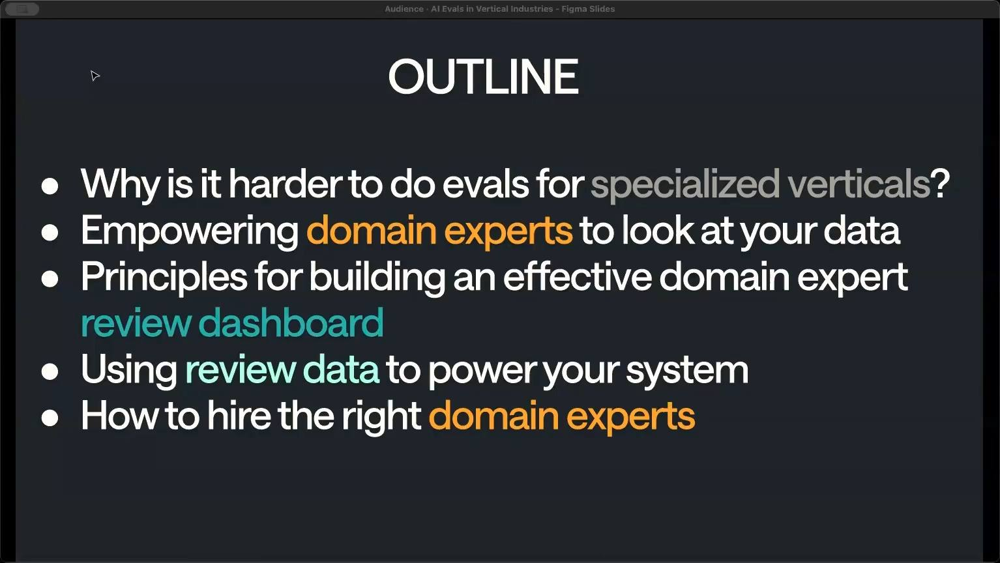

## 2. 讲师原话

**关于讲师的背景与这节分享的定位：**

> "我叫 Christopher Lovejoy。我原本是医学博士，后来转行成了 AI 工程师。今天我要讲一讲垂直行业里的 evals。我花了大约八年时间接受培训并作为医生工作，然后又花了过去七年时间为医学等专业领域构建 AI 系统，大概在 10 到 20 家不同的创业公司和公司里做过这类系统的搭建。我目前就职于 Anterior，我们是一家 Sequoia 投资的初创公司，构建临床推理工具来自动化医疗行政工作，大约有 50 人。"
> —— p021 [02:28]

**怎么定义"专业垂直领域"——这是整节课的第一个判断：**

> "对我来说，我把它宽泛地理解为：当你处理某个问题时，需要专业技能或经验才能审视那些 AI 输出。这种专业技能或经验是什么，有时候并不容易定义。有些领域很明显，比如医疗和法律。比如 Anterior 做的是临床推理，要评估 AI 的输出，你显然需要一位医生。但也不总是这样，我一个朋友为一家会议摘要公司写 LM prompts，她并没有会议摘要的正式背景，但她显然培养出了那种品味，能够评价这些输出。所以我经常问自己的一个粗略启发式是：外行全职做上几个月，能不能培养出顶级判断力？没有临床背景的人去读临床文本，即使做两个月，我认为也培养不出那种判断力和品味；但如果是会议摘要，全职做两个月，你大概就能建立起那种品味，对什么是好的会议摘要形成判断。"
> —— p021 [03:54]

**为什么垂直领域做 evals 更难——讲师给了三条，这条线索贯穿全课：**

> "这门课覆盖的很多原则完全适用于专业垂直领域，只是要额外考虑几个挑战。其中一个挑战是，定义质量和正确性要难得多。举个例子，这是我们 Anterior 的 AI，叫 Florence，它会回答这样的医学问题：这位患者是否有足够的既往脑部 MRI 来诊断多发性硬化？如果你没有医学背景，很难判断这是不是一个好答案、正确答答案。而实际上它是错误的，但这非常难发现。问题出在它如何理解 'suspicious（可疑）' 这个词。患者实际上已经确诊多发性硬化，所以不是可疑，而是确诊。但如果你没有医学背景，很难看出来。"
> —— p021 [05:18]

> "这也会延伸到失败模式，因为要对 AI 出错的方式进行归类、描述失败模式，同样需要领域专家的洞察。这是我们在临床推理中使用的一个失败模式本体论，里面有几类失败模式：回溯性推理，即没有看对时间点；基于证据的推断不足或推断过度；误解时间顺序。想出这套体系、把失败案例归类进去，如果没有背景，显然很难做到。最后一点，写 prompts 也明显更难，既包括真正执行 pipeline 主要动作的 prompts，也包括用 LLM judge 来评估 pipeline、定义失败模式的 prompts。"
> —— p021 [06:45]

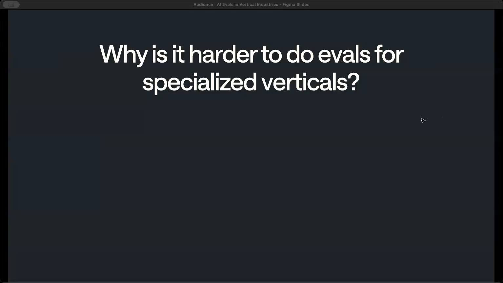

**解决方案：不是"看数据"，是"让专家看数据并翻译成行动"：**

> "这里的解决方案，显然我要说的就是：把领域专家带进 loop。但真正的问题是：把他们带进哪里？怎么带进来？这种交互长什么样？我们都很熟悉 '看你的数据' 这句箴言。我认为这绝对正确。但如果你的数据长这样呢？某种医学文本。作为外行，你不一定知道它是什么意思。所以在专业领域，更新后的箴言是：赋能领域专家去看那些数据，然后把数据翻译成可行动的东西。"
> —— p021 [07:41]

**三种评审载体，讲师逐一给了优缺点：**

> "一种评审输出的方式就是看 traces。你可以在某种 web 应用里把 traces 呈现出来，这是 Langfuse 的一个例子。这会有帮助，你能看到所有 LM 调用、每次调用的输入输出。但挑战在于，这可能不是领域专家最容易交互、最容易浏览信息的方式，你可能需要滚来滚去，还得自己拼出上下文。"
> —— p021 [08:39]

> "另一种是在你实际产品里建一个自定义视图。这是 Avila 的例子，一个支持用药依从性的聊天机器人，左边是聊天，右边是评审者可以进来标注、做笔记的地方。这很合理，因为你把上下文以最终用户交互的同样方式呈现给了评审者。但你能定制这个体验的程度有限，如果你想调整评审者看信息的方式，把它嵌在产品里会让这件事更难。"
> —— p021 [09:04]

> "第三种是自底向上从零构建的自定义评审 dashboard，屏幕上这是我们 Anterior 建的例子。它的优势是你可以真正优化和调整评审流程的每一个细节。我的看法是，如果你在做领域专家评审，而且评审确实是应用性能的关键部分，并且你想高效地呈现大量上下文，那么构建自定义评审界面很值得。你可以从非常简单开始，可以 vibe code 它，这是一个很好的起点，然后随着时间增加复杂度和 sophistication。"
> —— p021 [10:03]

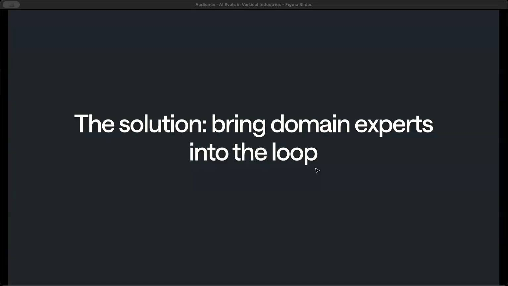

**三个优化目标和三个设计原则：**

> "我为这些评审想了三个优化目标。第一个、也许最重要的，是高质量评审，也就是优化出尽可能接近真相的评审。当然总有风险，评审者赶时间可能做不到 100%，但你要尽量优化质量，因为你在 evals 里用到的数据集规模往往不需要很大，而你要靠它跑指标，所以质量要尽可能高。但你也想优化时间，因为你想评审足够多的案例，也就是在最短时间内做出最多好的评审。第三，你还想让数据可行动，能转化为某种下游动作。为了达成这些，我提出三个原则：对于前两点，你可以优化把评审者需要的所有上下文清晰地呈现出来；第二个原则是优化评审流程序列本身；第三个原则是设计评审以获取你需要的所有数据。"
> —— p021 [10:59]

**原则一：把上下文清晰地呈现出来。**

> "你想尽可能直观地呈现所有上下文。你想最小化获取信息的摩擦。你想确保信息就在那里，如果评审者需要找某些上下文，有办法找到。但你也不想让它太杂乱，要把东西抽象掉。可以做的事包括：用嵌套、用侧边栏、用标签页。在 Anterior 的界面上，右边是病历和指南，也就是给评审者的高层上下文，可以点开、滚动；左边是 AI 回答的具体问题，你能看到问题、答案、推理等等。我们发现这样分组很有用：把证据和指南这种高层上下文放在右边，把更具体的焦点放在左边。"
> —— p021 [12:50]

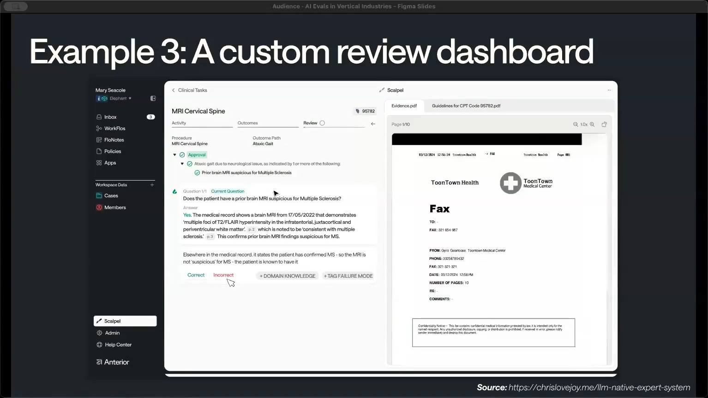

**原则二：优化评审流程顺序，靠 shadowing 得出流程。**

> "当你知道用户通常会在屏幕上往哪走、以什么顺序、怎么做事情时，你就可以开始真正最小化摩擦，调整东西放的位置。你在防止滚动、防止点击、防止用户在一个时点有太多选项，帮他们追踪进度、知道自己在评审的哪一步。你也可以通过视觉提示引导他们按顺序做某些步骤，或者要求他们必须先做 A 再做 B。我们采取的方法是从底向上设计这个流程，并形成自己的观点。我们做了很多 shadowing sessions，和来自不同公司的护士一起，看他们怎么做这类评审，差异很大。然后我们就想：这里的共同要素是什么，什么能带来真正有效的评审？"
> —— p021 [14:13]

> "在我们的具体场景里，流程是这样的：先把案例摘要呈现给护士，让他们看到病例的高层上下文——患者细节是什么？请求的是什么医疗程序？然后进入当前决策点，也就是 AI 现在被问的问题是什么；再引导他们看相关医学证据，帮他们逐步浏览病历的具体部分，看哪些和当前问题相关；最后回来对 AI 的输出做决定。我们发现这是一个相对最优的流程，既快，又照顾到关键细节，不会漏上下文，能带来好的评审。"
> —— p021 [15:08]

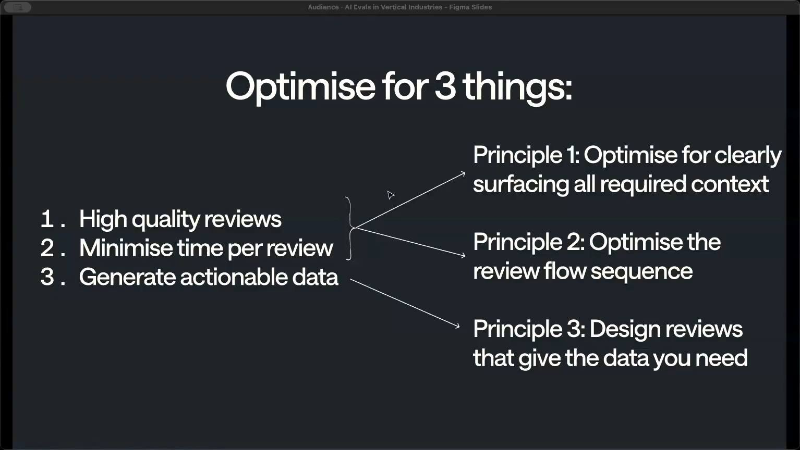

**原则三：设计评审，拿到三类数据。**

> "我通常想的是你从评审里想要的三样主要东西。第一是性能指标，你想知道做得怎么样。理想情况下你从生产里采样案例，评审其中一部分，这就能估计你实时对客户的表现。第二是失败模式，如果错了，是怎么错的？第三是改进建议。"
> —— p021 [16:08]

> "在这个 dashboard 里，左边是问题、AI 的输出、答案、理由。底部这个框让评审者进来说它是对还是错，这就给了我们性能指标，我们看到多少对多少错，还可以按 procedure codes、按案例特征来切分。底部右边有 'tag failure mode'，如果错了，他们点失败模式，分类体系打开，选相关的失败模式。最后是改进建议，他们可以选择提供领域知识。比如之前那个 MRI 的例子：发现可疑多发性硬化，实际上错了，因为患者已经有多发性硬化，如果医学上已经确诊，我们不会说可疑，而会说确诊。所以评审者可以添加一条领域知识，比如描述 '可疑' 在医疗语境下是什么意思、确诊了就不该说可疑。这条会保存到知识库。"
> —— p021 [17:06]

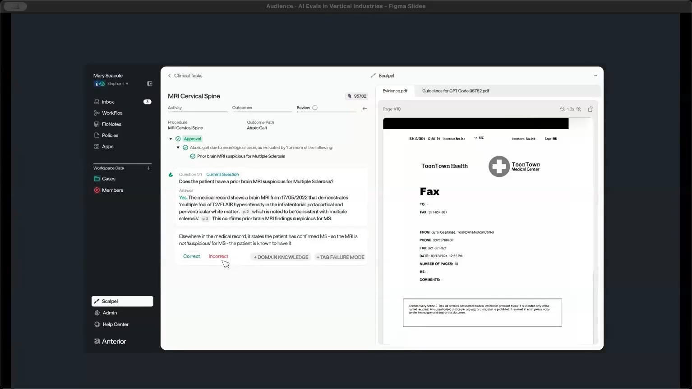

> "如果你把这些领域知识创建成字符串，就可以很容易地在生产系统下游重新呈现并插入。"
> —— p021 [18:28]

**关于失败模式体系怎么来、怎么更新（现场提问的回答）：**

> "这个 dashboard 假设你已经定义了失败模式。所以你可能一开始做错误分析，想出一套失败模式，然后在这里按这个分类体系打标签。但你也会有自由文本选项，用来添加你认为不属于这些失败模式的东西。然后下游会有人看这些数据，看失败模式的分布，也看有没有没被捕捉到的东西、可能需要更新失败模式分类体系。"
> —— p021 [18:57]

**评审数据的三个下游用途：**

> "三个非常强大的用例：用这些数据优先排序工程工作；第二，促进快速 AI 迭代；第三，在你的系统里实现改进、甚至自动化某些改进。"
> —— p021 [19:55]

> "你可以看你的错误指标，也就是你优化的那个指标，然后看哪些失败模式导致最多这类错误。这样你就可以基于失败模式来优先改进。第二，你最终会得到现成的失败模式数据集，因为你一直在评审生产的真实案例，已经标出哪些错了、错在哪个失败模式。所以它非常能代表未来数据，不是合成的，也不是离线过时的。你可以把它给工程师：'这是特定失败模式，这是过去一周从生产来的 50 个案例，现在得分 0%，因为全是失败案例，请持续改进并对着它测试。'"
> —— p021 [20:22]

> "迭代之后你可能会得到这样一张图：X 轴是 pipeline 版本，某个工程师聚焦某个失败模式并推送修复，你看到指标跳跃；同时你要确保不会在其他失败模式上回归，从而得到随时间迭代的改进。"
> —— p021 [21:20]

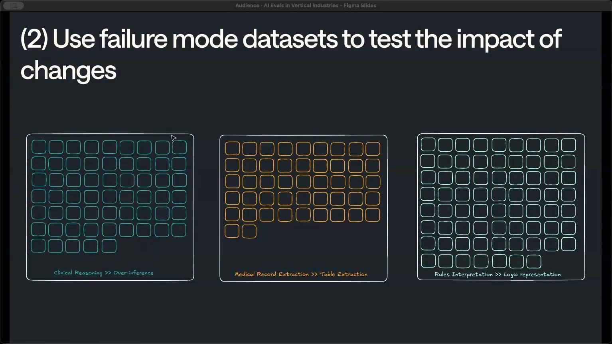

> "自动化改进是这样的：评审时提交的领域知识如果只是字符串，它可以进入领域知识库作为候选。你可以自动评估它，也可以人工 in the loop。假设自动评估：拿它对着失败模式数据集、回归测试数据集、其他性能评估数据集跑，也就是你想用来驱动这个决策的任何 evals。如果这个改动修复了失败模式、又没引起其他问题，你可以立即让它上线。这样就从评审者评审一个生产中的失败案例，到修复上线，不到一小时，形成非常紧的迭代回路。"
> —— p021 [22:16]

**招聘领域专家：**

> "有帮助的原则之一是有一个首席领域专家。有人把它描述为 '仁慈的独裁者'。有一个 DRI，也就是直接负责人，从组织角度看很有帮助。它避免靠共识做决策。有时在什么算正确、什么算好上会有不确定性，有一个人来做决定、负责，然后往前走，很有帮助。这个首席领域专家很适合做这件事，因为他们能对 AI 系统的表现形成很强的直觉，他们花大量时间评审 AI 输出，有领域专长，甚至可能调整 prompts。尽早招他们，给他们所有权，不要让他们只做评审。你也不想让他们只看数据，你还想让他们帮助设计、创建围绕数据的更大系统。"
> —— p021 [23:39]

> "我主张多招几个领域专家。除了评审，他们还能帮你招聘一个评审团队、定采样策略、分析评审数据、监控评审者表现、确保所有评审者对 '好' 的定义一致；他们可以引导产品开发、优先工程工作、和客户沟通并把客户想要的东西翻译成产品，还能改进 AI 性能，包括 prompts 和领域知识。"
> —— p021 [25:31]

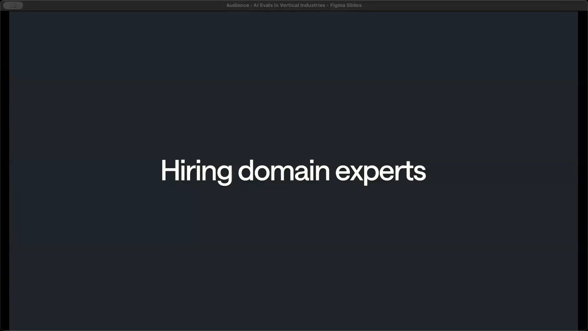

> "有用的技能包括：管理和领导经验，因为你可能要带一个团队；行业人脉，可以从自己的人脉里招人；统计学和数据科学经验，可以帮助定采样策略、分析数据、监控评审者表现；产品经验，比如做过产品角色、在创业公司待过，如果他们要引导产品开发、把工程工作产品化，这会很有帮助；还有和客户沟通的沟通能力。不太可能找到具备所有这些的人。实际来看，你通常会招一个有领域专长、具备其中几项的人，然后把他们和某个人配对，比如配一个数据科学家或统计学家来设计其中一些组件，或者配一个行业人脉更强的人来把团队招起来。"
> —— p021 [26:27]

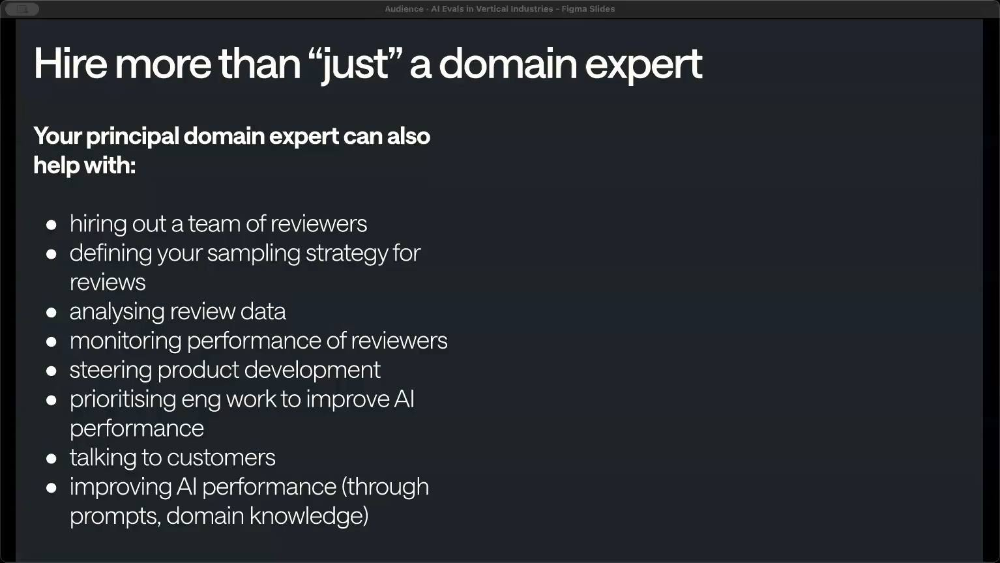

**现场问答里三个重要判断：数据合规、不追求完美系统、超长文档。**

> "我们从不混合不同客户的数据。我们有明确的协议，规定我们可以保留数据多长时间用于这个评估系统，这属于质量保证和质量改进。这也影响设计：你要持续评审生产中来的案例，持续生成数据集。如果有一个三个月前的数据集，而协议规定最多保留三个月，那这个数据集就得删掉，你要持续构建新的数据集用于 evals。"
> —— p021 [30:00]

> "系统永远不会完美，不会是 100%，所以使用方式必须考虑到这一点。在我们的场景里，我们卡在一个不错的位置：传统上由初级护士做评审，如果初级护士不确定，会升级给高级护士或医生。我们插在最底层。如果我们能批准护理，那很好，患者得到护理，比人快；如果 AI 没法批准，就会升级。所以有这种自然的制衡，人类会来评审，它被嵌进了一个决策层级里。"
> —— p021 [31:21]

> "是的，两种情况都有，处理过一些超过一千页的案例。有额外考虑。通常我们发现低于几百页，你其实可以把整份记录放进长上下文模型，性能不会下降；超过这个长度就会下降。因此有很多经典 RAG 的做法。我们发现有用的是创建一份显式的映射和记录的结构化表示——几乎是对每次就诊的摘要、包含什么信息——然后用检索技术，无论是语义相似度还是遍历方法，帮 LM 找到相关上下文来回答问题。所以这确实引入更多复杂度，基本变成一个检索问题。"
> —— p021 [32:40]

## 3. 从零复现

这一节没有代码，所以"复现"复现的是讲师的**推导链**：从一个模糊需求出发，一步步收敛到"建一个什么样的评审系统、招一个什么样的人"。我按需求 → 约束 → 估算/阈值 → 方案 → 取舍五步重排。

### 3.1 需求：先判断你的场景要不要领域专家

讲师给的判断工具是一个启发式问题，而不是一张领域清单：

> "外行全职做上几个月，能不能培养出顶级判断力？"

落到操作上，分三步：

1. **写出你要评估的输出长什么样。** 是会议摘要、代码补丁、客服回复，还是病历问答？把一条真实输出贴出来。
2. **问一个外行能不能判断它对不对。** 讲师的两个锚点：临床文本——两个月也培养不出来；会议摘要——全职两个月大概能培养出品味。前者需要领域专家，后者不一定。
3. **如果答案是"需要专家"，进入下一节；如果"不需要"，用课程通用的 eval 流程即可，不必上重型评审系统。**

讲师还强调，这个判断不总是显而易见：医疗、法律是明显案例，但"给会议摘要写 LM prompts"这种工作，没有正式背景的人也能靠长期浸淫长出判断力。所以判断依据是**判断力能否被外行在合理时间内获得**，不是头衔。

### 3.2 约束：垂直领域多出来的三处摩擦

讲师把"为什么更难"收敛成三条，这三条正好对应课程的三段结构：

| 摩擦点 | 具体表现 | 对应课程环节 |
|---|---|---|
| 定义质量和正确性更难 | Florence 把"已确诊多发性硬化"答成"suspicious（可疑）"，外行看不出错 | 错误分析阶段 |
| 定义失败模式更难 | 需要一套临床推理失败模式本体论：回溯性推理、推断不足/过度、误解时间顺序 | 错误分析 → 自动评估器 |
| 写 prompts 更难 | 既包括主 pipeline 的 prompts，也包括 LLM judge 的 prompts | 实现自动评估器 → 改进 |

除此之外，问答环节补了三条工程约束：数据合规（不混客户数据、约定保留时长）、系统不可能完美（必须嵌进人工升级链路）、文档可能超长（上千页，超过几百页长上下文就退化）。

### 3.3 估算与阈值：课里给出的几个数

这节不是数值课，讲师没有给采样率公式或样本量公式。能明确记下的阈值只有下面这些，别自己加戏：

- **数据集规模不需要很大**：讲师的原话是"你在 evals 里用到的数据集规模往往不需要很大"，所以质量优先于数量。
- **单个失败模式的数据集举例**：过去一周从生产来的 50 个案例，当前得分 0%（因为全是失败案例）。
- **长上下文阈值**：约几百页以内可以直接塞长上下文模型；超过就性能下降，要上 RAG。
- **修复闭环时间**：从生产失败案例出现到修复上线，有可能不到一小时。
- **公司规模参照**：Anterior 约 50 人。

### 3.4 方案：一个五层系统

讲师的方案可以拆成五层，从下往上：

1. **判断层**：用"外行几个月能否培养顶级判断力"决定是否引入专家。
2. **载体层**：三选一——trace 工具（如 Langfuse）、产品内嵌评审视图（如 Avila）、自建评审 dashboard（如 Anterior）。
3. **设计层**：三个优化目标（质量、速度、可行动）× 三个原则（清晰呈现上下文、优化流程顺序、设计评审拿数据）。
4. **数据层**：每次评审产出三样东西——对/错（性能指标）、失败模式标签（含自由文本）、改进建议（领域知识/ prompt 修改）。
5. **回流层**：评审数据用于三件事——排工程优先级、生成失败模式回归数据集、自动评估候选改进并上线。

### 3.5 取舍：三种载体怎么选

讲师没有说"自建 dashboard 永远最好"，而是给了选择条件：

- **trace 工具**：最快能看，但领域专家要在原始调用日志里自己拼上下文，浏览成本高。适合早期探索、工程师自查。
- **产品内嵌视图**：上下文和真实用户看到的一致，评审者不用切换心智模型；但定制空间受限，想改评审者看信息的方式就难。
- **自建 dashboard**：可以完全按评审流程定制，适合"评审是应用性能关键部分、要高效呈现大量上下文"的场景；代价是要自己建，但可以先用 vibe coding 起步，再逐步加复杂度。

讲师自己的倾向：如果评审是核心竞争力，选自建。

## 4. 完整代码

**课里没有代码。** 这一节按纯讲解课处理，把讲师给出的方案落成可用的设计产物。所有字段名、接口名都是我为方便读者落地而整理的示意命名，**不是讲师屏幕上出现过的内容**；讲师只描述了这些信息的存在和用途。

### 4.1 设计决策表：评审载体选型

| 维度 | trace 工具（Langfuse 类） | 产品内嵌视图（Avila 类） | 自建 dashboard（Anterior 类） |
|---|---|---|---|
| 上手成本 | 最低 | 中 | 高（可 vibe coding 起步） |
| 上下文呈现 | 原始调用日志，需自行拼接 | 与最终用户一致 | 完全按评审需要定制 |
| 流程定制 | 几乎不能 | 受产品结构限制 | 完全可控 |
| 适合阶段 | 早期探索、工程师自查 | 评审轻量、想复用产品 UI | 评审是性能关键、上下文量大 |
| 讲师判断 | 有信息量但领域专家不好用 | 合理但有定制上限 | 关键场景首选 |

### 4.2 优化目标 → 设计原则 → 落地手段

| 优化目标 | 对应原则 | 落地手段（讲师提到的） |
|---|---|---|
| 高质量评审 | 清晰呈现所有需要的上下文 | 嵌套、侧边栏、标签页；信息找得到但不杂乱；高层上下文与具体焦点分区 |
| 评审速度快 | 优化评审流程顺序 | 减少滚动与点击；单点减少选项；进度可见；视觉提示或强制步骤顺序 |
| 数据可行动 | 设计评审以拿到所需数据 | 对/错判定、失败模式标签 + 自由文本、改进建议（领域知识 / prompt 修改） |

### 4.3 评审界面布局职责表（按 Anterior 的描述整理）

| 区域 | 放什么 | 为什么 |
|---|---|---|
| 右侧 | 病历、指南等高层上下文，可点开、可滚动 | 评审需要随时回查证据 |
| 左侧 | 当前问题、AI 答案、AI 推理 | 具体焦点，和右侧高层上下文分开 |
| 底部判定框 | 正确 / 不正确 | 直接产出性能指标 |
| 底部右侧 | tag failure mode + 自由文本 | 产出失败模式分布，并发现分类体系缺口 |
| 改进建议区 | 领域知识、prompt 修改建议 | 产出可回流的候选改进 |

流程顺序（讲师从 shadowing 中提炼）：

1. 案例摘要（患者细节、请求的医疗程序）
2. 当前决策点（AI 被问的问题）
3. 相关医学证据（逐步浏览病历相关部分）
4. 对 AI 输出做决定

### 4.4 评审数据模型草案（课里没有代码，以下为示意）

```ts
// 课里没有代码，以下为示意：字段来自讲师对评审界面的口头描述，
// 命名是整理者自拟的，落地时请按你的后端约定调整。
type Verdict = "correct" | "incorrect";

interface ReviewRecord {
  caseId: string;
  pipelineVersion: string;      // 用于画 X 轴为 pipeline 版本的迭代曲线
  procedureCode?: string;       // 讲师提到可按 procedure codes 切分指标
  caseTraits?: Record<string, string>; // 讲师提到可按案例特征切分
  question: string;             // 当前决策点
  aiAnswer: string;
  aiRationale: string;          // AI 的推理
  verdict: Verdict;             // 对/错 → 性能指标
  failureMode?: string;         // 来自失败模式分类体系
  failureModeFreeText?: string; // 分类体系覆盖不到时的自由文本
  suggestedDomainKnowledge?: string; // 字符串形式，可进知识库、可自动评估
  suggestedPromptChange?: string;
  reviewerId: string;
  reviewedAt: string;
}
```

### 4.5 评审数据的三个下游用途

| 用途 | 输入 | 输出 | 讲师原话要点 |
|---|---|---|---|
| 排工程优先级 | 错误指标 + 失败模式分布 | 先修哪个失败模式 | 看哪个失败模式导致最多目标指标上的错误 |
| 快速 AI 迭代 | 按失败模式切出的生产案例集 | 可反复跑的回归数据集 | 过去一周 50 个案例、当前 0 分，交给工程师对着改 |
| 自动化改进 | 候选领域知识字符串 | 通过评估则自动上线 | 对失败模式集、回归集、性能集跑评估，不回归就上线 |

### 4.6 招聘技能矩阵

| 技能 | 用途（讲师原话归纳） | 是否必需 |
|---|---|---|
| 领域专长 | 判断对错、定义失败模式 | 必需 |
| 管理与领导 | 带评审团队 | 有帮助 |
| 行业人脉 | 从自己的人脉招评审者 | 有帮助 |
| 统计与数据科学 | 定采样策略、分析数据、监控评审者表现 | 有帮助 |
| 产品经验 | 引导产品开发、把工程工作产品化 | 有帮助 |
| 沟通 | 和客户对话、翻译需求 | 有帮助 |

讲师明确说：**不太可能找到全才**，实际做法是"领域专长 + 其中几项"，再配一个数据科学家/统计学家或人脉强的人补位。

### 4.7 阈值与规模认知表

| 项 | 课里给出的值 | 备注 |
|---|---|---|
| eval 数据集规模 | 不需要很大 | 所以质量优先 |
| 单失败模式数据集举例 | 50 个生产案例 / 一周 | 举例，不是公式 |
| 长上下文可用上限 | 约几百页 | 超过则性能下降，需 RAG |
| 修复闭环 | 可能 < 1 小时 | 取决于自动评估与上线链路 |
| 数据保留 | 按合同约定，例如最多三个月 | 到期删除，持续采新数据 |

## 5. 逐行解释

**为什么把"定义质量"排在第一位？** 因为后面所有环节都依赖它。Florence 的例子说明：如果连"可疑 vs 确诊"的区别都看不出来，你就无法做错误分析、无法定义失败模式、也无法写 judge prompt。讲师把三条摩擦按课程结构排列（错误分析 → 自动评估器 → 改进），意思是这三处都需要专家，不是只在一个环节需要。

**为什么失败模式要建成"本体论 + 自由文本"两层？** 讲师在问答里说得很清楚：dashboard 假设失败模式已经定义好，但现实是分类体系一定会有覆盖不到的情况。所以设计上必须同时留一个自由文本出口，下游再有人定期看分布、决定要不要更新分类体系。只有固定选项会丢信息，只有自由文本又无法统计。

**为什么评审界面要"高层上下文在右、具体焦点在左"？** 这是讲师从实际使用中得出的分组：评审者的注意力在左边的问题和答案上，但需要随时回查右边的病历和指南。把两者分开，既减少滚动，又保证证据可及。对应原则一里的三个子要求：直观、低摩擦、信息在但别太乱。

**为什么流程顺序要从 shadowing 里提炼，而不是拍脑袋？** 讲师和不同公司的护士做了大量 shadowing，发现做法差异很大，于是转而找"共同要素"。最终流程是：案例摘要 → 当前决策点 → 相关证据 → 做决定。这个顺序既快又不漏上下文。对前端读者的类比：这相当于先做用户研究再画线框图，而不是先画 UI 再让用户适应。

**为什么性能指标要能按 procedure codes 和案例特征切分？** 因为总体准确率会掩盖结构性差异。按程序代码、案例特征切开，才能看出"某类案例特别差"，这和失败模式分布结合，才能定位到可执行的工程任务。

**为什么领域知识要用"字符串"保存？** 讲师的原话是：创建成字符串，就可以很容易地在生产系统下游重新呈现并插入。字符串是最容易做版本管理、做 diff、做自动评估、做知识库检索的形态。如果存成不可解析的自然语言长文或图片，回流链路就断了。

**为什么自动化改进要先跑三类评估？** 讲师列了三类：失败模式数据集、回归测试数据集、其他性能评估数据集。逻辑是：一个改动必须同时满足"修好目标失败模式"和"不弄坏别的"，才能自动上线。这是把软件工程里的回归测试思路搬到 prompt/知识改进上。

**为什么首席领域专家要是 DRI 而不是委员会？** 讲师说得很直白：在"什么算正确、什么算好"存在不确定性时，靠共识会卡住，需要一个人拍板并负责。这和很多工程组织的 tech lead 角色是同构的。

**为什么系统不追求完美？** 讲师的答案是把它嵌进决策层级：Anterior 插在初级护士的位置，能批准就批准，不能批准就升级给高级护士或医生。这样系统不需要 100% 正确，只需要在"能安全批准的那部分"上比人快。这是产品设计层面的风险控制，不是模型层面的。

**为什么超过几百页要上 RAG？** 讲师观察到长上下文模型在几百页以内性能不降，超过就降。解法是先做"显式的映射和结构化表示"——相当于给每次就诊做摘要、标注包含什么信息——再用语义相似度或遍历方法检索。注意讲师说的是"基本变成一个检索问题"，也就是难度从"模型能不能读"变成"检索能不能找对"。

## 6. 复现检查清单

- [ ] 用"外行全职几个月能否培养顶级判断力"判断过自己的场景是否需要领域专家
- [ ] 找出一条真实 AI 输出，确认外行确实判断不了对错（否则不必上重型评审）
- [ ] 选定评审载体：trace 工具 / 产品内嵌 / 自建 dashboard，并写下选择理由
- [ ] 若选自建：先用 vibe coding 做出最小可用版本，再逐步加复杂度
- [ ] 界面做到"高层上下文"和"具体焦点"分区（如右病历、左问答）
- [ ] 信息可查找但不过度杂乱（用了嵌套/侧边栏/标签页中的至少一种）
- [ ] 评审流程按"案例摘要 → 当前决策点 → 相关证据 → 做决定"排布
- [ ] 单屏减少滚动与点击，进度可见，关键步骤有顺序引导
- [ ] 每次评审都能产出：对/错、失败模式标签、自由文本、改进建议
- [ ] 性能指标可按 procedure codes、案例特征切分
- [ ] 失败模式有分类体系，同时保留自由文本出口
- [ ] 评审数据能按失败模式切出生产来源的回归数据集
- [ ] 候选领域知识以
字符串形式存储，能被下游检索并重新注入生产 pipeline
- [ ] 候选改进能对着失败模式数据集 + 回归数据集 + 性能评估数据集跑一遍，通过才允许上线
- [ ] 已指定首席领域专家（DRI），在"什么算正确 / 什么算好"上有最终裁决权
- [ ] 首席专家尽早入场，参与系统设计与评审团队搭建，而不是只做标注工
- [ ] 客户数据不混用，保留时长写进合同，并有到期删除的执行机制
- [ ] 系统嵌在人工升级链路里：AI 不能批准时自动升级给人，而不是硬扛 100% 正确
- [ ] 超过几百页的文档走了"结构化摘要 + 检索"，而不是硬塞长上下文模型

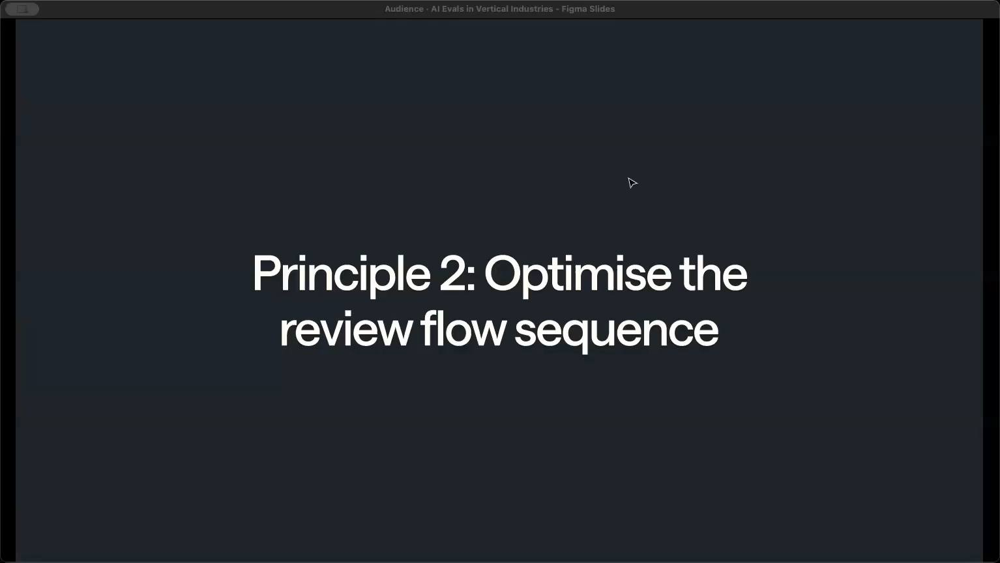

## 7. 课里没讲但你会撞上的

这一节是我在把上面的设计往真实项目里搬时，一定会踩到、但讲师在这 34 分钟里没有展开的部分。**以下内容全部标注来源：凡是逐字稿里没有的，我一律写"课里没讲"，并说明这是工程实践补充，不要当成讲师的观点引用。**

### 7.1 技术栈与最小可跑骨架（课里没讲）

讲师全程只说了"可以 vibe code 一个评审 dashboard"，**课里没讲任何技术栈、框架、数据库或部署方式**。所以下面这套骨架是我给的，不是课程内容。

对前端转 AI 应用工程师的人来说，最小可跑版本只需要三样东西：

1. 一个前端页面（React / Next.js / 甚至单文件 HTML 都行），左边渲染问题与 AI 输出、右边渲染病历与指南；
2. 一个后端接口（Node + Express 足够），接收评审提交并落库；
3. 一个数据库（本地 SQLite 起步即可，上量再换 Postgres）。

关键点不在框架选型，而在**数据落库的形态必须是结构化的**。讲师反复强调"领域知识要存成字符串、能回流"，如果你的评审结果只存成一大段自由文本 JSON 或者直接截图，第 4.5 节那三条下游用途一条都做不了。

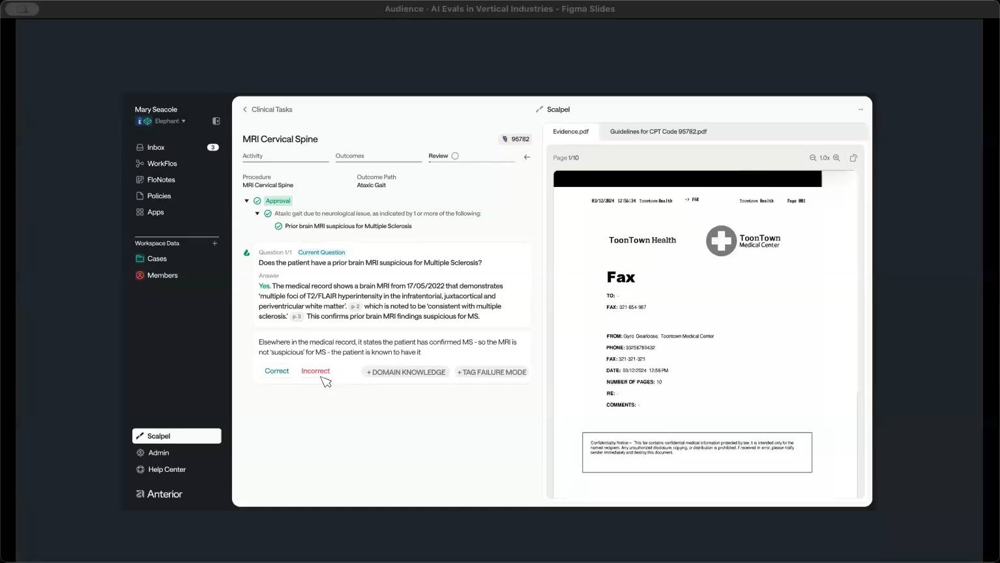

### 7.2 评审数据的并发与去重（课里没讲）

讲师说"评审者登录、评审一个生产案例、二十分钟后提交"，但他**没讲如果两个人同时评同一个案例会怎样**。这是你落地第一天就会撞上的问题。

现实场景有三种：

- 同一个案例被分配给两个评审者做一致性校验 —— 这时"两条记录"是**对的**，不能去重；
- 同一个案例被同一个评审者重复打开、重复提交 —— 这是**脏数据**，必须去重；
- 同一个案例被不同评审者评出相反结论 —— 这**不是 bug**，是你要监控的"评审者对不齐"信号（讲师提到要"确保所有评审者对齐、达到同一标准"，但**课里没讲用什么指标衡量**）。

在 JS / Node 里对应的做法很直接：数据库上给 `(caseId, reviewerId)` 建唯一索引，提交用 upsert（Postgres 的 `ON CONFLICT DO UPDATE`，SQLite 的 `INSERT ... ON CONFLICT`），前端再加一个乐观锁字段（比如 `revision`），提交时带上版本号，版本对不上就拒绝覆盖。这套东西和你在前端做表单防重复提交是同一类问题，只是把幂等键从"表单 ID"换成了"案例 ID + 评审者 ID"。

**注意：以上并发处理方式课里一个字都没提，是工程常识补充。**

### 7.3 采样策略：讲师说要定，但没给方法（课里没讲怎么算）

讲师明确说过要定采样策略：

> "你会想定一个采样策略，因为总会有一部分案例是你想评审的；如果你的量很大，你可能并不想评审全部。"
> —— p021 [25:31]

但**课里没给任何采样公式、样本量计算或置信区间**。他只说了两句可用的信息：数据来自生产、样本量不需要很大。

真要落地，你会撞上的是"分层采样"问题：如果按总体随机抽 100 条，而某个 procedure code 只占 2%，你大概率一条都抽不到，也就永远发现不了那类案例的系统性错误。实践做法是按 procedure code、案例特征先分层，再在层内按比例或按固定配额抽。**以下算式课里没讲，是我补的示意：**

```
第 i 层应抽条数 n_i = max(每层最低配额 q, 总配额 N × 第 i 层在生产中的占比 p_i)
    其中 q 通常取 5～10，保证小类不被抽空
总评审量 N 由"你能承受的评审工时"倒推：N = 可用评审工时 ÷ 单案例平均评审时长
```

讲师给过的唯一相关数字是"过去一周 50 个案例"作为单个失败模式数据集的例子，这是举例，不是采样公式。

### 7.4 评审者一致性与质量控制（课里只提了目标，没给指标）

讲师说要"监控评审者的表现、确保所有评审者对齐、达到同一标准"。**课里没讲用什么指标、什么阈值、多久校准一次。** 你会撞上的具体问题是：两个评审者对同一个案例给出相反判定，你该信谁？

工程上一般要补三样东西（课里没讲）：一是让一部分案例被重复评审，用来算评审者间一致性；二是定期做校准会，拿分歧案例集体讨论，并把结论沉淀进失败模式文档；三是给每个评审者算一个"和历史多数判定的一致率"，长期偏低的人要么重训、要么退出。讲师提到的那位"首席领域专家"天然就是校准会的主持人 —— 这条职责是我从"DRI 要对正确性拍板"推出来的，**讲师没有明说他要主持校准会**。

### 7.5 合规：脱敏、审计、到期删除（课里讲了原则，没讲实现）

讲师讲了两条原则：不混用不同客户的数据；合同里写明保留时长（他举的例子是"最多三个月"），到期就删、持续采新数据。**但课里没讲工程上怎么保证这件事真的发生。**

你会撞上的坑：

- **删除不是 `DELETE FROM reviews`**。评审记录里往往冗余存了病历原文片段，删主表不删快照等于没删。要么快照表单独设 TTL，要么干脆只存 `caseId` 引用，原文留在有生命周期管理的对象存储里。
- **审计日志本身也是数据**。为合规而记的操作日志，同样受保留期约束。
- **脱敏要在入库前做**。如果评审 dashboard 会把病历渲染给外部评审者（很多公司评审团队是外包或合同工），入库时就该脱敏，而不是渲染时再遮。
- 到期删除建议用定时任务（Node 里就是 `node-cron` 或部署平台的 scheduled job）扫过期记录，并留下删除执行的记录，证明"确实删了"。

**以上实现细节课里全部没讲，属于合规工程补充。**

### 7.6 长文档检索：讲师给了思路，没给参数（课里没讲）

讲师对超长病历的判断很具体：几百页以内长上下文模型性能不降，超过就降；解法是"先做显式的映射和结构化表示（相当于每次就诊的摘要 + 包含什么信息），再用语义相似度或遍历方法检索"。**但课里没给分块大小、top-k、摘要粒度、遍历算法的任何参数。**

实际会撞上的问题（课里没讲）：

- **病历不是文章，是树**。就诊 → 检查 → 报告 → 结论，天然有层级。纯向量检索切碎了层级，反而找不到"这条结论属于哪次就诊"。所以讲师说的"遍历方法"值得重视：先按结构定位到相关就诊，再在就诊内部做语义检索。
- **时间顺序是硬约束**。讲师列的第一个失败模式就是"回溯性推理，没看对时间点"和"误解时间顺序"。这意味着检索结果必须带时间戳，并且要按时间排序展示给模型和评审者，否则你会亲手制造这类失败。
- **摘要要能追溯到原文**。评审者看到摘要判断错了，必须能一键跳到原始段落，否则评审质量回归。

### 7.7 自动上线链路：讲师讲了"通过就上线"，没讲回滚（课里没讲）

讲师描述的闭环很激进：候选领域知识对着失败模式集、回归集、性能集跑评估，修好目标问题且不回归，就立即上线，全程可能不到一小时。**课里没讲如果上线后线上指标反而掉了怎么办。**

工程上必须自己补的（课里没讲）：灰度（先对 5% 流量生效，观察再全量）、可一键回滚（候选知识带版本号，回滚就是切回上一版）、以及"自动上线"和"人工确认上线"的分级 —— 讲师自己也说了可以"自动评估或人工 in the loop"，但没说哪些改动该走哪条路。建议按影响面分：只影响措辞的领域知识可以自动，影响判定阈值的改动必须人工。

### 7.8 成本与延迟（课里完全没提）

**课里没讲任何 token 成本、评审 dashboard 的调用成本、或自动评估的耗时。** 但你一定会撞上：如果每个候选改进都要对着三个数据集全量重跑，一次评估可能是几百次模型调用。实践中要限制候选改进的并发评估数量，并且对回归数据集做缓存（同一 pipeline 版本 + 同一数据集的结果可复用）。这部分完全是我的工程补充，与讲师观点无关。

### 7.9 一句话的落地顺序建议

如果你的场景已经判定为"需要领域专家"，但团队只有你一个前端转过来的工程师，按这个顺序做（**顺序是我给的，课里没讲**）：

1. 先拿 Langfuse 之类的 trace 工具看 20 条真实输出，确认自己看不懂 —— 这是验证"需要专家"的最低成本方式；
2. 用 vibe coding 做一个只有"左问题右上下文 + 底部对错按钮"的单页，先让一位专家用一周；
3. 加上失败模式标签和自由文本，开始积累可按失败模式切分的数据集；
4. 等数据集有几十条、并且你确认某类失败模式反复出现，再接自动评估和候选改进回流；
5. 到这一步再谈首席领域专家、采样策略、合规保留期这些组织级的事。

课里讲师给的是完整蓝图，但他是从一家 50 人、已经有成熟评审流程的公司视角讲的。你从零开始时，最重要的不是一次把五层系统全建起来，而是先用最小成本验证"外行确实判断不了"这个前提 —— 因为如果前提不成立，后面所有投入都是浪费。