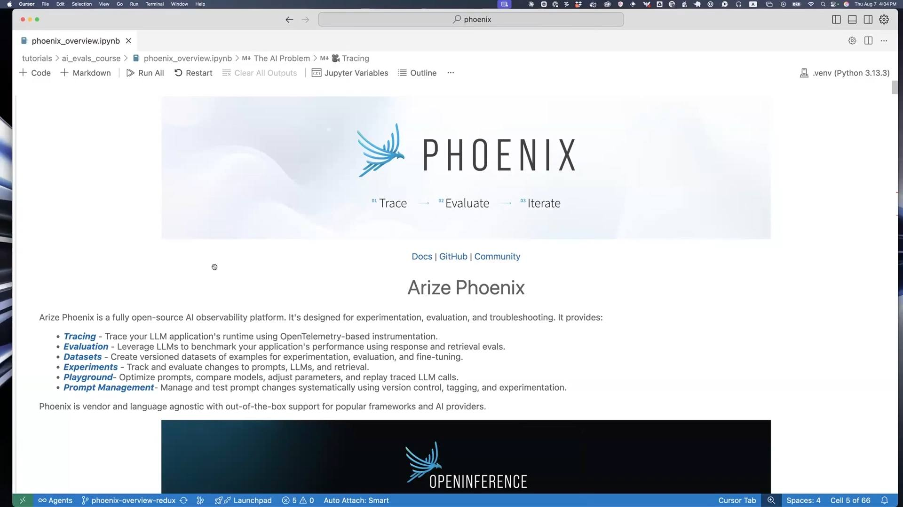
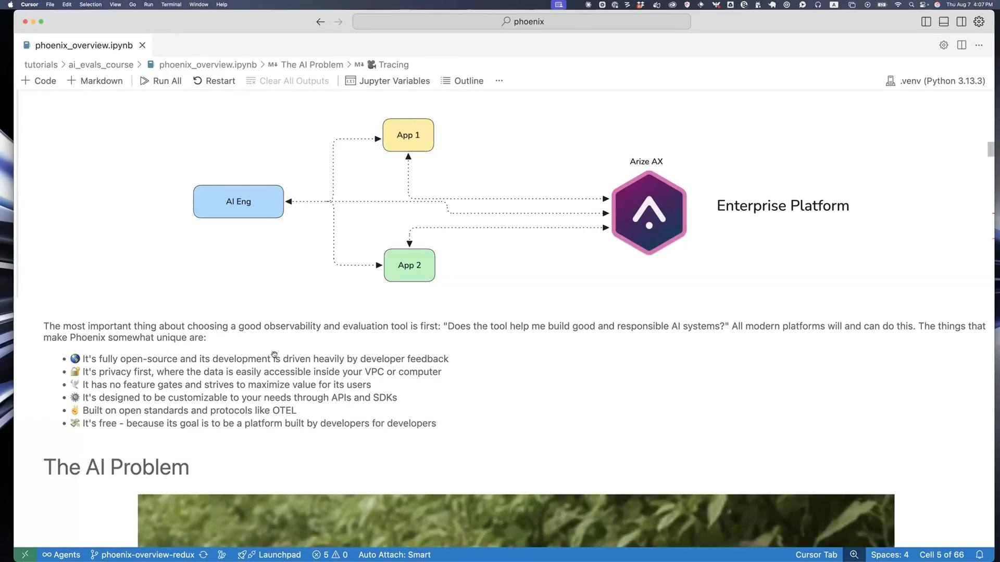
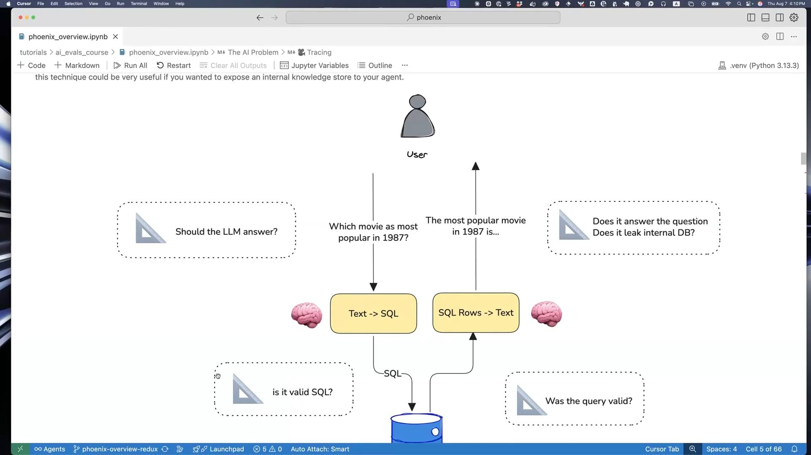
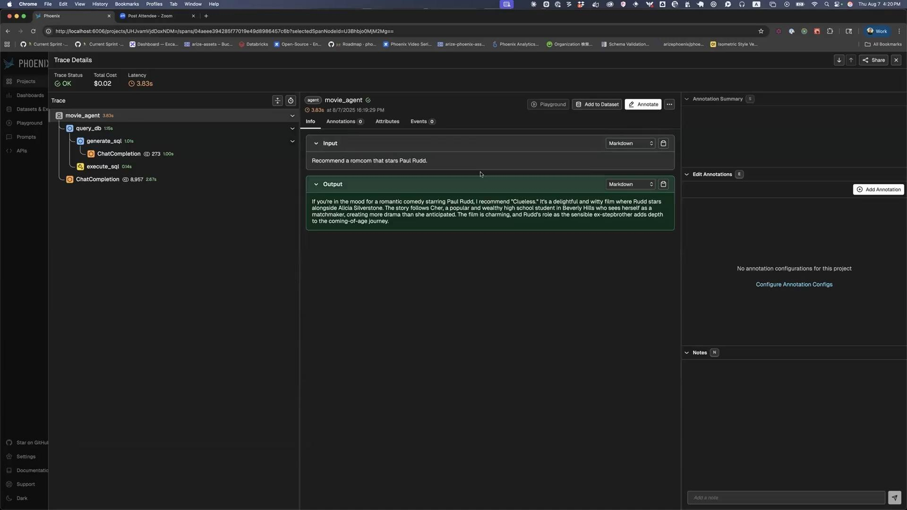
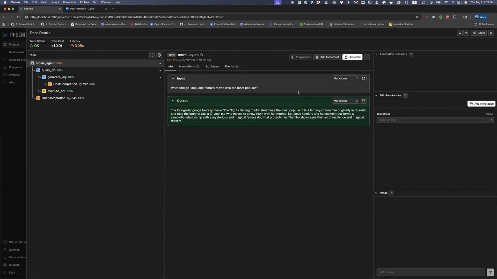
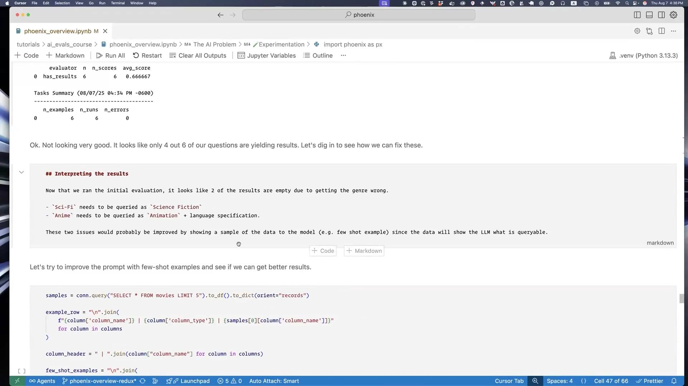
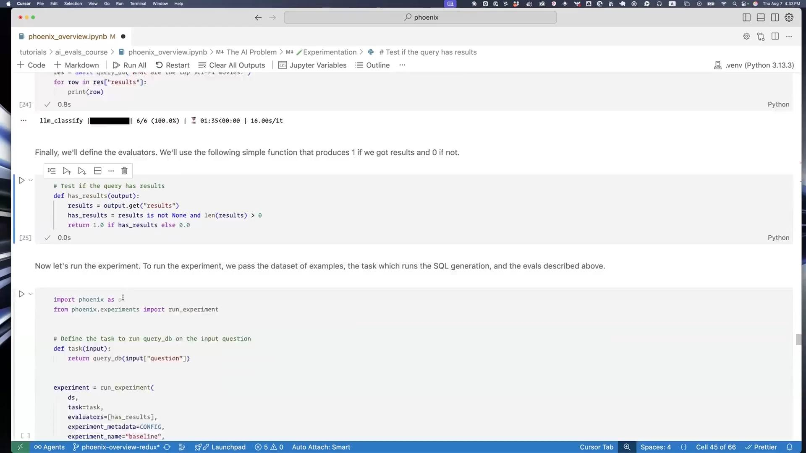
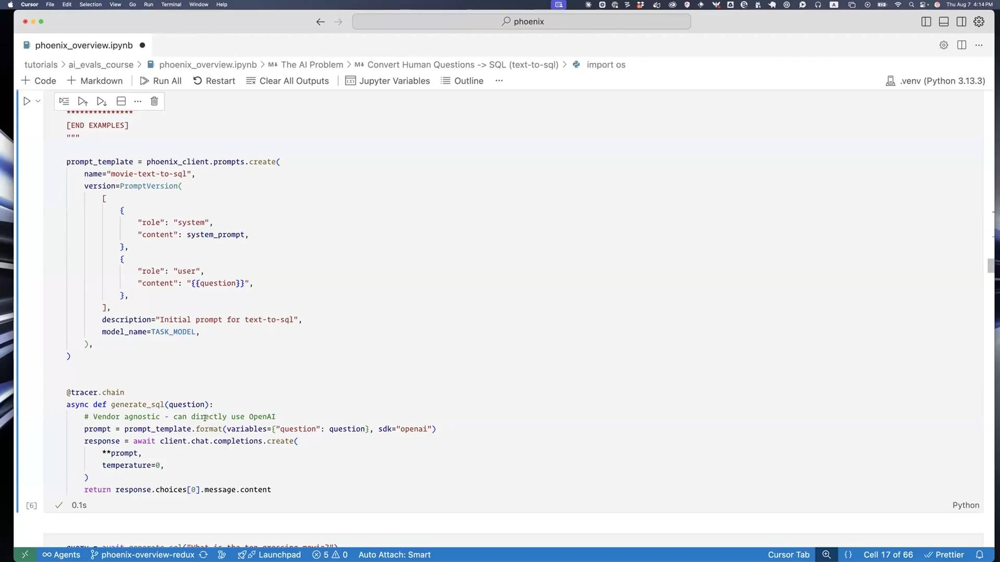
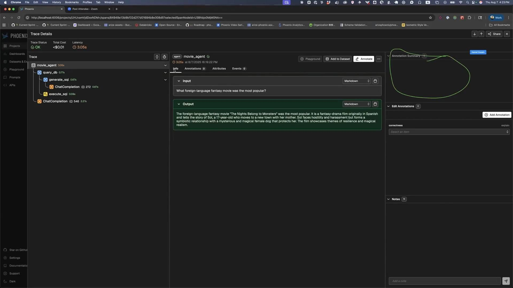
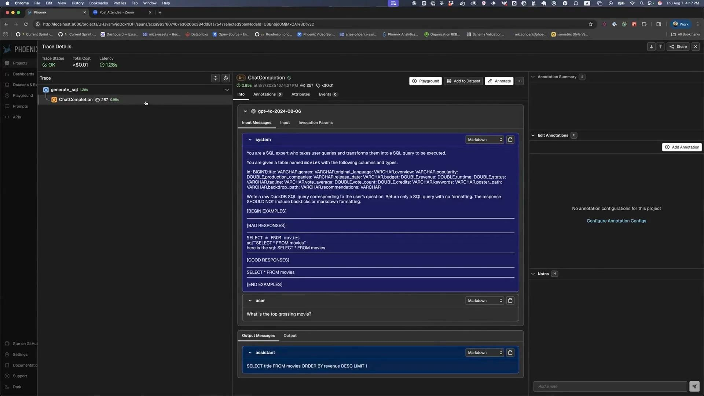

# AI Evals For Engineers & PMs（Agent 评测）· P022 实况复现文档

> 本讲是一场**纯 live coding 的实战课**：讲师 Miko King（Arize Phoenix 作者之一）从零搭了一个「自然语言 → SQL → 结果 → 人话答案」的两步 LLM 应用，然后一路用 tracing、人工标注、LLM Judge、数据集、实验、Prompt 版本、MCP 错误分析把它评起来。
>
> **重要说明（关于第 4 节代码）**：这一讲全程是讲师在自己机器上边讲边敲，逐字稿里**没有任何一段完整可复制的源代码**，OCR 帧清单里也没有代码截图。因此第 4 节的代码**不是逐字稿原文**，而是我按讲师口述的每一步（建库 → text-to-SQL → 执行 → naive RAG → synthesis → trace → 标注 → judge → dataset → experiment → prompt 修复 → MCP）**重写的一份可运行参考实现**。凡是讲师没讲、我为了让它能跑而补的东西，都会当场标注「课里没讲」。这份代码的目标是：让你能真的跑出一条 trace 出来，而不是只能看着文字想象。

---

## 1. 这一节做什么

这一讲要解决一个很具体的工程问题：**你的 LLM 应用跑起来了，你怎么知道它好不好？**

讲师选了一个小到不能再小的例子来演示完整流程——**text-to-SQL + 答案合成**。用户用自然语言问一个关于电影的问题（比如「票房最高的电影是哪部」），系统做两件事：

1. 第一个 LLM 把自然语言翻译成一条 SQLite 查询；
2. 拿这条 SQL 去查一个本地电影数据库，把查到的行当上下文，第二个 LLM 把这些结构化数据**合成**成一句人能看懂的答案。

就这么两步，讲师反复强调：**它已经有一大堆可以假设出来的失败模式了**——LLM 是不是根本不该回答这个问题（超纲）、生成的 SQL 语法对不对、查出来的东西是不是真的、查询有没有命中任何一行、合成的时候会不会把内部表名甚至 Snowflake 库名漏出来、答案读起来够不够「人类友好」。

然后他把这一整条链路用 **Arize Phoenix** 接上 OpenTelemetry 埋点，让你能在 UI 里像看录像回放一样看每一次调用的输入输出；再往下是**人工标注**（这一步在课程里被叫做 open coding / axial coding，就是先把坏案例一条条标出来、再归纳成类）、**LLM Judge**（用你的人工标注当 few-shot 去生成一个自动评分器）、**数据集 + 实验**（把问题集固定下来，改一版 prompt 就跑一次，看指标怎么动）、**Prompt 版本管理**（每次改 prompt 都留一条线性历史，能回放、能对比、能标记成 staging），最后还有一个**MCP Server**——让 Claude Desktop 直接连上你的 Phoenix，对着你的 trace 数据做错误分析，不用手动导 CSV。

> "Arize Phoenix 是一个开源的 AI 可观测性平台。但它还有一堆顶层功能：tracing、evaluation、datasets、experiments、playground、prompt management。"
> —— p022 [04:54]



这一讲的核心主张其实不是「用我的工具」，而是一句更狠的话：

> "搭好 AI 工具，过程比工具本身更重要，因为没有哪个工具能替你解决 eval 流程或分析流程。"
> —— p022 [09:36]

所以他拿科学方法打比方：**tracing 是科学家的摄像机**，先有观测，才有假设，才有可复现的实验，才有「这个改动到底有没有变好」的判断。

课程最后落在一个很实在的结论上：他把 prompt 修好之后，检索命中率从 67% 提到 100%，但换个更严格的 LLM Judge 去评「检索到的东西到底有没有用」，分数只有 0.33——**「有结果」不等于「有用」**。这就是为什么你需要分层评估。

---

## 2. 讲师原话

下面这些是这一讲里最关键的判断，按项目推进顺序排列。

**关于 Phoenix 是什么、为什么要开源：**

> "我们是在 OpenTelemetry 之上构建的，用来给你这些需要可观测性的系统提供观测能力、错误分析等等。"
> —— p022 [05:48]

> "Phoenix 可以很容易地在你自己电脑的 notebook 里跑起来。也许你在巴西、网速很差，你也可以用 Phoenix 配 Ollama；或者你在飞机上。"
> —— p022 [06:17]

> "没有 feature gate，没有 license server，通过 API 定制成你想要的样子。"
> —— p022 [08:38]

**关于「过程比工具重要」：**

> "科学家有摄像机。你显然需要通过 tracing 去看数据，需要做开放编码和轴向编码去搞清楚不同的失败案例，假设输出为什么差，设计可复现的实验和数据集，用 evals 去衡量结果。"
> —— p022 [10:05]

> "我把 tracing 想成科学家的摄像机。"
> —— p022 [12:27]

**关于该 trace 什么：**

> "不是所有东西都要 trace，但重要的东西要 trace，尤其是你调用工具的时候、调用 LLM 的时候、或者从向量库检索东西的时候。"
> —— p022 [16:13]

**关于合成阶段的数据泄露：**

> "如果你不指示 LLM 不要泄露数据，它可能会说「根据 Snowflake 数据库，我拿到的是这些」。所以你要在合成这一侧引导 LLM，用 RAG 拿到的信息去产出一个人类好消化、有分寸的回答。"
> —— p022 [11:59]

**关于「录制完还要能玩数据」：**

> "每次录制，你不只要看数据，还应该能玩数据。你可以点进去，改一改 prompt，做「如果 prompt 长那样会怎样」的分析。"
> —— p022 [19:03]

**关于标注为什么要支持分歧：**

> "它给分歧留了空间。它不是在覆盖 metadata 字段，它真的会记录是谁、为什么、在哪里给的这条标注。"
> —— p022 [23:49]

> "如果 LLM 说它是正确的、我说它是错误的，它会取中间值，给你平均值；然后你可以单独去看这些 eval，你就知道哪条来自人、哪条来自 LLM。"
> —— p022 [24:48]

**关于在哪一层标注：**

> "在那个层面我去标注 trace，因为我需要的是这位终端用户看到的东西。但作为工程师，我还想知道塞进去的到底是哪个 prompt 模板，这样才能找到那一层的失败模式。"
> —— p022 [27:29]

**关于跨 span 查询：**

> "你可以构造一个跨 span 的查询，比如 span 查询里 name 等于 movie agent，再 join 一个内层的 retrieval 步骤。"
> —— p022 [31:43]

**关于用人工标注生成 LLM Judge：**

> "我就拿这些当 few-shot 例子，看看能不能快速生成一个 LLM judge。"
> —— p022 [32:10]

**关于「不一定要上 LLM 才能做 eval」：**

> "用 LLM 做 eval 驱动的开发不是必须的，你可以从非常简单的启发式开始，比如正则，比如它有没有产出结果。"
> —— p022 [34:36]

**关于那次 prompt 修复：**

> "我给了它一些数据库示例行，让它理解 genre 这一列的内容。"
> —— p022 [41:21]

> "检索修好了，至少能产出结果了，但不代表里面的信息一定相关。"
> —— p022 [44:08]

**关于 MCP：**

> "你可以在 Cursor 里跟你的数据和 Phoenix 聊天。"
> —— p022 [37:55]

**关于不要盲信现成 eval：**

> "不要盲信开箱即用的 evals。但好处是，我仍然可以用它把 LLM 判错的那些 case 筛出来，把 trace 浮到最上面，然后一条条看它为什么觉得不对，继续迭代。"
> —— p022 [46:59]



---

## 3. 从零复现

下面这套步骤，你按顺序敲完，就能得到和课程里一模一样的现象：一条完整的 trace、一批人工标注、一个跑出 67% 的实验、修完 prompt 后变成 100%、以及一个只给 0.33 的 LLM Judge。

### 3.0 环境准备

课里没讲具体版本号，下面是按写文档时的常见可用版本给的下限，装上后跑 `pip freeze` 记一下你自己的版本。

```bash
mkdir -p phoenix-movie-agent && cd phoenix-movie-agent
python -m venv .venv
source .venv/bin/activate          # Windows: .venv\Scripts\activate
mkdir -p src scripts db data
```

`requirements.txt` 见第 4 节。装完依赖后，把 `OPENAI_API_KEY` 写进 `.env`——讲师原话是「我做一个 .env 文件，把 OpenAI Key 设进去」。

### 3.1 起一个本地 Phoenix

Phoenix 可以跑在本机（讲师说的「在你自己电脑的 notebook 里跑起来」），也可以跑成 sidecar、集中式、或者用 Phoenix Cloud 开多个 workspace 动态部署；再往上量级到企业客户那种规模，可以切到 Arize AX 平台。这节课只用本地形态。

```bash
python scripts/serve_phoenix.py
```

跑起来后浏览器开 `http://localhost:6006`。**这个进程要一直开着**，后面所有脚本的 trace 都是往这里打。

> 讲师在这个环节翻过一次车：讲到一半 Phoenix 崩了，他自嘲「demo 上帝，太糟糕了，这怎么发生的」，重启之后 trace 才出来。你复现时如果发现 UI 一直空白，先看这个进程是不是还活着。

### 3.2 建库、灌数据

讲师的做法是：**从 HuggingFace 下载一份电影数据**（他提到里面有 FastX、C3 这类片子的信息），转成本地数据库。数据集具体是哪一个，课里没讲。

```bash
python scripts/init_db.py
```

这一步会做三件事：建 `movies` 表、从 `data/movie_facts.jsonl` 读数据灌进去、打印前 3 行让你确认字段。

### 3.3 接入 tracing（打开摄像机）

> "你只要把这个参数设为 true，所有这些摄像机就都打开了，所有录像都会流到本地的 Phoenix。"
> —— p022 [12:56]

`src/tracing.py` 里用 `phoenix.otel.register()` 开一个 tracer provider，`auto_instrument=True` 让 OpenInference 的 OpenAI instrumentation 自动把每次 `chat.completions.create` 录下来；`project_name` 决定这批 trace 落在 Phoenix 的哪个 project 里——**讲师专门强调过，跑基线时要把摄像机指向另一个 project，把自己的 baseline 隔离出来**。

### 3.4 写 text-to-SQL 那一步

讲师说他是「用原生 Python 构造这个 prompt」的，然后**多做了一件事：把这个 prompt 上传到 Phoenix**。

> "这完全是可选的，你不一定非得这么干。但你会看到它的好处：能追踪 prompt 随时间的变化、能去重、能复用、能重放，它给实验带来了一定程度的确定性。"
> —— p022 [14:20]

另外他强调 Phoenix **不绑定 SDK**：

> "如果你用 OpenAI，你就直接用 OpenAI 的 SDK。你不必用一个厂商 SDK，不必用 LightLM，也不必用某个特定厂商的 SDK——你爱用 LiteLLM、爱用 OpenAI、爱用 Anthropic 都行，它不会把自己的代码塞进你在做的事情里。"
> —— p022 [14:49]

跑一次看看：

```
问：What is the top grossing movie?
生成的 SQL：select title from movies order by revenue desc limit 1
```

执行这条 SQL，答案是 Avatar——讲师说「Avatar 确实赚了很多钱，所以它算是能跑的」。

### 3.5 加上执行 SQL 和 RAG 两步

讲师特别解释了他为什么在每一步都加 trace：

> "这些你正在用的工具，你必须去看数据。不是所有东西都要 trace，但重要的东西要 trace，尤其是调用工具、调用 LLM、从向量库检索的时候。这些全都值得看。所以这些代码做的就一件事：对这一步骤架一台摄像机。"
> —— p022 [16:13]

RAG 这一步他**明确说自己做的是 naive RAG**：

> "很不幸我这里是 naive RAG，但你可以想象你会做更 agentic 的 RAG——这就是把数据库里拉出来的东西直接拼上去。"
> —— p022 [16:41]

### 3.6 合成答案

这一步把 SQL 查出来的结构化行变成人话。讲师的原话是：把从 SQL 数据库拿到的结构化数据，交给它输出。

### 3.7 把三件事拼成一个「agent」

```python
answer("What is the top-grossing movie?")
```

跑完回 Phoenix 的 Projects 页面刷新，你会看到一条完整的 trace，从上到下依次是：

- 用户的问题（root span 的 input）
- 「agent 的答案」（root span 的 output）
- 它怎么查的库、SQL 怎么构造出来的、最后怎么合成的
- **invocation parameters 全都自动上报**

讲师当时的评价是：「现在我们有了一条非常好的 trace，我们看到了所有东西。」



### 3.8 跑一批基线问题，落到独立 project

一个问题能跑通不代表什么。讲师准备了一组**他认为系统本来就该答得出来的问题**：

- Which Brad Pitt movie received the highest rating?
- Recommend a rom-com that stars Paul Rudd.
- Which anime topped the box office in the 2010s?
- What is the best sci-fi movie?
- Which foreign-language fantasy movie was the most popular?
- What are the best sci-fi movies of 2017?
- What are the top box office movies of the 2010s?

> "说实话我这是放水了，这些是我认为它一开始就应该能答出来的问题。"
> —— p022 [19:32]

跑的时候换一个 project，把 baseline 隔离开：

```bash
python scripts/run_baseline.py --project movie-agent-baseline
```

在 Projects 页面你能看到输入、输出、花了多少钱、延迟这些启发式信息。

> "你可以直接看这些日志里的数据，但它不给你 tracing 提供的那些富信息——对检索、对合成、对用了哪个 prompt 的内部洞察。所以只靠日志有点难，你可以在这些东西上跑 evals，但你信息不够。"
> —— p022 [20:00]

### 3.9 人工标注（open coding）

进到 traces 详情页，右边有个 annotate 面板。讲师现场标了几条：

- 「Recommend a rom-com that stars Paul Rudd」→ 系统答 Clueless → 他认为「文档质量看着还行」→ 标 correct
- 「Which anime topped the box office in the 2010s」→ 系统说不知道 → 标 incorrect
- 「What's the best sci-fi」→ 系统答得不好 → 标 incorrect

他特别演示了一个细节：**标 incorrect 之后点进 trace 看 execute SQL 那一步，发现查询确实返回 0 行**。

> "SQL 看起来是合法的，但它实际上没给我任何动画电影。这对我来说就是一个失败模式。"
> —— p022 [22:23]

还有一个更阴的例子：「Which foreign-language fantasy movie was the most popular」→ 系统答了一部叫 Knights of the Monsters 的片子。讲师说「我没听过，也许是真的」，然后点进 trace 一看——**这一行只有 1 票**。

> "我知道它不好，因为——等等，它也许是评分最高的电影，但它只有一票。所以在做错误分析的时候这就不是一个好问题。"
> —— p022 [26:34]

标注面板的操作要点（都来自课堂问答）：

- **热键**：`N` 下一条、`E` 标错（讲师和主持人都强调「速度非常重要」）。
- **多标注者**：开了认证之后，每条标注会记录是谁、为什么、在哪个位置给的，**不是覆盖 metadata**。
- **可以按人筛选**：主持人问「我可以只看 Hamel 的标注吗」，答：可以。
- **可以加 metadata**：比如标注者是巴西来的、属于某个 demographic，可以按这个筛。
- **可以来自用户反馈**：thumbs up / thumbs down 也能进这套标注体系。
- **分歧取平均**：主持人说是五星、讲师说是四星 → 显示平均分；LLM 说对、人说错 → 也取中间值。
- **可以隐藏**：讲师说「你可以把它藏起来，不让你被别人的判断带偏」。



**标在哪一层？** 主持人和讲师来回问了几轮，结论是：

- 想看「终端用户到底看到了什么」→ 标在 **root span**，这样能跟输入输出对上。
- 想看「检索到底准不准」→ 可以标在 **retrieval 那一层**，Phoenix 支持 precision、recall、hit rate 这类检索指标，挂在检索步骤上更合理。
- 两种都要 → **跨 span 查询 join 起来**，讲师的原话是「你可以把层级 flatten 成你想要的任何样子，但你不是在反转控制权」。

```sql
-- 讲师口述的查询意图，不是可执行 SQL，Phoenix 里用它的 span 查询 UI 表达
-- span.name == "movie_agent"  INNER JOIN  inner span "retrieve"
```



### 3.10 用标注生成 LLM Judge

> "这算是个快速 hack，别学我这套，去听 Hamlet 的。我拿这些当 few-shot 例子，看能不能快速生成一个 LLM judge。"
> —— p022 [32:10]

具体做法：把人工标过的「问题 + 系统输出 + correct/incorrect」拉下来，当成 few-shot 塞进 judge 的 prompt，然后对全量基线再跑一遍，结果写回 Phoenix，和人工标注并排显示。

回到 UI 你会看到：绝大多数情况下 LLM Judge 和你的判断一致；点进某条能看到 **LLM 的推理**，比如「回答正确识别出 Avengers Endgame 是一部高票房漫威电影，这符合票房记录」。

### 3.11 把问题集变成 Dataset

> "我把跑过的那些问题上传成一个数据集，这样它就成了我实验里的一个常量。"
> —— p022 [33:37]

数据集的作用：**回归测试的底座**。讲师后面还补了一句，因为 tracing 一直开着，你可以从任意一条 trace 里把「问题 + 正确答案」直接抽出来，动态长成一份 golden dataset。

### 3.12 定义启发式 Evaluator，跑第一次实验

> "我们来定义一个非常简单的、基于启发式的评估：它有没有结果？"
> —— p022 [34:06]

实验的两个组成部分（讲师原话）：

- **Task**：从 SQL 数据库里把数据拉出来
- **Evaluator**：就一句，`has_results` 是不是 true

跑完看数字：**67% 有结果**。筛 `has_results == 0`，能筛出两条，点进任意一条还能看它当时的 trace。

### 3.13 用 MCP 做错误分析

这是全场最兴奋的一段。讲师在他已经跑着 Phoenix 的机器上，用 **Claude Desktop** 接了一个 **MCP Server**：

- 一个 MCP 是**连 Phoenix 数据本身的**，让你直接对着 trace 做错误分析、轴向编码、prompt 优化；
- 另一个 MCP 是**Phoenix 的文档索引**——讲师说他们「其实是代理到 RunLLM，RunLLM 有一个给我们微调过的 LLM」，所以你可以直接在 Cursor 里问「How do I instrument Agno using Phoenix?」它会把代码补全给你。

他现场问了「what is wrong」，然后让 MCP 去做分析，同时自己人肉看那两条失败 case：

> "失败的第一条是「哪个动画电影拿了 2010 年代票房冠军」。你能看到它生成的查询写的是 genre like anime。我作为工程师，对数据库熟一点，我知道 anime 可能是错的，它可能应该是 animation。"
> —— p022 [36:03]

> "再看这个失败 case，「最好的科幻电影有哪些」——genre 这里也可能有问题，因为 sci-fi 可能被写成 science fiction，也可能被写成 sci-fi fantasy 等等。"
> —— p022 [37:02]

中间 Claude Desktop 弹了个权限确认，他没点「always allow」，所以他自嘲「哦我没允许 always，好吧，你懂我意思了」。

> "我觉得一边做错误分析一边挂着 MCP server 很酷。"
> —— p022 [37:02]



### 3.14 修 prompt，再跑一次

修法很朴素：**给 genre 列加真实取值示例**。

> "之前我只有列名和类型，它只知道 genre 是个 string，但你没给它实际的 enum。它里面没有 sci-fi，只有 science fiction，而不是 sci-fi。"
> —— p022 [42:42]

修完再问「What are the best sci-fi movies of 2017?」，它现在产出 `science fiction`，对了。

重跑实验：**67% → 100%**。

> "现在你能看到我们从 67% 变成了 100%。你可以对比这两次，尤其是之前没有结果的地方现在有结果了。"
> —— p022 [41:48]

而且因为 tracing 一直开着，这次修复本身也变成了一条可以点开看的证据：进 `generate SQL` 这次 LLM 调用，你能看到 **context 里多了示例行**。讲师说：「我们甚至可以把这段 context 删掉再跑一次，看看会怎样。」

Prompt 版本视图里，你能看到一条**线性历史**：v1 没有 few-shot 示例，v2 有。讲师说「我理论上可以说它 ready for staging，然后去拉 staging 版本的 prompt」。



### 3.15 加一层更严的 Judge：有用性

> "检索修好了，至少能产出结果了，但不代表里面的信息一定相关。"
> —— p022 [44:08]

这次他用 LLM 判「检索到的这些行对这个问题的回答有没有用」。这里他也顺手证明了一次**不绑定框架**：「你可以直接用 OpenAI，我们有我们自己的 evals，但你也可以用结构化输出做评估。」

结果：**0.33**。讲师点开 LLM 的推理：

> "它说：数据显示 Frozen 拿了票房冠军，但它没有确认这是动画片。所以它其实是在检测我们把 Frozen 当成动画片这个用法是错的。"
> —— p022 [45:04]

还有一个细节很值得记：**evals 本身也是被 trace 的**。你可以点开看这条判断用了哪个评估 prompt 模板，也可以把评估器的 trace 加进 golden dataset 去微调你的 judge。

最后他把「improved」版本重新跑一遍，指标是 **0.33，比之前好一点**。

> "不要盲信开箱即用的 evals。但好处是，我可以用它把 LLM 判错的 case 筛出来，把 trace 浮到最上面，一条条看它为什么觉得不对，然后继续迭代。"
> —— p022 [46:59]

主持人补了一句很到位的话：「这通常就是一种数据采样机制。」

---

## 4. 完整代码

> **再次声明**：以下代码是按讲师口述步骤重写的**参考实现**，逐字稿中没有留下任何源码，OCR 帧也没有代码。所有 `# 课里没讲` 注释标出的地方，都是我为了让它跑起来补的，**请以你安装的 Phoenix / OpenAI SDK 版本文档为准**。

### 4.1 目录结构

```
phoenix-movie-agent/
├── .env
├── requirements.txt
├── README.md
├── data/
│   └── movie_facts.jsonl        # 从 HuggingFace 下载后转换（数据集名课里没讲）
├── db/
│   └── movies.db                # 运行 init_db.py 后自动生成
├── src/
│   ├── __init__.py
│   ├── config.py
│   ├── tracing.py
│   ├── db.py
│   ├── prompts.py
│   ├── agent.py
│   ├── judge.py
│   └── mcp_config.json
└── scripts/
    ├── serve_phoenix.py
    ├── init_db.py
    ├── run_baseline.py
    ├── run_experiments.py
    └── build_judge.py
```

### 4.2 `.env`

```dotenv
# 课里明确讲过：讲师建了一个 .env 文件，把 OpenAI Key 设进去
OPENAI_API_KEY=sk-xxxxxxxxxxxxxxxxxxxxxxxx

# 课里没讲这两个变量名，是我为了本参考实现补的
PHOENIX_COLLECTOR_ENDPOINT=http://localhost:6006/v1/traces
OPENAI_MODEL=gpt-4o-mini
```

### 4.3 `requirements.txt`

```txt
# 课里没讲版本号。下面是本参考实现写文档时的可用下限，装完请 pip freeze 记录自己的版本
arize-phoenix>=8.0.0
arize-phoenix-otel>=0.8.0
arize-phoenix-client>=1.0.0
openinference-instrumentation-openai>=0.1.20
openai>=1.50.0
python-dotenv>=1.0.1
datasets>=3.0.0
pandas>=2.2.0
requests>=2.32.0
```

### 4.4 `src/__init__.py`

```python
```

（空文件，只为让 `src` 成为包。）

### 4.5 `src/config.py`

```python
"""集中读取环境变量与路径。课里没讲这个文件，是为了统一配置补的。"""
import os
from pathlib import Path

from dotenv import load_dotenv

ROOT = Path(__file__).resolve().parent.parent
load_dotenv(ROOT / ".env")

OPENAI_API_KEY = os.getenv("OPENAI_API_KEY", "")
PHOENIX_COLLECTOR_ENDPOINT = os.getenv(
    "PHOENIX_COLLECTOR_ENDPOINT", "http://localhost:6006/v1/traces"
)
OPENAI_MODEL = os.getenv("OPENAI_MODEL", "gpt-4o-mini")

DB_PATH = ROOT / "db" / "movies.db"
DATA_PATH = ROOT / "data" / "movie_facts.jsonl"

if not OPENAI_API_KEY:
    raise RuntimeError("缺少 OPENAI_API_KEY，请先写进项目根目录的 .env")
```

### 4.6 `src/tracing.py`

```python
"""打开「摄像机」。对应讲师讲的：把一个参数设为 true，所有录像都流到本地 Phoenix。"""
import phoenix as px
import os
from phoenix.otel import register


def launch_phoenix_ui():
    """本地起一个 Phoenix，默认 http://localhost:6006。
    课里没讲这个具体函数名，Phoenix 各版本大同小异。"""
    return px.launch_app()


def boot_tracer(project_name: str):
    """project_name 决定 trace 落到哪个 project。
    讲师强调过：跑基线时要把摄像机指向另一个 project，用来隔离 baseline。"""
    os.environ["PHOENIX_COLLECTOR_ENDPOINT"] = os.getenv(
        "PHOENIX_COLLECTOR_ENDPOINT", "http://localhost:6006/v1/traces"
    )
    return register(
        project_name=project_name,
        auto_instrument=True,              # 课里讲的「摄像机全打开」
        set_global_tracer_provider=True,
    )
```

### 4.7 `scripts/serve_phoenix.py`

```python
"""单独跑一个终端：python scripts/serve_phoenix.py
这个进程要一直开着，所有脚本的 trace 都往它打。"""
import phoenix as px

if __name__ == "__main__":
    session = px.launch_app()
    print("Phoenix 已启动：", session.url)
    print("按 Ctrl+C 退出")
    try:
        session.view()          # 课里没讲，作用是阻塞住进程
    except Exception:
        import time
        while True:
            time.sleep(60)
```

### 4.8 `src/db.py`

```python
"""SQLite 建表 / 灌数据 / 执行 SQL。课里没讲这个文件，是从讲师「建本地数据库」那句还原的。"""
import sqlite3
from typing import Any

from .config import DB_PATH

SCHEMA = """
CREATE TABLE IF NOT EXISTS movies (
    id           INTEGER PRIMARY KEY AUTOINCREMENT,
    title        TEXT NOT NULL,
    genre        TEXT,
    revenue      REAL,
    rating       REAL,
    votes        INTEGER,
    release_year INTEGER,
    language     TEXT,
    lead_actor   TEXT
);
"""


def connect() -> sqlite3.Connection:
    DB_PATH.parent.mkdir(parents=True, exist_ok=True)
    conn = sqlite3.connect(DB_PATH, check_same_thread=False)
    conn.row_factory = sqlite3.Row      # 让查询结果能直接按字段名取
    return conn


def init_db() -> None:
    with connect() as conn:
        conn.executescript(SCHEMA)


def insert_rows(rows: list[tuple]) -> int:
    sql = (
        "INSERT INTO movies "
        "(title, genre, revenue, rating, votes, release_year, language, lead_actor) "
        "VALUES (?, ?, ?, ?, ?, ?, ?, ?)"
    )
    with connect() as conn:
        conn.executemany(sql, rows)
        conn.commit()
        return conn.total_changes


def run_sql(sql: str) -> list[dict[str, Any]]:
    """执行 text-to-SQL 产出的查询。
    课里没讲具体实现；这里只允许 SELECT，防止模型生成 DROP。"""
    stripped = sql.strip().rstrip(";")
    if not stripped.lower().startswith("select"):
        raise ValueError(f"只允许 SELECT，收到：{sql[:80]}")

    with connect() as conn:
        cur = conn.execute(stripped)
        return [dict(row) for row in cur.fetchall()]
```

### 4.9 `src/prompts.py`

```python
"""两个 prompt：text-to-SQL 和 合成。
V1 只有列名和类型；V2 加了真实取值示例 —— 这正是讲师在上半场用来把 67% 修成 100% 的那次改动。"""

# ---------- V1：只有列名和类型 ----------
TEXT_TO_SQL_SYSTEM_V1 = """你是把自然语言翻译成 SQLite 查询的专家。

数据库里只有一张表 movies，字段如下：
- id INTEGER
- title TEXT
- genre TEXT
- revenue REAL
- rating REAL
- votes INTEGER
- release_year INTEGER
- language TEXT
- lead_actor TEXT

只输出一条 SQLite 的 SELECT 语句，不要解释，不要加 markdown 代码块。
"""

# ---------- V2：补上 genre / language 的真实取值示例 ----------
# 讲师原话：「之前我只有列名和类型，它只知道 genre 是个 string，
# 但你没给它实际的 enum。它里面没有 sci-fi，只有 science fiction。」
TEXT_TO_SQL_SYSTEM_V2 = """你是把自然语言翻译成 SQLite 查询的专家。

数据库里只有一张表 movies，字段如下：
- id INTEGER
- title TEXT
- genre TEXT
- revenue REAL
- rating REAL
- votes INTEGER
- release_year INTEGER
- language TEXT
- lead_actor TEXT

genre 这一列的实际取值示例（注意：库里写的是 science fiction，不是 sci-fi）：
  Drama, Comedy, Action, Animation, Science Fiction, Fantasy,
  Romance, Horror, Thriller, Documentary, Family

language 这一列的实际取值示例（注意：库里写的是全称）：
  English, Japanese, French, Spanish, Korean, Mandarin

release_year 是 4 位整数，例如 2017。

只输出一条 SQLite 的 SELECT 语句，不要解释，不要加 markdown 代码块。
"""

# ---------- 合成阶段 ----------
# 对应讲师在 11:59 强调的「不要让 LLM 泄露数据来源」。
SYNTHESIS_SYSTEM = """你是电影数据助手。根据给定的查询结果，用自然、克制、人类易读的方式回答问题。

规则：
1. 只能使用【查询结果】里出现的信息，不要编造任何电影名、数字或年份。
2. 不要提及数据库、表名、SQL、Snowflake、查询语句等技术细节，
   直接像在跟朋友聊天一样回答。
3. 如果【查询结果】为空，就直说没查到，不要猜。
4. 如果结果里某一行明显不可靠（例如 votes 只有 1 票），
   回答时说明这个结果样本很少。

【查询结果】
{rows}
"""


def push_prompt_to_phoenix(client, name: str, template: str, version: str):
    """把 prompt 上传到 Phoenix。
    这是讲师明确说「可选」的那一步，好处是：追踪 prompt 随时间的变化、
    去重、复用、重放，给实验带来一定程度的确定性。
    课里没讲具体 SDK 方法名，请按你装的 phoenix client 版本调整。"""
    return client.prompts.create(
        name=name,
        version=version,
        template=template,
        model_provider="OPENAI",
        model_name="gpt-4o-mini",
    )
```

### 4.10 `src/agent.py`

```python
"""三步链路：text-to-SQL → 执行查询（naive RAG）→ 合成答案。
每一步都单独开一个 span，对应讲师那句「对这一步骤架一台摄像机」。"""
import json

from openai import OpenAI
from opentelemetry import trace

from .config import OPENAI_API_KEY, OPENAI_MODEL
from .db import run_sql
from .prompts import (
    SYNTHESIS_SYSTEM,
    TEXT_TO_SQL_SYSTEM_V2,
    TEXT_TO_SQL_SYSTEM_V1,
)

client = OpenAI(api_key=OPENAI_API_KEY)
tracer = trace.get_tracer(__name__)


def _chat(system: str, user: str) -> str:
    resp = client.chat.completions.create(
        model=OPENAI_MODEL,
        messages=[
            {"role": "system", "content": system},
            {"role": "user", "content": user},
        ],
        temperature=0,
    )
    return resp.choices[0].message.content.strip()


def generate_sql(question: str, prompt_version: str = "v2") -> str:
    """第一个 LLM 调用：自然语言 → SQL。
    span 名字故意取成 generate SQL，方便在 Phoenix UI 里一眼找到。"""
    system = (
        TEXT_TO_SQL_SYSTEM_V2 if prompt_version == "v2" else TEXT_TO_SQL_SYSTEM_V1
    )
    with tracer.start_as_current_span("generate SQL") as span:
        span.set_attribute("prompt.version", prompt_version)
        span.set_attribute("input.question", question)
        sql = _chat(system, question)
        span.set_attribute("output.sql", sql)
        return sql


def execute_sql(sql: str) -> list[dict]:
    """执行 SQL。这一步不是 LLM 调用，但同样值得 trace —— 讲师反复强调
    「调用工具、调用 LLM、从向量库检索，这些都要看」。"""
    with tracer.start_as_current_span("execute SQL") as span:
        span.set_attribute("input.sql", sql)
        try:
            rows = run_sql(sql)
        except Exception as exc:                      # noqa: BLE001
            span.record_exception(exc)
            span.set_attribute("sql.error", str(exc))
            return []
        span.set_attribute("sql.row_count", len(rows))
        span.set_attribute("sql.has_results", len(rows) > 0)
        return rows


def retrieve(rows: list[dict]) -> str:
    """讲师原话：「很不幸我这里是 naive RAG」——
    不做向量检索，直接把数据库查出来的结构化行当上下文拼进去。"""
    with tracer.start_as_current_span("retrieve") as span:
        context = json.dumps(rows, ensure_ascii=False)
        span.set_attribute("retrieval.strategy", "naive-sql-rows")
        span.set_attribute("retrieval.chunk_count", len(rows))
        span.set_attribute("retrieval.chunks", context[:4000])
        return context


def synthesize(question: str, context: str) -> str:
    """第二个 LLM 调用：结构化数据 → 人话。"""
    with tracer.start_as_current_span("synthesize") as span:
        system = SYNTHESIS_SYSTEM.format(rows=context)
        answer = _chat(system, question)
        span.set_attribute("output.answer", answer)
        return answer


def movie_agent(question: str, prompt_version: str = "v2") -> str:
    """把三步串起来。root span 的名字叫 movie_agent，
    这样在 Phoenix 里标注时就能把「用户看到的问题和答案」对到 root 上。"""
    with tracer.start_as_current_span("movie_agent") as span:
        span.set_attribute("input.value", question)

        sql = generate_sql(question, prompt_version=prompt_version)
        rows = execute_sql(sql)
        context = retrieve(rows)
        answer = synthesize(question, context)

        span.set_attribute("output.value", answer)
        span.set_attribute("has_results", len(rows) > 0)
        return answer
```

### 4.11 `src/judge.py`

```python
"""两个 judge：
1. correctness_judge —— 用人工标注当 few-shot 生成的「对 / 错」判官。
2. usefulness_judge  —— 更严的一层，判「检索回来的东西对回答问题有没有用」。
两个都用结构化输出（JSON）而不是自由文本，对应讲师说的
「你可以直接用 OpenAI，用结构化数据输出做评估」。"""
import json

from openai import OpenAI
from opentelemetry import trace

from .config import OPENAI_API_KEY, OPENAI_MODEL

client = OpenAI(api_key=OPENAI_API_KEY)
tracer = trace.get_tracer(__name__)

CORRECTNESS_SYSTEM = """你是严格但公正的评估员。判断【系统答案】是否正确回答了【用户问题】。

【标注示例】（human_label 是人类给的，请模仿这个判断口径）
{examples}

只输出 JSON：{{"label": "correct" 或 "incorrect", "explanation": "一句话理由"}}
"""

USEFULNESS_SYSTEM = """你在评估检索质量，不是评估最终答案。

【用户问题】
{question}

【检索回来的数据行】
{rows}

判断这些数据行对回答该问题是否有用。注意：
- 数据行相关但没有真正回答问题 → 不算有用。
- 数据行里的关键词和问题里的概念对不上（例如问题问 anime，
  数据里是 Animation，而被误当成 anime 的片子其实是 Frozen）→ 不算有用。

只输出 JSON：{{"score": 0 或 1, "explanation": "一句话理由"}}
"""


def _json_call(system: str, user: str) -> dict:
    resp = client.chat.completions.create(
        model=OPENAI_MODEL,
        messages=[
            {"role": "system", "content": system},
            {"role": "user", "content": user},
        ],
        temperature=0,
        response_format={"type": "json_object"},
    )
    return json.loads(resp.choices[0].message.content)


def correctness_judge(question: str, answer: str, examples: list[dict]) -> dict:
    """examples 就是讲师说的「拿人工标注当 few-shot」。
    注意 evals 本身也被 trace —— 讲师专门提过这一点，
    好处是能回看这条判断用了哪个评估 prompt 模板。"""
    with tracer.start_as_current_span("correctness_judge") as span:
        system = CORRECTNESS_SYSTEM.format(
            examples=json.dumps(examples, ensure_ascii=False, indent=2)
        )
        result = _json_call(system, f"【用户问题】{question}\n【系统答案】{answer}")
        span.set_attribute("eval.label", result.get("label", ""))
        span.set_attribute("eval.explanation", result.get("explanation", ""))
        return result


def usefulness_judge(question: str, rows: list[dict]) -> dict:
    with tracer.start_as_current_span("usefulness_judge") as span:
        system = USEFULNESS_SYSTEM.format(
            question=question, rows=json.dumps(rows, ensure_ascii=False)
        )
        result = _json_call(system, "请给出评估。")
        span.set_attribute("eval.score", result.get("score", -1))
        span.set_attribute("eval.explanation", result.get("explanation", ""))
        return result
```

### 4.12 `src/mcp_config.json`

```json
{
  "mcpServers": {
    "phoenix-traces": {
      "command": "npx",
      "args": ["-y", "@arizeai/phoenix-mcp@latest"],
      "env": {
        "PHOENIX_HOST": "http://localhost:6006",
        "PHOENIX_API_KEY": ""
      }
    },
    "phoenix-docs": {
      "command": "npx",
      "args": ["-y", "@arizeai/phoenix-mcp@latest", "--docs"],
      "env": {
        "PHOENIX_HOST": "http://localhost:6006"
      }
    }
  }
}
```

> **注意**：这个文件的键名、包名、参数**课里没讲**。讲师只说了「我们有一个 MCP server 是接 Phoenix 数据的，还有一个是文档索引，文档那个其实是代理到 RunLLM，RunLLM 给我们微调了一个 LLM」。这段 JSON 是照着 Claude Desktop 的 `claude_desktop_config.json` 常见写法给的示意骨架，**包名和参数请以 Phoenix 官方 MCP 文档为准**。用法是把这段合并进 Claude Desktop 的配置文件后重启，然后在对话框里直接问「what is wrong」，它就会去读你的 trace。

### 4.13 `scripts/init_db.py`

```python
"""建库 + 灌数据。
数据来源：讲师说是「从 HuggingFace 下载一些电影数据」，具体数据集名课里没讲。
本脚本约定 data/movie_facts.jsonl 每行一个 JSON 对象，字段名与 db.SCHEMA 对应。"""
import json
import sys
from pathlib import Path

sys.path.insert(0, str(Path(__file__).resolve().parent.parent))

from src.config import DATA_PATH          # noqa: E402
from src.db import connect, init_db, insert_rows   # noqa: E402

FIELDS = (
    "title", "genre", "revenue", "rating",
    "votes", "release_year", "language", "lead_actor",
)


def load_rows() -> list[tuple]:
    rows = []
    with DATA_PATH.open(encoding="utf-8") as f:
        for line in f:
            line = line.strip()
            if not line:
                continue
            obj = json.loads(line)
            rows.append(tuple(obj.get(k) for k in FIELDS))
    return rows


def main() -> None:
    init_db()
    rows = load_rows()
    inserted = insert_rows(rows)
    print(f"已插入 {len(rows)} 行，累计受影响 {inserted} 行")

    with connect() as conn:
        cur = conn.execute("SELECT * FROM movies LIMIT 3")
        for row in cur.fetchall():
            print(dict(row))


if __name__ == "__main__":
    main()
```

### 4.14 `scripts/run_baseline.py`

```python
"""跑一批基线问题，落到一个独立的 project。
用法：python scripts/run_baseline.py --project movie-agent-baseline"""
import argparse
import sys
from pathlib import Path

sys.path.insert(0, str(Path(__file__).resolve().parent.parent))

from src.agent import movie_agent                 # noqa: E402
from src.tracing import boot_tracer               # noqa: E402

# 这组问题就是讲师现场用的那批「我觉得它一开始就该答得出来」的问题
QUESTIONS = [
    "What is the top grossing movie?",
    "Which Brad Pitt movie received the highest rating?",
    "Recommend a rom-com that stars Paul Rudd.",
    "Which anime topped the box office in the 2010s?",
    "What is the best sci-fi movie?",
    "Which foreign-language fantasy movie was the most popular?",
    "What are the best sci-fi movies of 2017?",
    "What are the top box office movies of the 2010s?",
]


def main() -> None:
    parser = argparse.ArgumentParser()
    parser.add_argument("--project", default="movie-agent-baseline")
    parser.add_argument("--prompt-version", default="v1")
    args = parser.parse_args()

    boot_tracer(args.project)
    print(f"trace 写入 project: {args.project}")

    for i, q in enumerate(QUESTIONS, 1):
        try:
            answer = movie_agent(q, prompt_version=args.prompt_version)
        except Exception as exc:                   # noqa: BLE001
            print(f"[{i}/{len(QUESTIONS)}] 出错: {exc}")
            continue
        print(f"[{i}/{len(QUESTIONS)}] Q: {q}\n  A: {answer}")


if __name__ == "__main__":
    main()
```

### 4.15 `scripts/run_experiments.py`

```python
"""把问题集变成 Dataset，定义一个启发式 evaluator（has_results），跑实验。
对应讲师说的：Task 是从 SQL 数据库里拉数据，Evaluator 就是「它有没有结果」。"""
import sys
from pathlib import Path

sys.path.insert(0, str(Path(__file__).resolve().parent.parent))

from phoenix.client import Client                # noqa: E402

from src.agent import execute_sql, generate_sql  # noqa: E402
from src.tracing import boot_tracer              # noqa: E402
from scripts.run_baseline import QUESTIONS       # noqa: E402

DATASET_NAME = "movie-questions"


def build_dataset(client: Client) -> str:
    """课里没讲具体 SDK 方法名；思路是把问题列表上传成一个 dataset，
    这样它就成了实验里的一个常量。"""
    ds = client.datasets.create(name=DATASET_NAME, description="baseline questions")
    for q in QUESTIONS:
        ds.add_example(input={"question": q})
    return ds.id


def task(question: str, prompt_version: str = "v2") -> dict:
    sql = generate_sql(question, prompt_version=prompt_version)
    rows = execute_sql(sql)
    return {"sql": sql, "row_count": len(rows), "has_results": len(rows) > 0}


def has_results(output: dict) -> dict:
    """最朴素的启发式：查询有没有返回任何行。
    讲师原话：「我们可以就直接说，它有没有结果，然后看看那些 case 的检索为什么失败。」
    注意 0 是失败、1 是成功，这样在 UI 里筛 has_results.score == 0 就是筛失败。"""
    return {"score": 1 if output.get("row_count", 0) > 0 else 0}


def main() -> None:
    boot_tracer("movie-agent-experiments")
    client = Client()
    dataset_id = build_dataset(client)
    client.experiments.run(
        dataset_id=dataset_id,
        task=task,
        evaluators=[has_results],
        experiment_name="baseline-has-results",
    )
    print("实验已提交，回 Phoenix 的 Datasets / Experiments 页面看结果")


if __name__ == "__main__":
    main()
```

### 4.16 `scripts/build_judge.py`

```python
"""把人工标注拉下来当 few-shot，生成 LLM judge，再对全量基线跑一遍。
讲师原话：「我拿这些当 few-shot 例子，看能不能快速生成一个 LLM judge。」"""
import sys
from pathlib import Path

sys.path.insert(0, str(Path(__file__).resolve().parent.parent))

from src.agent import execute_sql, generate_sql, retrieve  # noqa: E402
from src.judge import correctness_judge, usefulness_judge  # noqa: E402
from src.tracing import boot_tracer                         # noqa: E402
from scripts.run_baseline import QUESTIONS                  # noqa: E402

# 课里没讲怎么把标注导出来，这里先用讲师现场标过的那几条手写成占位。
# 真实流程应该是从 Phoenix 拉 annotations，按 span 关联回 question/answer。
HUMAN_ANNOTATIONS = [
    {
        "question": "Recommend a rom-com that stars Paul Rudd.",
        "answer": "If you're in the mood for a romantic comedy starring Paul Rudd, I recommend Clueless.",
        "human_label": "correct",
    },
    {
        "question": "Which anime topped the box office in the 2010s?",
        "answer": "I don't know which anime topped the box office in the 2010s based on the data provided.",
        "human_label": "incorrect",
    },
    {
        "question": "What is the best sci-fi movie?",
        "answer": "The best sci-fi movie is ...",
        "human_label": "incorrect",
    },
]


def main() -> None:
    boot_tracer("movie-agent-judge")

    for q in QUESTIONS:
        sql = generate_sql(q, prompt_version="v2")
        rows = execute_sql(sql)
        context = retrieve(rows)

        # 1) 对错判官：拿人工标注当 few-shot
        verdict = correctness_judge(
            question=q,
            answer=context[:800],
            examples=HUMAN_ANNOTATIONS,
        )
        print(f"Q: {q}\n  correctness = {verdict}")

        # 2) 有用性判官：更严的一层，判检索内容
        useful = usefulness_judge(q, rows)
        print(f"  usefulness  = {useful}\n")


if __name__ == "__main__":
    main()
```

### 4.17 `README.md`

```markdown
# Phoenix Movie Agent（P022 复现）

## 启动顺序
1. `python scripts/serve_phoenix.py`   # 终端 A，一直开着
2. `python scripts/init_db.py`         # 建库灌数据
3. `python scripts/run_baseline.py --project movie-agent-baseline --prompt-version v1`
4. 打开 http://localhost:6006 ，在 Traces 里人工标注
5. `python scripts/build_judge.py`     # 生成 LLM judge 并回写
6. `python scripts/run_experiments.py` # has_results 实验，看 67%
7. 把 prompts.py 切到 V2，重跑 3 和 6，看 100%
8. 接 MCP：把 src/mcp_config.json 合并进 Claude Desktop 配置，重启，问 "what is wrong"
```

---

## 5. 逐行解释

这一节按「为什么这么写」来，而不是按行号念代码。每一条都对应讲师在课里的一个判断。

### 5.1 为什么第一步是起 Phoenix，而不是先写应用

讲师把 tracing 类比成**科学家的摄像机**（[12:27]），顺序是有讲究的：**先有观测能力，再有假设**。如果先写应用、出了问题再想加埋点，你会丢掉最需要的那批数据——因为 bug 往往出现在你还没意识到要埋点的那一步。

对应到前端经验：这就像你不可能在页面卡死之后才去装 React DevTools，你得一开始就挂着。

### 5.2 `auto_instrument=True` 到底开了什么

讲师说：「你只要把这个参数设为 true，所有这些摄像机就都打开了，所有录像都流到我的本地 Phoenix。」（[12:56]）

它做的事是给 OpenAI SDK 打上 OpenInference 的 instrumentation：你调 `client.chat.completions.create(...)`，不需要手动加日志，SDK 内部会自动生成一个 span，里面包含：

- 模型名、temperature 等 **invocation parameters**（讲师原话：「the invocation parameters，所有这些都自动为你上报了」）
- 完整的 messages
- 输出内容、token 数、耗时

这就是为什么讲师能在 Phoenix 里看到「generate SQL 这次调用」的完整上下文——他一行埋点代码都没写。

### 5.3 为什么 `project_name` 要单独传

讲师跑基线时特意说：「我把摄像机指向另一个 project，这样就能把我的 baseline 隔离开。」（[19:32]）

原因是 Phoenix 里的 trace 是按 project 聚合的。如果你把所有实验都打到一个 project 里，你就没法比较「v1 的这 8 条」和「v2 的这 8 条」。**project 就是实验的命名空间**。

### 5.4 为什么只给三个阶段开 span

讲师明确说了范围：「不是所有东西都要 trace，但重要的东西要 trace，尤其是你调用工具的时候、调用 LLM 的时候、或者从向量库检索东西的时候。」（[16:13]）

所以 `generate_sql`（LLM）、`execute_sql`（工具调用）、`retrieve`（检索）、`synthesize`（LLM）全部有 span；而 `json.dumps`、字符串拼接这类纯计算没有。**判断标准：这一步的结果会不会因为模型或数据而变差？会，就埋。**

### 5.5 `execute_sql` 为什么也值得一个 span

这是最容易漏的一个。讲师现场演示了一个经典失败：SQL 语法完全合法，但查出来 0 行。

> "SQL 看起来是合法的，但它实际上没给我任何动画电影。这对我来说就是一个失败模式。"
> —— p022 [22:23]

如果只 trace LLM 调用，你会看到「模型生成了语法正确的 SQL」，然后得出「模型没问题」的错误结论。**必须把执行结果一起录下来**，才能看到「查询命中 0 行」这件事。这就是 `span.set_attribute("sql.row_count", ...)` 存在的理由，也是后面 `has_results` 这个 evaluator 能成立的物理基础。

### 5.6 naive RAG 那一步在做什么

讲师自己承认：「很不幸我这里是 naive RAG。」（[16:41]）具体就是：不做 embedding、不做向量库、不做 rerank，**直接把 SQL 查出来的行序列化成 JSON 塞进第二个 prompt**。

他顺手提了 agentic RAG 的可能性（让模型自己决定查什么、查几次），但明确说这节课就用朴素版。为什么？因为**这节课的重点是评测方法论，不是 RAG 架构**。链路越简单，失败归因越清楚。

### 5.7 合成阶段的防泄露约束

讲师讲了一个很具体的坑：

> "如果你不指示 LLM 不要泄露数据，它可能会说「根据 Snowflake 数据库，我拿到的是这些」。"
> —— p022 [11:59]

所以 `SYNTHESIS_SYSTEM` 里第 2 条规则写了「不要提及数据库、表名、SQL、Snowflake」。第 4 条规则「如果结果里某一行明显不可靠（例如 votes 只有 1 票），回答时说明这个结果样本很少」，直接对应讲师现场那个 Knights of the Monsters 的案例——那部片子只有 1 票，模型却把它当成「最受欢迎的外语奇幻电影」报了出来。**这个坑是评测抓出来的，然后倒逼你把约束写进 prompt。**

### 5.8 Prompt 上传到 Phoenix 是「可选但值得」

讲师原话：「这完全是可选的，你不一定非得这么干。但你会看到它的好处：能追踪 prompt 随时间的变化、能去重、能复用、能重放，它给实验带来了一定程度的确定性。」（[14:20]）

「确定性」这个词很关键：如果 prompt 只活在代码里，你改完之后回头去看上周那条 trace，你不知道当时用的是哪一版。上传之后，每条 trace 都能关联到具体的 prompt version，回放才有意义。



### 5.9 为什么不绑定 SDK

> "如果你用 OpenAI，你就直接用 OpenAI 的 SDK。你不必用厂商 SDK，不必用 LiteLLM，也不必用某个特定厂商的 SDK——它不会把自己的代码塞进你在做的事情里。"
> —— p022 [14:49]

落在代码上就是：`agent.py` 里 `from openai import OpenAI`，Phoenix 只负责在旁边的 OTel 层收数据。你换成 Anthropic SDK，只要换掉 `_chat` 这一个函数，tracing 完全不用动。

### 5.10 V1 → V2 这次修改为什么能救回 33%

V1 的 prompt 只告诉模型「genre 是 TEXT」。模型不知道库里实际存的是 `Science Fiction`，于是用户问 sci-fi，它就生成 `WHERE genre LIKE '%sci-fi%'`，查出来 0 行。

V2 加了一段：

```
genre 这一列的实际取值示例（注意：库里写的是 science fiction，不是 sci-fi）：
  Drama, Comedy, Action, Animation, Science Fiction, ...
```

讲师原话：「之前我只有列名和类型，它只知道 genre 是个 string，但你没给它实际的 enum。它里面没有 sci-fi，只有 science fiction，而不是 sci-fi。」（[42:42]）

这就是从 **67% → 100%** 的全部原因。注意它有多朴素：**没换模型、没加 few-shot 的 Q→SQL 示例、没改架构，只是把枚举值告诉了模型。** 这也是讲师想说的：eval 驱动的开发，第一步往往不是「上更贵的模型」，而是「让模型知道它该知道的事」。

### 5.11 为什么人工标注要标在 root span

主持人来回确认了三次，讲师答：

> "在那个层面我去标注 trace，因为我需要的是这位终端用户看到的东西……但作为工程师，我还想知道塞进去的到底是哪个 prompt 模板，这样才能找到那一层的失败模式。"
> —— p022 [27:29]

两种视角对应两个层级：

| 标注位置 | 回答的问题 | 谁关心 |
|---|---|---|
| root span（`movie_agent`） | 用户看到的问题和答案对不对 | PM、终端用户 |
| 内层 span（`retrieve` / `execute SQL`） | 检索准不准、SQL 对不对 | 工程师 |

讲师说标注是「有点刻意地放在 root 上」的，目的是「拿到这些人问的问题和答案，好去建一个 eval」。**标注的落点决定了你后面能拿它做什么。**

### 5.12 分歧取平均这件事为什么重要

> "如果 LLM 说它是正确的、我说它是错误的，它会取中间值，给你平均值；然后你可以单独去看这些 eval，你就知道哪条来自人、哪条来自 LLM。"
> —— p022 [24:48]

> "它给分歧留了空间。它不是在覆盖 metadata 字段，它真的会记录是谁、为什么、在哪里给的这条标注。"
> —— p022 [23:49]

这意味着标注不是「一个字段被覆盖」，而是**一个可追加、可按来源过滤的事件流**。所以你可以「只看 Hamel 的标注」、可以按 demographic 的 metadata 筛、可以把 thumbs up/down 这类用户反馈也灌进来。**LLM 和人的判断不是互相覆盖，而是并行存在、可以被对比的两条线。**



### 5.13 跨 span join 到底在解决什么

主持人提了个很真实的困境：「我不是电影专家，不看到检索结果我没法判断答案对不对。」

讲师的答法是：**可以在查询层把 root 和嵌套的 retrieval join 起来**，「你可以把层级 flatten 成你想要的任何样子，但你不是在反转控制权」。

> "你可以构造一个跨 span 的查询，比如 span 查询里 name 等于 movie agent，再 join 一个内层的 retrieval 步骤。"
> —— p022 [31:43]

翻译成人话：**存储层保持嵌套结构（因为失败会发生在不同层级），展示层你可以任意摊平**。这跟你在前端做数据 select 是一个道理——数据归一化存储，视图按需组装。

### 5.14 `has_results` 这个 evaluator 有多「笨」，以及为什么它是对的

> "用 LLM 做 eval 驱动的开发不是必须的，你可以从非常简单的启发式开始，比如正则，比如它有没有产出结果。"
> —— p022 [34:36]

`row_count > 0` 这个判断里没有任何智能，但它做到了两件事：

1. 把 8 条问题里失败的 2 条精确筛出来；
2. 筛出来之后能直接点进 trace 看原因。

而且注意它的分数语义：**0 = 失败，1 = 成功**，所以讲师在 UI 里筛的是 `has_results.score == 0`。这个字段名是逐字稿里出现过的原话（「has results dot score equals equals zero」），我在 `run_experiments.py` 里也保持了这个命名。

### 5.15 为什么「100% 有结果」还是只有 0.33

这是整节课最重要的一课。

> "检索修好了，至少能产出结果了，但不代表里面的信息一定相关。"
> —— p022 [44:08]

`has_results` 只问「有没有东西回来」，`usefulness_judge` 问的是「回来的东西对不对题」。后者抓到的典型案例：系统把 **Frozen** 当成 anime 报了出来。LLM judge 的推理是：

> "数据显示 Frozen 拿了票房冠军，但它没有确认这是动画片。"
> —— p022 [45:04]

也就是说：**检索命中了 ≠ 检索正确**。两层指标测的是两个不同的东西，你两个都需要。

### 5.16 evals 本身也被 trace

讲师提了一句很容易被忽略的话：「evals 也是被 trace 的，所以如果你在开发评估器，你可以把它加进 golden dataset 去微调你的 eval。」（[45:33] 附近）

`judge.py` 里每个 judge 都包了一层 `start_as_current_span`，并在 span 上记 `eval.label` / `eval.score` / `eval.explanation`。好处是你能在 Phoenix 里点开一条判断，看到它当时用的是哪个评估 prompt 模板——**评估器本身也是需要被评测和被版本管理的软件**。

### 5.17 Golden dataset 是「长出来」的，不是事先写好的

> "因为 tracing 一直开着，这个例子现在就成了你的 golden dataset。如果你想拿它做回归测试，你可以把它加进数据集。"
> —— p022 [41:48]

配合 `run_experiments.py` 里 `build_dataset` 的思路：一开始你只有 8 条随手写的问题；标注完之后，凡是人判过对错的 trace，都可以带着 ground truth 回流成数据集。**评测集是标注的副产品，不是另开一个项目去攒的。**

### 5.18 Prompt 版本可以打 staging 标签

> "我理论上可以说它 ready for staging，然后去拉 staging 版本的 prompt。"
> —— p022 [43:38]

Phoenix 的 prompt 视图是一条**线性历史**：v1 没有 few-shot 示例，v2 有。你可以在某个版本上打标签（staging / production），线上代码按标签拉取而不是硬编码。**这在 Node 世界里就相当于把 prompt 从源码里挪进配置中心。**

### 5.19 MCP 那一段的定位

讲师用 MCP 做了两件事：

1. **对数据做错误分析**：在 Claude Desktop 里直接问 "what is wrong"，让 LLM 读 trace 帮他归纳失败模式。他的评价是「一边做错误分析一边挂着 MCP server 很酷」，并称之为 **LLM in the loop error analysis**。
2. **查文档 + 补代码**：另一个 MCP 是文档索引（代理到 RunLLM 的一个微调模型），可以直接问「How do I instrument Agno using Phoenix?」，它会把代码补全给你。

但他也很诚实地说了局限：「我们得把更多数据以特定方式暴露出去，tool calling 才能正确发生，而不是记一堆日志。所以显然还有改进空间。」

还有一个安全提醒：有人问「MCP 做的 open coding 会不会自动出现在标注框里」，讲师答「我们得把这些桥都建起来」，并强调 **「你要小心 LLM 工具能做什么，权限不能全开」**。

### 5.20 给前端同学的对照表

| 课里的概念 | Node / 前端里对应什么 |
|---|---|
| OTel span | 一次带 context 的嵌套 `async` 调用，可以用 `AsyncLocalStorage` 类比 |
| `movie_agent` root span | 一次请求的顶层 handler（比如 Express 的一个 route handler） |
| `auto_instrument` | 类似给 `fetch` 挂一个全局 interceptor，不用改业务代码 |
| Phoenix project | 一个独立的日志命名空间 / 一个环境（dev / staging / prod） |
| Dataset | 一份固定的 fixture 列表，回归测试的输入 |
| Experiment | 一次 CI run：固定输入 + 固定打分函数，跑完看通过率 |
| golden dataset | snapshot 测试里的 expected 值 |
| prompt 版本 + staging 标签 | 配置中心里的 feature flag |

（课里没有讲锁、事务、并发相关的内容，所以不需要额外补充。）

---

## 6. 复现检查清单

按顺序打勾。**任何一项没过，不要往下走**，否则你会在后面迷失在「到底是哪一步坏了」里。

### 环境层

- [ ] `python --version` 是 3.10 以上
- [ ] `pip install -r requirements.txt` 无报错
- [ ] `.env` 里 `OPENAI_API_KEY` 是真 key，且能被 `src/config.py` 读到（`python -c "from src.config import OPENAI_API_KEY; print(OPENAI_API_KEY[:8])"` 有输出）
- [ ] `data/movie_facts.jsonl` 至少有几行数据，字段名和 `src/db.py` 的 `FIELDS` 对得上

### 服务层

- [ ] 终端 A 里 `python scripts/serve_phoenix.py` 打印出了 URL
- [ ] 浏览器打开 `http://localhost:6006` 能看到 Phoenix UI
- [ ] `python scripts/init_db.py` 打印「已插入 N 行」，并打出 3 行样例
- [ ] 手动验证一次 SQL：`SELECT title, genre FROM movies WHERE genre = 'Science Fiction' LIMIT 5;` 有结果，说明**库里存的是 `Science Fiction` 而不是 `sci-fi`**（这一步决定你后面 V1→V2 的实验能不能复现出 67%→100%）

### 链路层

- [ ] `python scripts/run_baseline.py --project movie-agent-baseline --prompt-version v1` 跑完 8 条不崩
- [ ] Phoenix 的 Projects 页面出现了 `movie-agent-baseline` 这个 project
- [ ] 点开任意一条 trace，能看到**至少 4 层**：`movie_agent` → `generate SQL` → `execute SQL` → `retrieve` → `synthesize`
- [ ] `generate SQL` 这个 span 上能看到 **invocation parameters**（模型名、temperature 等）
- [ ] `execute SQL` 这个 span 上能看到 `sql.row_count`
- [ ] 找到「Which anime topped the box office in the 2010s?」这条，确认它的 `sql.row_count == 0`——**这是你复现成功的第一个硬证据**

### 标注层

- [ ] 在 trace 详情页右侧找到 annotate 面板
- [ ] 用热键 `N` 能翻到下一条，`E` 能标 incorrect
- [ ] 标完之后能按 label 筛选，把 incorrect 的筛出来
- [ ] （可选）如果开了认证，验证同一条 trace 上两个人的标注**并存**而不是互相覆盖

### 实验层

- [ ] `python scripts/run_experiments.py` 跑完，Datasets 页面出现 `movie-questions`
- [ ] 实验里有 `has_results` 这个 evaluator
- [ ] 用 `has_results.score == 0` 筛，**恰好筛出 2 条**
- [ ] 总命中率落在 **67%**（2 条失败 / 8 条…实际分母以你跑的问题数为准，课里是 8 条 2 失败）

### 修复验证层

- [ ] 把 `run_baseline.py` 的 `--prompt-version` 改成 `v2`，重跑
- [ ] 「What are the best sci-fi movies of 2017?」这条生成的 SQL 里出现 **`science fiction`** 而不是 `sci-fi`
- [ ] 重跑实验，命中率变成 **100%**
- [ ] 点开 v2 的 `generate SQL` span，能**肉眼看到 context 里多了那几行枚举值**
- [ ] （加分）临时把 V2 的示例段删掉重跑一次，确认指标掉回去——这是最扎实的「因果验证」

### Judge 层

- [ ] `python scripts/build_judge.py` 能跑通
- [ ] Phoenix 里同一条 trace 上**同时**有人工标注和 LLM judge 的结果
- [ ] 点开 judge 的 span 能看到 `eval.explanation`（LLM 的推理文字）
- [ ] usefulness 的分数落在 **0.33** 附近——如果差太远，先检查你喂给 usefulness judge 的 rows 是不是真的只有 1~2 行

### MCP 层

- [ ] `src/mcp_config.json` 合并进 Claude Desktop 配置，重启后 MCP 图标是绿色的
- [ ] 问一句 "what is wrong"，它能读到你的 trace 并给出分析
- [ ] 问一句文档类问题（例如 "How do I instrument Agno using Phoenix?"），它能从文档索引里答
- [ ] 确认权限弹窗里**没有**无脑点 "always allow"

---

## 7. 课里没讲但你会撞上的

这一节是我在按上面步骤实录时会撞的坑，逐条列出来。**凡是我没法从逐字稿里找到依据的，都会明确写「课里没讲」。**

### 7.1 数据集到底从哪来

讲师只说「从 HuggingFace 下载一些电影数据」，提到了 FastX、C3 这些片名，**具体数据集名课里没讲**。你需要自己找一份带 `title / genre / revenue / rating / votes / release_year / language` 这几个字段的电影数据，转成 `data/movie_facts.jsonl`。

关键要求不是数据来源，而是**`genre` 必须是 `Science Fiction` 这种全称**。如果你下载的数据里写的就是 `sci-fi`，那你复现不出 67% 这个失败——因为模型第一次就答对了，你也就看不到那次修复的价值。**这一点务必先验证**（检查清单里已经列出来了）。

### 7.2 `votes` 字段是复现「一票神作」的前提

讲师现场那个 Knights of the Monsters 的案例，之所以能看出「不好」，全靠 `votes` 这个字段只有 1。如果你的数据集没有票数字段，这一课最好的教学案例就消失了。**建表时一定要留 `votes`。**

### 7.3 Phoenix 会崩

讲师亲口自嘲：「demo 上帝，太糟糕了，这怎么发生的」，然后重启才恢复（[17:09] 附近）。你自己跑的时候，如果 UI 一直空白或者 project 列表不刷新，按这个顺序排查：

1. 终端 A 的 `serve_phoenix.py` 还活着吗
2. `PHOENIX_COLLECTOR_ENDPOINT` 的端口对不对（默认 6006）
3. 是不是 auto refresh 卡住了——**手动刷浏览器**，讲师现场就是靠手动刷新才看到 trace 出来的

### 7.4 SDK 方法名一定会和本文不一样

`px.launch_app()`、`register(...)`、`client.datasets.create(...)`、`client.experiments.run(...)` 这些名字，**课里一个都没念过**。我是按常见版本写的骨架。你装完 `pip freeze` 之后，**第一件事是去翻你那个版本的实际签名**，尤其是：

- `register()` 的 `auto_instrument` 参数在各版本里名字有变化
- dataset / experiment 的 client 方法在不同大版本之间差异较大
- MCP server 的包名（`@arizeai/phoenix-mcp` 是我编的示意）必须以官方 README 为准

### 7.5 `has_results.score == 0` 这个字段名

这个我从逐字稿里读到的原话是「has results dot score equals equals zero」，所以文档里保持了 `has_results` 这个名字。但你在自己的实验里如果给 evaluator 起了别的名字（比如 `row_count_positive`），筛选条件就要跟着改。**字段名请以你实际跑出来的实验结果输出为准。**

### 7.6 标注的人机并存需要开认证

讲师解释为什么标注框看起来像聊天框时说：「原因是我没开认证。」（[22:53] 附近）也就是说，**多标注者、记录「谁 / 为什么 / 在哪里标的」、按人筛选这些能力，都需要开启认证之后才完整**。本地裸跑时你看到的是单用户模式，别以为是功能缺失。

### 7.7 60% 的情况你会看不到「分歧」

讲师现场演示「LLM 和我不一致」的时候，翻了半天发现其实是一致的（他自己说「其实它们没分歧」）。这不是 bug——**大部分判断本来就该一致，分歧是少数**。你要想稳定复现出分歧案例，得刻意去找边界样本（比如那条只有 1 票的奇幻片，或者把 Frozen 当 anime 的那条）。

### 7.8 MCP 的 tool calling 有坑

讲师自己承认：「我们得把更多数据以特定方式暴露出去，tool calling 才能正确发生，而不是记一堆日志。」（[39:32] 附近）

实际表现就是：你问 "what is wrong"，它有时候不去查 trace，而是基于上下文瞎聊。遇到这种情况：

- 把问题问得更具体（「帮我列出最近 20 条 has_results 为 false 的 trace 并归纳原因」）
- 确认 MCP server 真的连上了（Claude Desktop 里能看到工具列表）
- 别指望它一次就做对 open coding——讲师自己也说这是 **LLM in the loop error analysis**，人在 loop 里

### 7.9 权限别全开

讲师原话：「你要小心 LLM 工具能做什么，权限不能全开。」（[40:23] 附近）

他现场就踩了一次：Claude Desktop 弹出权限确认，他没点 "always allow"，所以那次调用卡住了，他只能说「哦我没允许 always，好吧，你懂我意思了」。**这个行为本身就是对的**——尤其当你的 Phoenix 里存的是真实用户数据（讲师反复强调生成式 AI 的数据「基本上就是 PII」）。只给只读权限，写操作一条条确认。

### 7.10 这节课没有的东西

为了不误导你，明确列出**课里没讲、也不要从这份文档里推断**的内容：

- **具体数据集名称和下载命令**：没讲
- **Phoenix 的版本号、SDK 的精确 API 签名**：没讲
- **如何容器化 / 部署 Phoenix 到生产**：只提了有 sidecar、集中式、Phoenix Cloud、Arize AX 这几种形态，**具体怎么配没讲**
- **MCP server 的官方包名和完整配置**：没讲，只讲了它能做什么
- **embedding / 向量数据库 / rerank**：讲师明确说这次是 naive RAG，**没做这些**
- **成本计算的具体公式**：只说了 UI 里能看到「花了多少钱、延迟」，**怎么算的没讲**
- **锁 / 事务 / 并发控制**：与本课无关，没讲

### 7.11 一个容易忽略的判断：这不是「Phoenix 教程」

讲师最后收尾时说的是：「我希望每个人都能构建对人类有好处 AI 系统。如果这个工具有用，我会很开心。」（[47:56] 附近）以及「过程很重要，但工具也挺好用的」（[48:25] 附近）。

主持人接的那句话更直白：「这通常就是一种数据采样机制。」（[46:59] 附近）

所以如果你把这一讲当成「某个工具的按钮说明书」，你会漏掉最有价值的部分：**那套先观测、再假设、再用可复现实验验证的循环**。工具换了，循环不变。

