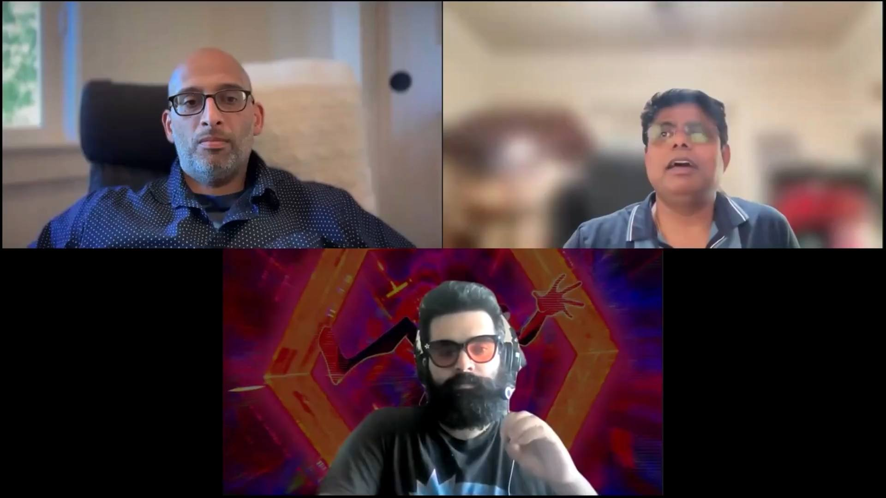
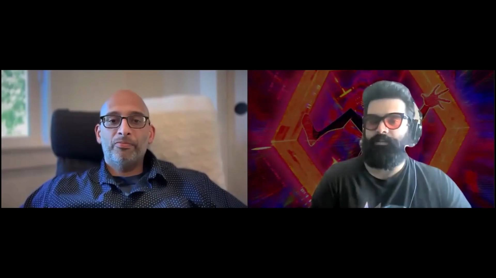
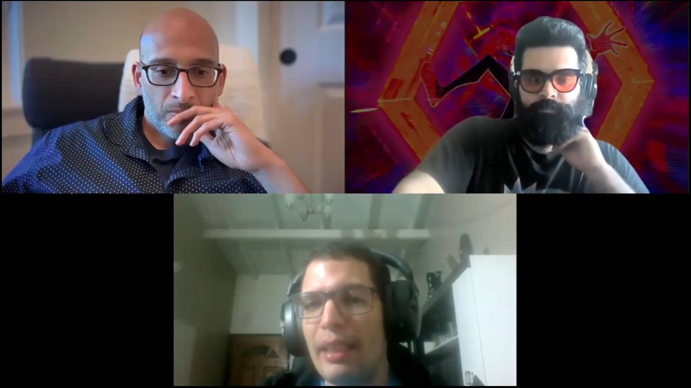
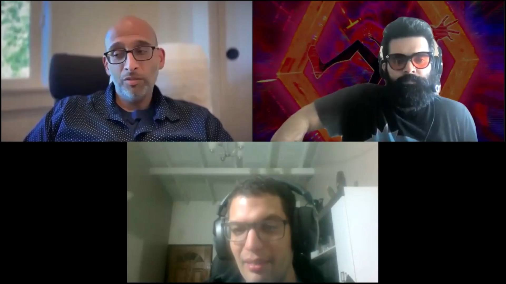
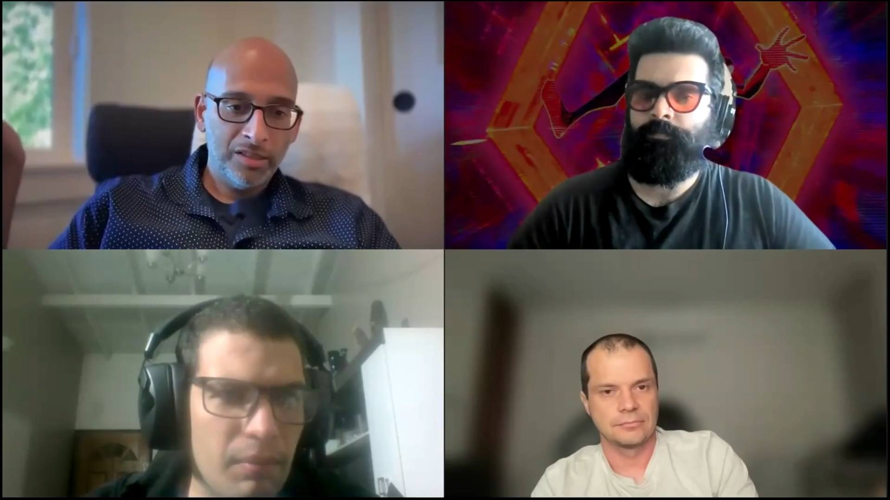
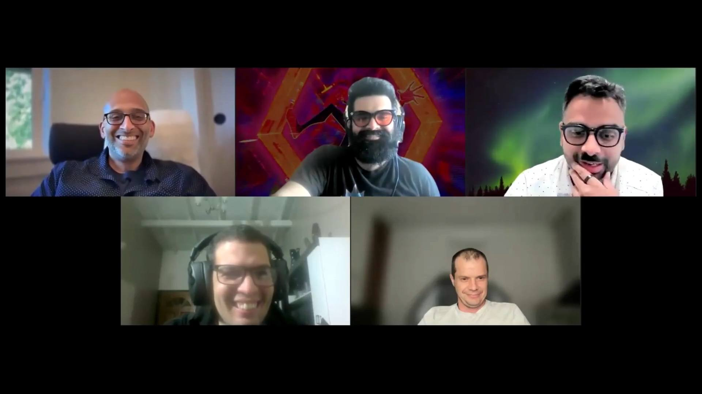
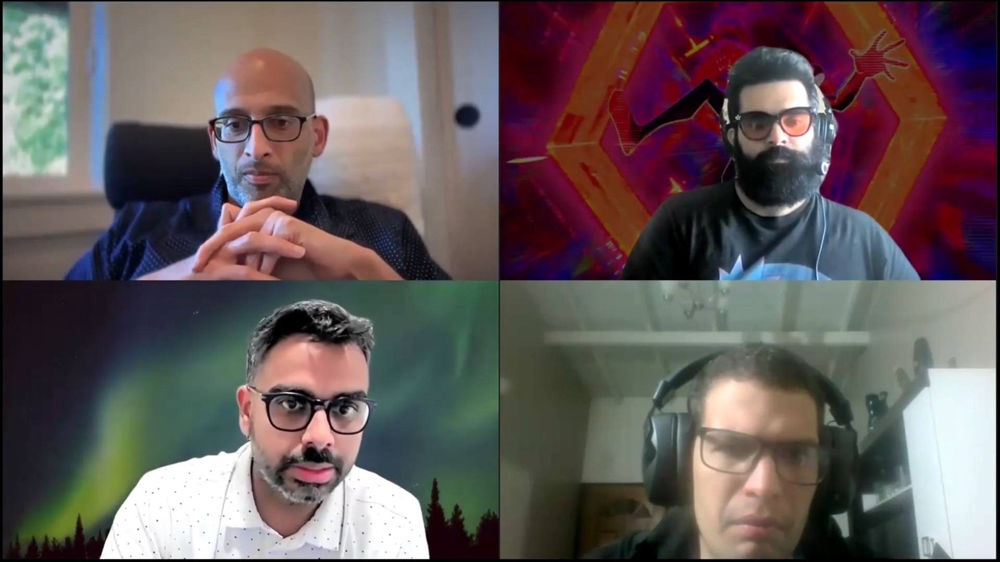
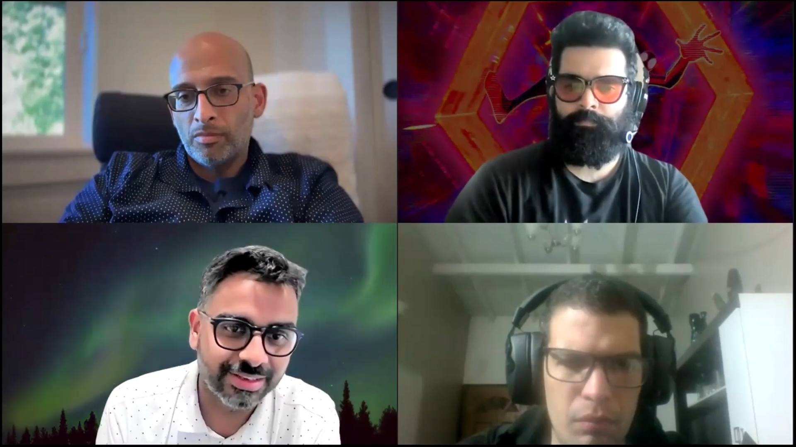

# AI Evals 实战：从「让团队接受评测」到「用评测驱动模型选型」——Office Hours 实录复现文档

> 课程：AI Evals For Engineers & PMs（Agent 评测）｜覆盖 P25（Office Hours 问答专场）
> 说明：本节是**纯问答/讨论课**，逐字稿里没有可运行的代码工程，也没有 OCR 代码片段。因此第 3、4、5 节按「纯讲解课」规则改写：把讲师的推导过程复现成可执行的**决策流程、评估方案与产物模板**，并在需要处标注「课里没有代码，以下为示意」。

---

## 1. 这一节做什么

P25 是一场小规模 Office Hours（讲师开场说「There's only three people here」，实际在场约 4–5 人）。它不教新知识点，而是把前面课程里的 **error analysis（错误分析）/ evals（评测）** 方法论，落到五个真实工程与组织问题上：

1. **非技术背景（业务/售前）如何跟上课程**——讲师给出的方法是把 course reader 丢给 ChatGPT 做个性化问答。
2. **「评测文化」在行业里为什么不被重视，个人如何突围**——讲师的答案是「让结果说话，不要让理念说话」。
3. **没有数据管线的团队（法务等）如何引入 AI 与评测**——先建数据管线，评测可以后置；等「痛点」出现再推动。
4. **新模型发布时，工程师自己该跑什么评测**——正式 eval suite + 非正式 vibe check（含用 chorus.sh 并行对比多模型）。
5. **文档结构化抽取（发票/收据 JSON 化）场景下，如何用评测证明「换模型/换架构」是对的**——去掉 textract 中间层、改用多模态模型、用 JSON schema 约束输出、用成本换算做取舍。
6. 末尾补充 **guardrails 与 evaluators 的区别**，以及「不要盲用现成 guardrail，先看它的 prompt」。

这一节的可交付产物不是代码，而是：**一套可复用的「评测驱动决策」流程 + 若干模板（失败模式表、评测指标表、成本估算表、guardrail 检查清单）**。

---

## 2. 讲师原话

关于「非技术背景怎么学」：

> "把 course reader 放进 ChatGPT，开始按你的知识水平提问……课程读本里内容很多，你可以用它，按你的兴趣开始问问题。"
> —— p025 [03:32]

> "如果你在学，如果你发现某样东西对你有帮助，我鼓励你把它写到某个地方，任何地方，然后分享出来。"
> —— p025 [05:45]

关于「评测不被行业重视、个人如何突围」：

> "evals 本身并不是你需要去宣传的东西。它的成果不在于宣传。关键在于你让产品真正跑起来的能力。"
> —— p025 [13:11]

> "让结果赢，不要让理念赢。不要用理念、技术或者『我们应该做 evals』这种说法去领头，甚至不要去争论这件事，直接去做，让你的结果自己说话。"
> —— p025 [14:32]

> "我们这群人的共同点是，我们都是数据科学家、机器学习的人，在工业界待了很久。结果发现，如果你是在工业界的机器学习从业者，你就必须做这些事，比如看数据。"
> —— p025 [15:58]

> "一旦你有了这些超出预期的结果……你的同事会问，你是怎么一直找到这些问题、修好它们、诊断它们的？然后你就有了一整套术语，你可以说，让我给你讲讲 error analysis。"
> —— p025 [16:54]

关于「没有数据管线的团队」：

> "你不需要对每件事都立刻做 evals。先构建东西是可以的，而且你应该在 evals 之前先构建东西。"
> —— p025 [21:07]

> "evals 可能很贵。如果只是给我自己用，那我就是那个 eval，这就够了。"
> —— p025 [21:07]

> "你需要看看能不能按每周或某个节奏呈现结果……如果你不是那个能做 evals 的人，而需要别人来做 evals，那就很难了。"
> —— p025 [21:37]

> "我几乎会稍微等一等，等一个能激发动机的问题出现。"
> —— p025 [22:06]

> "有时候人们就是需要先感受到痛，才会去做事。"
> —— p025 [23:05]

> "这就像写软件不写测试。你刚进入软件行业时可能不写测试……直到你被卡在维护某个东西上，你才意识到，没有测试根本没法维护。"
> —— p025 [25:20]

> "如果他们还只是在做 demo，甚至不知道自己想构建什么，也许他们还不知道自己想要什么，需要做更多 demo，直到说服自己其中一个值得做下去。也有可能他们本来就不该做 evals。因为做 evals 时你需要有一个目标。"
> —— p025 [27:07]

> "比 vibe check 低一个层次的，是去看日志、看 trace。"
> —— p025 [28:04]

> "我认为他们边做边学是可以的。我不认为他们必须在进入 AI 之前先吃下 evals。"
> —— p025 [28:33]

关于「新模型发布时跑什么评测」：

> "benchmarks 在这个阶段是有损的。模型在你的用例上表现如何，你没法在 benchmark 和你的用例之间画一条直线。"
> —— p025 [30:27]

> "当然，永远要跑你自己的 evals。"
> —— p025 [30:27]

> "尤其是前沿模型，如果从成本角度说得通、没有约束，我就会去试。然后有一套针对课程里讲过的那些具体 evals 的 suite，我跑它们，看指标告诉我什么，我就按那个来。"
> —— p025 [30:57]

> "另一种方式是，直接用。你肯定也想做自己的 vibe check。"
> —— p025 [31:26]

> "我经常用 chorus.sh……我并行试很多模型，感受一下哪个对我有意义。"
> —— p025 [31:55]

> "Gemini 在多模态上就是最强的，某些场景下没有竞争。如果我需要喂视频、幻灯片、转录文本，Gemini 会做得最好。"
> —— p025 [34:16]

关于「文档抽取场景」：

> "一旦你有了课程里讲的这种 evals，你应该做的是试着简化数据处理管线。现在你在用 textract，把文本加上其他用户输入喂给 LLM。那是你的 baseline。"
> —— p025 [37:57]

> "你应该让 evals 跑过那个 baseline，看那些不同的指标、那些 judge 上的二元指标，也许还有一些基于代码的指标。然后再简化，比如把 textract 这一步拿掉，用多模态模型直接读 PDF。"
> —— p025 [38:26]

> "很多时候多模态的东西非常好，因为它是高保真的，它更理解文档，损失更少。"
> —— p025 [39:51]

> "从成本角度看……用 Nova Pro 每份文档大约 3 到 4 印度卢比，客户说这相当高。他们想要接近 1 卢比。"
> —— p025 [42:16]

关于 guardrails 与 evaluators：

> "guardrails 是内联的安全检查，位于请求-响应路径上。"
> —— p025 [45:07]

> "guardrail 触发时，系统可以打码、拒绝或重新生成响应。"
> —— p025 [46:35]

> "evaluators 是在响应产生之后运行的。从根本上说，机制是一样的，你都是在跑一些测试，基于代码的测试，或者 LLM as a judge。"
> —— p025 [47:02]

> "不要盲目使用现成的 LLM guardrails。永远要看它的 prompt。"
> —— p025 [48:01]

> "它不是魔法，很多情况下它就是一个 prompt。"
> —— p025 [50:22]

关于自动化与「人在环」：

> "自动化也许能激励你去看数据，给你呈现一些你原本不知道的东西。"
> —— p025 [52:41]

> "LLM 应该能帮你写 open codes，肯定也能帮你做 axial coding，肯定也能帮你写 LLM judge 的 prompt。只要你有意识地去做，就像其他任何事情一样。"
> —— p025 [53:09]

> "只要我们在一定程度上保持人在环，我觉得就会不错。"
> —— p025 [54:06]

---

## 3. 从零复现（把讲师的推导过程按步骤复现）

> 本节没有可运行代码。以下是把讲师在问答中给出的判断，整理成**你可以照着执行的流程**。每一步都标注了讲师依据。

### 步骤 0：先判断「这个团队现在该不该做 evals」

讲师在 [27:07] 给了一个前置条件：**做 evals 必须有目标**。所以第一步不是写 judge，而是回答三个问题：

| 问题 | 如果答案是「否」 | 讲师依据 |
|---|---|---|
| 你们知道自己要构建什么产品/能力吗？ | 继续做 demo，直到说服自己其中一个值得做 | [27:07] |
| 你们有可观测的输入输出吗（日志、trace）？ | 先补日志/trace，这是「比 vibe check 低一层」的动作 | [28:04] |
| 有人能每周（或固定节奏）产出评测结果吗？ | 先解决「谁来做」的问题，否则评测推不动 | [21:37] |

**决策**：三项都过 → 进入步骤 1。任一项不过 → 先做前置工程（数据管线 / 日志 / demo），评测后置。讲师明确说「你不需要对每件事都立刻做 evals」[21:07]。

### 步骤 1：建立 baseline（当前生产管线）

以 P25 里那位学员的文档抽取系统为例，baseline 是：

```
PDF → AWS Textract（OCR/文本抽取）→ 文本 + 用户输入 → LLM（Nova Pro）→ JSON 属性
```

讲师原话 [37:57]：这就是你的 baseline，**先让 evals 跑过它**，拿到一组数字，再谈优化。没有 baseline 数字，任何「换模型更好」的论断都无法证明。

### 步骤 2：定义失败模式（error analysis）

学员描述的失败现象（[36:28]）可以直接转成失败模式清单：

| 失败模式 | 现象 | 可观测信号 |
|---|---|---|
| F1 属性缺失 | 期望的属性没被抽出来 | 输出 JSON 缺少 schema 中的 required 字段 |
| F2 数值错误 | 合计/总额类字段算错 | 抽取的 total 与人工标注值不一致 |
| F3 格式不合规 | 没严格遵守文档语法（schema） | JSON 解析失败 / 类型不符 |
| F4 扫描件噪声 | 印章、手写批注干扰 | 扫描件子集上的准确率显著低于数字件 |

讲师没有逐条确认这些分类，但 [38:26] 明确要求「在这些 judge 上跑二元指标，也许还有一些基于代码的指标」——F1/F3 适合代码指标（schema 校验），F2/F4 适合 LLM judge 或人工标注对照。

### 步骤 3：搭评测指标（二元 + 代码 + judge 混合）

讲师在 [38:26] 给的组合是：

1. **二元指标（binary metrics）**：每个样本每个字段 pass/fail。
2. **基于代码的指标（code-based）**：JSON schema 校验、数值比对、必填字段检查。
3. **LLM as a judge**：用于语义层面的判断（例如「这个地址是否被正确规范化」）。

> 课里没有代码，以下为示意：一个最小的字段级二元评测记录结构。

```json
{
  "doc_id": "invoice_001",
  "doc_type": "invoice",
  "fields": {
    "invoice_number": { "expected": "INV-2024-001", "actual": "INV-2024-001", "pass": true },
    "gstin":          { "expected": "27AABCU9603R1ZM", "actual": null, "pass": false, "failure_mode": "F1" },
    "total_amount":  { "expected": 12500.00, "actual": 15200.00, "pass": false, "failure_mode": "F2" }
  },
  "schema_valid": false,
  "pipeline": "textract+nova_pro"
}
```

### 步骤 4：做架构简化实验（A/B）

讲师在 [38:26]–[39:51] 给的实验设计：

- **A 组（baseline）**：Textract + 文本 → LLM
- **B 组（简化）**：多模态模型直接读 PDF（去掉 Textract 中间层）

判断依据：同一套指标在 A、B 上跑，比较字段级 pass rate。讲师的预期是 B 组「高保真、损失更少」[39:51]，但强调这是 impression，必须用数字验证。

**约束**：讲师提醒「取决于 PDF 大小，有时直接读不可能」[38:26]。所以实验要按文档页数/类型分层。

### 步骤 5：用 JSON schema / 文档语法约束输出

学员在 [40:21]–[41:47] 提出的方案（讲师回应「yeah yeah」认可）：

1. 先做**文档类型识别**（约 20–25 种格式）。
2. 每种类型配一份**严格 JSON schema（document grammar）**。
3. 把 schema 作为 context 传给模型，要求「至少把 required 属性找出来，找不到也不要直接丢掉」。

> 课里没有代码，以下为示意：发票类文档的 grammar 草案。

```json
{
  "$schema": "http://json-schema.org/draft-07/schema#",
  "title": "IndiaInvoice",
  "type": "object",
  "required": ["invoice_number", "gstin", "pan", "total_amount", "vendor_name"],
  "properties": {
    "invoice_number": { "type": "string" },
    "gstin":          { "type": "string", "pattern": "^[0-9]{2}[A-Z]{5}[0-9]{4}[A-Z]{1}[1-9A-Z]{1}Z[0-9A-Z]{1}$" },
    "pan":            { "type": "string", "pattern": "^[A-Z]{5}[0-9]{4}[A-Z]{1}$" },
    "vendor_name":    { "type": "string" },
    "total_amount":   { "type": "number" },
    "line_items": {
      "type": "array",
      "items": {
        "type": "object",
        "required": ["description", "amount"],
        "properties": {
          "description": { "type": "string" },
          "amount":      { "type": "number" }
        }
      }
    }
  }
}
```

### 步骤 6：成本估算与取舍

讲师在 [42:16] 给出学员提供的真实数字：Nova Pro 约 **3–4 印度卢比/文档**，客户目标 **约 1 卢比/文档**，汇率按 **1 美元 = 80 卢比**。

换算表（按讲师给的汇率）：

| 方案 | 单文档成本（卢比） | 单文档成本（美元） | 相对 baseline |
|---|---|---|---|
| Nova Pro（baseline） | 3–4 | 0.0375–0.05 | 1.0x |
| 客户目标 | ~1 | ~0.0125 | ~0.25–0.33x |
| 自托管 7B 参数模型（学员设想） | 课里没给具体数字 | 课里没给 | 课里没给 |

讲师没有对「7B 自托管」给出成本结论，只认可了「值得试试去掉中间层、用多模态」这个方向 [39:24]。**不要替讲师编造自托管成本数字。**

### 步骤 7：新模型发布时的个人评测流程

讲师在 [30:57]–[34:44] 给的流程，可直接照做：

1. **正式路径**：跑课程里那套针对你用例的 eval suite → 看指标。
2. **非正式路径（vibe check）**：把新模型用在你日常真实任务上（写作、编码、转录问答）。
3. **并行对比**：用 chorus.sh 同时问多个模型同一个问题，横向看差异。
4. **按能力选型**：多模态任务（视频/幻灯片/转录）直接选 Gemini，讲师说「没有竞争」[34:16]。

讲师举的真实例子 [32:22]–[33:48]：他把 office hours 的转录文本做成「问题清单」，让 Gemini 2.0/2.5 Pro、GPT-5、Ocus 4.1 等分别抽取问题，再让模型互相评判谁答对了哪些题。结论是「GPT-5 在这场里明显更好，抓到了更多问题，但不是压倒性胜利」。

### 步骤 8：guardrails vs evaluators 的判定流程

讲师在 [45:07]–[50:22] 给的区分，整理成决策表：

| 维度 | Guardrail | Evaluator |
|---|---|---|
| 位置 | 请求-响应路径内联（inline） | 响应产生之后 |
| 延迟要求 | 通常要快（用户在等） | 可离线、可批量 |
| 复杂度 | 简单、可解释、目标明确 | 可以复杂（多 judge、多指标） |
| 误报代价 | 用户可见，直接影响体验 | 主要影响分析结论 |
| 触发动作 | 打码 / 拒绝 / 重新生成 | 记录、聚合、报告 |
| 典型用途 | PII 泄露、合规（GDPR/CCPA） | 质量度量、回归检测、模型选型 |
| 实现 | 本质也是 prompt 或小模型（可微调以求快） | 代码测试 + LLM judge |

讲师强调 [48:01]：**用任何现成 guardrail 之前，先看它的 prompt**。他引用了博客《Show me the prompt》，展示某 guardrail 工具背后其实是「先抽取结构化信息，再让模型修正成合法 JSON」的两段 prompt——「为了拿到结构化输出搞了一大堆仪式」[49:23]。

---

## 4. 完整代码（纯讲解课：落成可用的产物）

> 本节没有讲师给出的可运行代码。以下全部是**从讲师判断落成的产物模板**，标注了哪些是讲师原话、哪些是示意。

### 4.1 设计决策表（基于 P25 全部讨论）

| 决策 | 讲师立场 | 依据帧 |
|---|---|---|
| 评测要不要对外宣传 | 不要，让结果说话 | [13:11] [14:32] |
| 没有数据管线时先做什么 | 先建管线，评测后置 | [21:07] |
| 团队抗拒评测时怎么办 | 等「motivating problem」，用痛点推动 | [22:06] [23:05] |
| 团队只做 demo 时 | 可能还不该做 evals，先做更多 demo | [27:07] |
| 新模型怎么评估 | 正式 suite + vibe check 双轨 | [30:57] [31:26] |
| 文档抽取优化方向 | 去掉 textract，试多模态直读 PDF | [38:26] [39:51] |
| 输出约束 | 文档类型识别 + 严格 JSON schema 作为 context | [40:21] [41:47] |
| guardrail 使用 | 先看 prompt，不要盲用 | [48:01] [50:22] |
| 评测自动化 | 可以，但必须保留人在环 | [52:41] [54:06] |

### 4.2 组件职责表（文档抽取评测系统）

| 组件 | 职责 | 课里是否明确讲过 |
|---|---|---|
| 文档类型分类器 | 把输入分到 20–25 种格式之一 | 学员提出，讲师认可 [40:21] |
| JSON Schema 库 | 每类文档一份 grammar | 学员提出 [41:17] |
| 抽取管线 A | Textract + 文本 → LLM | 讲师称其为 baseline [37:57] |
| 抽取管线 B | 多模态模型直读 PDF | 讲师建议尝试 [38:26] |
| 代码指标 | schema 校验、数值比对 | 讲师提到 code-based [38:26] |
| LLM judge | 语义层判断 | 讲师提到 LLM as a judge [38:26] |
| 结果聚合 | 按失败模式统计 pass rate | 课里没讲具体实现 |

### 4.3 接口/数据模型草案（示意，课里没有代码）

```typescript
// 课里没有代码，以下为示意：评测样本与结果的类型定义
type FailureMode = "F1_missing_field" | "F2_numeric_error" | "F3_schema_invalid" | "F4_scan_noise";

interface EvalSample {
  docId: string;
  docType: string;              // 20–25 种格式之一
  pdfPath: string;
  pageCount: number;
  isScanned: boolean;           // 扫描件 vs 数字件
  expected: Record<string, unknown>;  // 人工标注的 ground truth
}

interface FieldResult {
  field: string;
  expected: unknown;
  actual: unknown;
  pass: boolean;
  failureMode?: FailureMode;
}

interface EvalRun {
  pipeline: "textract_llm" | "multimodal_direct";
  model: string;                // 例如 "nova-pro" / "gemini-2.5-pro"
  sampleId: string;
  schemaValid: boolean;
  fields: FieldResult[];
  costInr: number;              // 单文档成本，卢比
  latencyMs: number;
}
```

### 4.4 容量/成本估算表

| 项 | 数值 | 来源 |
|---|---|---|
| 汇率 | 1 USD = 80 INR | 讲师 [42:44] |
| Nova Pro 单文档成本 | 3–4 INR | 学员 [42:16]，讲师未反驳 |
| 客户目标成本 | ~1 INR | 学员 [42:44] |
| 文档格式种类 | 20–25 种 | 学员 [40:21] |
| 典型页数 | 约 5 页 | 学员 [38:55] |

### 4.5 Guardrail 上线前检查清单（基于 [48:01]–[50:22]）

- [ ] 我读过这个 guardrail 背后的完整 prompt 了吗？
- [ ] 它是不是其实就是「抽取 + 修正 JSON」两段 prompt 的包装？
- [ ] 它的误报率在真实流量上测过吗？（讲师：误报对用户可见 [46:35]）
- [ ] 它是否在关键路径上？延迟可接受吗？
- [ ] 触发后的动作定义清楚了吗：打码 / 拒绝 / 重新生成？
- [ ] 如果是高影响场景，是否考虑微调小模型来提速？[47:32]

---

## 5. 逐行解释（逐条解释上一节的每个决策）

**为什么「不要宣传 evals」？**
讲师 [13:11] 的逻辑是：evals 是手段不是目的，产出是「产品跑得好」。如果你在 Notion 做 AI 工程师，你不需要说「evals」这个词，你只需要每周拿出「产品在 XYZ 场景失败、失败模式是什么、影响多少企业版用户、我建了个 LLM judge 量化了规模、我知道怎么修」[14:04]。这种输出会自然让你脱颖而出。反过来，如果先讲理念，会陷入「该不该做 evals」的争论，而争论不产生结果。

**为什么「先建东西，再评测」？**
[21:07] 讲师用自己的 side project 举例：他不做正式 evals，因为他自己就是 eval——他一直在看数据。这说明 evals 的成本（时间、金钱、人力）必须和收益匹配。对个人项目，vibe check + 看日志就够了；对生产系统，才需要正式 suite。这条判断直接对应步骤 0 的三问。

**为什么「等痛点」而不是「强推」？**
[22:06]–[23:05] 讲师说得很直白：你没法强迫别人做他们不理解、没时间、不在乎的事。他用的类比是「等病人心脏病发作」[24:53]，但也补了更温和的版本：先看症状（胆固醇高），再谈。对应到工程上，就是先做 demo 让团队看到 AI 能做什么，等他们真的把 AI 往生产推、撞到问题，再引入评测。讲师也承认这是「听起来不像正确答案」的务实建议。

**为什么「只做 demo 的团队可能不该做 evals」？**
[27:07] 的核心是「evals 需要目标」。没有目标，你就不知道 judge 该判什么、指标该优化什么。这时候正确的动作是继续做 demo 探索方向，同时「至少要看数据」[27:36]——看日志、看 trace，这比 vibe check 低一层但比什么都不做强 [28:04]。

**为什么 benchmark 不可靠？**
[30:27] 讲师说 benchmark 是「lossy」的：模型在 benchmark 上的分数和它在你用例上的表现之间没有直线关系。所以流程必须是「先跑自己的 suite」[30:27]，benchmark 只作为参考。这也解释了为什么他要用 chorus.sh 做并行 vibe check [31:55]——那是把「你的用例」直接喂给多个模型的最快方式。

**为什么文档抽取要去掉 Textract？**
[38:26]–[39:51] 的逻辑链是：Textract 是文本抽取中间层，会丢信息（尤其扫描件上的印章、手写）；多模态模型直接看 PDF 是「高保真」的，损失更少。但讲师明确说这是 impression（「I can't say for sure」）[39:51]，所以必须用步骤 3 的指标在 A/B 两组上验证，不能凭感觉换架构。

**为什么用 JSON schema 作为 context？**
学员 [41:47] 的观察是：模型经常漏属性。把 schema 放进 context，等于告诉模型「这些字段必须找，找不到也要尝试」[42:16]。这比事后用代码校验再重试更前置。讲师对此回应「yeah yeah」表示认可，但没有展开讲实现细节——实现细节课里没讲。

**成本怎么算？**
[42:16]–[42:44] 学员给的数字是 Nova Pro 3–4 INR/文档，客户要 1 INR。按 80 汇率，baseline 约 0.0375–0.05 USD/文档，目标约 0.0125 USD/文档，即要降 3–4 倍。讲师没有给出「7B 自托管能不能达到 1 INR」的结论，只认可了「值得试多模态直读」这个降本方向 [39:24]。任何自托管成本数字都必须自己实测，课里没讲。

**guardrail 和 evaluator 的本质区别是什么？**
[47:02] 讲师说「fundamentally, it's the same mechanism」——都是跑测试（代码测试或 LLM judge）。区别全在**位置**：guardrail 在关键路径上，所以要求快、简单、可解释、误报少、用户可见 [46:05]；evaluator 在响应之后，所以可以复杂、可以批量、可以慢慢跑。这个区分直接决定了工程选型：合规场景（GDPR/CCPA、PII）用 guardrail [47:02]，质量度量用 evaluator。

**为什么「先看 prompt」？**
[48:27]–[50:22] 讲师用《Show me the prompt》的例子说明：很多 guardrail 工具表面是「安全护栏」，背后就是两段 prompt（先抽取结构化信息，再让模型修正 JSON）。如果你不知道这一点，你会以为它有什么魔法，也就无法判断它的误报来源、无法调优、无法替换。讲师的结论是「它不是魔法，很多情况下它就是一个 prompt」[50:22]。

**自动化评测的边界在哪？**
[52:41]–[54:06] 讲师的态度是「正在改变想法」：他过去对过度自动化有负面反应，因为客户买了工具、按了红按钮、以为 evals 会自动完成，结果卡住。但他现在认为，如果自动化能「呈现你原本不知道的东西」，就能激励人去看数据。边界是「人在环」[54:06]：LLM 可以帮你写 open codes、做 axial coding、写 judge prompt [53:09]，但你必须看 plan、必须反应，就像用 LLM 写代码也必须看代码一样。

---

## 6. 复现检查清单

按顺序打勾，任何一项不过就回到对应步骤：

- [ ] 我能用一句话说清「我们要构建什么」，以及它的成功标准（步骤 0）
- [ ] 我有当前生产管线的 baseline 数字（pass rate、成本、延迟）（步骤 1）
- [ ] 我列出了至少 3 条失败模式，每条都有可观测信号（步骤 2）
- [ ] 我的评测同时包含代码指标和 LLM judge，且每个字段是二元判定（步骤 3）
- [ ] 我做了 A/B 两组（含去掉中间层的简化版），并按文档类型分层（步骤 4）
- [ ] 每类文档都有严格 JSON schema，且 schema 作为 context 传入（步骤 5）
- [ ] 我算过单文档成本，并和客户目标做过对比（步骤 6）
- [ ] 新模型发布时，我既跑了正式 suite 也做了 vibe check（步骤 7）
- [ ] 我用的每个 guardrail，我都读过它的 prompt（步骤 8）
- [ ] 我的自动化流程里保留了人工复核节点（步骤 8 延伸）

---

## 7. 课里没讲但你会撞上的

1. **JSON schema 在不同模型上的遵循率差异**。讲师认可了「把 schema 放进 context」这个方向 [41:47]，但没讲哪些模型对 schema 的遵循更好、需不需要用 structured output / function calling 模式。你需要自己用步骤 3 的指标测。
2. **多模态直读 PDF 的页数上限与分辨率策略**。讲师只说「取决于 PDF 大小，有时不可能」[38:26]，没给具体阈值。实际工程里要自己压测。
3. **扫描件预处理的去噪方法**。学员提到「有办法在预处理后让文档更干净」[39:24]，但课里没讲具体算法（去印章、去手写）。这块要自己找方案。
4. **7B 自托管模型的真实成本**。学员设想「7B 参数模型跑在内部 CPU/GPU 上能优化成本」[42:16]，讲师没有背书这个数字。GPU 折旧、吞吐、运维都要自己算。
5. **评测结果的统计显著性**。讲师说「看指标告诉我什么」[30:57]，但没讲样本量要多大、置信区间怎么算。小样本上的 pass rate 差异可能是噪声。
6. **chorus.sh 的具体用法**。讲师只说他用它并行对比模型 [31:55]，没讲配置、API、成本。课里没讲。
7. **guardrail 的误报率测量方法**。讲师强调误报对用户可见 [46:35]，但没给测量流程。你需要自己构造负样本集。
8. **「人在环」的具体 UX**。讲师说自动化要保留人在环 [54:06]，但没讲界面怎么设计、复核比例多少。他提到会做一个 eval automation 系列 [54:35]，届时可能有答案。
9. **前端转 AI 的对应关系**：本节讨论的「评测流水线」在 Node/前端侧对应的是 CI 里的测试套件 + 离线批处理脚本；guardrail 对应的是请求拦截中间件（类似 Express middleware），只是判定逻辑换成了模型调用。课里没讲这层映射，但这是你落地时必然要做的翻译。

---

### 附：本节引用的截图

















