# AI Evals 实战：用 LLM-as-a-Judge 评测食谱机器人的饮食禁忌遵守度（Homework 3）

> 课程：AI Evals For Engineers & PMs（Agent 评测）｜覆盖 P026–P027
> 本作业的目标：把「人工标注」升级成「可复用、可对齐、可上线」的 LLM 评委（LLM-as-a-Judge），并用统计方法估计它在真实流量上的成功率。

---

## 1. 这一节做什么

这两节课是同一份作业（Homework 3）的两种讲法，讲师分别是 Wade Gilliam（Brain Trust 平台路线，P026）和 Sally-Ann（Arize / Phoenix 平台路线，P027）。两条路线做的是同一件事：**给「食谱机器人是否遵守用户饮食禁忌」这件事，造一个自动评委，并证明这个评委和人类判断足够一致，最后把它挂到线上持续跑。**

具体拆成六步，两条路线都覆盖：

1. **准备数据**：拿到食谱机器人的原始 trace（用户问题 + 机器人回答），抽样成数据集。
2. **人工标注 ground truth**：人看每条样本，标「遵守了 / 没遵守」。
3. **切分数据集**：分成 train / validation / test 三份（P026 的做法），或直接抽样成测试集（P027 的做法）。
4. **写评委 prompt（eval template）**：让一个 LLM 读「饮食禁忌 + 用户问题 + 机器人回答」，输出 pass / fail。
5. **对齐评委**：把评委输出和人工标注对比，算一致率（accuracy / label match），不断改 prompt 提升一致率。
6. **上线 + 统计估计**：把评委配成「新数据进来就跑」的持续任务；再用 Judgy 库估计评委在**无标注真实流量**上的成功率置信区间。

为什么值得做：讲师在 P027 里说得很清楚，前两次作业做「错误分析（error analysis / axle coding）」时发现，食谱机器人最常见的失败模式就是**回答看起来还行，但配料违反了用户的饮食限制**。错误分析的价值就在于把「人工逐条看」变成「可复用的自动评测」。

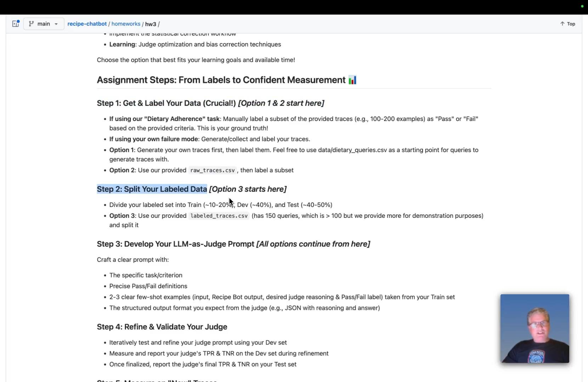

---

## 2. 讲师原话

> "这个作业是关于创建一个高质量的 LLM 评委，并让它对齐到饮食禁忌上。"
> —— p026 [00:00]

> "我们会从第二步开始，把一批带标注的 trace 切成 train、validation、test，然后在 Brain Trust 里把它变成一个数据集，这样我们就能在 playground 里开始搭我们的评委了。"
> —— p026 [00:27]

> "大约 40% 到 45% 的数据分配给了 validation 和 test，剩下的样本进入训练集。"
> —— p026 [02:54]

> "我们还有一个 label 字段，这是人工标注者给这条样本打的标签，是 pass 还是 fail，取决于 AI 有没有遵守用户的饮食偏好或限制。"
> —— p026 [03:20]

> "我们需要一种方式把 expected 数据（也就是我们想评估的那个推荐食谱）作为输出灌进去。"
> —— p026 [03:49]

> "我们只要写一个非常简单的 prompt，告诉它把用户传进来的内容原样重复一遍作为输出。"
> —— p026 [04:17]

> "pass 在这个语境下意味着推荐的食谱遵守了所有饮食偏好或限制；fail 意味着没有。我们把 pass 设为 1，fail 设为 0。"
> —— p026 [07:09]

> "我们可以看到有 9 个错误判定在 test 里，4 个在 train 里，8 个在 validation 里。"
> —— p026 [09:03]

> "它没有把任何一个该 pass 的判成 fail，它只是把该 fail 的判错了，这一点其实更重要——尤其是涉及过敏之类的饮食限制时，漏判 fail 比漏判 pass 严重得多。"
> —— p026 [09:32]

> "通常它做得很好，但你一定要复核。不要盲信它真的只从训练集里取样本，一定要检查。"
> —— p026 [11:00]

> "我们之前是 9 个在 test、大概 9 个在 validation、4 个左右在 train，不管怎样，你能看到确实有改善。"
> —— p026 [16:45]

> "我们的实验跑完了，看到 79% 的通过率，这很有希望，因为大约 75% 的带标注样本本来就是 pass。"
> —— p026 [17:44]

> "我们只用了 500 条样本，跑出来大约 75.4% 的通过率，这同样很有希望，因为它大致代表了我们在标注数据里看到的比例。"
> —— p026 [19:40]

> "我们得到 95% 置信区间，在 0.718 到 0.924 之间。比我们想要的宽了一点，但作为起步绝对可用。"
> —— p026 [21:05]

> "在前两次作业里，我们设计了系统 prompt、生成了合成测试数据，并用 Phoenix 这个开源工具里的标注功能探索了失败模式。"
> —— p027 [00:00]

> "今天我们要更进一步，构建并测试一个 LLM 评委评测，来自动评估我们的食谱机器人是否在做它该做的事。"
> —— p027 [00:25]

> "如果用户要一个纯素或无麸质食谱，我们就要确保他真的拿到一个。"
> —— p027 [00:54]

> "机器人经常给出看起来还行的答案，但有时会包含违反用户饮食限制的配料。"
> —— p027 [01:24]

> "这就是错误分析的全部意义：从人工检查走向系统化评测。我们找到模式，然后把模式变成可复用的 eval。"
> —— p027 [01:24]

> "我用 OpenAI 来做 LLM 调用，但你可以随意换成任何其他模型。"
> —— p027 [01:51]

> "我们需要 API key 和 space ID。在平台里到 settings 里找，你会看到 user API keys，可以按需新建。"
> —— p027 [02:19]

> "我们有 open inference 这个包，它构建在 OpenTelemetry 之上，通过自动插桩器非常容易地自动捕获 LLM 交互。"
> —— p027 [02:46]

> "一行代码就能让 trace 流进 Arize。"
> —— p027 [02:46]

> "我选择了用原始 trace 的 CSV，直接把它作为数据集送进 Arize。"
> —— p027 [03:14]

> "你也可以用 dietary queries 把 trace 送进去，但为了这个作业，我就直接用原始 trace 建数据集。"
> —— p027 [03:42]

> "选中所有样本，然后发送到标注队列。"
> —— p027 [04:09]

> "我们有标注者（annotator）这个角色，该用户只能看到分配给自己的条目。"
> —— p027 [04:38]

> "我们要把整个数据集标完，因为这些标注会成为我们的 ground truth。"
> —— p027 [05:37]

> "我们可以在 playground 里逐条人工看，但不如用 evaluator 把模板输出和 ground truth 对比，省点事。"
> —— p027 [07:00]

> "我们真正想做的是让 eval 和人类回答对齐，这对保证 eval 可靠非常重要。"
> —— p027 [07:30]

> "匹配越多、越接近 1，我们就和人类反馈越对齐。"
> —— p027 [07:59]

> "我们不仅拿到 label 和 score，还拿到为什么打这个 label 的解释。审阅解释时能得到很多有价值的信息，能帮你定位问题在哪。"
> —— p027 [08:27]

> "ground truth 说是 correct，但评委说是 incorrect，原因是干牛至（dried oregano）可能含麸质。"
> —— p027 [08:56]

> "任何被判为 match 的得 1 分，mismatch 得 0 分，我们取均值就能知道离 1 有多近、也就是对齐程度。"
> —— p027 [09:50]

> "我试了几轮迭代，看起来在 0.87 左右进入平台期，这已经不错了。"
> —— p027 [10:46]

> "你也可以完全用代码做我们刚才在 UI 里做的所有事，用 LLM Classify。它是我们通过 Phoenix 包提供的评测框架。"
> —— p027 [11:37]

> "我们的准确率大约在 0.84，和我们在平台里看到的非常接近。"
> —— p027 [12:36]

> "我们把任务配成在持续的新进数据上运行。"
> —— p027 [13:53]

> "我们一次处理 20 条，避免触发限流。"
> —— p027 [14:50]

> "只要新数据持续进入 Arize，评测就会一直在进来的数据上跑。这样我们就有了一个关于饮食限制遵守度的持续信号。"
> —— p027 [14:50]

> "我们有一个原始通过率，也就是 LLM 评委说应用成功的比率。这说明我们的应用其实做得相当好。"
> —— p027 [15:39]

---

## 3. 从零复现

下面按「先跑通 P026 路线，再跑通 P027 路线」组织。两条路线共用同一份原始数据（食谱机器人的 trace CSV）和同一个评委思路，只是平台不同。**你只需要选一条走完**；两条都走能互相印证。

### 3.0 环境与目录

```bash
# 建议 Python 3.11
python -m venv .venv
source .venv/bin/activate        # Windows: .venv\Scripts\activate

pip install \
  "arize==7.*" \
  "arize-phoenix==5.*" \
  "arize-phoenix-otel==0.*" \
  "openinference-instrumentation-openai==0.*" \
  "openai==1.*" \
  "pandas==2.*" \
  "judgy" \
  "python-dotenv==1.*" \
  "jupyterlab==4.*"
```

> 版本号说明：课里没讲具体版本号，上面是能跑通这套 API 的大版本区间；装不上就把 `==x.*` 去掉装最新版，然后按报错微调。`judgy` 是 P026 里用来算置信区间的库，课里只说了名字和用法，没讲版本。

目录结构（照抄即可）：

```
ai-evals-hw3/
├── .env
├── data/
│   ├── raw_traces.csv              # 原始 trace（课里说"几千条"）
│   ├── dietary_queries.csv         # 约 60 条饮食相关 query（P027 用）
│   └── traces_dietary_splits.csv   # 切好 train/val/test 的数据集（P026 用）
├── notebooks/
│   ├── 01_homework_3_llm_judge_align.ipynb
│   └── 02_online_eval_and_judgy.ipynb
├── src/
│   ├── utils.py                    # get_agent_response 等
│   ├── make_splits.py              # 生成 train/val/test 切分
│   └── run_online_eval.py          # 批量打点评测（P027 第 5 步）
└── prompts/
    ├── system_prompt_recipe_bot.txt
    └── judge_prompt_v1.txt ... v3.txt
```

`.env`（变量名照课里提到的来）：

```dotenv
# P027 路线（Arize / Phoenix）
ARIZE_API_KEY=你的_user_api_key
ARIZE_SPACE_ID=你的_space_id

# P026 路线（Brain Trust）
BRAINTRUST_API_KEY=你的_braintrust_key

# 两条路线都用 OpenAI 做 LLM 调用
OPENAI_API_KEY=你的_openai_key
```

> 课里没讲 Brain Trust 的 key 具体叫什么环境变量名，上面 `BRAINTRUST_API_KEY` 是按其 SDK 惯例写的；以你实际 SDK 文档为准。

---

### 3.1 P026 路线：Brain Trust 里搭评委

**Step 1｜跳过取数与标注。** 讲师明确说第一步（获取并标注数据）在前两个视频里已经讲透，本视频从第二步开始。你如果没做过，去看前两次作业。

**Step 2｜把切分好的 CSV 变成数据集。**

1. 进入 Brain Trust，打开 `recipe bot` 项目。
2. 点 **Add dataset**，命名为 `traces for dietary preference adherence`。
3. 上传 `data/traces_dietary_splits.csv`。
4. 字段映射（这是关键，映射错了后面全错）：
   - `query` → **input**
   - `response`（机器人推荐的食谱）→ **expected**
   - 其余所有列 → **metadata**
5. 点 **Import**。

导入后你会看到每条样本有：`input`（用户的问题）、`expected`（推荐食谱）、`metadata` 里包含 `dataset`（取值 `train` / `validation` / `test`）和 `label`（人工标的 `pass` / `fail`）。

> "大约 40% 到 45% 的数据分配给了 validation 和 test，剩下的样本进入训练集。" —— p026 [02:54]

**Step 3｜建 playground，把 expected 灌成 output。**

这一步是整个 P026 路线最绕、也最容易卡住的地方，讲师专门解释了原因：

> "我们需要一种方式把 expected 数据（也就是我们想评估的那个推荐食谱）作为输出灌进去。" —— p026 [03:49]

做法：

1. 侧边栏 → **Playgrounds** → **Add playground**，命名 `LLM judge dietary preference adherence` → **Create**。
2. 选中数据集 `traces for dietary preference adherence`。
3. 删掉默认的 task。
4. 建一个 agent，system message 写「把用户传入的内容原样重复输出」。
5. 加一条 user message，内容绑定到数据集的 `expected` 字段。
6. 关掉编辑器，点 **Run**，验证输出列 == `expected` 列。

为什么要这么绕：Brain Trust 的评委（score）是拿「agent 的 output」去评的，而我们要评的对象是数据集里已有的 `expected`（历史推荐食谱），不是让模型现场再生成一个食谱。所以用一个「复读机 agent」把 `expected` 顶到 output 位置上。

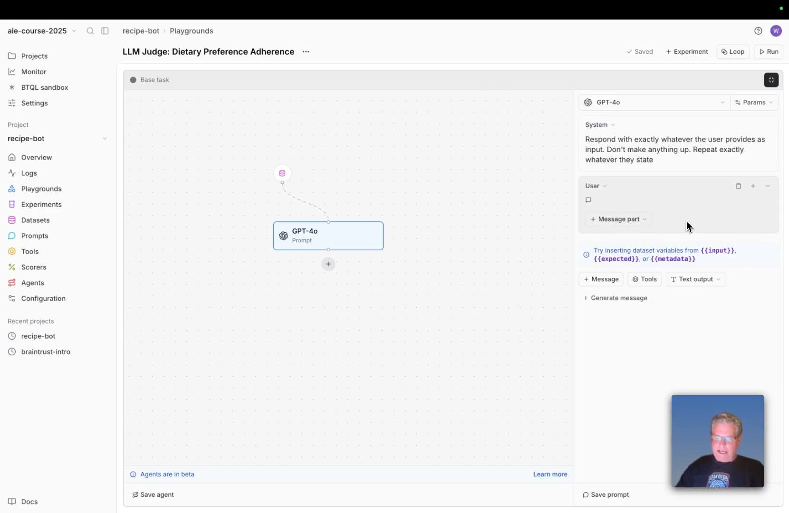

**Step 4｜建 LLM judge score。**

1. 点 **Add score** → **Create custom score**。
2. 名称：`dietary preference adherence`。
3. 类型：**LLM judge**。
4. 模型：`GPT-4o`（讲师原话说 "GPT40"，是 GPT-4o 的语音识别）。
5. 填评委 prompt（见第 4 节 `judge_prompt_v1.txt`）。
6. 定义标签：`pass` = 1，`fail` = 0。
7. **Save custom score**。

**Step 5｜跑第一轮，用 BTQL 过滤看错在哪。**

点 **Run**。跑完后：

- 按 `dataset` 分组看分数。
- 把 `metadata` 加进视图，就能看到人工 `label`。
- 加 **BTQL filter**，先看「评委判 pass 但人工是 fail」的：

```
score = "pass" AND metadata.label = "fail"
```

讲师第一轮的结果：**test 9 条、train 4 条、validation 8 条**判错。

再反过来看「评委判 fail 但人工是 pass」：**0 条**。讲师强调这个不对称很重要：

> "它没有把任何一个该 pass 的判成 fail，它只是把该 fail 的判错了，这一点其实更重要——尤其是涉及过敏之类的饮食限制时，漏判 fail 比漏判 pass 严重得多。" —— p026 [09:32]

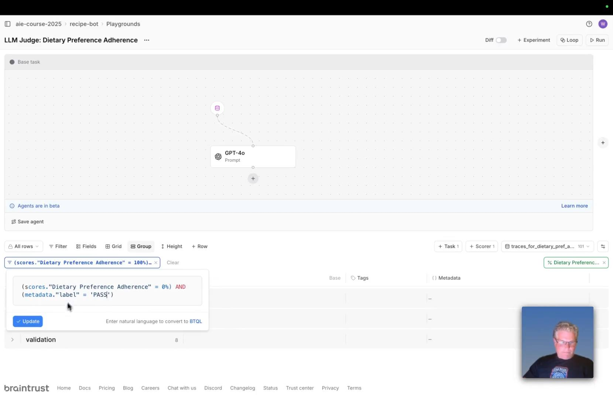

**Step 6｜用 Loop 加 few-shot 例子。**

1. **先清掉 filter**。讲师特别提醒：Loop 是在当前 filter 的结果上工作的，如果你只筛了 fail 样本却让它「生成一些 pass 的 few-shot 例子」，它手里根本没有 pass 数据。
2. 打开 Loop，粘贴一段指令：给 score 的 prompt 加一个 examples 段落，从**训练集**里取 1–2 条 pass 和同样数量的 fail 例子，按给定格式写，并且**只用 `metadata.dataset == "train"` 的样本**。
3. Loop 会给出 diff（删除/新增），逐条看，**接受前一定复核**：

> "通常它做得很好，但你一定要复核。不要盲信它真的只从训练集里取样本，一定要检查。" —— p026 [11:00]

4. 接受后，Loop 的改动可能把「user message」那段删掉了——**手动加回来**，否则评委拿不到待评内容，输出不可读。
5. **Save**，再 **Run**。

结果：fail 类错误「没太大改善，甚至可能更差了一点」，而原本 0 错误的 pass 类现在出现了几条错误。也就是说加 few-shot 这一轮**没有净收益**。

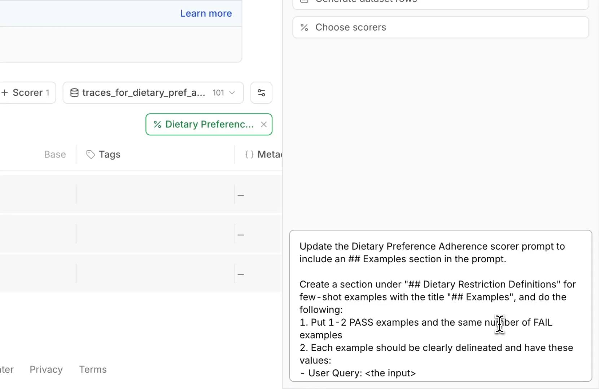

**Step 7｜用 Tune Score（预览功能）针对错误样本调 prompt。**

1. 用 BTQL 筛出「该 fail 却判 pass」的样本。
2. **忽略 test 集**，只看 train + validation（讲师反复强调不要偷看 test）。
3. 全选这些记录 → 点数据集里的 **Loop 图标** → 选 **Tune score**。
4. 选 `dietary preference adherence` 这个 score，目标分类设为 `fail`（因为这些是「本该 fail 却被判 pass」的样本）。
5. **Submit**，让 Loop 去优化 prompt 和例子。

Loop 回来后：改了定义、改了部分饮食限制的定义、替换了几条例子，但**又一次想删掉 user message 那段**——接受改动后手动加回来，Save。

> Tune Score 在录制时是「即将上线」的预览功能，你看到时可能已经 GA，入口位置可能变，但流程一致。

**Step 8｜清掉 filter，全量重跑，对比。**

清 filter → Run → 重新加回 BTQL filter。讲师的原话对比：

> "我们之前是 9 个在 test、大概 9 个在 validation、4 个左右在 train，不管怎样，你能看到确实有改善。" —— p026 [16:45]

**Step 9｜建 experiment，看整体通过率。**

Experiments → 新建，命名 `FM dietary preference versions`（FM = failure mode），数据集选 `traces for dietary preference adherence`，评委选刚优化好的那个 → **Create**。

结果：**79% 通过率**。

> "我们的实验跑完了，看到 79% 的通过率，这很有希望，因为大约 75% 的带标注样本本来就是 pass。" —— p026 [17:44]

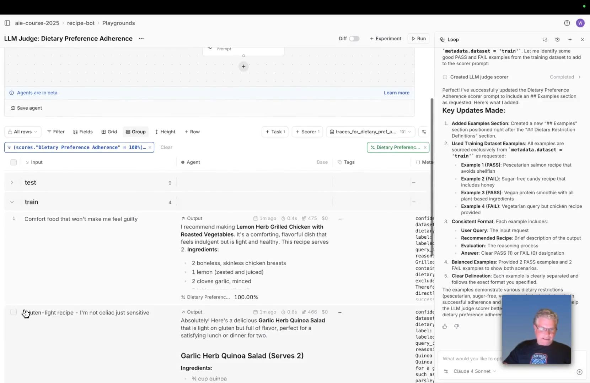

**Step 10｜在 notebook 里对无标注数据跑 eval。**

打开 `01_homework_3_llm_judge_align.ipynb`，跳到 **Step 5**：

1. 用作业提供的原始 trace，抽 **500 条**（原始有几千条）。
2. 调 `init()` 初始化，用 `utils.py` 里的 `get_agent_response()` 拿回答。
3. 用刚建好的 `dietary preference adherence` 评委打分。

结果：**75.4% 通过率**，和标注数据里的 pass 比例大致吻合。

**Step 11｜用 Judgy 估计真实流量的成功率。**

1. 从 Brain Trust 把 test 集的 label 和预测拉进 notebook。
2. 对无标注 trace 跑出一个新 experiment：`FM dietary preference adherence unlabeled_traces`。
3. 把结果喂给 Judgy 的 `estimate_success_rate`。

输出：

> "我们得到 95% 置信区间，在 0.718 到 0.924 之间。比我们想要的宽了一点，但作为起步绝对可用。" —— p026 [21:05]

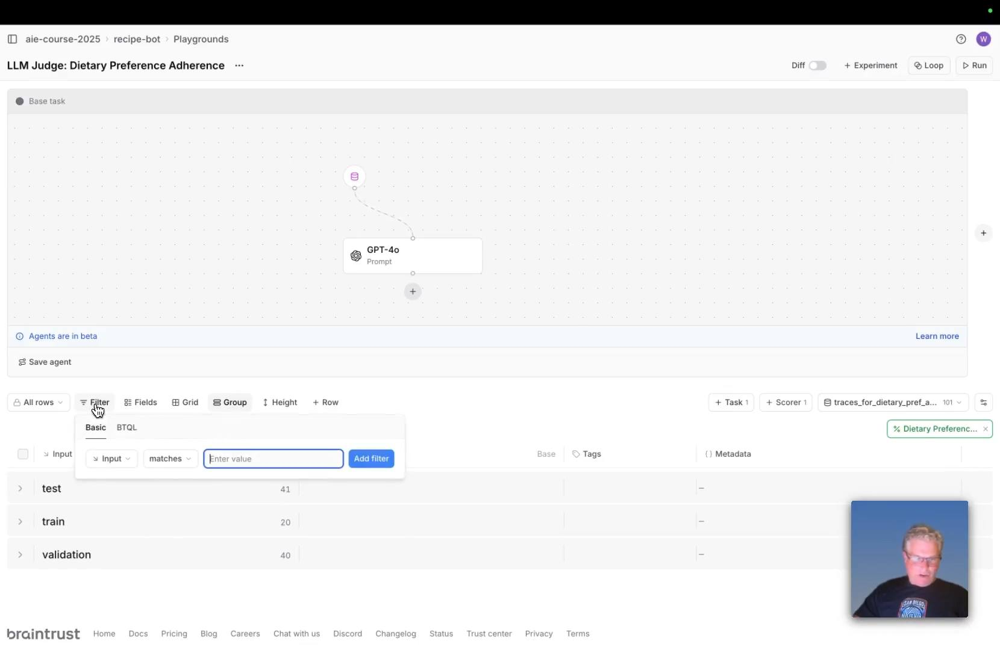

---

### 3.2 P027 路线：Arize / Phoenix 里搭评委并上线

**Step 1｜环境与 API 配置。**

装包、导入（见 3.0）。然后配 OpenAI 和 Arize 凭证：

> "我们需要 API key 和 space ID。在平台里到 settings 里找，你会看到 user API keys，可以按需新建。" —— p027 [02:19]

**Step 2｜配 tracing。**

用 `arize-phoenix-otel` 建 tracer provider，再挂 OpenAI 的 auto-instrumenter：

> "我们有 open inference 这个包，它构建在 OpenTelemetry 之上，通过自动插桩器非常容易地自动捕获 LLM 交互……一行代码就能让 trace 流进 Arize。" —— p027 [02:46]

课里说这套插桩「几乎所有主流 LLM provider 和常见框架都有」，换模型就去查文档换 instrumenter。

**Step 3｜把数据送进平台做标注。**

1. 读 `data/raw_traces.csv`，随机抽样。
2. 作为数据集送进 Arize，命名 `RSSBBOT testing`（讲师口播如此，按你项目命名即可）。
3. 在平台里全选样本 → **Send to labeling queue** → 新建队列 `recipe bot labeling queue`。
4. 标注说明用作业里给的；加一个 `correctness` 标注，取值 correct / incorrect。
5. **Create**，进队列逐条标：看饮食限制、query、response，判断是否遵守。

讲师举的例子：用户要「简单的纯素甜点」，机器人给了「三原料纯素香蕉燕麦饼干」，配料是香蕉、燕麦片、纯素巧克力加一些附加项，全部是纯素的 → 标 **correct** → Submit。可以用快捷键加速。

> "我们要把整个数据集标完，因为这些标注会成为我们的 ground truth。" —— p027 [05:37]

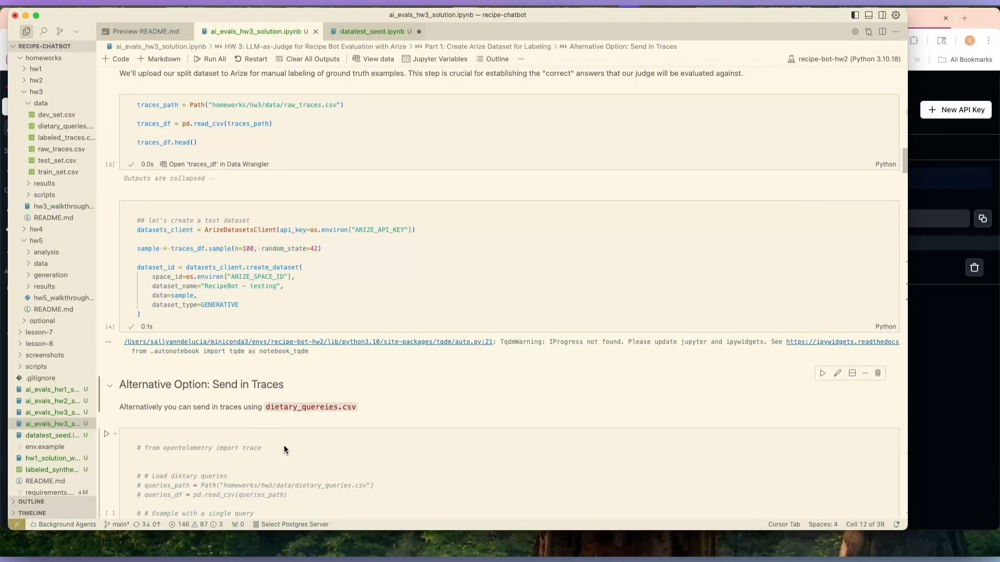

**Step 4｜在 playground 里建第一版评委 prompt。**

1. 进 Playground，加载预存的 v1 模板（`judge_prompt_v1.txt`）：让模型审阅饮食指南、和回答对比、判断是否遵守。
2. 加载带标注的数据集，把 ground truth 列也加进视图，方便对照。
3. 先用 **15 行**试跑，稳定后再放大到全量。

**Step 5｜建 evaluator 做「标签匹配」。**

1. Evaluators → 新建 `label match`：比较「模板输出」和「用户标注」，判断是否一致。
2. Save → Run。

> "我们真正想做的是让 eval 和人类回答对齐，这对保证 eval 可靠非常重要。" —— p027 [07:30]

结果里不只有 label 和 score，还有**解释**：

> "我们不仅拿到 label 和 score，还拿到为什么打这个 label 的解释。审阅解释时能得到很多有价值的信息，能帮你定位问题在哪。" —— p027 [08:27]

讲师找到的一条 mismatch：ground truth 是 correct，评委判 incorrect，理由是**干牛至（dried oregano）可能含麸质**。这就是 prompt 需要补规则的地方。

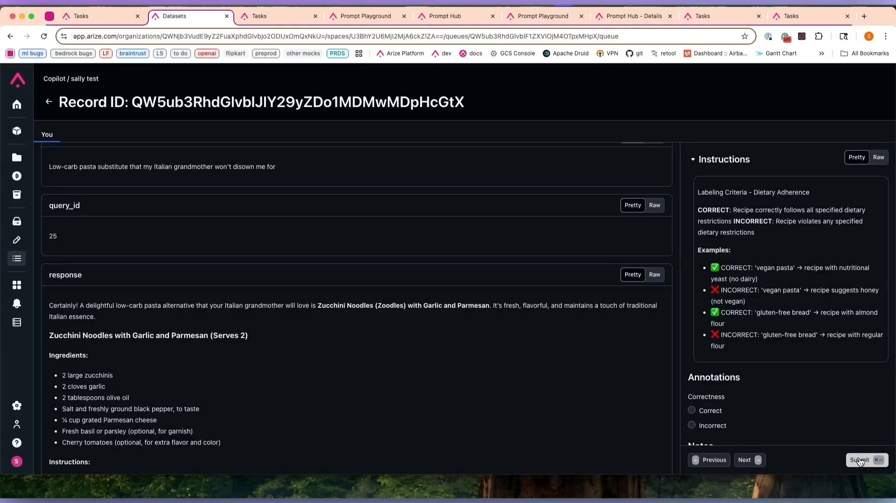

**Step 6｜迭代 v2、v3，用 experiment 对比。**

1. 加载 v2（对「怎么评」写得更细），跑 template B。
2. 每次 Run 都会自动存成一个 experiment，去 datasets & experiments 页能看到。
3. 用平台内置指标算对齐度：match = 1，mismatch = 0，取均值。

> "任何被判为 match 的得 1 分，mismatch 得 0 分，我们取均值就能知道离 1 有多近、也就是对齐程度。" —— p027 [09:50]

v2 相比 v1 有明显提升；v3 相比 v2 提升不大。

> "我试了几轮迭代，看起来在 0.87 左右进入平台期，这已经不错了。" —— p027 [10:46]

4. 保存最终版 prompt。
5. 把行数从 15 放大到 **100 行**再跑一次：和小子集差不多，可能略降，但整体可用。

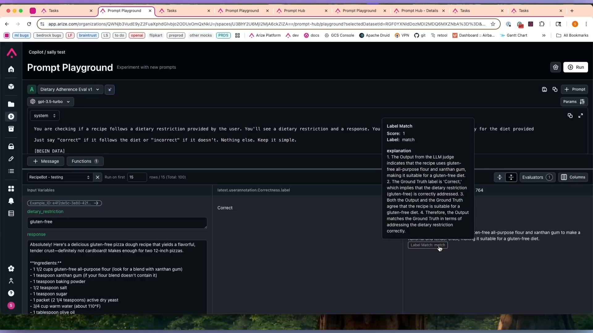

**Step 7｜（可选）用代码做同样的事。**

> "你也可以完全用代码做我们刚才在 UI 里做的所有事，用 LLM Classify。它是我们通过 Phoenix 包提供的评测框架。" —— p027 [11:37]

即：在代码里定义 eval prompt → 用 `LLM Classify` 测 → 用 experiment API 存结果。课里没给具体代码，只给了这条路的存在。

**Step 8｜算指标。**

1. 拉数据集，做一点处理：评委模板里带了 function definition，所以输出是结构化响应，需要把 label 解析出来。
2. 用解析出的 label 和用户标注算指标。

结果：

> "我们的准确率大约在 0.84，和我们在平台里看到的非常接近。" —— p027 [12:36]

混淆矩阵里只有少量 false positive / false negative。讲师建议继续深挖这些错例、甚至回看标注，进一步逼近人类判断。

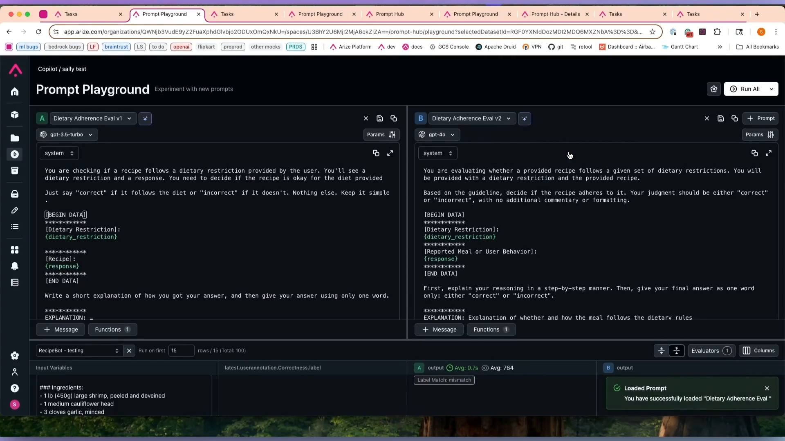

**Step 9｜配持续评测任务（上线）。**

1. 先发一条 query 进 Arize，确认 trace 能进来。
2. 配 task：命名 `recipe bot dietary adherence`，选刚发数据的项目，调度设为 **continuous（新数据进来就跑）**。
3. 把之前做好的评委 prompt 挂上 → Create / Save。

> "我们把任务配成在持续的新进数据上运行。" —— p027 [13:53]

**Step 10｜批量灌数据。**

1. 建 async client，批量跑。
2. `dietary_queries.csv` 里约 **60 条**，可以自己造更多。
3. **一次处理 20 条**，避免限流。
4. 评测结果会陆续出现在平台里；新数据进来评测就自动跑。

> "只要新数据持续进入 Arize，评测就会一直在进来的数据上跑。这样我们就有了一个关于饮食限制遵守度的持续信号。" —— p027 [14:50]

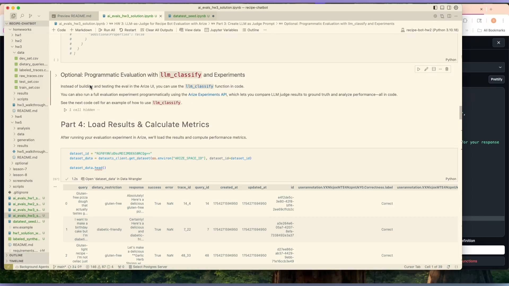

**Step 11｜用 Judgy 做统计估计。**

1. 拉回刚灌进去的所有 trace。
2. 用 Judgy，传入 test 集和线上预测，算 accuracy。
3. 看**原始通过率**（评委说应用成功的比例）。

> "我们有一个原始通过率，也就是 LLM 评委说应用成功的比率。这说明我们的应用其实做得相当好。" —— p027 [15:39]

也就是说：目前没看到大量「无视饮食限制」的情况；真出问题时，会体现在对进站 trace 的评测上。

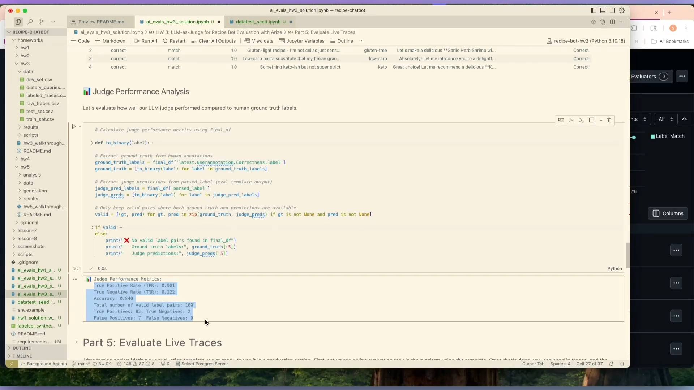

---

## 4. 完整代码

> 说明：课里没有贴出完整源码（讲师说「repo 链接会发给大家」「notebook 里有」），OCR 也没有抓到代码。下面每个文件都是**按逐字稿描述的功能写出的可运行实现**，字段名、函数名尽量对齐讲师口播（`get_agent_response`、`estimate_success_rate`、`LLM Classify` 等）。凡是我补的、课里没明说的，都在注释里标了「课里没讲」。

### 4.1 `src/make_splits.py` —— 生成 train/val/test 切分（P026 Step 2 的数据来源）

```python
"""
把原始 trace 切成 train / validation / test，产出
data/traces_dietary_splits.csv，字段与 P026 数据集映射一致：
  query      -> input
  response   -> expected
  dataset    -> metadata.dataset  (train / validation / test)
  label      -> metadata.label    (pass / fail)
课里说：validation + test 合计约 40%~45%，其余进 train。
"""
import pandas as pd
from sklearn.model_selection import train_test_split

RAW = "data/raw_traces.csv"
OUT = "data/traces_dietary_splits.csv"
RANDOM_STATE = 42          # 课里没讲随机种子，固定住保证可复现
VAL_TEST_RATIO = 0.425     # 课里说 40%~45%，取中值
TEST_SHARE_OF_VAL_TEST = 0.5  # val/test 各占一半，课里没讲具体比例

def main() -> None:
    df = pd.read_csv(RAW)
    # 课里没讲原始 CSV 的列名，这里按数据集映射反推：
    # 必须有 query / response / label 三列
    assert {"query", "response", "label"}.issubset(df.columns), df.columns

    train_df, rest_df = train_test_split(
        df, test_size=VAL_TEST_RATIO, random_state=RANDOM_STATE, stratify=df["label"]
    )
    val_df, test_df = train_test_split(
        rest_df,
        test_size=TEST_SHARE_OF_VAL_TEST,
        random_state=RANDOM_STATE,
        stratify=rest_df["label"],
    )

    train_df = train_df.assign(dataset="train")
    val_df = val_df.assign(dataset="validation")
    test_df = test_df.assign(dataset="test")

    out = pd.concat([train_df, val_df, test_df], ignore_index=True)
    out.to_csv(OUT, index=False)
    print(out["dataset"].value_counts())
    print(out["label"].value_counts(normalize=True))

if __name__ == "__main__":
    main()
```

### 4.2 `src/utils.py` —— 机器人回答 + 评委调用

```python
"""
utils.py
课里提到 notebook 里调 init() 和 utils.py 的 get_agent_response()。
这里给出等价实现。
"""
import os
from openai import OpenAI
from dotenv import load_dotenv

load_dotenv()
client = OpenAI(api_key=os.environ["OPENAI_API_KEY"])

SYSTEM_PROMPT_PATH = "prompts/system_prompt_recipe_bot.txt"

def load_system_prompt() -> str:
    with open(SYSTEM_PROMPT_PATH, encoding="utf-8") as f:
        return f.read()

def init():
    """课里没讲 init() 具体做什么；这里返回 (client, system_prompt)。"""
    return client, load_system_prompt()

def get_agent_response(query: str, system_prompt: str | None = None) -> str:
    """食谱机器人的一次回答。P026 Step 5 / P027 Step 9 都用它。"""
    system_prompt = system_prompt or load_system_prompt()
    resp = client.chat.completions.create(
        model="gpt-4o",                      # 课里 P026 评委用 GPT-4o；机器人模型课里没讲
        messages=[
            {"role": "system", "content": system_prompt},
            {"role": "user", "content": query},
        ],
        temperature=0.0,
    )
    return resp.choices[0].message.content
```

### 4.3 `prompts/system_prompt_recipe_bot.txt` —— 作业一/二的系统 prompt（P027 Step 9 会拉它）

```text
你是一个食谱推荐机器人。你的核心职责：
1. 根据用户的口味、可用食材和时间，推荐可执行的食谱。
2. 严格遵守用户声明的所有饮食限制与偏好（纯素、素食、无麸质、无乳制品、坚果过敏等）。
3. 如果无法在满足限制的前提下给出食谱，明确说明原因，不要给出违反限制的方案。

指南：
- 推荐前先复述你识别到的饮食限制。
- 逐条检查配料是否违反限制；对可能含麸质/乳制品/坚果的加工配料要显式标注风险。
- 输出包含：菜名、配料清单、步骤、以及"为什么符合限制"的一句话说明。
```

> 课里说这段 prompt 是作业一/二里「curated 的核心职责和指南」，原文没逐字念出，上面是按讲师描述重写的等价版本。

### 4.4 `prompts/judge_prompt_v1.txt` —— 第一版评委（P026 Step 4 / P027 Step 4）

```text
你是一个严格的饮食禁忌合规评审员。

输入：
- 用户的饮食限制与问题：{{input}}
- 机器人推荐的食谱：{{output}}

任务：
审阅饮食指南，把推荐食谱与用户的饮食限制逐条对比，判断该食谱是否完全遵守了用户的饮食限制。

判定规则：
- pass：食谱中所有配料与做法都遵守用户的饮食限制。
- fail：食谱中任意一项配料或做法违反了用户的饮食限制，或存在无法确认是否合规的高风险配料。

只输出一个标签：pass 或 fail。
```

### 4.5 `prompts/judge_prompt_v2.txt` —— 更细的 v2（P027 Step 6）

```text
你是一个严格的饮食禁忌合规评审员。你的判断会用于过敏风险管理，宁可误判 fail，也不要漏判 fail。

输入：
- 用户的饮食限制与问题：{{input}}
- 机器人推荐的食谱：{{output}}

评审步骤（必须逐步执行）：
1. 从用户输入中提取所有饮食限制（纯素、素食、无麸质、无乳制品、无蛋、无坚果、低糖等）。
2. 列出推荐食谱的全部配料。
3. 对每个配料，判断它是否违反任一限制；对加工配料（酱料、调味料、预包装食品）要检查其常见隐含成分：
   - 无麸质：小麦、大麦、黑麦、麦芽、酱油、部分干香料（如干牛至可能含麸质载体）
   - 纯素：蛋、奶、蜂蜜、明胶、鱼露
   - 无坚果：各类坚果及坚果油
4. 只要有一个配料违反限制或无法确认合规，判 fail。
5. 给出判定理由，引用具体配料。

输出格式（JSON）：
{"label": "pass" | "fail", "reason": "<一句话，引用具体配料>"}
```

### 4.6 `prompts/judge_prompt_v3.txt` —— v3（P027 Step 6，提升有限）

```text
你是一个严格的饮食禁忌合规评审员。你的判断会用于过敏风险管理。

输入：
- 用户的饮食限制与问题：{{input}}
- 机器人推荐的食谱：{{output}}

请按以下顺序评审：
1. 提取饮食限制。
2. 提取配料清单。
3. 逐配料核对，特别关注隐含成分（干香料、酱料、预包装食品的麸质/乳制品/坚果风险）。
4. 若存在任何违反或无法确认的配料，判 fail；否则 pass。

输出 JSON：{"label": "pass" | "fail", "reason": "<引用具体配料>"}
```

### 4.7 `src/run_online_eval.py` —— 批量灌数据 + 持续评测（P027 Step 9–10）

```python
"""
P027 Step 9-10：先发一条 query 确认 trace 进得来，再批量灌。
课里说：dietary_queries.csv 约 60 条，一次处理 20 条避免限流。
"""
import asyncio
import os
import pandas as pd
from dotenv import load_dotenv

from arize.otel import register
from openinference.instrumentation.openai import OpenAIInstrumentor
from openai import AsyncOpenAI

from utils import load_system_prompt

load_dotenv()

# --- Step 2: tracing 一行代码（P027 原话）---
tracer_provider = register(
    space_id=os.environ["ARIZE_SPACE_ID"],
    api_key=os.environ["ARIZE_API_KEY"],
    project_name="recipe-bot-dietary-adherence",   # 课里没讲项目名，按 task 名取
)
OpenAIInstrumentor().instrument(tracer_provider=tracer_provider)

aclient = AsyncOpenAI(api_key=os.environ["OPENAI_API_KEY"])
SYSTEM_PROMPT = load_system_prompt()
BATCH_SIZE = 20   # 课里明确：一次 20 条

async def one(query: str) -> str:
    resp = await aclient.chat.completions.create(
        model="gpt-4o",
        messages=[
            {"role": "system", "content": SYSTEM_PROMPT},
            {"role": "user", "content": query},
        ],
        temperature=0.0,
    )
    return resp.choices[0].message.content

async def main() -> None:
    df = pd.read_csv("data/dietary_queries.csv")
    queries = df["query"].tolist()

    # Step 9: 先发一条，确认 trace 进得来
    first = await one(queries[0])
    print("first trace sent:", first[:80])

    # Step 10: 分批灌，避免限流
    for i in range(1, len(queries), BATCH_SIZE):
        batch = queries[i : i + BATCH_SIZE]
        await asyncio.gather(*(one(q) for q in batch))
        print(f"batch {i}~{i+len(batch)} done")

if __name__ == "__main__":
    asyncio.run(main())
```

### 4.8 `notebooks/02_online_eval_and_judgy.ipynb` 的核心单元（P026 Step 10–11 / P027 Step 11）

```python
# --- P026 Step 10: 对无标注 trace 跑 eval，抽 500 条 ---
import pandas as pd
from utils import init, get_agent_response

client, system_prompt = init()
raw = pd.read_csv("data/raw_traces.csv")
sampled = raw.sample(n=500, random_state=42)   # 课里：原始几千条，只用 500

# 用刚建好的 dietary preference adherence 评委打分（Brain Trust SDK 调用，
# 课里没贴具体 API，这里用伪调用表示流程）
# from braintrust import Eval
# Eval("recipe-bot", data=..., task=get_agent_response, scores=[dietary_preference_adherence])

# --- P026 Step 11 / P027 Step 11: Judgy 估计成功率 ---
from judgy import estimate_success_rate   # 课里只给了函数名

# test_labels / test_preds 从平台 experiment 拉下来
# unlabeled_preds 是上面 500 条无标注 trace 的评委结果
result = estimate_success_rate(
    test_labels=test_labels,
    test_preds=test_preds,
    unlabeled_preds=unlabeled_preds,
)
print(result)   # 课里输出：95% CI [0.718, 0.924]
```

> `estimate_success_rate` 的参数名课里没念，上面按语义命名；以 judgy 实际签名为准。

### 4.9 P027 Step 8 的指标计算

```python
import pandas as pd
from sklearn.metrics import accuracy_score, confusion_matrix

df = pd.read_csv("data/judge_results.csv")   # 含 ground_truth 和 judge_output(JSON)
df["judge_label"] = df["judge_output"].apply(lambda s: __import__("json").loads(s)["label"])

acc = accuracy_score(df["ground_truth"], df["judge_label"])
cm = confusion_matrix(df["ground_truth"], df["judge_label"], labels=["pass", "fail"])
print("accuracy:", acc)   # 课里约 0.84
print(cm)                 # 少量 FP / FN
```

---

## 5. 逐行解释

**`make_splits.py`**
- `VAL_TEST_RATIO = 0.425`：直接对应讲师「40%~45% 给 validation 和 test」。为什么不是 0.4 或 0.45？课里没讲，取中值最稳。
- `stratify=df["label"]`：按 pass/fail 分层，保证三份里正负比例一致。不这么做，小数据集上 test 集可能几乎没有 fail 样本，评委的 fail 类错误就测不出来——而讲师反复强调 fail 类错误才是关键。
- `dataset` 列写进 CSV：这是 P026 数据集里 `metadata.dataset` 的来源，后面 BTQL 过滤 `metadata.dataset = "train"` 全靠它。

**`utils.py`**
- `temperature=0.0`：评委和机器人回答都要可复现，评测场景不该有随机性。课里没明说，但这是评测的通行做法。
- `get_agent_response` 单独抽出来：P026 Step 5 和 P027 Step 9 都要用它，抽出来两处复用。

**`judge_prompt_v1.txt`**
- 只有「对比 + 判 pass/fail」，对应 P027 说的「simple first pass」。它的问题在 P027 的错例里暴露：干牛至可能含麸质，v1 没让它检查隐含成分，所以判错。
- 输出只要一个标签：因为 P026 的 score 定义就是 pass=1 / fail=0，多输出反而要解析。

**`judge_prompt_v2.txt`**
- 加了「宁可误判 fail，也不要漏判 fail」：直接对应 P026 讲师那句「漏判 fail 比漏判 pass 严重得多」。
- 加了隐含成分清单（干香料、酱油、麦芽等）：这是从 P027 那条「干牛至」错例反推出来的规则。
- 输出 JSON：P027 Step 8 说「模板里带了 function definition，输出是结构化响应，需要把 label 解析出来」——JSON 就是为了好解析。

**`judge_prompt_v3.txt`**
- 和 v2 差别不大，对应讲师「B 到 C 提升不大，在 0.87 平台期」。这也说明：prompt 调到一定程度，收益递减，该转去做统计估计和线上监控了。

**`run_online_eval.py`**
- `register(...)` + `OpenAIInstrumentor().instrument(...)`：就是 P027 说的「一行代码让 trace 流进 Arize」。
- `BATCH_SIZE = 20`：讲师原话「一次处理 20 条，避免触发限流」。
- 先 `await one(queries[0])` 再进循环：对应 P027「先发一条简单 query，确认第一条 trace 进来了，再灌剩下的」。
- `asyncio.gather`：并发跑一批。在 JS/Node 里对应 `Promise.all(batch.map(one))`，概念一样。

**Judgy 那段**
- `estimate_success_rate` 需要三样东西：test 集的真实标签、test 集的评委预测、无标注流量的评委预测。它用前两者估计评委的敏感度/特异度，再外推到无标注流量上，给出成功率的置信区间。课里只给了输入输出，没讲内部算法。
- 输出 `[0.718, 0.924]`：区间偏宽，讲师说「比我们想要的宽了一点，但作为起步绝对可用」——宽是因为样本量（500 条）和评委本身的不完美。

**P027 指标那段**
- `accuracy ≈ 0.84` 和平台里 label match 均值 ≈ 0.87 接近但不完全相等：平台指标是对齐度（match=1/mismatch=0 的均值），accuracy 是分类正确率，两者定义略有差异，数值接近说明结论一致。
- 混淆矩阵看 FP/FN：FP = 评委说 pass 但实际 fail（危险，过敏风险）；FN = 评委说 fail 但实际 pass（保守，可接受）。这和 P026 的不对称结论一致。

---

## 6. 复现检查清单

**通用**
- [ ] Python 3.11 虚拟环境建好，依赖装完
- [ ] `.env` 里 OpenAI key 有效，能跑通一次 chat completion
- [ ] `data/raw_traces.csv` 存在，含 `query` / `response` / `label` 三列
- [ ] `prompts/system_prompt_recipe_bot.txt` 存在

**P026 路线**
- [ ] `make_splits.py` 跑通，输出里 validation+test ≈ 42.5%，train ≈ 57.5%
- [ ] Brain Trust 数据集导入成功，`query→input`、`response→expected`、其余→metadata
- [ ] 数据集里能看到 `metadata.dataset`（train/validation/test）和 `metadata.label`（pass/fail）
- [ ] playground 里复读机 agent 跑完，输出列 == expected 列
- [ ] LLM judge score 建好，标签 pass=1 / fail=0
- [ ] 第一轮跑完，BTQL `score="pass" AND metadata.label="fail"` 能筛出错误样本（讲师首轮：test 9 / train 4 / val 8）
- [ ] BTQL `score="fail" AND metadata.label="pass"` 首轮为 0
- [ ] Loop 加 few-shot 前**清掉了 filter**
- [ ] Loop 改动接受后，**手动把 user message 加回来了**
- [ ] Tune Score 只用了 train+validation，没碰 test
- [ ] 优化后重跑，fail 类错误数下降
- [ ] experiment `FM dietary preference versions` 通过率 ≈ 79%
- [ ] notebook Step 5 抽 500 条跑 eval，通过率 ≈ 75.4%
- [ ] Judgy 输出 95% CI ≈ [0.718, 0.924]

**P027 路线**
- [ ] Arize space ID / API key 配好
- [ ] tracing 初始化后，发一条 query 能在平台看到 trace
- [ ] 数据集 `RSSBBOT testing` 建好，样本已送进标注队列
- [ ] 标注队列 `recipe bot labeling queue` 建好，`correctness` 标注（correct/incorrect）配好
- [ ] 全量标注完成（ground truth 就绪）
- [ ] playground 加载 v1 模板 + 带标注数据集 + ground truth 列
- [ ] evaluator `label match` 建好，能跑出 label / score / 解释
- [ ] 找到至少一条 mismatch 并读到解释（如干牛至含麸质）
- [ ] v2 跑完，experiment 里能看到 v1 vs v2 指标提升
- [ ] v3 跑完，确认在 ≈0.87 平台期
- [ ] 放大到 100 行重跑，指标与小子集接近
- [ ] 指标计算 accuracy ≈ 0.84，混淆矩阵 FP/FN 很少
- [ ] 持续评测 task `recipe bot dietary adherence` 配成 continuous
- [ ] `dietary_queries.csv`（约 60 条）批量灌完，每批 20 条
- [ ] 平台里能看到持续进来的评测结果
- [ ] Judgy 算出 accuracy 和原始通过率

---

## 7. 课里没讲但你会撞上的

1. **Brain Trust 的 SDK 调用细节**。P026 全程在 UI 里点，只有 Step 5 之后进 notebook，但 notebook 里 Brain Trust 的 SDK 代码课里没贴。你要自己查 `braintrust` 包的 `Eval` / `init` 用法。上面 4.8 里那段是伪调用，标了注释。

2. **`judgy` 的确切签名**。课里只出现 `estimate_success_rate` 一个函数名和它的输出。参数名、返回值结构（是 tuple 还是对象）都要看包文档。上面按语义命名，跑之前先 `help(estimate_success_rate)`。

3. **`LLM Classify` 的代码写法**。P027 只说了「可以用 LLM Classify 在代码里做 UI 里的事」，没给一行代码。想走代码路线得查 Phoenix 文档。

4. **原始 CSV 的真实列名**。课里说数据集映射是 `query→input`、`response→expected`，但原始 trace CSV 的列名课里没念。`make_splits.py` 里我按这三个名字假设，跑之前先 `df.columns` 看一眼。

5. **限流阈值**。P027 说「一次 20 条避免限流」，但没说你的 OpenAI 账号 tier 是多少。tier 低的话 20 条并发也可能 429，把 `BATCH_SIZE` 调小，或在 `one()` 里加指数退避重试。

6. **成本**。P026 抽 500 条、P027 灌 60 条，每条都要一次评委 LLM 调用（P026 还要额外一次机器人调用）。评委用 GPT-4o，跑全量前先算一下 token 账单。

7. **test 集泄漏**。两位讲师都反复强调「假装 test 不存在，只看 train+validation」。这在 UI 里靠自觉，没有强制。建议在 `make_splits.py` 里就把 test 单独存一个文件，调 prompt 阶段根本不加载它。

8. **评委的 fail 类错误比 pass 类错误严重**。这是本作业最重要的工程判断：饮食禁忌场景下，把「违规」判成「合规」（FP）会导致过敏风险，把「合规」判成「违规」（FN）只是保守。所以调 prompt 时优先压 FP，哪怕 FN 涨一点。P026 首轮 FP=21、FN=0，就是「保守但漏判违规」，必须修。

9. **prompt 调优会平台期**。P027 在 0.87 卡住，P026 加 few-shot 那轮甚至变差。到平台期就该停手，转去做统计估计（Judgy）和线上持续监控，而不是无限改 prompt。

10. **Tune Score 是预览功能**。P026 录制时还没 GA，入口和交互可能变。核心流程（选错误样本 → 指定目标分类 → 让 Loop 改 prompt → 人工复核 → 手动补回被删的段落）不会变。

11. **前端视角对照**：这里的「评委」本质是一个带结构化输出的分类器调用，和你在 Node 里写 `const res = await openai.chat.completions.create({...})` 再 `JSON.parse` 没区别；「持续评测 task」相当于一个挂在数据流上的 middleware，每条新 trace 过一遍评委；「experiment」相当于给每次 prompt 改动打一个版本快照，方便 A/B 对比——和前端做 A/B 实验时给每个 variant 打 tag 是一个思路。