# AI Evals 课程文档：为 Trace 人工评审构建自定义标注界面（P028）

> 本课是纯讲解 + 案例研究课，逐字稿里没有可运行的代码。第 3、4 节按「纯讲解课」规则改写：把讲师的推导过程按步骤复现，并把讲师给出的设计原则落成可用的产物（设计决策表、组件职责表、数据模型草案）。第 4 节末尾补的示意代码已明确标注「课里没有代码，以下为示意」。

---

## 1. 这一节做什么

这一节（P028，全课最后一讲）解决一个具体问题：**当你已经有一堆 LLM 应用的 trace，怎么把它们高效地读进去、标出来、把错误模式沉淀成可复用的评测标准。**

讲师的核心主张是：用 Excel / 电子表格做 error analysis 会让人卡在「读不动」和「进不了心流」两个坑里；而现成的可观测性工具（Braintrust、LangSmith、Phoenix）虽然比表格好得多，但在需要长时间、大批量标注时，仍然值得在其之上叠一层**自定义标注界面**。这一节讲的就是这层界面该怎么设计、有哪些 HCI 原则、以及两个真实案例（EvalGen、Doc Wrangler）里踩出来的经验。

学完这一节，你应该能回答三个问题：

1. 为什么值得自己做一个标注 UI，而不是直接用表格或现成工具？
2. 一个「好标」的界面必须满足哪五条设计原则，每条对应什么具体功能？
3. 标注过程中人的标准会漂移（criteria drift），这件事对界面设计和评测流程意味着什么？

---

## 2. 讲师原话

> "上周我们做了一次书面反思，主题是 RAG 系统的 error analysis 和 evals。具体来说，结论是：要在生成之前先评测检索。"
> —— p028 [00:26]

> "很多人共鸣的一点是：问题出在检索上。另一个回答里，agent 经常没能检索到正确的实体。"
> —— p028 [00:26]

> "Julio 的作业里有个很有意思的发现：prompt 里应该有更清晰的规范，说明——如果用户查询有歧义，就追问用户来澄清这个歧义。"
> —— p028 [00:53]

> "澄清意图绝对是有用的。我每次遇到 RAG 系统，最大的错误之一就是用户意图没有被明确或没有被正确表达。"
> —— p028 [02:19]

> "如果你戴上产品经理的帽子，这其实属于 UX 的范畴。就像你会关注用户界面一样……如果你没有收集用户意图，我会把它归到 UX 那一类问题里。你该认真想：你是不是在让用户走向成功？"
> —— p028 [02:48]

> "传统搜索引擎里，人们就喜欢搜有歧义的查询。这方面有一整条研究线，也有专门衡量系统如何应对歧义查询的产品指标。我觉得这个问题会一直存在。"
> —— p028 [03:44]

> "这门课当前的主题一直是：看你的数据。具体来说，我们教了你用结构化的流程去看数据，也就是 error analysis。而这个流程的一部分，要求你读大量 trace，判断什么是好的、什么是坏的，并对错误做反思。"
> —— p028 [04:14]

> "当我第一次用 LLM、想做 error analysis 时，我感觉自己身处地狱——把这些东西加载到数字表格或电子表格里，试图搞清楚所有错误可能是什么。"
> —— p028 [05:39]

> "哪怕只审两三条 trace 都非常困难，因为一行就是一条 trace。如果这条 trace 有 50、80 轮，它就会非常长、非常难理解。"
> —— p028 [06:08]

> "让我进入心流的要素是：你能一直用键盘、能快速过滤 trace、能来回切换，你觉得自己像个高级用户。我在 Excel 里完全没有这种感觉。"
> —— p028 [06:32]

> "最主要的一点是：我觉得我审的 trace 数量根本不够，不足以训练 LLM judge 评测器，也不足以让我想做的任何事规模化。"
> —— p028 [06:32]

> "我不想为了标注专门做一个 UI，但还是咬牙做了，因为也许它能提升我的评审效率……那是 2023 年底，还没有 vibe coding。我想，好吧，我花一周做一个，看看值不值。"
> —— p028 [07:01]

> "我当时的思路是：聚焦某个特定领域，想办法把 trace 以它们的原生形态渲染出来——也就是终端用户看到的样子。我加了热键，加了给 trace 打失败模式标签的能力，因为我已经做过几轮 error analysis 了。"
> —— p028 [07:27]

> "今天你要是想做我 2023 年花一周做的那个界面，只需要一小时，因为你可以用 AI 来做。"
> —— p028 [07:55]

> "我发现，天哪，我真的能一小时标 200 多条 trace，那是我标注的巅峰状态——我连标两小时，标了 400 条。顺便说一句，那只是个 Streamlit 应用，标的是基于电商商品属性生成的 AI 商品描述。"
> —— p028 [07:55]

> "这一下说服了我。我从审 20 条变成审 200 多条。我不知道为什么没更多人在聊这件事。"
> —— p028 [08:25]

> "有一点我要澄清：有时候如果交互非常简单，比如就一个用户输入、没太多东西、然后一个输出，那用表格也许还行。但很多情况下不行。现在的东西通常都不简单。"
> —— p028 [08:54]

> "vibe code 自己的用户界面通常很容易。其实有个中间地带：我大量用 Jupyter notebook，有时做一个伪界面，notebook 里有很多技巧。你可以拿 notebook 里的一个数据结构，比如一封邮件，用 `__repr__` 的 HTML 方法，就能把任意数据结构渲染并格式化出来。"
> —— p028 [09:22]

> "另一个问题是：为什么不用 Braintrust、LangSmith、Phoenix 之类的？我们经常被问到这个。我会说，它们比电子表格好得多。"
> —— p028 [10:49]

> "它们其实也相当不错，有时候甚至够用。做数据标注时值得先试试：你在这儿标注是否足够满意？如果你要长期标注大量 trace，那么做一个自己的界面有时是值得的升级——它能按你想要的精确方式渲染、默认隐藏你不想看的东西，而且很多时候你想把 trace 范围之外的其他信息也放到屏幕上。"
> —— p028 [11:18]

> "比如说，如果发生了一个副作用，比如预约了一个会议，你想有个界面让评审者检查这个副作用是否真的按预期发生了。要做到这一点，真的只能靠某种自定义 UI。这样你就不必开四个窗口来回切换上下文。"
> —— p028 [11:44]

> "Braintrust、Phoenix、LangSmith 这些工具都有很好的 API，你可以把它们当数据库用，从你的自定义 UI 里来回读写。我一直这么干，强烈推荐你在卡住时考虑这个思路。"
> —— p028 [12:10]

> "所以希望我们已经说服你去构建自定义 UI 了。再说一次，它们也许不是要替代那些可观测性工具，而是作为它们之上的一层，会很有用。"
> —— p028 [12:39]

> "如果你想 vibe code 一个 UI，你不能只是打开 AI 然后说『给我一个标注用的 UI』。那不会work。你必须在 prompt 里注入好的设计原则。"
> —— p028 [12:39]

> "幸运的是，这些 UI 的设计原则不用从零发明。我们花了很多时间思考好的 HCI（人机交互）原则。"
> —— p028 [13:09]

> "第一件事是状态可见性（visibility of status）。状态指的是：你作为用户或标注者想知道——到目前为止你做了什么、还剩多少活。比如你已经标了 112 条、还剩 30 条、以及你目前发现了哪些失败模式。"
> —— p028 [13:09]

> "第二条原则非常重要，尤其对 error analysis 应用：识别优于回忆（recognition over recall）。做 error analysis 时你会有一个很长的失败模式长尾，多到记不住。如果你记得『五条 trace 之前我发现过类似的失败模式』，理想情况下，在做开放式编码或轴心编码时，你能直接指派那个失败模式、给这条 trace 打上某个标签，而不是从零开始开放式地写。"
> —— p028 [14:04]

> "在第零轮或第一轮开放式编码时，每条 trace 都写自由文本笔记也许完全没问题。但随着 error analysis 越做越多，你要走到一个点：失败模式可以通过下拉框打标签，轴心编码可以非常快地指派。"
> —— p028 [14:29]

> "这是更可爱的说法：把你的应用输出以终端用户会看到的原生形态渲染出来。我总说，如果你在做邮件助手、或者 AI 在生成邮件，你可以把这封邮件渲染成一封邮件，突然评审就变快了。"
> —— p028 [14:53]

> "我觉得这很重要，因为它让你能抓到错误——有时候只有按用户看到的样子渲染出来，你才看得出它是错的。"
> —— p028 [15:21]

> "第四点是用户控制（user control）。你想让标注者或你自己进入心流状态。心流状态意味着你不用身体动来动去、鼠标点来点去、在四个窗口之间来回找。所以用热键，让人能快速做决定——左右键、回去改评分等等，这样他们能保持心流。"
> —— p028 [16:16]

> "最后，评分时尽量极简。你不需要看到 trace 里涉及的每一样东西。你要有能力展开看细节，或者回去重读整个系统 prompt，因为忘了某件事是否在里面规定过。但你不必默认一直显示它们。只展示人们做高层判断所需的最少信息，但如果他们好奇、想下钻，可以有地方展开，比如具体的工具调用。"
> —— p028 [17:07]

> "原则就是减少摩擦（reduced friction）。任何时候……你一开始标注就很明显。"
> —— p028 [17:32]

> "前几天我们在 Braintrust 里标 Nurture Boss 的 trace，系统 prompt 相当长。所以你希望默认在每条 trace 上把它藏起来。不是删掉让你看不到，而是用舒服的方式收起来。每个领域、每个问题都会有它自己的取舍。没有硬性规则。只要记住：你是在减少摩擦。"
> —— p028 [18:02]

> "这是那个截图的放大版。左边你看到的是 JSON blob，就像你在某种可观测性工具里看到的，或者你在电子表格里看到的，字面上就长这样。左边非常吓人。我看到它时心理感受是：好吧，我得去泡杯茶，我得做好心理准备去读一大堆这种东西。右边就不让我紧张。"
> —— p028 [19:00]

> "右边我放了什么？顶部有状态指示器：你完成了 100 条里的 35 条。邮件被渲染成一封邮件。你能看到一些常见问题，每个旁边有一、二、三、四——这表示热键。比如这个应用里编造的政策或功能，你只要按键盘上的数字 2，就能打上这个标签。有 pass、fail、defer 这些很有用。"
> —— p028 [19:30]

> "另一个我想指出的点：你可以把这些界面 nerd snipe 到任意深度。有时我会把输出里与过去审过的坏例子语义相似或关键词相似的片段高亮出来，让我一眼就能看到。这也许有点过度了。"
> —— p028 [20:29]

> "高亮是怎么实现的？我会看过去的坏例子，有时高亮我认为它坏的原因，或者写进 open codes。然后我会在之前的坏例子里找关键词和 open codes，看它们是否出现在当前输出里。"
> —— p028 [20:58]

> "在 GPT-3.5 和 GPT-4 的年代，AI 还不够好，但你必须做 error analysis 才能得出好的 evals 并改进系统。今天这个时代，如果你用的是 o3 或最好的模型，你可以不做严格 evals 也能凑合——直到你进入产品 v2，或者你决定要投入把这个产品做好。"
> —— p028 [21:55]

> "所以当时我觉得：好吧，我必须让评审对我自己和参与我用户研究的所有人都更容易。"
> —— p028 [22:24]

> "比如一篇顶会论文，至少在人机交互方向，你要做一堆用户研究。而且往往前几轮用户研究没成，因为它们没教给你需要的洞察。这些情况下，他们都在做类似或相同的任务。我必须让他们做这件事非常容易，否则每个参与者做用户研究时我都要在旁边待八小时，看他们标左边那种东西。那完全说不通。"
> —— p028 [22:54]

> "如果要从这里带走一句话：你的团队或公司里应该有人来构建这些界面。"
> —— p028 [23:23]

> "怎么提升速度？不只是速度，还有标注的准确度。很多时候没有好的界面，人会有点懒、会漏掉失败模式，或者前后不一致。一个很好的例子是：我们做第一版 error analysis 应用时，没有回去重审旧 trace 的能力。结果就是，当参与者遇到新的失败模式、或者想改变对某个主观标准的看法时，他们没法回去，于是不是退出应用重启重标，而是干脆想『我不管了，就标错吧』。所以你必须让人既能快、又能准确标完所有 trace。"
> —— p028 [23:53]

> "我喜欢让人聚焦单条 trace 视图。这样注意力不会被多条 trace 分散。在电子表格里这很烦，你一次看到五六行，结果就是每行都草草扫过，而不是真正一次专注一行。"
> —— p028 [24:20]

> "我喜欢 pass/fail 热键，前面说过。我喜欢进度条。我们在 EvalGen 项目里发现一件很好玩的事：进度条真的激励人标更多。没有进度条时，人们点『我完成了』要早得多——只标了六七条就点了。有了进度条，他们标到 20 条才想去看其他对齐情况或其他指标。进度条作用巨大。"
> —— p028 [24:50]

> "其实，任何让人等待的东西，不只是标注应用，都需要进度条。否则你感觉它是无限的、不知道什么时候结束。这不是好的用户体验。"
> —— p028 [25:18]

> "第四点，批量标注 trace。我不建议你这么做，除非你已经到了 error analysis 的 v5，或者你是这个应用/产品的专家，真的具备专业知识。你知道系统里有哪些失败模式，对 trace 长什么样有很好的嗅觉，能说『这些 trace 都很像，我就给它们打同样的标签』。这当然能提升吞吐，因为你在审一批而不是一条。但除非你已经能又快又准地标完所有东西，否则别做。"
> —— p028 [25:47]

> "你得对 evals 流程相当有信心，几乎到了大师级别。然后你就是在弯曲规则——随着你变强，规则本来就是可以被弯曲的，这没问题，你可以有很强的直觉。如果你很确信这一组东西就是同一回事，那就批量标吧，没问题。即使里面有点小错也没关系，只要你对在做的事感觉 OK。"
> —— p028 [26:42]

> "我最近才开始用批量标注，是在做强化学习微调的时候。那时我在一千个例子上训练，我真的需要看所有错误 bug，因为我的奖励系统可能有问题。那才是批量标注真正开始帮上忙的地方。我还没把它用在课程前面教的更传统的 error analysis 上。"
> —— p028 [27:12]

> "我喜欢做的一件事，不只是标注，而是在 error analysis 阶段做聚类之类的事。如果我看到某种错误，我会想：我打赌还有别的类似错误，我想知道有没有另一个。与其直接下一条 trace，我会在这上面多花一会儿：让我顺着这条线挖下去。这涉及对 trace 做关键词搜索、语义搜索，也许做聚类。就像我做高亮那样：我知道哪些关键词是坏的，就在后面的 trace 里高亮它们。"
> —— p028 [28:06]

> "你会开始养成数据科学家的思维，说到底它最终归结为数据分析。"
> —— p028 [28:33]

> "希望人们理解：要提升速度，但不能以准确度为代价。"
> —— p028 [29:02]

> "最后一件能实质影响吞吐的事，是你怎么采样要审哪些 trace。"
> —— p028 [29:02]

> "很多人还没做过 error analysis 就急着问『我该怎么采样 trace』。别急。就字面意义上随机采样你的 trace，做出第一版 error analysis 应用。只有当你对界面有信心、热键好用、心流状态起来了，再考虑采样。"
> —— p028 [30:00]

> "希望我们不要过早收到『我该怎么采样、要不要分层采样』之类的问题，那应该晚点再谈。"
> —— p028 [30:24]

> "显然先做随机采样、均匀随机采样。随着你标的数据越来越多，你可以越来越智能地采样。高层看，它总会是某种形式的分层采样：你看你关心从哪些维度采样，然后从每个维度里随机采。"
> —— p028 [30:51]

> "一些有意思的维度：当然是你造合成数据时创建的那些维度。你还可以加更多——比如看那些与你标过为坏的 trace 共享关键词的 trace，这是一个很好的采样池。你可以看用户抱怨过的 trace，从这些里采。你可以把这些维度混搭。"
> —— p028 [31:18]

> "我会说，永远尽量保证也采一些随机集合，这样你就不会过度偏向第一轮 error analysis 里已经发现的失败模式。你需要某种方式去发现新的失败模式，尤其当你的应用已经上线时。"
> —— p028 [31:46]

> "接下来讲案例研究。这两篇论文是我过去写的——论文上写是过去一年，实际上意味着过去两年半。大量工作围绕构建界面、和人迭代，才走到这里。我先讲 EvalGen，也就是『谁来验证验证者』那篇论文。"
> —— p028 [32:15]

> "EvalGen 是什么？2023 年做的，是非常早期的、用于单轮 LLM 输出人工评测/人工标注的 UI。那时大家还没像今天这样把 agent 挂在嘴边。就是 AI 生成邮件、AI 生成商品描述这类你想象中人们搭第一个 LLM pipeline 时会做的东西。我们发现几乎没人有好的办法对这些单轮输出做 error analysis。那我们就做出我们能想到的第一种方式。"
> —— p028 [32:45]

> "于是我们做了：单条 trace 聚焦、二元评分、点赞/点踩。事实证明，在我们想到这些之前，我们试过让人反馈哪里坏哪里不坏，但人们其实不太会做 error analysis。所以最后就变成了点赞/点踩。一旦点踩，我们再让他们提供 open codes。也许从『识别出某处是坏的』再到『思考它为什么坏』会更容易。"
> —— p028 [33:12]

> "现在我不确定这是否完全成立。也许随着多轮或 agentic 系统变多，也许先发现单个错误、再整体推理它是否坏，会更容易。另外，今天在座各位希望都会成为 error analysis 专家，所以也许你可以有更复杂的界面。我不希望大家回去说 EvalGen 是唯一做标注的界面。我只是解释我们想出它的过程，以及你可以带走什么去构建自己的界面。"
> —— p028 [33:40]

> "最后我要提一件非常有用的事：我们内置了 rubric builder（评分标准构建器）。事实证明，包括我在内，人们在 prompt 里写了很多 do 和 don't 指令。我们写这些，是因为做了一点 error analysis，发现应该更好地规定 LLM 不该做什么。你其实可以把这些自动转成 eval 标准。我们发现这超级有用。"
> —— p028 [34:37]

> "不是所有标准都会一直失败，但其中一些——因为 LLM 并不完美地遵循指令——可能正是你在 error analysis 里发现的失败模式，比如泛化失败。所以从 prompt 里抽取标准作为起点非常有帮助。"
> —— p028 [35:05]

> "EvalGen 的界面怎么工作？我讲一下用户研究怎么做的。我有一批 AI 和 ML 工程师。顺便说，EvalGen 是构建在 Chainforge 之上的，那是一个开源的、可视化的 LLM 链/流水线构建器。要调用 EvalGen，有人在想评测的 prompt 上创建一个 evaluator 节点，EvalGen 的向导就会弹出。用户可以从『魔法般』的评分流程开始，并从中推断出标准。我们会从 prompt 里推断标准作为起点。"
> —— p028 [35:34]

> "然后我们带用户走这个标注流程：点赞/点踩，也就是好/坏。从这些标签，我们会生成新的 eval 实现，看它们是否与标签对齐。我们还会用其他实现计算对齐度。"
> —— p028 [36:01]

> "还有一点：这些评测器可以是基于代码的，也可以是基于 LLM 的。我当时没意识到这有多重要，但事实证明你其实真的两个都要。有些东西用代码评测检查更好。比如推文生成器，人们希望它在某个字符限制以内。LLM judge 在判断是否在字符限制内非常差。"
> —— p028 [36:29]

> "最后，在他们标了很多之后——注意这里底部有进度条，回到进度条那点——我们会给他们看一个成绩单：这是我们想出的所有评测器和 LLM judge，以及它们与你评分的对齐度。你从中挑你想要的。没什么疯狂的，没什么特别的，就是单轮输出、想出一些标准。"
> —— p028 [36:59]

> "我的合著者 Ian 基于 EvalGen V1 的经验发布了 V2，你肯定可以在 shipped domain 上用。我很喜欢它。我用 EvalGen 教人做 evals 有一段时间了，因为看这个工作流，它包含了大部分东西：你做 error analysis，它展示了对齐 LLM judge 的理念——它把代码 judge 和 LLM judge 摆在你面前，说『哦我的 judge 没对齐』。这是很多人根本不会想到的事，但在这门课里你会想到。然后你迭代，一直迭代到对齐足够好。"
> —— p028 [37:27]

> "我从这里学到什么？第一件我没料到的事，是人们随着审越来越多输出，标准漂移（criteria drift）有多严重。意思是人们随时间精炼自己的定义，想回去改之前条目的标签。有时他们直到看到某个失败模式才想到它。我觉得没人能预想到这会发生。因为 LLM 很怪，它们不像人那样行为，所以很难预先知道所有失败模式。"
> —— p028 [38:52]

> "这真的强化了一点：做 error analysis 的正确方式是某种扎根理论（grounded theory），比如开放式编码、轴心编码、分轮次。不存在这样的世界：你预先定义好 rubric、编好 LLM judge 然后直接跑，而不需要 error analysis。"
> —— p028 [39:18]

> "我们还发现，当人们发现新失败模式时——尤其上线后、或换模型后模型行为略有不同、你会看到不同失败模式——让你的 error analysis UI 支持即时创建轴心编码会很有帮助。"
> —— p028 [39:48]

> "关于标准漂移还有一点很有意思：我一直发现，不仅人的需求随时间变化，还发生某种对齐——把人往 LLM 那边对齐。就像你想让 LLM 对齐你一样，我发现人会获得某种共情，或者修正他们认为合理的标准，放松某些期望，当他们理解『哦这很难』之类的时候。他们也会变得更与 LLM 对齐。所以某种程度上双方都被推向中间。"
> —— p028 [40:16]

> "希望 LLM 更多地向你对齐，但我确实发现另一件事也在发生。这很重要，因为也许你会说『这有点怪，人变得更对齐 LLM』，但它很重要——尤其在商业语境里，你希望你的利益相关者和所有人都喜欢这个 LLM。这正是你做这种评审和 error analysis 时发生的事。这样你的产品上线时被所有人接受的概率会高得多。"
> —— p028 [41:13]

> "我们论文里给了一个标准漂移的例子：一个在推文上做命名实体识别（NER）的应用。意思就是从推文里抽取你认为像维基百科那样值得注意的实体。prompt 里部分指令是：不要把任何 hashtag 抽成实体，因为 hashtag 总是很多，我们只关心推文正文里的实体。人们看到 hashtag 被抽成实体就会报错。然后有时人们见多了，就改主意：其实如果 hashtag 是值得注意的实体、也在推文正文里提到过，抽出来也许没问题——只要抽取里没有井号，去掉井号、把它表述成实体就行。人们有各种随时间变化的解释，因为他们见了太多 hashtag 被抽成实体的实例。"
> —— p028 [41:42]

> "这说明：你自己以为有某个标准，然后可能发现它是一个有五种失败模式类型的兔子洞，有些也许可以、有些不行。"
> —— p028 [43:04]

> "EvalGen 上线了吗？上线了。你可以去 chainforge.ai。它也在这节课后的幻灯片里。我们改进了一点，你可以在这里做开放式和轴心编码，这很令人兴奋。不幸的是，因为我们是 2023 年做的，LLM 是 GPT-3.5 和 GPT-4。如果你今天重做，我肯定会用比当时更现代的 LLM。"
> —— p028 [43:04]

> "接下来讲第二个案例，不会占太多时间，叫 Doc Wrangler。"
> —— p028 [43:32]

> "Doc Wrangler 也是一个做 error analysis 的界面，但现在是领域特定的。它专门用于构建 LLM 驱动的、转换文档或对文档做分析的流水线。所以记住：你可以构建特定于领域或特定于数据模态的界面，来帮助人们评审。"
> —— p028 [44:02]

> "Doc Wrangler 是什么？Anna 提到它像是文档级 LLM 流水线的 IDE。思路是：你可以在很多文档上批量跑 prompt，然后看结果，并与源文档并排检查。一个例子：给一堆对话转录，总结所有报告的疾病和问题。把它想成能写 map-reduce 风格的流水线——map 由 LLM 驱动、reduce 由 LLM 驱动，这类对文档集合的语义分析流水线。"
> —— p028 [44:27]

> "为什么在这里讲它？Doc Wrangler 是一个界面，展示了如何捕获开放式编码反馈，再用这些 open codes 驱动对 prompt 的自动改进。这就闭环了 analyze、measure、improve 三个阶段。如果你已经在 open codes 甚至轴心编码里发现了问题，能不能自动提出『规范缺口』（Gulf of Specification）式的改进？这就是我们论文里展示的。"
> —— p028 [44:56]

> "思路是：你在一个文档批次上跑 prompt，然后并排查看并标注你的 open codes。"
> —— p028 [45:25]

> "这是一个 IDE，看起来就像 IDE。这是航空客服支持分析。我们要批量跑的 prompt 或流水线在上半部分，下半部分是类似电子表格的输出查看器。怎么做开放式编码？你可以展开一列，勾选文档里的任意键——文档就像一个字典——然后对输出提供反馈，同样是 open codes。"
> —— p028 [46:22]

> "这个流水线是从这些客服工单里抽取投诉。我在 prompt 里只要求抽取投诉，然后做 error analysis 时我意识到我还想要别的东西，比如我想要客户的原话来佐证。"
> —— p028 [47:16]

> "注意，也许我每条输出都想要那个，但作为人工评审者，我不想每次都写那条 open code。我感觉我已经捕获它了。这看起来像规范缺口问题，因为我原来的 prompt 从没说过要抽取原话。"
> —— p028 [47:45]

> "我在这上面做了一堆开放式编码……左边大概有 10 条以上 open codes，很多都是规范缺口。要点是：这里的自由文本笔记让我们收集意外的错误模式，这比要求人们正式标注每条 trace 要轻量得多。"
> —— p028 [48:14]

> "这种东西在 error analysis 极早期阶段非常有用，你只是想建立对 LLM 流水线行为的任何心智模型或理解。我很喜欢它，和我共事的人也很喜欢。它还能帮我教人做 error analysis，因为它把人挡进一个工作流，用训练轮引导他们。"
> —— p028 [48:42]

> "Doc Wrangler 是 DocETL 的一个界面，DocETL 是写这些 LLM 驱动文档处理流水线的 DSL。有 Python API，也有低代码/无代码的 YAML 界面。"
> —— p028 [49:36]

> "这里我讲了怎么捕获 open codes，现在我们要用这些 open codes 做点事：自动提出对 prompt 的改进。怎么工作？我回去点『improve prompt』工具。它会自动找出所有与这个 prompt 相关的 open codes，你可以用 LLM 驱动的匹配来做，随你怎么做。"
> —— p028 [50:03]

> "注意我现有的 prompt 从没提过『从用户那里抽取原话』，它只说描述投诉、分类、判断用户沮丧程度。"
> —— p028 [50:33]

> "一个很朴素的做法是：让 LLM 基于 open codes 提出轴心编码（就像本课一直教的），然后拿这些轴心编码让 LLM 提出对 prompt 模板的改进。这就是我们最后要做的。"
> —— p028 [51:01]

> "LLM 提出更新后的 prompt。在这个界面里，我们不一定替你写 prompt 或替换你的 prompt，我们展示纳入了所有反馈的改进建议。如果你愿意，你可以编辑这个 prompt，或者让 AI 改进它自己的编辑。"
> —— p028 [51:29]

> "你经常编辑 prompt 做微调，还是直接接受？我通常会加反馈。我很少直接编辑，因为觉得那样摩擦太大。我总发现自己需要给反馈，因为需要给应用多一点上下文，或者 Doc Wrangler 建议的 few-shot 例子不够好。所以我通常会来回几轮。我肯定会来回两次左右，就像让 LLM 生成轴心编码分类法时一样。我从不直接接受，我把它当好的起点，但会迭代。"
> —— p028 [51:59]

> "我们还保存 prompt 修订历史。如果你不喜欢新 prompt，可以回去编辑，或者检出之前的版本或建议。"
> —— p028 [52:51]

> "DocETL、Doc Wrangler，你其实可以开一整门课来讲，关于文档处理、结构化数据抽取、数据清洗、大量上下文工程规则。所以如果你觉得信息很多——确实很多——但我只想让你聚焦在人机交互部分。"
> —— p028 [53:20]

> "用 AI 帮你闭环 analyze、measure、improve 阶段。注意这里我们跳过了正式的测量或 LLM judge 步骤，因为我们处在极早期，这个 improve prompt 工具主要针对规范缺口问题。这些还不是你该投入 LLM judge 的地方，因为有时你只要把约束加进 prompt，输出就会遵循它，你就能省掉做 LLM judge 的麻烦。"
> —— p028 [53:48]

> "Doc Wrangler 用户研究学到什么？我很高兴它进了 UIST，这是本周期 CS 顶级的界面会议。我们学到要优先极速迭代，设计这种早期 error analysis 界面时，你的目标应该是发现这些规范缺口问题，并尽量用最少的 open codes 做到。"
> —— p028 [54:44]

> "如果你原型你的应用、在一堆 trace 上跑、然后在电子表格或可观测性工具里看所有东西，会很难真正下钻到这些规范缺口问题并自动改进 prompt。希望界面能被设计成正好针对工作流里的那个阶段。你可以构建界面为你闭环，如我们所示。一旦你闭合了规范缺口，觉得你的 open codes 其实要谈泛化问题了，那时你才该做更稳健的 LLM judge、规模化测量普遍程度。"
> —— p028 [55:12]

> "希望大家都被说服了：如果你构建自己的界面，你能快得多地审 trace。做这件事有模式和原则。尽量为你闭环，保持心流。从 EvalGen 我们学到最多的是标准漂移；从 Doc Wrangler 学到最多的是如何闭合规范缺口问题、半自动驱动 prompt 改进。"
> —— p028 [55:41]

> "我们今天就结束，下节课做现场 vibe coding，因为那节比较短。"
> —— p028 [56:40]

> "这周有两场客座讲座，主题是 vibe coding 或拥有自己的界面。我们还有一条关于 vibe coding 和 error analysis 界面的 YouTube 视频。"
> —— p028 [57:08]

> "没有新的编程作业。到目前为止已经布置了五次编程作业，一定要补上。你可以 vibe code 一个 recipe chat 的界面，如果你愿意。今天这节课后有书面反思。"
> —— p028 [58:06]

---

## 3. 从零复现

这一节没有可运行的代码，所以「复现」指的是**复现讲师的设计推导过程**：从痛点出发，一步步推出一个可用的标注界面方案。下面按讲师的原顺序走。

### 步骤 0：先确认你需不需要自定义 UI

讲师给了一个判断标准，不是「一律要做」：

- **可以继续用表格的情况**：交互非常简单——一个用户输入、没太多东西、一个输出。这种「单轮、结构简单」的场景，用电子表格做判断是可以的。
- **必须做自定义 UI 的情况**：trace 很长（讲师举例：一条 trace 有 50、80 轮）、需要长时间大批量标注、需要看到 trace 之外的信息（比如副作用是否真的发生）、需要避免在四个窗口之间来回切换。

判断动作：打开你现有的 trace 数据，随便挑 2–3 条，试着在表格里读完并下判断。如果你读两条就想去泡杯茶，那就是该做 UI 的信号。

### 步骤 1：先做随机采样，不要提前优化采样策略

讲师明确反对「还没做过 error analysis 就先问怎么采样」：

1. 第一版：**均匀随机采样** trace。
2. 做出第一版 error analysis 应用。
3. 等到界面有信心、热键顺手、能进心流之后，再考虑采样策略。
4. 之后的采样「总会是某种形式的分层采样」：确定你关心的维度 → 从每个维度里随机采。
5. 维度候选：造合成数据时用的那些维度；与已标为坏的 trace 共享关键词的 trace；用户抱怨过的 trace。这些可以混搭。
6. **永远保留一部分纯随机采样**，防止过度偏向第一轮已发现的失败模式，保留发现新失败模式的能力（应用已上线时尤其重要）。

### 步骤 2：把五条 HCI 原则写进你的 vibe coding prompt

讲师强调：不能只对 AI 说「给我一个标注 UI」，必须把设计原则注入 prompt。五条原则 + 每条对应的具体功能：

| # | 原则 | 落到界面上的具体功能 |
|---|---|---|
| 1 | 状态可见性（visibility of status） | 顶部状态指示器：「已完成 35 / 100」；剩余条数；目前已发现的失败模式列表 |
| 2 | 识别优于回忆（recognition over recall） | 失败模式用下拉框/标签指派，而不是每次从零写自由文本；支持即时创建新的轴心编码 |
| 3 | 原生形态渲染 | 邮件渲染成邮件（有头像、主题、发件地址、正文），而不是 JSON blob |
| 4 | 用户控制（user control） | 热键：pass/fail 用左右键；常见问题旁标数字 1/2/3/4 对应数字键；能回退改之前的评分 |
| 5 | 极简 | 默认只显示做高层判断所需的最少信息；长系统 prompt 默认收起；工具调用等细节可展开 |

讲师把这一切归结为一条总原则：**减少摩擦（reduced friction）**。并强调没有硬性规则——每个领域都有自己的取舍（比如系统 prompt 如果一直在动态变化，你可能反而想一直显示它）。

### 步骤 3：按「提吞吐但不牺牲准确度」的清单实现功能

讲师列出的具体功能项，按优先级：

1. **单条 trace 视图**——一次只显示一条，避免像表格那样一次看五六行导致每行都草草扫过。
2. **pass / fail / defer 热键**——讲师在截图里明确提到这三类。
3. **进度条**——EvalGen 的实测：没有进度条时人们标 6–7 条就点「我完成了」；有进度条时标到 20 条。讲师的原话是任何让人等待的东西都需要进度条。
4. **可回退重审**——第一版应用缺这个功能，导致参与者遇到新失败模式时干脆「就标错吧」。必须支持回去改之前的标签。
5. **即时创建轴心编码**——上线后或换模型后会出现新失败模式，界面必须允许当场新建编码。
6. **（可选，进阶）高亮相似片段**——把当前输出中与过去坏例子语义相似或关键词相似的片段高亮。讲师自己说「这也许有点过度了」。实现方式：从过去的坏例子里提取关键词和 open codes，在当前输出里匹配。
7. **（可选，高阶）批量标注**——只在 error analysis 的 v5、或你已是应用专家、能高置信度判断「这一组就是同一回事」时才用。讲师说即使有点小错也没关系，只要你对在做的事感觉 OK。

### 步骤 4：把「标准漂移」设计进流程

这是 EvalGen 最重要的发现，必须反映在流程设计上：

- 人的标准会随审阅量增加而精炼，会想回去改旧标签 → 界面必须支持改历史标签。
- 有些失败模式只有看到才会想到 → 界面必须支持即时新建编码。
- 不存在「预先定好 rubric → 编好 LLM judge → 直接跑」的路径。正确方式是扎根理论式的：开放式编码 → 轴心编码 → 分轮次迭代。
- 还有反向对齐：人也会向 LLM 对齐（理解「这很难」之后放松某些期望）。讲师认为这在商业语境里是好事——利益相关者更喜欢这个 LLM，产品上线被接受的概率更高。

### 步骤 5：区分「规范缺口」和「泛化问题」，决定要不要上 LLM judge

Doc Wrangler 的流程给出了这个判断：

1. 批量跑 prompt → 并排看输出和源文档 → 写 open codes（自由文本，轻量，用来收集意外错误模式）。
2. 点「improve prompt」：自动找出与该 prompt 相关的所有 open codes（可用 LLM 驱动匹配）。
3. 让 LLM 基于 open codes 提出轴心编码 → 再让 LLM 基于轴心编码提出 prompt 模板改进。
4. 界面只**展示建议**，不替换你的 prompt；你可以编辑，也可以让 AI 改进它自己的编辑；保存修订历史，可检出旧版本。
5. 讲师的实际用法：很少直接编辑（摩擦大），通常加反馈来回两轮左右；对 LLM 生成的轴心编码分类法也一样，当起点不当终点。
6. **如果问题是规范缺口**（prompt 里压根没说，比如没要求抽取客户原话）：把约束加进 prompt，输出往往就遵循了——**此时不要投入做 LLM judge**。
7. **如果 open codes 开始谈泛化问题**：这时才做更稳健的 LLM judge，规模化测量普遍程度。

### 步骤 6：决定自建 UI 与现成工具的关系

讲师给的架构判断，不是二选一：

- Braintrust / LangSmith / Phoenix 比电子表格好得多，有时甚至够用——先试试在它们里面标注是否满意。
- 要长期标大量 trace 时，自建 UI 是值得的升级：能按你要的方式精确渲染、默认隐藏不想看的、能把 trace 之外的信息放上屏幕（比如检查副作用是否发生）。
- **推荐架构**：把这些工具当数据库用，它们都有好 API，从你的自定义 UI 里来回读写。自定义 UI 是叠在可观测性工具之上的一层，不是替代品。

### 步骤 7：如果不想写完整应用，先用 notebook 过渡

讲师给的中间地带：Jupyter notebook 可以做伪界面。技巧是用数据结构的 `__repr__` HTML 方法把任意数据结构（比如一封邮件）渲染并格式化出来。这是通往完整 Web 应用的路径上的中间站。

---

## 4. 完整代码

**课里没有代码。** 逐字稿全程是讲解与案例演示，没有出现任何可运行代码、命令或配置文件；本节也没有 OCR 结果。因此不存在「必须原样保留的 OCR 命令/配置」。

下面给出的是把第 3 节的设计决策落成的**产物**：设计决策表、组件职责表、数据模型草案、容量/吞吐估算表。最后附一段示意代码，已明确标注「课里没有代码，以下为示意」。

### 4.1 设计决策表

| 决策点 | 讲师的选择 | 理由（讲师原话要点） | 什么时候不这样选 |
|---|---|---|---|
| 用表格还是自建 UI | 长 trace / 大批量 → 自建 UI | 一行一条 trace，50–80 轮就读不动；Excel 里进不了心流 | 交互极简单（单输入单输出）时表格可以 |
| 自建 UI 与可观测性工具的关系 | 叠在其上的一层，工具当数据库 | 工具 API 好，可来回读写；避免开四个窗口 | 只标少量、短期任务时直接用工具 |
| 采样策略 | 先均匀随机，后分层 | 别在没做过 error analysis 前就优化采样 | —— |
| 是否保留随机采样 | 永远保留一部分 | 防止过度偏向已发现的失败模式 | —— |
| 视图粒度 | 单条 trace | 表格一次看五六行会草草扫过 | —— |
| 评分方式 | pass / fail / defer + 热键 | 保持心流，减少摩擦 | 极早期可用纯自由文本 open codes |
| 失败模式录入 | 先自由文本，后下拉/标签 | 识别优于回忆；长尾多到记不住 | 第零/第一轮开放式编码时自由文本完全 OK |
| 是否支持改历史标签 | 必须支持 | 第一版没做，参与者干脆标错 | —— |
| 是否支持即时新建轴心编码 | 必须支持 | 上线/换模型后会出现新失败模式 | —— |
| 批量标注 | 仅 v5 或专家级 | 需要高置信度；弯曲规则可以但要感觉 OK | 新手阶段不要用 |
| 进度条 | 必须有 | 无进度条时 6–7 条就退出，有则到 20 条 | —— |
| 长系统 prompt | 默认收起，可展开 | 减少摩擦；Nurture Boss 的 prompt 很长 | 系统 prompt 动态变化时可能想常显 |
| 高亮相似片段 | 可选，可能过度 | 用过去坏例子的关键词/open codes 匹配 | —— |
| 规范缺口 vs 泛化问题 | 前者改 prompt，后者上 LLM judge | 加约束后输出常会遵循，省掉做 judge | —— |
| 代码 judge vs LLM judge | 两个都要 | 字符限制这类事 LLM judge 判得很差 | —— |

### 4.2 组件职责表

| 组件 | 职责 | 对应原则 |
|---|---|---|
| 状态栏 | 显示「已完成 N / 总数」、剩余条数、已发现失败模式清单 | 状态可见性 |
| 单条 trace 视图 | 一次只渲染一条 trace | 单条聚焦 |
| 原生渲染器 | 按模态渲染：邮件渲染成邮件、文档并排源文档 | 原生形态 |
| 评分控件 | pass / fail / defer，绑定左右键 | 用户控制 |
| 失败模式选择器 | 下拉/标签指派已有失败模式；支持即时新建 | 识别优于回忆 |
| 自由文本 open code 框 | 极早期收集意外错误模式 | 轻量捕获 |
| 详情折叠区 | 系统 prompt、工具调用等默认收起可展开 | 极简 |
| 进度条 | 显示整体进度 | 状态可见性 / 动机 |
| 历史回退 | 回看并修改之前条目的标签 | 准确度 |
| 相似片段高亮器（可选） | 用历史坏例子的关键词/open codes 匹配当前输出 | 识别优于回忆 |
| prompt 改进器（Doc Wrangler 式） | 聚合相关 open codes → 提议轴心编码 → 提议 prompt 改进 → 展示建议 + 保存修订历史 | 闭环 analyze→improve |
| 后端存储适配器 | 把 Braintrust / LangSmith / Phoenix 当数据库读写 | 与现成工具共存 |

### 4.3 数据模型草案

课里没有给出字段定义，以下是按讲师描述的功能反推的草案（字段名为本文档设计，非讲师原话）：

```text
Trace
  trace_id
  raw_payload            # 原始 trace，可能含 50–80 轮
  rendered_native_view   # 原生形态渲染结果（如邮件 HTML）
  system_prompt          # 默认折叠
  tool_calls[]           # 默认折叠，可展开
  side_effects[]         # trace 之外的信息，如"是否真的预约成功"

Label
  trace_id
  verdict                # pass / fail / defer
  open_codes[]           # 自由文本，早期阶段用
  axial_codes[]          # 从既有编码里指派，或即时新建
  reviewer_id
  created_at
  revised_at             # 支持回退修改

FailureMode
  code_id
  name
  parent_code_id         # 轴心编码的层级关系
  created_at             # 支持即时新建

PromptRevision           # Doc Wrangler 式
  revision_id
  prompt_template
  source_open_codes[]    # 这次改进聚合了哪些 open codes
  proposed_by            # LLM 提议 / 人工编辑
  accepted_at
```

### 4.4 容量与吞吐估算表

讲师给出的实测数字（这是他做 UI 的核心论据）：

| 指标 | 数值 | 出处 |
|---|---|---|
| 用表格时的审阅量 | 约 20 条 | p028 [08:25] |
| 自建 Streamlit 应用后的峰值 | 一小时 200+ 条 | p028 [07:55] |
| 连续两小时的实测 | 400 条 | p028 [07:55] |
| 做第一版 UI 的时间成本（2023，无 vibe coding） | 一周 | p028 [07:01] |
| 同样的事今天用 AI 做 | 约一小时 | p028 [07:55] |
| 无进度条时的退出点 | 6–7 条 | p028 [24:50] |
| 有进度条时的退出点 | 20 条 | p028 [24:50] |

按这些数字算：从 20 条/批 提升到 200 条/小时，是 **10 倍**量级的吞吐提升；一周的开发成本在今天压缩到一小时，投入产出比进一步放大。

### 4.5 示意代码（课里没有代码，以下为示意）

以下仅为帮助理解第 3 节设计原则如何落到实现，**不是讲师写过的代码**。用 Streamlit（讲师 2023 年那版就是 Streamlit 应用），因为这是讲师明确提到的技术栈。

```python
# app.py —— 示意代码，课里没有代码，以下为示意
# 依赖：streamlit（版本课里没讲，请以实际安装为准）
# 运行：streamlit run app.py

import streamlit as st

# ---- 数据层：课里没讲具体存储，这里用内存字典占位 ----
# 讲师建议把 Braintrust / LangSmith / Phoenix 当数据库用，
# 实际项目里把下面几个函数换成对这些工具 API 的读写即可。

def load_traces():
    # 示意数据。真实场景来自你的可观测性工具。
    return [
        {
            "trace_id": f"t{i}",
            "native_view": f"<b>邮件 #{i}</b><br>主题：示例主题 {i}<br>正文：示例正文……",
            "system_prompt": "很长的系统 prompt……（默认折叠）",
            "tool_calls": ["search_docs(query=...)", "send_email(...)"],
            "side_effects": ["预约是否成功：未知"],
        }
        for i in range(100)
    ]

FAILURE_MODES = ["编造政策/功能", "语气不当", "遗漏关键信息", "格式错误"]

def render_native(view_html: str):
    # 原则 3：原生形态渲染。真实项目里按模态渲染（邮件渲染成邮件）。
    st.markdown(view_html, unsafe_allow_html=True)

def main():
    traces = load_traces()
    total = len(traces)

    # 原则 1：状态可见性 + 进度条
    done = st.session_state.get("done", 0)
    st.progress(done / total)
    st.caption(f"已完成 {done} / {total}，剩余 {total - done}")

    idx = st.session_state.get("idx", 0)
    if idx >= total:
        st.success("全部标注完成")
        return
    trace = traces[idx]

    # 原则 2：识别优于回忆 —— 失败模式用多选标签，而不是每次从零写
    codes = st.multiselect("失败模式（可多选，也可现场新增）", FAILURE_MODES)

    # 极早期阶段仍保留自由文本 open code（轻量捕获意外错误模式）
    open_code = st.text_input("open code（自由文本，可留空）")

    # 原则 3：原生形态
    render_native(trace["native_view"])

    # 原则 5：极简 —— 长系统 prompt 与工具调用默认折叠
    with st.expander("系统 prompt（默认折叠）"):
        st.text(trace["system_prompt"])
    with st.expander("工具调用"):
        st.write(trace["tool_calls"])
    with st.expander("副作用检查"):
        st.write(trace["side_effects"])

    # 原则 4：用户控制 —— pass / fail / defer 三个按钮
    # 真实项目里应绑定键盘热键（左右键 / 数字键），Streamlit 原生热键支持有限，
    # 课里没讲具体热键实现方式，此处仅示意按钮。
    col1, col2, col3 = st.columns(3)
    verdict = None
    if col1.button("Pass"):
        verdict = "pass"
    if col2.button("Fail"):
        verdict = "fail"
    if col3.button("Defer"):
        verdict = "defer"

    if verdict:
        # 真实项目里这里写入你的存储（Braintrust / LangSmith / Phoenix 或自建库）
        st.session_state.setdefault("labels", []).append(
            {"trace_id": trace["trace_id"], "verdict": verdict,
             "codes": codes, "open_code": open_code}
        )
        st.session_state["done"] = done + 1
        st.session_state["idx"] = idx + 1
        st.rerun()

    # 支持回退修改历史标签（第一版缺这个功能导致参与者干脆标错）
    if st.button("回退上一条"):
        st.session_state["idx"] = max(0, idx - 1)
        st.session_state["done"] = max(0, done - 1)
        st.rerun()

if __name__ == "__main__":
    main()
```

> 再次强调：上面这段是本文档为说明设计原则而写的示意，**讲师在 P028 没有展示或运行任何代码**。热键的具体实现方式、存储层的具体 API 调用，课里都没讲。

---

## 5. 逐行解释

这一节逐条解释第 3、4 节里每个决策为什么这样定、不这样会怎样。

**为什么先随机采样、不提前分层？**
因为分层采样需要你先知道「哪些维度值得分层」，而这个知识只能从第一轮 error analysis 里来。提前分层等于用你还没建立的认知去筛数据，会系统性地漏掉你尚不知道的失败模式。讲师的原话是「别急」，先均匀随机，把界面做出来。

**为什么永远保留一部分纯随机采样？**
因为分层采样会围绕「你已经发现的失败模式」取样，形成自我强化：你越采越只看到已知问题，新问题永远浮不出来。保留随机流是给新失败模式留的入口，应用已上线时尤其关键。

**为什么必须单条 trace 视图？**
表格一次显示五六行，人的注意力会被摊薄，结果是每行都草草扫过。单条视图强制把注意力放在一条上。这不是审美问题，是准确度问题——草草扫过就是漏掉失败模式。

**为什么 pass/fail 要用热键？**
心流的定义是「不用身体动来动去、鼠标点来点去、在四个窗口之间来回找」。每次评分都要移鼠标，就打断心流；打断一次要几秒钟恢复，几百条累积起来就是巨大的吞吐损失。讲师在截图里把常见问题标上 1/2/3/4 对应数字键，就是这个道理。

**为什么进度条这么重要？**
EvalGen 的实测数据：无进度条 6–7 条退出，有进度条 20 条。差别不是「好看」，是「让人知道什么时候结束」。讲师把它推广到一切让人等待的界面：没有进度条，人感觉是无限的，这不是好的用户体验。

**为什么必须支持回退改历史标签？**
第一版没做，结果是参与者遇到新失败模式时，因为「退出重启重标」成本太高，干脆选择标错。一个不准确的标签比没有标签更糟——它会污染你后续训练 LLM judge 的数据。所以「快」和「准」必须同时满足，不能拿准确度换速度。

**为什么失败模式要先自由文本、后下拉？**
第零/第一轮开放式编码时，你还不知道有哪些失败模式，此时下拉框里没有选项，强制用下拉反而逼你过早收敛。自由文本在这个阶段是轻量捕获意外错误模式的最佳工具。但随着编码积累，长尾会多到记不住，这时必须转成下拉/标签指派——这就是「识别优于回忆」：认出「五条前见过类似的」比从零重写一遍快得多，也一致得多。

**为什么长系统 prompt 默认折叠？**
Nurture Boss 的系统 prompt 很长，每条 trace 都完整显示它，等于每条都让你重读一遍你早已知道的内容。折叠不是删除——你仍可展开重读（比如忘了某条约束是否写过）。讲师强调没有硬性规则：如果系统 prompt 是动态变化的，你可能反而想常显。

**为什么原生形态渲染能提升准确度而不只是速度？**
讲师的原话是「有时候只有按用户看到的样子渲染出来，你才看得出它是错的」。JSON blob 里一个字段错了，你可能扫过去；渲染成一封邮件，主题行、称呼、语气的问题会直接跳出来。人是非常视觉的动物。

**为什么批量标注要等到 v5 或专家级？**
批量标注的前提是「你高置信度地知道这一组就是同一回事」。这个置信度只能来自大量单条标注积累出的嗅觉。新手批量标注等于把系统性误判一次性复制到一整批。讲师也说规则可以被弯曲——但前提是你有强直觉，且对在做的事感觉 OK。

**为什么 Doc Wrangler 在规范缺口阶段跳过 LLM judge？**
因为规范缺口是「prompt 里压根没说」的问题。这类问题加一句约束往往就解决了，输出会遵循新约束。此时投入做 LLM judge 是浪费——你花钱造了一个测量工具，去测一个加一行 prompt 就能修好的问题。只有当 open codes 开始谈泛化问题（模型知道要求但做不到）时，才需要 LLM judge 去规模化测量。

**为什么代码 judge 和 LLM judge 都要？**
讲师举的例子很具体：推文生成器的字符限制。LLM judge 判断「是否在字符限制内」非常差——这是确定性的字符串长度问题，代码一行就能判。反过来，语气、是否编造政策这类语义判断，代码判不了。所以两类 judge 是互补的，不是替代。

**为什么自建 UI 要把现成工具当数据库而不是替代它们？**
因为现成工具在存储、检索、API 上已经成熟，而你自建 UI 的价值在于「渲染方式、默认隐藏什么、把什么额外信息放上屏幕」这些表现层的事。把两者结合，你既不用重造存储层，又能拿到自定义界面的吞吐收益。讲师说他「一直这么干」。

**为什么标准漂移意味着不能预先定 rubric？**
因为 LLM 的行为不像人，你无法在看过输出之前枚举出所有失败模式。EvalGen 的实测是：人们随着审阅量增加不断精炼定义、想改旧标签、看到才想到某些失败模式。这直接否定了「先定 rubric → 编 judge → 直接跑」的线性流程，指向扎根理论式的分轮次开放式编码 → 轴心编码。

**为什么人向 LLM 对齐也值得设计进去？**
讲师观察到人不只是被 LLM 对齐，人也会理解「这很难」之后放松某些期望。这在商业语境里是正面因素：利益相关者更喜欢这个 LLM，产品上线被接受的概率更高。所以评审流程不只是「校准模型」，也是「校准人对模型的预期」。

**推文 NER 那个例子说明了什么？**
说明「一条标准」背后可能是一个兔子洞。原本的规则是「不要把 hashtag 抽成实体」，但人们见多了之后开始分化：如果 hashtag 是值得注意的实体、也在正文提到过，抽出来也许可以，只要去掉井号。也就是说同一条规则演化出五种失败模式类型，有些可接受有些不可接受。这正是为什么界面必须支持即时新建轴心编码——标准本身在标注过程中生长。

---

## 6. 复现检查清单

按顺序勾，全部打勾才算复现了讲师的设计流程。

**准备阶段**
- [ ] 打开你现有的 trace 数据，随机挑 2–3 条，在表格里试读并下判断
- [ ] 判断你的场景属于「极简单可继续用表格」还是「必须自建 UI」
- [ ] 确认你的 trace 是否含长系统 prompt、工具调用、trace 之外的副作用信息

**界面设计（把五条原则写进 prompt）**
- [ ] 状态可见性：顶部有「已完成 N / 总数」+ 剩余条数 + 已发现失败模式清单
- [ ] 识别优于回忆：失败模式可用下拉/标签指派；支持即时新建轴心编码
- [ ] 原生形态：至少一种模态按终端用户看到的样子渲染（如邮件渲染成邮件）
- [ ] 用户控制：pass / fail / defer 三类评分；热键绑定；可回退改历史标签
- [ ] 极简：长系统 prompt 与工具调用默认折叠、可展开
- [ ] 总原则自检：每一处交互是否都在「减少摩擦」

**吞吐功能**
- [ ] 单条 trace 视图（不是一次显示多行）
- [ ] 进度条已实现
- [ ] 回退重审已实现（不是只能前进）
- [ ] （可选）相似片段高亮：用历史坏例子的关键词/open codes 匹配当前输出
- [ ] （可选，仅专家级）批量标注入口

**采样**
- [ ] 第一版用均匀随机采样
- [ ] 保留一条纯随机采样流，不 100% 走分层
- [ ] 分层维度候选已列出（合成数据维度 / 与坏例子共享关键词 / 用户抱怨过）

**与现成工具的关系**
- [ ] 确认 Braintrust / LangSmith / Phoenix 里标注是否已够用
- [ ] 若自建 UI，已规划把这些工具当数据库来回读写

**流程闭环（Doc Wrangler 式）**
- [ ] 支持自由文本 open code（早期轻量捕获）
- [ ] 能把相关 open codes 聚合，让 LLM 提议轴心编码
- [ ] 能让 LLM 基于轴心编码提议 prompt 改进，且只展示建议不自动替换
- [ ] 保存 prompt 修订历史，可检出旧版本
- [ ] 能区分「规范缺口」（改 prompt）与「泛化问题」（上 LLM judge）

**认知检查**
- [ ] 理解标准漂移：预期人会改旧标签、会看到才想到新失败模式
- [ ] 理解人也会向 LLM 对齐，这在商业语境里是正面因素
- [ ] 理解代码 judge 与 LLM judge 互补（字符限制 vs 语义判断）

---

## 7. 课里没讲但你会撞上的

**1. 热键在 Web 框架里怎么实现——课里没讲。**
讲师反复强调热键（左右键 pass/fail、数字键对应常见问题），但没讲具体实现。Streamlit 原生对全局键盘事件支持有限；如果你照第 4 节的示意代码做，会发现按钮能点但热键绑不上。这是你实际动手时第一个会撞上的坑。课里没给方案。

**2. 存储层怎么接——课里只给了方向。**
讲师说「把 Braintrust / Phoenix / LangSmith 当数据库用，它们都有好 API，来回读写」，但没演示任何一次具体 API 调用、认证方式、字段映射。你真正接的时候要自己查各家文档。课里没讲。

**3. 依赖版本——课里没讲。**
讲师提到 2023 年那版是 Streamlit 应用、EvalGen 构建在 Chainforge 之上、Doc Wrangler 是 DocETL 的界面（DocETL 有 Python API 和 YAML 低代码界面），但全程没有出现任何版本号、`requirements.txt`、安装命令。第 4 节的示意代码里我标注了「版本课里没讲，请以实际安装为准」。

**4. 高亮相似片段的具体算法——课里只讲了思路。**
讲师说「从过去的坏例子里找关键词和 open codes，看它们是否出现在当前输出里」，也提到「语义相似」。但关键词匹配用什么分词、语义相似用什么 embedding、阈值怎么定，课里没讲。讲师自己还说这「也许有点过度了」，所以这本来就是个可选功能。

**5. 聚类怎么做——课里只提了一句。**
讲师说 error analysis 阶段会「做关键词搜索、语义搜索，也许做聚类」，但没有讲任何聚类方法、特征、评估方式。课里没讲。

**6. 采样里的「分层」具体怎么分——课里只给了维度候选。**
讲师列了三个维度来源（合成数据维度、与坏例子共享关键词、用户抱怨过），但没讲每层采多少、比例怎么定、样本量怎么算。课里没讲。

**7. EvalGen / Doc Wrangler 的实际可用性——课里给了入口但没给操作步骤。**
EvalGen 在 chainforge.ai（讲师说 V2 由 Ian 发布、可在 shipped domain 上用，且 V2 支持开放式和轴心编码）；Doc Wrangler 是 DocETL 的界面。但课里没有一步步的操作演示脚本，也没有账号/部署说明。讲师明确说 DocETL/Doc Wrangler 的信息量「可以开一整门课」，本课只聚焦 HCI 部分。

**8. 前端转 AI 应用工程师的对应关系——课里没讲，这里补一句。**
讲师说的「热键保持心流」「单条视图」「进度条」在 JS/Node 世界里对应的是：键盘事件监听（如 `keydown` 绑定左右方向键）、单条渲染而非列表虚拟滚动、以及一个受控的进度状态。讲师没有用前端术语讲这些，但设计原则是通用的。涉及「回退改历史标签」时，本质是一次状态更新 + 持久化写入——在 JS 里对应不可变状态更新后写回存储，不涉及锁或事务；如果你把标注结果写进数据库，并发写入的冲突处理课里没讲。

**9. 用户研究的方法论——课里只讲了结论。**
讲师提到 EvalGen 和 Doc Wrangler 都做了用户研究（Doc Wrangler 进了 UIST），并说「前几轮用户研究常常没成，因为没教给你需要的洞察」，但没讲怎么设计用户研究、招多少参与者、怎么度量。课里没讲。

**10. 两场客座讲座与那条 YouTube 视频——课里提了但没给链接。**
讲师提到 Jeremy Howard（notebook 驱动的界面）和 Teresa Torres（产品经理、学了编程、用 notebook 做小界面、同样用减少摩擦的原则）两场客座讲座，以及一条关于 vibe coding 和 error analysis 界面的 YouTube 视频。讲师说链接会发在 Discord、时间看 Maven 学生门户。课里没给具体 URL。

---

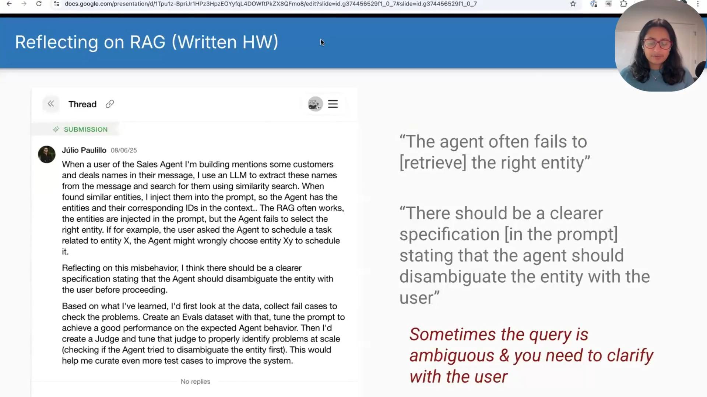

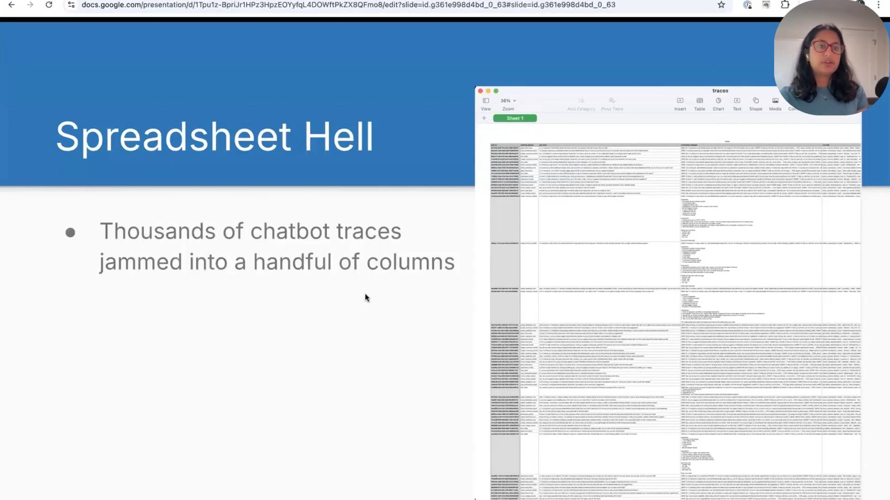

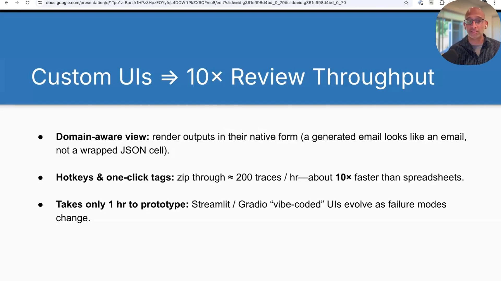

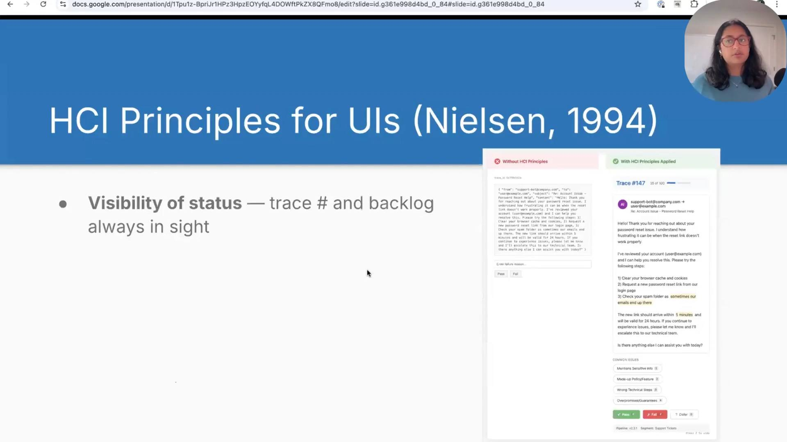

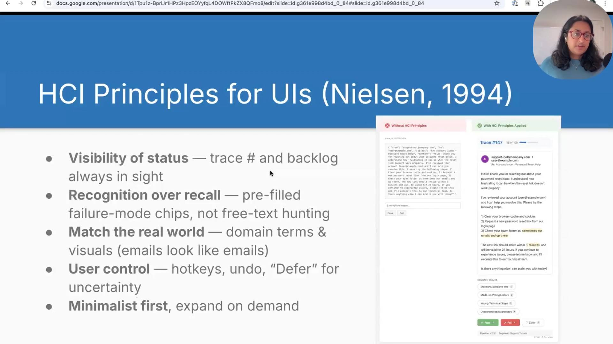

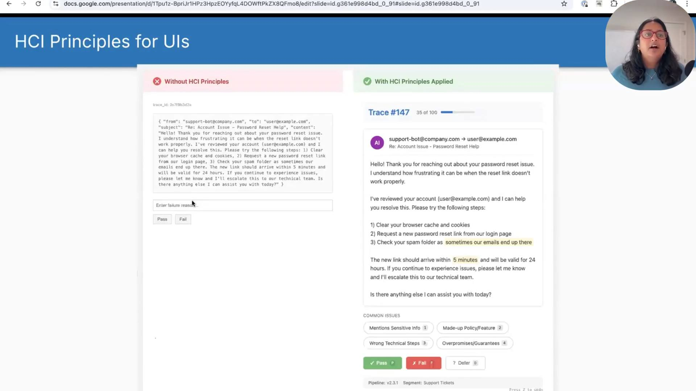

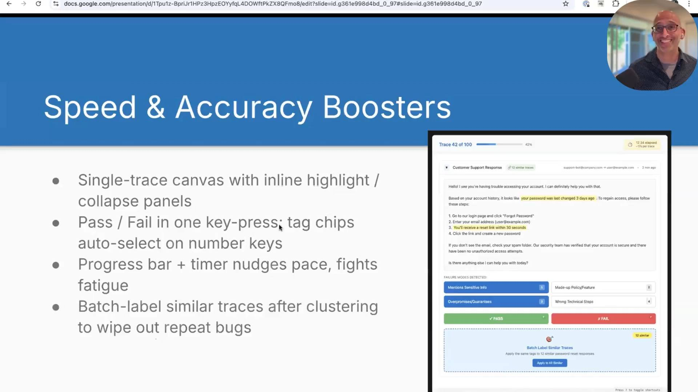

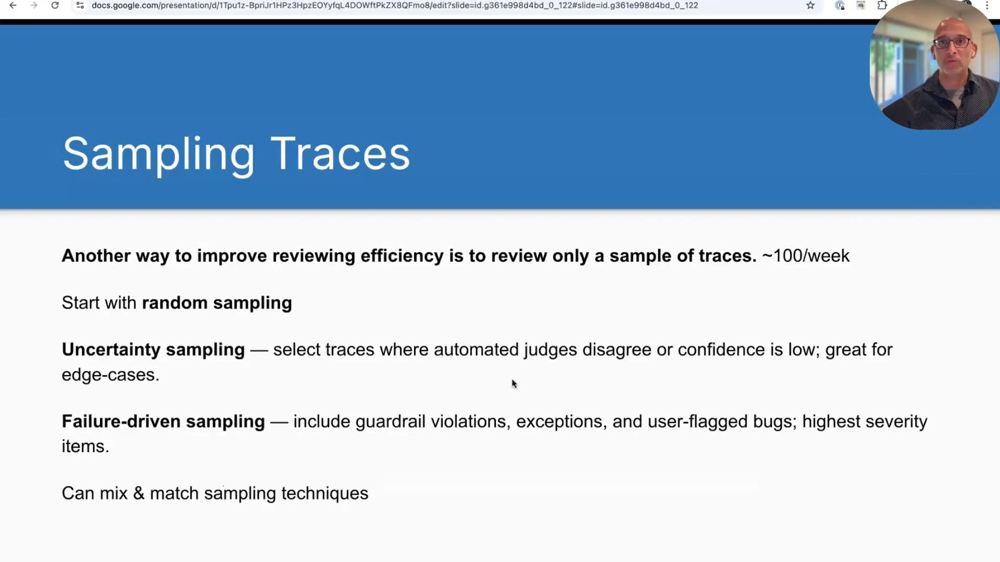

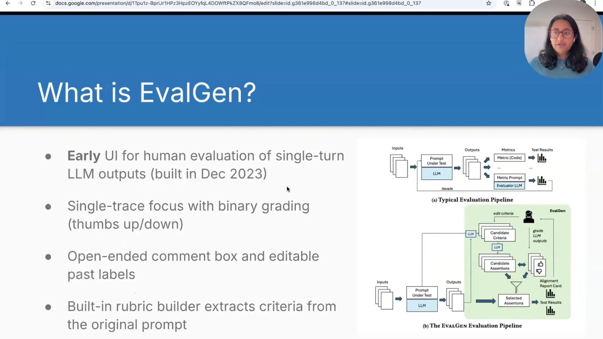

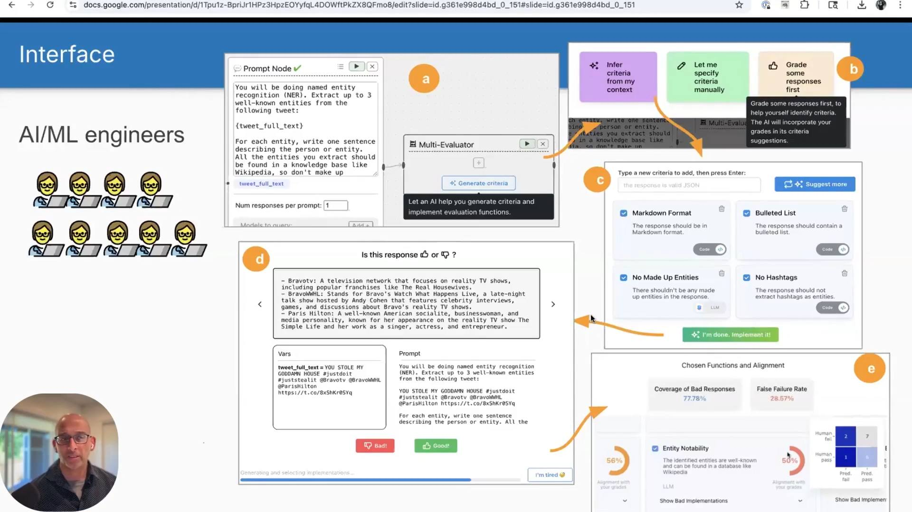

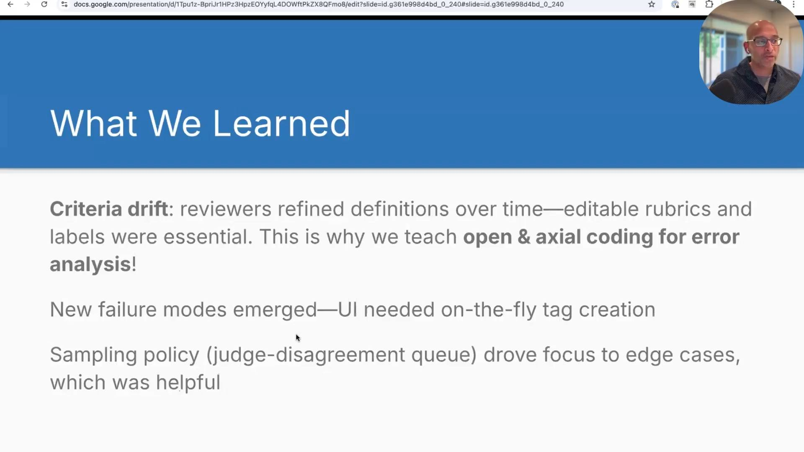

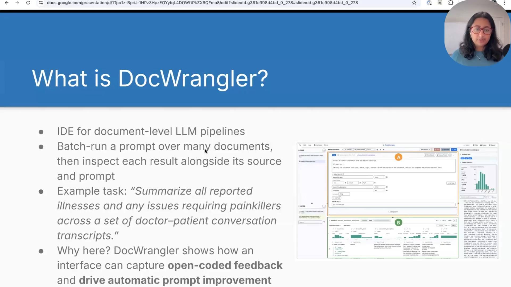