# AI Evals 第八课：用 Claude Code 现场搭建标注界面 + 准确率与成本优化

> 课程：AI Evals For Engineers & PMs（BV1FwTE6gEky）｜覆盖 P29（全课最后一讲）
> 读者定位：前端转 AI 应用工程师。本文档按「能照着复现」的标准写：先讲清这节课要交付什么，再给完整可运行的文件，最后逐行解释。

---

## 1. 这一节做什么

这是八节课的最后一讲，主题是**收尾 + 改进（improvement）**。整节课分成两大块：

**第一块（占前 45 分钟）：现场用 Claude Code「vibe coding」出一个自定义标注界面（annotation app）。**

讲师拿自己上一节课用过的「公寓租赁助手（apartment leasing agent）」的 trace 数据，从零开始，用自然语言向 Claude Code 描述需求，让 AI 生成一个 FastAPI 后端 + HTML/JS 前端的标注工具。这个工具要能做到：

- 一次只显示一条 trace，用左右方向键在 trace 之间前后翻页（不用鼠标点）；
- 每条 trace 是一个消息列表，每条消息是带 `content` 和 `role` 的 JSON 对象，`role` 可能是 AI、tool response 或 user message；
- 有一个自由文本输入框，让标注者写 open code（开放式标注）；
- 有进度条，显示已标注多少条、还剩多少条；
- 标注结果自动存到 CSV，允许覆盖旧文件、允许新建标注；
- 有一个「历史标注」下拉框，可以把之前写过的标注一键套用到当前 trace；
- 把用户原始 query 里的关键词（非停用词）在其他消息里高亮出来，方便快速判断「这条 trace 有没有真的回应了用户问的东西」；
- 领域相关关键词（比如时间 `11 a.m.`、日期）也要高亮；
- 重复消息要自动检测并打上「Duplicate」标记；
- JSON 格式的消息内容要渲染得好看一点；
- 布局上左边 75%~80% 放 trace，右边放标注输入框、下拉框、保存按钮。

讲师一边写 prompt 一边迭代，中间遇到端口占用、样式没加载等真实问题，也当场演示了怎么让 AI 修。最后他总结：**这类界面 30~40 分钟能做出一个能用的初版，再花一小时能打磨得比较满意**。

**第二块（最后 10 分钟）：讲怎么「改进」应用——准确率和成本两条线。**

- 准确率：先改 prompt（消歧义、加 few-shot、加角色、加「think step by step」），不行就做**任务分解**（把一个大 LLM 调用拆成「解析/改写 query → 调工具或检索 → 总结工具结果」的链），再不行就调 RAG（99.9% 的问题在检索）、修工具描述（system prompt 和 MCP 里的工具 spec 要一致），最后才考虑微调或 DSPy 这类自动 prompt 优化。
- 成本：先找出管线里所有 LLM 调用，能换小模型的换小模型（二分类这种用 GPT-5 mini/nano，成本降 10~100 倍）；减少 token（长文档用摘要、输出用 YAML/XML 代替啰嗦的 JSON）；利用 **KV 缓存**——把静态指令放前面、动态数据放后面，让前缀尽量共享，OpenAI 大约省 50%，Anthropic 大约省 90%。

> 注意：这节课**没有 OCR 结果**，讲师屏幕上出现的代码/配置没有被文字化提取。所以本文档第 4 节的「完整代码」是**根据讲师逐字稿里描述的需求、以及他现场演示出来的界面行为，重建的一份可直接运行的实现**，并在每处标注哪些是讲师明确要求的、哪些是复现时补的。凡逐字稿没讲的，一律写「课里没讲」。

---

## 2. 讲师原话

先看这节课的定位和「vibe coding」是什么：

> "今天我们要花一些时间做 vibe coding。什么是 vibe coding？这是 Andrej Karpathy 创造的一个词，意思基本上就是用 AI、和 AI 或 LLM 交互来构建应用。我们要走一遍这个过程，并且会用 Claude Code 来做。"
> —— p029 [02:22]

关于为什么值得自己搭标注界面：

> "这就是为什么我们提倡自己搭标注工具，因为它太顺手了。"
> —— p029 [33:44]

关于「高亮」这个设计——这是讲师反复强调的一个判断：

> "我喜欢用高亮、下划线、颜色，一切手段把注意力引到该看的地方。你能为『注意力该放哪』写出越多启发式规则，你审起来就越容易。"
> —— p029 [24:18]

关于「不要抄讲师的 prompt，要自己想」：

> "我其实想过，要不要直接把我在课上讲的那些幻灯片内容复制粘贴过来。然后我又想，不行，我想给大家展示：我就现场想，也能做出来。"
> —— p029 [39:24]

关于用 AI 做 eval 时人和 AI 的分工（这是整门课反复强调的）：

> "你应该让 AI 在环里（AI in the loop），而不是人在环里（human in the loop）。AI in the loop 的意思是你来驱动 AI。所以如果你让 AI 帮你做这些 eval，完全没问题，你应该这么做。但你要理解每一步，并且非常仔细地思考每一步。"
> —— p029 [06:33]

关于成本优化什么时候做：

> "在你的应用准确率变好之前，不要去想降低成本。这一点我怎么强调都不为过。对一个输出本来就很差的应用做成本优化，毫无意义。"
> —— p029 [53:06]

关于 KV 缓存的原理：

> "Transformer 模型的权重里，很多都和所谓的 key、value 向量有关。如果后续的 prompt 共享了相同的 token，这些向量就可以被缓存和复用。而且它只在 prompt 的前缀层面生效。"
> —— p029 [55:28]

关于 prompt 里静态和动态内容的顺序：

> "策略就是：把任何静态指令、system prompt 之类的东西，放在任何动态内容或数据之前。这样你才能尽可能省钱。"
> —— p029 [56:26]

关于这门课最终想让人带走的东西：

> "你不需要一次做完所有事。从小处开始。我经常跟人说这句话。你不需要在跑第一个 prompt 之前就跳进去搞一个自定义标注应用。慢慢来，为你自己把 eval 生态搭起来。"
> —— p029 [59:22]

---

## 3. 从零复现

这一节按「你坐在电脑前，从空文件夹开始」的顺序写。每一步都给出命令和文件。

### 3.1 环境准备

讲师现场用的是 Python 虚拟环境（他说自己其他项目已经开始转用 `uv`，但这次演示还是先激活了 venv）。我们照做：

```bash
# 1. 建项目目录
mkdir leasing-annotator
cd leasing-annotator

# 2. 建虚拟环境（讲师现场就是激活 venv）
python3 -m venv .venv
source .venv/bin/activate        # Windows: .venv\Scripts\activate

# 3. 装依赖
pip install fastapi uvicorn
```

> 版本说明：逐字稿里讲师**没有报任何版本号**。FastAPI + uvicorn 是讲师在描述需求时明确点名的后端栈（"I want the backend to be a fast API and the front end to be HTML/JS"）。前端用原生 HTML/JS，不引入构建工具——这也是讲师明确指定的。

### 3.2 准备 trace 数据

讲师的数据来自上一节课的公寓租赁助手，他「把所有能下载的 trace 都下载下来了」，存成一个 CSV，里面有 `input` 和 `output` 两列，分别对应消息。每条 trace 是一个消息列表，每条消息是带 `content` 和 `role` 的 JSON 对象。

我们复现时造一份结构相同的小样本 `traces.csv`（真实项目里换成你自己的导出即可）。注意 CSV 里 JSON 字段要用双引号包裹、内部双引号转义，最省事的做法是用 Python 生成而不是手写：

```python
# make_sample_traces.py —— 生成一份结构正确的 traces.csv
import csv, json

rows = [
    {
        "trace_id": "t001",
        "input": [
            {"role": "user", "content": "Hi, can I schedule a tour for tomorrow at 11 a.m.?"},
            {"role": "tool", "content": "{\"available_slots\": [\"11:00\", \"14:00\"]}"},
            {"role": "assistant", "content": "Sure! I can book you for tomorrow at 11 a.m. Does that work?"},
        ],
        "output": "Sure! I can book you for tomorrow at 11 a.m. Does that work?",
    },
    {
        "trace_id": "t002",
        "input": [
            {"role": "user", "content": "What is the pet policy?"},
            {"role": "assistant", "content": "Pets are allowed with a $300 deposit."},
            {"role": "assistant", "content": "Pets are allowed with a $300 deposit."},
        ],
        "output": "Pets are allowed with a $300 deposit.",
    },
    {
        "trace_id": "t003",
        "input": [
            {"role": "user", "content": "When does my lease end?"},
            {"role": "tool", "content": "{\"lease_end\": \"2026-03-31\"}"},
            {"role": "assistant", "content": "Your lease ends on March 31, 2026."},
        ],
        "output": "Your lease ends on March 31, 2026.",
    },
]

with open("traces.csv", "w", newline="", encoding="utf-8") as f:
    w = csv.writer(f)
    w.writerow(["trace_id", "input", "output"])
    for r in rows:
        w.writerow([r["trace_id"], json.dumps(r["input"], ensure_ascii=False), r["output"]])

print("wrote traces.csv")
```

运行：

```bash
python make_sample_traces.py
```

> 课里没讲 CSV 的确切列名和格式细节，讲师只说「input 和 output 两列指的是消息」「每条 trace 是消息列表，消息是带 content 和 role 的 JSON」。上面的 `trace_id` 列是复现时补的，方便做「历史标注」的 join key——讲师在讲数据库设计时确实提到用 trace ID 做 join key（见 3.6）。

### 3.3 用 Claude Code 生成应用（讲师现场的做法）

讲师打开 Claude Code，用自然语言描述需求。他的 prompt 大致是（翻译自逐字稿）：

> "我有一堆 LLM 应用的 trace，想标注失败模式。trace 在 CSV 里，input 和 output 两列指的是消息，你可能要再确认一下。每条 trace 是一个消息列表，消息是带 content 和 role 的 JSON 对象，role 可能是 AI、tool response 或 user message。我想一次标注一条 trace 的失败模式。我想要一个自由文本输入框来写 open code。我想要用左右方向键在 trace 之间前后翻页，并且有热键，不用点鼠标。也请用好的 UI 原则，比如显示已标注多少条的进度条。把标注自动存到 CSV，可以覆盖标注 CSV 文件、新建标注，并且允许有一个之前标注的下拉框，让我在标注后续 trace 时自动套用。另外想想我可能想要但没在指令里提到的东西。后端用 FastAPI，前端用 HTML/JS，应用建在这个文件夹里。开始之前可以在文件夹里建一个 plan.md。"

讲师特别提到：**第一次做某类东西时，先让 AI 写 `plan.md`**；他自己因为已经用 AI 做过至少 15 个标注应用，所以这次只是「为了照顾我」才让它写 plan。他还强调：**不要指望有唯一的神奇 prompt**，要把课上学的东西内化，现场想。

> 复现建议：如果你也想走 Claude Code 这条路，把上面这段 prompt 原样贴进去即可。但本文档第 4 节给的是**手写版完整代码**，不依赖任何 AI 工具，保证你能跑起来。

### 3.4 启动与排错

讲师现场遇到两个真实问题，复现时你大概率也会撞上：

1. **端口被占用**：他先看到 `address 8000 already in use`（可能是上一次 Claude Code 起的进程没关），于是换到 `8002`。复现时如果 8000 被占，直接换端口：

```bash
uvicorn app:app --reload --port 8002
```

2. **样式没加载**：页面能打开但 CSS 没生效，他打开浏览器 console 看到报错，让 AI 修。复现时如果页面「很紫、很丑」，先看 console 和 Network 面板，确认 `/static/style.css` 返回 200。

启动后访问 `http://127.0.0.1:8002/`。

### 3.5 迭代：讲师现场提的第二轮修改

第一版跑起来后，讲师列了一串「我不喜欢的地方」，让 AI 继续改（翻译自逐字稿）：

- 标注框在底部要滚动，**改成左右两栏**：左边 75%~80% 放 trace，右边放 open code 输入框、下拉框、方向键说明、保存按钮；
- 高亮**领域关键词**：时间（如 `11 a.m.`）、日期；
- **重复消息**要视觉上标出来，打上「Duplicate」；
- JSON 格式的消息内容**渲染得更好看**；
- 换掉那个紫色主题（观众也提了）。

这些就是第 4 节代码里 `highlight.js` 和 `renderMessage` 那部分的来源。

### 3.6 部署与数据存储（讲师口头讲的，课里没给代码）

讲师回答观众提问时讲了部署和存储方案，这里如实记录，**不编造代码**：

- **只自己用**：本地跑就行，标注存 CSV/JSON。
- **多人协作**：用 **Modal** 部署，因为它和 FastAPI 有集成；冷启动大约 15 秒，之后几乎瞬时，很便宜。
- **数据库**：建一个 Postgres，**每个应用一张表，每行一条 trace，每列是某个人的 open code**；另建一张 axial codes 表，两张表用 **trace ID** 做 join key。也可以用 SQLite（「就是个文件，复杂度低」），或者 Supabase、云厂商的数据库。
- 他还提到一个叫 **Doku** 的东西（「个人版 Heroku」），喜欢的栈是「一台 5 美元的 VPS/VM + Doku 提供 auth 等能力」。

> 课里没讲这些方案的具体配置和代码，本文档不补。

---

## 4. 完整代码

下面是**可直接保存运行**的完整实现。目录结构：

```
leasing-annotator/
├── app.py
├── traces.csv              # 由 3.2 的脚本生成
├── annotations.csv         # 首次运行自动创建
├── static/
│   ├── index.html
│   ├── style.css
│   └── app.js
└── .venv/
```

> 再次说明：本节代码是**依据讲师逐字稿描述的需求重建**的，不是从截图 OCR 抄来的（本段没有 OCR）。讲师明确要求过的点都在注释里标了 `# 讲师要求`；复现时补的点标 `# 复现补充`。

### 4.1 `app.py`（FastAPI 后端）

```python
# app.py
# 讲师要求：后端用 FastAPI；标注自动存 CSV；支持覆盖/新建；支持历史标注下拉
import csv
import json
import os
from typing import Any

from fastapi import FastAPI, HTTPException
from fastapi.responses import FileResponse
from fastapi.staticfiles import StaticFiles
from pydantic import BaseModel

BASE_DIR = os.path.dirname(os.path.abspath(__file__))
TRACES_CSV = os.path.join(BASE_DIR, "traces.csv")
ANNOTATIONS_CSV = os.path.join(BASE_DIR, "annotations.csv")
STATIC_DIR = os.path.join(BASE_DIR, "static")

app = FastAPI(title="Leasing Trace Annotator")


# ---------- 数据读写 ----------

def load_traces() -> list[dict[str, Any]]:
    """读 traces.csv，把 input 列的 JSON 字符串解析成消息列表。"""
    traces = []
    with open(TRACES_CSV, newline="", encoding="utf-8") as f:
        for row in csv.DictReader(f):
            try:
                messages = json.loads(row["input"])
            except json.JSONDecodeError:
                messages = []
            traces.append({
                "trace_id": row.get("trace_id", ""),
                "messages": messages,
                "output": row.get("output", ""),
            })
    return traces


def load_annotations() -> dict[str, dict[str, str]]:
    """读 annotations.csv，返回 {trace_id: {open_code, axial_code}}。"""
    if not os.path.exists(ANNOTATIONS_CSV):
        return {}
    out: dict[str, dict[str, str]] = {}
    with open(ANNOTATIONS_CSV, newline="", encoding="utf-8") as f:
        for row in csv.DictReader(f):
            out[row["trace_id"]] = {
                "open_code": row.get("open_code", ""),
                "axial_code": row.get("axial_code", ""),
            }
    return out


def save_annotation(trace_id: str, open_code: str, axial_code: str) -> None:
    """讲师要求：自动存 CSV，允许覆盖旧标注、允许新建。"""
    annotations = load_annotations()
    annotations[trace_id] = {"open_code": open_code, "axial_code": axial_code}
    with open(ANNOTATIONS_CSV, "w", newline="", encoding="utf-8") as f:
        w = csv.writer(f)
        w.writerow(["trace_id", "open_code", "axial_code"])
        for tid, ann in annotations.items():
            w.writerow([tid, ann["open_code"], ann["axial_code"]])


# ---------- 请求体 ----------

class AnnotationIn(BaseModel):
    trace_id: str
    open_code: str = ""
    axial_code: str = ""


# ---------- 路由 ----------

@app.get("/api/traces")
def get_traces():
    """返回全部 trace + 已有标注 + 历史标注列表（供下拉框用）。"""
    traces = load_traces()
    annotations = load_annotations()
    history = sorted({a["open_code"] for a in annotations.values() if a["open_code"]})
    return {"traces": traces, "annotations": annotations, "history": history}


@app.post("/api/annotate")
def annotate(payload: AnnotationIn):
    save_annotation(payload.trace_id, payload.open_code, payload.axial_code)
    return {"ok": True}


@app.get("/")
def index():
    return FileResponse(os.path.join(STATIC_DIR, "index.html"))


app.mount("/static", StaticFiles(directory=STATIC_DIR), name="static")
```

### 4.2 `static/index.html`

```html
<!DOCTYPE html>
<html lang="en">
<head>
  <meta charset="UTF-8" />
  <title>Leasing Trace Annotator</title>
  <link rel="stylesheet" href="/static/style.css" />
</head>
<body>
  <!-- 讲师要求：进度条 -->
  <header>
    <h1>Leasing Trace Annotator</h1>
    <div class="progress-wrap">
      <div id="progress-bar"></div>
    </div>
    <span id="progress-text">0 / 0</span>
  </header>

  <!-- 讲师要求：左右两栏，左 75%~80% 放 trace，右放标注 -->
  <main>
    <section id="trace-pane">
      <div id="trace-meta"></div>
      <div id="messages"></div>
    </section>

    <aside id="annotate-pane">
      <label for="open-code">Open code</label>
      <textarea id="open-code" placeholder="Describe the failure mode..."></textarea>

      <label for="history">Previous annotations</label>
      <select id="history">
        <option value="">-- pick one --</option>
      </select>

      <label for="axial-code">Axial code</label>
      <input id="axial-code" type="text" placeholder="e.g. hallucination" />

      <button id="save-btn">Save (S)</button>

      <p class="hint">← / → 翻页 · S 保存</p>
    </aside>
  </main>

  <script src="/static/app.js"></script>
</body>
</html>
```

### 4.3 `static/style.css`

```css
/* 讲师要求：换掉紫色主题；左 75%~80% 右 20%~25% */
* { box-sizing: border-box; }

body {
  margin: 0;
  font-family: -apple-system, BlinkMacSystemFont, "Segoe UI", sans-serif;
  background: #f7f7f8;
  color: #1f2328;
}

header {
  padding: 12px 20px;
  background: #fff;
  border-bottom: 1px solid #e5e7eb;
  display: flex;
  align-items: center;
  gap: 16px;
}

header h1 { font-size: 16px; margin: 0; }

.progress-wrap {
  flex: 1;
  height: 8px;
  background: #e5e7eb;
  border-radius: 4px;
  overflow: hidden;
}

#progress-bar {
  height: 100%;
  width: 0%;
  background: #2563eb;
  transition: width 0.2s;
}

main {
  display: flex;
  height: calc(100vh - 60px);
}

#trace-pane {
  width: 78%;              /* 讲师要求：左 75%~80% */
  overflow-y: auto;
  padding: 20px;
}

#annotate-pane {
  width: 22%;
  padding: 20px;
  background: #fff;
  border-left: 1px solid #e5e7eb;
  display: flex;
  flex-direction: column;
  gap: 8px;
}

#annotate-pane textarea {
  flex: 1;
  min-height: 160px;
  resize: vertical;
  font-family: inherit;
  padding: 8px;
}

#annotate-pane input,
#annotate-pane select,
#annotate-pane textarea {
  border: 1px solid #d1d5db;
  border-radius: 6px;
  padding: 8px;
}

#save-btn {
  padding: 10px;
  background: #2563eb;
  color: #fff;
  border: none;
  border-radius: 6px;
  cursor: pointer;
}

.hint { color: #6b7280; font-size: 12px; }

/* 消息卡片 */
.message {
  background: #fff;
  border: 1px solid #e5e7eb;
  border-radius: 8px;
  padding: 12px;
  margin-bottom: 10px;
}

.message .role {
  font-size: 12px;
  font-weight: 600;
  color: #6b7280;
  margin-bottom: 6px;
  text-transform: uppercase;
}

.message pre {
  margin: 0;
  white-space: pre-wrap;
  word-break: break-word;
  font-family: ui-monospace, SFMono-Regular, Menlo, monospace;
  font-size: 13px;
}

/* 讲师要求：关键词高亮 */
mark.keyword { background: #fde68a; padding: 0 2px; border-radius: 2px; }
mark.domain  { background: #bfdbfe; padding: 0 2px; border-radius: 2px; }

/* 讲师要求：重复消息打 Duplicate 标记 */
.duplicate-badge {
  display: inline-block;
  background: #ef4444;
  color: #fff;
  font-size: 11px;
  padding: 1px 6px;
  border-radius: 4px;
  margin-left: 8px;
}
```

### 4.4 `static/app.js`

```javascript
// static/app.js
// 讲师要求：左右方向键翻页、S 保存、进度条、历史标注下拉、关键词高亮、重复消息标记

let traces = [];
let annotations = {};
let history = [];
let idx = 0;

const $ = (sel) => document.querySelector(sel);

// ---------- 停用词（讲师要求：非停用词才高亮） ----------
const STOPWORDS = new Set([
  "a","an","the","is","are","was","were","be","been","being",
  "i","you","he","she","it","we","they","me","him","her","us","them",
  "my","your","his","its","our","their",
  "and","or","but","if","then","so","to","of","in","on","at","for",
  "with","about","as","by","from","up","down","out","over","under",
  "can","could","will","would","should","may","might","must",
  "do","does","did","have","has","had","what","when","where","who","why","how",
  "this","that","these","those","there","here","not","no","yes",
]);

// 讲师要求：领域关键词——时间、日期
const TIME_RE = /\b\d{1,2}(:\d{2})?\s?(a\.?m\.?|p\.?m\.?)\b/gi;
const DATE_RE = /\b(\d{4}-\d{2}-\d{2}|\d{1,2}\/\d{1,2}\/\d{2,4}|(jan|feb|mar|apr|may|jun|jul|aug|sep|oct|nov|dec)[a-z]*\s+\d{1,2})\b/gi;

function escapeHtml(s) {
  return s.replace(/&/g, "&amp;").replace(/</g, "&lt;").replace(/>/g, "&gt;");
}

// 讲师要求：把用户 query 里的非停用词，在其他消息里高亮
function highlightKeywords(text, keywords) {
  let html = escapeHtml(text);
  for (const kw of keywords) {
    if (!kw) continue;
    const re = new RegExp(`\\b${kw.replace(/[.*+?^${}()|[\]\\]/g, "\\$&")}\\b`, "gi");
    html = html.replace(re, (m) => `<mark class="keyword">${m}</mark>`);
  }
  return html;
}

// 讲师要求：领域关键词（时间、日期）高亮
function highlightDomain(text) {
  return text
    .replace(TIME_RE, (m) => `<mark class="domain">${m}</mark>`)
    .replace(DATE_RE, (m) => `<mark class="domain">${m}</mark>`);
}

function extractKeywords(userText) {
  return userText
    .toLowerCase()
    .replace(/[^a-z0-9\s]/g, " ")
    .split(/\s+/)
    .filter((w) => w.length > 2 && !STOPWORDS.has(w));
}

// 讲师要求：JSON 内容渲染得更好看
function renderContent(content) {
  try {
    const parsed = JSON.parse(content);
    return `<pre>${escapeHtml(JSON.stringify(parsed, null, 2))}</pre>`;
  } catch {
    return `<pre>${escapeHtml(content)}</pre>`;
  }
}

function renderTrace() {
  const trace = traces[idx];
  if (!trace) return;

  $("#trace-meta").textContent = `Trace ${idx + 1} / ${traces.length} · ${trace.trace_id}`;

  // 找第一条 user 消息，抽关键词
  const firstUser = trace.messages.find((m) => m.role === "user");
  const keywords = firstUser ? extractKeywords(firstUser.content) : [];

  // 讲师要求：检测重复消息
  const seen = new Map();
  const dupFlags = trace.messages.map((m) => {
    const key = `${m.role}::${m.content}`;
    const count = seen.get(key) || 0;
    seen.set(key, count + 1);
    return count > 0; // 第二次及以后出现算重复
  });

  const container = $("#messages");
  container.innerHTML = "";

  trace.messages.forEach((m, i) => {
    const div = document.createElement("div");
    div.className = "message";

    const role = document.createElement("div");
    role.className = "role";
    role.textContent = m.role;
    if (dupFlags[i]) {
      const badge = document.createElement("span");
      badge.className = "duplicate-badge";
      badge.textContent = "Duplicate";
      role.appendChild(badge);
    }
    div.appendChild(role);

    const body = document.createElement("div");
    let html = renderContent(m.content);
    // 只在非 user 消息里高亮关键词（user 消息本身是关键词来源）
    if (m.role !== "user") {
      html = highlightKeywords(html, keywords);
    }
    html = highlightDomain(html);
    body.innerHTML = html;
    div.appendChild(body);

    container.appendChild(div);
  });

  // 回填已有标注
  const ann = annotations[trace.trace_id] || {};
  $("#open-code").value = ann.open_code || "";
  $("#axial-code").value = ann.axial_code || "";

  updateProgress();
}

function updateProgress() {
  const total = traces.length;
  const done = traces.filter((t) => {
    const a = annotations[t.trace_id];
    return a && a.open_code && a.open_code.trim();
  }).length;
  $("#progress-bar").style.width = `${total ? (done / total) * 100 : 0}%`;
  $("#progress-text").textContent = `${done} / ${total}`;
}

async function saveCurrent() {
  const trace = traces[idx];
  if (!trace) return;
  const open_code = $("#open-code").value;
  const axial_code = $("#axial-code").value;

  await fetch("/api/annotate", {
    method: "POST",
    headers: { "Content-Type": "application/json" },
    body: JSON.stringify({ trace_id: trace.trace_id, open_code, axial_code }),
  });

  annotations[trace.trace_id] = { open_code, axial_code };
  if (open_code && !history.includes(open_code)) {
    history.push(open_code);
    renderHistory();
  }
  updateProgress();
}

function renderHistory() {
  const sel = $("#history");
  sel.innerHTML = '<option value="">-- pick one --</option>';
  for (const h of history) {
    const opt = document.createElement("option");
    opt.value = h;
    opt.textContent = h;
    sel.appendChild(opt);
  }
}

function go(delta) {
  const next = idx + delta;
  if (next < 0 || next >= traces.length) return;
  idx = next;
  renderTrace();
}

// ---------- 事件绑定 ----------
document.addEventListener("keydown", (e) => {
  // 在输入框里打字时不触发翻页
  const tag = document.activeElement.tagName;
  if (tag === "TEXTAREA" || tag === "INPUT") {
    if (e.key === "s" && (e.metaKey || e.ctrlKey)) {
      e.preventDefault();
      saveCurrent();
    }
    return;
  }
  if (e.key === "ArrowLeft") go(-1);
  if (e.key === "ArrowRight") go(1);
  if (e.key === "s" || e.key === "S") saveCurrent();
});

$("#save-btn").addEventListener("click", saveCurrent);

$("#history").addEventListener("change", (e) => {
  if (e.target.value) $("#open-code").value = e.target.value;
});

// ---------- 启动 ----------
async function boot() {
  const res = await fetch("/api/traces");
  const data = await res.json();
  traces = data.traces;
  annotations = data.annotations;
  history = data.history || [];
  renderHistory();
  renderTrace();
}

boot();
```

### 4.5 启动命令

```bash
# 在 leasing-annotator/ 目录下，已激活 .venv
python make_sample_traces.py          # 生成 traces.csv（只需一次）
uvicorn app:app --reload --port 8002
```

浏览器打开 `http://127.0.0.1:8002/`。

---

## 5. 逐行解释

### 5.1 后端 `app.py`

- `load_traces()`：CSV 的 `input` 列是 JSON 字符串，`json.loads` 解析成消息列表。讲师说「每条 trace 是消息列表，消息是带 content 和 role 的 JSON 对象」——这里就是把这个结构还原出来。解析失败时返回空列表而不是崩掉，因为讲师现场也遇到「有个 object object 不知道是什么」的脏数据。
- `load_annotations()` / `save_annotation()`：讲师明确要求「自动存 CSV、允许覆盖、允许新建」。实现方式是每次保存都**全量重写** `annotations.csv`——对几百条 trace 的规模完全够用，也最简单。如果你要多人并发写，这里会丢更新，需要换成数据库（讲师讲的 Postgres 方案就是为此）。
- `history`：从所有已有标注里收集去重后的 `open_code`，前端下拉框用。讲师原话是「允许有一个之前标注的下拉框，让我在标注后续 trace 时自动套用」。
- `@app.get("/api/traces")`：一次性把 traces、annotations、history 全返回，前端不用多次请求。这是复现时的简化，课里没讲具体 API 设计。
- `app.mount("/static", ...)`：静态文件挂载。讲师现场遇到「样式没加载」，本质就是静态文件路径没配对，这里用绝对路径 `STATIC_DIR` 避免。

### 5.2 前端 `app.js`

- **翻页**：`go(delta)` 改 `idx` 后重渲染。键盘监听里先判断 `document.activeElement.tagName`——如果焦点在 textarea/input 里，方向键应该移动光标而不是翻页。这是讲师要求「用热键翻页、不用点鼠标」时必须处理的边界，课里没细讲，但不处理就会很难用。
- **保存热键**：`S` 保存；在输入框里时用 `Cmd/Ctrl+S`。讲师说「有热键，不用点鼠标」。
- **关键词高亮**：`extractKeywords` 取第一条 user 消息，转小写、去标点、按空格切、过滤长度 ≤2 和停用词。讲师原话是「用户原始 query 里的非停用词，在其他消息里高亮」。注意代码里**只在非 user 消息里高亮**——因为 user 消息本身是关键词来源，全高亮反而没信息量。
- **领域高亮**：`TIME_RE` 匹配 `11 a.m.` 这类，`DATE_RE` 匹配 `2026-03-31`、`3/31/26`、`March 31` 这类。讲师说「时间对我很有意思，因为这个应用全是排期和时间」「日期也匹配任何日期模式」。
- **重复检测**：用 `role::content` 做 key，第二次及以后出现打 `Duplicate` 徽章。讲师原话是「我想视觉上看到 trace 里任何重复消息，重复的应该被标记出来」。注意讲师后来补充「我应该只说我只关心 assistant 的重复消息，我不太关心 user 的重复」——所以你可以把 key 改成只在 `m.role === "assistant"` 时检测，这是讲师自己承认的迭代点。
- **JSON 美化**：`renderContent` 先尝试 `JSON.parse`，成功就 `JSON.stringify(parsed, null, 2)` 缩进输出。讲师说「有些消息内容是 JSON，也许我们可以渲染得更好看一点」。
- **进度条**：`updateProgress` 统计「open_code 非空」的 trace 数。讲师要求「显示已标注多少条的进度条」。
- **历史下拉**：`renderHistory` 把 `history` 填进 `<select>`，`change` 时把值写进 textarea。讲师要求「下拉框自动套用」。

### 5.3 为什么这样布局

讲师现场第一版是「标注框在底部、要滚动」，他明确说「我不喜欢要滚下去才能标注」，于是改成左右两栏、左 78% 右 22%。这个比例是他现场从 75% 改到 80% 又改回来的，最终落在 78% 左右——CSS 里写 `78%` 就是照这个来。

### 5.4 准确率改进的「逐条解释」

讲师给的准确率改进是有顺序的，从低 effort 到高 effort：

1. **改 prompt**：消歧义、加 few-shot、加角色/persona、加「think step by step」。讲师说「从这些最低 effort 的开始，尤其在 prompt 精修这一类，就是把 prompt 写好，弥合 specification gap」。
2. **任务分解**：把一个大调用拆成链——「先用一个 LLM 解析或改写 query 澄清意图，然后基于改写后的 query 调工具或检索，再拿工具结果让 LLM 总结」。讲师说「每一部分还能继续拆，如果你 intent parsing 做不好，就想 step by step：人做这个 intent parsing 会怎么做，然后把那个调用拆成更小的调用链」。
3. **调 RAG**：「99.9% 的情况下问题在检索，去修你的检索，给检索建 eval 数据集」。
4. **修工具描述**：讲师特别指出「这些 agent 让我们在 system prompt 和工具实际 spec（比如 MCP）里都描述工具，很容易不一致，别这样，确保工具在所有地方描述一致」。
5. **微调 / DSPy**：最后手段。微调「只推荐给有 MLOps 资源的人，你要自己 serve 模型，要有人 on-call，很贵」。DSPy 是「自动做 prompt 优化」的工具，作者 Omar 当天晚些有 fireside chat。

> 在 JS/Node 里对应什么：任务分解就是「串行 await 多个 LLM 调用，每个调用只做一件小事」，而不是一个巨型 prompt 一次搞定。这跟前端把一个大组件拆成多个小组件是同一个思路。

### 5.5 成本优化的「逐条解释」

1. **换小模型**：找出管线里所有 LLM 调用，二分类这种用 GPT-5 mini/nano，「成本降 10 到 100 倍」。
2. **减 token**：长文档输入用摘要代替全文；输出别用啰嗦的 JSON，用 XML 或 YAML。
3. **KV 缓存**：原理是 transformer 的 key/value 向量在后续 prompt 共享相同 token 时可复用，**只在 prefix 层面生效**。讲师画了两组对比：input1 和 input2 共享前缀时，input2 只为未高亮部分付新 token；如果数据变了，可能只缓存了「hello, my」两个词。策略是「静态指令、system prompt 放前面，动态内容放后面」。省多少：OpenAI 约 50%，Anthropic 约 90%。
4. **模型级联（model cascades）**：讲师说「上次讲这个大家都没听懂，所以这次跳过，放在 reader 里」，他自己「做文档处理时一直用」。

> 讲师反复强调的顺序：**先准确率，后成本**。「对一个输出本来就很差的应用做成本优化，毫无意义。」

---

## 6. 复现检查清单

按顺序打勾，任何一项不过就别往下走：

- [ ] `python3 -m venv .venv && source .venv/bin/activate` 成功，`pip install fastapi uvicorn` 无报错。
- [ ] `python make_sample_traces.py` 生成 `traces.csv`，用文本编辑器打开能看到 3 行数据、`input` 列是合法 JSON。
- [ ] `uvicorn app:app --reload --port 8002` 启动，终端出现 `Uvicorn running on http://127.0.0.1:8002`。
- [ ] 浏览器打开 `http://127.0.0.1:8002/`，页面**不是**无样式的裸 HTML（如果很丑，看 console/Network，确认 `/static/style.css` 返回 200）。
- [ ] 页面显示 `Trace 1 / 3 · t001`，消息卡片有 role 标签。
- [ ] 按 `→` 翻到 t002，按 `←` 翻回 t001。
- [ ] t001 里 `11 a.m.` 有蓝色高亮（领域关键词），`tour`/`tomorrow`/`schedule` 在 assistant/tool 消息里有黄色高亮（用户 query 关键词）。
- [ ] t002 里第二条 assistant 消息带红色 `Duplicate` 徽章。
- [ ] 在右侧 textarea 写一段 open code，按 `S`，`annotations.csv` 出现对应行；刷新页面后标注还在。
- [ ] 进度条从 `0 / 3` 变成 `1 / 3`。
- [ ] 保存过的 open code 出现在右侧下拉框里，选中后能填进 textarea。
- [ ] 焦点在 textarea 里时按 `←/→` 是移动光标，不翻页。
- [ ] 端口 8000 被占时，换 `--port 8002` 能起来（讲师现场就是这么解决的）。

---

## 7. 课里没讲但你会撞上的

1. **CSV 里 JSON 的转义**：手写 `traces.csv` 时，`input` 列里的双引号要写成 `""`，否则 `csv` 模块读出来是坏的。用 3.2 的 Python 脚本生成最稳。课里没讲这个坑。
2. **并发写 `annotations.csv`**：本文档的实现是「读全量 → 改一条 → 全量重写」，两个人同时保存会丢更新。讲师讲的 Postgres 方案（每应用一张表、trace ID 做 join key）就是为解决这个。单人用无所谓。
3. **`--reload` 和文件写入**：uvicorn 的 `--reload` 会监听目录变化，你每保存一次 `annotations.csv` 可能触发一次重载。如果烦，把 `annotations.csv` 放到 `--reload-dir` 之外，或者生产环境别用 `--reload`。课里没讲。
4. **高亮用的正则**：`highlightKeywords` 里对关键词做了正则转义，但 `highlightDomain` 的 `DATE_RE` 里 `(jan|feb|...)` 后面跟 `[a-z]*` 会匹配到 `mayonnaise` 这种词。讲师现场也承认「高亮关键词要迭代一下，哪些值得高亮」。这不是 bug，是设计问题。
5. **`innerHTML` 的 XSS**：本文档先 `escapeHtml` 再插 `<mark>`，所以安全；但如果你直接 `innerHTML = content`，trace 里带 `<script>` 就会执行。课里没讲，但这是前端常识。
6. **Modal 部署的冷启动**：讲师说「第一次加载约 15 秒，之后几乎瞬时」。如果你要做多人协作版，预期第一次访问会卡一下。课里没给 Modal 的配置代码。
7. **Doku / VPS 方案**：讲师提了「5 美元 VPS + Doku 提供 auth」，但没演示。课里没讲具体步骤。
8. **模型级联**：讲师明确说「上次讲大家没听懂，这次跳过，放 reader 里」。本文档不展开，想学去看课程 reader。
9. **`plan.md` 到底该不该写**：讲师的原话是「第一次做某类东西时我会让它写 plan；我已经做过 15 个以上标注应用了，所以这次只是照顾你」。所以这不是硬性步骤，是经验判断。
10. **「AI in the loop」不是「human in the loop」**：讲师反复强调这个措辞——是你驱动 AI，不是 AI 驱动你。用 Claude Code 生成代码没问题，但你要理解每一行、每一步。这条没有代码，但比代码重要。

---

### 附：本节课的截图（按时间顺序，均来自 p029）

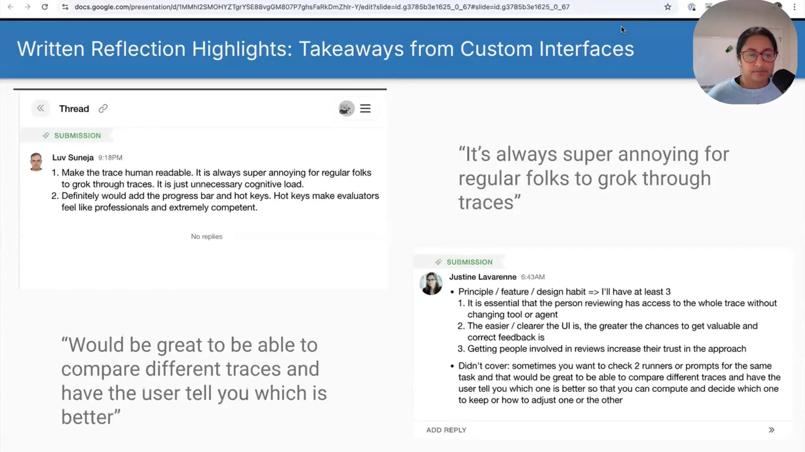

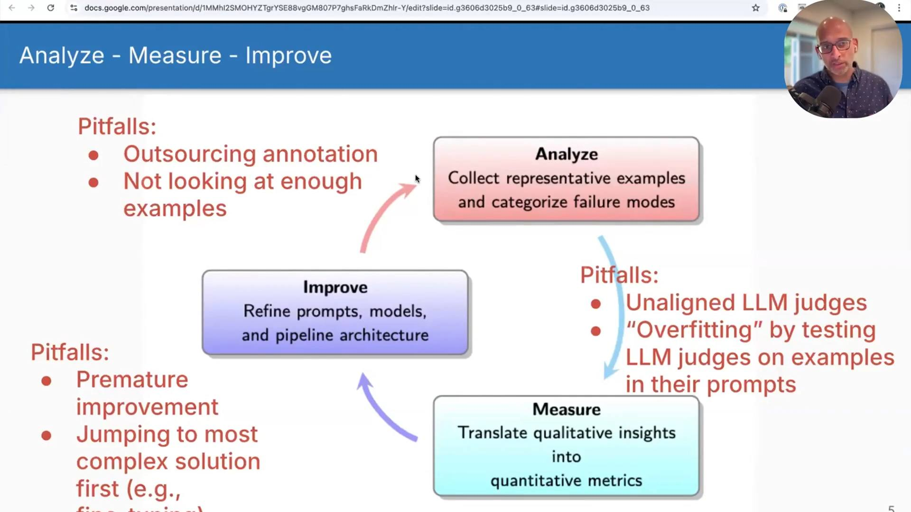

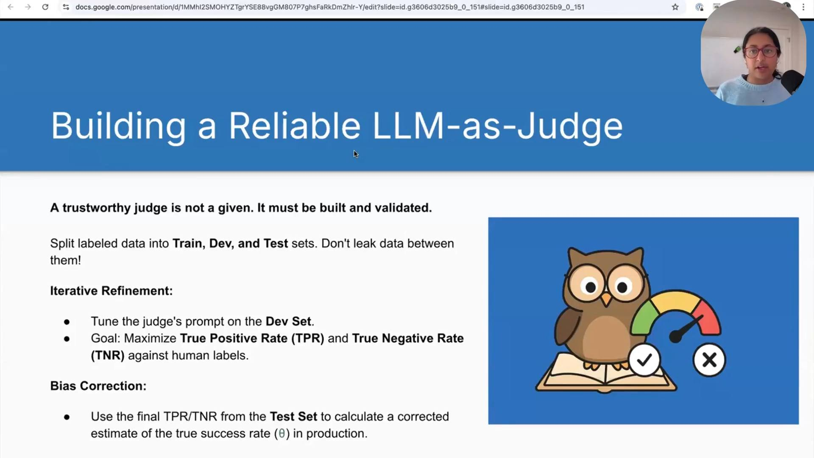

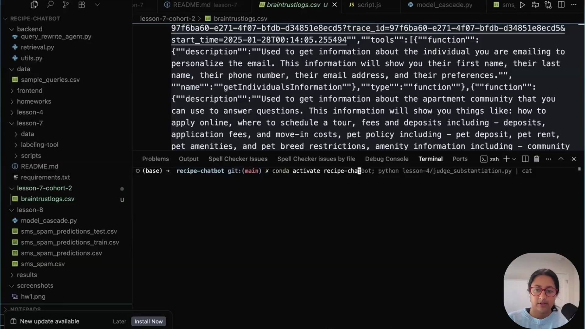

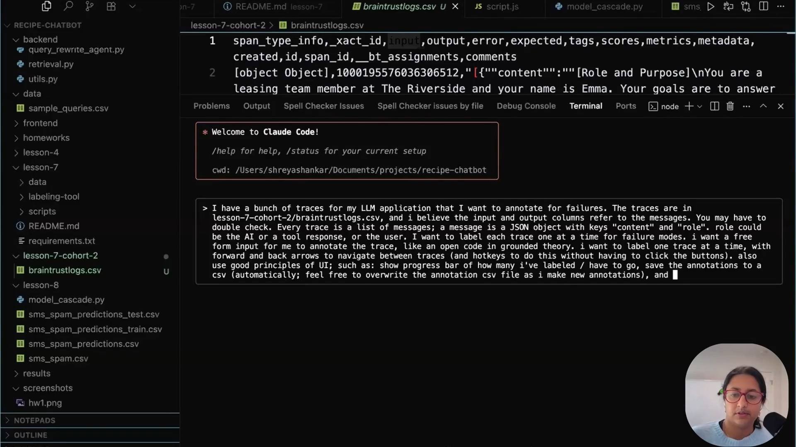

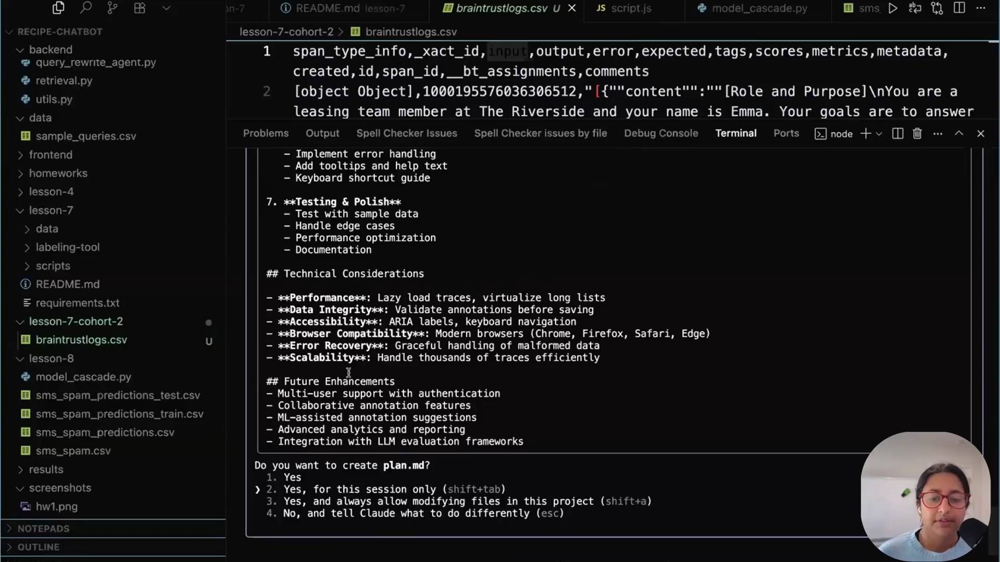

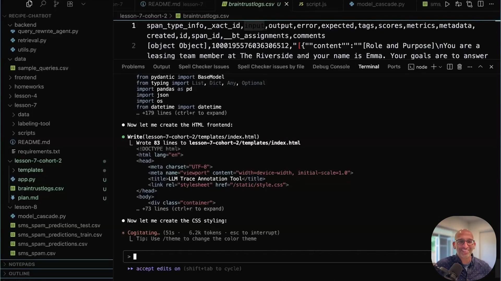

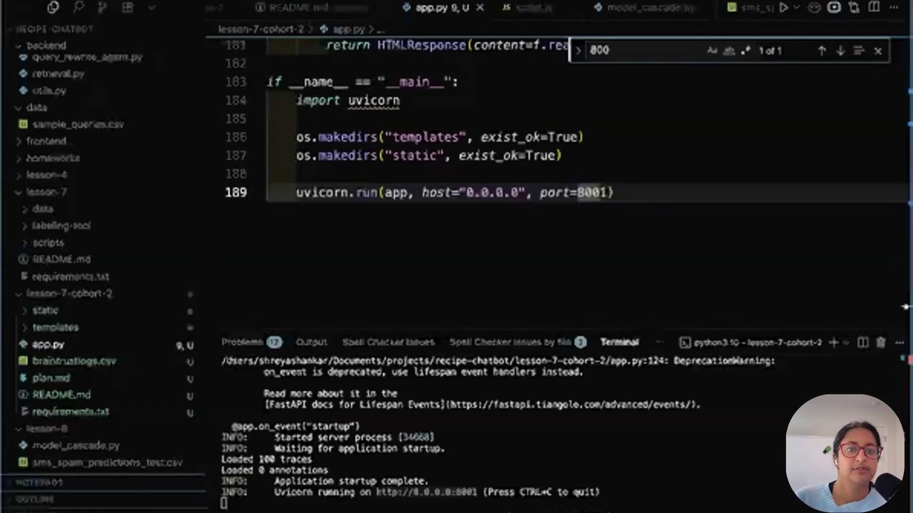

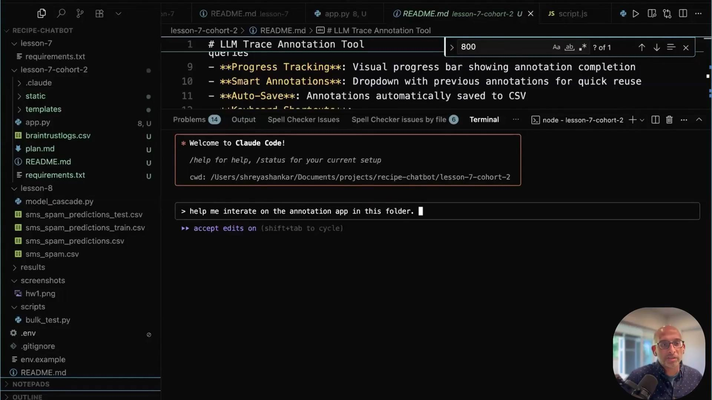

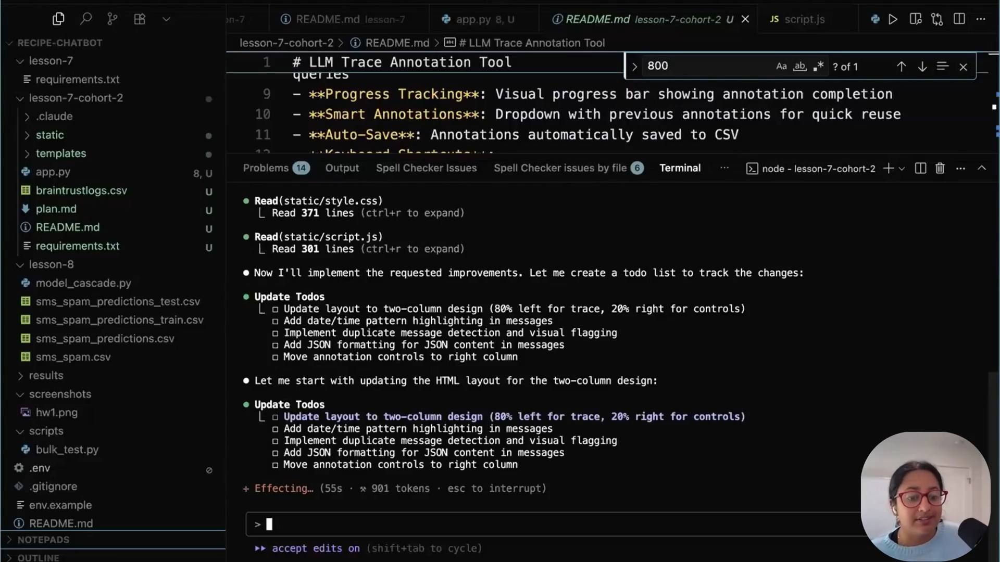

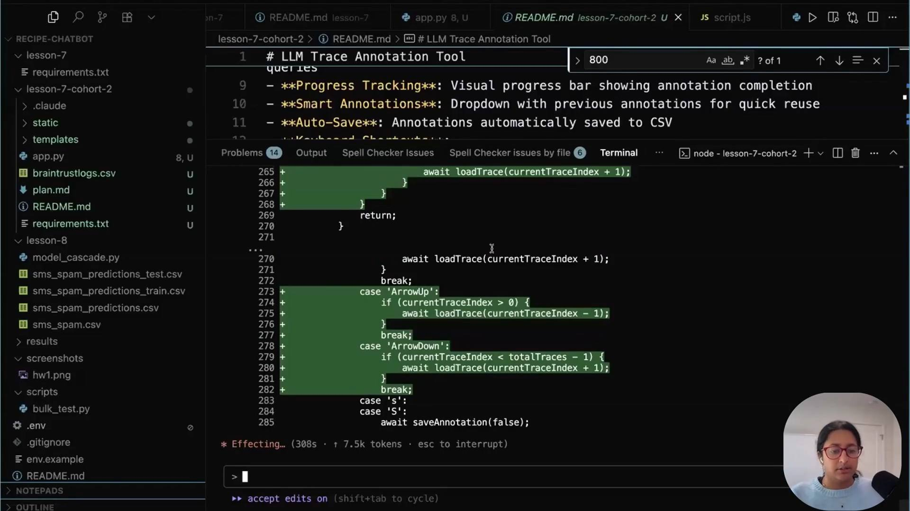

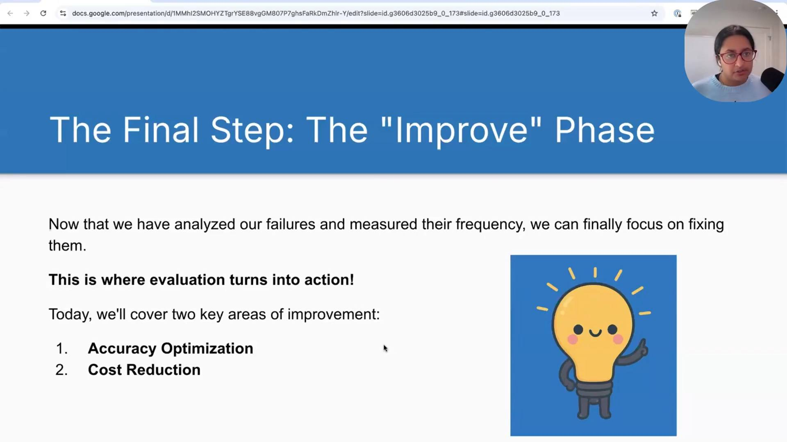